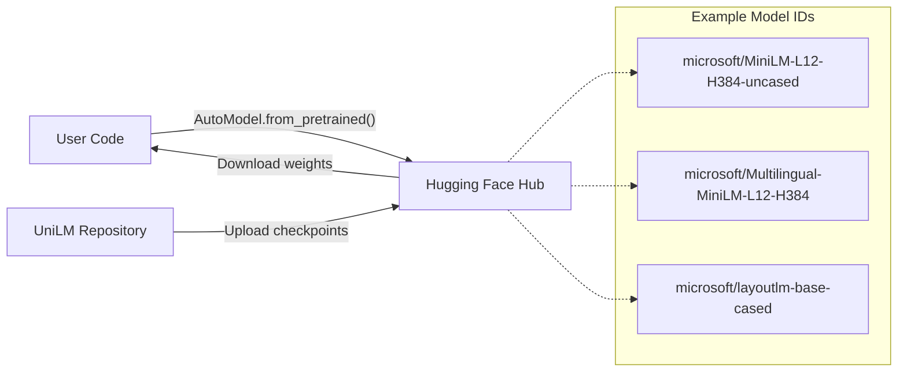
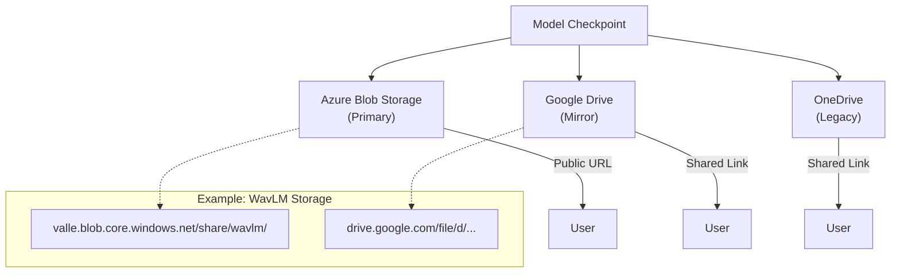
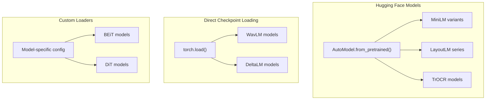
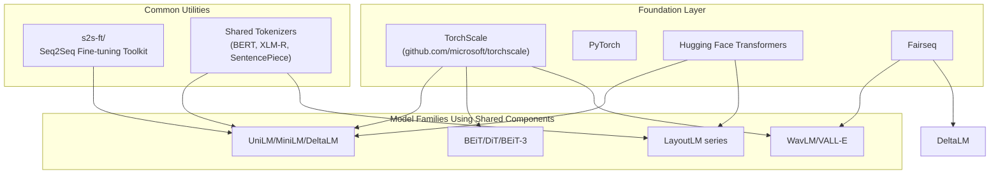
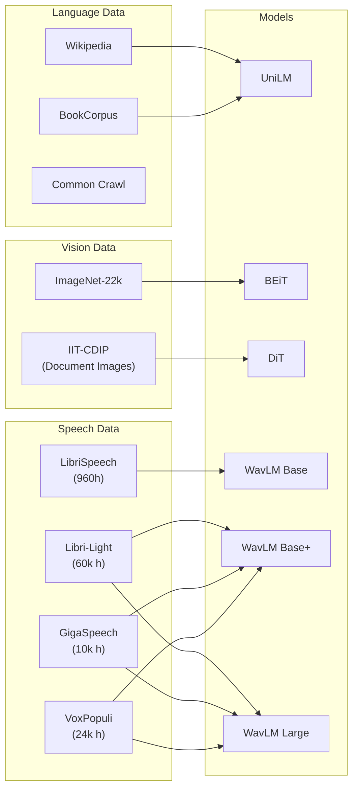

<!-- source: DeepWiki mcp.deepwiki.com · repo microsoft/unilm · page 1.2 Repository Structure and Model Distribution · fetched 2026-10-26 -->

# Repository Structure and Model Distribution

<details>
<summary>Relevant source files</summary>

The following files were used as context for generating this wiki page:

- [README.md](README.md)
- [deltalm/README.md](deltalm/README.md)
- [minilm/README.md](minilm/README.md)
- [minilm/examples/run_xnli.py](minilm/examples/run_xnli.py)
- [valle/README.md](valle/README.md)
- [wavlm/ASR.PNG](wavlm/ASR.PNG)
- [wavlm/README.md](wavlm/README.md)
- [wavlm/SUPERB_Results.png](wavlm/SUPERB_Results.png)
- [wavlm/screenshot.png](wavlm/screenshot.png)

</details>


## Purpose and Scope

This page documents the organizational structure of the Microsoft UniLM repository and explains how pre-trained models are distributed to users. It covers the directory layout, model family locations, checkpoint hosting infrastructure, and integration with model hubs. For details about specific model architectures and their training procedures, see the respective model family pages (e.g., [Vision Models](#2), [Language Models](#3), [Document AI](#5)).

---

## Repository Organization

The UniLM repository follows a modular structure where each model family occupies its own top-level directory. The repository contains foundation models across multiple modalities (language, vision, speech, multimodal), organized by model type rather than by research paper.

### Top-Level Directory Structure

```mermaid
graph TB
    Root["unilm/ (root)"]
    
    Root --> TorchScale["torchscale/<br/>(Foundation Architecture)"]
    Root --> Lang["Language Models"]
    Root --> Vision["Vision Models"]
    Root --> Speech["Speech Models"]
    Root --> DocAI["Document AI Models"]
    Root --> VisionLang["Vision-Language Models"]
    Root --> Toolkits["Toolkits & Utilities"]
    
    Lang --> UniLM["unilm/"]
    Lang --> MiniLM["minilm/"]
    Lang --> DeltaLM["deltalm/"]
    Lang --> E5["e5/"]
    Lang --> InfoXLM["infoxlm/"]
    
    Vision --> BEiT["beit/, beit2/, beit3/"]
    Vision --> DiT["dit/"]
    
    Speech --> WavLM["wavlm/"]
    Speech --> VALLE["valle/"]
    
    DocAI --> LayoutLM1["layoutlm/"]
    DocAI --> LayoutLM2["layoutlmv2/"]
    DocAI --> LayoutLM3["layoutlmv3/"]
    DocAI --> LayoutXLM["layoutxlm/"]
    DocAI --> TrOCR["trocr/"]
    
    VisionLang --> Kosmos["kosmos-2/, kosmos-2.5/"]
    VisionLang --> TextDiff["textdiffuser/, textdiffuser-2/"]
    
    Toolkits --> S2SFT["s2s-ft/"]
    Toolkits --> DiffTrans["diff-transformer/"]
    Toolkits --> RetNet["retnet/"]
```



**Sources:** [README.md:1-258]()

### Model Family Directory Structure

Each model directory typically contains:
- `README.md` - Model description, usage instructions, and performance metrics
- Model-specific code (training, inference, data processing)
- Configuration files
- Fine-tuning scripts
- Evaluation benchmarks

For example, the `wavlm/` directory structure:

```
wavlm/
├── README.md              # Model documentation
├── WavLM.py               # Model architecture
├── modules.py             # Component implementations
├── SUPERB_Results.png     # Benchmark visualizations
└── screenshot.png         # Additional documentation assets
```

**Sources:** [wavlm/README.md:1-135]()

---

## Model Family Locations

The following table maps model families to their repository locations and primary maintainers:

| Model Family | Directory | Modality | Key Models |
|-------------|-----------|----------|------------|
| **TorchScale** | `torchscale/` (external) | Foundation | DeepNet, Magneto, X-MoE |
| **UniLM** | `unilm/`, `unilm-v1/` | Language | UniLM v1, UniLM v2 |
| **MiniLM** | `minilm/` | Language | MiniLM v1, MiniLM v2, Multilingual variants |
| **DeltaLM** | `deltalm/` | Language | DeltaLM-base, DeltaLM-large |
| **E5** | `e5/` | Language | E5-small, E5-base, E5-large |
| **InfoXLM** | `infoxlm/` | Language | InfoXLM, XLM-E |
| **BEiT** | `beit/`, `beit2/`, `beit3/` | Vision | BEiT v1/v2/v3 variants |
| **DiT** | `dit/` | Vision | DiT-base, DiT-large |
| **WavLM** | `wavlm/` | Speech | WavLM-base, WavLM-base+, WavLM-large |
| **VALL-E** | `valle/` | Speech | VALL-E TTS models |
| **LayoutLM** | `layoutlm/`, `layoutlmv2/`, `layoutlmv3/` | Multimodal | LayoutLM v1/v2/v3 |
| **LayoutXLM** | `layoutxlm/` | Multimodal | LayoutXLM (multilingual) |
| **TrOCR** | `trocr/` | Multimodal | TrOCR-small, TrOCR-base, TrOCR-large |
| **Kosmos** | `kosmos-2/`, `kosmos-2.5/` | Multimodal | Kosmos-2, Kosmos-2.5 |
| **TextDiffuser** | `textdiffuser/`, `textdiffuser-2/` | Multimodal | TextDiffuser v1/v2 |

**Sources:** [README.md:6-107]()

---

## Model Distribution Channels

The repository provides models through multiple distribution channels to accommodate different user needs and geographic locations.

### Hugging Face Hub Integration

Most models are integrated with the Hugging Face Hub for easy loading through the `transformers` library:



**Example usage patterns:**

For MiniLM models:
```python
from transformers import AutoTokenizer, AutoModel

tokenizer = AutoTokenizer.from_pretrained("microsoft/MiniLM-L12-H384-uncased")
model = AutoModel.from_pretrained("microsoft/MiniLM-L12-H384-uncased")
```

For multilingual models:
```python
tokenizer = AutoTokenizer.from_pretrained("microsoft/Multilingual-MiniLM-L12-H384")
model = AutoModel.from_pretrained("microsoft/Multilingual-MiniLM-L12-H384")
```

**Sources:** [minilm/README.md:46-54](), [README.md:149-158]()

### Direct Checkpoint Downloads

For models not yet on Hugging Face or for specific versions, the repository provides direct download links through cloud storage providers:



**WavLM checkpoint distribution example:**

| Model | Size | Azure Storage | Google Drive |
|-------|------|---------------|--------------|
| WavLM Base | ~90MB | `valle.blob.core.windows.net/.../WavLM-Base.pt` | Shared link provided |
| WavLM Base+ | ~90MB | `valle.blob.core.windows.net/.../WavLM-Base+.pt` | Shared link provided |
| WavLM Large | ~300MB | `valle.blob.core.windows.net/.../WavLM-Large.pt` | Shared link provided |

**Sources:** [wavlm/README.md:17-23]()

**DeltaLM checkpoint distribution:**

DeltaLM models are hosted on dedicated Azure Blob Storage:

```python
# Base model loading
checkpoint = torch.load('deltalm-base.pt')  # Downloaded from Azure
cfg = WavLMConfig(checkpoint['cfg'])
model = DeltaLM(cfg)
model.load_state_dict(checkpoint['model'])
```

Checkpoint URLs:
- DeltaLM-base: `deltalm.blob.core.windows.net/deltalm/deltalm-base.pt`
- DeltaLM-large: `deltalm.blob.core.windows.net/deltalm/deltalm-large.pt`
- Vocabulary: `deltalm.blob.core.windows.net/deltalm/dict.txt`
- SentencePiece model: `deltalm.blob.core.windows.net/deltalm/spm.model`

**Sources:** [deltalm/README.md:14-19]()

### Model Loading Patterns

Different model families use different loading mechanisms:



**WavLM loading pattern:**
```python
import torch
from WavLM import WavLM, WavLMConfig

checkpoint = torch.load('/path/to/wavlm.pt')
cfg = WavLMConfig(checkpoint['cfg'])
model = WavLM(cfg)
model.load_state_dict(checkpoint['model'])
model.eval()
```

**Sources:** [wavlm/README.md:26-35]()

---

## Model Versioning and Naming Conventions

The repository follows consistent naming patterns for model checkpoints and identifiers:

### Version Suffixes

- **v1, v2, v3**: Major architecture versions (e.g., `LayoutLM v1`, `LayoutLM v2`, `LayoutLM v3`)
- **Base, Large**: Model size variants (e.g., `WavLM Base`, `WavLM Large`)
- **Base+**: Enhanced base models with extended training (e.g., `WavLM Base+`)
- **Small, Base, Large**: Standardized size tiers for models like TrOCR

### Language/Domain Suffixes

- **Multilingual/mMiniLM**: Multilingual variants (e.g., `Multilingual-MiniLM-L12-H384`)
- **uncased/cased**: Text casing handling (e.g., `MiniLM-L12-H384-uncased`)
- **LxH**: Layer count × Hidden size (e.g., `L12-H384` = 12 layers, 384 hidden dimensions)

### Checkpoint File Naming

Standard patterns:
- PyTorch checkpoints: `{model-name}.pt` or `{model-name}.bin`
- Configuration files: `{model-name}-config.json`
- Vocabulary files: `vocab.txt` or `dict.txt`
- Tokenizer models: `spm.model` (SentencePiece)

**Sources:** [minilm/README.md:8-28](), [deltalm/README.md:14-19](), [wavlm/README.md:18-23]()

---

## Shared Infrastructure and Dependencies

Models in the repository share common dependencies and infrastructure components:



### TorchScale Foundation

TorchScale provides core architectural components used across model families:
- **DeepNet**: Stabilization for deep Transformers (1000+ layers)
- **Magneto**: General-purpose foundation architecture
- **X-MoE**: Scalable Mixture-of-Experts implementation

The TorchScale library is maintained as a separate repository: `github.com/microsoft/torchscale`

**Sources:** [README.md:6-17]()

### Shared Tokenizers

Models within the same language family often share tokenizers:

| Tokenizer Type | Used By | Vocabulary Size |
|----------------|---------|-----------------|
| BERT WordPiece | MiniLM (English), LayoutLM | ~30K tokens |
| XLM-RoBERTa SentencePiece | Multilingual MiniLM, LayoutXLM | ~250K tokens |
| Custom SentencePiece | DeltaLM | Model-specific |

**MiniLM tokenizer example:**
```python
from transformers import XLMRobertaTokenizer

# Multilingual MiniLM uses XLM-R tokenizer
tokenizer = XLMRobertaTokenizer.from_pretrained("xlm-roberta-base")
# But with MiniLM model weights
```

**Sources:** [minilm/README.md:56-57](), [minilm/examples/run_xnli.py:45-46]()

### Fairseq Integration

Speech and translation models leverage Fairseq for training infrastructure:

- **WavLM**: Built on Fairseq's wav2vec 2.0 framework
- **DeltaLM**: Uses Fairseq for sequence-to-sequence training

DeltaLM setup requires Fairseq submodule:
```bash
git submodule update --init deltalm/fairseq
cd deltalm/
pip install --editable fairseq/
```

**Sources:** [wavlm/README.md:113](), [deltalm/README.md:36-40]()

---

## Pre-training Data and Model Checkpoints

Different model families are pre-trained on domain-specific datasets and made available at various training stages:

### Dataset-Model Mapping



**Sources:** [README.md:43-95](), [wavlm/README.md:18-23]()

### Checkpoint Release Strategy

Models are released at strategic training milestones:

1. **Pre-trained base models**: Released after self-supervised pre-training
2. **Fine-tuned models**: Released for specific downstream tasks
3. **Intermediate checkpoints**: Occasionally released for research purposes

**Example: MiniLM checkpoints on OneDrive:**
- Base checkpoint: `1drv.ms/u/s!AjHn0yEmKG8qixAY...` (MiniLMv1-L12-H384-uncased)
- Fine-tuned variants: Available for specific tasks (SQuAD, XNLI, etc.)

**Sources:** [minilm/README.md:104-107]()

---

## Summary

The UniLM repository organizes models by modality and family, with each model residing in a dedicated top-level directory containing code, documentation, and training scripts. Models are distributed through Hugging Face Hub for easy integration and through direct checkpoint downloads via Azure Blob Storage and Google Drive for maximum availability. Shared infrastructure components like TorchScale and common tokenizers enable code reuse across model families, while maintaining flexibility for model-specific customizations.

**Sources:** [README.md:1-258](), [wavlm/README.md:1-135](), [minilm/README.md:1-287](), [deltalm/README.md:1-185]()

---

