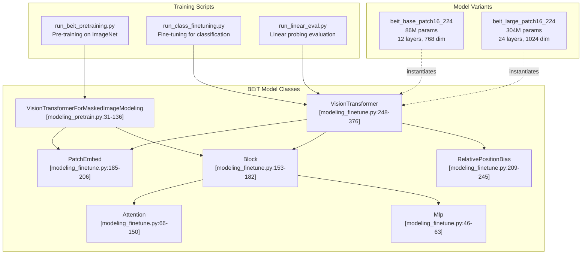
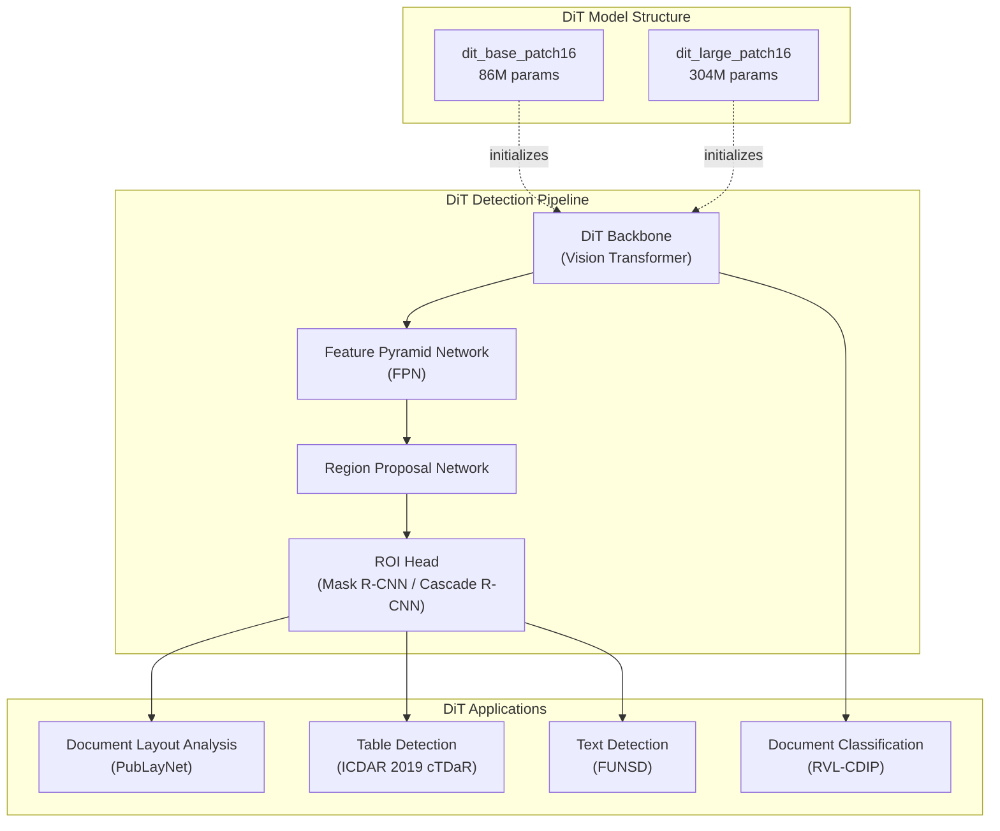
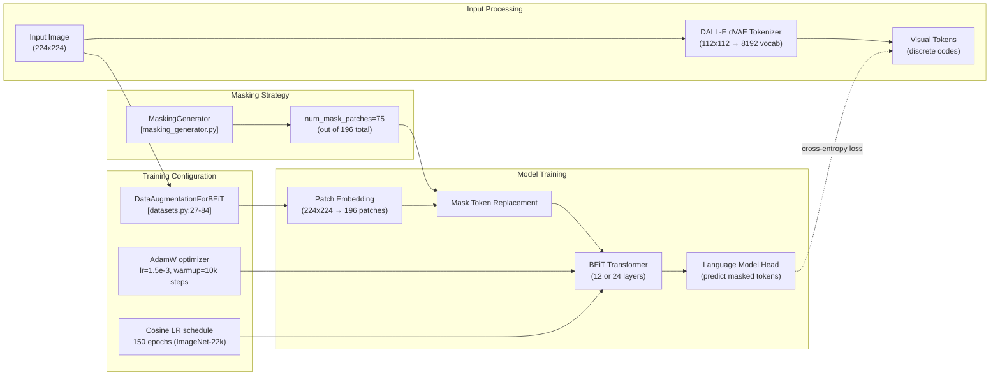
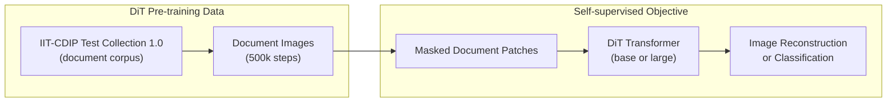
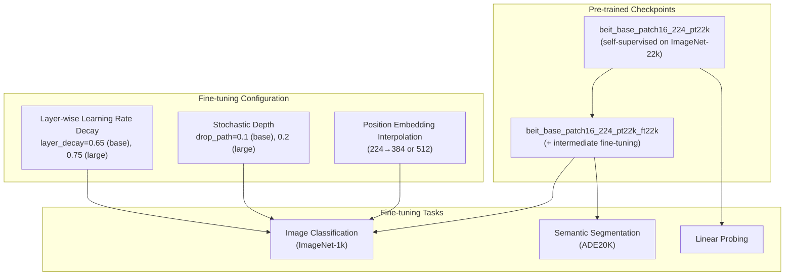
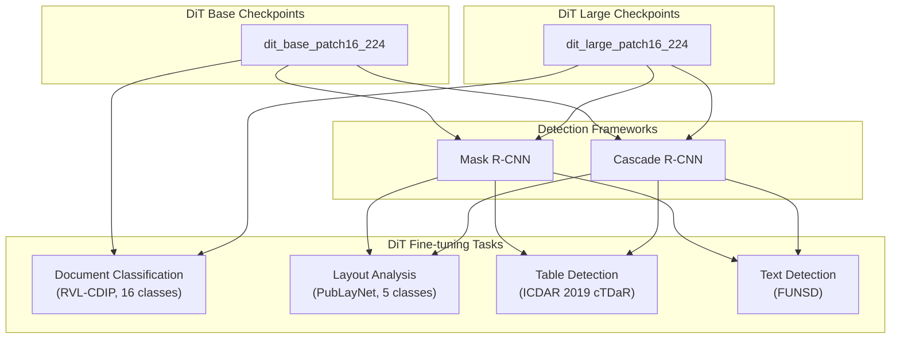

<!-- source: DeepWiki mcp.deepwiki.com · repo microsoft/unilm · page 2 Vision Models · fetched 2026-10-26 -->

# Vision Models

<details>
<summary>Relevant source files</summary>

The following files were used as context for generating this wiki page:

- [beit/README.md](beit/README.md)
- [beit/datasets.py](beit/datasets.py)
- [beit/modeling_finetune.py](beit/modeling_finetune.py)
- [beit/modeling_pretrain.py](beit/modeling_pretrain.py)
- [beit/run_beit_pretraining.py](beit/run_beit_pretraining.py)
- [beit/run_class_finetuning.py](beit/run_class_finetuning.py)
- [beit/run_linear_eval.py](beit/run_linear_eval.py)
- [beit/semantic_segmentation/backbone/beit.py](beit/semantic_segmentation/backbone/beit.py)
- [beit/semantic_segmentation/mmcv_custom/checkpoint.py](beit/semantic_segmentation/mmcv_custom/checkpoint.py)
- [beit/utils.py](beit/utils.py)
- [dit/README.md](dit/README.md)
- [dit/object_detection/icdar19_configs/cascade/cascade_dit_base.yaml](dit/object_detection/icdar19_configs/cascade/cascade_dit_base.yaml)
- [dit/object_detection/icdar19_configs/cascade/cascade_dit_large.yaml](dit/object_detection/icdar19_configs/cascade/cascade_dit_large.yaml)

</details>


## Purpose and Scope

This document describes the vision pre-training models in the UniLM repository, specifically **BEiT** (BERT Pre-Training of Image Transformers) and **DiT** (Document Image Transformer). These models employ self-supervised learning on image data using masked image modeling objectives.

For multimodal document understanding models that combine vision and language, see [Document AI: Multimodal Models](#5). For vision-language generation models, see [Vision-Language Models](#6).

## Overview

The repository contains two primary vision transformer models:

| Model | Purpose | Pre-training Data | Key Innovation |
|-------|---------|------------------|----------------|
| BEiT | General vision pre-training | ImageNet-22k (14M images) | Masked image modeling with discrete VAE tokens |
| DiT | Document image understanding | IIT-CDIP (document corpus) | Self-supervised pre-training on document images |

Both models follow a Vision Transformer (ViT) architecture with patch-based image encoding, but differ in their pre-training objectives and target domains. BEiT serves as a foundational model for natural images, while DiT specializes in document layout analysis.

**Sources:** [beit/README.md:1-21](), [dit/README.md:1-13]()

## Model Architecture

### BEiT Architecture and Code Organization



**BEiT Model Components:**

- **`PatchEmbed`**: Converts input images into patch embeddings using a convolutional projection with kernel size and stride equal to patch size (16x16)
- **`Attention`**: Multi-head self-attention with optional relative position bias
- **`Block`**: Standard transformer block with pre-normalization, attention, and MLP sublayers
- **`RelativePositionBias`**: Learnable relative position encodings based on spatial distances between patches
- **`VisionTransformer`**: Complete model for fine-tuning with classification head
- **`VisionTransformerForMaskedImageModeling`**: Pre-training model with mask token and language modeling head

**Sources:** [beit/modeling_finetune.py:1-421](), [beit/modeling_pretrain.py:1-164](), [beit/README.md:26-40]()

### DiT Architecture



**DiT Architecture Details:**

DiT reuses the BEiT Vision Transformer architecture but is pre-trained on document images rather than natural images. The model uses the same patch embedding and transformer blocks as BEiT.

**Key Configuration Parameters:**
- Patch size: 16x16
- Input resolution: 224x224 (pre-training and fine-tuning)
- Pixel normalization: mean=[127.5, 127.5, 127.5], std=[127.5, 127.5, 127.5]

**Sources:** [dit/README.md:14-23](), [dit/object_detection/icdar19_configs/cascade/cascade_dit_base.yaml:1-22](), [dit/object_detection/icdar19_configs/cascade/cascade_dit_large.yaml:1-26]()

## Pre-training Process

### BEiT Masked Image Modeling



**Pre-training Implementation:**

The BEiT pre-training pipeline is implemented in [beit/run_beit_pretraining.py:1-281](). Key components:

1. **Visual Tokenizer**: Uses DALL-E's discrete VAE to tokenize images into discrete visual tokens (8192 vocabulary size)
2. **Masking**: Randomly masks 75 out of 196 patches (approximately 38%)
3. **Objective**: Predict masked visual tokens using cross-entropy loss
4. **Data Augmentation**: Color jitter, random horizontal flip, random resized crop with two different resolutions

**Key Training Function:**
```python
# From run_beit_pretraining.py
def get_model(args):
    model = create_model(
        args.model,  # e.g., 'beit_base_patch16_224_8k_vocab'
        pretrained=False,
        drop_path_rate=args.drop_path,
        use_shared_rel_pos_bias=args.rel_pos_bias,
        use_abs_pos_emb=args.abs_pos_emb,
        init_values=args.layer_scale_init_value,  # 0.1 for base, 1e-5 for large
    )
    return model
```

**Sources:** [beit/run_beit_pretraining.py:32-148](), [beit/datasets.py:27-91](), [beit/README.md:90-143]()

### DiT Pre-training

DiT follows a similar masked image modeling approach but operates directly on document images without an external visual tokenizer:



**Pre-trained Checkpoints:**
- **DiT-base**: 86M parameters, pre-trained for 500k steps on IIT-CDIP
- **DiT-large**: 304M parameters, pre-trained for 500k steps on IIT-CDIP

**Checkpoint URLs:**
- `dit_base_patch16_224`: [dit-pts/dit-base-224-p16-500k-62d53a.pth]()
- `dit_large_patch16_224`: [dit-pts/dit-large-224-p16-500k-d7a2fb.pth]()

**Sources:** [dit/README.md:14-24](), [dit/object_detection/icdar19_configs/cascade/cascade_dit_base.yaml:5-6]()

## Fine-tuning and Applications

### BEiT Fine-tuning Pipeline



**BEiT Fine-tuning Results:**

| Model | Resolution | Pre-training | ImageNet-1k Acc@1 |
|-------|-----------|--------------|-------------------|
| BEiT-base | 224×224 | PT22K | 83.7% |
| BEiT-base | 224×224 | PT22K+FT22K | 85.2% |
| BEiT-base | 384×384 | PT22K+FT22K | 86.8% |
| BEiT-large | 224×224 | PT22K+FT22K | 87.4% |
| BEiT-large | 512×512 | PT22K+FT22K | 88.6% |

**Position Embedding Interpolation:**

When fine-tuning at different resolutions, BEiT interpolates position embeddings using geometric progression-based interpolation (implemented in [beit/run_class_finetuning.py:351-411]()):

```python
# Geometric progression for position interpolation
def geometric_progression(a, r, n):
    return a * (1.0 - r ** n) / (1.0 - r)

# Binary search to find optimal scaling factor
left, right = 1.01, 1.5
while right - left > 1e-6:
    q = (left + right) / 2.0
    gp = geometric_progression(1, q, src_size // 2)
    if gp > dst_size // 2:
        right = q
    else:
        left = q
```

**Sources:** [beit/README.md:65-88](), [beit/run_class_finetuning.py:217-594](), [beit/semantic_segmentation/mmcv_custom/checkpoint.py:310-483]()

### DiT Applications



**DiT Performance on Document Tasks:**

| Task | Dataset | DiT-base (Mask R-CNN) | DiT-large (Cascade R-CNN) |
|------|---------|----------------------|---------------------------|
| Document Classification | RVL-CDIP | 92.11% accuracy | 92.69% accuracy |
| Layout Analysis | PubLayNet | 93.5 mAP | 94.9 mAP |
| Table Detection (Modern) | ICDAR 2019 | 94.74 F1 | 96.29 F1 |
| Table Detection (Archival) | ICDAR 2019 | 96.24 F1 | 97.00 F1 |

**Detection Configuration:**

DiT uses Detectron2 for object detection tasks. The configuration includes:
- **FPN (Feature Pyramid Network)**: Multi-scale features from layers [7, 11, 15, 23] for DiT-large
- **RPN**: Region Proposal Network with 2000 top-K proposals during training
- **ROI Head**: Class-agnostic bounding box regression for better generalization

Example configuration from [dit/object_detection/icdar19_configs/cascade/cascade_dit_large.yaml:1-26]():
```yaml
MODEL:
  PIXEL_MEAN: [127.5, 127.5, 127.5]
  PIXEL_STD: [127.5, 127.5, 127.5]
  WEIGHTS: "dit-pts/dit-large-224-p16-500k-d7a2fb.pth"
  VIT:
    NAME: "dit_large_patch16"
    OUT_FEATURES: ["layer7", "layer11", "layer15", "layer23"]
  ROI_HEADS:
    NAME: CascadeROIHeads
  RPN:
    POST_NMS_TOPK_TRAIN: 2000
```

**Sources:** [dit/README.md:54-105](), [dit/object_detection/icdar19_configs/cascade/cascade_dit_base.yaml:1-22](), [dit/object_detection/icdar19_configs/cascade/cascade_dit_large.yaml:1-26]()

## Key Implementation Details

### Model Initialization and Layer Scaling

Both BEiT and DiT use layer-wise parameter scaling to stabilize training of deep transformers:

```python
# From modeling_finetune.py and modeling_pretrain.py
def fix_init_weight(self):
    """Rescale parameters based on layer depth"""
    def rescale(param, layer_id):
        param.div_(math.sqrt(2.0 * layer_id))
    
    for layer_id, layer in enumerate(self.blocks):
        rescale(layer.attn.proj.weight.data, layer_id + 1)
        rescale(layer.mlp.fc2.weight.data, layer_id + 1)
```

**Layer Scale Initialization:**
- BEiT-base: `init_values=0.1`
- BEiT-large: `init_values=1e-5`
- Can be disabled by setting `init_values=0`

**Sources:** [beit/modeling_finetune.py:302-308](), [beit/modeling_pretrain.py:78-84]()

### Relative Position Bias

BEiT and DiT support relative position bias for spatial awareness:

```python
# From modeling_finetune.py
class RelativePositionBias(nn.Module):
    def __init__(self, window_size, num_heads):
        super().__init__()
        self.window_size = window_size
        # (2*Wh-1) * (2*Ww-1) + 3 (cls-to-token, token-to-cls, cls-to-cls)
        self.num_relative_distance = (2 * window_size[0] - 1) * (2 * window_size[1] - 1) + 3
        self.relative_position_bias_table = nn.Parameter(
            torch.zeros(self.num_relative_distance, num_heads))
```

The relative position bias table is shared across all layers when using `use_shared_rel_pos_bias=True`, or can be layer-specific.

**Sources:** [beit/modeling_finetune.py:209-245](), [beit/semantic_segmentation/backbone/beit.py:245-281]()

### Data Augmentation

BEiT uses specialized data augmentation for pre-training:

```python
# From datasets.py
class DataAugmentationForBEiT(object):
    def __init__(self, args):
        self.common_transform = transforms.Compose([
            transforms.ColorJitter(0.4, 0.4, 0.4),
            transforms.RandomHorizontalFlip(p=0.5),
            RandomResizedCropAndInterpolationWithTwoPic(
                size=args.input_size,  # 224 for patches
                second_size=args.second_input_size,  # 112 for visual tokens
                interpolation=args.train_interpolation,
                second_interpolation=args.second_interpolation,
            ),
        ])
```

Two different resolutions are used:
1. **High resolution (224×224)**: For patch embeddings input to the model
2. **Low resolution (112×112)**: For discrete VAE tokenization target

**Sources:** [beit/datasets.py:27-84]()

## Training Infrastructure

### Distributed Training Support

Both models support distributed training with the following features:

| Feature | Implementation |
|---------|---------------|
| Data Parallelism | `torch.nn.parallel.DistributedDataParallel` |
| Mixed Precision | `torch.cuda.amp.GradScaler` via `NativeScalerWithGradNormCount` |
| DeepSpeed | Optional integration for large-scale training |
| Gradient Checkpointing | Available for memory-efficient training |

**Gradient Clipping:**
- BEiT pre-training: `clip_grad=3.0`
- BEiT fine-tuning: `clip_grad=1.0` (large), `clip_grad=3.0` (base)

**Sources:** [beit/run_beit_pretraining.py:219-221](), [beit/run_class_finetuning.py:479-500](), [beit/utils.py:339-366]()

### Checkpoint Management

Models support automatic checkpoint resumption and saving:

```python
# From utils.py
def auto_load_model(args, model, model_without_ddp, optimizer, loss_scaler, model_ema=None):
    """Automatically finds and loads the latest checkpoint"""
    if args.auto_resume and len(args.resume) == 0:
        all_checkpoints = glob.glob(os.path.join(output_dir, 'checkpoint-*.pth'))
        latest_ckpt = max([int(ckpt.split('-')[-1].split('.')[0]) 
                          for ckpt in all_checkpoints if ckpt.split('-')[-1].split('.')[0].isdigit()])
        args.resume = os.path.join(output_dir, f'checkpoint-{latest_ckpt}.pth')
```

**Sources:** [beit/utils.py:473-523]()

## Model Variants and Checkpoints

### BEiT Model Zoo

| Model | Layers | Hidden Dim | Heads | Patch Size | Parameters | Checkpoint |
|-------|--------|-----------|-------|-----------|-----------|-----------|
| BEiT-base | 12 | 768 | 12 | 16×16 | 86M | `beit_base_patch16_224` |
| BEiT-large | 24 | 1024 | 16 | 16×16 | 304M | `beit_large_patch16_224` |

**Registered Model Functions:**
- `beit_base_patch16_224()` - [modeling_finetune.py:379-384]()
- `beit_base_patch16_384()` - [modeling_finetune.py:388-393]()
- `beit_large_patch16_224()` - [modeling_finetune.py:397-402]()
- `beit_large_patch16_384()` - [modeling_finetune.py:406-411]()
- `beit_large_patch16_512()` - [modeling_finetune.py:415-420]()

**Sources:** [beit/modeling_finetune.py:378-421](), [beit/README.md:26-40]()

### DiT Model Zoo

| Model | Parameters | Pre-training Steps | Applications |
|-------|-----------|-------------------|--------------|
| DiT-base | 86M | 500k | Document classification, layout analysis, table/text detection |
| DiT-large | 304M | 500k | Document classification, layout analysis, table/text detection |

**Configuration Names:**
- `dit_base_patch16` - DiT-base with 16×16 patch size
- `dit_large_patch16` - DiT-large with 16×16 patch size

**Sources:** [dit/README.md:14-23](), [dit/object_detection/icdar19_configs/cascade/cascade_dit_base.yaml:7-8]()

## Comparison with BEiT v2 and v3

This page covers BEiT v1. The repository also contains:
- **BEiT v2**: Uses vector-quantized visual tokenizers (not covered here)
- **BEiT-3**: Unified pre-training for vision and vision-language tasks (not covered here)

See the respective subdirectories `beit2/` and `beit3/` for these advanced versions.

**Sources:** [beit/README.md:5-13]()

---

