<!-- source: DeepWiki mcp.deepwiki.com · repo microsoft/unilm · page 2.1 BEiT: BERT Pre-Training of Image Transformers · fetched 2026-10-26 -->

# BEiT: BERT Pre-Training of Image Transformers

<details>
<summary>Relevant source files</summary>

The following files were used as context for generating this wiki page:

- [beit/README.md](beit/README.md)
- [beit/datasets.py](beit/datasets.py)
- [beit/modeling_finetune.py](beit/modeling_finetune.py)
- [beit/modeling_pretrain.py](beit/modeling_pretrain.py)
- [beit/run_beit_pretraining.py](beit/run_beit_pretraining.py)
- [beit/run_class_finetuning.py](beit/run_class_finetuning.py)
- [beit/run_linear_eval.py](beit/run_linear_eval.py)
- [beit/semantic_segmentation/backbone/beit.py](beit/semantic_segmentation/backbone/beit.py)
- [beit/semantic_segmentation/mmcv_custom/checkpoint.py](beit/semantic_segmentation/mmcv_custom/checkpoint.py)
- [beit/utils.py](beit/utils.py)

</details>


## Overview

BEiT (BERT Pre-Training of Image Transformers) adapts masked language modeling to vision by treating images as sequences of visual tokens. Instead of predicting masked words in text, BEiT predicts masked image patches using a discrete vocabulary of 8,192 visual tokens from DALL-E's discrete VAE. This self-supervised approach achieves state-of-the-art results: 88.6% top-1 accuracy on ImageNet-1k and 57.0 mIoU on ADE20K semantic segmentation.

**Core Innovation**: Block-wise masking of image patches (75 out of 196 patches) combined with discrete visual token prediction enables effective representation learning without labels.

**Key Components**:
- `VisionTransformerForMaskedImageModeling` - Pre-training model with mask token and LM head
- `Dalle_VAE` - Discrete tokenizer producing 8,192 visual tokens
- `MaskingGenerator` - Block-wise masking strategy for spatial coherence
- `run_beit_pretraining.py` - Pre-training script with distributed training support

For subsequent versions, see [BEiT v2 and BEiT-3](#2.2). For detailed architecture and fine-tuning, see subsections [2.1.1](#2.1.1) and [2.1.2](#2.1.2).

**Sources**: [beit/README.md:1-21](), [beit/run_beit_pretraining.py:1-280](), [beit/modeling_pretrain.py:31-136]()

## Pre-training Pipeline

### Masked Image Modeling Process

**Pre-training Pipeline Flow Diagram**
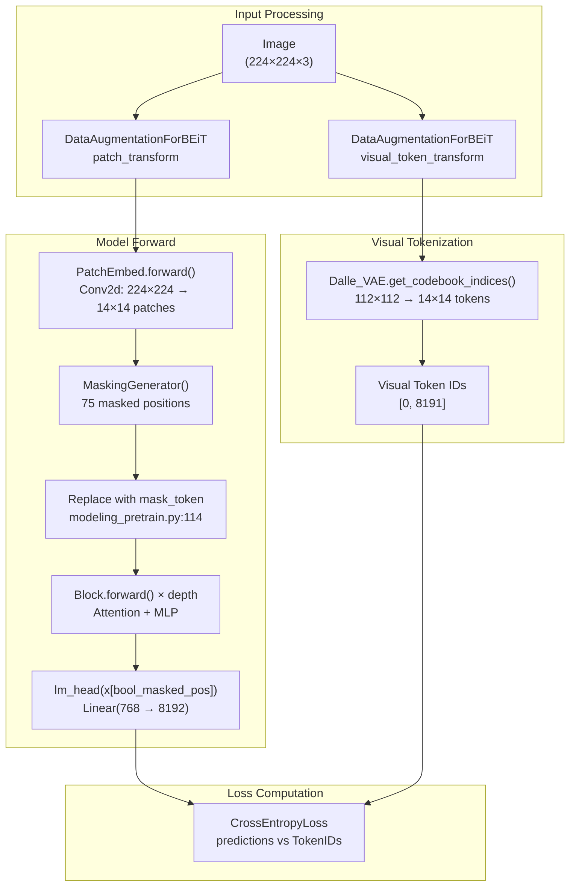

**Sources**: [beit/run_beit_pretraining.py:165-177](), [beit/modeling_pretrain.py:106-135](), [beit/datasets.py:27-84](), [beit/utils.py:525-537]()

### Visual Tokenization with DALL-E VAE

BEiT uses DALL-E's discrete VAE (`Dalle_VAE` in [beit/modeling_discrete_vae.py]()) to convert images into discrete visual tokens. The tokenizer processes a 112×112 downsampled version of each image and produces a 14×14 grid of token IDs from a vocabulary of 8,192 tokens.

| Component | Purpose | Code Entity |
|-----------|---------|-------------|
| **Discrete VAE** | Image → discrete tokens | `Dalle_VAE` class, `get_codebook_indices()` method |
| **Vocabulary Size** | Token ID range | `vocab_size=8192` in `VisionTransformerForMaskedImageModeling.__init__()` |
| **Tokenizer Resolution** | Downsampled input | `second_input_size=112` argument |
| **Token Transform** | Image preprocessing | `visual_token_transform` in `DataAugmentationForBEiT` |
| **Loading Function** | Create tokenizer instance | `utils.create_d_vae()` [beit/utils.py:525-537]() |

**Sources**: [beit/utils.py:525-537](), [beit/run_beit_pretraining.py:58-59,99-103,175-177](), [beit/datasets.py:49-63]()

### Block-wise Masking Strategy

BEiT masks 75 out of 196 patches (~40%) using block-wise masking (`MaskingGenerator` class) which masks contiguous regions rather than random individual patches. This encourages the model to learn spatial coherence and contextual relationships.

**Masking Implementation**:
```python
# From datasets.py:65-69
self.masked_position_generator = MaskingGenerator(
    args.window_size,                    # (14, 14) for 224x224 images
    num_masking_patches=args.num_mask_patches,  # 75
    max_num_patches=args.max_mask_patches_per_block,
    min_num_patches=args.min_mask_patches_per_block,  # 16
)
```

| Parameter | Default Value | Purpose |
|-----------|---------------|---------|
| `num_mask_patches` | 75 | Total patches to mask |
| `window_size` | (14, 14) | Patch grid dimensions |
| `min_mask_patches_per_block` | 16 | Minimum block size |
| `max_mask_patches_per_block` | None | Maximum block size (unconstrained) |

The masked positions are returned as a boolean tensor (`bool_masked_pos`) used to replace visible patches with `mask_token` in `VisionTransformerForMaskedImageModeling.forward()` [beit/modeling_pretrain.py:114-115]().

**Sources**: [beit/datasets.py:65-69](), [beit/run_beit_pretraining.py:51-54](), [beit/modeling_pretrain.py:106-115]()

## Architecture Components

### Model Class Hierarchy

**BEiT Model Architecture and Code Mapping**
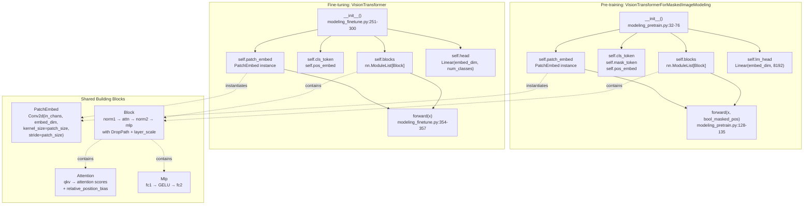

**Sources**: [beit/modeling_pretrain.py:31-136](), [beit/modeling_finetune.py:248-376](), [beit/modeling_finetune.py:153-182](), [beit/modeling_finetune.py:66-150]()

### Model Variant Specifications

| Model | Embed Dim | Depth | Heads | MLP Ratio | Params | Layer Scale | Code Registration |
|-------|-----------|-------|-------|-----------|--------|-------------|-------------------|
| **BEiT-Base** | 768 | 12 | 12 | 4x | 86M | 0.1 | `beit_base_patch16_224` in [modeling_finetune.py:379-384]() |
| **BEiT-Large** | 1024 | 24 | 16 | 4x | 304M | 1e-5 | `beit_large_patch16_224` in [modeling_finetune.py:397-402]() |

Both models use:
- **Patch size**: 16×16
- **QKV bias**: True
- **Relative position bias**: True (default)
- **Absolute position embedding**: Optional (disabled by default)

**Sources**: [beit/modeling_finetune.py:379-420](), [beit/modeling_pretrain.py:139-163](), [beit/README.md:30-31]()

### Attention Mechanism with Relative Position Bias

BEiT uses relative position bias to encode spatial relationships between patches. The bias is computed from a learnable table and added to attention scores before softmax.

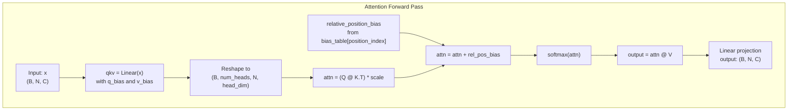

The relative position bias table has shape `(num_relative_distance, num_heads)` where:
- `num_relative_distance = (2*H-1) * (2*W-1) + 3` for H×W patch grid
- The "+3" accounts for: cls-to-token, token-to-cls, and cls-to-cls interactions

**Sources**: [beit/modeling_finetune.py:66-150](), [beit/modeling_finetune.py:209-245]()

### Layer Scale Initialization

BEiT introduces layer-wise scaling factors (`gamma_1`, `gamma_2`) applied to attention and MLP outputs, initialized to small values for training stability:

```python
# In Block.forward()
if self.gamma_1 is not None:
    x = x + self.drop_path(self.gamma_1 * self.attn(self.norm1(x)))
    x = x + self.drop_path(self.gamma_2 * self.mlp(self.norm2(x)))
```

| Model | Layer Scale Init Value | Rationale |
|-------|------------------------|-----------|
| **Base** | 0.1 | Standard initialization for 12-layer model |
| **Large** | 1e-5 | Smaller value for deeper 24-layer model improves stability |

**Sources**: [beit/modeling_finetune.py:169-181](), [beit/run_beit_pretraining.py:48-49](), [beit/README.md:120]()

## Pre-training Implementation

### Training Script Flow

**run_beit_pretraining.py Execution Flow**
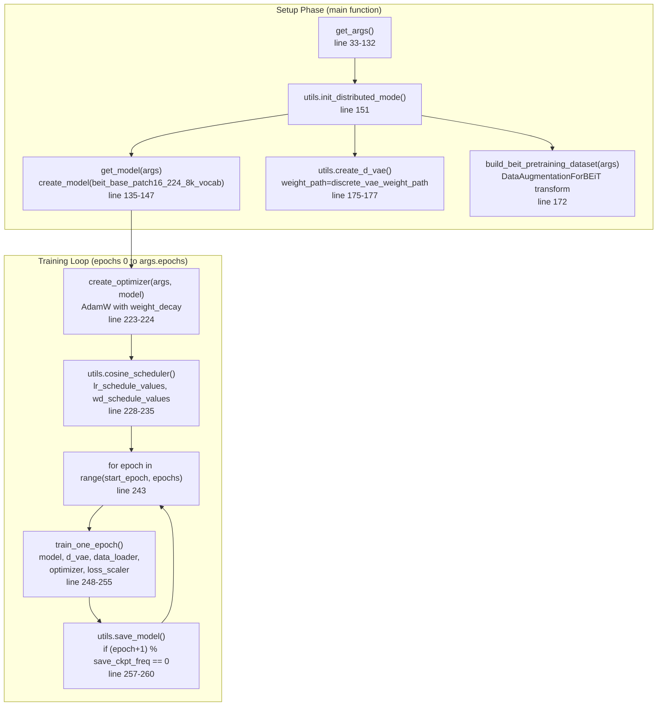

**Key Functions**:
- `get_args()` [beit/run_beit_pretraining.py:33-132]() - Parses command-line arguments
- `get_model()` [beit/run_beit_pretraining.py:135-147]() - Creates model via `timm.models.create_model()`
- `build_beit_pretraining_dataset()` [beit/datasets.py:87-90]() - Returns `ImageFolder` with `DataAugmentationForBEiT`
- `train_one_epoch()` [beit/engine_for_pretraining.py]() - Training loop implementation

**Sources**: [beit/run_beit_pretraining.py:33-280](), [beit/datasets.py:27-90]()

### Data Augmentation Pipeline

The pre-training pipeline applies specific augmentations and generates two views of each image: one for patch embeddings (224×224) and one for the discrete VAE (112×112).

| Augmentation | Purpose | Implementation |
|--------------|---------|----------------|
| **ColorJitter(0.4)** | Color variation | [datasets.py:34]() |
| **RandomHorizontalFlip(0.5)** | Horizontal flipping | [datasets.py:35]() |
| **RandomResizedCropAndInterpolationWithTwoPic** | Crop with dual output | [datasets.py:36-39]() |
| **Normalization** | Mean=[0.5, 0.5, 0.5], Std=[0.5, 0.5, 0.5] | [datasets.py:42-47]() |
| **Visual token transform** | map_pixels for DALL-E | [datasets.py:49-53]() |

**Sources**: [beit/datasets.py:27-90]()

### Pre-training Configuration

#### Example: Pre-training BEiT-Base on ImageNet-22k

Command to pre-train BEiT-Base on ImageNet-22k using 16 GPUs:

```bash
OMP_NUM_THREADS=1 python -m torch.distributed.launch --nproc_per_node=16 \
    run_beit_pretraining.py \
    --data_path ${DATA_PATH} \
    --output_dir ${OUTPUT_DIR} \
    --num_mask_patches 75 \
    --model beit_base_patch16_224_8k_vocab \
    --discrete_vae_weight_path ${TOKENIZER_PATH} \
    --batch_size 128 \
    --lr 1.5e-3 \
    --warmup_steps 10000 \
    --epochs 150 \
    --clip_grad 3.0 \
    --drop_path 0.1 \
    --layer_scale_init_value 0.1
```

#### Hyperparameter Settings

| Parameter | BEiT-Base | BEiT-Large | Code Reference |
|-----------|-----------|------------|----------------|
| `--batch_size` | 128 | 128 | Per-GPU batch size [line 35]() |
| `--lr` | 1.5e-3 | 1.5e-3 | Peak learning rate [line 81]() |
| `--warmup_steps` | 10,000 | 10,000 | LR warmup steps [line 90]() |
| `--epochs` | 150 | 150 | Total epochs [line 36]() |
| `--weight_decay` | 0.05 | 0.05 | AdamW weight decay [line 75]() |
| `--clip_grad` | 3.0 | 3.0 | Gradient clipping norm [line 71]() |
| `--drop_path` | 0.1 | 0.1 | Stochastic depth [line 61]() |
| `--layer_scale_init_value` | 0.1 | 1e-5 | Layer scale init [line 48]() |
| `--num_mask_patches` | 75 | 75 | Patches to mask [line 51]() |

**Effective batch size** = `batch_size` × `nproc_per_node` = 128 × 16 = **2048**

**Sources**: [beit/README.md:90-121](), [beit/run_beit_pretraining.py:35-90]()

### Optimizer and Scheduler Configuration

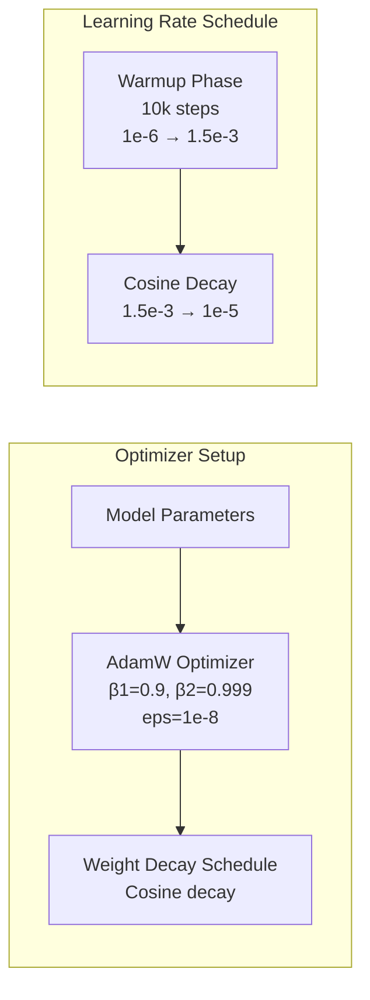

The learning rate schedule uses cosine annealing with linear warmup:
- **Warmup**: 10,000 steps from 1e-6 to 1.5e-3
- **Cosine decay**: 1.5e-3 to 1e-5 over remaining steps
- **Weight decay**: Cosine schedule from 0.05 to 0.05 (constant by default)

**Sources**: [beit/run_beit_pretraining.py:223-236](), [beit/utils.py:383-400]()

## Fine-tuning Procedures

### Fine-tuning Strategy

**Two-Stage vs. Direct Fine-tuning Paths**
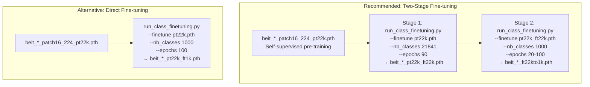

**Performance comparison**: Two-stage fine-tuning (pt22k → ft22k → ft1k) improves ImageNet-1k top-1 accuracy by **1.5%** compared to direct fine-tuning (pt22k → ft1k):
- BEiT-Base: 83.7% (direct) vs. **85.2%** (two-stage)
- BEiT-Large: 86.0% (direct) vs. **87.4%** (two-stage)

**Sources**: [beit/README.md:33-36,69-77]()

### Model Adaptation for Fine-tuning

#### Architectural Changes

When loading pre-trained weights for fine-tuning, BEiT adapts the model architecture:

| Component | Pre-training | Fine-tuning | Code Location |
|-----------|--------------|-------------|---------------|
| **Output Head** | `lm_head: Linear(embed_dim, 8192)` | `head: Linear(embed_dim, num_classes)` | [modeling_finetune.py:287]() |
| **Pooling** | Predict masked tokens | Mean pooling (default) or CLS token | [modeling_finetune.py:285-286,348-352]() |
| **Position Embeddings** | 224×224 resolution | Bicubic interpolation for higher res | [run_class_finetuning.py:413-434]() |
| **Relative Position Bias** | Shared or per-layer | Geometric interpolation | [run_class_finetuning.py:337-411]() |
| **Tokens** | `cls_token` + `mask_token` | `cls_token` only | [modeling_finetune.py:264]() |

The fine-tuning script (`run_class_finetuning.py`) automatically handles:
1. Loading checkpoint from `--finetune` path [line 315-320]()
2. Removing incompatible head weights [line 332-335]()
3. Expanding shared relative position bias to per-layer [line 337-344]()
4. Interpolating position embeddings if resolution changes [line 413-434]()

**Sources**: [beit/modeling_finetune.py:248-357](), [beit/run_class_finetuning.py:295-437]()

#### Example: Fine-tuning BEiT-Large on ImageNet-22k

Stage 1 command (ImageNet-22k classification with 21,841 classes):

```bash
OMP_NUM_THREADS=1 python -m torch.distributed.launch --nproc_per_node=16 \
    run_class_finetuning.py \
    --model beit_large_patch16_224 \
    --data_path $DATA_PATH \
    --nb_classes 21841 \
    --data_set image_folder \
    --disable_eval_during_finetuning \
    --finetune https://github.com/addf400/files/releases/download/v1.0/beit_large_patch16_224_pt22k.pth \
    --output_dir $OUTPUT_DIR \
    --batch_size 64 \
    --lr 2e-3 \
    --update_freq 2 \
    --warmup_epochs 5 \
    --epochs 90 \
    --layer_decay 0.75 \
    --drop_path 0.2 \
    --weight_decay 0.05 \
    --enable_deepspeed \
    --layer_scale_init_value 1e-5 \
    --clip_grad 1.0
```

#### Fine-tuning Hyperparameters

| Parameter | BEiT-Base | BEiT-Large | Purpose |
|-----------|-----------|------------|---------|
| `--lr` | 3e-3 | 2e-3 | Peak learning rate |
| `--layer_decay` | 0.65 | 0.75 | Layer-wise LR scaling |
| `--drop_path` | 0.2 | 0.2 | Stochastic depth |
| `--epochs` | 90 | 90 | Training epochs |
| `--batch_size` | 256 | 64 | Per-GPU batch size |
| `--update_freq` | 1 | 2 | Gradient accumulation steps |
| **Effective Batch** | 4096 | 2048 | `batch_size × update_freq × 16` |

**Sources**: [beit/README.md:144-186](), [beit/run_class_finetuning.py:37-214]()

### Layer-wise Learning Rate Decay

BEiT implements layer-wise LR decay where earlier layers (closer to input) receive exponentially smaller learning rates:

```python
# From run_class_finetuning.py:465-472
if args.layer_decay < 1.0:
    assigner = LayerDecayValueAssigner(
        list(args.layer_decay ** (num_layers + 1 - i) for i in range(num_layers + 2))
    )
```

**Decay formula**: `lr_layer_i = base_lr × (layer_decay)^(num_layers + 1 - i)`

**Example for BEiT-Large** (`layer_decay=0.75`, `num_layers=24`):

| Layer | Layer Index | Decay Factor | Effective LR (if base=2e-3) |
|-------|-------------|--------------|------------------------------|
| Patch embedding | 0 | 0.75^25 | 2e-3 × 0.75^25 ≈ 2e-6 |
| Block 0 | 1 | 0.75^24 | 2e-3 × 0.75^24 ≈ 3e-6 |
| Block 23 | 24 | 0.75^1 | 2e-3 × 0.75 = 1.5e-3 |
| Head | 25 | 0.75^0 = 1.0 | 2e-3 × 1.0 = 2e-3 |

This strategy prevents catastrophic forgetting in lower layers while allowing upper layers to adapt more quickly to downstream tasks.

**Sources**: [beit/run_class_finetuning.py:465-472](), [beit/optim_factory.py:27-50]() (imported `LayerDecayValueAssigner`)

### Position Embedding Interpolation

When fine-tuning at different resolutions, BEiT interpolates position embeddings using geometric progression for relative position bias and bicubic interpolation for absolute position embeddings.

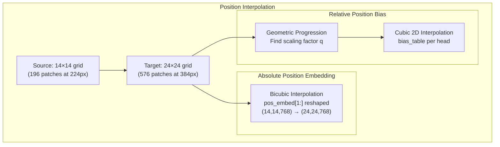

**Sources**: [beit/run_class_finetuning.py:413-434](), [beit/run_class_finetuning.py:337-411](), [beit/semantic_segmentation/mmcv_custom/checkpoint.py:440-479]()

## Checkpoint Management and Model Loading

### Available Pre-trained Checkpoints

BEiT provides checkpoints at different training stages:

| Checkpoint Type | Description | File Pattern | Use Case |
|-----------------|-------------|--------------|----------|
| **Self-supervised Pre-trained** | ImageNet-22k MIM pre-training | `beit_*_pt22k.pth` | Research, custom fine-tuning |
| **Intermediate Fine-tuned** | Pre-trained + IN22k fine-tuning | `beit_*_pt22k_ft22k.pth` | Recommended starting point |
| **Final Fine-tuned** | Fully fine-tuned on IN1k | `beit_*_ft1k.pth` or `beit_*_ft22kto1k.pth` | Direct evaluation |

**Download locations**:
- Base self-supervised: [beit/README.md:38]()
- Large self-supervised: [beit/README.md:39]()
- Base intermediate: [beit/README.md:34]()
- Large intermediate: [beit/README.md:35]()

**Sources**: [beit/README.md:26-40](), [beit/README.md:69-77]()

### Loading and State Dict Handling

BEiT implements flexible checkpoint loading with support for different state dict keys and automatic interpolation:

```mermaid
graph TB
    subgraph "Checkpoint Loading Pipeline"
        Load["Load checkpoint file<br/>torch.load() or hub.load_state_dict_from_url()"]
        ExtractKey["Extract state_dict<br/>Try keys: model | module | teacher"]
        RemoveHead["Remove head weights<br/>if shape mismatch"]
        ExpandRelPos["Expand shared rel_pos_bias<br/>to per-layer if needed"]
        InterpolatePos["Interpolate position embeddings<br/>if resolution differs"]
        InterpolateRel["Interpolate relative position bias<br/>if resolution differs"]
        LoadState["utils.load_state_dict()<br/>Load with strict=False"]
    end
    
    Load --> ExtractKey
    ExtractKey --> RemoveHead
    RemoveHead --> ExpandRelPos
    ExpandRelPos --> InterpolatePos
    InterpolatePos --> InterpolateRel
    InterpolateRel --> LoadState
```

**Sources**: [beit/run_class_finetuning.py:315-437](), [beit/utils.py:290-337]()

### Checkpoint Key Handling

The loading logic tries multiple possible keys in the checkpoint:

```python
# From run_class_finetuning.py
for model_key in args.model_key.split('|'):  # Default: "model|module"
    if model_key in checkpoint:
        checkpoint_model = checkpoint[model_key]
        break
```

This handles checkpoints saved from:
- Single GPU training: `checkpoint['model']`
- DistributedDataParallel: `checkpoint['module']`  
- EMA models: `checkpoint['teacher']`

**Sources**: [beit/run_class_finetuning.py:324-330](), [beit/utils.py:290-337]()

## Performance Benchmarks

### ImageNet-1k Classification Results

| Model | Init Checkpoint | Resolution | Top-1 | Top-5 | Params | Weight | Log |
|-------|----------------|------------|-------|-------|--------|--------|-----|
| BEiT-Base | pt22k | 224 | 83.7% | 96.6% | 87M | [link](https://github.com/addf400/files/releases/download/v1.0/beit_base_patch16_224_pt22k_ft1k.pth) | [link](https://paste.ubuntu.com/p/79z5PncrKZ/) |
| BEiT-Base | pt22k_ft22k | 224 | **85.2%** | **97.6%** | 87M | [link](https://github.com/addf400/files/releases/download/v1.0/beit_base_patch16_224_pt22k_ft22kto1k.pth) | [link](https://paste.ubuntu.com/p/KqFh55cwq4/) |
| BEiT-Base | pt22k_ft22k | 384 | **86.8%** | **98.1%** | 87M | [link](https://github.com/addf400/files/releases/download/v1.0/beit_base_patch16_384_pt22k_ft22kto1k.pth) | [link](https://paste.ubuntu.com/p/jnpD4NGZQn/) |
| BEiT-Large | pt22k | 224 | 86.0% | 97.6% | 304M | [link](https://github.com/addf400/files/releases/download/v1.0/beit_large_patch16_224_pt22k_ft1k.pth) | [link](https://paste.ubuntu.com/p/r4X4gHq6W5/) |
| BEiT-Large | pt22k_ft22k | 224 | **87.4%** | **98.3%** | 304M | [link](https://github.com/addf400/files/releases/download/v1.0/beit_large_patch16_224_pt22k_ft22kto1k.pth) | [link](https://paste.ubuntu.com/p/DpHhW5Zgk5/) |
| BEiT-Large | pt22k_ft22k | 384 | **88.4%** | **98.6%** | 305M | [link](https://github.com/addf400/files/releases/download/v1.0/beit_large_patch16_384_pt22k_ft22kto1k.pth) | [link](https://paste.ubuntu.com/p/xKTBDwPMd2/) |
| BEiT-Large | pt22k_ft22k | 512 | **88.6%** | **98.7%** | 306M | [link](https://github.com/addf400/files/releases/download/v1.0/beit_large_patch16_512_pt22k_ft22kto1k.pth) | [link](https://paste.ubuntu.com/p/Wsb3NwkfCR/) |

**Key findings**:
- **Two-stage fine-tuning** improves accuracy by 1.5% (Base) and 1.4% (Large)
- **Higher resolution** consistently improves performance
- **State-of-the-art**: 88.6% top-1 accuracy (BEiT-Large @ 512×512) without external data beyond ImageNet-22k

**Sources**: [beit/README.md:69-77]()

### ADE20K Semantic Segmentation Results

| Model | Init Checkpoint | Backbone | Decoder | mIoU | mIoU (ms+flip) | Params |
|-------|----------------|----------|---------|------|----------------|--------|
| BEiT-Base | pt22k_ft22k | BEiT-Base | UPerNet | 53.6 | **54.2** | 163M |
| BEiT-Large | pt22k_ft22k | BEiT-Large | UPerNet | 56.7 | **57.0** | 441M |

**Training setup**: 640×640 crop size, 160k iterations, UPerNet decoder

BEiT-Large achieves **57.0 mIoU** with multi-scale testing and horizontal flipping, setting a new state-of-the-art on ADE20K (as of July 2021).

**Sources**: [beit/README.md:80-87](), [beit/README.md:18]()

## Semantic Segmentation Integration

### BEiT Backbone for MMSegmentation

BEiT provides a custom backbone (`BEiT` class in [beit/semantic_segmentation/backbone/beit.py:284-449]()) that integrates with MMSegmentation. The backbone extracts multi-scale features from specified transformer layers.

**BEiT Backbone Feature Extraction**
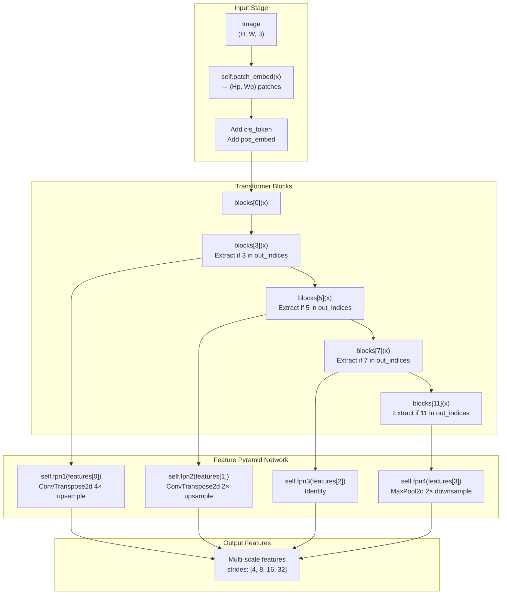

**Sources**: [beit/semantic_segmentation/backbone/beit.py:284-449]()

### Backbone Configuration Parameters

The `BEiT` backbone class is registered with MMSegmentation using `@BACKBONES.register_module()` decorator [beit/semantic_segmentation/backbone/beit.py:284]():

| Parameter | Purpose | Default | Usage |
|-----------|---------|---------|-------|
| `out_indices` | Which block outputs to extract | `[3, 5, 7, 11]` | Controls multi-scale feature layers |
| `use_checkpoint` | Enable gradient checkpointing | `False` | Set `True` for memory-constrained training |
| `patch_size` | Patch dimension | `16` | Use `8` for higher resolution |
| `embed_dim` | Model width | `768` (Base) | `1024` for Large |
| `depth` | Number of transformer blocks | `12` (Base) | `24` for Large |
| `use_abs_pos_emb` | Absolute position embedding | `True` | Set `False` for relative-only |
| `use_rel_pos_bias` | Relative position bias | `False` | Set `True` for per-layer bias |
| `use_shared_rel_pos_bias` | Shared relative position bias | `False` | Set `True` for shared bias |

**Sources**: [beit/semantic_segmentation/backbone/beit.py:284-334]()

### Feature Pyramid Network Heads

For `patch_size=16`, the backbone creates 4-scale outputs via FPN heads [beit/semantic_segmentation/backbone/beit.py:336-364]():

| FPN Head | Operation | Stride Change | Output Stride |
|----------|-----------|---------------|---------------|
| `self.fpn1` | ConvTranspose2d(×2) → BN → GELU → ConvTranspose2d(×2) | 16 → 4 | 4 |
| `self.fpn2` | ConvTranspose2d(×2) | 16 → 8 | 8 |
| `self.fpn3` | Identity | 16 → 16 | 16 |
| `self.fpn4` | MaxPool2d(×2) | 16 → 32 | 32 |

This creates a feature pyramid at strides {4, 8, 16, 32}, compatible with decoders like UPerNet and FPN.

**Sources**: [beit/semantic_segmentation/backbone/beit.py:336-364]()

## Training Infrastructure

### Distributed Training Modes

**Distributed Training Configuration**
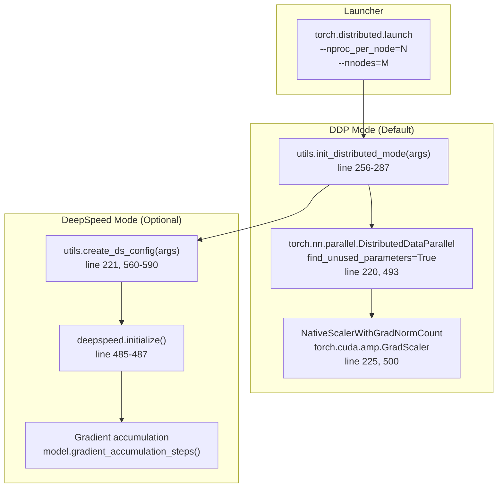

**Enabling DeepSpeed**: Add `--enable_deepspeed` flag to `run_class_finetuning.py` [line 198]()

**Sources**: [beit/run_beit_pretraining.py:219-221](), [beit/run_class_finetuning.py:198,479-500](), [beit/utils.py:256-287,560-590]()

### Mixed Precision Training

BEiT uses PyTorch's native AMP via `NativeScalerWithGradNormCount` [beit/utils.py:339-366]():

```python
# From utils.py:339-366
class NativeScalerWithGradNormCount:
    state_dict_key = "amp_scaler"
    
    def __init__(self):
        self._scaler = torch.cuda.amp.GradScaler()
    
    def __call__(self, loss, optimizer, clip_grad=None, parameters=None, ...):
        self._scaler.scale(loss).backward(create_graph=create_graph)
        if update_grad:
            if clip_grad is not None:
                self._scaler.unscale_(optimizer)
                norm = torch.nn.utils.clip_grad_norm_(parameters, clip_grad)
            else:
                self._scaler.unscale_(optimizer)
                norm = get_grad_norm_(parameters)
            self._scaler.step(optimizer)
            self._scaler.update()
        return norm
```

**Benefits**:
- **Faster training**: FP16 reduces memory bandwidth and enables larger batches
- **Gradient clipping**: Applies clipping after unscaling for stability
- **Loss scaling**: Automatic dynamic loss scaling prevents underflow

**Required dependency**: PyTorch >= 1.6 with CUDA support

**Sources**: [beit/utils.py:339-366](), [beit/README.md:55-62]()

### Gradient Accumulation and Update Frequency

For fine-tuning with limited GPU memory:

```python
# Effective batch size = batch_size × update_freq × num_gpus
# Example: 64 × 2 × 16 = 2048
--batch_size 64 --update_freq 2
```

Gradients are accumulated for `update_freq` iterations before updating parameters, allowing larger effective batch sizes without increased memory.

**Sources**: [beit/run_class_finetuning.py:41](), [beit/run_class_finetuning.py:163](), [beit/engine_for_finetuning.py]() (referenced)

## Linear Probing Evaluation

BEiT supports linear probing evaluation where a linear classifier is trained on frozen features to assess representation quality.

### Linear Classifier Architecture

```python
class LinearClassifier(nn.Module):
    def __init__(self, num_layers, dim, num_labels=1000):
        super().__init__()
        self.num_labels = num_labels
        self.linear = nn.ModuleList()
        self.num_classifier = num_layers
        for i in range(self.num_classifier):
            linear = nn.Linear(dim, num_labels)
            linear.weight.data.normal_(mean=0.0, std=0.01)
            linear.bias.data.zero_()
            self.linear.append(linear)
```

Linear probing trains separate classifiers for each layer's output, evaluating how well each layer's representations capture semantic information.

**Sources**: [beit/run_linear_eval.py:283-300]()

### Feature Extraction for Linear Probe

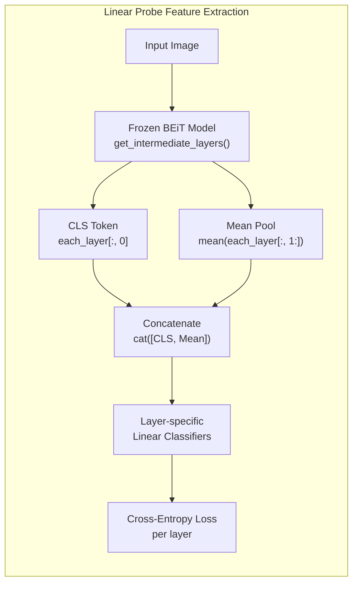

**Sources**: [beit/run_linear_eval.py:177-223](), [beit/modeling_finetune.py:359-375]()

## Summary

BEiT establishes masked image modeling as an effective self-supervised learning approach for Vision Transformers, achieving state-of-the-art results on ImageNet classification (88.6% top-1) and ADE20K semantic segmentation (57.0 mIoU). Key innovations include:

1. **Discrete Visual Tokens**: Using DALL-E's VAE to create a discrete vocabulary for vision
2. **Block-wise Masking**: Masking contiguous regions rather than random patches
3. **Layer Scale**: Scaling factors for training stability in deep models
4. **Relative Position Bias**: Learnable spatial bias for better position encoding
5. **Two-stage Fine-tuning**: Intermediate fine-tuning on ImageNet-22k improves transfer learning

The implementation provides comprehensive support for pre-training, fine-tuning, and evaluation across image classification and semantic segmentation tasks, with flexible checkpoint loading, distributed training, and mixed precision support.

**Sources**: [beit/README.md:1-221](), [beit/run_beit_pretraining.py:1-280](), [beit/run_class_finetuning.py:1-593](), [beit/modeling_pretrain.py:1-163](), [beit/modeling_finetune.py:1-420]()

---

