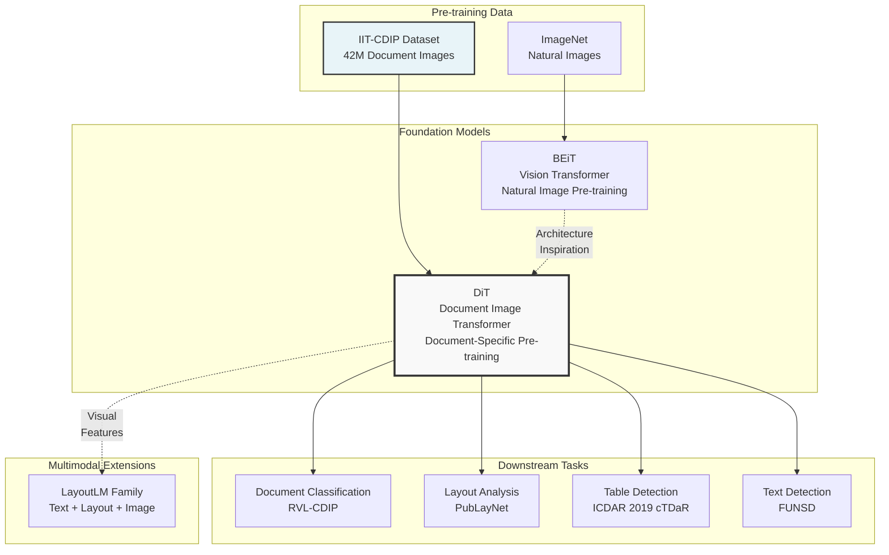
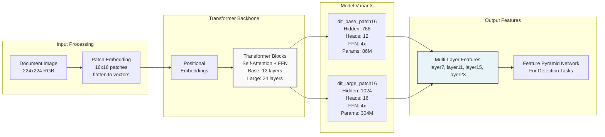
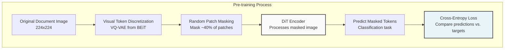
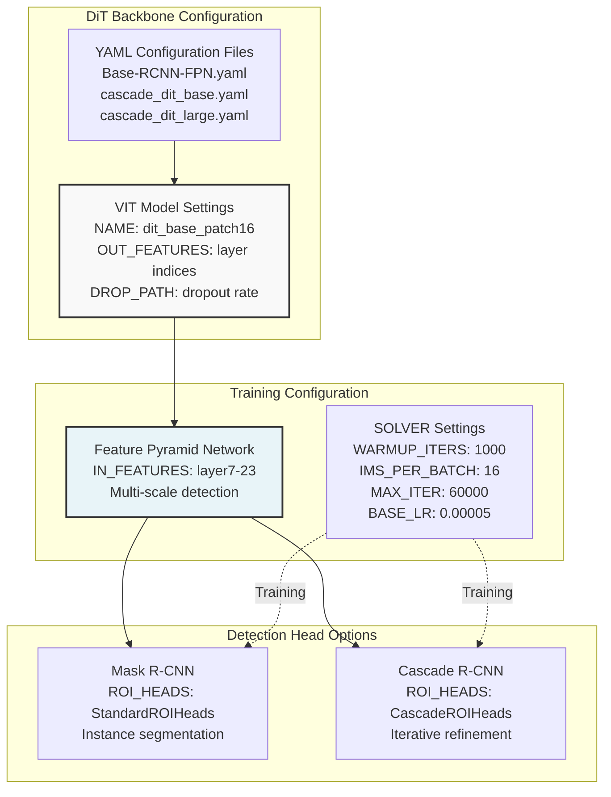

<!-- source: DeepWiki mcp.deepwiki.com · repo microsoft/unilm · page 2.2 DiT: Document Image Transformer · fetched 2026-10-26 -->

# DiT: Document Image Transformer

<details>
<summary>Relevant source files</summary>

The following files were used as context for generating this wiki page:

- [dit/README.md](dit/README.md)
- [dit/object_detection/icdar19_configs/cascade/cascade_dit_base.yaml](dit/object_detection/icdar19_configs/cascade/cascade_dit_base.yaml)
- [dit/object_detection/icdar19_configs/cascade/cascade_dit_large.yaml](dit/object_detection/icdar19_configs/cascade/cascade_dit_large.yaml)

</details>


## Purpose and Scope

This document describes the DiT (Document Image Transformer) model, a self-supervised vision transformer pre-trained on document images for Document AI tasks. DiT applies masked image modeling to learn visual representations specifically optimized for document understanding, distinct from natural image domains.

For information about BEiT, the natural image transformer that DiT is based on, see [BEiT: BERT Pre-Training of Image Transformers](#2.1). For specific downstream applications, see [DiT for Document Layout Analysis](#2.2.1), [DiT for Table Detection](#2.2.2), and [DiT for Text Detection](#2.2.3). For multimodal document understanding models that combine text and layout information with visual features, see [LayoutLM v1: Document Understanding Foundation](#5.1).

## Overview

DiT is a vision transformer model that extends the BEiT architecture to the document image domain. Unlike general vision models pre-trained on natural images (ImageNet), DiT is pre-trained using self-supervised learning on the IIT-CDIP Test Collection 1.0, a large-scale unlabeled corpus of approximately 42 million document images. This domain-specific pre-training enables DiT to capture visual patterns unique to document layouts, typography, tables, and textual arrangements that are critical for document understanding tasks.

The model employs masked image modeling as its pre-training objective, where random patches of the input image are masked and the model learns to reconstruct the visual tokens. After pre-training, DiT serves as a powerful visual backbone for various downstream tasks including document classification, layout analysis, table detection, and text detection.

**Key Characteristics:**
- **Domain-Specific Pre-training:** Trained on document images rather than natural images
- **Self-Supervised Learning:** Uses masked image modeling without requiring labeled data
- **Vision Transformer Architecture:** Based on BEiT with patch-based image encoding
- **Multi-Scale Feature Extraction:** Supports Feature Pyramid Networks for object detection tasks
- **Two Model Sizes:** DiT-base (86M parameters) and DiT-large (304M parameters)

Sources: [dit/README.md:1-24]()

## System Architecture

### DiT in the Document AI Ecosystem



**Diagram: DiT Position in Document AI Pipeline**

This diagram shows DiT's relationship to other models in the repository. DiT adapts the BEiT architecture from natural images to document images, creating a specialized visual backbone for document understanding tasks.

Sources: [dit/README.md:1-3]()

### Core Architecture Components



**Diagram: DiT Architecture Components**

DiT follows a standard Vision Transformer architecture with patch-based image encoding. The input document image is divided into 16×16 patches, which are linearly embedded and fed through multiple transformer layers with self-attention and feed-forward networks.

Sources: [dit/README.md:18-19](), [dit/object_detection/icdar19_configs/cascade/cascade_dit_large.yaml:7-8]()

## Architecture Details

### Model Configuration

DiT is available in two sizes, both using 16×16 patch size and 224×224 input resolution:

| Configuration | Layers | Hidden Size | Attention Heads | FFN Factor | Parameters |
|--------------|--------|-------------|-----------------|------------|------------|
| **DiT-base** | 12 | 768 | 12 | 4× | 86M |
| **DiT-large** | 24 | 1024 | 16 | 4× | 304M |

The feed-forward network (FFN) factor of 4× means the intermediate dimension in the FFN is 4 times the hidden size (e.g., 3072 for base, 4096 for large).

Sources: [dit/README.md:18-19]()

### Patch Embedding and Input Processing

DiT processes document images through the following pipeline:

1. **Input Normalization:** Images are normalized with pixel mean and standard deviation of [127.5, 127.5, 127.5], centering pixel values around zero
2. **Patch Extraction:** The 224×224 image is divided into 14×14 grid of 16×16 patches (196 patches total)
3. **Linear Projection:** Each patch is flattened and linearly projected to the hidden dimension
4. **Position Encoding:** Learnable positional embeddings are added to preserve spatial relationships

Sources: [dit/object_detection/icdar19_configs/cascade/cascade_dit_large.yaml:3-4]()

### Feature Extraction Layers

For object detection tasks, DiT extracts features from multiple transformer layers to create a feature pyramid. The specific layers vary by model size:

**DiT-base:**
- Uses intermediate layer features for Feature Pyramid Network (FPN)
- Default feature extraction points determined during fine-tuning

**DiT-large:**
- Extracts features from layers 7, 11, 15, and 23
- These multi-scale features enable detection at different granularities
- Layer selection provides hierarchical representations: early layers capture low-level patterns, deeper layers capture high-level semantic structures

Sources: [dit/object_detection/icdar19_configs/cascade/cascade_dit_large.yaml:8-11]()

## Pre-training Strategy

### Dataset: IIT-CDIP Test Collection 1.0

DiT is pre-trained on the IIT-CDIP Test Collection 1.0, a large-scale corpus of document images. This dataset consists of approximately 42 million document images scanned from legacy document archives, representing diverse document types including:

- Business correspondence and forms
- Technical documentation and manuals
- Legal documents and contracts
- Scientific papers and reports
- Administrative documents

The scale and diversity of this corpus enable DiT to learn robust visual representations for document understanding without requiring manual annotations.

**Reference:** The IIT-CDIP dataset is described in the ACM publication at https://dl.acm.org/doi/10.1145/1148170.1148307

Sources: [dit/README.md:16]()

### Masked Image Modeling Objective

DiT employs self-supervised masked image modeling, following the approach pioneered by BEiT:



**Diagram: Self-Supervised Pre-training Pipeline**

The pre-training process:
1. **Tokenization:** Document images are converted to discrete visual tokens using a pre-trained VQ-VAE tokenizer from BEiT
2. **Masking:** Random patches in the input image are masked (replaced with a learnable mask token)
3. **Encoding:** The masked image is processed through the DiT transformer encoder
4. **Prediction:** The model predicts the original visual tokens for the masked patches
5. **Loss Computation:** Cross-entropy loss is computed between predicted and target tokens

This self-supervised objective enables the model to learn meaningful visual representations of document structure, layout, and typography without requiring labeled data.

Sources: [dit/README.md:3]()

## Pre-trained Model Checkpoints

DiT provides two pre-trained checkpoints, both trained with 500k iterations on IIT-CDIP:

### Available Checkpoints

| Model | Checkpoint Name | Parameters | Download |
|-------|----------------|------------|----------|
| **DiT-base** | `dit_base_patch16_224` | 86M | [dit-base-224-p16-500k-62d53a.pth](https://huggingface.co/HYPJUDY/dit/resolve/main/dit-pts/dit-base-224-p16-500k-62d53a.pth) |
| **DiT-large** | `dit_large_patch16_224` | 304M | [dit-large-224-p16-500k-d7a2fb.pth](https://huggingface.co/HYPJUDY/dit/resolve/main/dit-pts/dit-large-224-p16-500k-d7a2fb.pth) |

Both checkpoints are hosted on Hugging Face Hub under the repository `HYPJUDY/dit`. These checkpoints serve as initialization weights for fine-tuning on downstream document understanding tasks.

### Checkpoint Loading in Configuration

The model weights are referenced in configuration files for downstream tasks. For example, in Cascade R-CNN configurations:

```yaml
# DiT-base configuration
MODEL:
  WEIGHTS: "https://layoutlm.blob.core.windows.net/dit/dit-pts/dit-base-224-p16-500k-62d53a.pth"
  VIT:
    NAME: "dit_base_patch16"
```

```yaml
# DiT-large configuration  
MODEL:
  WEIGHTS: "https://layoutlm.blob.core.windows.net/dit/dit-pts/dit-large-224-p16-500k-d7a2fb.pth"
  VIT:
    NAME: "dit_large_patch16"
```

Sources: [dit/README.md:14-24](), [dit/object_detection/icdar19_configs/cascade/cascade_dit_base.yaml:5-7](), [dit/object_detection/icdar19_configs/cascade/cascade_dit_large.yaml:5-7]()

## Setup and Dependencies

### Installation Requirements

DiT requires specific versions of core dependencies for compatibility:

| Package | Version | Purpose |
|---------|---------|---------|
| **PyTorch** | 1.9.0 | Deep learning framework |
| **torchvision** | 0.10.0 | Image transformations and models |
| **Timm** | 0.5.4 | Transformer model implementations |
| **detectron2** | Compatible with PyTorch 1.9 | Object detection framework |
| **apex** | Latest | Mixed-precision training |
| **shapely** | Latest | Geometric operations for detection |

### Installation Steps

The basic installation process:

```bash
# Clone repository
git clone https://github.com/microsoft/unilm.git
cd unilm/dit

# Install core dependencies
pip install -r requirements.txt

# Install apex for mixed-precision training (optional but recommended)
git clone https://github.com/NVIDIA/apex
cd apex
pip install -v --disable-pip-version-check --no-cache-dir \
  --global-option="--cpp_ext" --global-option="--cuda_ext" ./

# Install detectron2 for object detection tasks
python -m pip install detectron2 -f \
  https://dl.fbaipublicfiles.com/detectron2/wheels/cu111/torch1.9/index.html

# Install shapely for geometric operations
pip install shapely
```

**Note:** The `apex` library enables mixed-precision (FP16) training for improved performance and reduced memory usage. Detectron2 is only required for object detection tasks (layout analysis, table detection, text detection).

Sources: [dit/README.md:26-52]()

## Downstream Task Configurations

### Object Detection Framework Integration



**Diagram: Detection Framework Configuration**

DiT integrates with detectron2's object detection framework through YAML configuration files. The backbone configuration specifies the DiT model variant, feature extraction layers, and hyperparameters. Detection heads (Mask R-CNN or Cascade R-CNN) are connected to the multi-scale FPN features.

Sources: [dit/object_detection/icdar19_configs/cascade/cascade_dit_base.yaml:1-22](), [dit/object_detection/icdar19_configs/cascade/cascade_dit_large.yaml:1-26]()

### Common Configuration Parameters

**Model Parameters:**
- `PIXEL_MEAN` and `PIXEL_STD`: Set to [127.5, 127.5, 127.5] for zero-centered normalization
- `VIT.NAME`: Specifies the model variant (`dit_base_patch16` or `dit_large_patch16`)
- `VIT.OUT_FEATURES`: Layers from which to extract features for FPN
- `VIT.DROP_PATH`: Stochastic depth rate (0.2 for DiT-large)

**Detection Parameters:**
- `ROI_HEADS.NAME`: `CascadeROIHeads` for Cascade R-CNN, `StandardROIHeads` for Mask R-CNN
- `ROI_BOX_HEAD.CLS_AGNOSTIC_BBOX_REG`: Set to `True` for class-agnostic bounding box regression
- `RPN.POST_NMS_TOPK_TRAIN`: Number of proposals to keep after NMS (2000)

**Training Parameters:**
- `SOLVER.BASE_LR`: Base learning rate (5e-5)
- `SOLVER.WARMUP_ITERS`: Warmup iterations (1000)
- `SOLVER.MAX_ITER`: Maximum training iterations (60000)
- `SOLVER.IMS_PER_BATCH`: Batch size (16)
- `TEST.EVAL_PERIOD`: Evaluation frequency (every 1000 iterations)

Sources: [dit/object_detection/icdar19_configs/cascade/cascade_dit_base.yaml:2-21](), [dit/object_detection/icdar19_configs/cascade/cascade_dit_large.yaml:2-25]()

## Fine-tuning Task Overview

DiT demonstrates strong performance across multiple document understanding tasks when fine-tuned from the self-supervised pre-trained checkpoints. The model serves as a visual backbone for three primary categories of downstream applications:

### 1. Document Image Classification

**Dataset:** RVL-CDIP (Ryerson Vision Lab Complex Document Information Processing)

**Task:** Classify document images into 16 categories (letter, form, email, resume, memo, etc.)

**Performance Highlights:**
- DiT-base: 92.11% accuracy
- DiT-large: 92.69% accuracy

Detailed instructions and results: See [DiT for Document Layout Analysis](#2.2.1)

### 2. Document Layout Analysis

**Dataset:** PubLayNet (Publication Layout Analysis)

**Task:** Detect and segment layout elements (text, title, list, table, figure) in scientific documents

**Detection Frameworks:** Mask R-CNN and Cascade R-CNN

**Performance Highlights:**
- DiT-base + Cascade R-CNN: 94.5 mAP
- DiT-large + Cascade R-CNN: 94.9 mAP

Detailed instructions and results: See [DiT for Document Layout Analysis](#2.2.1)

### 3. Table Detection

**Dataset:** ICDAR 2019 cTDaR (Competition on Table Detection and Recognition)

**Task:** Detect table regions in modern and archival document images

**Tracks:** Modern, Archival, and Combined

**Performance Highlights:**
- DiT-large + Cascade R-CNN (Modern): 96.29 F1
- DiT-large + Cascade R-CNN (Archival): 97.00 F1

Detailed instructions and results: See [DiT for Table Detection](#2.2.2)

### 4. Text Detection

**Dataset:** FUNSD (Form Understanding in Noisy Scanned Documents)

**Task:** Detect text regions in noisy form documents

Detailed instructions and results: See [DiT for Text Detection](#2.2.3)

Sources: [dit/README.md:54-105]()

## Performance Summary

### Comparison of Detection Frameworks

The following table summarizes DiT performance across tasks using different detection algorithms:

| Task | Model | Mask R-CNN | Cascade R-CNN | Best Result |
|------|-------|-----------|--------------|-------------|
| **PubLayNet (Layout Analysis)** | DiT-base | 93.5 mAP | 94.5 mAP | 94.5 |
| | DiT-large | 94.1 mAP | 94.9 mAP | **94.9** |
| **ICDAR Modern (Table Detection)** | DiT-base | 94.74 F1 | 95.85 F1 | 95.85 |
| | DiT-large | 95.50 F1 | 96.29 F1 | **96.29** |
| **ICDAR Archival (Table Detection)** | DiT-base | 96.24 F1 | 96.63 F1 | 96.63 |
| | DiT-large | 96.46 F1 | 97.00 F1 | **97.00** |

**Observations:**
- Cascade R-CNN consistently outperforms Mask R-CNN across all tasks
- DiT-large provides consistent improvements over DiT-base
- Performance gains from Cascade R-CNN are most pronounced on modern document layouts
- Archival document detection achieves higher F1 scores due to simpler layouts

Sources: [dit/README.md:64-95]()

## Relationship to Other Models

### Integration with LayoutLM

DiT serves as a visual backbone that can provide image features to multimodal document understanding models in the LayoutLM family. While DiT processes raw document images through pure vision transformers, LayoutLM models combine these visual features with text tokens and layout information for comprehensive document understanding.

**Key Differences:**
- **DiT:** Vision-only model, processes document images as pixel arrays
- **LayoutLM:** Multimodal model, combines text, 2D position, and image features

### Comparison with BEiT

DiT adapts the BEiT architecture from natural images to document images:

| Aspect | BEiT | DiT |
|--------|------|-----|
| **Pre-training Domain** | Natural images (ImageNet) | Document images (IIT-CDIP) |
| **Primary Tasks** | Image classification, semantic segmentation | Document classification, layout analysis, table/text detection |
| **Visual Patterns** | Objects, scenes, textures | Layouts, typography, tables, document structures |
| **Downstream Applications** | General computer vision | Document AI and understanding |

The architectural similarity allows DiT to leverage BEiT's proven transformer design while specializing for document-specific visual patterns through domain-specific pre-training.

Sources: [dit/README.md:1-3]()

## Demos and Model Cards

DiT models and fine-tuned checkpoints are publicly available through Hugging Face:

**Interactive Demos:**
- [Document Layout Analysis Demo](https://huggingface.co/spaces/nielsr/dit-document-layout-analysis): Visualize layout detection on PubLayNet
- [Document Image Classification Demo](https://huggingface.co/spaces/microsoft/document-image-transformer): Classify documents into RVL-CDIP categories

**Model Repository:**
- Pre-trained checkpoints: [HYPJUDY/dit](https://huggingface.co/HYPJUDY/dit/tree/main/dit-pts)
- Fine-tuned checkpoints: [HYPJUDY/dit](https://huggingface.co/HYPJUDY/dit/tree/main/dit-fts)

These resources enable quick experimentation and deployment of DiT for document understanding applications.

Sources: [dit/README.md:10-11]()

---

