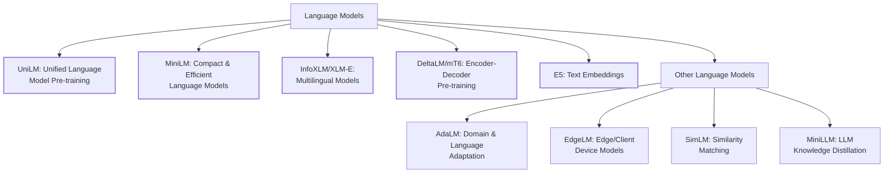
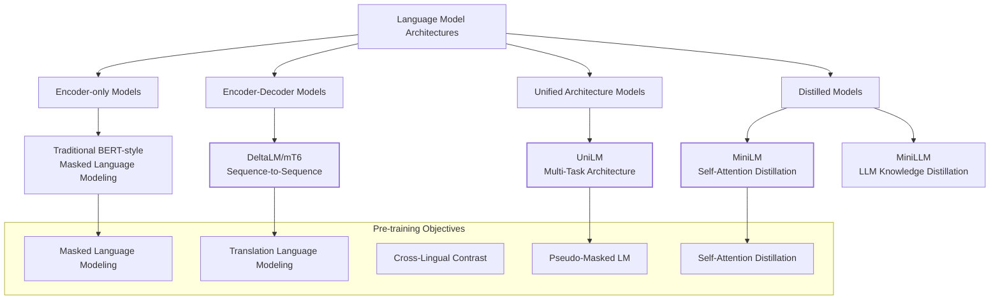
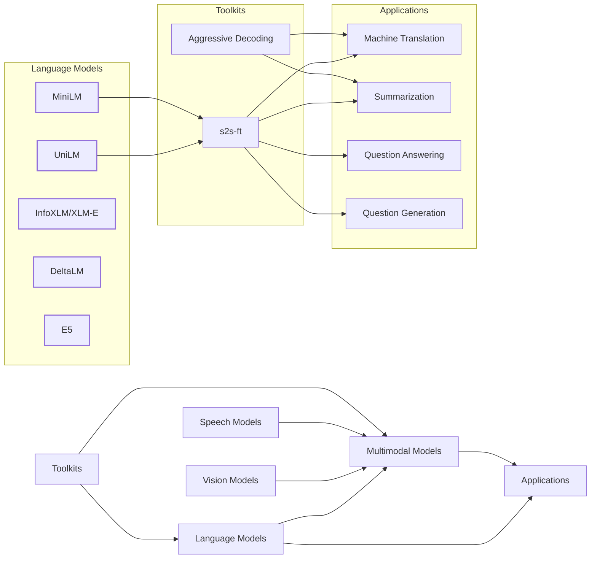

<!-- source: DeepWiki mcp.deepwiki.com · repo microsoft/unilm · page 3 Language Models · fetched 2026-10-26 -->

# Language Models

<details>
<summary>Relevant source files</summary>

The following files were used as context for generating this wiki page:

- [README.md](README.md)
- [deltalm/README.md](deltalm/README.md)
- [minilm/README.md](minilm/README.md)
- [minilm/examples/run_xnli.py](minilm/examples/run_xnli.py)
- [unilm/README.md](unilm/README.md)
- [valle/README.md](valle/README.md)
- [wavlm/ASR.PNG](wavlm/ASR.PNG)
- [wavlm/README.md](wavlm/README.md)
- [wavlm/SUPERB_Results.png](wavlm/SUPERB_Results.png)
- [wavlm/screenshot.png](wavlm/screenshot.png)

</details>


This page provides an overview of the language models in Microsoft's UniLM repository. The focus is on foundation models for natural language understanding and generation tasks. For information about multimodal models that combine language with other modalities, see [Multimodal Models](#5).

## Overview of Language Models

The UniLM repository contains several families of language models, each designed with specific goals and capabilities. These models represent Microsoft's research efforts in creating pre-trained language models that can be adapted to various downstream tasks.



Sources: [README.md:43-59](). [minilm/README.md:2-3]().

## Core Language Model Families

### UniLM

UniLM (Unified Language Model) implements a unified pre-training approach that handles both language understanding and generation tasks within a single model architecture.

Key characteristics:
- Uses shared Transformer networks with specific self-attention masks
- Pre-trained with masked language modeling objectives
- Can be fine-tuned for both understanding tasks (classification, sequence labeling) and generation tasks (summarization, translation)
- Has evolved through multiple versions (UniLMv1, UniLMv2, UniLMv3)

UniLM serves as a foundation architecture for many other models in the repository, demonstrating that a single pre-trained model can effectively perform various NLP tasks.

Sources: [README.md:44-45]().

### MiniLM

MiniLM focuses on creating compact, efficient pre-trained models through knowledge distillation, while maintaining competitive performance on language tasks.

Key characteristics:
- Uses deep self-attention distillation in MiniLMv1
- Implements multi-head self-attention relation distillation in MiniLMv2
- Available in different configurations:
  - MiniLM-L12-H384: 12-layer model with 384 hidden size (2.7x speedup vs. BERT-Base)
  - MiniLM-L6-H384: 6-layer model with 384 hidden size (5.3x speedup vs. BERT-Base)
  - MiniLM-L6-H768: 6-layer model with 768 hidden size (2.0x speedup vs. BERT-Base)
- Both English and multilingual versions are available

MiniLM models are particularly suitable for resource-constrained environments where computational efficiency is important.

Sources: [README.md:50-52](). [minilm/README.md:2-5]().

### InfoXLM/XLM-E

InfoXLM and its successor XLM-E are multilingual pre-trained models that support 100+ languages.

Key characteristics:
- Designed for cross-lingual transfer learning
- Pre-trained using multilingual masked language modeling, translation language modeling, and cross-lingual contrastive learning
- Strong performance on cross-lingual benchmarks like XNLI and MLQA
- State-of-the-art results on the XTREME leaderboard

These models enable effective transfer of knowledge across different languages, helping to address the language diversity challenge in NLP.

Sources: [README.md:46-47]().

### DeltaLM/mT6

DeltaLM (also known as mT6) is an encoder-decoder pre-training approach specifically designed for language generation and translation tasks.

Key characteristics:
- Encoder-decoder architecture based on Transformers
- Supports 100+ languages for multilingual generation and translation
- Pre-trained by augmenting existing multilingual encoders
- Achieved first place on the WMT21 multilingual translation task

DeltaLM addresses the challenges of sequence-to-sequence tasks in multilingual settings, making it valuable for cross-lingual applications.

Sources: [README.md:48-49](). [deltalm/README.md:1-7]().

### E5 Text Embeddings

E5 is a family of text embedding models focusing on generating high-quality text representations through weakly-supervised contrastive pre-training.

Key characteristics:
- Creates dense vector representations of text that capture semantic meaning
- Optimized for retrieval, similarity matching, and other embedding-based applications
- Trained using contrastive learning objectives

E5 embeddings can be used for a wide range of applications including semantic search, recommendation systems, and clustering.

Sources: [README.md:58]().

## Model Architectures and Design Patterns

The language models in the UniLM repository utilize various Transformer-based architectures with specific design choices to address different NLP challenges.



Sources: [README.md:43-59](). [minilm/README.md:6-39]().

### Architectural Variations

Different models in the repository employ specific architectural variations:

1. **Encoder-only models**:
   - Focus primarily on understanding tasks
   - Examples: BERT-based variants in the repository
   - Typically used for classification, sequence labeling, etc.

2. **Encoder-decoder models**:
   - Designed for sequence-to-sequence tasks
   - Examples: DeltaLM/mT6
   - Used for machine translation, summarization, etc.

3. **Unified models**:
   - Handle both understanding and generation tasks
   - Examples: UniLM with specific attention masks
   - Can be fine-tuned for diverse downstream applications

4. **Distilled models**:
   - Smaller, faster versions of larger models
   - Examples: MiniLM, MiniLLM
   - Trade off some accuracy for efficiency

### Model Scaling

The repository includes models at various scales to accommodate different resource constraints:

| Model Family | Configurations | Parameters | Relative Speed |
|--------------|---------------|------------|----------------|
| UniLM        | Base size     | ~110M      | 1.0x baseline  |
| MiniLM       | L12-H384      | ~33M       | 2.7x faster    |
| MiniLM       | L6-H384       | ~22M       | 5.3x faster    |
| MiniLM       | L6-H768       | ~66M       | 2.0x faster    |
| DeltaLM      | Base          | ~360M      | -              |
| DeltaLM      | Large         | ~830M      | -              |

Sources: [minilm/README.md:19-27](). [deltalm/README.md:14-18]().

## Pre-training Approaches

The language models in the UniLM repository employ various pre-training objectives and techniques:

### Masked Language Modeling (MLM)

Used in models like UniLM, where a percentage of input tokens are masked and the model is trained to predict them based on context.

### Pseudo-Masked Language Modeling

Introduced in UniLMv2, this extends masked language modeling to support both autoencoding and partially autoregressive language modeling within a unified framework.

### Translation Language Modeling (TLM)

Used in multilingual models like InfoXLM, where parallel sentences in different languages have tokens masked, and the model learns to predict them using cross-lingual context.

### Self-Attention Distillation

Used in MiniLM to transfer knowledge from a larger teacher model to a smaller student model by matching the self-attention distributions:
- MiniLMv1: Deep self-attention distillation
- MiniLMv2: Multi-head self-attention relation distillation

Sources: [minilm/README.md:5-8](), [README.md:237]().

## Fine-tuning and Applications

The language models in the UniLM repository can be fine-tuned for various downstream tasks using dedicated toolkits and techniques.

### Natural Language Understanding Tasks

Language models like UniLM and MiniLM can be fine-tuned for:
- Text classification (e.g., sentiment analysis)
- Natural language inference
- Question answering
- Named entity recognition

Example performance on NLU tasks (dev set results):

| Model              | SQuAD 2.0 | MNLI-m | SST-2 | QNLI | CoLA | RTE  | MRPC | QQP  |
|--------------------|-----------|--------|-------|------|------|------|------|------|
| BERT-Base          | 76.8      | 84.5   | 93.2  | 91.7 | 58.9 | 68.6 | 87.3 | 91.3 |
| MiniLM-L12-H384    | 81.7      | 85.7   | 93.0  | 91.5 | 58.5 | 73.3 | 89.5 | 91.3 |
| MiniLM-L6-H384     | 75.6      | 83.3   | 91.5  | 90.5 | 47.5 | 68.8 | 88.9 | 90.6 |

Sources: [minilm/README.md:124-130]().

### Natural Language Generation Tasks

Models like UniLM and DeltaLM excel at generation tasks such as:
- Abstractive summarization
- Question generation
- Machine translation
- Text completion

Example performance on CNN/Daily Mail summarization:

| Model                | ROUGE-1 | ROUGE-2 | ROUGE-L |
|----------------------|---------|---------|---------|
| BART                 | 44.16   | 21.28   | 40.90   |
| UniLM V1             | 43.08   | 20.43   | 40.34   |
| MiniLM-L12-H384      | 42.66   | 19.91   | 39.73   |
| MiniLM-L6-H384       | 41.57   | 19.21   | 38.64   |

Sources: [minilm/README.md:206-215]().

### Cross-lingual Tasks

Multilingual models like InfoXLM/XLM-E and DeltaLM support:
- Cross-lingual natural language inference (XNLI)
- Cross-lingual question answering (MLQA)
- Multilingual machine translation

Example performance on XNLI:

| Model            | Avg  | en   | fr   | es   | de   | el   | bg   | ru   | tr   | ar   | vi   | th   | zh   | hi   | sw   | ur   |
|------------------|------|------|------|------|------|------|------|------|------|------|------|------|------|------|------|------|
| XLM-R Base       | 74.5 | 84.6 | 78.4 | 78.9 | 76.8 | 75.9 | 77.3 | 75.4 | 73.2 | 71.5 | 75.4 | 72.5 | 74.9 | 71.1 | 65.2 | 66.5 |
| mMiniLM-L12-H384 | 71.1 | 81.5 | 74.8 | 75.7 | 72.9 | 73.0 | 74.5 | 71.3 | 69.7 | 68.8 | 72.1 | 67.8 | 70.0 | 66.2 | 63.3 | 64.2 |

Sources: [minilm/README.md:64-70]().

### Fine-tuning Toolkits

The repository includes specialized toolkits for fine-tuning:

1. **s2s-ft**: Sequence-to-sequence fine-tuning toolkit
   - Designed for adapting pre-trained models for generation tasks
   - Supports various sequence-to-sequence tasks like summarization, translation, and question generation
   - Compatible with models like UniLM and MiniLM

2. **Aggressive Decoding**:
   - Accelerates the decoding process for sequence-to-sequence generation
   - Provides up to 7-9x speedup for specific tasks without quality loss
   - Compatible with fine-tuned models from the repository

Sources: [README.md:96-100]().

## Integration Within the UniLM Ecosystem

The language models in the UniLM repository are part of a broader ecosystem that includes vision, speech, and multimodal models. They are designed to be interoperable and can be combined for various applications.



Sources: [README.md:19-108]().

## Usage Examples

### Loading and Using MiniLM

```python
# Example for loading a MiniLM model
from transformers import AutoTokenizer, AutoModel
  
tokenizer = AutoTokenizer.from_pretrained("microsoft/MiniLM-L12-H384-uncased")
model = AutoModel.from_pretrained("microsoft/MiniLM-L12-H384-uncased")

inputs = tokenizer("Hello world!", return_tensors="pt")
outputs = model(**inputs)
```

Sources: [minilm/README.md:110-118]().

### Using Multilingual MiniLM

```python
# Example for loading a multilingual MiniLM model
from transformers import AutoTokenizer, AutoModel
  
tokenizer = AutoTokenizer.from_pretrained("microsoft/Multilingual-MiniLM-L12-H384")
model = AutoModel.from_pretrained("microsoft/Multilingual-MiniLM-L12-H384")

inputs = tokenizer("Hello world!", return_tensors="pt")
outputs = model(**inputs)
```

Sources: [minilm/README.md:46-54]().

### Fine-tuning MiniLM for NLU Tasks

```bash
# Example command for fine-tuning MiniLM on SQuAD 2.0
python -m torch.distributed.launch --nproc_per_node=4 ./examples/run_squad.py \
  --model_type bert \
  --output_dir ${OUTPUT_DIR} --data_dir ${DATA_DIR} \
  --model_name_or_path ${MODEL_PATH}/minilm-l12-h384-uncased.bin \
  --tokenizer_name ${MODEL_PATH}/vocab.txt \
  --config_name ${MODEL_PATH}/minilm-l12-h384-uncased-config.json \
  --do_train --do_eval --do_lower_case \
  --train_file train-v2.0.json --predict_file dev-v2.0.json \
  --learning_rate 4e-5 --num_train_epochs 4 \
  --max_seq_length 384 --doc_stride 128 \
  --per_gpu_eval_batch_size=12 --per_gpu_train_batch_size=12 --save_steps 5000 \
  --version_2_with_negative
```

Sources: [minilm/README.md:133-150]().

### Fine-tuning on Cross-lingual Tasks

```bash
# Example for fine-tuning multilingual MiniLM on XNLI
python ./examples/run_xnli.py --model_type minilm \
 --output_dir ${OUTPUT_DIR} --data_dir ${DATA_DIR} \
 --model_name_or_path ${MODEL_PATH}/multilingual-minilm-l12-h384.bin \
 --tokenizer_name xlm-roberta-base \
 --config_name ${MODEL_PATH}/multilingual-minilm-l12-h384-config.json \
 --do_train --do_eval \
 --max_seq_length 128 --per_gpu_train_batch_size 128 \
 --learning_rate 5e-5 --num_train_epochs 5 --per_gpu_eval_batch_size 32 \
 --weight_decay 0.001 \
 --warmup_steps 500 --save_steps 1500 --logging_steps 1500 --eval_all_checkpoints\
 --language en --fp16 --fp16_opt_level O2
```

Sources: [minilm/README.md:73-86](). [minilm/examples/run_xnli.py:16-17]().

## Conclusion

The language models in the Microsoft UniLM repository represent a diverse set of approaches to pre-trained language modeling, from unified architectures that handle both understanding and generation (UniLM) to compact, efficient models (MiniLM) and multilingual models (InfoXLM, DeltaLM). These models serve as powerful foundation systems that can be fine-tuned for a wide range of natural language processing tasks.

The ongoing development of these models reflects Microsoft's research efforts to advance the state of the art in NLP through pre-training methods that are efficient, versatile, and performant across different languages and tasks.

---

