<!-- source: DeepWiki mcp.deepwiki.com · repo microsoft/unilm · page 3.1 UniLM: Unified Language Model Pre-training · fetched 2026-10-26 -->

# UniLM: Unified Language Model Pre-training

<details>
<summary>Relevant source files</summary>

The following files were used as context for generating this wiki page:

- [s2s-ft/README.md](s2s-ft/README.md)
- [s2s-ft/s2s_ft/configuration_minilm.py](s2s-ft/s2s_ft/configuration_minilm.py)
- [s2s-ft/s2s_ft/configuration_unilm.py](s2s-ft/s2s_ft/configuration_unilm.py)
- [s2s-ft/s2s_ft/modeling.py](s2s-ft/s2s_ft/modeling.py)
- [s2s-ft/s2s_ft/modeling_decoding.py](s2s-ft/s2s_ft/modeling_decoding.py)
- [s2s-ft/s2s_ft/tokenization_minilm.py](s2s-ft/s2s_ft/tokenization_minilm.py)
- [s2s-ft/s2s_ft/tokenization_unilm.py](s2s-ft/s2s_ft/tokenization_unilm.py)
- [unilm-v1/README.md](unilm-v1/README.md)
- [unilm/README.md](unilm/README.md)

</details>


This document covers the UniLM (Unified Language Model) family of models, which pioneered unified pre-training for both natural language understanding (NLU) and natural language generation (NLG) tasks. UniLM demonstrates that a single pre-trained Transformer model can be effectively fine-tuned for both discriminative and generative tasks through specialized self-attention masks.

For knowledge distillation from UniLM models, see [MiniLM: Knowledge Distillation](#3.2). For sequence-to-sequence fine-tuning infrastructure, see [s2s-ft: Sequence-to-Sequence Fine-tuning](#7.1). For multilingual encoder-decoder pre-training, see [DeltaLM and Multilingual Models](#3.3).

---

## Overview and Model Evolution

UniLM introduced a paradigm shift by demonstrating that pre-trained language models could handle both understanding and generation tasks without architectural modifications. The key innovation is the use of different self-attention masking patterns during pre-training to enable bidirectional, unidirectional, and sequence-to-sequence modeling within a single model.

### Version Timeline

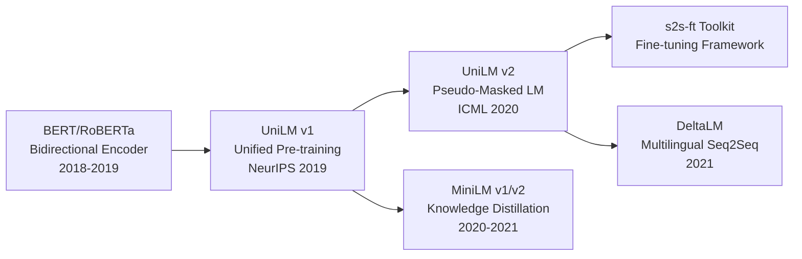

**Sources:** [README.md:44-48](), [unilm/README.md:4-8]()

---

## UniLM v1: Unified Language Model Pre-training

UniLM v1, published at NeurIPS 2019, introduced the core concept of unified pre-training by training a single Transformer model with multiple self-attention masking patterns.

### Pre-training Objectives

UniLM v1 uses three types of Language Modeling (LM) objectives during pre-training:

1. **Bidirectional LM** (for NLU tasks): Full bidirectional attention, similar to BERT
2. **Unidirectional LM** (left-to-right): Causal masking for autoregressive generation
3. **Sequence-to-Sequence LM**: Bidirectional attention over source, causal masking over target

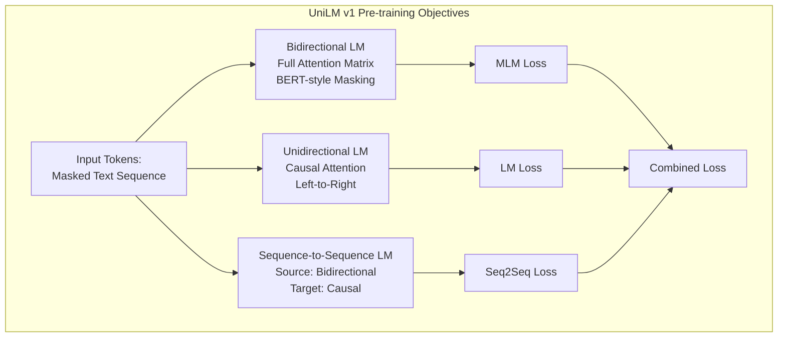

**Key Technical Details:**
- **Shared Parameters**: All three objectives share the same Transformer parameters
- **Attention Masks**: Different masking patterns control information flow during self-attention
- **Input Format**: `[CLS] source_tokens [SEP] target_tokens [SEP]` for seq2seq tasks
- **Masking Strategy**: 15% of tokens masked following BERT's masking procedure

### Architecture

UniLM v1 uses a standard Transformer encoder architecture identical to BERT:
- **Base Model**: 12 layers, 768 hidden dimensions, 12 attention heads (110M parameters)
- **Large Model**: 24 layers, 1024 hidden dimensions, 16 attention heads (340M parameters)
- **Vocabulary**: WordPiece tokenization with 28,996 tokens (same as BERT)

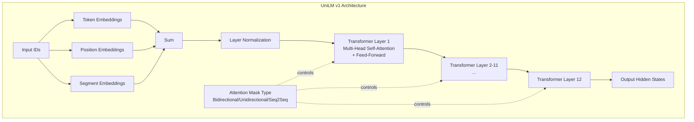

**Sources:** [README.md:44](), [unilm/README.md:8]()

---

## UniLM v2: Pseudo-Masked Language Models

UniLM v2, published at ICML 2020, introduces the **Pseudo-Masked Language Model (PMLM)** objective, which improves upon v1 by addressing the discrepancy between pre-training and fine-tuning.

### Key Innovation: PMLM Objective

The PMLM objective combines:
1. **Partially Autoregressive**: Models dependencies within masked spans
2. **Partially Autoencoding**: Uses bidirectional context outside masked spans

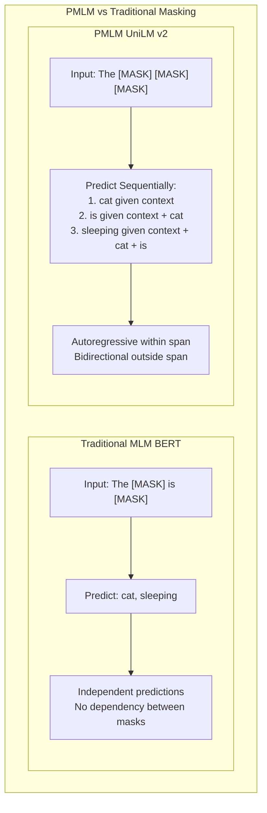

### Technical Details

**PMLM Formulation:**
- **Span Selection**: Randomly select spans of text to mask (similar to SpanBERT)
- **Factorization**: Within each span, model tokens autoregressively from left to right
- **Context**: Bidirectional attention over unmasked tokens
- **Training**: Optimize the joint probability of the masked span given context

**Advantages over UniLM v1:**
- Better alignment between pre-training and generation fine-tuning
- No need to sample different attention patterns (always uses partial autoregression)
- Improved performance on both NLU and NLG tasks

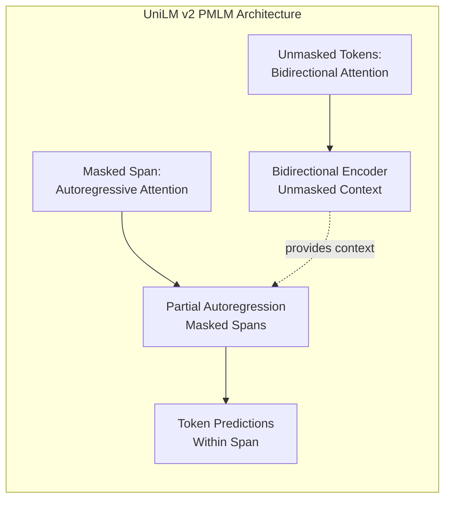

**Sources:** [README.md:237](), [unilm/README.md:4-6]()

---

## Code Organization and File Structure

The UniLM codebase is organized into version-specific directories with shared dependencies on the Transformers library.

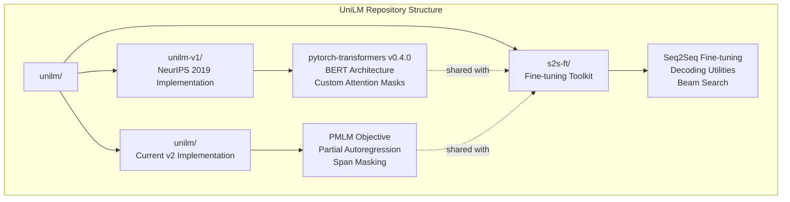

**Key Directories:**
- `unilm-v1/`: Original NeurIPS 2019 implementation with three-objective pre-training
- `unilm/`: Current directory with UniLM v2 PMLM implementation and documentation
- Integration with `s2s-ft/` toolkit for fine-tuning on generation tasks

**Sources:** [README.md:44](), [unilm/README.md:1-36]()

---

## Pre-training Configuration

### Model Variants

UniLM models follow BERT's size conventions:

| Variant | Layers | Hidden Size | Attention Heads | Parameters | Training Data |
|---------|--------|-------------|-----------------|------------|---------------|
| **UniLM v1 Base** | 12 | 768 | 12 | 110M | BERT corpus (16GB) |
| **UniLM v1 Large** | 24 | 1024 | 16 | 340M | BERT corpus (16GB) |
| **UniLM v2** | 12/24 | 768/1024 | 12/16 | 110M/340M | BERT corpus + extensions |

### Pre-training Hyperparameters

**UniLM v1:**
- **Batch Size**: 512 sequences
- **Max Sequence Length**: 512 tokens
- **Learning Rate**: 3e-5 (Base), 2e-5 (Large)
- **Warmup**: 10,000 steps
- **Training Steps**: ~500k-1M depending on configuration
- **Optimization**: Adam with linear warmup and decay

**UniLM v2:**
- Similar hyperparameters to v1
- **Span Masking Probability**: 15% of tokens in spans
- **Average Span Length**: 3-5 tokens
- **PMLM Objective**: Autoregressive factorization within spans

**Sources:** [README.md:44-48](), [unilm/README.md:1-20]()

---

## Fine-tuning for Downstream Tasks

UniLM models can be fine-tuned for both NLU and NLG tasks with appropriate attention masks.

### Natural Language Understanding Tasks

For NLU tasks (classification, NER, QA extraction), UniLM uses **bidirectional attention** during fine-tuning:

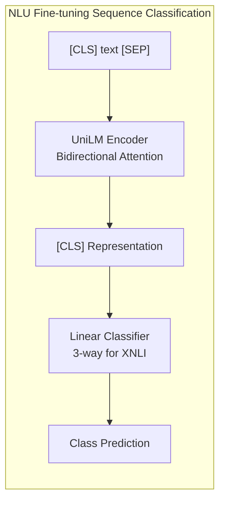

**Common NLU Tasks:**
- **GLUE Benchmark**: Classification tasks (MNLI, SST-2, QNLI, etc.)
- **XNLI**: Cross-lingual natural language inference
- **SQuAD**: Question answering (span extraction)

**Example Configuration:**
- Task-specific head added on top of `[CLS]` token representation
- Bidirectional attention mask throughout the sequence
- Fine-tuning learning rate: 1e-5 to 5e-5

### Natural Language Generation Tasks

For NLG tasks, UniLM uses **sequence-to-sequence attention**:

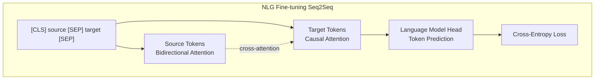

**Common NLG Tasks:**
- **Abstractive Summarization**: CNN/DM, XSum
- **Question Generation**: SQuAD QG
- **Machine Translation**: WMT datasets
- **Text Simplification**
- **Paraphrase Generation**

**Training Strategy:**
- Teacher forcing during training (use gold target tokens as context)
- Sequence-to-sequence attention mask: bidirectional for source, causal for target
- Fine-tuning via `s2s-ft` toolkit (see [s2s-ft: Sequence-to-Sequence Fine-tuning](#7.1))

**Sources:** [README.md:44](), [README.md:235-237]()

---

## Integration with s2s-ft Toolkit

The `s2s-ft` (sequence-to-sequence fine-tuning) toolkit provides infrastructure for fine-tuning UniLM on generation tasks.

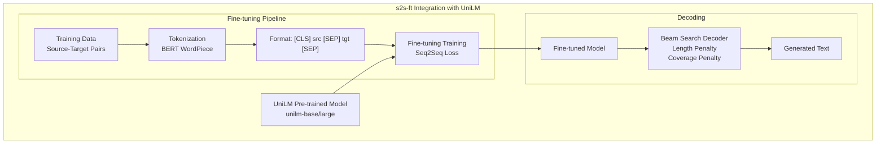

**Key Components in s2s-ft:**
- **Model Loading**: Load pre-trained UniLM checkpoints
- **Input Formatting**: Create sequence-to-sequence input format
- **Training Loop**: Sequence generation training with teacher forcing
- **Decoding**: Beam search with configurable hyperparameters
- **Evaluation**: Automatic metrics (ROUGE, BLEU, METEOR)

**Sources:** [README.md:97](), [README.md:235-236]()

---

## Performance Highlights

### NLU Tasks (UniLM v1)

UniLM v1 achieved competitive results on GLUE benchmark tasks:

| Task | Metric | BERT-Base | UniLM-Base |
|------|--------|-----------|------------|
| MNLI-m | Accuracy | 84.5 | 85.7 |
| SST-2 | Accuracy | 93.2 | 93.0 |
| QNLI | Accuracy | 91.7 | 91.5 |
| CoLA | Matthews Corr. | 58.9 | 58.5 |
| SQuAD 2.0 | F1 | 76.8 | 81.7 |

### NLG Tasks (UniLM v1)

UniLM v1 demonstrated strong performance on generation tasks:

**Abstractive Summarization (XSum):**
- ROUGE-1: 40.43 (vs 38.76 for BertSumAbs)
- ROUGE-2: 17.72 (vs 16.33 for BertSumAbs)
- ROUGE-L: 32.60 (vs 31.15 for BertSumAbs)

**Question Generation (SQuAD QG):**
- BLEU-4: 22.78 (state-of-the-art at time of publication)
- METEOR: 25.49
- ROUGE-L: 51.57

### UniLM v2 Improvements

UniLM v2 with PMLM showed consistent improvements across both NLU and NLG tasks compared to v1, particularly on generation tasks where the PMLM objective better aligns with the autoregressive nature of decoding.

**Sources:** [README.md:44](), [README.md:243]()

---

## Knowledge Distillation to MiniLM

UniLM serves as the teacher model for MiniLM distillation, which compresses the model while maintaining performance:

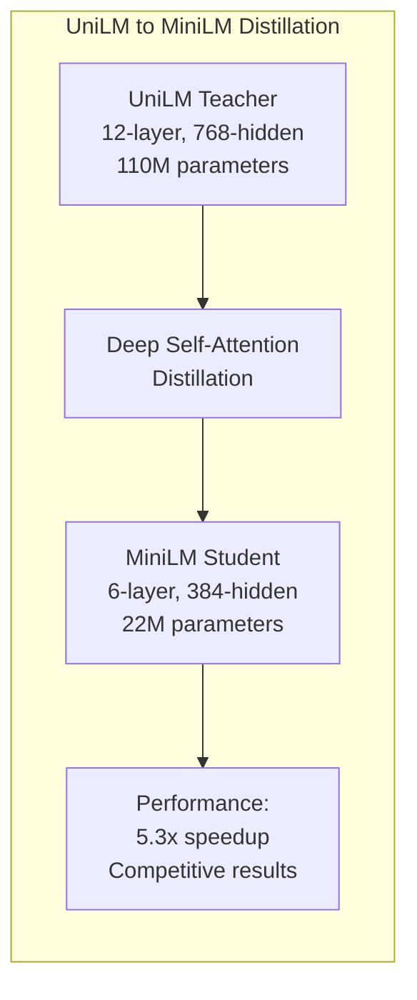

MiniLM distills knowledge from UniLM's self-attention distributions, achieving substantial compression with minimal performance degradation. For details, see [MiniLM: Knowledge Distillation](#3.2).

**Sources:** [README.md:50](), [minilm/README.md:39]()

---

## Usage and Model Loading

### Loading Pre-trained Models

UniLM models can be loaded using the Hugging Face Transformers library:

```python
from transformers import BertConfig, BertForSequenceClassification, BertTokenizer

# Load configuration
config = BertConfig.from_pretrained("path/to/unilm-config.json")

# Load pre-trained model
model = BertForSequenceClassification.from_pretrained(
    "path/to/unilm-model.bin",
    config=config
)

# Load tokenizer (BERT WordPiece)
tokenizer = BertTokenizer.from_pretrained("path/to/vocab.txt")
```

### Fine-tuning for Sequence-to-Sequence

For NLG tasks, use the s2s-ft toolkit:

```bash
# Fine-tuning on summarization task
python run_seq2seq.py \
  --train_file data/train.json \
  --output_dir output/ \
  --model_type bert \
  --model_name_or_path unilm-base-cased.bin \
  --tokenizer_name bert-base-cased \
  --do_lower_case \
  --fp16 \
  --max_source_seq_length 464 \
  --max_target_seq_length 48 \
  --per_gpu_train_batch_size 16 \
  --learning_rate 1e-4
```

**Sources:** [README.md:44](), [unilm/README.md:22-24]()

---

## Evolution to Multilingual Models

UniLM's unified pre-training approach influenced several multilingual developments:

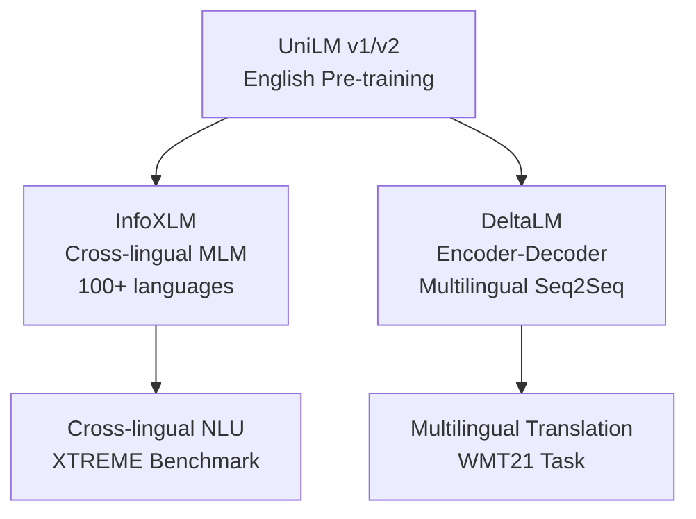

- **InfoXLM**: Extends masked language modeling to 100+ languages with cross-lingual objectives
- **DeltaLM**: Applies UniLM's seq2seq pre-training to multilingual encoder-decoder architecture
- Both leverage UniLM's core insight of unified pre-training objectives

For details on multilingual models, see [DeltaLM and Multilingual Models](#3.3).

**Sources:** [README.md:46-48](), [deltalm/README.md:1-10]()

---

## Citations and References

**UniLM v1:**
```bibtex
@inproceedings{unilm,
    title = "Unified Language Model Pre-training for Natural Language Understanding and Generation",
    author = "Dong, Li and Yang, Nan and Wang, Wenhui and Wei, Furu and Liu, Xiaodong and Wang, Yu and Gao, Jianfeng and Zhou, Ming and Hon, Hsiao-Wuen",
    booktitle = "NeurIPS",
    year = "2019"
}
```

**UniLM v2:**
```bibtex
@inproceedings{unilmv2,
    title = "UniLMv2: Pseudo-Masked Language Models for Unified Language Model Pre-Training",
    author = "Bao, Hangbo and Dong, Li and Wei, Furu and Wang, Wenhui and Yang, Nan and Liu, Xiaodong and Wang, Yu and Piao, Songhao and Gao, Jianfeng and Zhou, Ming and Hon, Hsiao-Wuen",
    booktitle = "ICML",
    year = "2020"
}
```

**Sources:** [README.md:243](), [unilm/README.md:13-20]()

---

## Limitations and Considerations

**Computational Requirements:**
- Pre-training UniLM requires significant computational resources (8-16 GPUs for several days)
- Large model (340M parameters) requires substantial GPU memory during fine-tuning

**Model Selection:**
- For pure NLU tasks, BERT/RoBERTa may be more efficient
- For pure generation, GPT-style models may be simpler
- UniLM is most beneficial when both NLU and NLG capabilities are needed

**Vocabulary:**
- Limited to BERT's WordPiece vocabulary (28,996 tokens)
- May not be optimal for domain-specific applications without vocabulary extension

**Sources:** [README.md:44](), [unilm/README.md:1-36]()

---

