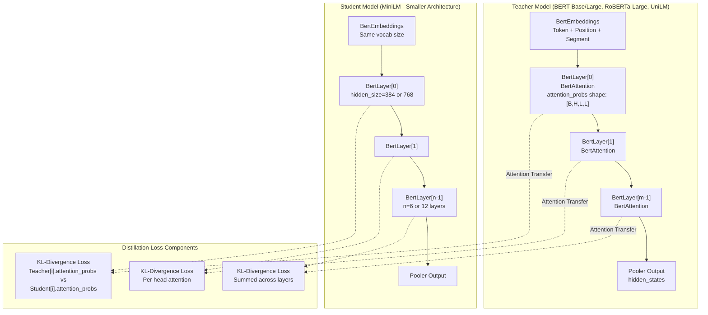
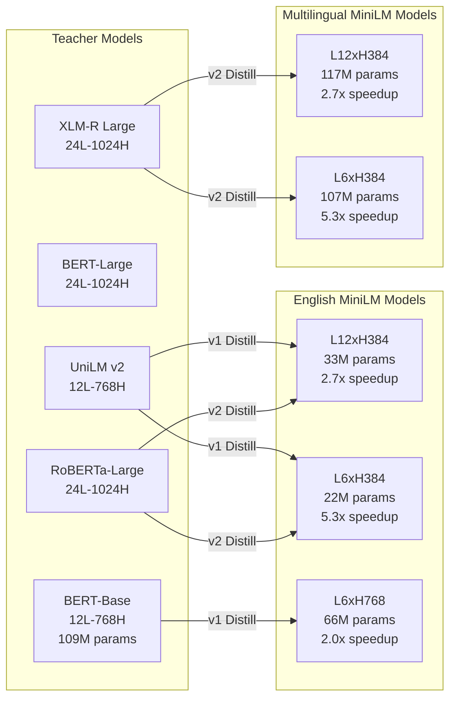
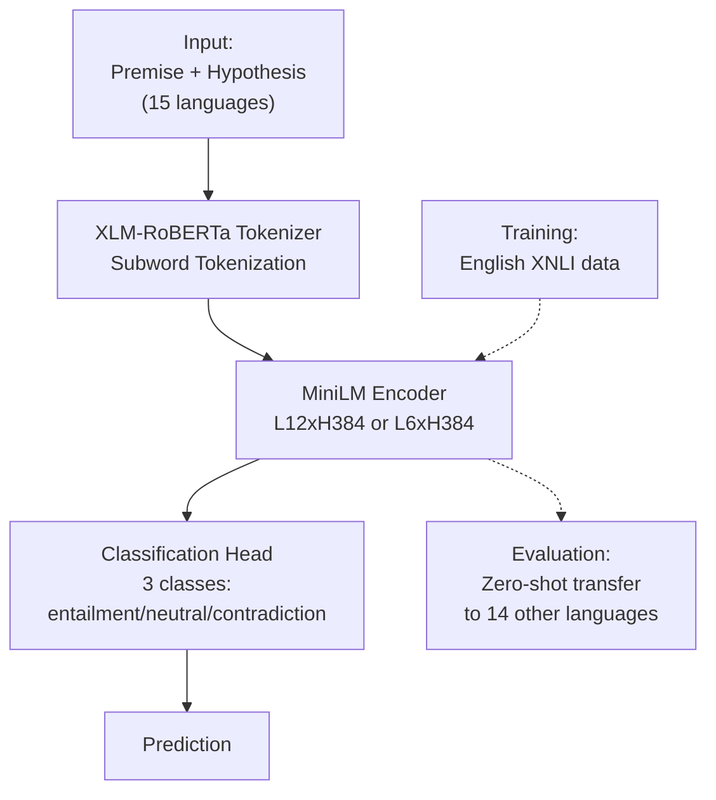
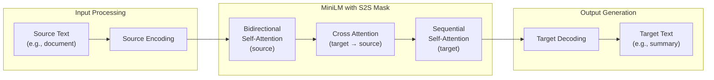
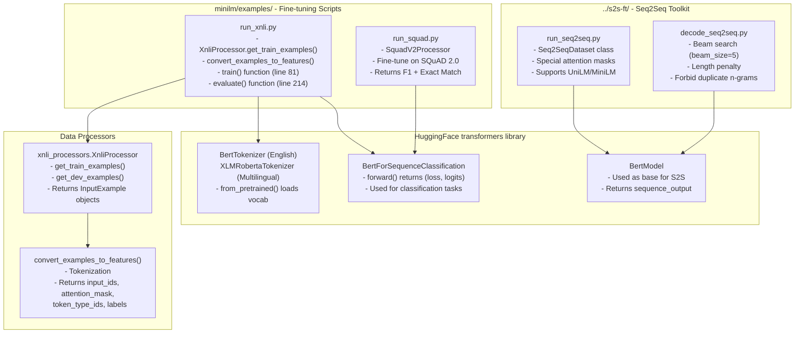
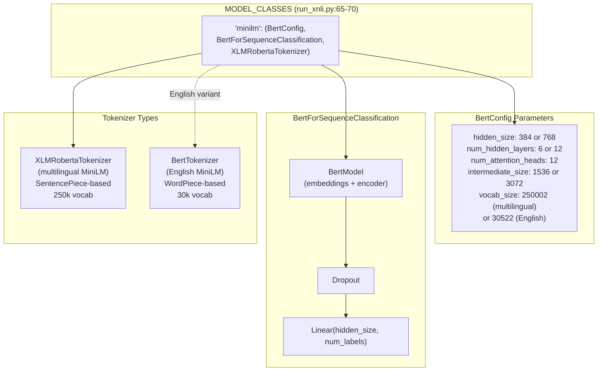
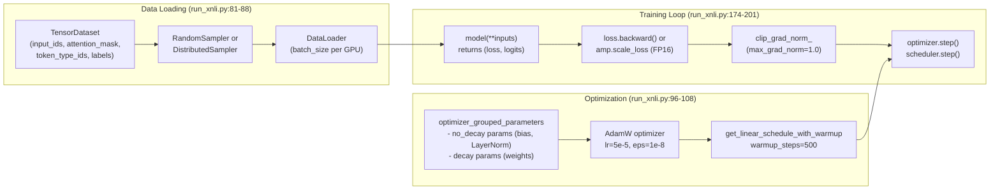
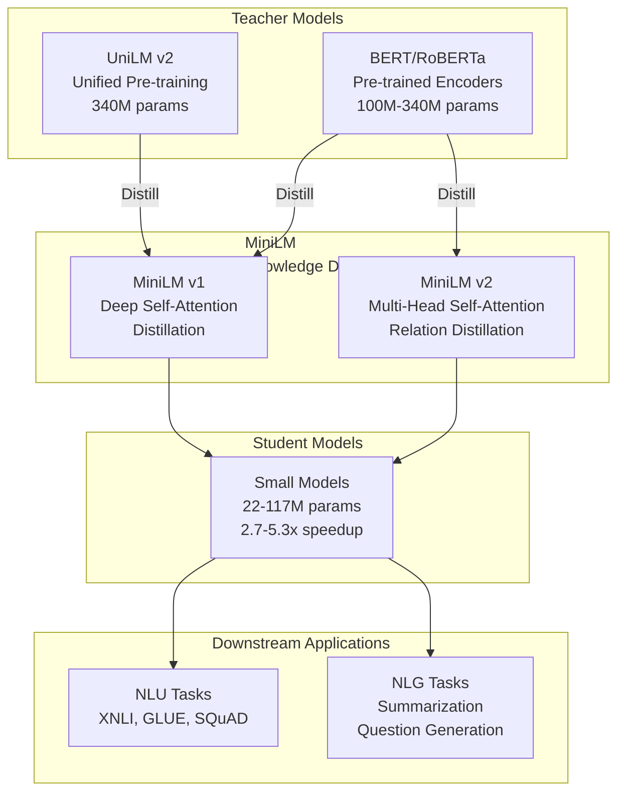

<!-- source: DeepWiki mcp.deepwiki.com · repo microsoft/unilm · page 3.2 MiniLM: Knowledge Distillation · fetched 2026-10-26 -->

# MiniLM: Knowledge Distillation

<details>
<summary>Relevant source files</summary>

The following files were used as context for generating this wiki page:

- [README.md](README.md)
- [deltalm/README.md](deltalm/README.md)
- [minilm/README.md](minilm/README.md)
- [minilm/examples/run_xnli.py](minilm/examples/run_xnli.py)
- [valle/README.md](valle/README.md)
- [wavlm/ASR.PNG](wavlm/ASR.PNG)
- [wavlm/README.md](wavlm/README.md)
- [wavlm/SUPERB_Results.png](wavlm/SUPERB_Results.png)
- [wavlm/screenshot.png](wavlm/screenshot.png)

</details>


## Purpose and Scope

This page documents the MiniLM system for knowledge distillation of pre-trained Transformer models. MiniLM produces small, fast models that achieve 2-5.3x speedup while maintaining competitive performance on both Natural Language Understanding (NLU) and Natural Language Generation (NLG) tasks. The system includes two versions:

- **MiniLM v1**: Deep self-attention distillation for task-agnostic compression
- **MiniLM v2**: Multi-head self-attention relation distillation with improved generalization

For information about the broader unified pre-training approach that MiniLM distills from, see [UniLM](#3.1). For information about multilingual models beyond compression, see [DeltaLM](#3.3). For text embedding models, see [E5](#3.4).

Sources: [README.md:50](), [minilm/README.md:1-6]()

---

## Knowledge Distillation Approach

MiniLM employs task-agnostic knowledge distillation to compress large pre-trained Transformers (BERT, RoBERTa, UniLM) into smaller, faster models without task-specific fine-tuning first. The key innovation is distilling knowledge from the teacher's self-attention distributions rather than just final layer representations.

### MiniLM v1: Deep Self-Attention Distillation

**Deep Self-Attention Distillation Architecture**:


**MiniLM v1 Distillation Process**:

MiniLM v1 transfers knowledge through **layer-to-layer attention distribution matching**. For each layer `i` in the student (mapped to layer `j` in the teacher), the distillation loss minimizes the KL divergence between attention probability distributions:

- **Input**: Teacher and student models process the same input tokens
- **Attention Extraction**: Extract `attention_probs` tensors from each `BertLayer`'s `BertAttention` module (shape `[batch_size, num_heads, seq_len, seq_len]`)
- **Loss Computation**: Compute KL divergence between corresponding teacher-student attention pairs, averaged over all heads and sequence positions
- **Objective**: Student learns to mimic the teacher's attention patterns, capturing relational knowledge

The key insight is that **"deep self-attention distillation is all you need"** for effective compression - no need for intermediate feature matching or task-specific objectives during distillation.

Sources: [minilm/README.md:39](), [README.md:50](), [README.md:236]()

### MiniLM v2: Multi-Head Self-Attention Relation Distillation

MiniLM v2 generalizes the approach by introducing **self-attention relation distillation**, which removes the constraint that the student must have the same number of attention heads as the teacher. This enables more flexible student architectures.

**Self-Attention Relation** concept:
- Instead of transferring raw attention distributions (which requires matching head counts)
- MiniLM v2 transfers **relations between attention distributions** across different heads
- This is computed as the correlation/similarity between attention distributions of different heads
- Allows student models with fewer heads to learn from teachers with more heads

Sources: [minilm/README.md:6](), [minilm/README.md:226]()

---

## Model Variants and Pre-trained Models

### Architecture Variants

MiniLM provides multiple size-speed tradeoffs through different architectural configurations:

| Configuration | Layers | Hidden Size | Heads | Parameters | Speedup vs BERT-Base |
|--------------|--------|-------------|-------|------------|---------------------|
| L12xH384 | 12 | 384 | 12 | 33M (41M total) | 2.7x |
| L6xH384 | 6 | 384 | 12 | 22M (30M total) | 5.3x |
| L6xH768 | 6 | 768 | 12 | 66M (81M total) | 2.0x |

**Note**: Total parameters include embedding parameters (~8M for English models, ~75M for multilingual models using XLM-R vocabulary).

Sources: [minilm/README.md:102-107]()

### Model Variants Diagram



Sources: [minilm/README.md:8-29](), [minilm/README.md:102-107]()

### English Pre-trained Models

**MiniLM v2 English Models**:

| Model | Teacher | Speedup | Params | MNLI-m | SQuAD 2.0 F1 | Download |
|-------|---------|---------|--------|--------|--------------|----------|
| **L6xH768** | RoBERTa-Large | 2.0x | 81M | 87.0 | 81.6 | OneDrive |
| **L12xH384** | RoBERTa-Large | 2.7x | 41M | 86.9 | 82.3 | OneDrive |
| **L6xH384** | RoBERTa-Large | 5.3x | 30M | 84.4 | 76.4 | OneDrive |
| L6xH768 | BERT-Large | 2.0x | 66M | 85.0 | 77.7 | OneDrive |
| L6xH384 | BERT-Large | 5.3x | 22M | 83.0 | 74.3 | OneDrive |

Models use the same WordPiece vocabulary as BERT and are compatible with HuggingFace Transformers through the BERT model classes.

Sources: [minilm/README.md:17-28](), [minilm/README.md:102-108]()

### Multilingual Pre-trained Models

**MiniLM v1/v2 Multilingual Models** (XLM-R tokenizer):

| Model | Teacher | Speedup | Params | XNLI (Acc) | MLQA (F1) |
|-------|---------|---------|--------|------------|-----------|
| **L12xH384** | XLMR-Large | 2.7x | 117M | 72.9 | 64.9 |
| **L6xH384** | XLMR-Large | 5.3x | 107M | 69.3 | 59.0 |

These models support 100+ languages using the XLM-RoBERTa tokenizer but with BERT-style Transformer architecture.

Sources: [minilm/README.md:8-14](), [minilm/README.md:42-44]()

---

## Distillation Loss Functions

### MiniLM v1 Loss Function

The distillation loss for MiniLM v1 combines attention transfer losses across all layers:

**Loss Components**:
1. **Attention Transfer Loss** (per layer): KL divergence between teacher and student attention distributions
2. **Last Layer Value-Relation Transfer** (optional): Transfer of value-value relations in the final layer

The student model is trained to minimize:
```
L = Σ(layers) KL(A_teacher || A_student)
```

where `A` represents the self-attention distribution matrices.

Sources: [minilm/README.md:39](), [README.md:236]()

### MiniLM v2 Loss Function

MiniLM v2 uses **self-attention relation distillation** to enable flexible head configurations:

**Self-Attention Relations**: For a teacher with `H` heads, compute pairwise relations between attention distributions to form an `H×H` relation matrix. The student (with potentially fewer heads `h < H`) learns a similar `h×h` relation structure.

This removes the architectural constraint while preserving the knowledge about how different attention patterns relate to each other.

Sources: [minilm/README.md:6](), [minilm/README.md:258-273]()

---

## Fine-tuning for NLU Tasks

### Using HuggingFace Transformers

MiniLM models can be loaded and fine-tuned using the HuggingFace Transformers library with BERT model classes:

```python
from transformers import AutoTokenizer, AutoModel

# Load pre-trained MiniLM
tokenizer = AutoTokenizer.from_pretrained("microsoft/MiniLM-L12-H384-uncased")
model = AutoModel.from_pretrained("microsoft/MiniLM-L12-H384-uncased")

# Use for downstream tasks
inputs = tokenizer("Hello world!", return_tensors="pt")
outputs = model(**inputs)
```

Sources: [minilm/README.md:110-118]()

### Fine-tuning on XNLI (Cross-lingual NLI)

**XNLI Fine-tuning Architecture**:


**Fine-tuning Example** (XNLI):
```bash
# Fine-tune multilingual MiniLM on XNLI
python ./examples/run_xnli.py --model_type minilm \
    --output_dir ${OUTPUT_DIR} --data_dir ${DATA_DIR} \
    --model_name_or_path ${MODEL_PATH}/multilingual-minilm-l12-h384.bin \
    --tokenizer_name xlm-roberta-base \
    --config_name ${MODEL_PATH}/multilingual-minilm-l12-h384-config.json \
    --do_train --do_eval \
    --max_seq_length 128 --per_gpu_train_batch_size 128 \
    --learning_rate 5e-5 --num_train_epochs 5 \
    --warmup_steps 500 --weight_decay 0.001 \
    --language en --fp16 --fp16_opt_level O2
```

Sources: [minilm/README.md:72-87](), [minilm/examples/run_xnli.py:1-17]()

### XNLI Performance

Evaluation on zero-shot cross-lingual transfer (train on English, evaluate on all languages):

| Model | #Layers | #Hidden | #Params | Average | en | fr | es | de | ... |
|-------|---------|---------|---------|---------|----|----|----|----|-----|
| mBERT | 12 | 768 | 85M | 66.3 | 82.1 | 73.8 | 74.3 | 71.1 | ... |
| XLM-R Base | 12 | 768 | 85M | 74.5 | 84.6 | 78.4 | 78.9 | 76.8 | ... |
| **mMiniLM-L12xH384** | 12 | 384 | 21M | 71.1 | 81.5 | 74.8 | 75.7 | 72.9 | ... |

Despite having only 21M Transformer parameters (vs 85M for baselines), multilingual MiniLM achieves competitive cross-lingual transfer.

Sources: [minilm/README.md:64-70]()

### MLQA Performance (Cross-lingual QA)

| Model | #Params | Average | en | es | de | ar | hi | vi | zh |
|-------|---------|---------|----|----|----|----|----|----|-----|
| mBERT | 85M | 57.7 | 77.7 | 64.3 | 57.9 | 45.7 | 43.8 | 57.1 | 57.5 |
| XLM-R Base | 85M | 64.9 | 80.3 | 67.0 | 62.7 | 55.0 | 60.4 | 66.5 | 62.3 |
| **mMiniLM-L12xH384** | 21M | 63.2 | 79.4 | 66.1 | 61.2 | 54.9 | 58.5 | 63.1 | 59.0 |

Sources: [minilm/README.md:93-99]()

### SQuAD 2.0 and GLUE Benchmarks

**English MiniLM performance** on development sets:

| Model | #Param | SQuAD 2.0 | MNLI-m | SST-2 | QNLI | CoLA | RTE | MRPC | QQP |
|-------|--------|-----------|--------|-------|------|------|-----|------|-----|
| BERT-Base | 109M | 76.8 | 84.5 | 93.2 | 91.7 | 58.9 | 68.6 | 87.3 | 91.3 |
| **MiniLM-L12xH384** | 33M | 81.7 | 85.7 | 93.0 | 91.5 | 58.5 | 73.3 | 89.5 | 91.3 |
| **MiniLM-L6xH384** | 22M | 75.6 | 83.3 | 91.5 | 90.5 | 47.5 | 68.8 | 88.9 | 90.6 |

MiniLM-L12xH384 matches or exceeds BERT-Base performance with only 30% of the parameters and 2.7x faster inference.

Sources: [minilm/README.md:125-129]()

---

## Fine-tuning for NLG Tasks

MiniLM can be fine-tuned for sequence-to-sequence generation tasks using the [s2s-ft toolkit](#7.1). This requires using a specific self-attention mask that enables autoregressive decoding.

### NLG Fine-tuning Process

**Sequence-to-Sequence Training**:


Sources: [minilm/README.md:152-153]()

### Abstractive Summarization: XSum

**XSum Results**:

| Model | #Param | ROUGE-1 | ROUGE-2 | ROUGE-L |
|-------|--------|---------|---------|---------|
| BART | 400M | 45.14 | 22.27 | 37.25 |
| MASS | 123M | 39.75 | 17.24 | 31.95 |
| BertSumAbs | 156M | 38.76 | 16.33 | 31.15 |
| **MiniLM-L12xH384** | 33M | 40.43 | 17.72 | 32.60 |
| **MiniLM-L6xH384** | 22M | 38.79 | 16.39 | 31.10 |

MiniLM-L12xH384 outperforms MASS and BertSumAbs with far fewer parameters.

**Fine-tuning Command** (XSum):
```bash
python -m torch.distributed.launch --nproc_per_node=4 run_seq2seq.py \
    --train_file ${TRAIN_FILE} \
    --output_dir ${OUTPUT_DIR} \
    --model_type bert \
    --model_name_or_path ${MODEL_PATH}/minilm-l12-h384-uncased.bin \
    --tokenizer_name ${MODEL_PATH}/minilm-l12-h384-uncased-vocab-nlg.txt \
    --do_lower_case --fp16 --fp16_opt_level O2 \
    --max_source_seq_length 464 --max_target_seq_length 48 \
    --per_gpu_train_batch_size 16 \
    --learning_rate 1e-4 --num_warmup_steps 500 --num_training_steps 108000
```

Sources: [minilm/README.md:157-185]()

### Abstractive Summarization: CNN/Daily Mail

**CNN/DM Results**:

| Model | #Param | ROUGE-1 | ROUGE-2 | ROUGE-L |
|-------|--------|---------|---------|---------|
| T5-11B | 11B | 43.52 | 21.55 | 40.69 |
| BART | 400M | 44.16 | 21.28 | 40.90 |
| UniLM V1 | 340M | 43.08 | 20.43 | 40.34 |
| **MiniLM-L12xH384** | 33M | 42.66 | 19.91 | 39.73 |
| **MiniLM-L6xH384** | 22M | 41.57 | 19.21 | 38.64 |

Sources: [minilm/README.md:206-215]()

### Question Generation: SQuAD QG

MiniLM achieves strong results on question generation benchmarks:

**SQuAD QG (Du et al. split)**:

| Model | #Param | BLEU-4 | METEOR | ROUGE-L |
|-------|--------|--------|--------|---------|
| UniLM V1 | 340M | 22.78 | 25.49 | 51.57 |
| **MiniLM-L12xH384** | 33M | 21.07 | 24.09 | 49.14 |
| **MiniLM-L6xH384** | 22M | 20.31 | 23.43 | 48.21 |

Sources: [minilm/README.md:217-228]()

---

## Code Organization

### Key Components

**Code Structure and Entry Points**:


**File Organization**:

```
minilm/
├── README.md                           # Documentation and model links
├── examples/
│   ├── run_xnli.py                    # XNLI fine-tuning script
│   │   ├── train() function (line 81-213)
│   │   ├── evaluate() function (line 214-268)
│   │   └── main() (line 271-391)
│   └── run_squad.py                   # SQuAD fine-tuning (similar structure)
├── configs/
│   ├── minilm-l12-h384-uncased-config.json
│   └── multilingual-minilm-l12-h384-config.json
└── [Pre-trained model files downloaded separately]

../s2s-ft/                              # Sequence-to-sequence toolkit
├── run_seq2seq.py                      # Training for NLG tasks
├── decode_seq2seq.py                   # Beam search decoding
└── [Additional S2S utilities]
```

**Key Functions**:
- `train()` in [run_xnli.py:81-213](): Main training loop with optimizer, scheduler, FP16
- `evaluate()` in [run_xnli.py:214-268](): Evaluation on dev/test sets with metrics
- `convert_examples_to_features()`: Converts raw text to model inputs (input_ids, masks)
- Model loading: Uses `BertConfig.from_pretrained()` and `BertForSequenceClassification.from_pretrained()`

Sources: [minilm/README.md:72-87](), [minilm/README.md:131-150](), [minilm/README.md:167-185](), [minilm/examples/run_xnli.py:1-17]()

### Model Classes and Configuration

**Model Type Definitions and Components**:



**Key Implementation Details**:

MiniLM reuses HuggingFace Transformers components:
- **Config**: `BertConfig` with modified `hidden_size` (384 instead of 768) and `num_hidden_layers` (6 or 12 instead of 12)
- **Model Architecture**: Standard `BertForSequenceClassification` from HuggingFace
  - Contains: `BertModel` (encoder) + dropout + classification head
  - No architectural changes needed - only size parameters differ
- **Tokenizer**:
  - Multilingual: `XLMRobertaTokenizer` (vocab size 250002, SentencePiece)
  - English: `BertTokenizer` (vocab size 30522, WordPiece)

This design allows MiniLM models to be drop-in replacements for BERT in existing codebases.

Sources: [minilm/examples/run_xnli.py:65-70](), [minilm/README.md:46-54](), [minilm/README.md:102-107]()

### Training Infrastructure

**Training Pipeline** in `run_xnli.py`:



**Key Training Components**:

1. **Optimizer Setup** ([run_xnli.py:96-108]()):
   - `AdamW` optimizer with weight decay (default 0.001)
   - Separate parameter groups: decay for weights, no decay for biases and LayerNorm
   - Linear warmup schedule with configurable warmup steps

2. **Mixed Precision Training** ([run_xnli.py:118-123]()):
   - NVIDIA Apex `amp.initialize()` for FP16 training
   - `opt_level="O2"` for mixed precision
   - Gradient scaling via `amp.scale_loss()`

3. **Distributed Training** ([run_xnli.py:130-133]()):
   - PyTorch `DistributedDataParallel` wrapper
   - `DistributedSampler` for data parallelism
   - Gradient synchronization across GPUs

4. **Gradient Accumulation** ([run_xnli.py:204-208]()):
   - Accumulate gradients over `gradient_accumulation_steps` before optimizer step
   - Enables large effective batch sizes (e.g., 128 × 4 GPUs = 512)

Sources: [minilm/examples/run_xnli.py:81-208]()

---

## Integration with UniLM Ecosystem

**MiniLM's Role in the UniLM Repository**:


MiniLM enables deployment of UniLM-quality models in resource-constrained environments by providing:
- **Compression**: 3-10x parameter reduction
- **Speed**: 2-5.3x inference speedup
- **Versatility**: Support for both NLU and NLG tasks
- **Multilingual**: Models covering 100+ languages

Sources: [minilm/README.md:1-6](), [minilm/README.md:239-257](), [README.md:50]()

---

## Citations

**MiniLM v1 Paper** (NeurIPS 2020):
```latex
@inproceedings{minilm,
  author = {Wang, Wenhui and Wei, Furu and Dong, Li and Bao, Hangbo and Yang, Nan and Zhou, Ming},
  title = {{MiniLM}: Deep Self-Attention Distillation for Task-Agnostic Compression of Pre-Trained Transformers},
  year = {2020},
  publisher = {Curran Associates Inc.},
  booktitle = {Proceedings of NeurIPS 2020}
}
```

**MiniLM v2 Paper** (ACL 2021 Findings):
```latex
@inproceedings{minilmv2,
  title = "{M}ini{LM}v2: Multi-Head Self-Attention Relation Distillation for Compressing Pretrained Transformers",
  author = "Wang, Wenhui and Bao, Hangbo and Huang, Shaohan and Dong, Li and Wei, Furu",
  booktitle = "Findings of ACL-IJCNLP 2021",
  year = "2021"
}
```

Sources: [minilm/README.md:243-273]()

---

