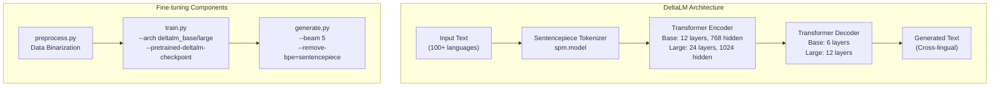
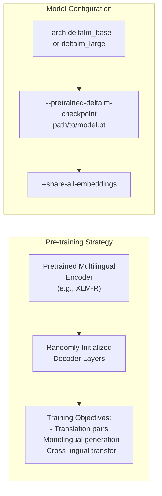
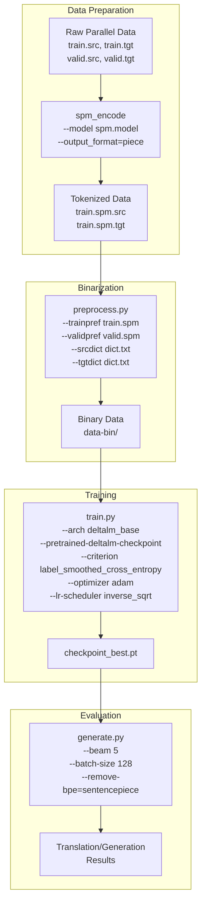
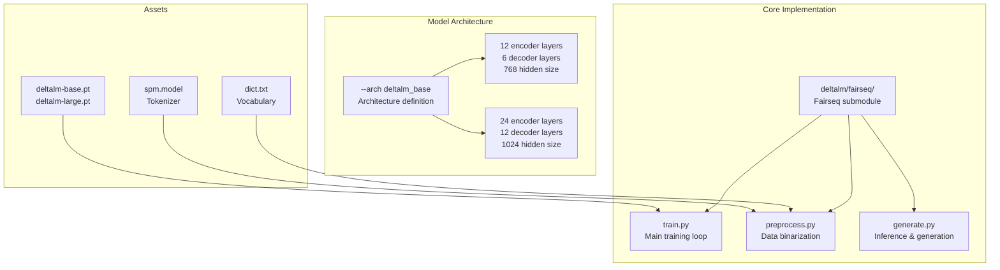

<!-- source: DeepWiki mcp.deepwiki.com · repo microsoft/unilm · page 3.3 DeltaLM and Multilingual Models · fetched 2026-10-26 -->

# DeltaLM and Multilingual Models

<details>
<summary>Relevant source files</summary>

The following files were used as context for generating this wiki page:

- [README.md](README.md)
- [deltalm/README.md](deltalm/README.md)
- [minilm/README.md](minilm/README.md)
- [minilm/examples/run_xnli.py](minilm/examples/run_xnli.py)
- [valle/README.md](valle/README.md)
- [wavlm/ASR.PNG](wavlm/ASR.PNG)
- [wavlm/README.md](wavlm/README.md)
- [wavlm/SUPERB_Results.png](wavlm/SUPERB_Results.png)
- [wavlm/screenshot.png](wavlm/screenshot.png)

</details>


This document covers DeltaLM, an encoder-decoder pre-training approach for multilingual language generation and translation supporting 100+ languages. DeltaLM augments pretrained multilingual encoders with decoder components to enable cross-lingual generation tasks. For general language understanding (NLU) tasks, see [UniLM](#3.1). For monolingual distillation, see [MiniLM](#3.2). For text embeddings, see [E5](#3.4).

## Architecture Overview

DeltaLM employs an encoder-decoder transformer architecture specifically designed for sequence-to-sequence tasks across multiple languages. The model augments pretrained multilingual encoders with decoder layers to support both language generation and translation.



**DeltaLM Encoder-Decoder Architecture and Fine-tuning Pipeline**

The architecture uses separate encoder and decoder stacks, with the encoder processing source language input and the decoder generating target language output autoregressively.

Sources: [deltalm/README.md:1-20](), [README.md:48]()

## Pre-trained Models

DeltaLM provides two model variants with different capacity levels:

| Model | Encoder Layers | Decoder Layers | Hidden Size | FFN Size | Attention Heads | Parameters |
|-------|----------------|----------------|-------------|----------|-----------------|------------|
| DeltaLM-base | 12 | 6 | 768 | 3072 | 12 | 360M |
| DeltaLM-large | 24 | 12 | 1024 | 4096 | 16 | 830M |

Both models share:
- **Vocabulary**: Sentencepiece model with shared dictionary across 100+ languages
- **Pre-training Data**: Multilingual text corpora
- **Tokenization**: Subword tokenization via sentencepiece
- **Architecture Type**: Encoder-decoder with shared embeddings

Model checkpoints and vocabulary files:
- `deltalm-base.pt` - Base model checkpoint
- `deltalm-large.pt` - Large model checkpoint  
- `dict.txt` - Shared vocabulary dictionary
- `spm.model` - Sentencepiece tokenizer model

Sources: [deltalm/README.md:14-20]()

## Training and Pre-training Approach

DeltaLM's pre-training strategy augments existing multilingual encoders with decoder components:



**DeltaLM Pre-training and Configuration Strategy**

The model leverages transfer learning by initializing the encoder from pretrained multilingual models while training the decoder from scratch on multilingual parallel and monolingual data.

Sources: [deltalm/README.md:1-11]()

## Fine-tuning Pipeline

The fine-tuning process involves data preparation, tokenization, binarization, training, and evaluation stages:



**Complete Fine-tuning Pipeline from Raw Data to Evaluation**

### Data Preparation Steps

1. **Organize Raw Data**: Structure parallel text files as `train.src`, `train.tgt`, `valid.src`, `valid.tgt`

2. **Tokenization**: Apply sentencepiece tokenization:
   ```bash
   spm_encode --model=/path/to/checkpoint/spm.model --output_format=piece < train.src > train.spm.src
   ```

3. **Binarization**: Convert to fairseq binary format using `preprocess.py` with shared dictionaries for source and target languages

4. **Fine-tuning**: Train with `train.py` specifying architecture and pretrained checkpoint:
   - `--arch deltalm_base` or `--arch deltalm_large`
   - `--pretrained-deltalm-checkpoint` pointing to model file
   - Label smoothing with `--criterion label_smoothed_cross_entropy`
   - Inverse square root learning rate schedule

5. **Evaluation**: Generate outputs with `generate.py` using beam search

Sources: [deltalm/README.md:34-154]()

## Training Configuration

Key hyperparameters and settings for fine-tuning:

| Parameter | Value | Purpose |
|-----------|-------|---------|
| `max_source_positions` | 512 | Maximum source sequence length |
| `max_target_positions` | 512 | Maximum target sequence length |
| `label_smoothing` | 0.1 | Label smoothing for cross-entropy |
| `optimizer` | adam | Optimizer algorithm |
| `adam_betas` | (0.9, 0.98) | Adam beta parameters |
| `lr_scheduler` | inverse_sqrt | Learning rate decay schedule |
| `warmup_updates` | 4000 | Warmup steps for learning rate |
| `max_tokens` | 4096 * 128 | Recommended batch size in tokens |

**Important Notes**:
- For large checkpoint: use `--arch deltalm_large`
- Adjust `max_tokens` and `update_freq` based on GPU memory
- Use `--fp16` for mixed precision training on devices with Tensor Cores

Sources: [deltalm/README.md:102-131]()

## Applications and Performance

### Cross-lingual Abstractive Summarization

DeltaLM demonstrates strong performance on WikiLingua benchmark for cross-lingual abstractive summarization:

| Model | Parameters | ROUGE-1 | ROUGE-2 | ROUGE-L |
|-------|------------|---------|---------|---------|
| mBART | 610M | 34.5 | 12.9 | **28.7** |
| mT5 | 300M | 27.5 | 8.8 | 22.8 |
| mT5 | 580M | 31.8 | 11.5 | 26.0 |
| DeltaLM | 360M | **35.3** | **13.4** | **28.7** |

DeltaLM achieves the best ROUGE-1 and ROUGE-2 scores while matching mBART's ROUGE-L performance with significantly fewer parameters (360M vs 610M).

Sources: [deltalm/README.md:22-32]()

### Multilingual Machine Translation

DeltaLM achieved first place on the WMT21 multilingual translation task, which requires translating between 102 languages. This demonstrates the model's capability for large-scale multilingual translation.

Sources: [deltalm/README.md:9](), [README.md:214]()

## Implementation Details

### Codebase Structure

DeltaLM is implemented as a Fairseq extension:



**DeltaLM Implementation Components and Dependencies**

### Key Scripts and Modules

1. **train.py**: Main training script
   - Loads pretrained checkpoint via `--pretrained-deltalm-checkpoint`
   - Configures architecture with `--arch` flag
   - Supports distributed training and mixed precision

2. **preprocess.py**: Data preparation
   - Binarizes text data for efficient loading
   - Creates fairseq dataset objects
   - Uses shared dictionaries for multilingual support

3. **generate.py**: Inference script
   - Beam search decoding (default beam size: 5)
   - Removes BPE with `--remove-bpe=sentencepiece`
   - Batch processing for efficiency

Sources: [deltalm/README.md:34-154]()

## Usage Example

Complete example for IWSLT14 German-English translation:

```bash
# 1. Prepare raw data
bash examples/prepare_iwslt14.sh /tmp/iwslt14

# 2. Tokenize with sentencepiece
bash examples/binary_iwslt14.sh \
     /tmp/iwslt14/iwslt14.tokenized.de-en \
     /tmp/iwslt14/iwslt14.spm \
     /path/to/checkpoint/spm.model

# 3. Binarize data
bash examples/binary_iwslt14.sh \
     /tmp/iwslt14/iwslt14.spm \
     /tmp/iwslt14/iwslt14.bin \
     /path/to/checkpoint/dict.txt

# 4. Fine-tune model
bash examples/train_iwslt14.sh \
     /tmp/iwslt14/iwslt14.bin \
     /tmp/iwslt14/checkpoints \
     /path/to/checkpoint/model.pt

# 5. Evaluate
bash examples/evaluate_iwslt14.sh \
     /tmp/iwslt14/iwslt14.bin \
     /tmp/iwslt14/checkpoints
```

The repository includes example scripts for the complete pipeline, demonstrating data preparation, training, and evaluation on standard benchmarks.

Sources: [deltalm/README.md:54-153]()

## Related Work

DeltaLM is accompanied by mT6 (Multilingual Pretrained Text-to-Text Transformer with Translation Pairs), which shares similar goals for multilingual generation. Both approaches focus on encoder-decoder pre-training for cross-lingual tasks.

The model builds upon the UniLM family of models (see [UniLM](#3.1)) by extending the architecture to explicitly support encoder-decoder structures for generation-focused tasks rather than masked language modeling approaches used in encoder-only models.

Sources: [deltalm/README.md:1-8](), [README.md:48]()

---

