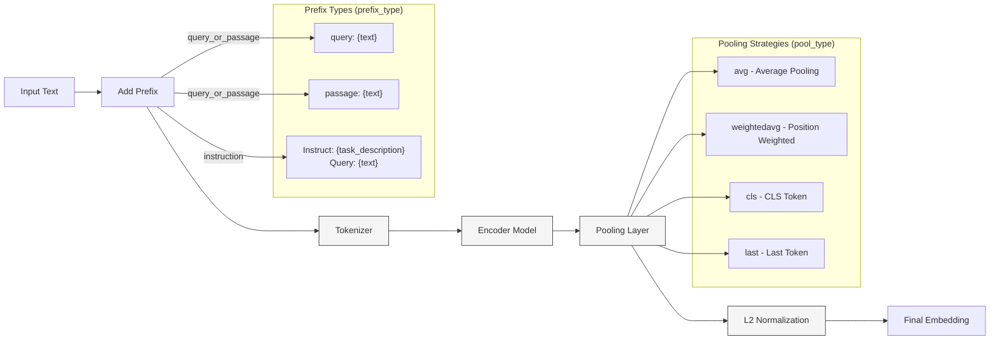
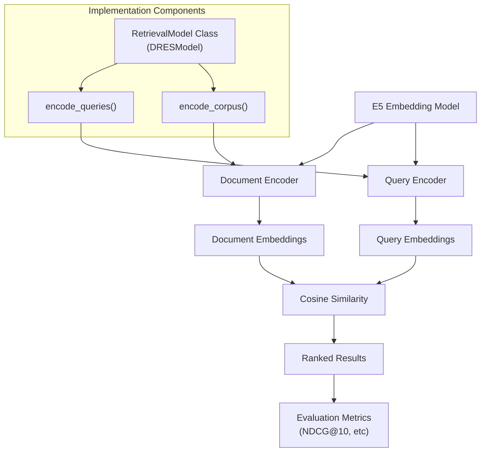

<!-- source: DeepWiki mcp.deepwiki.com · repo microsoft/unilm · page 3.4 E5: Text Embeddings · fetched 2026-10-26 -->

# E5: Text Embeddings

<details>
<summary>Relevant source files</summary>

The following files were used as context for generating this wiki page:

- [e5/README.md](e5/README.md)
- [e5/model_config.py](e5/model_config.py)
- [e5/mteb_beir_eval.py](e5/mteb_beir_eval.py)
- [e5/mteb_except_retrieval_eval.py](e5/mteb_except_retrieval_eval.py)
- [e5/requirements.txt](e5/requirements.txt)
- [e5/scripts/eval_mteb_beir.sh](e5/scripts/eval_mteb_beir.sh)
- [e5/scripts/eval_mteb_except_retrieval.sh](e5/scripts/eval_mteb_except_retrieval.sh)
- [e5/utils.py](e5/utils.py)

</details>


## Purpose and Scope

This document covers the E5 text embedding models, a series of text embedding models developed as part of the UniLM project. E5 models transform text into dense vector representations that capture semantic meaning, making them particularly useful for information retrieval, semantic search, and a variety of natural language understanding tasks.

The document explains the model architecture, variants, technical implementation, and usage of E5 text embeddings, as well as how to evaluate these models using standard benchmarks.

Sources: [e5/README.md:1-10]()

## Overview of E5 Text Embeddings

E5 (Embeddings from bidirectional Encoder representations) are text embedding models pre-trained using contrastive learning approaches. The series includes models of various sizes, both English and multilingual versions, as well as models based on large language models (LLMs).

### E5 Model Architecture and Variants

```mermaid
graph TD
    E5["E5 Text Embeddings"] --> EnglishModels["English Models"]
    E5 --> MultilingualModels["Multilingual Models"]
    E5 --> LLMModels["LLM-based Models"]
    
    EnglishModels --> E5Versions["Standard Versions"]
    EnglishModels --> E5V2["V2 Versions"]
    EnglishModels --> E5Unsupervised["Unsupervised Versions"]
    
    E5Versions --> E5S["e5-small (12 layers, 384 dim)"]
    E5Versions --> E5B["e5-base (12 layers, 768 dim)"]
    E5Versions --> E5L["e5-large (24 layers, 1024 dim)"]
    
    E5V2 --> E5SV2["e5-small-v2 (12 layers, 384 dim)"]
    E5V2 --> E5BV2["e5-base-v2 (12 layers, 768 dim)"]
    E5V2 --> E5LV2["e5-large-v2 (24 layers, 1024 dim)"]
    
    E5Unsupervised --> E5SU["e5-small-unsupervised (12 layers, 384 dim)"]
    E5Unsupervised --> E5BU["e5-base-unsupervised (12 layers, 768 dim)"]
    E5Unsupervised --> E5LU["e5-large-unsupervised (24 layers, 1024 dim)"]
    
    MultilingualModels --> ME5S["multilingual-e5-small (12 layers, 384 dim)"]
    MultilingualModels --> ME5B["multilingual-e5-base (12 layers, 768 dim)"]
    MultilingualModels --> ME5L["multilingual-e5-large (24 layers, 1024 dim)"]
    MultilingualModels --> ME5LI["multilingual-e5-large-instruct (24 layers, 1024 dim)"]
    
    LLMModels --> E5Mistral["e5-mistral-7b-instruct (32 layers, 4096 dim)"]
```



Sources: [e5/README.md:12-43]()

E5 models are available in different configurations:

1. **English Models**: Available in standard, v2, and unsupervised variants, each in three sizes (small, base, large).
2. **Multilingual Models**: Support multiple languages, with variants including small, base, large, and a specialized large-instruct model.
3. **LLM-based Models**: Leverage large language models like Mistral for improved embedding quality.

The models with `-unsupervised` suffix are pre-trained only on unlabeled datasets, while the standard models incorporate supervised learning signals.

## Model Performance

E5 models are evaluated on standard benchmarks such as BEIR (Benchmark for Information Retrieval), with performance generally improving with model size:

| Model | BEIR Score | Layers | Embedding Dimension |
|-------|-----------|--------|---------------------|
| E5-small-v2 | 49.0 | 12 | 384 |
| E5-base-v2 | 50.3 | 12 | 768 |
| E5-large-v2 | 50.6 | 24 | 1024 |
| E5-small | 46.0 | 12 | 384 |
| E5-base | 48.8 | 12 | 768 |
| E5-large | 50.0 | 24 | 1024 |
| multilingual-e5-large | 51.4 | 24 | 1024 |
| multilingual-e5-large-instruct | 52.5 | 24 | 1024 |
| E5-mistral-7b-instruct | 56.9 | 32 | 4096 |

Sources: [e5/README.md:12-43]()

## Technical Implementation

### Embedding Generation Process



Sources: [e5/utils.py:45-70](), [e5/model_config.py:1-34](), [e5/mteb_beir_eval.py:51-70]()

The E5 embedding generation process involves:

1. **Text Preprocessing**: Adding appropriate prefixes based on input type
   - `query_or_passage` type: Adds "query: " or "passage: " prefixes
   - `instruction` type: Adds task-specific instructions and "Query: " prefix

2. **Tokenization**: Converting text to token IDs using the model's tokenizer

3. **Encoding**: Passing tokens through the transformer model to get contextual representations

4. **Pooling**: Combining token representations into a single vector using one of several strategies:
   - `avg`: Simple mean pooling over all tokens
   - `weightedavg`: Position-weighted mean pooling (from SGPT)
   - `cls`: Using the [CLS] token representation
   - `last`: Using the last token representation

5. **Normalization**: L2-normalizing the final vector for cosine similarity calculations

Different E5 models use different default pooling strategies, as defined in the model configuration:

```python
# Default pooling strategies by model
MODEL_NAME_TO_POOL_TYPE = {
    'e5-small': 'avg',
    'e5-base': 'avg',
    'e5-large': 'avg',
    # [...]
    'e5-mistral-7b-instruct': 'last',
}
```

Sources: [e5/model_config.py:1-16]()

### Task-Specific Instructions

For instruction-based models, E5 employs task-specific prompts to guide the embedding generation. For example:

- For retrieval tasks: "Given a question, retrieve Wikipedia passages that answer the question"
- For classification tasks: "Classify the sentiment expressed in the given movie review text"

The system contains a comprehensive dictionary of task-specific instructions for different benchmarks and tasks.

Sources: [e5/utils.py:85-204]()

## Evaluation

E5 models can be evaluated on two main benchmarks:

### BEIR Benchmark Evaluation



Sources: [e5/mteb_beir_eval.py:39-92](), [e5/scripts/eval_mteb_beir.sh:1-24]()

The BEIR benchmark focuses on information retrieval tasks across various domains. To evaluate an E5 model on BEIR:

```bash
bash scripts/eval_mteb_beir.sh intfloat/e5-small-v2
```

This runs the evaluation script that:
1. Loads the specified model
2. Encodes queries and documents
3. Calculates retrieval metrics (NDCG, recall, etc.)

### MTEB Benchmark Evaluation

The MTEB (Massive Text Embedding Benchmark) evaluates models on a broader range of tasks beyond retrieval:

```bash
bash scripts/eval_mteb_except_retrieval.sh intfloat/e5-base-v2
```

For multilingual models, add the `--multilingual` flag:

```bash
bash scripts/eval_mteb_except_retrieval.sh intfloat/multilingual-e5-base --multilingual
```

This evaluates the model on:
- STS (Semantic Textual Similarity)
- Summarization
- Classification
- Clustering
- Reranking
- BitextMining
- PairClassification

Sources: [e5/mteb_except_retrieval_eval.py:1-129](), [e5/scripts/eval_mteb_except_retrieval.sh:1-25]()

## Usage Guide

### Installation

To use E5 models, install the required dependencies:

```bash
pip install -r requirements.txt
```

For the `e5-mistral-7b-instruct` model, you'll need `transformers>=4.34` to properly load the Mistral model.

Sources: [e5/requirements.txt:1-6](), [e5/README.md:45-51]()

### Basic Usage Example

Here's a simplified example of using an E5 model to generate embeddings:

```python
from transformers import AutoModel, AutoTokenizer
import torch.nn.functional as F
from utils import pool, create_batch_dict

# Load model and tokenizer
model_name = "intfloat/e5-base-v2"
tokenizer = AutoTokenizer.from_pretrained(model_name)
model = AutoModel.from_pretrained(model_name)

# Prepare input texts
query_text = "query: what is the capital of France?"
passage_text = "passage: Paris is the capital and most populous city of France."

# Create batch and generate embeddings
batch_dict = create_batch_dict(tokenizer, [query_text, passage_text])
outputs = model(**batch_dict)
embeddings = pool(outputs.last_hidden_state, batch_dict['attention_mask'], "avg")
normalized_embeddings = F.normalize(embeddings, p=2, dim=1)

# Calculate similarity
similarity = (normalized_embeddings[0] * normalized_embeddings[1]).sum()
```

## Performance Considerations

When evaluating or using E5 models, consider:

1. **Memory Usage**: Evaluation on large corpora can be memory-intensive. Reduce batch size if you encounter OOM errors.

2. **Processing Time**: Full benchmark evaluation can take significant time (up to 10 hours for standard models, several days for LLM-based models like `e5-mistral-7b-instruct`).

3. **GPU Utilization**: By default, evaluation scripts use all available GPUs. For the LLM-based models, ensure you have sufficient GPU memory.

Sources: [e5/README.md:86-88](), [e5/README.md:64-66]()

## Integration with Other UniLM Components

E5 embeddings are part of the broader UniLM ecosystem of language models. They can be used as standalone embedding models or integrated with other UniLM components for more complex NLP tasks.

In the context of the wider UniLM architecture, E5 serves as a specialized component for generating high-quality text representations that can be used for retrieval, matching, and similarity-based tasks.

---

