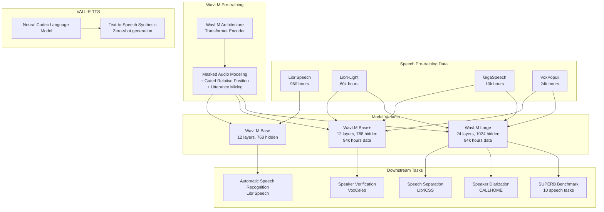
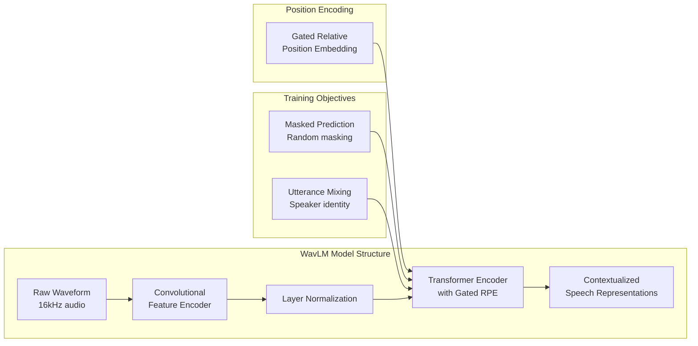
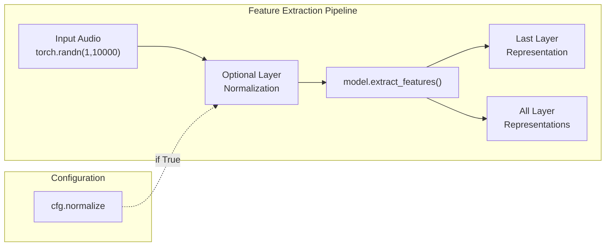
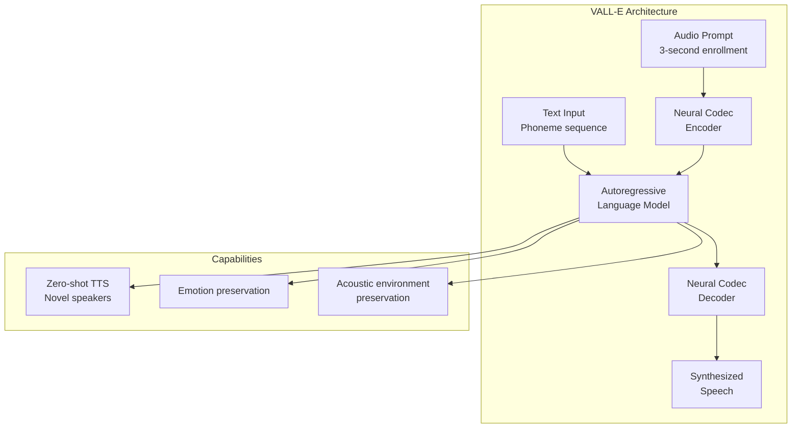
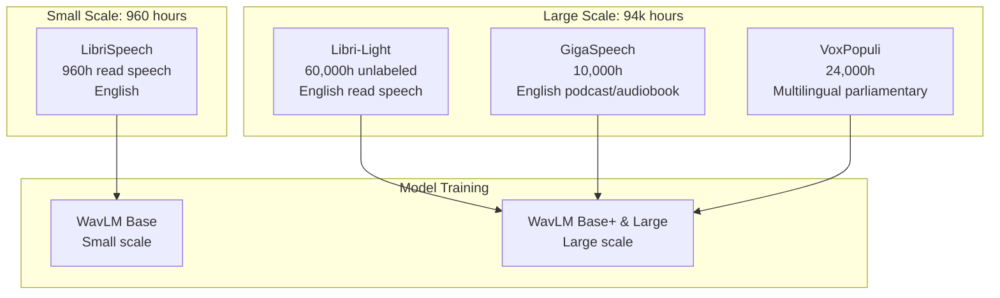

<!-- source: DeepWiki mcp.deepwiki.com · repo microsoft/unilm · page 4 Speech Models · fetched 2026-10-26 -->

# Speech Models

<details>
<summary>Relevant source files</summary>

The following files were used as context for generating this wiki page:

- [README.md](README.md)
- [deltalm/README.md](deltalm/README.md)
- [minilm/README.md](minilm/README.md)
- [minilm/examples/run_xnli.py](minilm/examples/run_xnli.py)
- [valle/README.md](valle/README.md)
- [wavlm/ASR.PNG](wavlm/ASR.PNG)
- [wavlm/README.md](wavlm/README.md)
- [wavlm/SUPERB_Results.png](wavlm/SUPERB_Results.png)
- [wavlm/screenshot.png](wavlm/screenshot.png)

</details>


This page documents the speech processing models in the Microsoft UniLM repository, focusing on self-supervised pre-training approaches for universal speech representation and synthesis. For language models, see [Language Models](#3). For vision models, see [Vision Models](#2). For multimodal document understanding, see [Document AI: Multimodal Models](#5).

## Overview

The repository includes two primary speech model families:

- **WavLM**: Large-scale self-supervised pre-training for universal speech representation learning, applicable to ASR, speaker verification, speech separation, and other downstream tasks
- **VALL-E**: Neural codec language model for zero-shot text-to-speech synthesis

Both models employ self-supervised pre-training strategies inspired by masked language modeling, adapted for the audio modality.

**Sources:** [README.md:69-72](), [wavlm/README.md:1-14](), [valle/README.md:1-5]()

## Architecture Overview



**Sources:** [wavlm/README.md:18-23](), [README.md:69-72]()

## WavLM Model Architecture

WavLM applies masked audio modeling with architectural innovations for robust speech representation learning across diverse speech processing tasks.

### Core Components



The model uses a convolutional feature encoder to process raw waveforms, followed by Transformer layers with gated relative position embeddings. The pre-training combines masked prediction and utterance mixing to learn both content and speaker representations.

**Sources:** [wavlm/README.md:7-14](), [README.md:70]()

### Model Variants

| Model | Layers | Hidden Size | Heads | FFN Dim | Parameters | Training Data |
|-------|--------|-------------|-------|---------|------------|---------------|
| WavLM Base | 12 | 768 | 12 | 3072 | ~95M | 960h LibriSpeech |
| WavLM Base+ | 12 | 768 | 12 | 3072 | ~95M | 94k hours (Libri-Light + GigaSpeech + VoxPopuli) |
| WavLM Large | 24 | 1024 | 16 | 4096 | ~315M | 94k hours (Libri-Light + GigaSpeech + VoxPopuli) |

**Sources:** [wavlm/README.md:18-23]()

## Code Integration and Usage

### Loading Pre-trained Models

The following code demonstrates loading WavLM checkpoints programmatically:

```python
import torch
from WavLM import WavLM, WavLMConfig

# Load checkpoint
checkpoint = torch.load('/path/to/wavlm.pt')
cfg = WavLMConfig(checkpoint['cfg'])
model = WavLM(cfg)
model.load_state_dict(checkpoint['model'])
model.eval()
```

**Sources:** [wavlm/README.md:26-35]()

### Feature Extraction



To extract representations from the last layer:

```python
wav_input_16khz = torch.randn(1,10000)
if cfg.normalize:
    wav_input_16khz = torch.nn.functional.layer_norm(wav_input_16khz, wav_input_16khz.shape)
rep = model.extract_features(wav_input_16khz)[0]
```

To extract representations from all layers:

```python
rep, layer_results = model.extract_features(
    wav_input_16khz, 
    output_layer=model.cfg.encoder_layers, 
    ret_layer_results=True
)[0]
layer_reps = [x.transpose(0, 1) for x, _ in layer_results]
```

**Sources:** [wavlm/README.md:37-49]()

### Integration with Hugging Face and S3PRL

WavLM models are supported by both Hugging Face Transformers and the S3PRL (Self-Supervised Speech Pre-training and Representation Learning) toolkit. For downstream task fine-tuning, weighted sum of layer representations is recommended:

```
# Weighted sum approach (recommended)
weighted_rep = sum(w_i * layer_reps[i] for i in range(num_layers))
```

**Sources:** [wavlm/README.md:51]()

## Downstream Task Performance

### SUPERB Benchmark

WavLM Large achieves state-of-the-art performance on the SUPERB (Speech processing Universal PERformance Benchmark), which evaluates models across 10 diverse speech tasks including content, speaker, semantics, and paralinguistics understanding.

**Sources:** [wavlm/README.md:53-56](), [README.md:147]()

### Speaker Verification

Performance on VoxCeleb1 benchmark (EER %):

| Model | Fix Pre-train | Vox1-O | Vox1-E | Vox1-H |
|-------|--------------|--------|--------|--------|
| ECAPA-TDNN | - | 0.87 | 1.12 | 2.12 |
| HuBERT Large | Yes | 0.888 | 0.912 | 1.853 |
| UniSpeech-SAT Large | Yes | 0.771 | 0.781 | 1.669 |
| **WavLM Large** | Yes | **0.59** | **0.65** | **1.328** |
| **WavLM Large** | No | **0.505** | **0.579** | **1.176** |

With large margin fine-tuning and score calibration:

| Model | Vox1-O | Vox1-E | Vox1-H |
|-------|--------|--------|--------|
| **WavLM Large** | **0.33** | **0.477** | **0.984** |

**Sources:** [wavlm/README.md:59-74]()

### Speech Separation

Evaluation on LibriCSS dataset (WER %):

| Model | 0S | 0L | OV10 | OV20 | OV30 | OV40 |
|-------|----|----|------|------|------|------|
| Conformer (SOTA) | 4.5 | 4.4 | 6.2 | 8.5 | 11 | 12.6 |
| UniSpeech-SAT Large | 4.3 | 4.2 | 5.0 | 6.3 | 8.2 | 8.8 |
| **WavLM Large** | **4.2** | **4.1** | **4.8** | **5.8** | **7.4** | **8.5** |

**Sources:** [wavlm/README.md:77-87]()

### Speaker Diarization

Evaluation on CALLHOME dataset (DER %):

| Model | spk_2 | spk_3 | spk_4 | spk_5 | spk_6 | spk_all |
|-------|-------|-------|-------|-------|-------|---------|
| EEND-EDA clustering (SOTA) | 7.11 | 11.88 | 14.37 | 25.95 | 21.95 | 11.84 |
| UniSpeech-SAT Large | 5.93 | 10.66 | 12.9 | 16.48 | 23.25 | 10.92 |
| **WavLM Large** | **6.46** | **10.69** | **11.84** | **12.89** | **20.70** | **10.35** |

**Sources:** [wavlm/README.md:90-101]()

### Automatic Speech Recognition

WavLM models demonstrate strong ASR performance on LibriSpeech when fine-tuned with CTC or seq2seq objectives.

**Sources:** [wavlm/README.md:103-106]()

## VALL-E: Neural Codec Language Model

VALL-E introduces a language modeling approach for text-to-speech synthesis, treating TTS as a conditional codec language modeling task. The model achieves state-of-the-art zero-shot TTS performance, capable of synthesizing high-quality personalized speech with only a 3-second enrollment recording.



### Key Characteristics

- **Zero-shot capability**: Synthesize speech for any speaker with minimal audio prompt
- **Neural codec representation**: Uses discrete acoustic tokens from neural audio codecs
- **Language modeling paradigm**: Treats TTS as a conditional generation task
- **High-quality synthesis**: Achieves competitive naturalness and speaker similarity

### Demo and Resources

Demo samples are available at https://aka.ms/valle demonstrating the model's capabilities across various speakers and acoustic conditions.

**Sources:** [valle/README.md:1-5](), [README.md:72](), [README.md:123]()

## Model Checkpoints and Access

### WavLM Checkpoint URLs

Pre-trained models are hosted on Azure Storage and Google Drive:

**WavLM Base:**
- Azure: `https://valle.blob.core.windows.net/share/wavlm/WavLM-Base.pt`
- Training: 960 hours LibriSpeech

**WavLM Base+:**
- Azure: `https://valle.blob.core.windows.net/share/wavlm/WavLM-Base+.pt`
- Training: 94k hours (Libri-Light + GigaSpeech + VoxPopuli)

**WavLM Large:**
- Azure: `https://valle.blob.core.windows.net/share/wavlm/WavLM-Large.pt`
- Training: 94k hours (Libri-Light + GigaSpeech + VoxPopuli)

All checkpoints are also available through Hugging Face Hub for seamless integration.

**Sources:** [wavlm/README.md:18-23](), [README.md:148-149]()

## Training Infrastructure

### Pre-training Data Sources



The training pipeline uses public datasets totaling up to 94k hours of speech, significantly larger than previous English speech models. This scale enables robust representations across diverse acoustic conditions and speaking styles.

**Sources:** [wavlm/README.md:18-23](), [wavlm/README.md:198]()

## Related Models

For additional speech pre-training models, including UniSpeech, UniSpeech-SAT, SpeechT5, and SpeechLM, see the [UniSpeech repository](https://github.com/microsoft/UniSpeech).

**Sources:** [wavlm/README.md:108-109](), [README.md:83-90]()

## Citation

When using WavLM in research, cite:

```latex
@article{Chen2021WavLM,
  title   = {WavLM: Large-Scale Self-Supervised Pre-training for Full Stack Speech Processing},
  author  = {Sanyuan Chen and Chengyi Wang and Zhengyang Chen and Yu Wu and Shujie Liu and Zhuo Chen and Jinyu Li and Naoyuki Kanda and Takuya Yoshioka and Xiong Xiao and Jian Wu and Long Zhou and Shuo Ren and Yanmin Qian and Yao Qian and Jian Wu and Michael Zeng and Furu Wei},
  eprint={2110.13900},
  archivePrefix={arXiv},
  primaryClass={cs.CL},
  year={2021}
}
```

For VALL-E, cite:

```latex
@article{VALLE2023,
  title={Neural Codec Language Models are Zero-Shot Text to Speech Synthesizers},
  author={Wang, Chengyi and Chen, Sanyuan and Wu, Yu and Zhang, Ziqiang and Zhou, Long and Liu, Shujie and Chen, Zhuo and Liu, Yanqing and Wang, Huaming and Li, Jinyu and others},
  journal={arXiv preprint arXiv:2301.02111},
  year={2023}
}
```

**Sources:** [wavlm/README.md:118-129](), [valle/README.md:5]()

---

