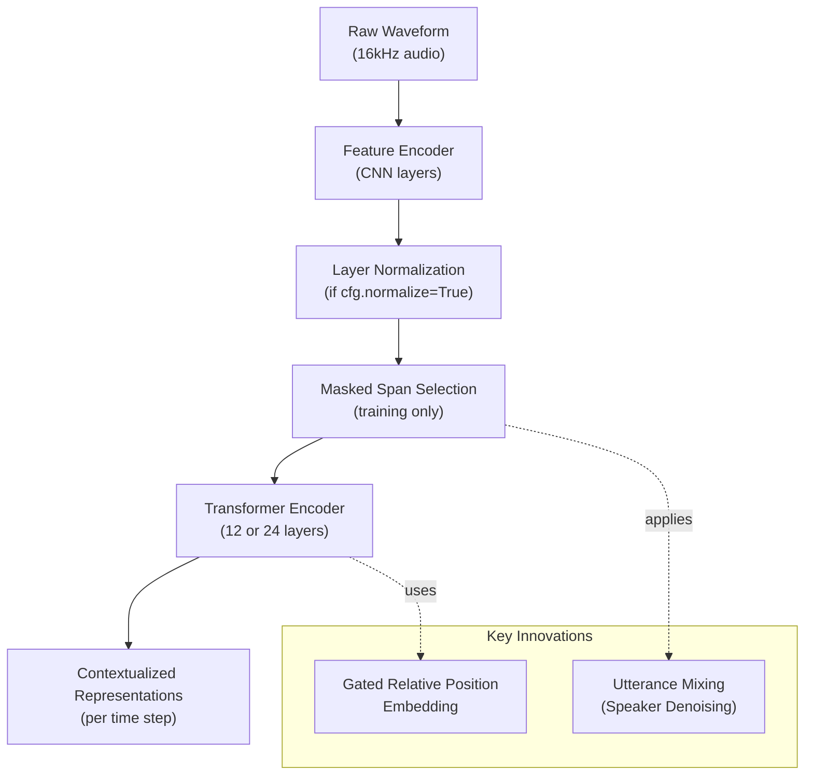
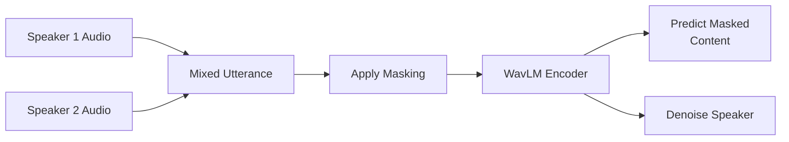
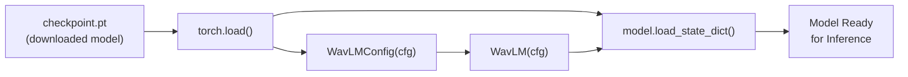
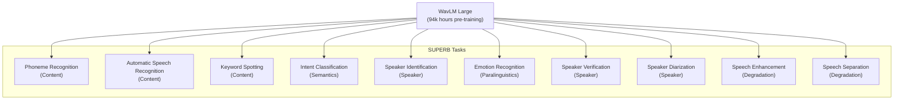
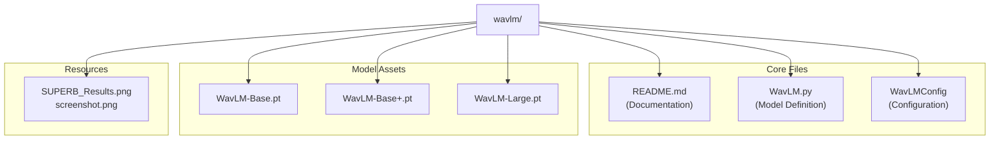

<!-- source: DeepWiki mcp.deepwiki.com · repo microsoft/unilm · page 4.1 WavLM: Universal Speech Representation · fetched 2026-10-26 -->

# WavLM: Universal Speech Representation

<details>
<summary>Relevant source files</summary>

The following files were used as context for generating this wiki page:

- [README.md](README.md)
- [deltalm/README.md](deltalm/README.md)
- [minilm/README.md](minilm/README.md)
- [minilm/examples/run_xnli.py](minilm/examples/run_xnli.py)
- [valle/README.md](valle/README.md)
- [wavlm/ASR.PNG](wavlm/ASR.PNG)
- [wavlm/README.md](wavlm/README.md)
- [wavlm/SUPERB_Results.png](wavlm/SUPERB_Results.png)
- [wavlm/screenshot.png](wavlm/screenshot.png)

</details>


## Overview

WavLM is a large-scale self-supervised pre-trained model for speech processing that solves full-stack downstream speech tasks. Pre-trained on 94,000 hours of publicly available audio data, WavLM achieves state-of-the-art performance on the SUPERB benchmark and demonstrates significant improvements across various speech tasks including automatic speech recognition (ASR), speaker verification, speech separation, and speaker diarization.

For language models, see [UniLM](#3.1). For vision pre-training, see [BEiT](#2.1). For neural codec speech synthesis, see [VALL-E](#4.2).

**Sources:** [wavlm/README.md:1-15](), [README.md:69-71]()

---

## Architecture and Pre-training

WavLM builds on the wav2vec 2.0 framework with key innovations to handle both spoken content and speaker identity preservation. The model integrates gated relative position embedding structures and an utterance mixing training method.

### Core Components



**Sources:** [wavlm/README.md:7-10, 196-198]()

### Training Objectives

WavLM employs two primary training objectives:

1. **Masked Prediction**: Random spans of latent speech representations are masked, and the model learns to predict masked units using a contrastive task over quantized targets.

2. **Utterance Mixing with Speaker Denoising**: Multiple utterances are mixed together during training, forcing the model to learn speaker-invariant content representations while maintaining the ability to distinguish speakers.



**Sources:** [wavlm/README.md:196-198]()

---

## Pre-training Data

WavLM models are trained on combinations of public speech datasets totaling up to 94,000 hours:

| Dataset | Hours | Description | Used In |
|---------|-------|-------------|---------|
| **LibriSpeech** | 960h | English audiobook readings | WavLM Base |
| **Libri-Light** | 60,000h | Unlabeled LibriVox audiobooks | WavLM Base+, Large |
| **GigaSpeech** | 10,000h | English podcast/audiobook corpus | WavLM Base+, Large |
| **VoxPopuli** | 24,000h | European Parliament recordings | WavLM Base+, Large |

**Total training data**: 94,960 hours for WavLM Large

**Sources:** [wavlm/README.md:20-22](), [README.md:70]()

---

## Model Variants

WavLM is released in three configurations with different capacities and pre-training data scales:

| Model | Layers | Hidden Size | Attention Heads | FFN Dim | Parameters | Pre-training Data |
|-------|--------|-------------|-----------------|---------|------------|-------------------|
| **WavLM Base** | 12 | 768 | 12 | 3072 | ~95M | 960h LibriSpeech |
| **WavLM Base+** | 12 | 768 | 12 | 3072 | ~95M | 94k hours (Libri-Light + GigaSpeech + VoxPopuli) |
| **WavLM Large** | 24 | 1024 | 16 | 4096 | ~317M | 94k hours (Libri-Light + GigaSpeech + VoxPopuli) |

All models are available for download via Azure Storage and Google Drive.

**Sources:** [wavlm/README.md:18-22]()

---

## Loading and Usage

### Model Loading



### Basic Inference Pattern

The following code demonstrates loading a pre-trained WavLM model and extracting representations:

```python
import torch
from WavLM import WavLM, WavLMConfig

# Load checkpoint
checkpoint = torch.load('/path/to/wavlm.pt')
cfg = WavLMConfig(checkpoint['cfg'])
model = WavLM(cfg)
model.load_state_dict(checkpoint['model'])
model.eval()

# Prepare input (16kHz waveform)
wav_input_16khz = torch.randn(1, 10000)
if cfg.normalize:
    wav_input_16khz = torch.nn.functional.layer_norm(
        wav_input_16khz, wav_input_16khz.shape
    )

# Extract last layer representation
rep = model.extract_features(wav_input_16khz)[0]

# Extract all layer representations
rep, layer_results = model.extract_features(
    wav_input_16khz, 
    output_layer=model.cfg.encoder_layers, 
    ret_layer_results=True
)[0]
layer_reps = [x.transpose(0, 1) for x, _ in layer_results]
```

**Key Methods:**
- `WavLM.extract_features()`: Main inference method for extracting contextualized speech representations
- `cfg.normalize`: Controls whether to apply layer normalization to input waveforms

**Sources:** [wavlm/README.md:24-49]()

### Integration with HuggingFace and S3PRL

WavLM models are also supported by:
- **HuggingFace Transformers**: Direct loading via model hub
- **S3PRL toolkit**: Self-supervised speech representation learning framework

The recommended approach for downstream tasks is to extract representations from each layer and compute a weighted sum of these representations.

**Sources:** [wavlm/README.md:51](), [wavlm/README.md:11-12]()

---

## Downstream Task Performance

### SUPERB Benchmark

WavLM Large achieves state-of-the-art results on the SUPERB (Speech processing Universal PERformance Benchmark), which evaluates models across 10 diverse speech tasks.



**Sources:** [wavlm/README.md:53-56](), [wavlm/README.md:147]()

### Speaker Verification Results

Performance on VoxCeleb1 benchmark (Error Rate %, lower is better):

| Model | Fix Pre-train | Vox1-O | Vox1-E | Vox1-H |
|-------|---------------|--------|--------|--------|
| ECAPA-TDNN | - | 0.87 | 1.12 | 2.12 |
| HuBERT Large | Yes | 0.888 | 0.912 | 1.853 |
| Wav2Vec2.0 (XLSR) | Yes | 0.915 | 0.945 | 1.895 |
| UniSpeech-SAT Large | Yes | 0.771 | 0.781 | 1.669 |
| **WavLM Large** | Yes | **0.59** | **0.65** | **1.328** |
| **WavLM Large** | No | **0.505** | **0.579** | **1.176** |

With large margin fine-tuning and score calibration:

| Model | Vox1-O | Vox1-E | Vox1-H |
|-------|--------|--------|--------|
| **WavLM Large** | **0.33** | **0.477** | **0.984** |

**Sources:** [wavlm/README.md:59-73]()

### Speech Separation Results

Word Error Rate (%) on LibriCSS benchmark (lower is better):

| Model | 0S | 0L | OV10 | OV20 | OV30 | OV40 |
|-------|----|----|------|------|------|------|
| Conformer (SOTA) | 4.5 | 4.4 | 6.2 | 8.5 | 11.0 | 12.6 |
| HuBERT Base | 4.7 | 4.6 | 6.1 | 7.9 | 10.6 | 12.3 |
| UniSpeech-SAT Base | 4.4 | 4.4 | 5.4 | 7.2 | 9.2 | 10.5 |
| UniSpeech-SAT Large | 4.3 | 4.2 | 5.0 | 6.3 | 8.2 | 8.8 |
| WavLM Base+ | 4.5 | 4.4 | 5.6 | 7.5 | 9.4 | 10.9 |
| **WavLM Large** | **4.2** | **4.1** | **4.8** | **5.8** | **7.4** | **8.5** |

**Sources:** [wavlm/README.md:76-86]()

### Speaker Diarization Results

Diarization Error Rate (%) on CALLHOME dataset (lower is better):

| Model | spk_2 | spk_3 | spk_4 | spk_5 | spk_6 | spk_all |
|-------|-------|-------|-------|-------|-------|---------|
| EEND-vector clustering | 7.96 | 11.93 | 16.38 | 21.21 | 23.10 | 12.49 |
| EEND-EDA clustering (SOTA) | 7.11 | 11.88 | 14.37 | 25.95 | 21.95 | 11.84 |
| HuBERT Base | 7.93 | 12.07 | 15.21 | 19.59 | 23.32 | 12.63 |
| HuBERT Large | 7.39 | 11.97 | 15.76 | 19.82 | 22.10 | 12.40 |
| UniSpeech-SAT Large | 5.93 | 10.66 | 12.90 | 16.48 | 23.25 | 10.92 |
| WavLM Base | 6.99 | 11.12 | 15.20 | 16.48 | 21.61 | 11.75 |
| **WavLM Large** | **6.46** | **10.69** | **11.84** | **12.89** | **20.70** | **10.35** |

**Sources:** [wavlm/README.md:89-100]()

### Automatic Speech Recognition

LibriSpeech test results demonstrate WavLM's effectiveness for content understanding tasks. The model serves as a strong foundation for ASR systems when fine-tuned on transcribed speech data.

**Sources:** [wavlm/README.md:102-105]()

---

## Implementation Architecture

### File Structure



### Key Classes and Configuration

**WavLMConfig**: Configuration class that defines model architecture parameters including:
- `encoder_layers`: Number of transformer layers (12 for Base/Base+, 24 for Large)
- `normalize`: Whether to apply layer normalization to input
- Encoder configuration (hidden size, attention heads, FFN dimensions)

**WavLM**: Main model class that implements:
- `extract_features()`: Primary method for feature extraction from raw audio
- `load_state_dict()`: Loads pre-trained weights from checkpoint
- Support for both single-layer and multi-layer representation extraction

**Sources:** [wavlm/README.md:24-49]()

---

## Related Models and Resources

WavLM is part of Microsoft's broader speech pre-training research, which includes:

- **UniSpeech**: Unified pre-training for self-supervised and supervised learning
- **UniSpeech-SAT**: Universal speech representation with speaker-aware pre-training
- **SpeechT5**: Encoder-decoder pre-training for spoken language processing
- **SpeechLM**: Enhanced speech pre-training with unpaired textual data

For more speech pre-trained models, visit the [UniSpeech repository](https://github.com/microsoft/UniSpeech).

**Sources:** [wavlm/README.md:108-109](), [README.md:83-89]()

---

## Citation

```latex
@article{Chen2021WavLM,
  title   = {WavLM: Large-Scale Self-Supervised Pre-training for Full Stack Speech Processing},
  author  = {Sanyuan Chen and Chengyi Wang and Zhengyang Chen and Yu Wu and 
             Shujie Liu and Zhuo Chen and Jinyu Li and Naoyuki Kanda and 
             Takuya Yoshioka and Xiong Xiao and Jian Wu and Long Zhou and 
             Shuo Ren and Yanmin Qian and Yao Qian and Jian Wu and 
             Michael Zeng and Furu Wei},
  eprint={2110.13900},
  archivePrefix={arXiv},
  primaryClass={cs.CL},
  year={2021}
}
```

**Sources:** [wavlm/README.md:120-128]()

---

