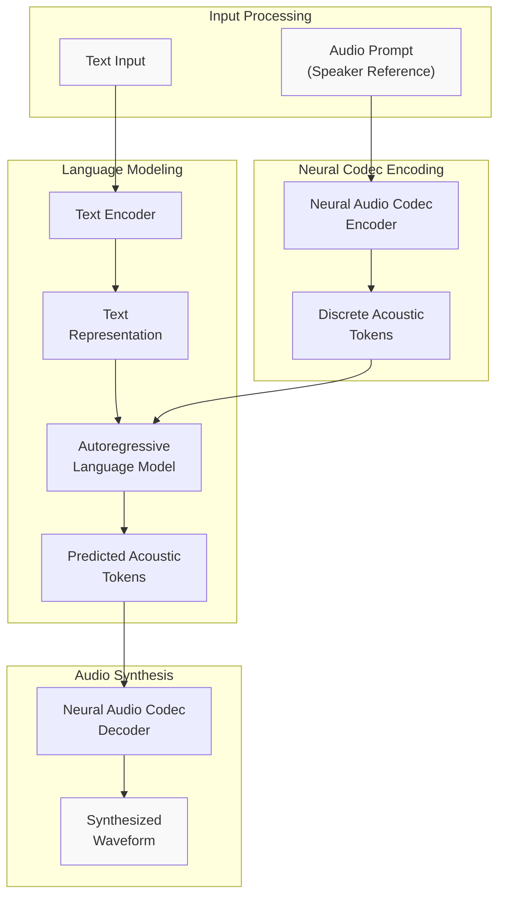
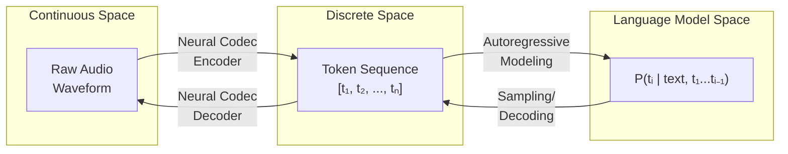
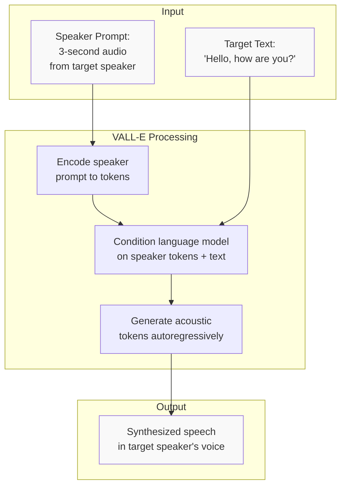
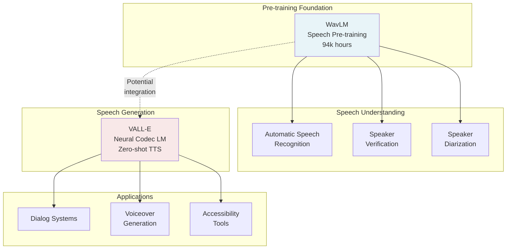

<!-- source: DeepWiki mcp.deepwiki.com · repo microsoft/unilm · page 4.2 VALL-E: Neural Codec Language Model · fetched 2026-10-26 -->

# VALL-E: Neural Codec Language Model

<details>
<summary>Relevant source files</summary>

The following files were used as context for generating this wiki page:

- [README.md](README.md)
- [deltalm/README.md](deltalm/README.md)
- [minilm/README.md](minilm/README.md)
- [minilm/examples/run_xnli.py](minilm/examples/run_xnli.py)
- [valle/README.md](valle/README.md)
- [wavlm/ASR.PNG](wavlm/ASR.PNG)
- [wavlm/README.md](wavlm/README.md)
- [wavlm/SUPERB_Results.png](wavlm/SUPERB_Results.png)
- [wavlm/screenshot.png](wavlm/screenshot.png)

</details>


## Overview

VALL-E is a neural codec language model for text-to-speech (TTS) synthesis that achieves state-of-the-art zero-shot TTS performance. Unlike traditional TTS systems, VALL-E applies language modeling techniques to discrete acoustic tokens derived from neural audio codecs, enabling it to synthesize speech in voices not seen during training.

This page documents the VALL-E system as represented in the UniLM repository. For pre-training and fine-tuning of general speech representations, see [WavLM](#4.1). For language model distillation techniques, see [MiniLM](#3.2).

**Note:** The VALL-E implementation in this repository is currently a research release with limited code availability. The main resources are the research paper and demo materials.

Sources: [README.md:72](), [valle/README.md:1-5]()

## System Architecture

### Neural Codec Language Model Concept

VALL-E treats text-to-speech as a conditional language modeling problem over discrete audio codes. The system consists of three primary stages:



**Figure 1: VALL-E Neural Codec Language Model Architecture**

The architecture transforms TTS from a continuous signal generation problem into a discrete sequence modeling problem, enabling the application of powerful language modeling techniques developed for NLP.

Sources: [README.md:72](), [valle/README.md:5]()

### Key Components

| Component | Function | Description |
|-----------|----------|-------------|
| **Neural Audio Codec** | Audio Tokenization | Converts continuous audio waveforms into discrete tokens and back |
| **Text Encoder** | Text Processing | Encodes input text into representations suitable for conditioning |
| **Autoregressive LM** | Sequence Prediction | Predicts acoustic token sequences conditioned on text and speaker prompt |
| **Codec Decoder** | Waveform Synthesis | Reconstructs audio waveform from predicted discrete tokens |

Sources: [README.md:72](), [valle/README.md:1-5]()

## Language Modeling for Speech

### Discrete Acoustic Tokens

VALL-E leverages neural audio codecs to convert continuous audio signals into discrete token sequences. This discretization enables:

1. **Application of NLP techniques**: Standard language modeling architectures (e.g., Transformers) can be directly applied
2. **Efficient training**: Discrete tokens allow for straightforward next-token prediction objectives
3. **Zero-shot capability**: The model learns general acoustic-linguistic mappings that generalize to unseen speakers



**Figure 2: Discretization and Language Modeling Pipeline**

Sources: [README.md:72](), [valle/README.md:5]()

### Training Objective

The model is trained to maximize the likelihood of acoustic token sequences given text and optional speaker prompts:

```
L = log P(acoustic_tokens | text, speaker_prompt)
```

This formulation treats TTS as a sequence-to-sequence translation task in the discrete token space, similar to machine translation or text generation.

Sources: [valle/README.md:5]()

## Zero-Shot Text-to-Speech

### Zero-Shot Capability

VALL-E's key innovation is its ability to perform **zero-shot TTS**: synthesizing speech in the voice of a target speaker using only a short (3-second) audio prompt, without any fine-tuning or speaker-specific training.



**Figure 3: Zero-Shot TTS Process**

This capability emerges from:
- **Large-scale training**: Model trained on diverse speakers and acoustic conditions
- **In-context learning**: Similar to few-shot learning in language models, acoustic patterns are learned from context
- **Codec representations**: Discrete tokens capture speaker characteristics efficiently

Sources: [README.md:72-73](), [README.md:123](), [valle/README.md:5]()

## Relationship to Other Speech Models

VALL-E complements other speech processing models in the UniLM ecosystem:



**Figure 4: Speech Models Ecosystem**

| Model | Focus | Key Capability |
|-------|-------|----------------|
| **WavLM** | Speech understanding | Universal speech representations for ASR, speaker tasks |
| **VALL-E** | Speech generation | Zero-shot TTS with neural codec language modeling |

**Integration Opportunities:**
- WavLM representations could potentially enhance VALL-E's speaker encoding
- VALL-E's discrete tokens could be used for speech-to-speech tasks
- Combined pipeline for speech understanding + generation

Sources: [README.md:70-73](), [wavlm/README.md:1-15]()

## Available Resources

### Repository Contents

The VALL-E directory in the UniLM repository currently contains:

```
valle/
└── README.md  # Brief description and links to resources
```

Sources: [valle/README.md:1-5]()

### External Resources

| Resource | Description | Link |
|----------|-------------|------|
| **Demo Page** | Audio samples demonstrating zero-shot TTS | https://aka.ms/valle |
| **Research Paper** | "Neural Codec Language Models are Zero-Shot Text to Speech Synthesizers" | arXiv:2301.02111 |
| **Announcement** | January 2023 release announcement | README news section |

Sources: [valle/README.md:4-5](), [README.md:123]()

### Publication Details

**Title:** Neural Codec Language Models are Zero-Shot Text to Speech Synthesizers

**Release Date:** January 2023

**Key Contributions:**
1. Novel application of language modeling to TTS via neural codecs
2. State-of-the-art zero-shot TTS performance
3. In-context learning for voice cloning without fine-tuning

Sources: [README.md:123](), [valle/README.md:5]()

## Technical Approach Summary

VALL-E's approach represents a paradigm shift in TTS:

**Traditional TTS Approach:**
```
Text → Acoustic Features → Waveform
(continuous signal processing)
```

**VALL-E Approach:**
```
Text + Speaker Prompt → Discrete Tokens → Waveform
(language modeling over discrete codes)
```

This reformulation enables:
- **Leverage of language model advances**: Transformer architectures, attention mechanisms, scaling laws
- **Data efficiency**: Pre-trained models can adapt to new speakers with minimal data
- **Naturalness**: Autoregressive generation captures complex prosodic patterns
- **Flexibility**: Easy conditioning on various attributes (speaker, emotion, style)

Sources: [README.md:72-73](), [valle/README.md:1-5]()

## Future Directions

The repository indicates that future updates will be posted to the VALL-E directory. Potential areas of development include:

1. **Model Release**: Pre-trained checkpoints and inference code
2. **Training Code**: Scripts for training on custom datasets
3. **Integration Examples**: Combining with other UniLM models
4. **Extensions**: Multi-lingual support, controllable generation, real-time inference

Users interested in VALL-E should monitor:
- [valle/README.md:1-5]() for announcements
- The demo page at https://aka.ms/valle for latest samples
- The research paper for technical details

Sources: [valle/README.md:3](), [README.md:115-123]()

---

