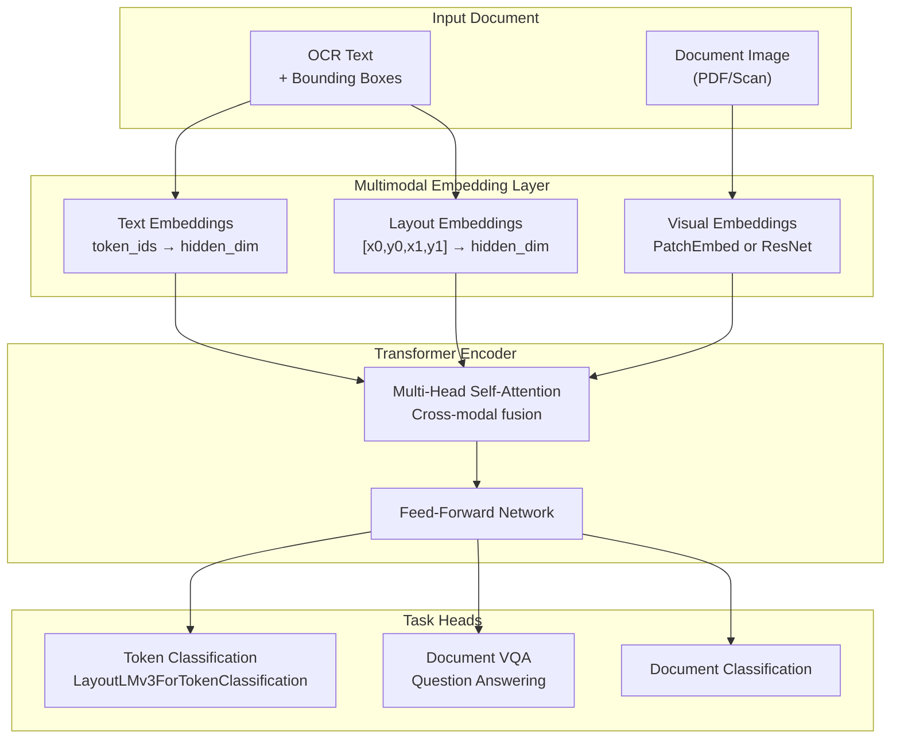
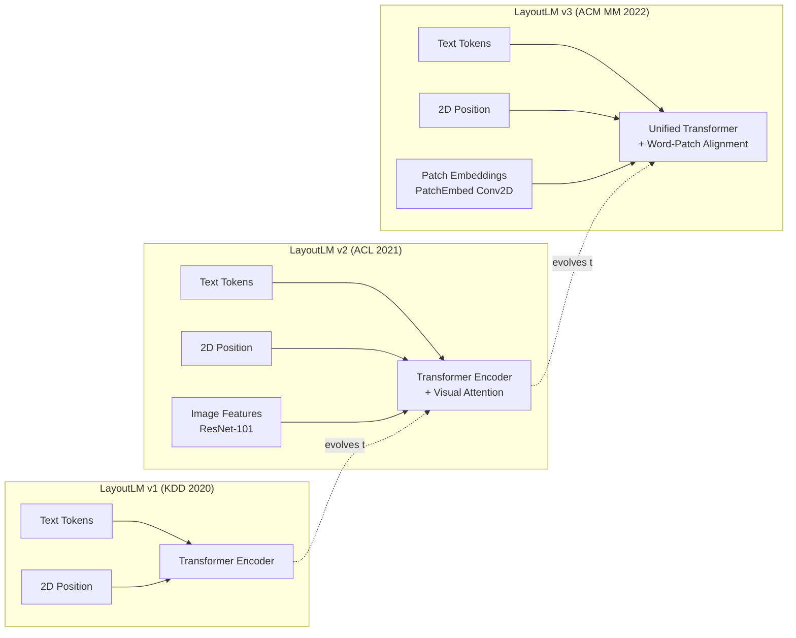
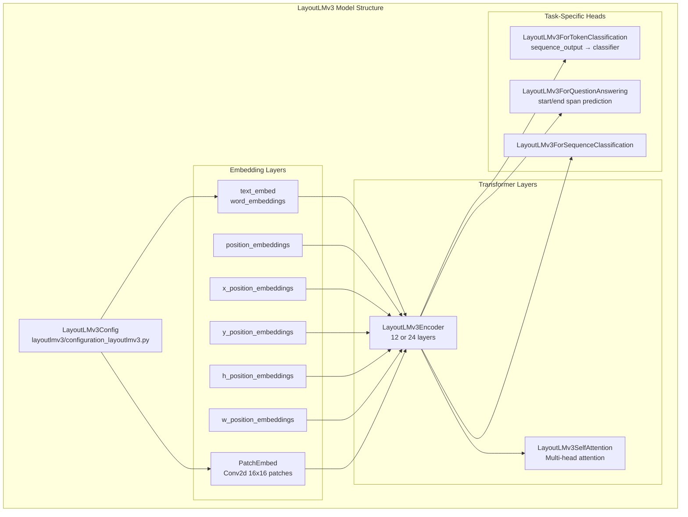
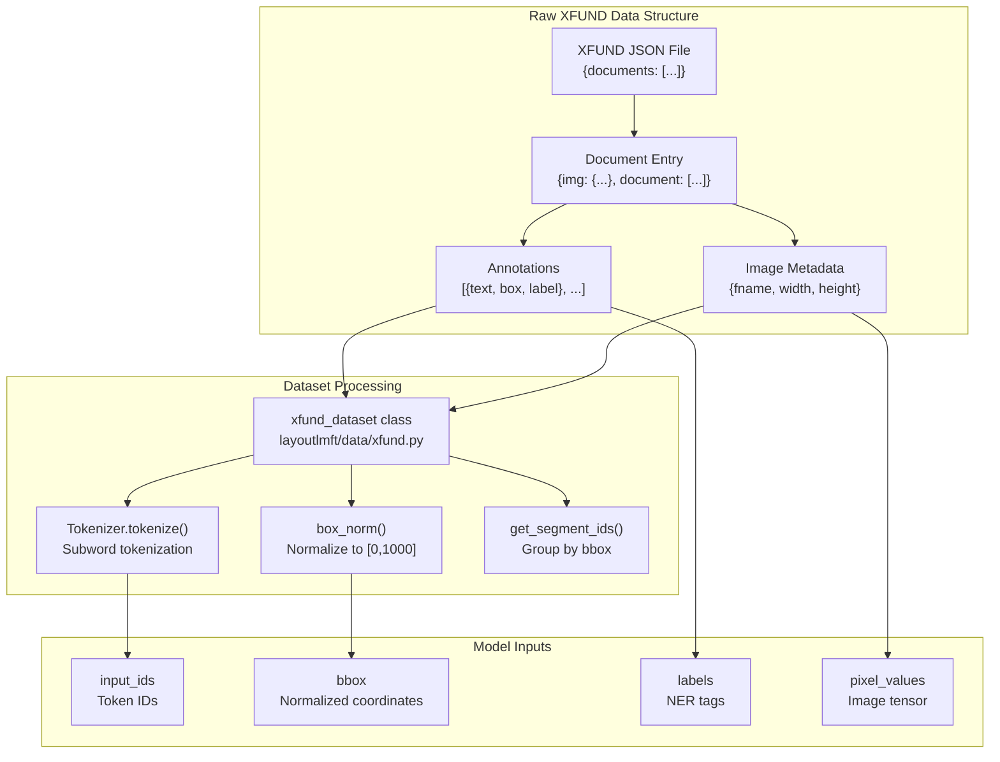
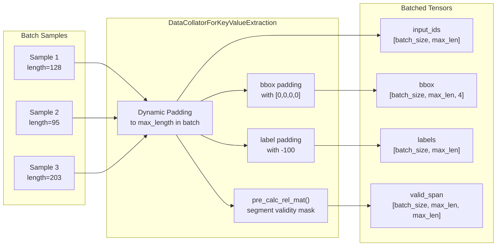
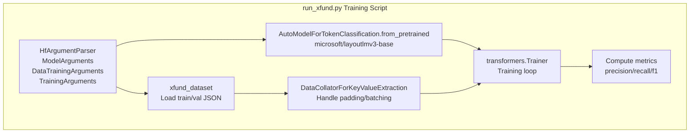
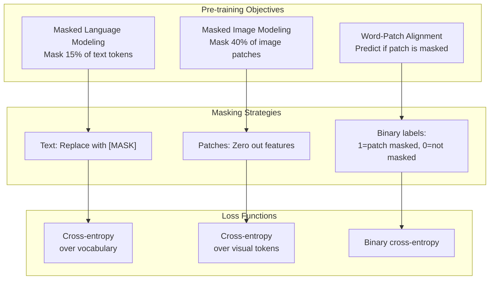
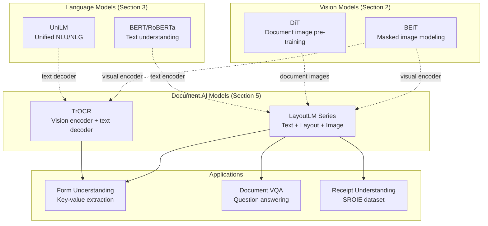

<!-- source: DeepWiki mcp.deepwiki.com · repo microsoft/unilm · page 5 Document AI: Multimodal Models · fetched 2026-10-26 -->

# Document AI: Multimodal Models

<details>
<summary>Relevant source files</summary>

The following files were used as context for generating this wiki page:

- [layoutlm/README.md](layoutlm/README.md)
- [layoutlmft/layoutlmft/modules/decoders/re.py](layoutlmft/layoutlmft/modules/decoders/re.py)
- [layoutlmv3/README.md](layoutlmv3/README.md)
- [layoutlmv3/examples/run_xfund.py](layoutlmv3/examples/run_xfund.py)
- [layoutlmv3/layoutlmft/data/data_collator.py](layoutlmv3/layoutlmft/data/data_collator.py)
- [layoutlmv3/layoutlmft/data/xfund.py](layoutlmv3/layoutlmft/data/xfund.py)
- [layoutlmv3/layoutlmft/models/layoutlmv3/modeling_layoutlmv3.py](layoutlmv3/layoutlmft/models/layoutlmv3/modeling_layoutlmv3.py)
- [layoutxlm/README.md](layoutxlm/README.md)
- [trocr/README.md](trocr/README.md)
- [trocr/__init__.py](trocr/__init__.py)
- [trocr/data_aug.py](trocr/data_aug.py)
- [trocr/deit.py](trocr/deit.py)
- [trocr/pic_inference.py](trocr/pic_inference.py)
- [trocr/task.py](trocr/task.py)
- [trocr/unilm3-cased.model](trocr/unilm3-cased.model)
- [trocr/unilm_models.py](trocr/unilm_models.py)

</details>


## Purpose and Scope

This section provides an overview of multimodal foundation models designed for Document AI tasks, which combine text, layout (2D position), and image information for understanding visually-rich documents such as forms, receipts, and PDFs. These models represent a key application area of "The Big Convergence" vision, bridging vision and language modalities for document-centric tasks.

**Covered in this section:**
- Common architectural patterns for multimodal document understanding
- Key model families: LayoutLM series, TrOCR
- Input modalities: text tokens, bounding box coordinates, document images
- Typical downstream tasks: form understanding, receipt extraction, document VQA

**Related sections:**
- For DiT (Document Image Transformer) pre-training, see [DiT: Document Image Transformer](#2.3)
- For specific LayoutLM variants and training details, see subsections [5.1](#5.1), [5.2](#5.2), [5.3](#5.3)
- For TrOCR architecture and OCR applications, see [TrOCR: Transformer-based OCR](#5.4)

---

## Multimodal Document Understanding Architecture

### Core Modalities

Document AI models process three complementary modalities:

| Modality | Representation | Purpose |
|----------|---------------|---------|
| **Text** | Token IDs from tokenizer | Semantic content understanding |
| **Layout** | 2D bounding boxes `[x0, y0, x1, y1]` | Spatial relationship modeling |
| **Image** | Pixel values or patch embeddings | Visual appearance features |



**Sources:** [README.md:74-79](), [layoutlmv3/README.md:1-5]()

---

## LayoutLM Architecture Evolution

The LayoutLM family demonstrates progressive integration of visual features:



**Key evolution milestones:**
- **v1**: Text + layout only, BERT-style pre-training
- **v2**: Added ResNet-101 visual features, separate image encoder
- **v3**: Unified text-image masking with patch embeddings (similar to BEiT), word-patch alignment objective

**Sources:** [README.md:74-79](), [layoutlm/README.md:7-18](), [layoutlmv3/README.md:1-5]()

---

## LayoutLMv3 Implementation

### Model Architecture Components



**Sources:** [layoutlmv3/layoutlmft/models/layoutlmv3/modeling_layoutlmv3.py:50-76](), [layoutlmv3/layoutlmft/models/layoutlmv3/modeling_layoutlmv3.py:77-157]()

### Key Implementation Details

**PatchEmbed Layer:** Converts document images into patch embeddings using convolution.

```python
# From layoutlmv3/layoutlmft/models/layoutlmv3/modeling_layoutlmv3.py:50-76
class PatchEmbed(nn.Module):
    """Image to Patch Embedding"""
    def __init__(self, img_size=224, patch_size=16, in_chans=3, embed_dim=768):
        # Conv2d with kernel_size=patch_size, stride=patch_size
        self.proj = nn.Conv2d(in_chans, embed_dim, 
                             kernel_size=patch_size, stride=patch_size)
```

**Layout Embeddings:** Bounding boxes `[x0, y0, x1, y1]` are decomposed into separate embeddings for each dimension, normalized to `[0, 1000]` range.

```python
# Normalization example from layoutlmv3/layoutlmft/data/xfund.py:22-33
def box_norm(self, box, width, height):
    x0, y0, x1, y1 = box
    x0 = int((x0 / width) * 1000)  # Normalize to 0-1000
    y0 = int((y0 / height) * 1000)
    x1 = int((x1 / width) * 1000)
    y1 = int((y1 / height) * 1000)
    return [x0, y0, x1, y1]
```

**Segment IDs:** Group tokens belonging to the same text segment (same bounding box) for better relational modeling.

```python
# From layoutlmv3/layoutlmft/data/xfund.py:35-45
def get_segment_ids(self, bboxs):
    segment_ids = []
    for i in range(len(bboxs)):
        if bboxs[i-1] == bboxs[i]:
            segment_ids.append(segment_ids[-1])  # Same segment
        else:
            segment_ids.append(segment_ids[-1] + 1)  # New segment
```

**Sources:** [layoutlmv3/layoutlmft/models/layoutlmv3/modeling_layoutlmv3.py:50-76](), [layoutlmv3/layoutlmft/data/xfund.py:22-57]()

---

## Data Processing Pipeline

### XFUND Dataset Format

The XFUND dataset (cross-lingual form understanding) represents a typical Document AI dataset structure:



**Label Schema for Named Entity Recognition:**

| Label | ID | Description |
|-------|----|-----------| 
| `O` | 0 | Outside any entity |
| `B-HEADER` | 1 | Beginning of header |
| `I-HEADER` | 2 | Inside header |
| `B-QUESTION` | 3 | Beginning of question |
| `I-QUESTION` | 4 | Inside question |
| `B-ANSWER` | 5 | Beginning of answer |
| `I-ANSWER` | 6 | Inside answer |

**Sources:** [layoutlmv3/layoutlmft/data/xfund.py:11-19](), [layoutlmv3/layoutlmft/data/xfund.py:59-80]()

### Data Collation

The `DataCollatorForKeyValueExtraction` handles batching with proper padding:



**Sources:** [layoutlmv3/layoutlmft/data/data_collator.py:15-22](), [layoutlmv3/layoutlmft/data/data_collator.py:24-56]()

---

## Training Workflow

### Fine-tuning Script Structure

The training workflow for LayoutLMv3 on XFUND dataset:



**Key Training Arguments:**

```bash
# From layoutlmv3/README.md:97-108
python -m torch.distributed.launch \
  --nproc_per_node=8 examples/run_xfund.py \
  --model_name_or_path microsoft/layoutlmv3-base-chinese \
  --output_dir path/to/output \
  --do_train --do_eval \
  --segment_level_layout 1 \
  --visual_embed 1 \
  --input_size 224 \
  --max_steps 1000 \
  --learning_rate 7e-5 \
  --per_device_train_batch_size 2
```

**Configuration Flags:**
- `segment_level_layout=1`: Enable segment-level layout features (group tokens by bbox)
- `visual_embed=1`: Enable visual embeddings from document images
- `input_size=224`: Image resolution for PatchEmbed layer

**Sources:** [layoutlmv3/examples/run_xfund.py:1-91](), [layoutlmv3/README.md:97-108]()

---

## Pre-trained Models and Benchmarks

### Available Checkpoints

| Model | Parameters | Languages | HuggingFace Path |
|-------|-----------|-----------|------------------|
| LayoutLMv3-Base | 133M | English | `microsoft/layoutlmv3-base` |
| LayoutLMv3-Large | 368M | English | `microsoft/layoutlmv3-large` |
| LayoutLMv3-Base-Chinese | 133M | Chinese | `microsoft/layoutlmv3-base-chinese` |

**Pre-training Data:**
- IIT-CDIP: 11M scanned document images (carefully excluding overlap with downstream datasets)
- Unlabeled document images for self-supervised masked visual-language modeling

**Sources:** [layoutlmv3/README.md:21-27](), [layoutlm/README.md:31-41]()

### Benchmark Results

**FUNSD (Form Understanding in Noisy Scanned Documents):**

| Model | Precision | Recall | F1 |
|-------|-----------|--------|-----|
| BERT-Large | 0.6113 | 0.7085 | 0.6563 |
| RoBERTa-Large | 0.6780 | 0.7391 | 0.7072 |
| LayoutLM v1 | 0.7677 | 0.8195 | 0.7927 |
| LayoutLMv3-Base | 0.8955 | 0.9165 | 0.9059 |
| LayoutLMv3-Large | 0.9219 | 0.9210 | 0.9215 |

**XFUND Chinese (Multilingual Form Understanding):**

| Model | Precision | Recall | F1 |
|-------|-----------|--------|-----|
| LayoutLMv3-Base-Chinese | 0.8980 | 0.9435 | 0.9202 |

**Sources:** [layoutlm/README.md:98-104](), [layoutlmv3/README.md:55-58](), [layoutlmv3/README.md:122-125]()

---

## Multimodal Fusion Mechanisms

### Unified Masking Strategy

LayoutLMv3 employs unified text-image masking for pre-training:



**Word-Patch Alignment:** A novel pre-training objective that learns cross-modal alignment by predicting whether the image patch corresponding to a text word is masked. This helps the model learn fine-grained visual-textual correspondences.

**Sources:** [layoutlmv3/README.md:1-5](), [README.md:182-183]()

---

## Relationship to Other Modalities

Document AI multimodal models build upon and interact with other model families:



**Key Integration Points:**
- **BEiT influence:** LayoutLMv3 adopts patch embedding and masked image modeling from BEiT
- **BERT backbone:** Text encoding follows BERT architecture (word embeddings + position embeddings)
- **TrOCR synergy:** Can provide text+bbox inputs for LayoutLM models
- **DiT collaboration:** DiT focuses on image-only pre-training while LayoutLM handles multimodal fusion

**Sources:** [README.md:63-65](), [README.md:74-77](), [README.md:95]()

---

