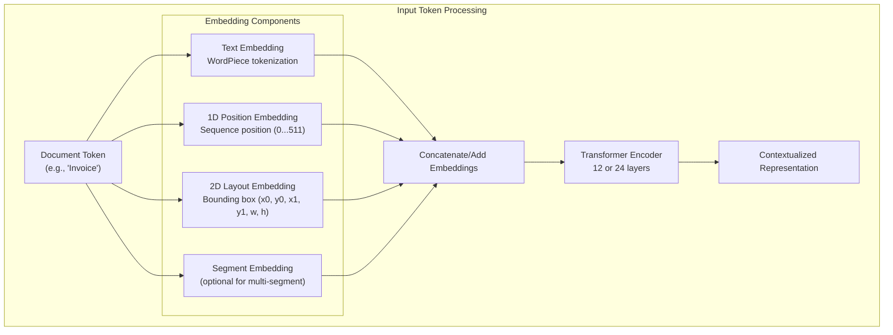
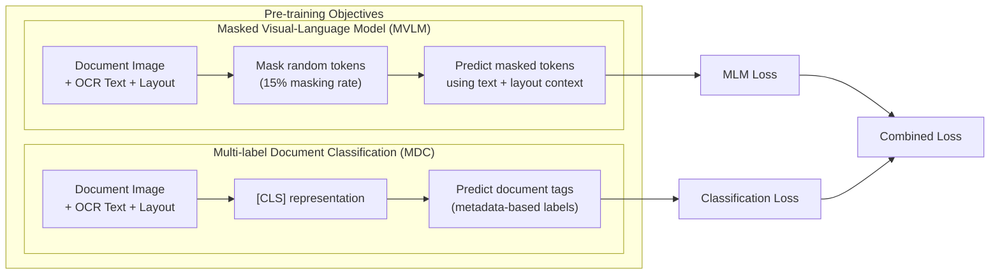
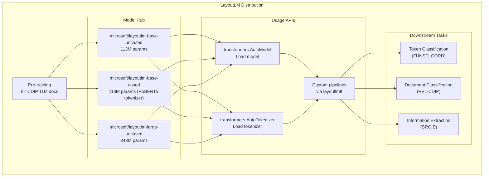
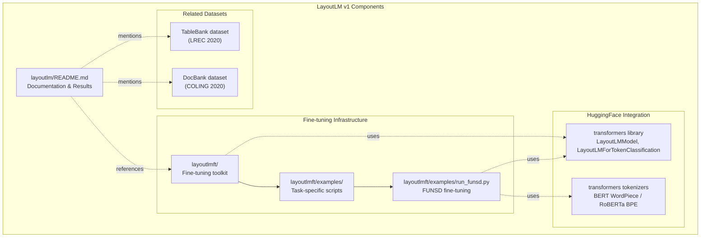

<!-- source: DeepWiki mcp.deepwiki.com · repo microsoft/unilm · page 5.1 LayoutLM v1: Document Understanding Foundation · fetched 2026-10-26 -->

# LayoutLM: Document Understanding Foundation

<details>
<summary>Relevant source files</summary>

The following files were used as context for generating this wiki page:

- [layoutlm/README.md](layoutlm/README.md)
- [layoutlmft/layoutlmft/modules/decoders/re.py](layoutlmft/layoutlmft/modules/decoders/re.py)
- [layoutxlm/README.md](layoutxlm/README.md)

</details>


## Purpose and Scope

This document covers **LayoutLM v1**, the original multimodal pre-training approach that combines text and layout information for document understanding tasks. LayoutLM v1 introduced the foundational concept of jointly modeling text content and spatial layout in a unified Transformer architecture. For subsequent improvements that incorporate visual image features, see [LayoutLMv2 and LayoutXLM](#5.2). For the unified masking approach in version 3, see [LayoutLMv3: Unified Multimodal Pre-training](#5.3). For OCR-specific applications, see [TrOCR: Transformer-based OCR](#5.4).

Sources: [layoutlm/README.md:1-12]()

---

## Overview

LayoutLM is a **simple but effective multi-modal pre-training method** that combines text, layout (2D position), and image information for visually-rich document understanding. The key insight is that document understanding tasks (form extraction, receipt parsing, document classification) require understanding not just the text content, but also the spatial arrangement of text elements on the page.

### Problem Statement

Traditional NLP models like BERT and RoBERTa process text as a linear sequence, losing critical spatial information that humans rely on when reading documents:
- **Form fields** are identified by their position relative to labels
- **Table cells** derive meaning from row/column positions
- **Receipt items** follow structured spatial patterns
- **Document layouts** provide hierarchical structure cues

LayoutLM addresses this by pre-training a Transformer model that jointly learns representations of both text semantics and layout structure.

### Key Contributions

| Aspect | Description |
|--------|-------------|
| **Multimodal Input** | Text tokens + 2D position (bounding boxes) |
| **Pre-training** | Masked Visual-Language Modeling on 11M+ documents |
| **Dataset** | IIT-CDIP Test Collection 1.0 (carefully filtered) |
| **SOTA Results** | FUNSD (79.27% F1), SROIE (96.04%), RVL-CDIP (94.42%) |
| **Publication** | KDD 2020 (full paper, research track) |

Sources: [layoutlm/README.md:7-12](), [layoutlm/README.md:76-105]()

---

## Architecture

### Input Representation

LayoutLM extends the standard BERT architecture by adding **2D position embeddings** alongside text embeddings. Each token receives three types of embeddings:



**2D Position Representation**: Each token's bounding box is represented as a tuple `(x0, y0, x1, y1, width, height)` normalized to the document dimensions. These coordinates are embedded into separate learnable position embeddings for each dimension.

Sources: [layoutlm/README.md:9-12]()

### Model Variants

LayoutLM provides three official pre-trained checkpoints:

| Model | Parameters | Tokenization | Architecture | HuggingFace Hub |
|-------|-----------|--------------|--------------|-----------------|
| **LayoutLM-Base-Uncased** | 113M | BERT WordPiece (uncased) | 12 layers, 768 hidden | `microsoft/layoutlm-base-uncased` |
| **LayoutLM-Base-Cased** | 113M | RoBERTa BPE (cased) | 12 layers, 768 hidden | `microsoft/layoutlm-base-cased` |
| **LayoutLM-Large-Uncased** | 343M | BERT WordPiece (uncased) | 24 layers, 1024 hidden | `microsoft/layoutlm-large-uncased` |

**Important**: The cased variant uses a **different tokenizer** (RoBERTa-based) and requires special initialization:

```python
from transformers import AutoTokenizer
tokenizer = AutoTokenizer.from_pretrained('microsoft/layoutlm-base-cased')
```

Sources: [layoutlm/README.md:29-50]()

---

## Pre-training

### Dataset: IIT-CDIP Test Collection 1.0

LayoutLM is pre-trained on the **IIT-CDIP Test Collection 1.0**, a large-scale dataset containing:
- **11 million** scanned document images
- Diverse document types (invoices, forms, letters, tables, etc.)
- OCR-extracted text with bounding box annotations

**Critical Detail**: Since some downstream benchmark datasets (FUNSD, RVL-CDIP) are subsets of IIT-CDIP, the authors **carefully excluded overlapping documents** from the pre-training corpus to prevent data leakage.

Sources: [layoutlm/README.md:31-41]()

### Pre-training Objectives

LayoutLM employs two self-supervised objectives:



1. **Masked Visual-Language Model (MVLM)**: Similar to BERT's MLM, but the model predicts masked tokens using both text context and layout (2D position) information
2. **Multi-label Document Classification (MDC)**: Predicts document-level tags using the `[CLS]` token representation

Sources: [layoutlm/README.md:9-12]()

---

## Applications and Fine-tuning

### Supported Task Types

LayoutLM can be fine-tuned for various document understanding tasks:

| Task Type | Example Datasets | Prediction Target |
|-----------|-----------------|-------------------|
| **Named Entity Recognition** | FUNSD (form fields) | Token-level labels (B-HEADER, I-QUESTION, etc.) |
| **Key Information Extraction** | SROIE (receipts), CORD (receipts) | Entity-level extraction (company, date, total) |
| **Document Classification** | RVL-CDIP (16 classes) | Document-level category |
| **Table Understanding** | TableBank, PubTabNet | Table structure detection |

### Fine-tuning Integration

LayoutLM integrates with the **layoutlmft** toolkit for fine-tuning. The toolkit provides:
- Distributed training support (`torch.distributed.launch`)
- Mixed precision training (`--fp16`)
- Standard training/evaluation pipelines

Example command for FUNSD fine-tuning:

```bash
cd layoutlmft
python -m torch.distributed.launch --nproc_per_node=4 examples/run_funsd.py \
    --model_name_or_path microsoft/layoutlm-base-uncased \
    --output_dir /tmp/test-ner \
    --do_train \
    --do_predict \
    --max_steps 1000 \
    --warmup_ratio 0.1 \
    --fp16
```

Sources: [layoutlm/README.md:52-71]()

---

## Benchmark Results

### SROIE (Receipt Understanding)

LayoutLM achieved **96.04% Hmean** on the SROIE field-level task, significantly outperforming the previous ranking #1 system:

| Model | Hmean | Notes |
|-------|-------|-------|
| BERT-Large | 90.99% | Text-only baseline |
| RoBERTa-Large | 92.80% | Text-only baseline |
| Ranking 1st in SROIE | 94.02% | Previous SOTA |
| **LayoutLM** | **96.04%** | +2.02% improvement |

The SROIE dataset contains scanned receipts with key information extraction tasks (company, date, address, total).

Sources: [layoutlm/README.md:76-85]()

### RVL-CDIP (Document Classification)

LayoutLM achieved **94.42% accuracy** on the RVL-CDIP document image classification benchmark (16 categories):

| Model | Accuracy | Notes |
|-------|----------|-------|
| BERT-Large | 89.92% | Text-only baseline |
| VGG-16 (Afzal et al., 2017) | 90.97% | Vision-only baseline |
| Stacked CNN Ensemble | 92.21% | Vision-based ensemble |
| Multimodal Ensemble (2019) | 93.07% | Previous SOTA |
| **LayoutLM** | **94.42%** | +1.35% improvement |

Sources: [layoutlm/README.md:86-97]()

### FUNSD (Form Understanding)

LayoutLM achieved **79.27% F1** on the FUNSD field-level entity recognition task:

| Model | Precision | Recall | F1 |
|-------|-----------|--------|-----|
| BERT-Large | 0.6113 | 0.7085 | 0.6563 |
| RoBERTa-Large | 0.6780 | 0.7391 | 0.7072 |
| **LayoutLM** | **0.7677** | **0.8195** | **0.7927** |

The FUNSD dataset contains 199 real, fully annotated forms with semantic entity types (header, question, answer, other).

Sources: [layoutlm/README.md:98-105]()

---

## Integration with Ecosystem

### HuggingFace Hub

All LayoutLM models are distributed via HuggingFace Model Hub, enabling easy integration:



Sources: [layoutlm/README.md:21-50]()

### Code Structure

LayoutLM v1 code is integrated into the broader UniLM ecosystem:



Sources: [layoutlm/README.md:1-130]()

---

## Evolution and Next Steps

LayoutLM v1 established the foundation for document understanding with text + layout. Subsequent versions introduced major improvements:

| Version | Key Innovation | Release Date | Reference |
|---------|---------------|--------------|-----------|
| **LayoutLM v1** | Text + Layout embeddings | KDD 2020 | [Paper](https://arxiv.org/abs/1912.13318) |
| **LayoutLMv2** | + Image features (ResNeXT-FPN) | ACL 2021 | See [LayoutLMv2](#5.2) |
| **LayoutXLM** | + Multilingual support (7 languages) | 2021 | See [LayoutLMv2](#5.2) |
| **LayoutLMv3** | Unified text-image masking | 2022 | See [LayoutLMv3](#5.3) |

**Design Philosophy**: LayoutLM v1 deliberately focused on text + layout to isolate the contribution of spatial information. The image features were added in v2 after establishing the effectiveness of layout embeddings.

Sources: [layoutlm/README.md:4-18]()

---

## Release History

| Date | Event |
|------|-------|
| **February 18, 2020** | Initial release of pre-trained models and fine-tuning code |
| **May 16, 2020** | Paper accepted to KDD 2020 (research track, full paper) |
| **August 7, 2020** | Release of TableBank and DocBank datasets |
| **September 27, 2021** | LayoutLM-cased models released on HuggingFace |

Sources: [layoutlm/README.md:20-27]()

---

## Citation

```latex
@inproceedings{Xu2020LayoutLMPO,
  title   = {LayoutLM: Pre-training of Text and Layout for Document Image Understanding},
  author  = {Yiheng Xu and Minghao Li and Lei Cui and Shaohan Huang and Furu Wei and Ming Zhou},
  journal = {Proceedings of the 26th ACM SIGKDD International Conference on Knowledge Discovery & Data Mining},
  year    = {2020}
}
```

Sources: [layoutlm/README.md:106-117]()

---

## Contact and Support

For issues or questions about LayoutLM:
- **GitHub Issues**: Submit issues on the repository
- **Technical Contact**: Lei Cui (lecu@microsoft.com), Furu Wei (fuwei@microsoft.com)
- **License**: MIT License (Microsoft Open Source Code of Conduct)
- **Base Framework**: Built on [HuggingFace Transformers](https://github.com/huggingface/transformers)

Sources: [layoutlm/README.md:119-130]()

---

