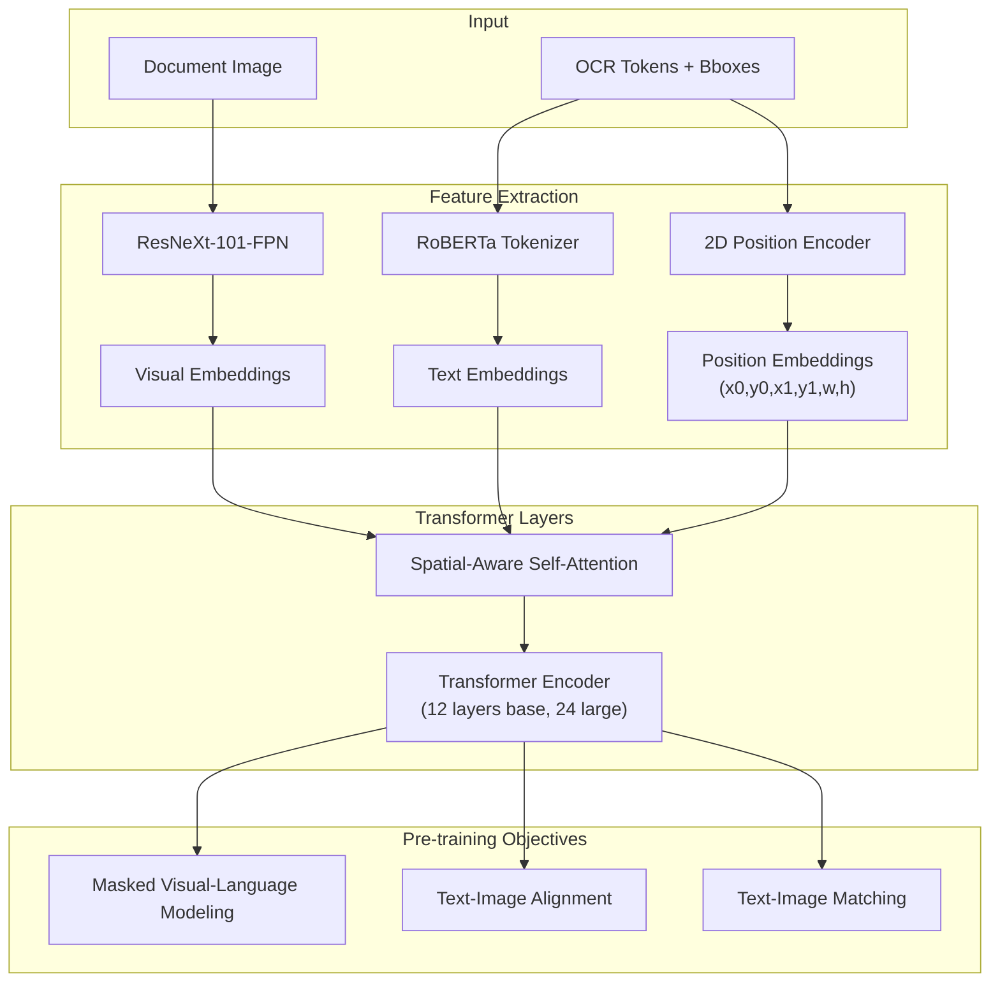
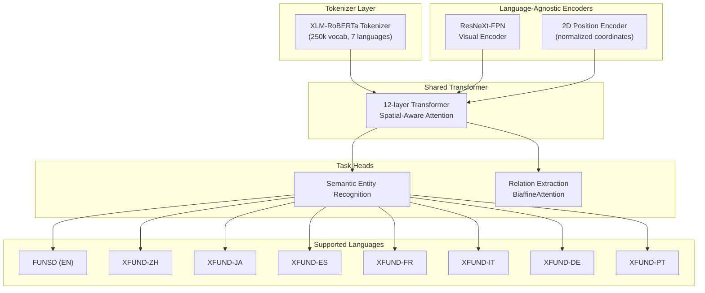
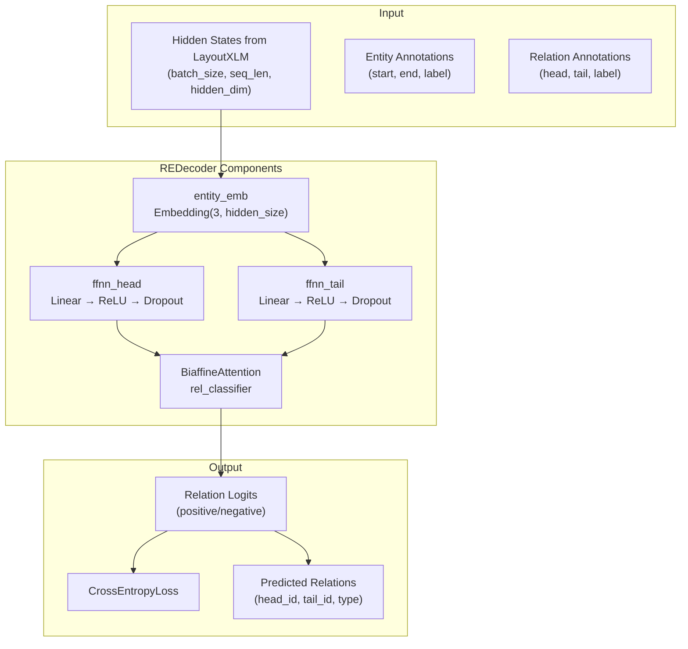

<!-- source: DeepWiki mcp.deepwiki.com · repo microsoft/unilm · page 5.2 LayoutLMv2 and LayoutXLM · fetched 2026-10-26 -->

# LayoutLMv2 and LayoutXLM

<details>
<summary>Relevant source files</summary>

The following files were used as context for generating this wiki page:

- [layoutlm/README.md](layoutlm/README.md)
- [layoutlmft/layoutlmft/modules/decoders/re.py](layoutlmft/layoutlmft/modules/decoders/re.py)
- [layoutxlm/README.md](layoutxlm/README.md)

</details>


## Overview

LayoutLMv2 and LayoutXLM are multimodal pre-trained models that extend LayoutLM v1 by integrating visual features from document images. The key advancement is the addition of CNN-based visual embeddings and spatial-aware self-attention mechanisms.

**LayoutLMv2** (December 2020) introduces ResNeXt-FPN visual backbone for image feature extraction and achieves SOTA on DocVQA, SROIE, FUNSD, and CORD benchmarks. Published in ACL 2021.

**LayoutXLM** (April 2021) extends LayoutLMv2 architecture to support multilingual document understanding across 7 languages using XLM-RoBERTa tokenizer. Introduces the XFUND benchmark dataset for cross-lingual form understanding.

Related pages: [LayoutLM v1](#5.1), [LayoutLMv3](#5.3), [TrOCR](#5.4)

**Sources:** [layoutlm/README.md:1-18](), [layoutxlm/README.md:1-9]()

---

## LayoutLMv2 Architecture

LayoutLMv2 extends LayoutLM v1 with three key components:

1. **Visual Backbone**: ResNeXt-101-FPN CNN for image feature extraction
2. **Spatial-Aware Self-Attention**: Modified attention mechanism incorporating 2D spatial relationships between tokens
3. **Multi-task Pre-training**: MVLM (Masked Visual-Language Modeling), TIA (Text-Image Alignment), TIM (Text-Image Matching)

### Model Architecture Comparison

| Component | LayoutLM v1 | LayoutLMv2 |
|-----------|-------------|------------|
| Text Encoder | BERT tokenizer | RoBERTa tokenizer |
| Layout Encoding | 2D position embeddings (6 values) | 2D position embeddings (6 values) |
| Visual Features | None | ResNeXt-FPN image patches |
| Attention | Standard self-attention | Spatial-aware self-attention |
| Pre-training | MLM + 2D position | MVLM + TIA + TIM |

**Diagram: LayoutLMv2 Multimodal Fusion**



**Sources:** [layoutlm/README.md:14-15]()

---

## LayoutXLM: Multilingual Extension

LayoutXLM maintains LayoutLMv2's architecture while extending to multilingual document understanding through XLM-RoBERTa tokenization. The model supports 7 languages: English, Chinese, Japanese, Spanish, French, Italian, German, and Portuguese.

### Architecture Differences from LayoutLMv2

| Component | LayoutLMv2 | LayoutXLM |
|-----------|------------|-----------|
| Text Tokenizer | RoBERTa | XLM-RoBERTa (multilingual) |
| Vocabulary | English only | 250k multilingual vocab |
| Training Data | IIT-CDIP (English docs) | IIT-CDIP + multilingual docs |
| Language Support | 1 language | 7 languages |
| Benchmark | FUNSD, CORD, SROIE | XFUND (7 languages) |

### XFUND Dataset

The XFUND (Multilingual Form Understanding) dataset provides human-labeled key-value pairs for form understanding across 7 languages. Each language subset contains labeled forms for two tasks:

- **Semantic Entity Recognition (SER)**: Identify and classify form fields
- **Relation Extraction (RE)**: Link questions to answers in forms

**Diagram: LayoutXLM Cross-lingual Architecture**



**Sources:** [layoutxlm/README.md:1-9](), [layoutxlm/README.md:14-49]()

---

## Fine-tuning and Task Adapters

### Relation Extraction Decoder

LayoutXLM uses a biaffine attention mechanism for relation extraction tasks (linking question entities to answer entities in forms). The implementation is in `REDecoder` class.

**Diagram: Relation Extraction Pipeline**



The `BiaffineAttention` class combines bilinear and linear transformations for relation classification:

- **Bilinear layer**: `torch.nn.Bilinear(in_features, in_features, out_features)`
- **Linear layer**: `torch.nn.Linear(2 * in_features, out_features)`
- **Forward**: `bilinear(x_1, x_2) + linear(concat(x_1, x_2))`

**Sources:** [layoutlmft/layoutlmft/modules/decoders/re.py:1-155]()

---

## Available Models

| Model | Parameters | Hidden Size | Layers | HuggingFace Model ID |
|-------|------------|-------------|--------|---------------------|
| LayoutLMv2-Base | ~200M | 768 | 12 | `microsoft/layoutlmv2-base-uncased` |
| LayoutLMv2-Large | ~426M | 1024 | 24 | `microsoft/layoutlmv2-large-uncased` |
| LayoutXLM-Base | ~200M | 768 | 12 | `microsoft/layoutxlm-base` |

All models are available through Hugging Face Transformers with standard `AutoModel` and `AutoTokenizer` APIs.

**Sources:** [layoutxlm/README.md:12]()

---

## Benchmark Results

### LayoutLMv2 Performance

| Dataset | Task | Metric | LayoutLM v1 | LayoutLMv2 |
|---------|------|--------|-------------|------------|
| FUNSD | Entity Recognition | F1 | 79.27% | 84.20% |
| SROIE | Receipt Understanding | Hmean | 96.04% | **97.81%** |
| CORD | Receipt Parsing | F1 | - | 96.01% |
| DocVQA | Visual QA | ANLS | - | **86.72%** |

### LayoutXLM Performance on XFUND

Language-specific fine-tuning results:

| Task | Model | EN | ZH | JA | ES | FR | IT | DE | PT | Avg |
|------|-------|----|----|----|----|----|----|----|----|-----|
| SER | xlm-roberta-base | 66.7 | 87.7 | 77.6 | 61.1 | 67.4 | 66.9 | 68.1 | 68.2 | 70.5 |
| SER | **layoutxlm-base** | **79.4** | **89.2** | **79.2** | **75.5** | **79.0** | **80.8** | **82.2** | **79.0** | **80.6** |
| RE | xlm-roberta-base | 26.6 | 51.1 | 58.0 | 52.9 | 49.7 | 53.1 | 50.4 | 39.8 | 47.7 |
| RE | **layoutxlm-base** | **54.8** | **70.7** | **69.6** | **69.0** | **63.5** | **64.2** | **65.5** | **57.2** | **64.3** |

Zero-shot transfer (trained on English FUNSD, tested on other languages):

| Task | Model | ZH | JA | ES | FR | IT | DE | PT | Avg |
|------|-------|----|----|----|----|----|----|----|----|
| SER | xlm-roberta-base | 41.4 | 30.2 | 30.6 | 37.1 | 27.7 | 32.9 | 39.4 | 38.2 |
| SER | **layoutxlm-base** | **60.2** | **47.2** | **45.7** | **57.6** | **48.5** | **52.5** | **53.9** | **55.6** |

**Sources:** [layoutxlm/README.md:51-72]()

---

## Training Details

### Pre-training

Both models are pre-trained on IIT-CDIP Test Collection 1.0 (11M scanned documents). Overlapping documents with downstream evaluation datasets are excluded to prevent data leakage.

**Pre-training objectives:**
1. **Masked Visual-Language Modeling (MVLM)**: Reconstruct randomly masked text tokens (15%) and visual regions (15%)
2. **Text-Image Alignment (TIA)**: Predict whether text lines align with corresponding image regions
3. **Text-Image Matching (TIM)**: Binary classification of whether text and image come from the same document

### Fine-tuning Examples

**LayoutLMv2 on FUNSD (Entity Recognition):**
```bash
cd layoutlmft
python -m torch.distributed.launch --nproc_per_node=4 examples/run_funsd.py \
    --model_name_or_path microsoft/layoutlmv2-base-uncased \
    --output_dir /tmp/test-ner \
    --do_train --do_predict \
    --max_steps 1000 --warmup_ratio 0.1 --fp16
```

**LayoutXLM on XFUND (Semantic Entity Recognition):**
```bash
cd layoutlmft
python -m torch.distributed.launch --nproc_per_node=4 examples/run_xfun_ser.py \
    --model_name_or_path microsoft/layoutxlm-base \
    --output_dir /tmp/test-ner \
    --do_train --do_eval --lang zh \
    --max_steps 1000 --warmup_ratio 0.1 --fp16
```

**LayoutXLM on XFUND (Relation Extraction):**
```bash
cd layoutlmft
python -m torch.distributed.launch --nproc_per_node=4 examples/run_xfun_re.py \
    --model_name_or_path microsoft/layoutxlm-base \
    --output_dir /tmp/test-re \
    --do_train --do_eval --lang zh \
    --max_steps 2500 --per_device_train_batch_size 2 \
    --warmup_ratio 0.1 --fp16
```

**Sources:** [layoutlm/README.md:31-41](), [layoutlm/README.md:60-70](), [layoutxlm/README.md:20-49]()

---

## Model Family Comparison

| Feature | LayoutLM v1 | LayoutLMv2 | LayoutXLM | LayoutLMv3 |
|---------|-------------|------------|-----------|------------|
| Text Tokenizer | BERT | RoBERTa | XLM-RoBERTa | RoBERTa/XLM-R |
| 2D Position | ✓ | ✓ | ✓ | ✓ |
| Visual Encoder | None | ResNeXt-101-FPN | ResNeXt-101-FPN | Linear Projection |
| Languages | 1 | 1 | 7 | 53 |
| Pre-training | MLM + Layout | MVLM + TIA + TIM | MVLM + TIA + TIM | Unified Masking |
| Parameters (Base) | 113M | ~200M | ~200M | ~125M |
| Release | 2020 | Dec 2020 | Apr 2021 | 2022 |

LayoutLMv2 introduced CNN-based visual features and spatial-aware attention. LayoutXLM extended this to multilingual scenarios with XLM-RoBERTa. LayoutLMv3 further simplified the architecture with unified text-image masking.

**Sources:** [layoutlm/README.md:1-18](), [layoutxlm/README.md:1-9]()

---

## Training Infrastructure and Utilities

### Distributed Training

LayoutLMv2 and LayoutXLM training leverages:

- **Mixed Precision Training**: FP16/AMP for memory efficiency
- **Distributed Data Parallel (DDP)**: Multi-GPU training
- **Gradient Accumulation**: Effective large batch training

### Related Tooling

The models integrate with broader UniLM infrastructure:

- **s2s-ft toolkit**: For sequence-to-sequence fine-tuning tasks (see [s2s-ft: Sequence-to-Sequence Fine-tuning](#7.1))
- **Detectron2 integration**: Used by DiT for layout analysis tasks, leveraging similar document understanding principles

**Sources:** [README.md:97]()

---

## Summary

**LayoutLMv2** and **LayoutXLM** marked a significant advancement in document AI by successfully integrating visual features with text and layout information. The key contributions include:

1. **Multimodal Architecture**: First LayoutLM models to incorporate image features through CNN-based visual embeddings
2. **Spatial-Aware Attention**: Enhanced attention mechanisms for 2D spatial reasoning
3. **Multilingual Extension**: LayoutXLM's support for 7 languages with the XFUND benchmark
4. **Strong Performance**: State-of-the-art results on DocVQA, SROIE, FUNSD, and CORD at release
5. **Ecosystem Integration**: Seamless integration with Hugging Face Transformers

These models laid the groundwork for LayoutLMv3's unified architecture and demonstrated the importance of visual features for document understanding tasks. They remain important milestones in the progression toward general-purpose document AI.

**Sources:** [README.md:75-77](), [README.md:229-230](), [layoutlm/README.md:1-18]()

---

