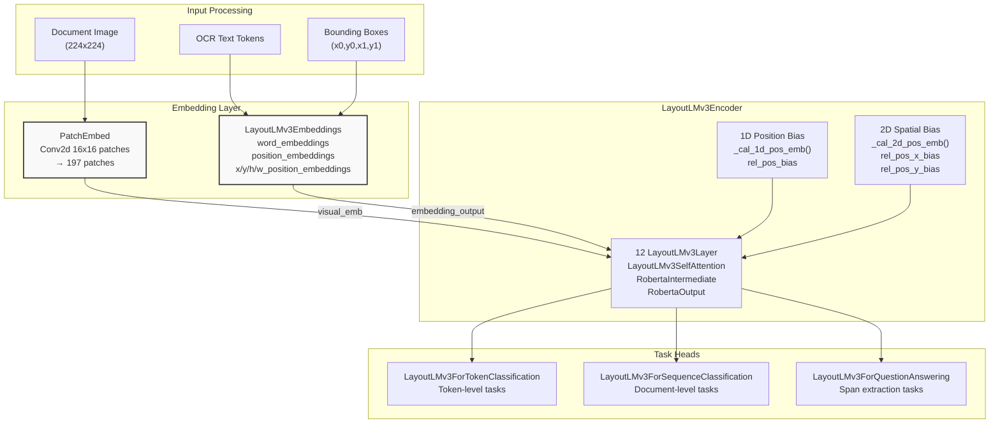
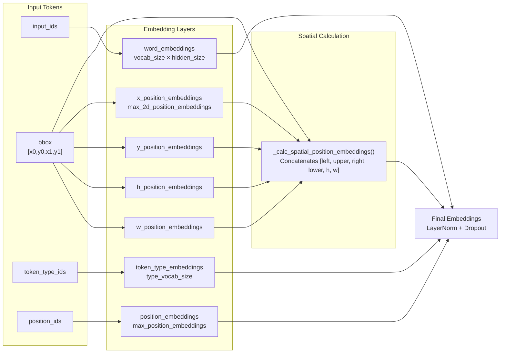
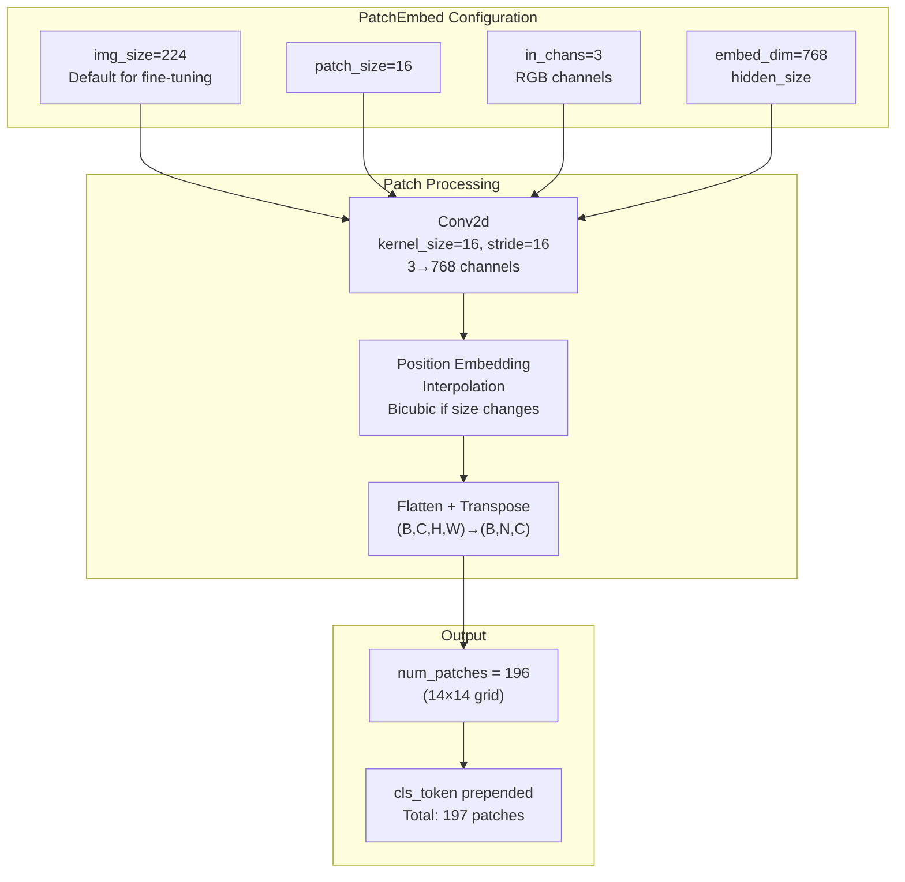
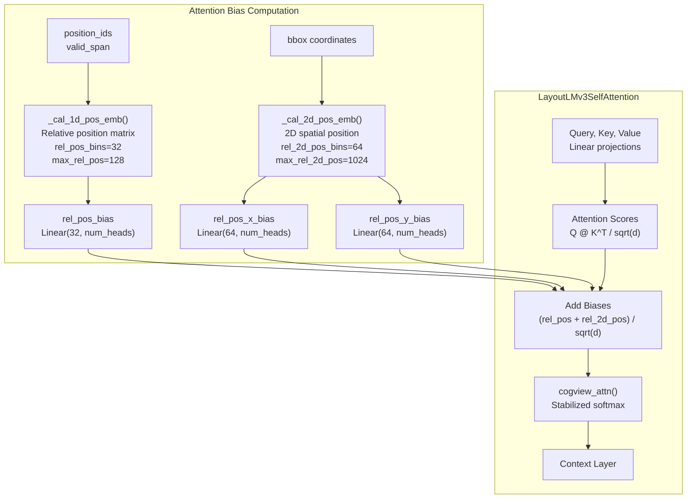
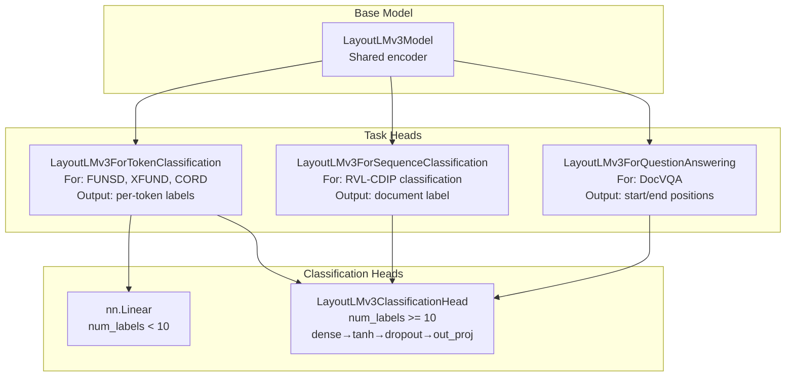
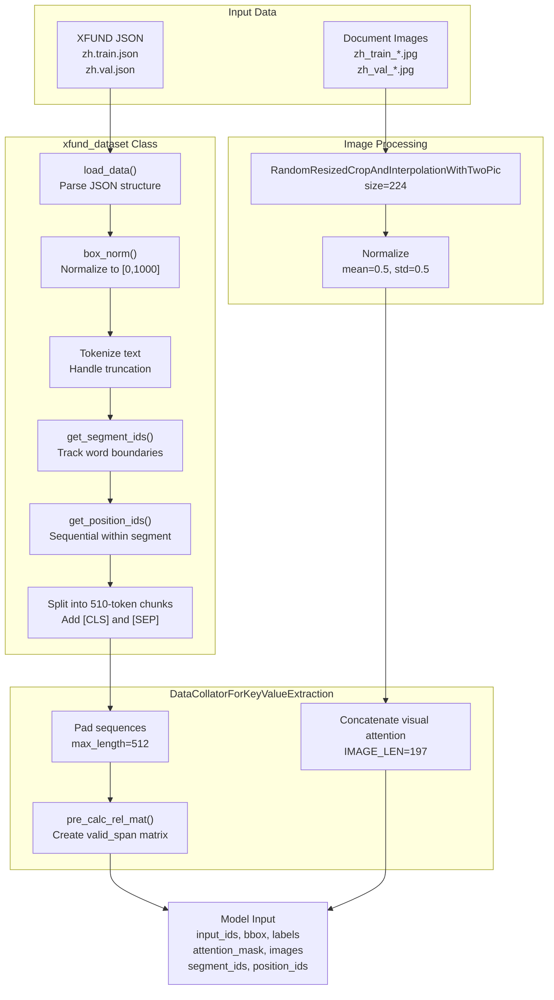

<!-- source: DeepWiki mcp.deepwiki.com · repo microsoft/unilm · page 5.3 LayoutLMv3: Unified Multimodal Pre-training · fetched 2026-10-26 -->

# LayoutLMv3: Unified Multimodal Pre-training

<details>
<summary>Relevant source files</summary>

The following files were used as context for generating this wiki page:

- [layoutlmv3/README.md](layoutlmv3/README.md)
- [layoutlmv3/examples/run_xfund.py](layoutlmv3/examples/run_xfund.py)
- [layoutlmv3/layoutlmft/data/data_collator.py](layoutlmv3/layoutlmft/data/data_collator.py)
- [layoutlmv3/layoutlmft/data/xfund.py](layoutlmv3/layoutlmft/data/xfund.py)
- [layoutlmv3/layoutlmft/models/layoutlmv3/modeling_layoutlmv3.py](layoutlmv3/layoutlmft/models/layoutlmv3/modeling_layoutlmv3.py)

</details>


## Purpose and Scope

This page documents **LayoutLMv3**, a unified multimodal pre-trained model for Document AI that combines text, layout, and image information through unified text-image masking and word-patch alignment objectives. LayoutLMv3 represents the third generation in the LayoutLM series, achieving state-of-the-art performance on both text-centric tasks (form understanding, receipt understanding, document VQA) and image-centric tasks (document classification, layout analysis).

For the foundational LayoutLM v1 architecture, see [LayoutLM v1](#5.1). For improvements in LayoutLMv2 and multilingual LayoutXLM, see [LayoutLMv2 and LayoutXLM](#5.2). For vision-only document understanding with DiT, see [DiT](#2.2). For optical character recognition using TrOCR, see [TrOCR](#5.4).

## Architecture Overview

LayoutLMv3 introduces a **unified text-image multimodal architecture** that processes document images and their associated text/layout information through a shared Transformer encoder. Unlike previous versions that used separate masking strategies for text and image modalities, LayoutLMv3 applies unified masking to both modalities and adds a word-patch alignment objective to learn cross-modal alignment.

### Unified Multimodal Architecture



**Sources:** [layoutlmv3/layoutlmft/models/layoutlmv3/modeling_layoutlmv3.py:50-76](), [layoutlmv3/layoutlmft/models/layoutlmv3/modeling_layoutlmv3.py:77-186](), [layoutlmv3/layoutlmft/models/layoutlmv3/modeling_layoutlmv3.py:461-506](), [layoutlmv3/layoutlmft/models/layoutlmv3/modeling_layoutlmv3.py:699-744]()

### Key Innovations

| Feature | Description | Implementation |
|---------|-------------|----------------|
| **Unified Masking** | Same masking strategy for text and image patches | Applied during pre-training (not in fine-tuning code) |
| **Word-Patch Alignment** | Predicts whether image patch corresponds to text word | Pre-training objective |
| **Spatial Attention Bias** | 2D relative position bias for layout-aware attention | `_cal_2d_pos_emb()` in encoder |
| **1D Relative Bias** | Sequential position bias with segment awareness | `_cal_1d_pos_emb()` in encoder |
| **Patch Interpolation** | Supports variable image resolutions during fine-tuning | `PatchEmbed.forward()` with position_embedding |

**Sources:** [layoutlmv3/README.md:1-6](), [layoutlmv3/layoutlmft/models/layoutlmv3/modeling_layoutlmv3.py:530-577]()

## Core Components

### Text and Layout Embeddings

The `LayoutLMv3Embeddings` class combines multiple embedding types to represent document text with its spatial layout:



**Sources:** [layoutlmv3/layoutlmft/models/layoutlmv3/modeling_layoutlmv3.py:77-186](), [layoutlmv3/layoutlmft/models/layoutlmv3/modeling_layoutlmv3.py:105-130]()

The spatial position embeddings encode six values:
- **Left (x0)**: Left boundary of bounding box
- **Upper (y0)**: Top boundary of bounding box  
- **Right (x2)**: Right boundary of bounding box
- **Lower (y3)**: Bottom boundary of bounding box
- **Height**: `clip(y1 - y0, 0, 1023)`
- **Width**: `clip(x1 - x0, 0, 1023)`

All coordinates are normalized to the range [0, 1000] before embedding lookup.

**Sources:** [layoutlmv3/layoutlmft/models/layoutlmv3/modeling_layoutlmv3.py:100-130]()

### Visual Patch Embeddings

The `PatchEmbed` module converts document images into patch embeddings using a convolutional layer:



**Sources:** [layoutlmv3/layoutlmft/models/layoutlmv3/modeling_layoutlmv3.py:50-75](), [layoutlmv3/layoutlmft/models/layoutlmv3/modeling_layoutlmv3.py:722-732]()

The patch embedding process:
1. **Convolutional Projection**: Splits 224×224 image into 14×14 grid of 16×16 patches (196 total)
2. **Position Embedding Addition**: Adds learned 2D position embeddings with interpolation for variable sizes
3. **CLS Token Prepending**: Adds special classification token at position 0
4. **Visual BBox Assignment**: Assigns pseudo bounding boxes to patches for spatial attention

**Sources:** [layoutlmv3/layoutlmft/models/layoutlmv3/modeling_layoutlmv3.py:64-75](), [layoutlmv3/layoutlmft/models/layoutlmv3/modeling_layoutlmv3.py:760-776]()

### Encoder with Attention Biases

The `LayoutLMv3Encoder` implements a 12-layer Transformer with specialized attention biases for document understanding:



**Sources:** [layoutlmv3/layoutlmft/models/layoutlmv3/modeling_layoutlmv3.py:233-354](), [layoutlmv3/layoutlmft/models/layoutlmv3/modeling_layoutlmv3.py:469-483](), [layoutlmv3/layoutlmft/models/layoutlmv3/modeling_layoutlmv3.py:530-577]()

#### Attention Bias Features

**1D Relative Position Bias** (`_cal_1d_pos_emb`):
- Computes relative distance between tokens: `position_ids[i] - position_ids[j]`
- Uses `valid_span` matrix to enforce segment-level constraints (tokens in different text segments get maximum distance)
- Image-text pairs get minimum distance (0) for cross-modal attention
- Applies `relative_position_bucket()` to discretize continuous distances into 32 bins

**2D Spatial Position Bias** (`_cal_2d_pos_emb`):
- Computes horizontal distance: `bbox[i][x0] - bbox[j][x0]`
- Computes vertical distance: `bbox[i][y3] - bbox[j][y3]`
- Separate learned biases for X and Y dimensions, then summed
- Enables layout-aware attention (e.g., attending to spatially nearby words)

**CogView Attention Stabilization**:
The `cogview_attn()` method improves training stability by rescaling attention scores before softmax to avoid precision bottlenecks.

**Sources:** [layoutlmv3/layoutlmft/models/layoutlmv3/modeling_layoutlmv3.py:259-272](), [layoutlmv3/layoutlmft/models/layoutlmv3/modeling_layoutlmv3.py:314-335](), [layoutlmv3/layoutlmft/models/layoutlmv3/modeling_layoutlmv3.py:530-577]()

## Pre-training Objectives

LayoutLMv3 uses three complementary pre-training objectives (implemented outside this codebase, but the architecture supports them):

| Objective | Description | Purpose |
|-----------|-------------|---------|
| **Masked Language Modeling (MLM)** | Predict masked text tokens | Learn text representations |
| **Masked Image Modeling (MIM)** | Predict masked image patches | Learn visual representations |
| **Word-Patch Alignment (WPA)** | Predict if image patch corresponds to text word | Learn cross-modal alignment |

The unified masking strategy applies the same masking approach to both text tokens and image patches, unlike LayoutLMv2 which used different strategies. This simplifies the pre-training process and improves multimodal representation learning.

**Sources:** [layoutlmv3/README.md:1-6]()

## Fine-tuning Applications

### Model Configuration

LayoutLMv3 provides three pre-trained checkpoints:

| Model | Parameters | Hidden Size | Layers | Attention Heads | Hugging Face Path |
|-------|-----------|-------------|--------|-----------------|-------------------|
| **layoutlmv3-base** | ~125M | 768 | 12 | 12 | `microsoft/layoutlmv3-base` |
| **layoutlmv3-large** | ~368M | 1024 | 24 | 16 | `microsoft/layoutlmv3-large` |
| **layoutlmv3-base-chinese** | ~125M | 768 | 12 | 12 | `microsoft/layoutlmv3-base-chinese` |

**Sources:** [layoutlmv3/README.md:21-26]()

### Task-Specific Model Classes



**Sources:** [layoutlmv3/layoutlmft/models/layoutlmv3/modeling_layoutlmv3.py:986-1012](), [layoutlmv3/layoutlmft/models/layoutlmv3/modeling_layoutlmv3.py:1015-1098](), [layoutlmv3/layoutlmft/models/layoutlmv3/modeling_layoutlmv3.py:1101-1193](), [layoutlmv3/layoutlmft/models/layoutlmv3/modeling_layoutlmv3.py:1196-1282]()

### Form Understanding on FUNSD and XFUND

**FUNSD** (Form Understanding in Noisy Scanned Documents) and **XFUND** (multilingual form understanding) are token classification tasks where the model must label each word as `HEADER`, `QUESTION`, `ANSWER`, or `OTHER`.

#### XFUND Data Processing Pipeline



**Sources:** [layoutlmv3/layoutlmft/data/xfund.py:21-208](), [layoutlmv3/layoutlmft/data/data_collator.py:24-124](), [layoutlmv3/examples/run_xfund.py:1-369]()

#### Label Schema

The XFUND dataset uses BIO tagging for entity recognition:

| Label | ID | Description |
|-------|-----|-------------|
| `O` | 0 | Outside any entity |
| `B-HEADER` | 1 | Beginning of header |
| `I-HEADER` | 2 | Inside header |
| `B-QUESTION` | 3 | Beginning of question |
| `I-QUESTION` | 4 | Inside question |
| `B-ANSWER` | 5 | Beginning of answer |
| `I-ANSWER` | 6 | Inside answer |

**Sources:** [layoutlmv3/layoutlmft/data/xfund.py:11-19]()

#### Segment-Level Layout Encoding

The `segment_ids` and `position_ids` mechanism enables the model to understand word-level boundaries:

1. **Segment IDs**: Each word gets a unique segment ID. If consecutive tokens have the same bounding box, they belong to the same word and share a segment ID.
2. **Position IDs**: Reset to 2 (after [CLS]=0, [SEP]=1) at the start of each new word, then increment sequentially.
3. **Valid Span Matrix**: A boolean matrix where `valid_span[i,j] = True` if tokens i and j belong to the same segment. Used in 1D position bias calculation to prevent cross-segment attention beyond intended distance.

**Sources:** [layoutlmv3/layoutlmft/data/xfund.py:35-57](), [layoutlmv3/layoutlmft/data/data_collator.py:15-22](), [layoutlmv3/layoutlmft/data/data_collator.py:105-118]()

#### Training Configuration

Example training command for XFUND Chinese:

```bash
python -m torch.distributed.launch \
  --nproc_per_node=8 examples/run_xfund.py \
  --data_dir data --language zh \
  --model_name_or_path microsoft/layoutlmv3-base-chinese \
  --segment_level_layout 1 --visual_embed 1 --input_size 224 \
  --max_steps 1000 --learning_rate 7e-5 \
  --per_device_train_batch_size 2
```

**Key hyperparameters:**
- `segment_level_layout=1`: Enable segment-aware position encoding
- `visual_embed=1`: Include image patches
- `input_size=224`: Image resolution (can be interpolated during fine-tuning)
- Effective batch size: 2 × 8 GPUs = 16

**Performance on XFUND (Chinese):**
- Precision: 0.8980
- Recall: 0.9435
- F1: 0.9202

**Sources:** [layoutlmv3/README.md:83-130]()

### Document Layout Analysis on PubLayNet

For document layout analysis (detecting text regions, titles, lists, tables, figures), LayoutLMv3 uses a **Cascade Mask R-CNN** detection framework. This task is image-centric, so the model operates in `image_only` mode without text tokens.

The encoder outputs multi-scale features through FPN (Feature Pyramid Network) layers:

```python
# In LayoutLMv3Encoder for detection=True
self.fpn1 = nn.Sequential(
    nn.ConvTranspose2d(embed_dim, embed_dim, kernel_size=2, stride=2),
    nn.BatchNorm2d(embed_dim),
    nn.GELU(),
    nn.ConvTranspose2d(embed_dim, embed_dim, kernel_size=2, stride=2),
)
self.fpn2 = nn.Sequential(nn.ConvTranspose2d(..., stride=2))
self.fpn3 = nn.Identity()
self.fpn4 = nn.MaxPool2d(kernel_size=2, stride=2)
```

**Sources:** [layoutlmv3/layoutlmft/models/layoutlmv3/modeling_layoutlmv3.py:485-505]()

Training uses Detectron2 framework with configuration in `cascade_layoutlmv3.yaml`:

```bash
python train_net.py --config-file cascade_layoutlmv3.yaml --num-gpus 16 \
  MODEL.WEIGHTS /path/to/layoutlmv3-base/pytorch_model.bin \
  OUTPUT_DIR /path/to/output
```

**Performance on PubLayNet:**

| Category | AP |
|----------|-----|
| Text | 94.5 |
| Title | 90.6 |
| List | 95.5 |
| Table | 97.9 |
| Figure | 97.0 |
| **Overall mAP** | **95.1** |

**Sources:** [layoutlmv3/README.md:60-82]()

## Data Processing Details

### Bounding Box Normalization

All bounding boxes are normalized to the range [0, 1000] to ensure consistent spatial embeddings:

```python
def box_norm(self, box, width, height):
    x0, y0, x1, y1 = box
    x0 = clip(0, int((x0 / width) * 1000), 1000)
    y0 = clip(0, int((y0 / height) * 1000), 1000)
    x1 = clip(0, int((x1 / width) * 1000), 1000)
    y1 = clip(0, int((y1 / height) * 1000), 1000)
    return [x0, y0, x1, y1]
```

**Sources:** [layoutlmv3/layoutlmft/data/xfund.py:22-33]()

### Visual Bounding Boxes for Image Patches

For each image patch in the 14×14 grid, the model computes a pseudo bounding box:

```python
def _init_visual_bbox(self, img_size=(14, 14), max_len=1000):
    visual_bbox_x = torch.div(torch.arange(0, max_len * (img_size[1] + 1), max_len),
                              img_size[1], rounding_mode='trunc')
    visual_bbox_y = torch.div(torch.arange(0, max_len * (img_size[0] + 1), max_len),
                              img_size[0], rounding_mode='trunc')
    visual_bbox = torch.stack([
        visual_bbox_x[:-1].repeat(img_size[0], 1),
        visual_bbox_y[:-1].repeat(img_size[1], 1).transpose(0, 1),
        visual_bbox_x[1:].repeat(img_size[0], 1),
        visual_bbox_y[1:].repeat(img_size[1], 1).transpose(0, 1),
    ], dim=-1).view(-1, 4)
```

This creates a grid of bounding boxes covering the entire document image, enabling spatial attention between text and image patches.

**Sources:** [layoutlmv3/layoutlmft/models/layoutlmv3/modeling_layoutlmv3.py:760-776]()

### Concatenation of Text and Visual Embeddings

The forward pass combines text and visual modalities:

```python
# Text embeddings: [batch_size, seq_length, hidden_size]
embedding_output = self.embeddings(input_ids, bbox, ...)

# Visual embeddings: [batch_size, 197, hidden_size]  (196 patches + 1 CLS)
visual_emb = self.forward_image(images)

# Concatenate: [batch_size, seq_length + 197, hidden_size]
embedding_output = torch.cat([embedding_output, visual_emb], dim=1)

# Extend attention mask for visual tokens
visual_attention_mask = torch.ones((batch_size, 197), dtype=torch.long)
attention_mask = torch.cat([attention_mask, visual_attention_mask], dim=1)
```

**Sources:** [layoutlmv3/layoutlmft/models/layoutlmv3/modeling_layoutlmv3.py:903-938](), [layoutlmv3/layoutlmft/data/data_collator.py:74-79]()

## Model Variants and Checkpoints

### Available Models

| Model | Size | Use Case | Hugging Face Hub |
|-------|------|----------|------------------|
| `layoutlmv3-base` | Base | General English documents | [microsoft/layoutlmv3-base](https://huggingface.co/microsoft/layoutlmv3-base) |
| `layoutlmv3-large` | Large | Higher accuracy for English | [microsoft/layoutlmv3-large](https://huggingface.co/microsoft/layoutlmv3-large) |
| `layoutlmv3-base-chinese` | Base | Chinese documents (XFUND, EPHOIE) | [microsoft/layoutlmv3-base-chinese](https://huggingface.co/microsoft/layoutlmv3-base-chinese) |

### Fine-tuned Checkpoints

Community-contributed fine-tuned models:

| Task | Model | Performance | Hub |
|------|-------|-------------|-----|
| FUNSD (base) | layoutlmv3-base-finetuned-funsd | F1: 0.9059 | [HYPJUDY/layoutlmv3-base-finetuned-funsd](https://huggingface.co/HYPJUDY/layoutlmv3-base-finetuned-funsd) |
| FUNSD (large) | layoutlmv3-large-finetuned-funsd | F1: 0.9215 | [HYPJUDY/layoutlmv3-large-finetuned-funsd](https://huggingface.co/HYPJUDY/layoutlmv3-large-finetuned-funsd) |
| PubLayNet (base) | layoutlmv3-base-finetuned-publaynet | mAP: 95.1 | [HYPJUDY/layoutlmv3-base-finetuned-publaynet](https://huggingface.co/HYPJUDY/layoutlmv3-base-finetuned-publaynet) |

**Sources:** [layoutlmv3/README.md:21-82]()

## Implementation Dependencies

LayoutLMv3 builds upon several foundational components:

| Component | Source | Purpose |
|-----------|--------|---------|
| **Embeddings** | Adapted from BERT/RoBERTa | Word and position embeddings |
| **Intermediate/Output layers** | `RobertaIntermediate`, `RobertaOutput` | Feed-forward networks |
| **Self-attention output** | `RobertaSelfOutput` | Attention projection and residual |
| **Patch embedding** | Adapted from BEiT/ViT | Image patch processing |
| **Position encoding** | `timm.models.layers.to_2tuple` | 2D position utilities |
| **Detection framework** | Detectron2 | Layout analysis tasks |

**Sources:** [layoutlmv3/README.md:145-151](), [layoutlmv3/layoutlmft/models/layoutlmv3/modeling_layoutlmv3.py:25-44]()

## Configuration Parameters

Key configuration options in `LayoutLMv3Config`:

| Parameter | Default | Description |
|-----------|---------|-------------|
| `hidden_size` | 768 (base) | Transformer hidden dimension |
| `num_hidden_layers` | 12 (base) | Number of Transformer layers |
| `num_attention_heads` | 12 (base) | Number of attention heads |
| `max_position_embeddings` | 512 | Maximum text sequence length |
| `max_2d_position_embeddings` | 1024 | Maximum coordinate value + 1 |
| `coordinate_size` | 128 | Dimension for x/y position embeddings |
| `shape_size` | 128 | Dimension for height/width embeddings |
| `has_relative_attention_bias` | True | Enable 1D relative position bias |
| `has_spatial_attention_bias` | True | Enable 2D spatial position bias |
| `rel_pos_bins` | 32 | Number of bins for 1D position |
| `max_rel_pos` | 128 | Maximum 1D relative position |
| `rel_2d_pos_bins` | 64 | Number of bins for 2D position |
| `max_rel_2d_pos` | 1024 | Maximum 2D relative position |
| `input_size` | 224 | Default image resolution |
| `visual_embed` | True | Enable visual embeddings |

**Sources:** [layoutlmv3/layoutlmft/models/layoutlmv3/modeling_layoutlmv3.py:83-104](), [layoutlmv3/layoutlmft/models/layoutlmv3/modeling_layoutlmv3.py:469-483]()

---

