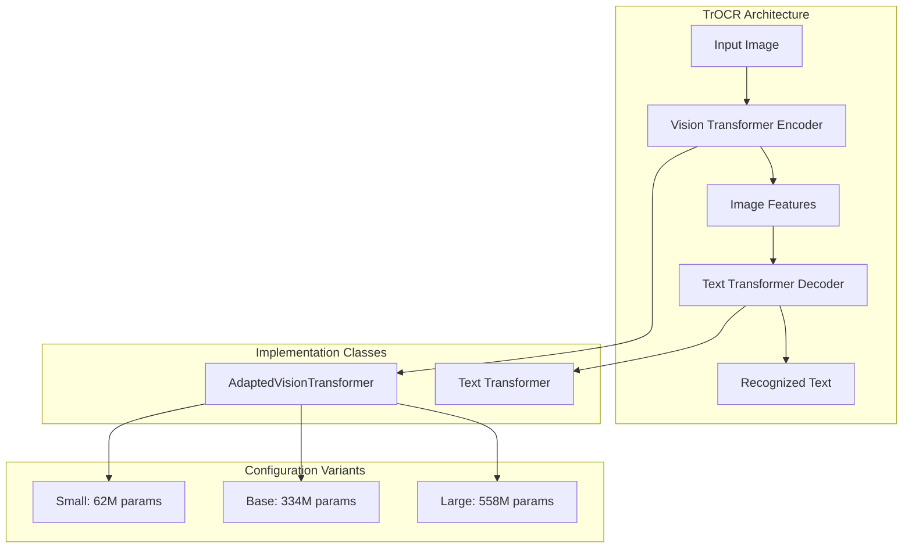
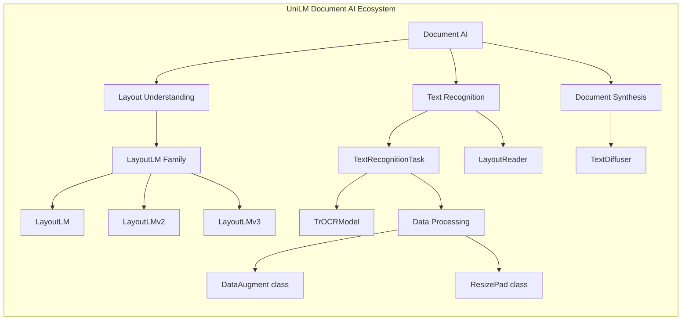
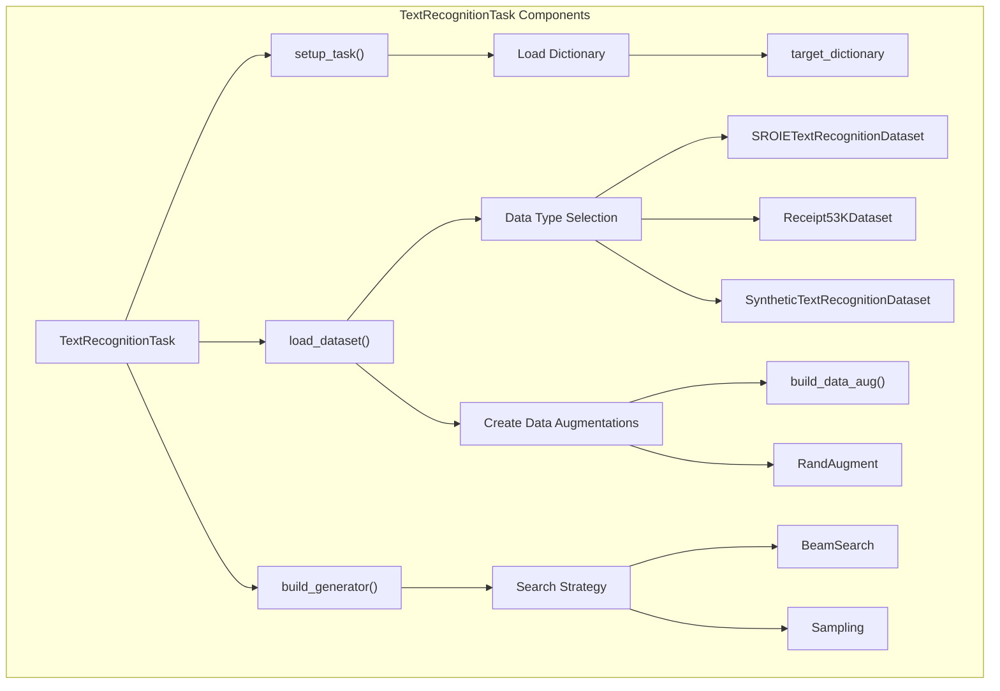

<!-- source: DeepWiki mcp.deepwiki.com · repo microsoft/unilm · page 5.4 TrOCR: Transformer-based OCR · fetched 2026-10-26 -->

# TrOCR: Transformer-based OCR

<details>
<summary>Relevant source files</summary>

The following files were used as context for generating this wiki page:

- [trocr/README.md](trocr/README.md)
- [trocr/__init__.py](trocr/__init__.py)
- [trocr/data_aug.py](trocr/data_aug.py)
- [trocr/deit.py](trocr/deit.py)
- [trocr/pic_inference.py](trocr/pic_inference.py)
- [trocr/task.py](trocr/task.py)
- [trocr/unilm3-cased.model](trocr/unilm3-cased.model)
- [trocr/unilm_models.py](trocr/unilm_models.py)

</details>


## Purpose and Scope

This document describes TrOCR, an end-to-end text recognition approach that uses pre-trained image Transformer and text Transformer models. TrOCR leverages the Transformer architecture for both image understanding and wordpiece-level text generation, providing a unified approach to optical character recognition (OCR). This document covers the architecture, available models, performance metrics, usage instructions for fine-tuning and inference, and implementation details.

Sources: [trocr/README.md:3-8]()

## Architecture Overview

TrOCR implements an encoder-decoder architecture where both components are based on the Transformer architecture.



- **Encoder**: Uses a Vision Transformer (ViT) architecture to process the input image. The model divides the image into patches, processes them with self-attention layers, and produces a sequence of feature vectors.
- **Decoder**: Employs a text Transformer (based on models like RoBERTa or UniLM) that attends to the image features and generates text tokens in an autoregressive manner.

The encoder implementation is based on the `AdaptedVisionTransformer` class, which modifies the standard Vision Transformer for OCR tasks. Various image preprocessing and data augmentation techniques are applied to ensure model robustness.

Sources: [trocr/deit.py:58-128](), [trocr/README.md:4-6]()

## Available Models and Performance

TrOCR is available in three model sizes with varying parameter counts:

| Model | Parameters | Pre-trained Weights |
|-------|------------|---------------------|
| TrOCR-Small | 62M | `trocr-small-handwritten.pt`, `trocr-small-printed.pt` |
| TrOCR-Base | 334M | `trocr-base-handwritten.pt`, `trocr-base-printed.pt` |
| TrOCR-Large | 558M | `trocr-large-handwritten.pt`, `trocr-large-printed.pt` |

Each size variant is trained for different domains:
- **Handwritten text** (trained on IAM dataset)
- **Printed text** (trained on SROIE dataset)

### Performance Metrics

#### IAM Dataset (Handwritten Text)

| Model | Character Error Rate (CER) |
|-------|----------------------------|
| TrOCR-Small | 4.22 |
| TrOCR-Base | 3.42 |
| TrOCR-Large | 2.89 |

#### SROIE Dataset (Printed Text)

| Model | F1 Score |
|-------|----------|
| TrOCR-Small | 95.86 |
| TrOCR-Base | 96.34 |
| TrOCR-Large | 96.60 |

#### Scene Text Recognition Benchmarks

| Model | IIIT5K-3000 | SVT-647 | ICDAR2013-857 | ICDAR2013-1015 | ICDAR2015-1811 | ICDAR2015-2077 | SVTP-645 | CT80-288 |
|-------|-------------|---------|---------------|----------------|----------------|----------------|----------|----------|
| TrOCR-Base | 93.4 | 95.2 | 98.4 | 97.4 | 86.9 | 81.2 | 92.1 | 90.6 |
| TrOCR-Large | 94.1 | 96.1 | 98.4 | 97.3 | 88.1 | 84.1 | 93.0 | 95.1 |

Sources: [trocr/README.md:14-26]()

## Integration in UniLM Ecosystem

TrOCR is positioned within the Document AI ecosystem as a specialized application for text recognition.



While the LayoutLM family focuses on understanding the layout and structure of documents, TrOCR specifically handles the text recognition component. It can be used independently for OCR tasks or as part of a larger document processing pipeline.

Sources: [trocr/task.py:23-110](), [trocr/__init__.py:1-6]()

## Installation and Setup

```bash
conda create -n trocr python=3.7
conda activate trocr
git clone https://github.com/microsoft/unilm.git
cd unilm/trocr
pip install pybind11
pip install -r requirements.txt
pip install -v --no-cache-dir --global-option="--cpp_ext" --global-option="--cuda_ext" 'git+https://github.com/NVIDIA/apex.git'
```

Sources: [trocr/README.md:27-37]()

## Usage

### Fine-tuning on IAM Dataset (Handwritten Text)

```bash
export MODEL_NAME=ft_iam
export SAVE_PATH=/path/to/save/${MODEL_NAME}
export LOG_DIR=log_${MODEL_NAME}
export DATA=/path/to/data
mkdir ${LOG_DIR}
export BSZ=8
export valid_BSZ=16

CUDA_VISIBLE_DEVICES=0,1,2,3,4,5,6,7 python -m torch.distributed.launch --nproc_per_node=8 \
    $(which fairseq-train) \
    --data-type STR --user-dir ./ --task text_recognition --input-size 384 \
    --arch trocr_large \   # or trocr_base
    --seed 1111 --optimizer adam --lr 2e-05 --lr-scheduler inverse_sqrt \
    --warmup-init-lr 1e-8 --warmup-updates 500 --weight-decay 0.0001 --log-format tqdm \
    --log-interval 10 --batch-size ${BSZ} --batch-size-valid ${valid_BSZ} --save-dir ${SAVE_PATH} \
    --tensorboard-logdir ${LOG_DIR} --max-epoch 300 --patience 20 --ddp-backend legacy_ddp \
    --num-workers 8 --preprocess DA2 --update-freq 1 \
    --bpe gpt2 --decoder-pretrained roberta2 \
    --finetune-from-model /path/to/model --fp16 \
    ${DATA} 
```

Sources: [trocr/README.md:65-87]()

### Fine-tuning on SROIE Dataset (Printed Text)

```bash
export MODEL_NAME=ft_SROIE
export SAVE_PATH=/path/to/save/${MODEL_NAME}
export LOG_DIR=log_${MODEL_NAME}
export DATA=/path/to/data
mkdir ${LOG_DIR}
export BSZ=16
export valid_BSZ=16

CUDA_VISIBLE_DEVICES=0,1,2,3,4,5,6,7 python -m torch.distributed.launch --nproc_per_node=8 \
    $(which fairseq-train) \
    --data-type SROIE --user-dir ./ --task text_recognition --input-size 384 \
    --arch trocr_large \   # or trocr_base
    --seed 1111 --optimizer adam --lr 5e-05 --lr-scheduler inverse_sqrt \
    --warmup-init-lr 1e-8 --warmup-updates 800 --weight-decay 0.0001 --log-format tqdm \
    --log-interval 10 --batch-size ${BSZ} --batch-size-valid ${valid_BSZ} \
    --save-dir ${SAVE_PATH} --tensorboard-logdir ${LOG_DIR} --max-epoch 300 \
    --patience 10 --ddp-backend legacy_ddp --num-workers 10 --preprocess DA2 \
    --bpe gpt2 --decoder-pretrained roberta2 \
    --update-freq 16 --finetune-from-model /path/to/model --fp16 \
    ${DATA}
```

Sources: [trocr/README.md:105-127]()

### Evaluation

#### IAM Dataset Evaluation

```bash
export DATA=/path/to/data
export MODEL=/path/to/model
export RESULT_PATH=/path/to/result
export BSZ=16

$(which fairseq-generate) \
        --data-type STR --user-dir ./ --task text_recognition --input-size 384 \
        --beam 10 --scoring cer2 --gen-subset test --batch-size ${BSZ} \
        --path ${MODEL} --results-path ${RESULT_PATH} --preprocess DA2 \
        --bpe gpt2 --dict-path-or-url https://layoutlm.blob.core.windows.net/trocr/dictionaries/gpt2_with_mask.dict.txt \
        --fp16 \
        ${DATA}
```

Sources: [trocr/README.md:89-103]()

### Inference Example

The following code demonstrates how to perform inference with a pre-trained TrOCR model:

```python
import task
import deit
import trocr_models
import torch
import fairseq
from fairseq import utils
from fairseq_cli import generate
from PIL import Image
import torchvision.transforms as transforms

# Initialize model
model_path = 'path/to/model'
model, cfg, task = fairseq.checkpoint_utils.load_model_ensemble_and_task(
    [model_path],
    arg_overrides={"beam": 5, "task": "text_recognition", "data": "", "fp16": False})

device = "cuda" if torch.cuda.is_available() else "cpu"
model[0].to(device)

# Define image transform
img_transform = transforms.Compose([
    transforms.Resize((384, 384), interpolation=3),
    transforms.ToTensor(),
    transforms.Normalize(0.5, 0.5)
])

# Process image
im = Image.open('path/to/pic').convert('RGB').resize((384, 384))
im = img_transform(im).unsqueeze(0).to(device).float()

sample = {
    'net_input': {"imgs": im},
}

# Generate text
generator = task.build_generator(
    model, cfg.generation, extra_gen_cls_kwargs={'lm_model': None, 'lm_weight': None}
)
bpe = task.build_bpe(cfg.bpe)

decoder_output = task.inference_step(generator, model, sample, prefix_tokens=None, constraints=None)
decoder_output = decoder_output[0][0]  # top1

hypo_tokens, hypo_str, alignment = utils.post_process_prediction(
    hypo_tokens=decoder_output["tokens"].int().cpu(),
    src_str="",
    alignment=decoder_output["alignment"],
    align_dict=None,
    tgt_dict=model[0].decoder.dictionary,
    remove_bpe=cfg.common_eval.post_process,
    extra_symbols_to_ignore=generate.get_symbols_to_strip_from_output(generator),
)

text = bpe.decode(hypo_str)
print(text)
```

Sources: [trocr/pic_inference.py:1-79]()

## Implementation Details

### Task Registration and Configuration

TrOCR is implemented as a Fairseq task called `TextRecognitionTask`. This task handles dataset loading, model building, and inference procedures.



The task supports different data types:
- `SROIE`: For printed text recognition
- `Receipt53K`: For receipt text recognition
- `STR`: For synthetic text recognition

It also configures different preprocessing and data augmentation strategies based on the training or evaluation mode.

Sources: [trocr/task.py:23-281]()

### Data Augmentation

TrOCR employs extensive data augmentation strategies to improve model robustness. The `DataAugment` class applies various transformations to the input images:

1. **Geometric transformations**: Rotation, perspective transformation, scaling
2. **Noise injection**: Gaussian noise, impulse noise, speckle noise
3. **Blur operations**: Gaussian blur, motion blur, defocus blur
4. **Weather effects**: Fog, snow, frost, rain
5. **Camera simulation**: Contrast, brightness adjustments, JPEG compression

For training, multiple augmentations are randomly applied with configurable magnitudes.

Sources: [trocr/data_aug.py:17-323]()

### Model Architecture Adaptations

The `AdaptedVisionTransformer` class modifies the standard Vision Transformer for OCR tasks:

1. Adds support for Absolute Position Embedding (APE)
2. Implements masking during training
3. Adds FP16 precision handling for attention computation
4. Supports custom image sizes and patch configurations

Additional modules like `Fp16FixedAttention` implement specialized attention mechanisms to improve training stability with FP16 precision.

Sources: [trocr/deit.py:17-56](), [trocr/deit.py:58-128]()

## Conclusion

TrOCR represents a significant advancement in OCR technology by leveraging the power of Transformer architectures for both image understanding and text generation. Its end-to-end approach eliminates the need for complex pipelines that were common in traditional OCR systems.

The model's flexible architecture allows it to handle both handwritten and printed text with state-of-the-art accuracy. The availability of different model sizes enables deployment in various scenarios based on the computational constraints and accuracy requirements.

For integration with other document understanding technologies in the UniLM ecosystem, TrOCR can be combined with layout analysis tools like the LayoutLM family to create comprehensive document understanding solutions.

Sources: [trocr/README.md:3-8](), [trocr/README.md:191-202]()

---

