<!-- source: DeepWiki mcp.deepwiki.com · repo microsoft/unilm · page 6 Vision-Language Models · fetched 2026-10-26 -->

# Vision-Language Models

<details>
<summary>Relevant source files</summary>

The following files were used as context for generating this wiki page:

- [kosmos-2/README.md](kosmos-2/README.md)
- [kosmos-2/data/generate_config.py](kosmos-2/data/generate_config.py)
- [kosmos-2/data/prepare_grit.py](kosmos-2/data/prepare_grit.py)
- [kosmos-2/data/visualize_grit.py](kosmos-2/data/visualize_grit.py)
- [kosmos-2/demo/gradio_app.py](kosmos-2/demo/gradio_app.py)
- [kosmos-2/train.sh](kosmos-2/train.sh)
- [kosmos-2/vl_setup_xl.sh](kosmos-2/vl_setup_xl.sh)
- [metalm/README.md](metalm/README.md)
- [textdiffuser-2/README.md](textdiffuser-2/README.md)
- [textdiffuser-2/assets/arial.ttf](textdiffuser-2/assets/arial.ttf)
- [textdiffuser-2/assets/attention_processor.py](textdiffuser-2/assets/attention_processor.py)
- [textdiffuser-2/assets/readme_images/architecture.jpg](textdiffuser-2/assets/readme_images/architecture.jpg)
- [textdiffuser-2/assets/readme_images/demo.jpg](textdiffuser-2/assets/readme_images/demo.jpg)
- [textdiffuser-2/assets/readme_images/m1_loss.jpg](textdiffuser-2/assets/readme_images/m1_loss.jpg)
- [textdiffuser-2/assets/readme_images/teaser.jpg](textdiffuser-2/assets/readme_images/teaser.jpg)
- [textdiffuser-2/assets/reference_requirements.txt](textdiffuser-2/assets/reference_requirements.txt)
- [textdiffuser-2/cog.yaml](textdiffuser-2/cog.yaml)
- [textdiffuser-2/data/check_layout_planner_data.py](textdiffuser-2/data/check_layout_planner_data.py)
- [textdiffuser-2/data/layout_planner_data_5k.json](textdiffuser-2/data/layout_planner_data_5k.json)
- [textdiffuser-2/inference_textdiffuser2_t2i_full.py](textdiffuser-2/inference_textdiffuser2_t2i_full.py)
- [textdiffuser-2/predict.py](textdiffuser-2/predict.py)
- [textdiffuser/README.md](textdiffuser/README.md)

</details>


## Purpose and Scope

This document covers vision-language multimodal models in the Microsoft UniLM repository that focus on combining visual and linguistic understanding. These models handle tasks involving both image and text modalities, with emphasis on generative capabilities.

**Scope:** This page covers the Kosmos series (Multimodal Large Language Models) and TextDiffuser series (diffusion-based text rendering in images). For document-specific vision-language models that process structured documents (forms, receipts, PDFs), see [Document AI: Multimodal Models](#5). For pure vision models without language integration, see [Vision Models](#2).

The vision-language models in this repository represent a key component of "The Big Convergence" vision - unified modeling across tasks, languages, and modalities.

Sources: [README.md:29-39](), [README.md:74-95]()

## Model Categories

The repository contains two primary categories of vision-language models:

| Category | Models | Primary Capability | Key Innovation |
|----------|--------|-------------------|----------------|
| **Multimodal LLMs** | Kosmos-1, Kosmos-2, Kosmos-2.5 | General multimodal understanding, perception, grounding | Unified MLLM architecture for diverse tasks |
| **Text Rendering** | TextDiffuser, TextDiffuser-2 | Accurate text generation in images | Diffusion models with character-aware loss and layout planning |

Sources: [README.md:29-36](), [README.md:66-67]()

## Kosmos-2: Grounding Multimodal Large Language Models to the World

### Architecture Overview

Kosmos-2 is implemented as a unified transformer-based MLLM that grounds language to visual coordinates. The model extends standard LLM capabilities with spatial grounding tokens.

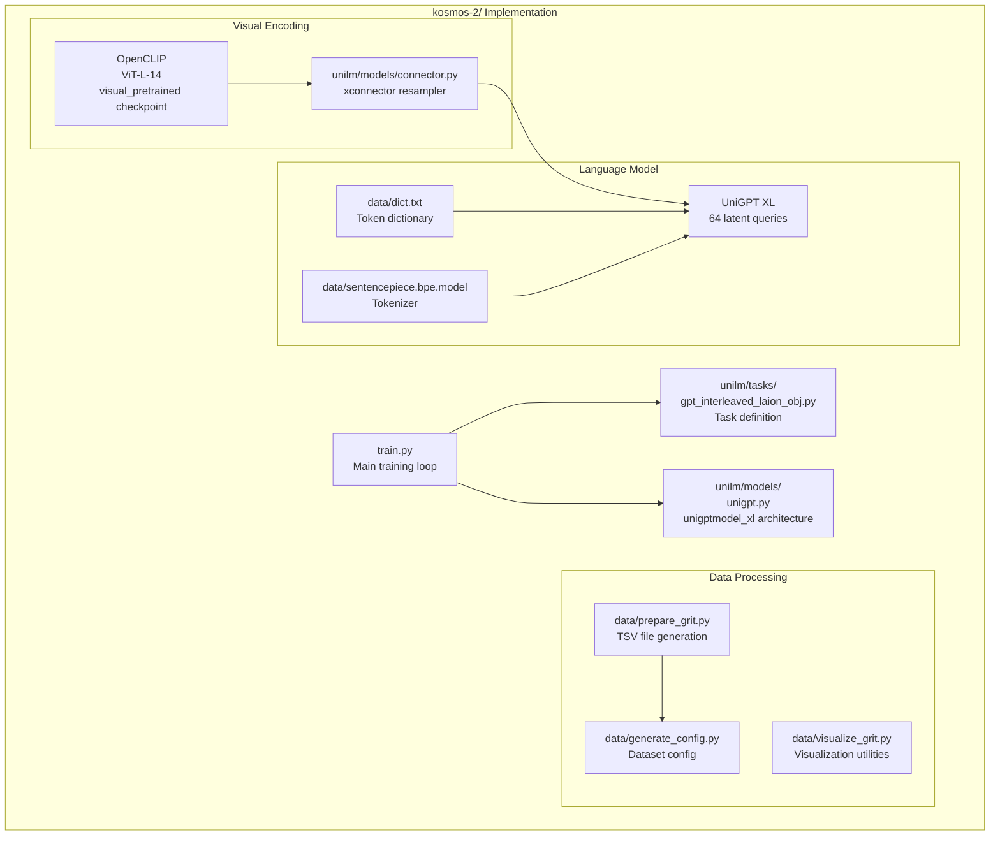

**Diagram: Kosmos-2 Codebase Architecture**

The model uses a two-stage architecture: (1) CLIP ViT-L/14 for visual encoding, (2) UniGPT XL for multimodal language modeling with grounding capabilities.

**Key Implementation Details:**

**Model Configuration:**
- Architecture: `unigptmodel_xl` defined in [unilm/models/unigpt.py]()
- Visual encoder: ViT-L-14 with 1024-dim output
- Connector: `xconnector` resampler with 64 latent queries ([train.sh:48]())
- Context length: 2048 tokens ([train.sh:5]())
- Coordinate quantization: 32 buckets ([train.sh:43]())

**Training Task:**
- Task class: `image_gpt_interleaved_laion_obj` in [unilm/tasks/gpt_interleaved_laion_obj.py]()
- Supports interleaved image-text data and LAION/COYO datasets
- Special token: `<grounding>` to trigger bounding box generation ([train.sh:45]())

Sources: [kosmos-2/train.sh:1-53](), [kosmos-2/data/prepare_grit.py:1-54](), [kosmos-2/data/generate_config.py:1-25]()

### GRIT Dataset Structure

Kosmos-2 training uses GRIT (Grounded Image-Text pairs), a dataset of 20M+ image-text pairs with phrase grounding annotations.

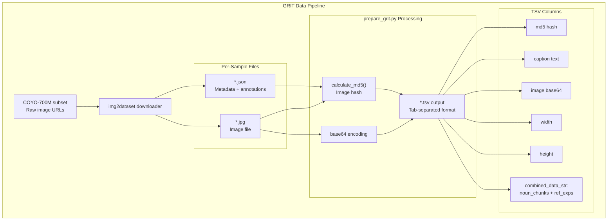

**Diagram: GRIT Dataset Processing Pipeline**

**Data Format:**

Each sample in GRIT contains:
- `noun_chunks`: Noun phrases with bounding boxes `[start, end, x1_norm, y1_norm, x2_norm, y2_norm, score]`
- `ref_exps`: Full referring expressions with same format
- Normalized coordinates in range [0, 1]

Processing script [data/prepare_grit.py:9-53]() converts JSON+JPG pairs to TSV:
```python
# Key functions in prepare_grit.py
def calculate_md5(image)  # Lines 9-15
def process_files(directory)  # Lines 17-43
def write_tsv(tsv_data, output_file)  # Lines 45-47
```

Configuration generation [data/generate_config.py:6-22]() creates training manifests:
```json
{
  "source": ["../grit/file1.tsv", "../grit/file2.tsv"],
  "source_lang": "grit",
  "weight": 1.0,
  "name": "grit"
}
```

Sources: [kosmos-2/data/prepare_grit.py:1-54](), [kosmos-2/data/generate_config.py:1-25](), [kosmos-2/README.md:83-108]()

### Training Configuration

Training is configured through [train.sh]() with the following key parameters:

**Model Parameters:**
- `--arch unigptmodel_xl`: Architecture defined in [unilm/models/unigpt.py]()
- `--latent-query-num 64`: Number of latent queries for visual features
- `--connector xconnector`: Resampler type from [unilm/models/connector.py]()

**Data Parameters:**
- `--phrase-mode 'expression'`: Use full referring expressions vs phrases
- `--quantized-size 32`: Coordinate discretization buckets
- `--locate-special-token 1`: Enable `<grounding>` token
- `--box-score-threshold 0.65`: Minimum confidence for bounding boxes
- `--use-object-bbox-prob 0.5`: Probability of using grounding annotations

**Optimization:**
- `--optimizer adam` with `--adam-betas '(0.9,0.98)'`
- `--lr 0.0002` with polynomial decay scheduler
- `--max-update 60000` training steps
- `--memory-efficient-fp16` for mixed precision
- `--checkpoint-activations` for memory efficiency

Sources: [kosmos-2/train.sh:1-74]()

### Evaluation Tasks

Kosmos-2 supports evaluation across multiple vision-language tasks:

| Task | Dataset | Key Metric | Implementation |
|------|---------|------------|----------------|
| Phrase Grounding | Flickr30k Entities | Recall@1 | [evaluation/flickr_entities/README.md]() |
| Referring Expression Comprehension | RefCOCO/RefCOCO+/RefCOCOg | Accuracy | [evaluation/refcoco/README.md]() |
| Referring Expression Generation | RefCOCOg | Meteor, CIDEr | [evaluation/]() |
| Image Captioning | Flickr30K | CIDEr | [evaluation/]() |
| Visual Question Answering | VQAv2 | Accuracy | [evaluation/]() |

**Phrase Grounding Results:**
- Flickr30k val: 77.8% Recall@1
- Flickr30k test: 78.7% Recall@1

**Referring Expression Comprehension:**
- RefCOCO val: 52.32% accuracy
- RefCOCO+ val: 45.48% accuracy  
- RefCOCOg val: 60.57% accuracy

Sources: [kosmos-2/README.md:119-171]()

### Inference Interface

The model provides inference through [demo/gradio_app.py]() with the following pipeline:

```mermaid
graph TB
    subgraph "gradio_app.py Inference Pipeline"
        Input["User Input:<br/>image path + text prompt"]
        
        subgraph "Token Processing - get_interactive_tokens_and_lengths()"
            ImageLoad["Image.open() + square_transform()"]
            BOS["Add bos_id token"]
            ImageTokens["Add boi_id + range(4, 68) + eoi_id"]
            TextTokens["sentencepiece.encode() text"]
            Combine["Concatenate tokens"]
        end
        
        subgraph "Model Inference"
            Batch["make_batches()<br/>Create inference batch"]
            Generate["task.inference_step()<br/>generator.generate()"]
            Decode["decode_fn()<br/>Post-process output"]
        end
        
        subgraph "Visualization"
            Extract["Extract <phrase>...</phrase> tags"]
            DrawBox["visualize_results_on_image()<br/>from draw_box module"]
            Highlight["mark_texts()<br/>Create highlighted text"]
        end
        
        Output["Image with boxes +<br/>Highlighted text"]
    end
    
    Input --> ImageLoad
    ImageLoad --> BOS
    BOS --> ImageTokens
    ImageTokens --> TextTokens
    TextTokens --> Combine
    Combine --> Batch
    Batch --> Generate
    Generate --> Decode
    Decode --> Extract
    Extract --> DrawBox
    Extract --> Highlight
    DrawBox --> Output
    Highlight --> Output
```

**Diagram: Kosmos-2 Gradio Demo Inference Flow**

**Key Functions:**

1. **Token Encoding** [demo/gradio_app.py:88-162]():
   - `get_interactive_tokens_and_lengths()`: Converts image+text to token IDs
   - Handles `[image]path<tab>text` format
   - Image features: tokens 4-67 (64 total)
   - Special tokens: `<image>`, `</image>`, `<grounding>`

2. **Batch Creation** [demo/gradio_app.py:165-224]():
   - `make_batches()`: Creates inference batches with constraints
   - Uses `task.build_dataset_for_caption_inference()`

3. **Text Highlighting** [demo/gradio_app.py:528-579]():
   - `mark_texts()`: Extracts and highlights grounded phrases
   - Pattern: `<phrase>text</phrase>` in model output

Sources: [kosmos-2/demo/gradio_app.py:1-527](), [kosmos-2/README.md:63-71]()

### Kosmos Series Context

Kosmos-2 builds on earlier work:
- **MetaLM** (June 2022): General-purpose interfaces concept
- **Kosmos-1** (February 2023): Foundation MLLM architecture
- **Kosmos-2** (June 2023): Added grounding capabilities
- **Kosmos-2.5** (September 2023): Added multimodal literacy for text-intensive images

Sources: [kosmos-2/README.md:1-9](), [metalm/README.md:1-6]()

## TextDiffuser: Diffusion Models as Text Painters

### Architecture Overview

TextDiffuser implements a two-stage pipeline based on Stable Diffusion v1.5 with custom modifications for text rendering.

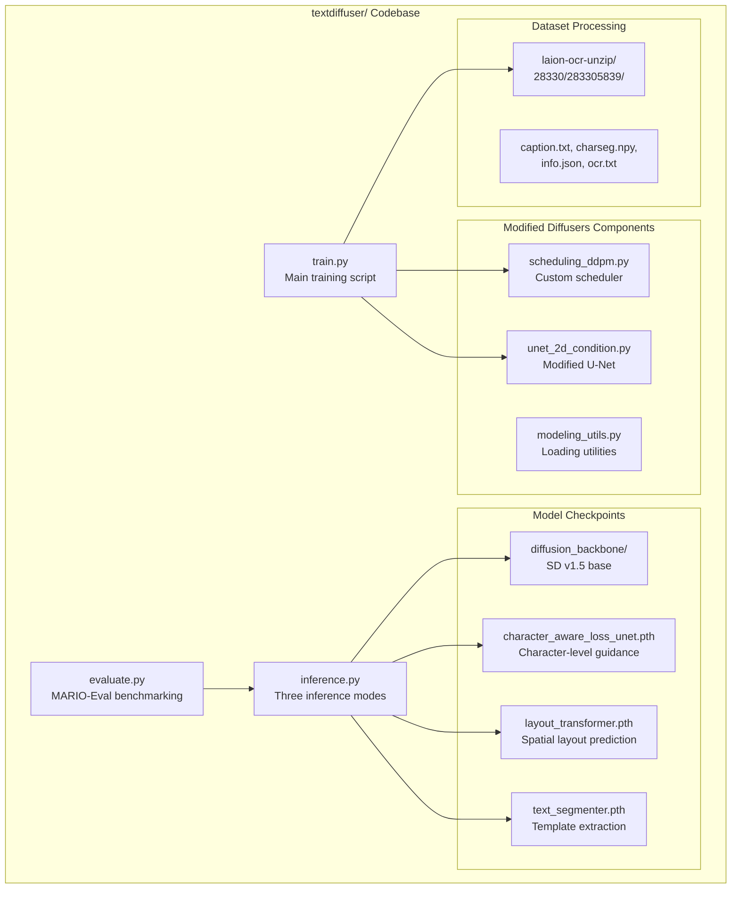

**Diagram: TextDiffuser Implementation Structure**

**File Replacement Requirements:**

The diffusers library requires custom modifications at [textdiffuser/README.md:53-60]():
```bash
# Modified files must replace standard diffusers
cp ./assets/files/scheduling_ddpm.py ./diffusers/src/diffusers/schedulers/
cp ./assets/files/unet_2d_condition.py ./diffusers/src/diffusers/models/
cp ./assets/files/modeling_utils.py ./diffusers/src/diffusers/models/
```

Sources: [textdiffuser/README.md:1-80](), [textdiffuser/README.md:53-60]()

### Core Components

#### 1. Layout Transformer

The Layout Transformer generates spatial layouts for keywords in the prompt. It predicts bounding box coordinates for where text should appear in the generated image.

**Model Details:**
- Checkpoint: `layout_transformer.pth`
- Produces character-level layout information
- Coordinates in normalized space (128x128 grid)

Sources: [textdiffuser/README.md:75-78]()

#### 2. Character-Level Segmentation

A pre-trained segmentation model extracts character-level masks from template images, enabling precise layout control.

**Model Details:**
- Checkpoint: `text_segmenter.pth`
- Outputs character-level segmentation masks stored as `.npy` files
- Used in text-to-image-with-template mode

Sources: [textdiffuser/README.md:77-78](), [textdiffuser/README.md:94-96]()

#### 3. Diffusion Backbone

The core generation model based on Stable Diffusion v1.5 with modifications for text rendering.

**Architecture:**
- Base: Stable Diffusion v1.5
- Modified U-Net with character-aware loss integration
- CLIP text encoder for prompt encoding
- DDPM scheduler for denoising

**Checkpoint Structure:**
```
textdiffuser-ckpt/
├── diffusion_backbone/           # Main generation model
├── character_aware_loss_unet.pth # Character-level guidance
├── layout_transformer.pth        # Layout planning
└── text_segmenter.pth           # Character segmentation
```

Sources: [textdiffuser/README.md:68-80](), [textdiffuser/README.md:54-60]()

### Character-Aware Loss

A key innovation in TextDiffuser is the character-aware loss function that guides the diffusion model to generate accurate text at the character level.

**Mechanism:**
- Computed using `character_aware_loss_unet.pth`
- Applied during training with lambda weight (default: 0.01)
- Ensures character-level accuracy in generated text

**Training Parameter:**
```bash
--character_aware_loss_lambda=0.01
```

Sources: [textdiffuser/README.md:76](), [textdiffuser/README.md:142]()

### MARIO-10M Dataset

TextDiffuser training uses MARIO-10M, a large-scale dataset of image-text pairs with OCR annotations.

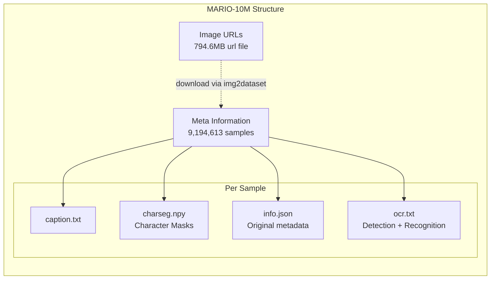

**Diagram: MARIO-10M Dataset Organization**

**Dataset Characteristics:**
- **Size:** 9.2M+ samples
- **Annotations:** OCR detection, recognition, character-level segmentation
- **Source:** LAION dataset with OCR processing
- **Storage:** Organized by folder structure (e.g., `28330/283305839/`)

**File Structure per Sample:**
- `caption.txt` - Image caption
- `charseg.npy` - Character-level segmentation masks (512×512)
- `info.json` - Metadata from LAION (height, width, etc.)
- `ocr.txt` - OCR detection and recognition results

Sources: [textdiffuser/README.md:82-113]()

### Training Implementation

Training is orchestrated through [train.py]() using Accelerate for distributed training.

**Command-line Arguments** [train.py:116-149]():

```bash
accelerate launch train.py \
    --train_batch_size=24 \
    --gradient_accumulation_steps=4 \
    --gradient_checkpointing \
    --mixed_precision="fp16" \
    --num_train_epochs=2 \
    --learning_rate=1e-5 \
    --max_grad_norm=1 \
    --lr_scheduler="constant" \
    --output_dir="experiment_name" \
    --enable_xformers_memory_efficient_attention \
    --character_aware_loss_lambda=0.01 \
    --drop_caption \
    --mask_all_ratio=0.5 \
    --segmentation_mask_aug \
    --dataset_path=/path/to/laion-ocr-unzip \
    --train_dataset_index_file=/path/to/index_file.txt \
    --vis_num=8
```

**Key Training Parameters:**
- Effective batch size: 24 × 4 = 96
- Character-aware loss lambda: 0.01
- Caption dropout: 50% probability
- Mask augmentation ratio: 0.5

**Data Loading:**

Index file format [train.py:117-124]():
```txt
06269_062690093
27197_271975251
27197_271978467
```

Each line references a sample in the dataset hierarchy: `folder_id/sample_id`

Sources: [textdiffuser/README.md:116-150]()

### Inference Modes

The [inference.py]() script implements three mode branches controlled by `--mode` parameter:

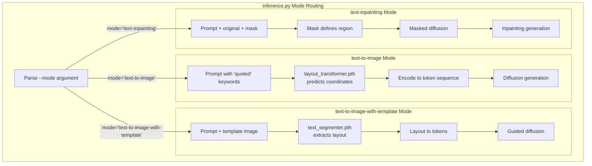

**Diagram: TextDiffuser Inference Mode Dispatch**

**Mode 1: Text-to-Image** [inference.py:163-169]()

Keywords enclosed in single quotes trigger layout prediction:
```bash
python inference.py \
  --mode="text-to-image" \
  --prompt="A sign that says 'Hello'" \
  --vis_num=4
```

**Mode 2: Text-to-Image-with-Template** [inference.py:171-182]()

Template image provides layout via character-level segmenter:
```bash
python inference.py \
  --mode="text-to-image-with-template" \
  --prompt="a poster of monkey music festival" \
  --template_image="assets/examples/text-to-image-with-template/case2.jpg"
```

**Mode 3: Text-Inpainting** [inference.py:184-196]()

Mask image defines inpainting region:
```bash
python inference.py \
  --mode="text-inpainting" \
  --prompt="a boy draws good morning on a board" \
  --original_image="assets/examples/text-inpainting/case2.jpg" \
  --text_mask="assets/examples/text-inpainting/case2_mask.jpg"
```

Sources: [textdiffuser/README.md:155-196]()

### Evaluation Framework

TextDiffuser uses MARIO-Eval, a comprehensive benchmark with 10K prompts across multiple subsets.

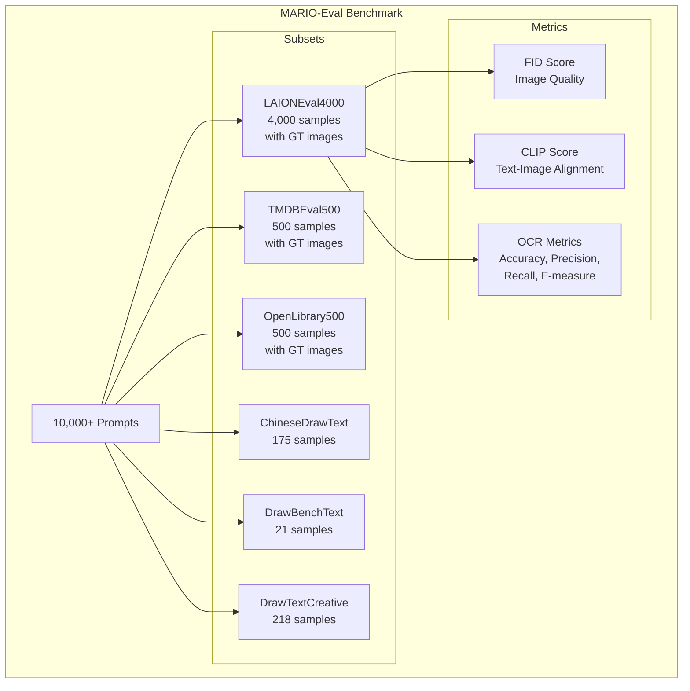

**Diagram: MARIO-Eval Benchmark Structure**

**Evaluation Results (on LAIONEval4000):**

| Metric | Stable Diffusion | ControlNet | DeepFloyd | TextDiffuser |
|--------|-----------------|------------|-----------|--------------|
| FID↓ | 51.295 | 51.485 | **34.902** | 38.758 |
| CLIP Score↑ | 0.3015 | 0.3424 | 0.3267 | **0.3436** |
| OCR Accuracy↑ | 0.0003 | 0.2390 | 0.0262 | **0.5609** |
| OCR Precision↑ | 0.0173 | 0.5211 | 0.1450 | **0.7846** |
| OCR Recall↑ | 0.0280 | 0.6707 | 0.2245 | **0.7802** |
| OCR F-measure↑ | 0.0214 | 0.5865 | 0.1762 | **0.7824** |

Sources: [textdiffuser/README.md:198-250]()

## TextDiffuser-2: LLM-Enhanced Layout Planning

### Architecture Overview

TextDiffuser-2 splits layout planning and image generation into two separately trained modules.

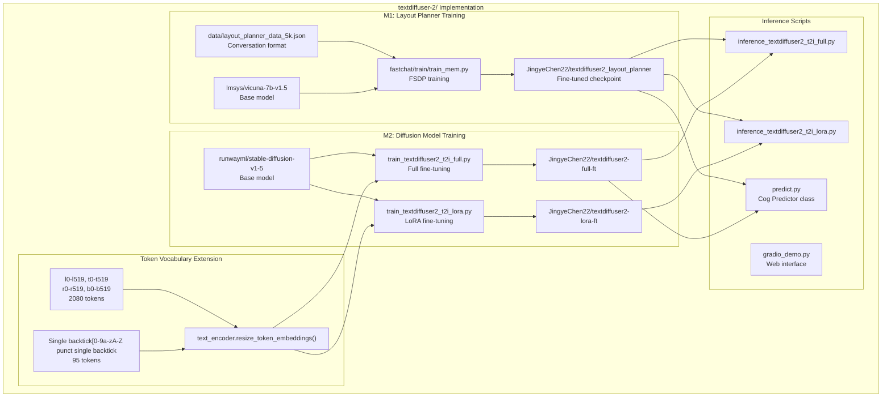

**Diagram: TextDiffuser-2 Training and Inference Pipeline**

**Key Implementation Classes:**

1. **Predictor** [predict.py:45-358](): Production inference interface
   - `setup()` [predict.py:46-136](): Load M1 + M2 models
   - `predict()` [predict.py:138-358](): End-to-end generation

2. **Token Vocabulary** [predict.py:84-94]():
   ```python
   # Coordinate tokens (2080 total)
   for i in range(520):
       tokenizer.add_tokens([f"l{i}", f"t{i}", f"r{i}", f"b{i}"])
   
   # Character tokens (95 total)
   for c in alphabet:
       tokenizer.add_tokens([f"[{c}]"])
   ```

Sources: [textdiffuser-2/README.md:1-24](), [textdiffuser-2/predict.py:45-358]()

### Key Improvements over TextDiffuser

1. **Flexible Layout Planning:** LLM-based layout generation replaces rigid transformer-based approach
2. **Conversational Editing:** Support for iterative layout refinement through dialogue
3. **Style Diversity:** Enhanced variety in text rendering styles
4. **Automated Keyword Detection:** Language model can identify keywords automatically

Sources: [textdiffuser-2/README.md:18-21]()

### M1: Layout Planner Implementation

The layout planner module fine-tunes Vicuna-7B to generate spatial layouts from text prompts.

#### Training Data Structure

**Dataset Format** [data/layout_planner_data_5k.json:1-14]():
```json
{
  "id": "identity_0",
  "conversations": [
    {
      "from": "human",
      "value": "Given a prompt... Prompt: FirstService Residential builder"
    },
    {
      "from": "gpt", 
      "value": "FirstService 0,91,127,112\nRESIDENTIAL 51,117,127,127\n"
    }
  ]
}
```

Each entry contains a prompt and corresponding layout with format `keyword left,top,right,bottom`.

**Data Validation** [data/check_layout_planner_data.py:1-33]():
```python
# Visualize layout predictions
f = open('layout_planner_data_5k.json')
items = json.load(f)
layout = random.sample(items, k=1)[0]['conversations'][1]['value']

# Parse layout format
for line in layout.split('\n'):
    pred = ' '.join(line.split()[:-1])  # keyword
    box = line.split()[-1]              # coordinates
    l, t, r, b = [int(i)*2 for i in box.split(',')]
```

#### Training Configuration

**Command** [README.md:97-122]():
```bash
torchrun --nproc_per_node=8 --master_port=20003 fastchat/train/train_mem.py \
    --model_name_or_path lmsys/vicuna-7b-v1.5 \
    --data_path data/layout_planner_data_5k.json \
    --bf16 True \
    --output_dir experiment_result \
    --num_train_epochs 6 \
    --per_device_train_batch_size 2 \
    --gradient_accumulation_steps 16 \
    --learning_rate 2e-5 \
    --warmup_ratio 0.03 \
    --lr_scheduler_type "cosine" \
    --fsdp "full_shard auto_wrap" \
    --fsdp_transformer_layer_cls_to_wrap 'LlamaDecoderLayer' \
    --model_max_length 2048 \
    --gradient_checkpointing True \
    --lazy_preprocess True
```

**Training Parameters:**
- Effective batch size: 2 × 16 × 8 = 256
- Total training samples: 5,000
- FSDP sharding across 8 GPUs
- Gradient checkpointing for memory efficiency
- Lazy preprocessing for efficiency

#### Inference Integration

**Conversation Template** [predict.py:193-207]():
```python
from fastchat.model import get_conversation_template

template = f"Given a prompt that will be used to generate an image, plan the layout..."
conv = get_conversation_template(self.m1_model_path)
conv.append_message(conv.roles[0], template)  # User message
conv.append_message(conv.roles[1], None)      # Assistant placeholder
prompt = conv.get_prompt()

# Generate layout
output_ids = self.m1_model.generate(
    **inputs,
    do_sample=True,
    temperature=temperature,
    max_new_tokens=512
)
```

Sources: [textdiffuser-2/README.md:95-126](), [textdiffuser-2/data/layout_planner_data_5k.json:1-14](), [textdiffuser-2/data/check_layout_planner_data.py:1-33](), [textdiffuser-2/predict.py:193-217]()

#### Layout Planner Integration

The layout planner integrates with the diffusion model through specialized token encoding:

```python
# Coordinate tokens
for i in range(520):
    tokenizer.add_tokens(["l" + str(i)])  # left
    tokenizer.add_tokens(["t" + str(i)])  # top
    tokenizer.add_tokens(["r" + str(i)])  # right
    tokenizer.add_tokens(["b" + str(i)])  # bottom

# Character tokens
for c in alphabet:
    tokenizer.add_tokens([f"[{c}]"])
```

**Alphabet Definition:**
```python
alphabet = (
    string.digits +
    string.ascii_lowercase +
    string.ascii_uppercase +
    string.punctuation +
    " "
)  # len(alphabet) = 95
```

Sources: [textdiffuser-2/predict.py:26-35](), [textdiffuser-2/predict.py:84-94]()

### M2: Diffusion Model Implementation

The diffusion module extends Stable Diffusion v1.5 with custom token embeddings for layout encoding.

#### Token Vocabulary Extension

**Implementation** [predict.py:83-94]():
```python
tokenizer = CLIPTokenizer.from_pretrained("runwayml/stable-diffusion-v1-5", subfolder="tokenizer")
print(f"tokenizer size: {len(tokenizer)}")  # 49408

# Add coordinate tokens
for i in range(520):
    tokenizer.add_tokens([f"l{i}"])  # left
    tokenizer.add_tokens([f"t{i}"])  # top
    tokenizer.add_tokens([f"r{i}"])  # right
    tokenizer.add_tokens([f"b{i}"])  # bottom

# Add character tokens
alphabet = string.digits + string.ascii_lowercase + string.ascii_uppercase + string.punctuation + ' '
for c in alphabet:
    tokenizer.add_tokens([f"[{c}]"])

print(f"new tokenizer size: {len(tokenizer)}")  # 51583

# Resize embeddings
text_encoder.resize_token_embeddings(len(tokenizer))
```

**Vocabulary Breakdown:**
- Base CLIP: 49,408 tokens
- Coordinate tokens: 520 × 4 = 2,080 (`l0`...`l519`, `t0`...`t519`, `r0`...`r519`, `b0`...`b519`)
- Character tokens: 95 (`[0]`...`[9]`, `[a]`...`[z]`, `[A]`...`[Z]`, punctuation)
- **Total: 51,583 tokens**

#### Model Components

**Setup Method** [predict.py:46-123]():
```python
def setup(self):
    # M1: Layout planner
    self.m1_tokenizer = AutoTokenizer.from_pretrained(
        "JingyeChen22/textdiffuser2_layout_planner"
    )
    self.m1_model = AutoModelForCausalLM.from_pretrained(
        "JingyeChen22/textdiffuser2_layout_planner",
        torch_dtype=torch.float16
    ).cuda()
    
    # M2: Text encoder with expanded vocabulary
    self.text_encoder = CLIPTextModel.from_pretrained(
        "JingyeChen22/textdiffuser2-full-ft",
        subfolder="text_encoder"
    ).cuda().half()
    
    # M2: VAE
    self.vae = AutoencoderKL.from_pretrained(
        "runwayml/stable-diffusion-v1-5",
        subfolder="vae"
    ).half().cuda()
    
    # M2: U-Net
    self.unet = UNet2DConditionModel.from_pretrained(
        "JingyeChen22/textdiffuser2-full-ft",
        subfolder="unet"
    ).half().cuda()
    
    # M2: Scheduler
    self.scheduler = DDPMScheduler.from_pretrained(
        "runwayml/stable-diffusion-v1-5",
        subfolder="scheduler"
    )
```

Sources: [textdiffuser-2/predict.py:46-123](), [textdiffuser-2/predict.py:83-94]()

#### Training Approaches

**1. Full Fine-tuning** [train_textdiffuser2_t2i_full.py]()

Updates all parameters of text encoder and U-Net:
```bash
accelerate launch train_textdiffuser2_t2i_full.py \
    --pretrained_model_name_or_path="runwayml/stable-diffusion-v1-5" \
    --train_batch_size=18 \
    --gradient_accumulation_steps=4 \
    --gradient_checkpointing \
    --mixed_precision="fp16" \
    --num_train_epochs=6 \
    --learning_rate=1e-5 \
    --max_grad_norm=1 \
    --lr_scheduler="constant" \
    --output_dir="diffusion_experiment_result" \
    --enable_xformers_memory_efficient_attention \
    --dataloader_num_workers=8 \
    --index_file_path='/path/to/train_dataset_index.txt' \
    --dataset_path='/path/to/laion-ocr-select/' \
    --granularity=128 \
    --coord_mode="ltrb" \
    --max_length=77 \
    --resume_from_checkpoint="latest"
```

**Parameters:**
- Effective batch size: 18 × 4 = 72
- Learning rate: 1e-5 (all parameters)
- Checkpoint: `JingyeChen22/textdiffuser2-full-ft`

**2. LoRA Fine-tuning** [train_textdiffuser2_t2i_lora.py]()

Low-rank adaptation for parameter efficiency:
```bash
accelerate launch train_textdiffuser2_t2i_lora.py \
    --pretrained_model_name_or_path="runwayml/stable-diffusion-v1-5" \
    --train_batch_size=18 \
    --gradient_accumulation_steps=4 \
    --num_train_epochs=6 \
    --learning_rate=1e-4 \
    --text_encoder_learning_rate=1e-5 \
    --granularity=128 \
    --coord_mode="ltrb" \
    --max_length=77
```

**Parameters:**
- U-Net LoRA learning rate: 1e-4
- Text encoder learning rate: 1e-5 
- Checkpoint: `JingyeChen22/textdiffuser2-lora-ft`
- Reduced memory footprint vs full fine-tuning

**Coordinate Modes** [inference_textdiffuser2_t2i_full.py:203-208]():
- `ltrb`: Left, top, right, bottom (default)
- `lt`: Left, top only
- `center`: Center coordinates

Sources: [textdiffuser-2/README.md:128-174](), [textdiffuser-2/inference_textdiffuser2_t2i_full.py:203-208]()

### Dataset and Training

TextDiffuser-2 uses the same MARIO-10M dataset as TextDiffuser but processes it differently through the layout planner.

**Training Data Organization:**
```
dataset_path/
├── 28330/
│   ├── 283305839/
│   │   ├── caption.txt
│   │   ├── charseg.npy
│   │   ├── info.json
│   │   └── ocr.txt
```

**Index File Format:**
```
06269_062690093
27197_271975251
27197_271978467
...
```

Sources: [textdiffuser-2/README.md:78-91]()

### Inference Pipeline

#### Command-Line Inference

**Full Fine-tuning** [inference_textdiffuser2_t2i_full.py]():
```bash
accelerate launch inference_textdiffuser2_t2i_full.py \
  --pretrained_model_name_or_path="runwayml/stable-diffusion-v1-5" \
  --mixed_precision="fp16" \
  --output_dir="inference_results" \
  --enable_xformers_memory_efficient_attention \
  --resume_from_checkpoint="JingyeChen22/textdiffuser2-full-ft" \
  --granularity=128 \
  --max_length=77 \
  --coord_mode="ltrb" \
  --cfg=7.5 \
  --sample_steps=20 \
  --seed=43555 \
  --m1_model_path="JingyeChen22/textdiffuser2_layout_planner" \
  --input_format='prompt' \
  --input_prompt='a hotdog with mustard and other toppings on it'
```

**LoRA Inference** [inference_textdiffuser2_t2i_lora.py]():
```bash
accelerate launch inference_textdiffuser2_t2i_lora.py \
  --pretrained_model_name_or_path="runwayml/stable-diffusion-v1-5" \
  --resume_from_checkpoint="JingyeChen22/textdiffuser2-lora-ft" \
  --cfg=7.5 \
  --sample_steps=50 \
  --m1_model_path="JingyeChen22/textdiffuser2_layout_planner" \
  --input_format='prompt' \
  --input_prompt='a stamp of u.s.a'
```

**Input Format Options** [inference_textdiffuser2_t2i_full.py:228-233]():
- `prompt`: Single prompt string
- `prompts_txt_file`: File with one prompt per line
- `prompt_layout_txt_file`: Pre-specified layouts

#### Programmatic Inference

**Predictor.predict() Method** [predict.py:138-358]():

```python
class Predictor(BasePredictor):
    def predict(
        self,
        prompt: str,
        keywords: str = None,
        positive_prompt: str = None,
        use_lcm: bool = False,
        generate_natural_image: bool = False,
        num_images: int = 1,
        num_inference_steps: int = 20,
        guidance_scale: float = 7.5,
        temperature: float = 1.4,
    ) -> ModelOutput:
```

**Pipeline Steps:**
1. **Keyword Detection** [predict.py:192-197](): Automatic or manual keyword specification
2. **Layout Generation** [predict.py:199-225](): M1 model generates coordinates
3. **Token Encoding** [predict.py:227-268](): Convert layout to token IDs
4. **Diffusion Generation** [predict.py:274-346](): Standard or LCM sampling
5. **Post-processing** [predict.py:319-334](): VAE decode to images

Sources: [textdiffuser-2/README.md:180-217](), [textdiffuser-2/predict.py:138-358](), [textdiffuser-2/inference_textdiffuser2_t2i_full.py:228-233]()

#### Production Deployment (Cog/Replicate)

The [predict.py]() file implements the `Predictor` class for containerized deployment.

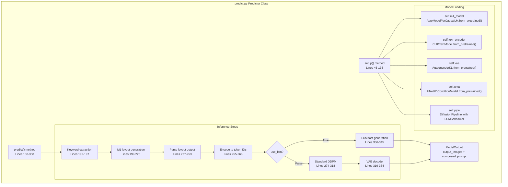

**Diagram: Predictor Class Execution Flow**

**Cog Configuration** [cog.yaml:1-16]():
```yaml
build:
  gpu: true
  python_version: "3.11"
  python_packages:
    - torch==2.0.1
    - diffusers==0.24.0
    - transformers==4.28.1
    - fschat==0.2.26
predict: "predict.py:Predictor"
```

**Key Implementation Details:**

1. **Alphabet Definition** [predict.py:26-35]():
   ```python
   alphabet = string.digits + string.ascii_lowercase + string.ascii_uppercase + string.punctuation + ' '
   # Total: 95 characters
   ```

2. **Layout Parsing** [predict.py:227-253]():
   ```python
   ocrs = outputs.split('\n')
   for ocr in current_ocr:
       items = ocr.split()
       pred = ' '.join(items[:-1])  # keyword
       box = items[-1]               # coordinates
       l, t, r, b = box.split(',')
       ocr_ids.extend([f"l{l}", f"t{t}", f"r{r}", f"b{b}"])
       char_list = [f"[{i}]" for i in list(pred)]
       ocr_ids.extend(char_list)
   ```

3. **LCM Integration** [predict.py:124-136]():
   ```python
   self.pipe = DiffusionPipeline.from_pretrained(
       "lambdalabs/sd-pokemon-diffusers",
       unet=copy.deepcopy(self.unet),
       text_encoder=copy.deepcopy(self.text_encoder)
   )
   self.pipe.scheduler = LCMScheduler.from_config(self.pipe.scheduler.config)
   self.pipe.load_lora_weights("latent-consistency/lcm-lora-sdv1-5")
   ```

Sources: [textdiffuser-2/predict.py:45-358](), [textdiffuser-2/cog.yaml:1-16]()

### Advanced Features

#### Latent Consistent Model (LCM) Support

TextDiffuser-2 integrates LCM for accelerated inference:

```python
# LCM pipeline setup
self.pipe = DiffusionPipeline.from_pretrained(
    "lambdalabs/sd-pokemon-diffusers",
    unet=copy.deepcopy(self.unet),
    tokenizer=self.tokenizer,
    text_encoder=copy.deepcopy(self.text_encoder),
    torch_dtype=torch.float16,
)
self.pipe.scheduler = LCMScheduler.from_config(self.pipe.scheduler.config)
self.pipe.load_lora_weights("latent-consistency/lcm-lora-sdv1-5")
```

**LCM Benefits:**
- 4-8× faster inference
- Guidance scale set to 1.0
- Requires fewer sampling steps

Sources: [textdiffuser-2/predict.py:124-136]()

#### Conversational Layout Editing

The LLM-based layout planner enables iterative refinement through natural language:

1. Generate initial layout from prompt
2. Review layout
3. Request modifications (e.g., "move the title higher", "make the text larger")
4. Layout planner adjusts coordinates
5. Regenerate image

This feature distinguishes TextDiffuser-2 from the original TextDiffuser's fixed layout approach.

Sources: [textdiffuser-2/README.md:22]()

#### Extended Coordinate Modes

TextDiffuser-2 supports multiple coordinate representations:

1. **LTRB (Left-Top-Right-Bottom):** Default mode used in training
2. **Angle:** Rotated bounding boxes (checkpoint available)
3. **Quadrilateral:** Arbitrary four-point polygons (checkpoint available)

**Extended Checkpoints:**
- Angle support: Available at Google Drive
- Quadrilateral support: Available at Google Drive

Sources: [textdiffuser-2/README.md:35-36]()

## Model Distribution and Deployment

### Hugging Face Integration

All models are distributed through Hugging Face for easy access:

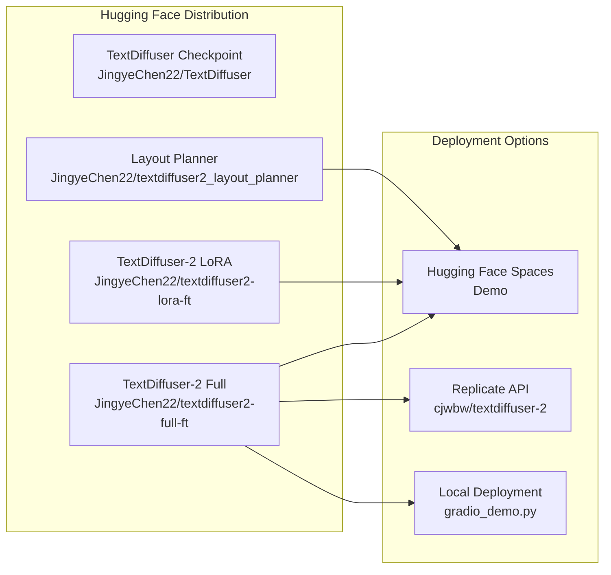

**Diagram: Model Distribution and Deployment Options**

Sources: [textdiffuser/README.md:6](), [textdiffuser-2/README.md:6-8](), [textdiffuser-2/README.md:220]()

### Demo Applications

#### TextDiffuser Demo

```bash
CUDA_VISIBLE_DEVICES=0 python gradio_app.py
```

**Features:**
- Text-to-image generation
- Template-based generation
- Text inpainting
- Interactive parameter tuning

Sources: [textdiffuser/README.md:257-266]()

#### TextDiffuser-2 Demo

```bash
python gradio_demo.py
```

**Enhanced Features:**
- Automatic keyword detection
- Conversational layout editing
- LCM fast generation
- Natural image mode (without layout encoding)

**Live Demo:** Available at `huggingface.co/spaces/JingyeChen22/TextDiffuser-2`

Sources: [textdiffuser-2/README.md:219-223]()

### Cog Integration

TextDiffuser-2 provides Cog configuration for containerized deployment:

```yaml
# cog.yaml
build:
  gpu: true
  python_version: "3.11"
  python_packages:
    - torch==2.0.1
    - torchvision==0.15.2
    - diffusers==0.24.0
    - transformers==4.28.1
    - fschat==0.2.26
predict: "predict.py:Predictor"
```

**Replicate Deployment:** Available at `replicate.com/cjwbw/textdiffuser-2`

Sources: [textdiffuser-2/cog.yaml:1-16](), [textdiffuser-2/README.md:8]()

## Comparative Analysis

### TextDiffuser vs TextDiffuser-2

| Aspect | TextDiffuser | TextDiffuser-2 |
|--------|-------------|----------------|
| **Layout Planning** | Transformer-based | LLM-based (Vicuna-7B) |
| **Flexibility** | Fixed pipeline | Conversational editing |
| **Keyword Detection** | Manual specification | Automatic + manual |
| **Coordinate Modes** | LTRB only | LTRB, angle, quadrilateral |
| **Training Approaches** | Full fine-tuning | Full + LoRA options |
| **Inference Speed** | Standard DDPM | Standard + LCM support |
| **Model Size** | 3.2GB checkpoint | Multiple checkpoint options |
| **Acceptance** | NeurIPS 2023 | ECCV 2024 Oral |

### Kosmos Series vs TextDiffuser Series

| Characteristic | Kosmos Series | TextDiffuser Series |
|----------------|---------------|---------------------|
| **Primary Task** | General multimodal understanding | Text rendering in images |
| **Architecture** | Autoregressive LLM | Diffusion model |
| **Input** | Text + images | Text prompts (+ optional templates) |
| **Output** | Text, classifications, answers | Generated images with text |
| **Text Capability** | Understanding existing text | Generating new text |
| **Training Paradigm** | Language model pre-training | Diffusion pre-training |
| **Grounding** | Visual-spatial grounding | Layout coordinate grounding |

## Related Components and Dependencies

### Shared Infrastructure

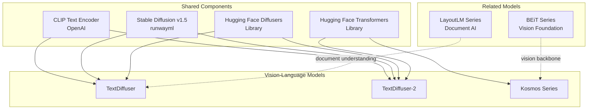

**Diagram: Component Dependencies and Related Models**

### External Dependencies

**TextDiffuser Dependencies:**
- PyTorch + torchvision
- Hugging Face Diffusers (custom modifications)
- CLIP (for text encoding)
- Stable Diffusion v1.5 (base model)
- img2dataset (for MARIO-10M download)
- Custom files: `scheduling_ddpm.py`, `unet_2d_condition.py`, `modeling_utils.py`

**TextDiffuser-2 Additional Dependencies:**
- FastChat (for layout planner training)
- Accelerate (for distributed training)
- Flash-attention (for efficient attention in LLM)
- LCM LoRA weights (for fast inference)

Sources: [textdiffuser/README.md:44-63](), [textdiffuser-2/README.md:47-64]()

## Performance Metrics

### TextDiffuser Benchmark Results

Evaluated on LAIONEval4000 subset of MARIO-Eval:

**Image Quality:**
- FID: 38.758 (vs DeepFloyd: 34.902, SD: 51.295)
- Best CLIP Score: 0.3436

**Text Accuracy (Microsoft OCR API):**
- OCR Accuracy: 56.09% (vs ControlNet: 23.90%)
- OCR Precision: 78.46%
- OCR Recall: 78.02%
- OCR F-measure: 78.24%

**Text Accuracy (MaskTextSpotter V3):**
- OCR Accuracy: 57.12%
- OCR Precision: 77.95%
- OCR Recall: 74.98%
- OCR F-measure: 76.43%

Sources: [textdiffuser/README.md:235-246]()

### User Study Results

**Whole-Image Generation:**
- TextDiffuser significantly outperforms competitors in text rendering quality
- Superior image-text matching compared to Stable Diffusion, ControlNet, DeepFloyd

**Part-Image Generation (Inpainting):**
- High scores in text rendering quality
- High scores in image-text matching

Sources: [textdiffuser/README.md:251-254]()

## Future Directions and Extensions

Based on the evolution from TextDiffuser to TextDiffuser-2, potential future directions include:

1. **Multi-language Support:** Extending beyond English to support diverse scripts (Chinese, Arabic, etc.)
2. **3D Text Rendering:** Generating text with perspective and depth
3. **Style Transfer:** Fine-grained control over font styles and artistic effects
4. **Real-time Generation:** Further optimization for interactive applications
5. **Integration with Document AI:** Combining with LayoutLM series for end-to-end document generation

The modular architecture of TextDiffuser-2 with separate layout planning and rendering stages facilitates these extensions.

Sources: [textdiffuser-2/README.md:18-21]()

---

