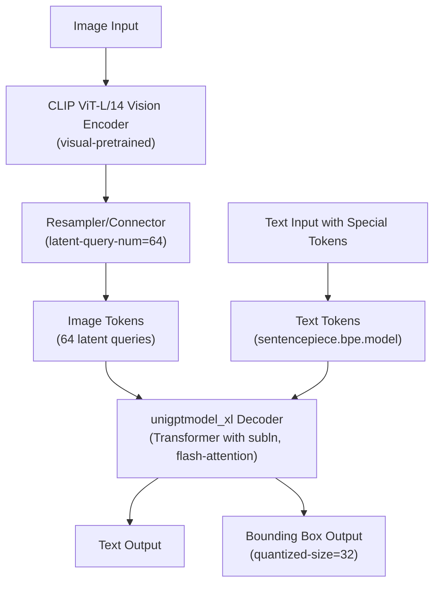
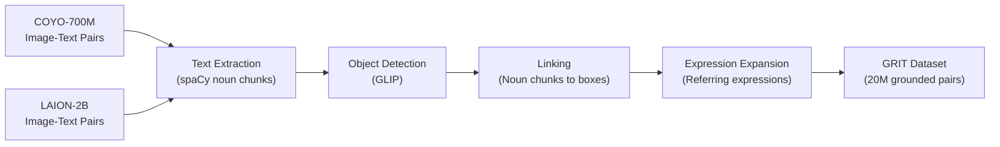
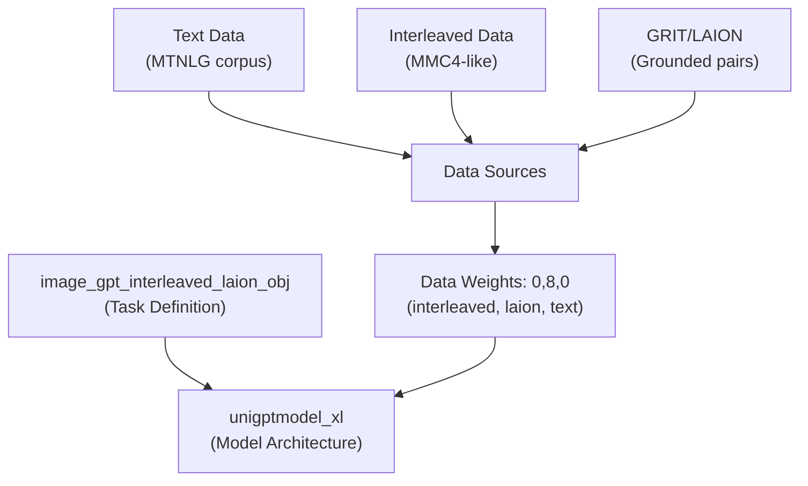
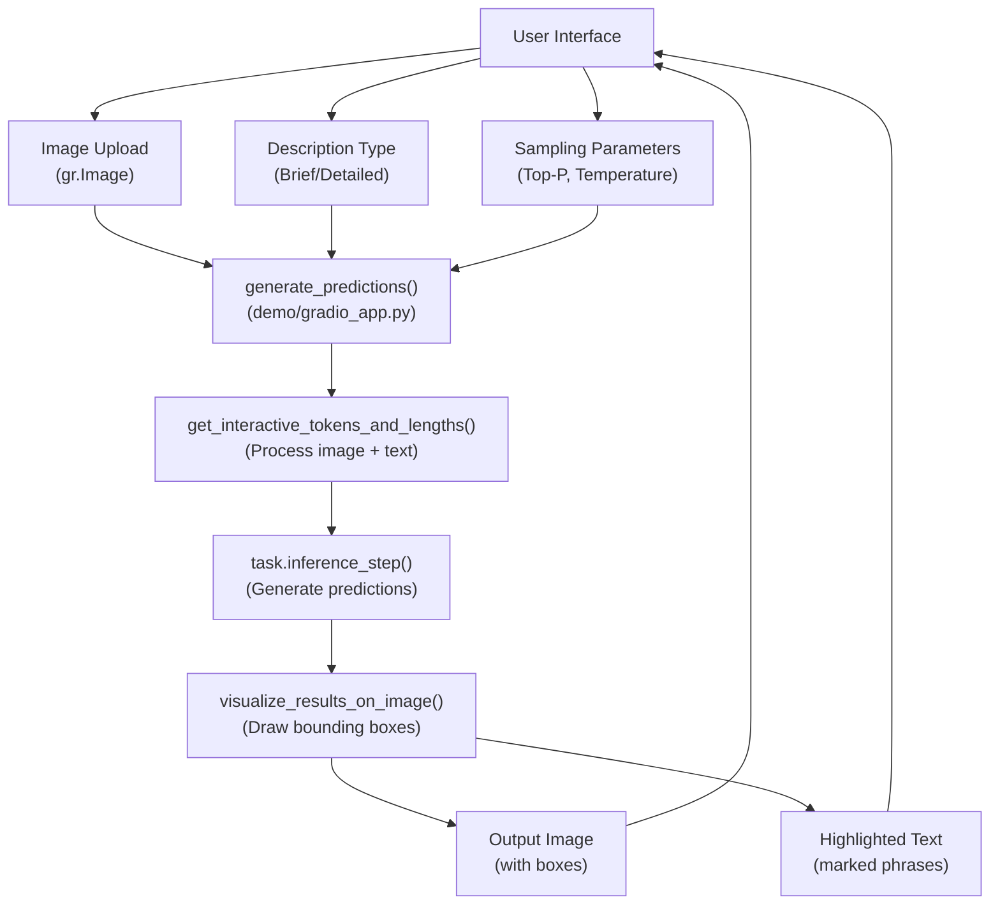

<!-- source: DeepWiki mcp.deepwiki.com · repo microsoft/unilm · page 6.1 Kosmos-2: Grounding Multimodal LLMs · fetched 2026-10-26 -->

# Kosmos-2: Grounding Multimodal LLMs

<details>
<summary>Relevant source files</summary>

The following files were used as context for generating this wiki page:

- [kosmos-2/README.md](kosmos-2/README.md)
- [kosmos-2/data/generate_config.py](kosmos-2/data/generate_config.py)
- [kosmos-2/data/prepare_grit.py](kosmos-2/data/prepare_grit.py)
- [kosmos-2/data/visualize_grit.py](kosmos-2/data/visualize_grit.py)
- [kosmos-2/demo/gradio_app.py](kosmos-2/demo/gradio_app.py)
- [kosmos-2/train.sh](kosmos-2/train.sh)
- [kosmos-2/vl_setup_xl.sh](kosmos-2/vl_setup_xl.sh)
- [metalm/README.md](metalm/README.md)

</details>


## Overview

Kosmos-2 is a Multimodal Large Language Model (MLLM) that grounds language to visual regions in images. Released in June 2023, it extends multimodal understanding by linking text phrases to specific spatial locations, enabling capabilities such as phrase grounding, referring expression comprehension, and visual question answering with spatial reasoning.

The model is built on a foundation of large-scale pre-training using the GRIT dataset (Grounded Image-Text pairs) and combines a CLIP ViT-L/14 vision encoder with a language model decoder. Kosmos-2 is part of the broader Kosmos series, which began with Kosmos-1 (foundation MLLM) in February 2023 and was followed by Kosmos-2.5 (multimodal literacy) in September 2023. MetaLM (June 2022) served as an earlier exploration of language models as general-purpose interfaces.

**Sources:** [kosmos-2/README.md:1-7](), [metalm/README.md:1-6]()

---

## Key Capabilities

Kosmos-2 enables several grounding-focused capabilities that connect language to visual regions:

| Capability | Description | Evaluation Dataset |
|------------|-------------|-------------------|
| **Phrase Grounding** | Locating image regions corresponding to text phrases | Flickr30k Entities |
| **Referring Expression Comprehension** | Understanding references to specific objects in images | RefCOCO, RefCOCO+, RefCOCOg |
| **Referring Expression Generation** | Generating descriptions that refer to specific regions | RefCOCOg |
| **Image Captioning** | Describing image content with spatial awareness | Flickr30K |
| **Visual Question Answering** | Answering questions about images | VQAv2 |

**Sources:** [kosmos-2/README.md:119-171]()

---

## Architecture

### High-Level Design

Kosmos-2 combines a vision encoder with a language model decoder to process multimodal inputs and generate grounded outputs:

**Architecture Flow Diagram**



**Sources:** [kosmos-2/train.sh:36-52](), [kosmos-2/README.md:36]()

### Core Components

| Component | Implementation | Description |
|-----------|---------------|-------------|
| **Vision Encoder** | `CLIP ViT-L/14` | Pre-trained OpenAI CLIP model with 1024-dimensional output |
| **Connector** | `xconnector` resampler | Maps visual features to 64 latent query tokens for language model |
| **Language Model** | `unigptmodel_xl` | Decoder-only transformer with Sub-LN, flash attention, and SoPE relative position |
| **Tokenizer** | SentencePiece BPE | Text tokenization with special tokens for grounding |
| **Coordinate System** | Quantized (32 bins) | Discretizes bounding box coordinates into 32x32 grid |

**Sources:** [kosmos-2/train.sh:36-52](), [kosmos-2/demo/gradio_app.py:88-163]()

### Special Tokens and Grounding Format

Kosmos-2 uses special tokens to represent image regions and grounding information:

- `<image>` / `</image>`: Delimit image token sequences
- `<grounding>`: Prompt token to trigger bounding box generation
- `<phrase>` / `</phrase>`: Mark text phrases that correspond to image regions
- `<object>` / `</object>`: Wrap bounding box coordinates

The model represents bounding boxes as quantized coordinates (normalized to 32x32 grid) and interleaves them with text tokens.

**Sources:** [kosmos-2/demo/gradio_app.py:96-150](), [kosmos-2/train.sh:43-44]()

---

## GRIT Dataset: Grounded Image-Text Pairs

### Overview

GRIT (Grounded Image-Text) is a large-scale dataset of grounded image-caption pairs created specifically for training Kosmos-2. The dataset contains approximately 20 million pairs (GrIT-20M split) processed from COYO-700M and LAION-2B.

**GRIT Data Processing Pipeline**



**Sources:** [kosmos-2/README.md:73-108]()

### Data Format

Each GRIT data instance contains:

| Field | Type | Description |
|-------|------|-------------|
| `url` | string | Image URL |
| `caption` | string | Image caption text |
| `width` / `height` | int | Image dimensions |
| `noun_chunks` | list | Noun phrases with bounding boxes: `[start, end, x_min, y_min, x_max, y_max, score]` |
| `ref_exps` | list | Referring expressions with bounding boxes (expanded from noun chunks) |
| `clip_similarity_*` | float | CLIP similarity scores (ViT-B/32 and ViT-L/14) |

Bounding box coordinates are normalized to [0, 1] range.

**Sources:** [kosmos-2/README.md:83-108]()

### Data Preparation

The repository provides scripts to prepare GRIT data for training:

1. **prepare_grit.py**: Converts downloaded images and JSON files to TSV format
   - Computes MD5 hashes for images
   - Encodes images as base64 strings
   - Combines noun chunks and referring expressions
   - Output: TSV files with format `[md5, caption, image_base64, width, height, combined_data]`

2. **generate_config.py**: Creates dataset configuration files
   - Generates JSON config listing all TSV files
   - Specifies data source, language, and weight

3. **visualize_grit.py**: Visualizes grounding annotations
   - Downloads images from URLs
   - Draws bounding boxes on images
   - Labels boxes with corresponding phrases
   - Handles overlapping annotations

**Sources:** [kosmos-2/data/prepare_grit.py:1-54](), [kosmos-2/data/generate_config.py:1-25](), [kosmos-2/data/visualize_grit.py:1-166]()

---

## Training Configuration

### Training Script Parameters

The training script (`train.sh`) specifies the model architecture and training procedure:

**Task and Model Configuration**



**Sources:** [kosmos-2/train.sh:1-53]()

### Key Training Parameters

| Parameter | Value | Description |
|-----------|-------|-------------|
| `--arch` | `unigptmodel_xl` | Model architecture defined in `unilm/models/unigpt.py` |
| `--task` | `image_gpt_interleaved_laion_obj` | Task defined in `unilm/tasks/gpt_interleaved_laion_obj.py` |
| `--tokens-per-sample` | 2048 | Maximum sequence length |
| `--lr` | 0.0002 | Peak learning rate |
| `--warmup-updates` | 375 | Learning rate warmup steps |
| `--max-update` | 60000 | Total training steps |
| `--update-freq` | 8 | Gradient accumulation steps |
| `--latent-query-num` | 64 | Number of image tokens for language model |
| `--quantized-size` | 32 | Size of coordinate quantization grid |
| `--phrase-mode` | `expression` | Use referring expressions vs. phrases |
| `--box-score-threshold` | 0.65 | Minimum confidence for bounding boxes |
| `--use-object-bbox-prob` | 0.5 | Probability of using grounded pairs |

**Sources:** [kosmos-2/train.sh:3-52]()

### Architecture Features

The model uses several advanced architectural features:

- `--subln`: Sub-Layer Normalization for training stability
- `--flash-attention`: Memory-efficient attention implementation
- `--sope-rel-pos`: SoPE (Self-Optimal Position Encoding) relative position embeddings
- `--checkpoint-activations`: Gradient checkpointing to reduce memory
- `--memory-efficient-fp16`: Mixed precision training (FP16)

**Sources:** [kosmos-2/train.sh:50-52]()

### Data Configuration

Training combines three data sources with configurable weights:

1. **Text Data**: Pure language modeling (weight: 0 in default config)
2. **Interleaved Data**: Multi-image, multi-turn conversations (weight: 0 in default config)
3. **LAION/GRIT Data**: Grounded image-text pairs (weight: 8 in default config)

The `--laion-batch-size 6` and `--interleaved-batch-size 1` parameters control batch composition.

**Sources:** [kosmos-2/train.sh:35-51]()

---

## Model Checkpoints and Distribution

### Hugging Face Integration

Kosmos-2 is available through Hugging Face's transformers library:

```python
# Load model using Hugging Face transformers
from transformers import AutoProcessor, AutoModelForVision2Seq

processor = AutoProcessor.from_pretrained("microsoft/kosmos-2-patch14-224")
model = AutoModelForVision2Seq.from_pretrained("microsoft/kosmos-2-patch14-224")
```

The model checkpoint is hosted at: `microsoft/kosmos-2-patch14-224`

An online demo is available at Hugging Face Spaces: `ydshieh/Kosmos-2`

**Sources:** [kosmos-2/README.md:34-36](), [kosmos-2/README.md:5](), [kosmos-2/README.md:65]()

### Direct Download

The checkpoint can be downloaded directly from Azure Blob Storage:

```bash
DLINK=$(echo -n "aHR0cHM6Ly9jb252ZXJzYXRpb25odWIuYmxvYi5jb3JlLndpbmRvd3MubmV0L2JlaXQtc2hhcmUtcHVibGljL2tvc21vcy0yL2tvc21vcy0yLnB0P3N2PTIwMjMtMDEtMDMmc3Q9MjAyNC0wNC0xMFQxMyUzQTExJTNBNDRaJnNlPTIwNTAtMDQtMTFUMTMlM0ExMSUzQTAwWiZzcj1jJnNwPXImc2lnPTRjWEpJalZSWkhJQldxSGpQZ0RuJTJGMDFvY3pwRFdYaXBtUENVazNaOHZiUSUzRA==" | base64 --decode)
wget -O kosmos-2.pt $DLINK
```

**Sources:** [kosmos-2/README.md:39-42]()

---

## Evaluation Benchmarks

### Phrase Grounding

Evaluated on Flickr30k Entities dataset under zero-shot setting:

| Model | Recall@1 (val) | Recall@1 (test) |
|-------|----------------|-----------------|
| Kosmos-2 | 77.8 | 78.7 |

**Sources:** [kosmos-2/README.md:121-127]()

### Referring Expression Comprehension

Evaluated on RefCOCO, RefCOCO+, and RefCOCOg datasets (zero-shot accuracy):

| Model | RefCOCO val | RefCOCO testA | RefCOCO testB | RefCOCO+ val | RefCOCO+ testA | RefCOCO+ testB | RefCOCOg val | RefCOCOg test |
|-------|-------------|---------------|---------------|--------------|----------------|----------------|--------------|---------------|
| Kosmos-2 | 52.32 | 57.42 | 47.26 | 45.48 | 50.73 | 42.24 | 60.57 | 61.65 |

**Sources:** [kosmos-2/README.md:129-136]()

### Referring Expression Generation

Evaluated on RefCOCOg with Meteor and CIDEr metrics:

| Model | Setting | Meteor | CIDEr |
|-------|---------|--------|-------|
| Kosmos-2 | Zero-shot | 12.2 | 60.3 |
| Kosmos-2 | Few-shot (k=2) | 13.8 | 62.2 |
| Kosmos-2 | Few-shot (k=4) | 14.1 | 62.2 |

**Sources:** [kosmos-2/README.md:138-146]()

### Image Captioning

Evaluated on Flickr30K Karpathy test split (zero-shot CIDEr):

| Model | CIDEr |
|-------|-------|
| Flamingo-3B | 60.6 |
| Flamingo-9B | 61.5 |
| Kosmos-1 | 67.1 |
| Kosmos-2 | 80.5 |

**Sources:** [kosmos-2/README.md:149-158]()

### Visual Question Answering

Evaluated on VQAv2 test-dev set (zero-shot):

| Model | Accuracy |
|-------|----------|
| Flamingo-3B | 49.2 |
| Flamingo-9B | 51.8 |
| Kosmos-1 | 51.0 |
| Kosmos-2 | 51.1 |

**Sources:** [kosmos-2/README.md:161-170]()

---

## Setup and Installation

### Environment Setup

The recommended setup uses an NVIDIA PyTorch Docker container:

```bash
alias=`whoami | cut -d'.' -f2`
docker run -it --rm --runtime=nvidia --ipc=host --privileged \
  -v /home/${alias}:/home/${alias} \
  nvcr.io/nvidia/pytorch:22.10-py3 bash
```

Clone the repository and navigate to the Kosmos-2 directory:

```bash
git clone https://github.com/microsoft/unilm.git
cd unilm/kosmos-2
```

**Sources:** [kosmos-2/README.md:44-54]()

### Dependencies

Install required packages using the provided setup script:

```bash
bash vl_setup_xl.sh
```

The script installs:
- `fairseq/` - Sequence modeling framework
- `infinibatch/` - Efficient data loading
- `torchscale/` - Foundation architectures
- `open_clip/` - CLIP vision encoder
- `DeepSpeed` - Distributed training
- `xformers` - Memory-efficient attention (v0.0.22)
- Additional dependencies: `numpy==1.23.0`, `tiktoken`, `ftfy`, `sentencepiece`, `gradio==3.37.0`, `spacy==3.6.0`

**Sources:** [kosmos-2/vl_setup_xl.sh:1-8](), [kosmos-2/README.md:55-59]()

### Alternative Conda Setup

A conda-based setup guide is also available at `docs/install.md`.

**Sources:** [kosmos-2/README.md:61]()

---

## Demo Application

### Gradio Interface

The repository provides a Gradio-based demo for interactive testing:

```bash
bash run_gradio.sh
```

**Demo Components and Data Flow**



**Sources:** [kosmos-2/README.md:68-71](), [kosmos-2/demo/gradio_app.py:1-527]()

### Input Format

The demo accepts image and text inputs with special formatting:
- Input format: `[image]{path}<tab><grounding>{prompt}`
- Brief prompt: `"<grounding>An image of"`
- Detailed prompt: `"<grounding>Describe this image in detail:"`

**Sources:** [kosmos-2/demo/gradio_app.py:348-351]()

### Output Processing

The demo processes model outputs to:
1. Extract phrases marked with `<phrase>` tags
2. Extract bounding boxes marked with `<object>` tags
3. Visualize boxes on the input image
4. Highlight grounded phrases in the text output

Functions involved:
- `mark_texts()` - Highlights phrases in output text
- `visualize_results_on_image()` - Draws bounding boxes on images
- `post_process_prediction()` - Decodes model outputs

**Sources:** [kosmos-2/demo/gradio_app.py:433-469](), [kosmos-2/demo/gradio_app.py:528-580](), [kosmos-2/demo/gradio_app.py:582-602]()

---

## Future Directions

The Kosmos series continues to evolve as part of the UniLM project's vision for unified multimodal understanding. Future developments may include:

1. **Extended Modalities**: Incorporation of audio, video, and other modalities
2. **Improved Grounding**: More precise spatial understanding and manipulation
3. **Interactive Capabilities**: Multi-turn dialogue with multimodal context
4. **Specialized Literacy**: Domain-specific document understanding

The series represents ongoing progress toward true general-purpose multimodal AI that can perceive, understand, and reason across all modalities.

**Sources:** [README.md:1-6](), [README.md:39]()

---

