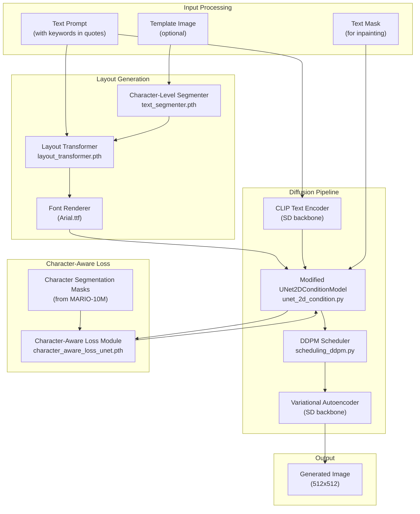
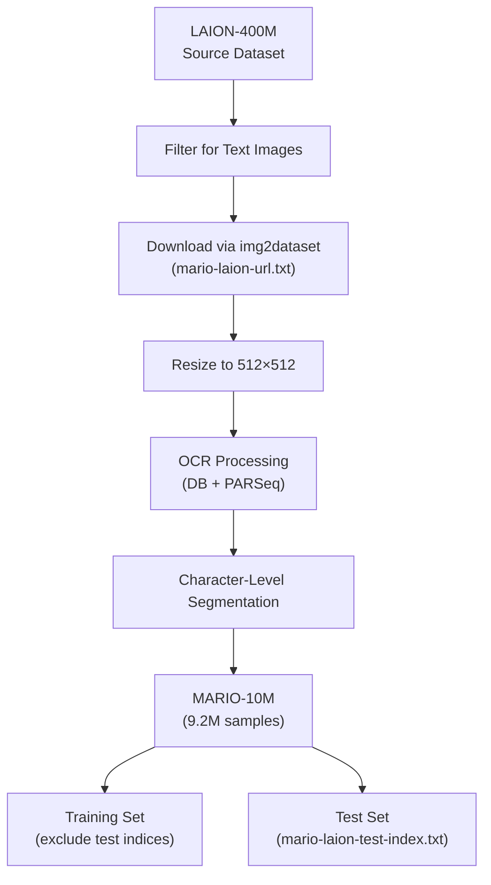
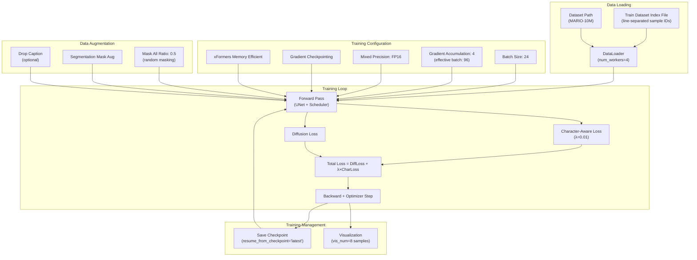
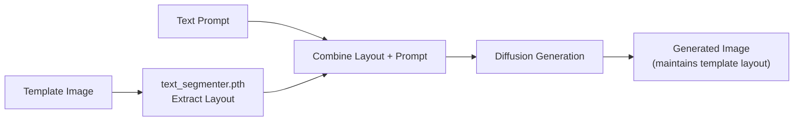
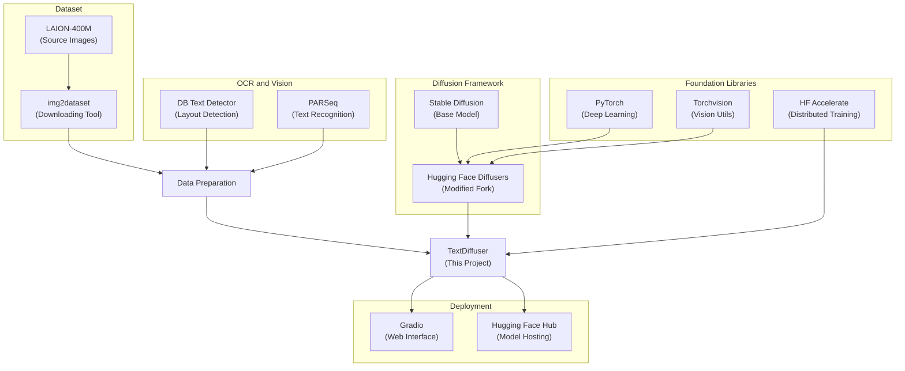
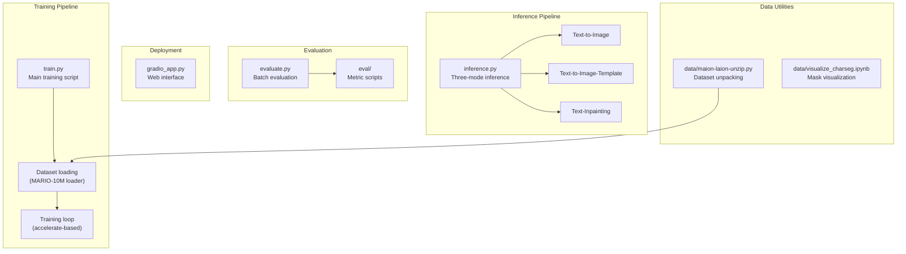

<!-- source: DeepWiki mcp.deepwiki.com · repo microsoft/unilm · page 6.2 TextDiffuser: Text Rendering with Diffusion · fetched 2026-10-26 -->

# TextDiffuser: Text Rendering with Diffusion

<details>
<summary>Relevant source files</summary>

The following files were used as context for generating this wiki page:

- [textdiffuser/README.md](textdiffuser/README.md)

</details>


## Purpose and Scope

This document provides comprehensive technical documentation for **TextDiffuser**, a two-stage diffusion-based framework for generating images with visually appealing, accurate, and contextually coherent text. TextDiffuser addresses the challenging problem of text rendering in images by combining diffusion models with character-level supervision and layout planning.

TextDiffuser is positioned within the Vision-Language multimodal models (section [6](#6)) and complements the Kosmos series ([6.1](#6.1)) by focusing specifically on text rendering rather than general vision-language understanding. For the successor model that incorporates language model-based layout planning, see TextDiffuser-2 ([6.3](#6.3)).

**Key capabilities:**
- Text-to-image generation with accurate text rendering from prompts alone
- Text-to-image-with-template generation using template images for layout guidance
- Text inpainting for reconstructing or modifying text in existing images
- Character-level supervision through segmentation masks
- Support for printed, handwritten, and scene text in various languages

Sources: [textdiffuser/README.md:1-34]()

## Architecture Overview

TextDiffuser employs a two-stage architecture that combines diffusion modeling with character-aware supervision and layout planning. The framework extends Stable Diffusion with specialized components for accurate text rendering.

### System Architecture Diagram



**Two-Stage Framework:**
1. **Layout Planning Stage**: Generates text layout information from prompts (via Layout Transformer) or extracts layout from template images (via Character Segmenter)
2. **Diffusion Generation Stage**: Renders images with text using a modified diffusion backbone guided by character-aware loss

Sources: [textdiffuser/README.md:10-16](), [textdiffuser/README.md:66-80]()

## Core Components

### Diffusion Backbone

The diffusion backbone is based on Stable Diffusion with critical modifications to support text rendering tasks. The model uses customized UNet architecture and scheduler.

**Modified Components:**

| Component | File | Purpose |
|-----------|------|---------|
| UNet2DConditionModel | `unet_2d_condition.py` | Modified attention and conditioning mechanisms |
| DDPM Scheduler | `scheduling_ddpm.py` | Customized noise scheduling for text rendering |
| Model Utils | `modeling_utils.py` | Modified model loading and saving utilities |

The checkpoint structure is organized as follows:

```
textdiffuser-ckpt/
├── diffusion_backbone/           # Main diffusion model
│   ├── unet/                     # Modified UNet weights
│   ├── vae/                      # VAE weights
│   ├── text_encoder/             # CLIP text encoder
│   └── scheduler/                # DDPM scheduler config
├── character_aware_loss_unet.pth # Character-aware loss network
├── layout_transformer.pth        # Layout generation model
└── text_segmenter.pth           # Character-level segmentation
```

**Installation Requirements:**
The system requires a modified version of Hugging Face Diffusers with custom files replacing standard components [textdiffuser/README.md:53-60](). The modifications enable character-level conditioning and specialized attention mechanisms for text rendering.

Sources: [textdiffuser/README.md:53-63](), [textdiffuser/README.md:66-80]()

### Character-Aware Loss

The character-aware loss is a key innovation that provides fine-grained supervision at the character level during training. This component ensures accurate text rendering by comparing generated character segmentation masks with ground truth annotations.

**Training Configuration:**
```python
# Key training parameter
--character_aware_loss_lambda=0.01
```

The character-aware loss weight (`character_aware_loss_lambda`) balances text accuracy with image quality. The loss operates on character-level segmentation masks from the MARIO-10M dataset, providing supervision that guides the diffusion model to render text accurately.

**Data Augmentation:**
The system applies segmentation mask augmentation (`--segmentation_mask_aug`) during training to improve robustness across different text styles and layouts.

Sources: [textdiffuser/README.md:76](), [textdiffuser/README.md:142-149]()

### Layout Transformer

The Layout Transformer generates spatial layouts for keywords identified in text prompts. It takes text prompts with keywords enclosed in single quotes and produces bounding box coordinates for where each text element should appear.

**Workflow:**
1. Parse input prompt to extract keywords in quotes (e.g., "A sign that says 'Hello'")
2. Generate spatial layout with bounding boxes for each keyword
3. Render layout as image template using font renderer (requires `Arial.ttf` in `assets/font/`)
4. Pass layout information to diffusion backbone for conditioning

The layout transformer enables the model to plan text placement before generation, ensuring coherent spatial arrangement of text elements in the final image.

Sources: [textdiffuser/README.md:62](), [textdiffuser/README.md:77](), [textdiffuser/README.md:160-169]()

### Character-Level Segmenter

The text segmenter performs character-level segmentation on template images, extracting layout information that can guide text-to-image-with-template generation.

**Segmentation Pipeline:**


The segmenter enables the system to work with template images containing printed, handwritten, or scene text, extracting precise character-level layout information for conditioning the generation process.

Sources: [textdiffuser/README.md:78](), [textdiffuser/README.md:171-182]()

## MARIO-10M Dataset

TextDiffuser is trained on **MARIO-10M** (MARIO-LAION), a large-scale dataset containing 9,194,613 image-text pairs with rich OCR annotations. This dataset is a crucial contribution that enables character-level supervision for text rendering.

### Dataset Structure

Each sample in MARIO-10M includes:

```
├── <part_id>/                    # e.g., 28330
│   ├── <image_id>/              # e.g., 283305839
│   │   ├── caption.txt          # Image caption from LAION
│   │   ├── charseg.npy         # Character-level segmentation masks
│   │   ├── info.json           # Metadata (original height, width, etc.)
│   │   └── ocr.txt             # OCR detection and recognition results
```

**Data Components:**

| Component | Format | Description |
|-----------|--------|-------------|
| `caption.txt` | Plain text | Natural language description of the image |
| `charseg.npy` | NumPy array | Character-level segmentation masks (one per character) |
| `info.json` | JSON | LAION metadata including original dimensions |
| `ocr.txt` | Text | OCR detection (bounding boxes) and recognition results |

### Dataset Acquisition



**Download Process:**
1. Download URLs from Google Drive (794.6MB compressed)
2. Use `img2dataset` for parallel downloading: `img2dataset --url_list=url.txt --output_folder=laion_ocr --thread_count=64 --resize_mode=no`
3. Resize images to 512×512
4. Organize according to `mario-laion-index-url.txt` structure
5. Exclude test set indices listed in `mario-laion-test-index.txt`

**Important Note:** Some URLs may be invalid as original image hosts may have removed content.

Sources: [textdiffuser/README.md:83-114](), [textdiffuser/README.md:87-96](), [textdiffuser/README.md:98-105]()

## Training Procedure

### Training Pipeline



### Training Command Structure

The training script uses Hugging Face Accelerate for distributed training. Key configuration:

```bash
accelerate launch train.py \
    --train_batch_size=24 \
    --gradient_accumulation_steps=4 \
    --gradient_checkpointing \
    --mixed_precision="fp16" \
    --num_train_epochs=2 \
    --learning_rate=1e-5 \
    --max_grad_norm=1 \
    --lr_scheduler="constant" \
    --lr_warmup_steps=0 \
    --output_dir="experiment_name" \
    --enable_xformers_memory_efficient_attention \
    --dataloader_num_workers=4 \
    --character_aware_loss_lambda=0.01 \
    --resume_from_checkpoint="latest" \
    --drop_caption \
    --mask_all_ratio=0.5 \
    --segmentation_mask_aug \
    --dataset_path=/path/to/laion-ocr-unzip \
    --train_dataset_index_file=/path/to/index_file.txt \
    --vis_num=8
```

**Training Parameters:**

| Parameter | Value | Purpose |
|-----------|-------|---------|
| `train_batch_size` | 24 | Per-device batch size |
| `gradient_accumulation_steps` | 4 | Effective batch size = 96 |
| `mixed_precision` | fp16 | Memory efficiency via FP16 |
| `learning_rate` | 1e-5 | Conservative LR for fine-tuning |
| `character_aware_loss_lambda` | 0.01 | Weight for character supervision |
| `mask_all_ratio` | 0.5 | Probability of masking all text |
| `segmentation_mask_aug` | flag | Enable mask augmentation |
| `drop_caption` | flag | Randomly drop captions (CFG) |

**Dataset Index File Format:**
```
06269_062690093
27197_271975251
27197_271978467
...
```
Each line contains a sample ID in format `<part_id>_<image_id>`.

**Pre-requisite:** Configure acceleration policy with `accelerate config` before training.

Sources: [textdiffuser/README.md:115-153]()

## Inference Modes

TextDiffuser supports three distinct inference modes, each addressing different text rendering scenarios.

### Mode 1: Text-to-Image

Generates images from text prompts alone, with keywords to render enclosed in single quotes.

```bash
CUDA_VISIBLE_DEVICES=0 python inference.py \
  --mode="text-to-image" \
  --resume_from_checkpoint="textdiffuser-ckpt/diffusion_backbone" \
  --prompt="A sign that says 'Hello'" \
  --output_dir="./output" \
  --vis_num=4
```

**Workflow:**
1. Parse prompt to extract quoted keywords
2. Layout Transformer generates spatial layout for keywords
3. Font renderer creates layout conditioning image
4. Diffusion model generates image conditioned on prompt and layout
5. Character-aware loss guides accurate text rendering

**Example Prompts:**
- `"A sign that says 'Hello'"`
- `"A poster with 'SALE' written in large letters"`
- `"A book cover with title 'Machine Learning'"`

Sources: [textdiffuser/README.md:157-169]()

### Mode 2: Text-to-Image-with-Template

Generates images using a template image to guide text layout and style. The template can contain printed, handwritten, or scene text.

```bash
CUDA_VISIBLE_DEVICES=0 python inference.py \
  --mode="text-to-image-with-template" \
  --resume_from_checkpoint="textdiffuser-ckpt/diffusion_backbone" \
  --prompt="a poster of monkey music festival" \
  --template_image="assets/examples/text-to-image-with-template/case2.jpg" \
  --output_dir="./output" \
  --vis_num=4
```

**Workflow:**


This mode is particularly useful for:
- Maintaining consistent text layout across image variations
- Adopting text styles from reference images
- Generating images that match specific design templates

Sources: [textdiffuser/README.md:171-182]()

### Mode 3: Text-Inpainting

Modifies existing images by inpainting text in specified regions. Requires both an original image and a text mask indicating the inpainting region and desired text.

```bash
CUDA_VISIBLE_DEVICES=0 python inference.py \
  --mode="text-inpainting" \
  --resume_from_checkpoint="textdiffuser-ckpt/diffusion_backbone" \
  --prompt="a boy draws good morning on a board" \
  --original_image="assets/examples/text-inpainting/case2.jpg" \
  --text_mask="assets/examples/text-inpainting/case2_mask.jpg" \
  --output_dir="./output" \
  --vis_num=4
```

**Text Mask Requirements:**
- Specifies the inpainting region (white = inpaint, black = preserve)
- Indicates the text content to render within the region
- Must match dimensions of original image

**Applications:**
- Correcting text in images
- Translating text while preserving visual context
- Replacing outdated text (e.g., dates, names) in images

Sources: [textdiffuser/README.md:184-196]()

## Evaluation Framework

### MARIO-Eval Benchmark

TextDiffuser introduces **MARIO-Eval**, a comprehensive benchmark containing 10,000 prompts (5,414 after curation) for evaluating text rendering quality.

**Benchmark Subsets:**

| Subset | Samples | Description |
|--------|---------|-------------|
| LAIONEval4000 | 4,000 | General text rendering from LAION |
| TMDBEval500 | 500 | Movie posters and entertainment |
| OpenLibrary500 | 500 | Book covers and library materials |
| ChineseDrawText | 175 | Chinese text rendering |
| DrawBenchText | 21 | Creative text rendering |
| DrawTextCreative | 218 | Artistic text generation |

**Dataset Structure:**
```
MARIOEval/
├── LAIONEval4000/
│   ├── images/                      # Ground truth images
│   ├── render/                      # Layout Transformer outputs
│   ├── LAIONEval4000.txt           # Prompts with quoted keywords
│   └── LAIONEval4000_wo_quote.txt  # Original prompts
├── TMDBEval500/
├── OpenLibrary500/
└── ...
```

Ground truth images are available only for LAIONEval4000, TMDBEval500, and OpenLibrary500. Render images contain layout information for ControlNet baseline evaluation.

Sources: [textdiffuser/README.md:198-219]()

### Evaluation Metrics

TextDiffuser employs multiple metrics to assess both image quality and text rendering accuracy.

**Image Quality Metrics:**
- **FID (Fréchet Inception Distance)**: Measures image quality and diversity
- **CLIP Score**: Evaluates text-image alignment

**OCR-Based Metrics:**
- **OCR Accuracy**: Exact match of rendered text with ground truth
- **OCR Precision**: Correctness of detected text
- **OCR Recall**: Coverage of expected text
- **OCR F-measure**: Harmonic mean of precision and recall

**Dual OCR Evaluation:**
The benchmark uses two OCR systems for robustness:
1. Microsoft OCR API (Azure Computer Vision v3)
2. Open-source MaskTextSpotterV3

Metrics prefixed with "*" indicate MaskTextSpotterV3 results.

### Performance Comparison

**Results on MARIO-Eval (LAIONEval4000):**

| Metrics | Stable Diffusion | ControlNet | DeepFloyd | TextDiffuser |
|:--------|:----------------:|:----------:|:---------:|:------------:|
| FID↓ | 51.295 | 51.485 | **34.902** | 38.758 |
| CLIPScore↑ | 0.3015 | 0.3424 | 0.3267 | **0.3436** |
| OCR-Accuracy↑ | 0.0003 | 0.2390 | 0.0262 | **0.5609** |
| OCR-Precision↑ | 0.0173 | 0.5211 | 0.1450 | **0.7846** |
| OCR-Recall↑ | 0.0280 | 0.6707 | 0.2245 | **0.7802** |
| OCR-Fmeasure↑ | 0.0214 | 0.5865 | 0.1762 | **0.7824** |

**Key Findings:**
- TextDiffuser achieves best text rendering quality (OCR metrics)
- Highest CLIP Score indicates superior text-image alignment
- Competitive FID score compared to specialized methods
- Dramatically outperforms vanilla Stable Diffusion on text accuracy

### Evaluation Scripts

**Sampling Command:**
```bash
CUDA_VISIBLE_DEVICES=0 python evaluate.py \
  --mode="text-to-image" \
  --resume_from_checkpoint="textdiffuser-ckpt/diffusion_backbone" \
  --prompt_list="/path/to/MARIOEval/TMDBEval500/TMDBEval500.txt" \
  --output_dir="/path/to/output_dir" \
  --vis_num=4
```

Evaluation scripts for baseline methods and metric calculation are provided in `./eval` folder, including:
- Stable Diffusion baseline sampling
- ControlNet baseline sampling
- DeepFloyd baseline sampling
- FID calculation
- CLIP Score calculation
- OCR metrics calculation (both Microsoft API and MaskTextSpotterV3)

Sources: [textdiffuser/README.md:221-249]()

### User Study Results

Human evaluation demonstrates TextDiffuser's superiority across two dimensions:

1. **Text Rendering Quality**: Clarity, legibility, and accuracy of rendered text
2. **Image-Text Matching**: Coherence between text content and visual context

The model receives consistently higher scores from human evaluators compared to Stable Diffusion, ControlNet, and DeepFloyd baselines, validating the effectiveness of character-aware supervision.

Sources: [textdiffuser/README.md:251-253]()

## Model Checkpoints and Deployment

### Checkpoint Distribution

Pre-trained checkpoints are hosted on Hugging Face Hub (3.2GB compressed):
- **HF Link**: `https://huggingface.co/datasets/JingyeChen22/TextDiffuser`
- **File**: `textdiffuser-ckpt-new.zip`

After extraction, the checkpoint directory contains four key components:

```
textdiffuser-ckpt/
├── diffusion_backbone/              # Full diffusion model (SD-based)
│   ├── unet/                        # Modified UNet2DConditionModel
│   ├── vae/                         # VAE encoder-decoder
│   ├── text_encoder/                # CLIP text encoder
│   ├── tokenizer/                   # CLIP tokenizer
│   └── scheduler/                   # DDPM scheduler
├── character_aware_loss_unet.pth    # Character-level loss network (~MB)
├── layout_transformer.pth           # Layout generation model (~MB)
└── text_segmenter.pth              # Character segmentation model (~MB)
```

### Deployment Options

**1. Hugging Face Spaces Demo:**
- Public deployment: `https://huggingface.co/spaces/JingyeChen22/TextDiffuser`
- No local setup required
- Web-based interface for all three inference modes

**2. Local Gradio Deployment:**
```bash
CUDA_VISIBLE_DEVICES=0 python gradio_app.py
```
Launches local web interface accessible via browser. Recommended for users with advanced GPUs.

**3. Google Colab:**
- Interactive notebook available at provided Colab link
- Free GPU access for experimentation
- Pre-configured environment

**4. Command-Line Interface:**
Use `inference.py` for programmatic access:
```bash
python inference.py --mode=<mode> --prompt=<prompt> [--template_image=<path>] [--text_mask=<path>]
```

Sources: [textdiffuser/README.md:66-80](), [textdiffuser/README.md:256-265]()

## Dependencies and External Projects

### Core Dependencies



**Required Modifications:**
TextDiffuser requires a forked version of Hugging Face Diffusers with custom modifications:
- **Repository**: `https://github.com/JingyeChen/diffusers`
- **Modified Files**:
  - `scheduling_ddpm.py`: Custom noise scheduling
  - `unet_2d_condition.py`: Modified attention mechanisms
  - `modeling_utils.py`: Updated model utilities

**Installation Sequence:**
1. Install base dependencies: `pip install -r requirements.txt`
2. Install PyTorch/Torchvision matching CUDA version
3. Clone and install modified Diffusers fork
4. Replace standard Diffusers files with custom versions
5. Add font file (`Arial.ttf`) to `assets/font/`

Sources: [textdiffuser/README.md:35-63](), [textdiffuser/README.md:281-285]()

## Code Organization

### Key Python Scripts



**Directory Structure:**
```
textdiffuser/
├── train.py                    # Training entry point
├── inference.py                # Inference entry point
├── evaluate.py                 # Evaluation on benchmarks
├── gradio_app.py              # Web demo interface
├── requirements.txt           # Python dependencies
├── assets/
│   ├── font/                  # Font files (Arial.ttf)
│   ├── files/                 # Modified Diffusers files
│   ├── examples/              # Example inputs for inference
│   └── readme_images/         # Documentation images
├── data/
│   ├── maion-laion-unzip.py  # Dataset unpacking utility
│   ├── visualize_charseg.ipynb # Visualization notebook
│   └── maion-laion-example/  # Sample data structure
├── eval/                      # Evaluation scripts and baselines
└── textdiffuser-ckpt/        # Model checkpoints (after download)
```

Sources: [textdiffuser/README.md:1-307]()

## Research Impact and Publication

**Publication:**
- **Conference**: NeurIPS 2023 (Neural Information Processing Systems)
- **Paper**: "TextDiffuser: Diffusion Models as Text Painters"
- **ArXiv**: 2305.10855
- **Authors**: Jingye Chen, Yupan Huang, Tengchao Lv, Lei Cui, Qifeng Chen, Furu Wei

**Key Contributions:**
1. Two-stage diffusion framework for accurate text rendering
2. Character-aware loss for fine-grained supervision
3. MARIO-10M dataset with 9.2M image-text pairs and character-level annotations
4. MARIO-Eval benchmark for comprehensive text rendering evaluation
5. Support for multilingual text rendering (including Chinese)

**Project Links:**
- Paper: `https://arxiv.org/pdf/2305.10855.pdf`
- Project Page: `https://jingyechen.github.io/textdiffuser/`
- Code: `https://github.com/microsoft/unilm/tree/master/textdiffuser`
- Demo: `https://huggingface.co/spaces/JingyeChen22/TextDiffuser`
- Colab: Provided in README

Sources: [textdiffuser/README.md:1-7](), [textdiffuser/README.md:24-33](), [textdiffuser/README.md:297-306]()

## Important Disclaimers

**Academic and Research Use Only:**
The code is intended strictly for academic and research purposes. Any use for generating inappropriate content is prohibited. Users are solely responsible for any misuse, and the code maintainers are not liable for inappropriate use.

**Dataset Availability:**
Some image URLs in MARIO-10M may be invalid as original hosts may have removed content. This is a known limitation of web-scraped datasets.

**Hardware Requirements:**
Training requires significant GPU resources. For users with limited hardware, consider:
- Reducing batch size (may affect quality)
- Using gradient accumulation to maintain effective batch size
- Using the pre-trained checkpoints for inference only
- Deploying via cloud services (Colab, Hugging Face Spaces)

Sources: [textdiffuser/README.md:112-113](), [textdiffuser/README.md:152](), [textdiffuser/README.md:288-289]()

---

