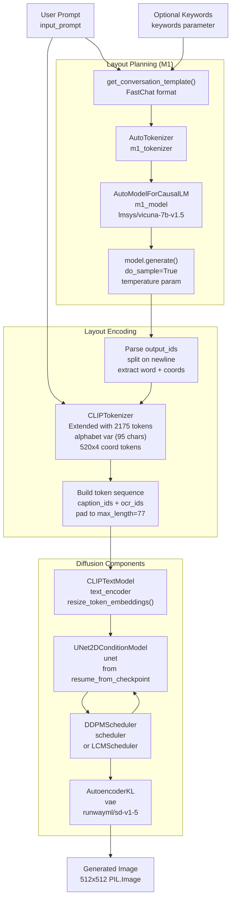
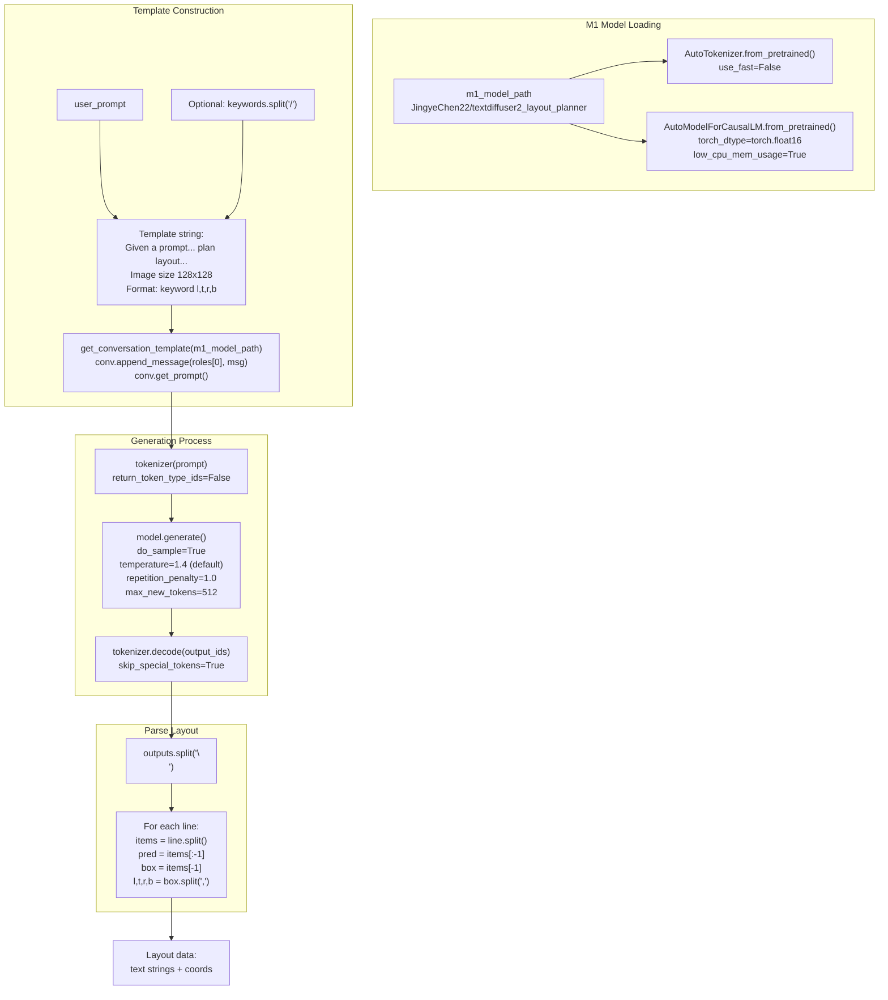
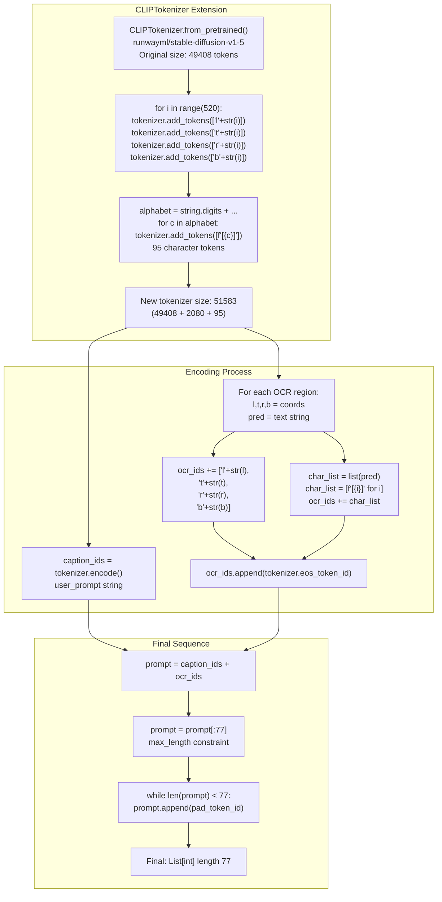
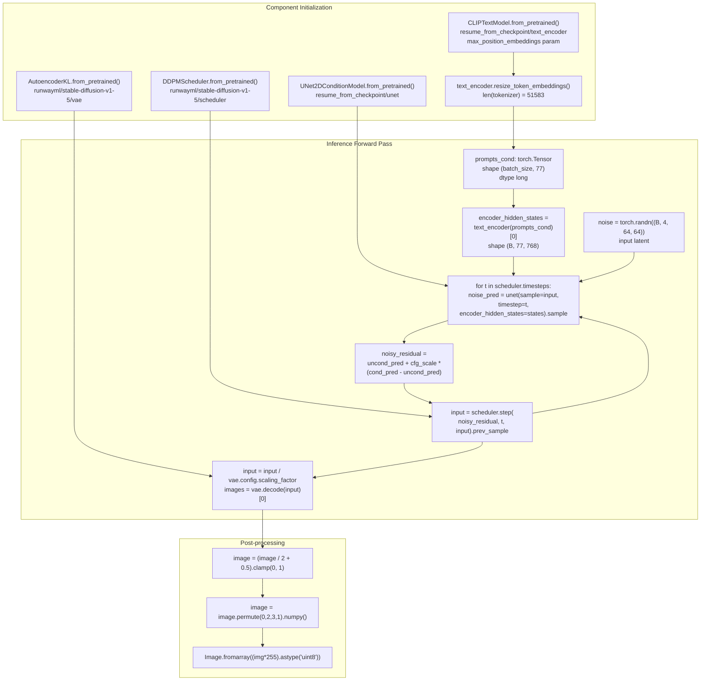
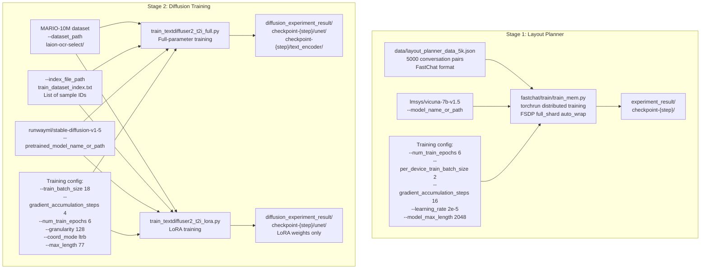

<!-- source: DeepWiki mcp.deepwiki.com · repo microsoft/unilm · page 6.3 TextDiffuser-2: LLM-Enhanced Layout Planning · fetched 2026-10-26 -->

# TextDiffuser-2: LLM-Enhanced Layout Planning

<details>
<summary>Relevant source files</summary>

The following files were used as context for generating this wiki page:

- [textdiffuser-2/README.md](textdiffuser-2/README.md)
- [textdiffuser-2/assets/arial.ttf](textdiffuser-2/assets/arial.ttf)
- [textdiffuser-2/assets/attention_processor.py](textdiffuser-2/assets/attention_processor.py)
- [textdiffuser-2/assets/readme_images/architecture.jpg](textdiffuser-2/assets/readme_images/architecture.jpg)
- [textdiffuser-2/assets/readme_images/demo.jpg](textdiffuser-2/assets/readme_images/demo.jpg)
- [textdiffuser-2/assets/readme_images/m1_loss.jpg](textdiffuser-2/assets/readme_images/m1_loss.jpg)
- [textdiffuser-2/assets/readme_images/teaser.jpg](textdiffuser-2/assets/readme_images/teaser.jpg)
- [textdiffuser-2/assets/reference_requirements.txt](textdiffuser-2/assets/reference_requirements.txt)
- [textdiffuser-2/cog.yaml](textdiffuser-2/cog.yaml)
- [textdiffuser-2/data/check_layout_planner_data.py](textdiffuser-2/data/check_layout_planner_data.py)
- [textdiffuser-2/data/layout_planner_data_5k.json](textdiffuser-2/data/layout_planner_data_5k.json)
- [textdiffuser-2/inference_textdiffuser2_t2i_full.py](textdiffuser-2/inference_textdiffuser2_t2i_full.py)
- [textdiffuser-2/predict.py](textdiffuser-2/predict.py)

</details>


## Purpose and Scope

TextDiffuser-2 is an advanced text rendering system that leverages language models for layout planning in text-to-image generation. This document covers the architecture, training procedures, and inference pipeline for TextDiffuser-2, which represents a significant evolution over its predecessor by introducing LLM-based layout planning and conversational layout editing capabilities. The system supports text-to-image generation, template-based generation, and text inpainting tasks.

For the original TextDiffuser approach using two-stage diffusion, see [TextDiffuser: Text Rendering with Diffusion](#6.2). For other vision-language multimodal models in the repository, see [Vision-Language Models](#6).

---

## Architecture Overview

TextDiffuser-2 introduces a two-language-model architecture: a layout planner for generating text layouts and a layout encoder integrated into the diffusion process.

### High-Level System Architecture



**Sources:** [textdiffuser-2/README.md:14-22](), [textdiffuser-2/predict.py:46-137](), [textdiffuser-2/inference_textdiffuser2_t2i_full.py:327-419]()

---

## Layout Planner Component

The layout planner is a fine-tuned Vicuna-7b-v1.5 language model that generates structured text layouts from user prompts. This is the key innovation ("M1 model") that distinguishes TextDiffuser-2 from its predecessor.

### Layout Planner Architecture

The M1 model is the layout planning component that uses Vicuna-7b-v1.5 to generate structured text layouts.



**Sources:** [textdiffuser-2/predict.py:51-226](), [textdiffuser-2/inference_textdiffuser2_t2i_full.py:421-515]()

### Layout Generation Process

The layout planner uses a carefully engineered prompt template that instructs the LLM to generate layouts in a specific format:

**Template Structure:**
- Image size specification (128x128 coordinate space)
- Task description: plan visual text layout
- Format specification: `keyword left,top,right,bottom` per line
- Optional keyword hints for better control

**Key Configuration:**
- **Model:** `lmsys/vicuna-7b-v1.5` fine-tuned on 5k layout examples
- **Temperature:** 1.4 (default) for diversity control
- **Max tokens:** 512 for layout generation
- **Coordinate mode:** `ltrb` (left, top, right, bottom)
- **Granularity:** 128 (coordinate quantization)

**Sources:** [textdiffuser-2/README.md:96-122](), [textdiffuser-2/predict.py:193-226](), [textdiffuser-2/inference_textdiffuser2_t2i_full.py:1-300]()

---

## Layout Encoding and Tokenization

TextDiffuser-2 extends the standard CLIP tokenizer with special tokens for coordinates and characters to encode the structured layout into the text conditioning.

### Extended Tokenization Scheme

TextDiffuser-2 extends the CLIP tokenizer vocabulary to encode spatial layout and character information explicitly.



**Sources:** [textdiffuser-2/predict.py:84-273](), [textdiffuser-2/inference_textdiffuser2_t2i_full.py:332-342]()

### Tokenization Implementation

The tokenizer is extended with 2,175 new tokens:
- **520 × 4 = 2,080 coordinate tokens:** For encoding spatial positions (0-519 range with granularity scaling)
- **95 character tokens:** For explicit character-level encoding using format `[char]`

**Alphabet Definition:**
```python
alphabet = string.digits + string.ascii_lowercase + string.ascii_uppercase + string.punctuation + " "
# 0-9, a-z, A-Z, punctuation, space = 95 characters total
```

**Coordinate Encoding:**
- Layout coordinates are in [0, 128) range (granularity=128)
- Scaled from 128 to 512 for token representation: `coord * 512 // 128`
- Encoded as special tokens: `l50`, `t20`, `r100`, `b80`

**Character Encoding:**
- Each character wrapped in brackets: `[H][e][l][l][o]`
- EOS token separates different text regions

**Sources:** [textdiffuser-2/predict.py:26-94](), [textdiffuser-2/inference_textdiffuser2_t2i_full.py:100-150]()

---

## Diffusion Model Integration

The diffusion model is based on Stable Diffusion v1.5 with modifications to handle the extended token vocabulary and layout-aware generation.

### Diffusion Model Components

The diffusion generation uses modified Stable Diffusion v1.5 components with extended token support.



**Sources:** [textdiffuser-2/predict.py:66-332](), [textdiffuser-2/inference_textdiffuser2_t2i_full.py:343-419]()

### Model Configuration

**Base Model:** `runwayml/stable-diffusion-v1.5`

**Modified Components:**
- **Text Encoder:** Resized from 49,408 to 51,583 tokens (49,408 + 2,175 new tokens)
- **Embedding Initialization:** New token embeddings initialized randomly or from nearest neighbors
- **Cross-Attention:** Standard Stable Diffusion attention mechanism handles layout tokens

**Training Modes:**

1. **Full-Parameter Training:**
   - All UNet and text encoder parameters trainable
   - Learning rate: 1e-5
   - Batch size: 18 with gradient accumulation
   - Memory efficient with gradient checkpointing

2. **LoRA Training:**
   - Low-rank adaptation for efficient fine-tuning
   - UNet learning rate: 1e-4
   - Text encoder learning rate: 1e-5
   - Significantly reduced memory footprint

**Sources:** [textdiffuser-2/README.md:129-174](), [textdiffuser-2/predict.py:66-123](), [textdiffuser-2/inference_textdiffuser2_t2i_full.py:1-300]()

---

## Training Procedures

TextDiffuser-2 requires training two separate models: the layout planner and the diffusion model.

### Training Pipeline Overview



**Sources:** [textdiffuser-2/README.md:94-174]()

### Layout Planner Training Details

**Dataset:** [data/layout_planner_data_5k.json]()

The dataset contains 5,000 conversation pairs in FastChat format:

```python
# Example structure from layout_planner_data_5k.json
{
  "id": "identity_0",
  "conversations": [
    {"from": "human", "value": "Given a prompt... plan layout... Prompt: ..."},
    {"from": "gpt", "value": "keyword1 l,t,r,b\nkeyword2 l,t,r,b\n"}
  ]
}
```

**Training Command:**
```bash
CUDA_VISIBLE_DEVICES=0,1,2,3,4,5,6,7 torchrun --nproc_per_node=8 --master_port=20003 \
  fastchat/train/train_mem.py \
  --model_name_or_path lmsys/vicuna-7b-v1.5 \
  --data_path data/layout_planner_data_5k.json \
  --bf16 True \
  --output_dir experiment_result \
  --num_train_epochs 6 \
  --per_device_train_batch_size 2 \
  --per_device_eval_batch_size 2 \
  --gradient_accumulation_steps 16 \
  --evaluation_strategy "no" \
  --save_strategy "steps" \
  --save_steps 500 \
  --save_total_limit 5 \
  --learning_rate 2e-5 \
  --weight_decay 0. \
  --warmup_ratio 0.03 \
  --lr_scheduler_type "cosine" \
  --logging_steps 1 \
  --fsdp "full_shard auto_wrap" \
  --fsdp_transformer_layer_cls_to_wrap 'LlamaDecoderLayer' \
  --tf32 True \
  --model_max_length 2048 \
  --gradient_checkpointing True \
  --lazy_preprocess True
```

**Key Training Configuration:**

| Parameter | Value | Purpose |
|-----------|-------|---------|
| Base model | `lmsys/vicuna-7b-v1.5` | Pretrained LLM |
| Batch size | 2 per device | Memory constraint |
| Gradient accumulation | 16 steps | Effective batch size 256 |
| Learning rate | 2e-5 | AdamW optimizer |
| LR scheduler | cosine | Gradual decay |
| FSDP | `full_shard auto_wrap` | Distributed training |
| Max length | 2048 tokens | Context window |
| Precision | bf16 | Mixed precision training |
| Checkpointing | Every 500 steps | Save progress |

**Loss Behavior:**

The training loss exhibits a characteristic staircase pattern, which is expected behavior for this task. See [textdiffuser-2/assets/readme_images/m1_loss.jpg]() for visualization.

**Sources:** [textdiffuser-2/README.md:96-126](), [textdiffuser-2/data/layout_planner_data_5k.json:1-30]()

### Diffusion Model Training

**Dataset:** MARIO-10M
- Same dataset as TextDiffuser v1
- Contains image-text pairs with OCR annotations
- Training uses index file specifying sample IDs

**Full-Parameter Training:**
```bash
accelerate launch train_textdiffuser2_t2i_full.py \
  --pretrained_model_name_or_path="runwayml/stable-diffusion-v1-5" \
  --train_batch_size=18 \
  --num_train_epochs=6 \
  --learning_rate=1e-5 \
  --mixed_precision="fp16" \
  --enable_xformers_memory_efficient_attention
```

**LoRA Training:**
```bash
accelerate launch train_textdiffuser2_t2i_lora.py \
  --pretrained_model_name_or_path="runwayml/stable-diffusion-v1-5" \
  --train_batch_size=18 \
  --num_train_epochs=6 \
  --learning_rate=1e-4 \
  --text_encoder_learning_rate=1e-5
```

**Training Configuration:**
- **Granularity:** 128 (coordinate quantization)
- **Coordinate mode:** `ltrb` (left, top, right, bottom)
- **Max length:** 77 tokens (CLIP limit)
- **Optimizer:** AdamW with constant learning rate schedule
- **Mixed precision:** FP16 for efficiency
- **XFormers:** Memory-efficient attention when available

**Sources:** [textdiffuser-2/README.md:94-174](), [textdiffuser-2/data/check_layout_planner_data.py:1-35]()

---

## Inference Pipeline

The inference process combines the layout planner and diffusion model to generate images with accurate text rendering.

### Full Inference Flow

The inference process combines M1 layout generation with diffusion-based image synthesis.

```mermaid
graph TB
    Input["Predictor.predict()<br/>prompt, keywords, cfg, steps, etc."]
    
    subgraph "M1 Layout Generation"
        CheckNatural["if generate_natural_image:<br/>skip M1, use caption only"]
        BuildTemplate["template = f'Given a prompt...'<br/>+ user_prompt<br/>+ optional keywords"]
        GetConv["conv = get_conversation_template()<br/>conv.append_message(roles[0], msg)<br/>prompt = conv.get_prompt()"]
        Tokenize["inputs = m1_tokenizer([prompt])<br/>to device cuda"]
        Generate["output_ids = m1_model.generate()<br/>do_sample=True, temperature=temp<br/>max_new_tokens=512"]
        Decode["outputs = m1_tokenizer.decode()<br/>skip_special_tokens=True"]
        Split["ocrs = outputs.split('\\n')"]
    end
    
    subgraph "Parse and Encode Layout"
        IterateOCR["for ocr in current_ocr:<br/>items = ocr.split()<br/>pred = ' '.join(items[:-1])<br/>box = items[-1]"]
        ExtractCoords["l,t,r,b = box.split(',')<br/>l,t,r,b = int(l),int(t),int(r),int(b)"]
        BuildOCRIds["ocr_ids += ['l'+str(l), 't'+str(t),<br/>'r'+str(r), 'b'+str(b)]"]
        BuildCharList["char_list = list(pred)<br/>char_list = [f'[{i}]' for i]<br/>ocr_ids += char_list<br/>ocr_ids.append(eos_token_id)"]
        EncodeCaption["caption_ids = tokenizer(user_prompt)"]
        EncodeOCR["ocr_ids = tokenizer.encode(ocr_ids)"]
        CombinePrompt["prompt = caption_ids + ocr_ids"]
        TruncatePad["prompt = prompt[:77]<br/>while len(prompt) < 77:<br/>prompt.append(pad_token_id)"]
    end
    
    subgraph "Diffusion Generation"
        PreparePrompts["prompts_cond = [prompt] * num_images<br/>prompts_nocond = [pad_token] * 77"]
        ToTensor["prompts_cond = torch.Tensor().long().cuda()"]
        SetTimesteps["scheduler.set_timesteps(num_inference_steps)"]
        InitNoise["noise = torch.randn((num_images,4,64,64))"]
        EncodeText["encoder_hidden_states_cond =<br/>text_encoder(prompts_cond)[0]"]
        LoopDenoise["for t in scheduler.timesteps:<br/>noise_pred_cond = unet(input, t, states)<br/>noise_pred_uncond = unet(input, t, uncond)<br/>residual = uncond + guidance * (cond-uncond)<br/>input = scheduler.step(residual, t, input)"]
        DecodeVAE["input = input / vae.config.scaling_factor<br/>images = vae.decode(input)[0]"]
        Postprocess["image = (image/2 + 0.5).clamp(0,1)<br/>to PIL Image"]
    end
    
    Output["ModelOutput:<br/>output_images: List[Path]<br/>composed_prompt: str"]
    
    Input --> CheckNatural
    CheckNatural -->|False| BuildTemplate
    BuildTemplate --> GetConv
    GetConv --> Tokenize
    Tokenize --> Generate
    Generate --> Decode
    Decode --> Split
    
    Split --> IterateOCR
    IterateOCR --> ExtractCoords
    ExtractCoords --> BuildOCRIds
    ExtractCoords --> BuildCharList
    
    CheckNatural -->|True| EncodeCaption
    BuildOCRIds --> EncodeOCR
    BuildCharList --> EncodeOCR
    Input --> EncodeCaption
    
    EncodeCaption --> CombinePrompt
    EncodeOCR --> CombinePrompt
    CombinePrompt --> TruncatePad
    
    TruncatePad --> PreparePrompts
    PreparePrompts --> ToTensor
    ToTensor --> EncodeText
    ToTensor --> SetTimesteps
    SetTimesteps --> InitNoise
    EncodeText --> LoopDenoise
    InitNoise --> LoopDenoise
    LoopDenoise --> DecodeVAE
    DecodeVAE --> Postprocess
    Postprocess --> Output
```



**Sources:** [textdiffuser-2/predict.py:138-359](), [textdiffuser-2/inference_textdiffuser2_t2i_full.py:421-600]()

### Inference Modes

**1. Text-to-Image with Automatic Layout:**
```python
# M1 automatically identifies keywords and generates layout
input_prompt = "A beautiful city skyline stamp of Shanghai"
# M1 generates: "Shanghai 10,15,118,45"
```

**2. Text-to-Image with Provided Keywords:**
```python
# User provides keywords to control layout
input_prompt = "A stamp with text"
keywords = "CHINA/2023/BEIJING"
# M1 generates layout for specified keywords
```

**3. Natural Image Generation (No Layout):**
```python
# Skip layout generation for natural images without text
generate_natural_image = True
# Layout encoding bypassed
```

### Inference Configuration

**Model Loading:**
- **Layout Planner:** `JingyeChen22/textdiffuser2_layout_planner`
- **Full-FT Diffusion:** `JingyeChen22/textdiffuser2-full-ft`
- **LoRA Diffusion:** `JingyeChen22/textdiffuser2-lora-ft`

**Generation Parameters:**
- **CFG Scale:** 7.5 (default) for guidance strength
- **Sampling Steps:** 20-50 (full), 4 (LCM for fast inference)
- **Scheduler:** DDPMScheduler or LCMScheduler
- **Seed:** Configurable for reproducibility
- **Temperature:** 1.4 (M1) for layout diversity

**Inference Commands:**

Full-parameter inference:
```bash
accelerate launch inference_textdiffuser2_t2i_full.py \
  --resume_from_checkpoint="JingyeChen22/textdiffuser2-full-ft" \
  --m1_model_path="JingyeChen22/textdiffuser2_layout_planner" \
  --input_prompt='a hotdog with mustard and other toppings on it' \
  --cfg=7.5 \
  --sample_steps=20
```

LoRA inference:
```bash
accelerate launch inference_textdiffuser2_t2i_lora.py \
  --resume_from_checkpoint="JingyeChen22/textdiffuser2-lora-ft" \
  --m1_model_path="JingyeChen22/textdiffuser2_layout_planner" \
  --input_prompt='a stamp of u.s.a' \
  --sample_steps=50
```

**Sources:** [textdiffuser-2/README.md:178-217](), [textdiffuser-2/predict.py:138-359](), [textdiffuser-2/inference_textdiffuser2_t2i_full.py:1-300]()

---

## Data Format and Datasets

### Layout Planner Training Data

The layout planner is trained on structured conversation data in FastChat format:

**Data Structure:**
```json
{
  "id": "sample_001",
  "conversations": [
    {
      "from": "human",
      "value": "Given a prompt... plan the layout... Prompt: A vintage poster with retro text"
    },
    {
      "from": "gpt", 
      "value": "RETRO 25,10,103,35\nVINTAGE 30,50,98,75"
    }
  ]
}
```

**Dataset:** [data/layout_planner_data_5k.json]()
- 5,000 training examples
- Each example contains prompt and corresponding layout
- Layout format: `keyword left,top,right,bottom` per line
- Coordinates in [0, 128) range

**Layout Verification:**
The repository includes a verification script to visualize layouts:

```python
# data/check_layout_planner_data.py
# Loads random sample and visualizes layout on 256×256 canvas
# Useful for dataset quality checking
```

### MARIO-10M Dataset

The diffusion model is trained on MARIO-10M, the same dataset used by TextDiffuser v1:

**Dataset Structure:**
- **Images:** 10M+ images with text content
- **Annotations:** OCR text, bounding boxes, categories
- **Index file:** `train_dataset_index.txt` specifies training samples

**Index File Format:**
```
06269_062690093
27197_271975251
27197_271978467
...
```

Each line is a sample ID referencing the dataset.

**Data Loading:**
- Custom PyTorch Dataset class loads images and annotations
- Applies augmentations and prepares layout encoding
- Granularity parameter controls coordinate quantization

**Sources:** [textdiffuser-2/README.md:78-91](), [textdiffuser-2/data/check_layout_planner_data.py:1-35]()

---

## Key Implementation Details

### Coordinate System and Transformation

TextDiffuser-2 uses coordinate quantization to represent spatial positions as discrete tokens.

**Coordinate Spaces:**

| Space | Range | Location in Code | Purpose |
|-------|-------|------------------|---------|
| M1 Output | [0, 128) | `outputs.split()` result | Layout planner generation space |
| Token Space | [0, 520) | `'l'+str(i)` tokens | Tokenizer vocabulary space |
| Image Space | [0, 512) | Final rendering | Output image coordinates |

**Granularity Parameter:**

The `--granularity` parameter (default 128) controls coordinate quantization:

```python
# From inference script
granularity = 128  # Grid resolution for layout

# M1 outputs coordinates in [0, granularity) range
l, t, r, b = 50, 20, 100, 60  # Example from M1

# No transformation needed for tokenization
# Coordinates directly map to token indices
coord_tokens = ['l50', 't20', 'r100', 'b60']

# For rendering, scale to image space (512x512)
scale_factor = 512 / granularity  # 512 / 128 = 4
image_l = l * scale_factor  # 50 * 4 = 200
image_t = t * scale_factor  # 20 * 4 = 80
```

The coordinate mode (`--coord_mode`) supports different representations:
- `lt`: left, top + implicit width/height
- `ltrb`: left, top, right, bottom (default)
- `center`: center x, center y + width/height

**Sources:** [textdiffuser-2/inference_textdiffuser2_t2i_full.py:196-210](), [textdiffuser-2/predict.py:244-248]()

### Alphabet Coverage

The character token set covers 95 ASCII characters:

| Category | Characters | Count |
|----------|-----------|--------|
| Digits | 0-9 | 10 |
| Lowercase | a-z | 26 |
| Uppercase | A-Z | 26 |
| Punctuation | !"#$%&'()*+,-./:;<=>?@[\]^_`{\|}~ | 32 |
| Space | ' ' | 1 |
| **Total** | | **95** |

### Model Checkpoints

**Available Checkpoints:**

| Component | HuggingFace Path | Type |
|-----------|-----------------|------|
| Layout Planner | `JingyeChen22/textdiffuser2_layout_planner` | Full Vicuna-7b-v1.5 |
| Diffusion (Full) | `JingyeChen22/textdiffuser2-full-ft` | Full SD v1.5 weights |
| Diffusion (LoRA) | `JingyeChen22/textdiffuser2-lora-ft` | LoRA adapters only |
| Angle Extension | Google Drive | Full model with angle support |
| Quadrilateral Extension | Google Drive | Full model with quad boxes |

**Context Length Variants:**
- Standard: 77 tokens (default)
- Extended: Longer context for complex layouts

**Sources:** [textdiffuser-2/README.md:68-77](), [textdiffuser-2/predict.py:46-137]()

---

## Advanced Features

### Conversational Layout Editing

TextDiffuser-2 supports iterative refinement of layouts through conversation:

```
User: Create a poster with "SUMMER SALE"
M1: SUMMER 20,10,100,40
    SALE 25,50,95,80

User: Move SALE text to the top
M1: SALE 25,10,95,40
    SUMMER 20,50,100,80
```

The layout planner maintains context and can modify layouts based on user feedback.

### Latent Consistency Model (LCM) Support

For fast inference, TextDiffuser-2 integrates LCM:

```python
# Enable LCM for 4-step generation (vs 20-50 steps)
pipe.scheduler = LCMScheduler.from_config(pipe.scheduler.config)
pipe.load_lora_weights("latent-consistency/lcm-lora-sdv1-5")
# Generate with guidance_scale=1, num_inference_steps=4
```

**Performance:**
- Standard: 20-50 denoising steps
- LCM: 4 denoising steps (~5-10× speedup)

### Extensions

**Angle Support:**
- Rotated text rendering
- Extended coordinate encoding with angle parameter
- Checkpoint: [Google Drive link]()

**Quadrilateral Support:**
- Arbitrary quadrilateral bounding boxes
- Non-axis-aligned text placement
- Checkpoint: [Google Drive link]()

**Sources:** [textdiffuser-2/README.md:22-36](), [textdiffuser-2/predict.py:124-136](), [textdiffuser-2/cog.yaml:1-17]()

---

## Deployment and Demo

### Gradio Demo

TextDiffuser-2 includes a Gradio interface for interactive use:

```bash
python gradio_demo.py
```

**Features:**
- Text prompt input with optional keywords
- Temperature slider for layout diversity
- CFG scale control
- LCM toggle for fast generation
- Multiple output images

**Public Demo:**
- HuggingFace Space: `JingyeChen22/TextDiffuser-2`
- Replicate API: `cjwbw/textdiffuser-2`

### Cog Deployment

The system includes Cog configuration for containerized deployment:

**Configuration:** [cog.yaml]()
- Python 3.11
- GPU required
- Dependencies: torch, diffusers, transformers, fschat

**Predictor Interface:**
```python
class Predictor(BasePredictor):
    def setup():
        # Load M1 model, text encoder, UNet, VAE
    
    def predict(prompt, keywords, use_lcm, ...):
        # Generate layout with M1
        # Encode layout to tokens
        # Run diffusion generation
        # Return images and composed prompt
```

**Sources:** [textdiffuser-2/README.md:219-223](), [textdiffuser-2/cog.yaml:1-17](), [textdiffuser-2/predict.py:45-359]()

---

## Related Systems

TextDiffuser-2 builds upon and relates to several other systems in the repository:

- **[TextDiffuser v1](#6.2):** Original two-stage diffusion approach
- **[Kosmos Series](#6.1):** Multimodal LLMs for perception and generation
- **[LayoutLM Series](#5):** Document understanding with layout information
- **[BEiT](#2):** Vision transformer foundations for image encoding

The LLM-based layout planning approach represents a key architectural innovation that increases flexibility and enables conversational editing compared to the fixed-layout approach in TextDiffuser v1.

---

