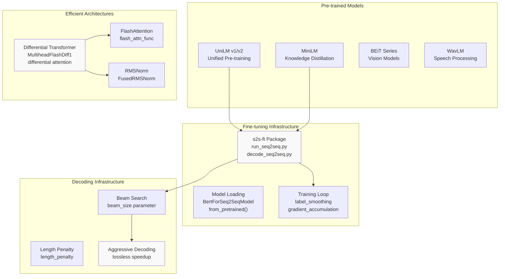
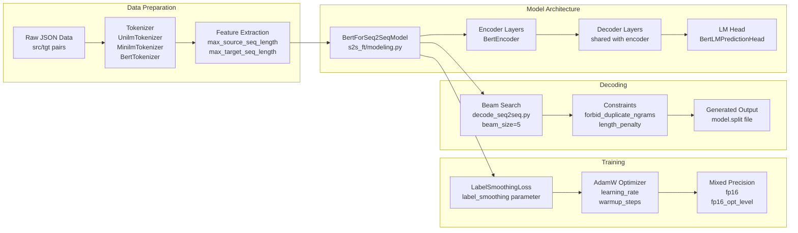
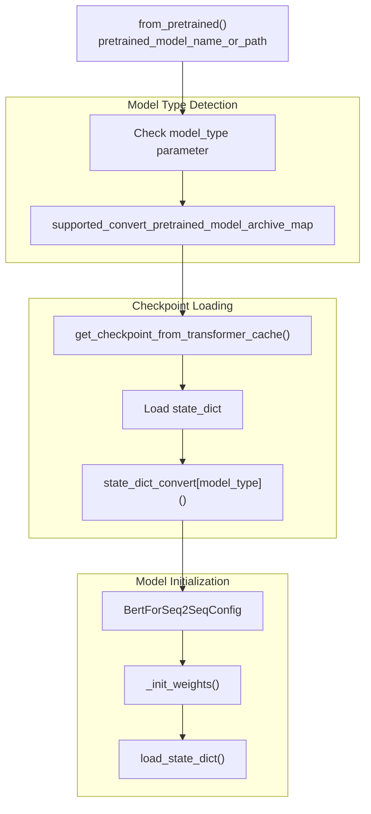
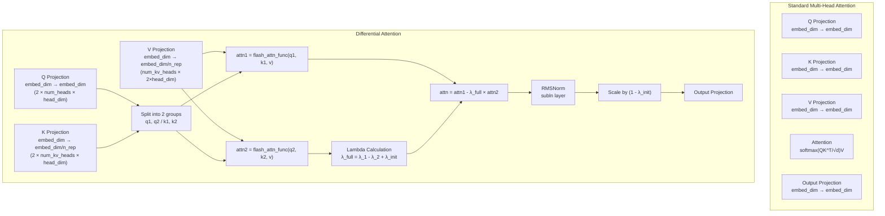
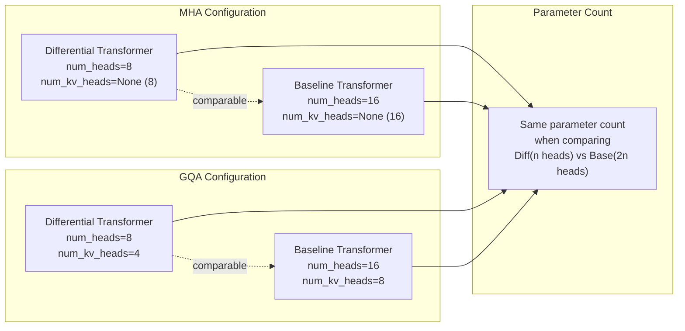
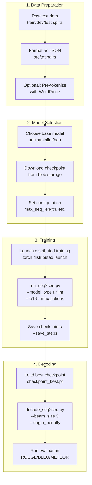
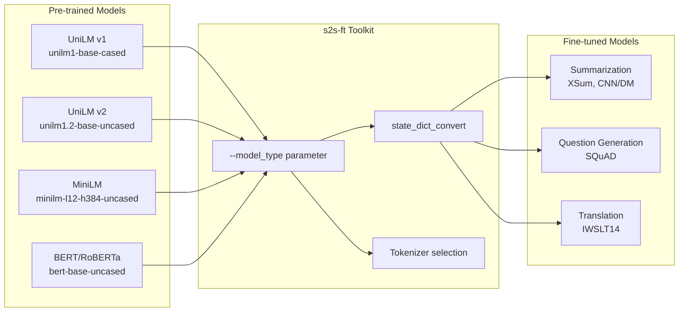

<!-- source: DeepWiki mcp.deepwiki.com · repo microsoft/unilm · page 7 Toolkits and Infrastructure · fetched 2026-10-26 -->

# Toolkits and Infrastructure

<details>
<summary>Relevant source files</summary>

The following files were used as context for generating this wiki page:

- [Diff-Transformer/README.md](Diff-Transformer/README.md)
- [Diff-Transformer/example.py](Diff-Transformer/example.py)
- [Diff-Transformer/imgs/code_highlight.png](Diff-Transformer/imgs/code_highlight.png)
- [Diff-Transformer/kernel/rotary.py](Diff-Transformer/kernel/rotary.py)
- [Diff-Transformer/multihead_attention.py](Diff-Transformer/multihead_attention.py)
- [Diff-Transformer/multihead_diffattn.py](Diff-Transformer/multihead_diffattn.py)
- [Diff-Transformer/multihead_flashdiff_1.py](Diff-Transformer/multihead_flashdiff_1.py)
- [Diff-Transformer/multihead_flashdiff_2.py](Diff-Transformer/multihead_flashdiff_2.py)
- [Diff-Transformer/rms_norm.py](Diff-Transformer/rms_norm.py)
- [retnet/README.md](retnet/README.md)
- [s2s-ft/README.md](s2s-ft/README.md)
- [s2s-ft/s2s_ft/configuration_minilm.py](s2s-ft/s2s_ft/configuration_minilm.py)
- [s2s-ft/s2s_ft/configuration_unilm.py](s2s-ft/s2s_ft/configuration_unilm.py)
- [s2s-ft/s2s_ft/modeling.py](s2s-ft/s2s_ft/modeling.py)
- [s2s-ft/s2s_ft/modeling_decoding.py](s2s-ft/s2s_ft/modeling_decoding.py)
- [s2s-ft/s2s_ft/tokenization_minilm.py](s2s-ft/s2s_ft/tokenization_minilm.py)
- [s2s-ft/s2s_ft/tokenization_unilm.py](s2s-ft/s2s_ft/tokenization_unilm.py)
- [unilm-v1/README.md](unilm-v1/README.md)

</details>


This page documents the reusable toolkits, optimized architectures, and infrastructure components that support the broader model ecosystem in the UniLM repository. These tools enable efficient fine-tuning, decoding, and deployment of pre-trained models across various tasks and modalities.

For pre-trained models themselves, see [Foundation Architectures](#1.1). For model-specific applications, see individual model pages such as [UniLM](#3.1), [MiniLM](#3.2), or [BEiT](#2.1).

## Overview

The repository provides three primary infrastructure categories:

1. **Fine-tuning Toolkits**: The s2s-ft package enables sequence-to-sequence fine-tuning of pre-trained models
2. **Efficient Architectures**: Differential Transformer and other architectural innovations for improved parameter efficiency
3. **Decoding and Deployment**: Tools for accelerated inference and production deployment



**Sources:** [README.md:96-100](), [s2s-ft/README.md:1-2](), [Diff-Transformer/README.md:1-26]()

## s2s-ft: Sequence-to-Sequence Fine-tuning Toolkit

The `s2s-ft` package is a PyTorch-based toolkit designed to fine-tune pre-trained Transformer encoders for sequence-to-sequence language generation tasks. It supports multiple pre-trained model families including UniLM, MiniLM, BERT, and RoBERTa.

### Supported Model Types

The toolkit defines model type mappings in the configuration infrastructure:

| Model Type | Archive Map | Configuration |
|------------|-------------|---------------|
| `unilm` | UNILM_PRETRAINED_MODEL_ARCHIVE_MAP | UnilmConfig |
| `minilm` | MINILM_PRETRAINED_MODEL_ARCHIVE_MAP | MinilmConfig |
| `bert` | BERT_PRETRAINED_MODEL_ARCHIVE_MAP | BertConfig |
| `roberta` | ROBERTA_PRETRAINED_MODEL_ARCHIVE_MAP | RobertaConfig |

**Sources:** [s2s-ft/s2s_ft/modeling.py:29-63](), [s2s-ft/s2s_ft/configuration_unilm.py:36-45](), [s2s-ft/s2s_ft/configuration_minilm.py:36-38]()

### Core Components



**Sources:** [s2s-ft/s2s_ft/modeling.py:1-100](), [s2s-ft/s2s_ft/modeling_decoding.py:30-68](), [s2s-ft/README.md:40-61]()

### Input Format

The toolkit supports two dataset formats for flexibility:

**Text Format** - Each line contains a JSON object:
```json
{"src": "Messages posted on social media...", "tgt": "Threats to kill pupils..."}
```

**Tokenized Format** - Pre-tokenized with WordPiece tokens:
```json
{"src": ["messages", "posted", "on", "social", "media", ...], "tgt": ["threats", "to", "kill", ...]}
```

The code automatically detects the format by checking if the JSON values are lists or strings.

**Sources:** [s2s-ft/README.md:40-61]()

### Training Configuration

Key hyperparameters for fine-tuning:

| Parameter | Description | Typical Values |
|-----------|-------------|----------------|
| `model_type` | Pre-trained model family | `unilm`, `minilm`, `bert` |
| `max_source_seq_length` | Maximum source sequence length | 464, 512, 608 |
| `max_target_seq_length` | Maximum target sequence length | 48, 160 |
| `per_gpu_train_batch_size` | Batch size per GPU | 8, 16 |
| `gradient_accumulation_steps` | Gradient accumulation | 1, 2 |
| `learning_rate` | Learning rate | 7e-5, 1e-4 |
| `num_warmup_steps` | Warmup steps | 500, 1000 |
| `label_smoothing` | Label smoothing parameter | 0.1 |

The effective batch size is: `num_gpus × per_gpu_train_batch_size × gradient_accumulation_steps`

**Sources:** [s2s-ft/README.md:78-84](), [s2s-ft/README.md:126-144]()

### Model Loading and State Dictionary Conversion

The toolkit includes sophisticated model loading logic in `BertPreTrainedForSeq2SeqModel` that converts checkpoints from different model families:



**Sources:** [s2s-ft/s2s_ft/modeling.py:78-120]()

### Label Smoothing Implementation

The toolkit implements label smoothing via `LabelSmoothingLoss` class:

```python
# Smoothing value distributed across vocabulary
smoothing_value = label_smoothing / (tgt_vocab_size - 2)
# Confidence for correct token
confidence = 1.0 - label_smoothing
# KL divergence loss between smoothed distribution and model prediction
```

**Sources:** [s2s-ft/s2s_ft/modeling_decoding.py:30-68]()

### Decoding Strategies

The `decode_seq2seq.py` script supports multiple decoding configurations:

| Parameter | Function | Example Values |
|-----------|----------|----------------|
| `beam_size` | Beam search width | 5, 8 |
| `length_penalty` | Length normalization | 0, 0.6, 0.9, 1.0 |
| `forbid_duplicate_ngrams` | Prevent n-gram repetition | flag |
| `forbid_ignore_word` | Constraints on specific tokens | "." |
| `min_len` | Minimum generation length | 1, 48 |
| `max_tgt_length` | Maximum generation length | 48, 160 |

**Sources:** [s2s-ft/README.md:102-106](), [s2s-ft/README.md:162-166]()

## Differential Transformer Architecture

The Differential Transformer introduces a novel attention mechanism that achieves parameter efficiency through differential attention, using half the number of attention heads compared to baseline Transformers while maintaining comparable performance.

### Architecture Innovation



**Sources:** [Diff-Transformer/multihead_flashdiff_1.py:30-113](), [Diff-Transformer/README.md:1-26]()

### Implementation Variants

The repository provides three implementation variants:

| Implementation | File | Purpose | FlashAttention Support |
|----------------|------|---------|------------------------|
| Naive | `multihead_diffattn.py` | Reference implementation | No |
| FlashDiff-1 | `multihead_flashdiff_1.py` | Optimized for flex_head_fa/xformers | Different qk/v dims supported |
| FlashDiff-2 | `multihead_flashdiff_2.py` | Optimized for standard flash-attention | Same qk/v dims required |

**Recommended:** Use `MultiheadFlashDiff1` for faster training and inference when using the customized FlashAttention implementation.

**Sources:** [Diff-Transformer/README.md:7-12]()

### Key Code Components

**Head Dimension Calculation:**
```python
# Differential attention uses half the heads with half the head dimension
self.head_dim = embed_dim // num_heads // 2
```

**Lambda Initialization Function:**
```python
def lambda_init_fn(depth):
    return 0.8 - 0.6 * math.exp(-0.3 * depth)
```

**Differential Attention Computation:**
```python
lambda_1 = torch.exp(torch.sum(self.lambda_q1 * self.lambda_k1, dim=-1).float()).type_as(q)
lambda_2 = torch.exp(torch.sum(self.lambda_q2 * self.lambda_k2, dim=-1).float()).type_as(q)
lambda_full = lambda_1 - lambda_2 + self.lambda_init
attn = attn1 - lambda_full * attn2
```

**Sources:** [Diff-Transformer/multihead_flashdiff_1.py:26-28](), [Diff-Transformer/multihead_flashdiff_1.py:56-111]()

### Multi-Head vs. Grouped-Query Attention

The architecture supports both MHA and GQA configurations:



**Sources:** [Diff-Transformer/multihead_flashdiff_1.py:36-55](), [Diff-Transformer/example.py:4-19]()

### FlashAttention Integration

The implementation integrates with FlashAttention for efficiency:

```python
# Import customized flash attention supporting different qk/v dimensions
from flex_head_fa import flash_attn_func

# Or use standard flash attention
from flash_attn import flash_attn_func

# Usage in forward pass
attn1 = flash_attn_func(q1, k1, v, causal=True)
attn2 = flash_attn_func(q2, k2, v, causal=True)
```

**Rotary Position Embeddings** are applied before attention computation:
```python
q = apply_rotary_emb(q, *rel_pos, interleaved=True)
k = apply_rotary_emb(k, *rel_pos, interleaved=True)
```

**Sources:** [Diff-Transformer/multihead_flashdiff_1.py:7-8](), [Diff-Transformer/multihead_flashdiff_1.py:90-100](), [Diff-Transformer/kernel/rotary.py:1-50]()

### RMSNorm Layer

The architecture uses RMSNorm for normalization:

```python
# Attempt to use fused implementation from apex
try:
    from apex.normalization import FusedRMSNorm as RMSNorm 
except ModuleNotFoundError:
    # Fallback to custom implementation
    from rms_norm import RMSNorm

# Applied after differential attention
self.subln = RMSNorm(2 * self.head_dim, eps=1e-5, elementwise_affine=True)
attn = self.subln(attn)
```

**Sources:** [Diff-Transformer/multihead_flashdiff_1.py:8-12](), [Diff-Transformer/rms_norm.py:4-26]()

## Additional Infrastructure Components

### WavLM Speech Processing

WavLM provides pre-trained models for full-stack speech processing tasks, trained on 94k hours of audio data.

**Model Loading:**
```python
import torch
from WavLM import WavLM, WavLMConfig

checkpoint = torch.load('/path/to/wavlm.pt')
cfg = WavLMConfig(checkpoint['cfg'])
model = WavLM(cfg)
model.load_state_dict(checkpoint['model'])
```

**Feature Extraction:**
```python
# Extract last layer representation
rep = model.extract_features(wav_input_16khz)[0]

# Extract all layer representations
rep, layer_results = model.extract_features(
    wav_input_16khz, 
    output_layer=model.cfg.encoder_layers, 
    ret_layer_results=True
)[0]
layer_reps = [x.transpose(0, 1) for x, _ in layer_results]
```

**Available Models:**

| Model | Training Data | Parameters | Link |
|-------|---------------|------------|------|
| WavLM Base | 960 hrs LibriSpeech | ~95M | Azure Storage / Google Drive |
| WavLM Base+ | 94k hrs (Libri-Light + GigaSpeech + VoxPopuli) | ~95M | Azure Storage / Google Drive |
| WavLM Large | 94k hrs (Libri-Light + GigaSpeech + VoxPopuli) | ~300M | Azure Storage / Google Drive |

**Sources:** [wavlm/README.md:1-51](), [wavlm/README.md:18-23](), [wavlm/README.md:24-49]()

### DeltaLM Multilingual Translation

DeltaLM provides encoder-decoder pre-training for language generation and translation across 100+ languages.

**Model Checkpoints:**
- `deltalm-base`: 12-6 enc-dec layers, 768 hidden, 360M parameters
- `deltalm-large`: 24-12 enc-dec layers, 1024 hidden, 830M parameters

**Fine-tuning Process:**
```bash
# 1. Tokenize with Sentencepiece
spm_encode --model=spm.model --output_format=piece < train.src > train.spm.src

# 2. Binarize data
python preprocess.py --trainpref train.spm \
    --srcdict dict.txt --tgtdict dict.txt

# 3. Fine-tune
python train.py $data_bin \
    --arch deltalm_base \
    --pretrained-deltalm-checkpoint model.pt \
    --criterion label_smoothed_cross_entropy
```

**Sources:** [deltalm/README.md:1-167](), [deltalm/README.md:14-19](), [deltalm/README.md:42-126]()

### Aggressive Decoding

Aggressive Decoding provides lossless speedup for sequence-to-sequence generation:

- **Input-guided Aggressive Decoding**: 7x-9x speedup for tasks with highly similar inputs/outputs (e.g., Grammatical Error Correction)
- **Generalized Aggressive Decoding**: 3x-5x speedup for general seq2seq tasks with identical or better quality

**Sources:** [README.md:99](), [README.md:177-179]()

### LLMOps

The LLMOps repository provides general technology for enabling AI capabilities with Large Language Models and Multimodal LLMs.

**Source:** [README.md:109-110]()

## Usage Patterns

### Fine-tuning Pipeline with s2s-ft



**Sources:** [s2s-ft/README.md:63-241]()

### Integration with Different Model Families

The toolkits support seamless integration across model families:



**Sources:** [s2s-ft/s2s_ft/modeling.py:44-65](), [s2s-ft/README.md:63-301]()

### Differential Transformer Instantiation

Example usage comparing Differential Attention with standard attention:

```python
# Differential Attention with MHA (8 heads)
diff_attn_mha = MultiheadDiffAttn(
    embed_dim=1024, 
    depth=0,  # layer index
    num_heads=8, 
    num_kv_heads=None
)

# Comparable to baseline Attention with MHA (16 heads)
attn_mha = MultiheadAttention(
    embed_dim=1024, 
    depth=0, 
    num_heads=16, 
    num_kv_heads=None
)

# Both have similar parameter counts
```

**Sources:** [Diff-Transformer/example.py:1-20]()

## Environment and Dependencies

### s2s-ft Requirements

```bash
# Docker environment (recommended)
docker run -it --rm --runtime=nvidia --ipc=host \
    --privileged pytorch/pytorch:1.2-cuda10.0-cudnn7-devel bash

# Install dependencies
pip install --user methodtools py-rouge pyrouge nltk
python -c "import nltk; nltk.download('punkt')"

# Install NVIDIA Apex for mixed precision
git clone https://github.com/NVIDIA/apex.git
cd apex && git reset --hard de6378f5dae8fcf2879a4be8ecea8bbcb9e59d5
python setup.py install --cuda_ext --cpp_ext

# Install as package
cd s2s-ft && pip install --editable .
```

**Sources:** [s2s-ft/README.md:4-23]()

### Differential Transformer Requirements

- PyTorch
- FlashAttention (standard or customized `flex_head_fa`)
- Triton (for rotary embedding kernels)
- Optional: NVIDIA Apex for fused RMSNorm

**Sources:** [Diff-Transformer/multihead_flashdiff_1.py:1-12](), [Diff-Transformer/kernel/rotary.py:1-10]()

---

**Summary:** The toolkits and infrastructure in the UniLM repository provide production-ready components for fine-tuning, efficient attention mechanisms, and optimized decoding. The s2s-ft package offers comprehensive support for sequence-to-sequence tasks across multiple model families, while Differential Transformer enables parameter-efficient architectures. Together, these tools bridge pre-trained models to downstream applications with minimal friction and maximum efficiency.

---

