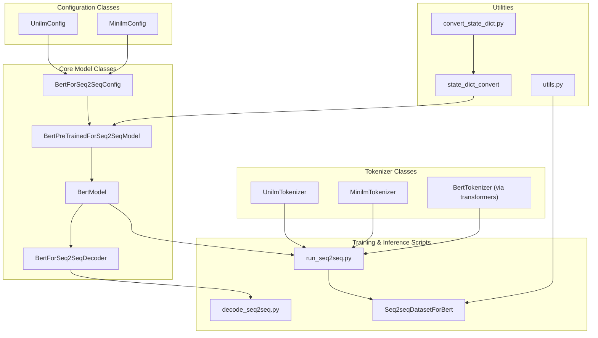
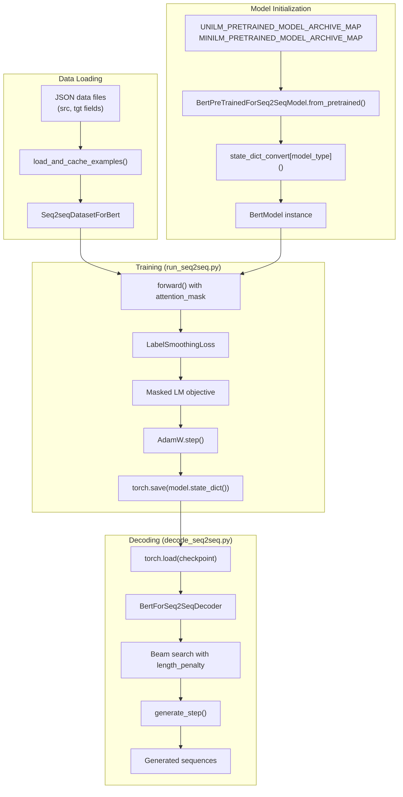
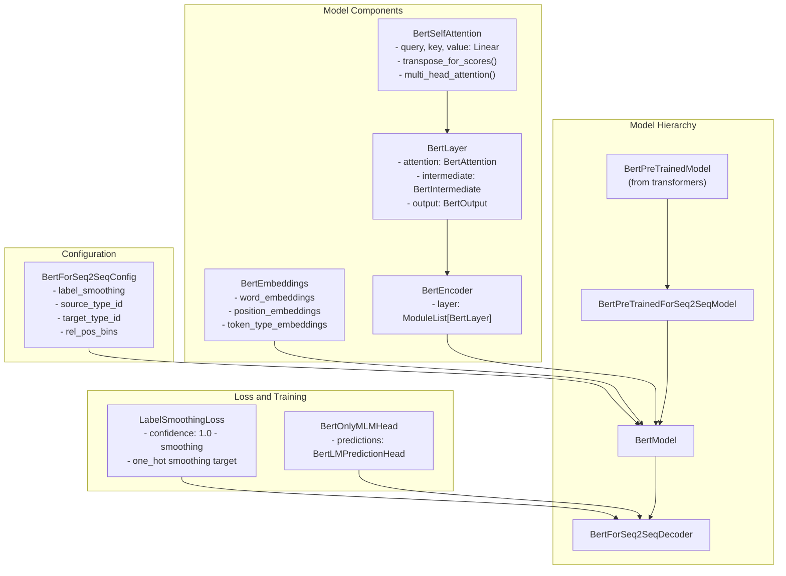
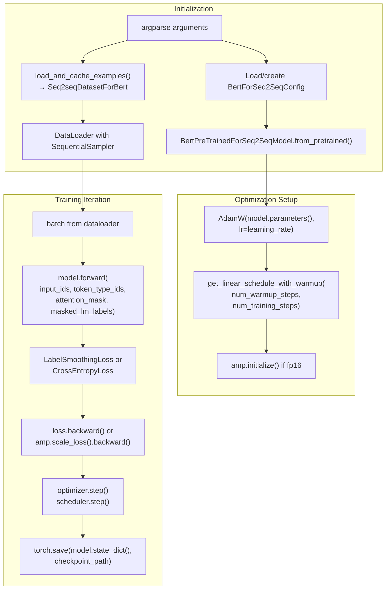
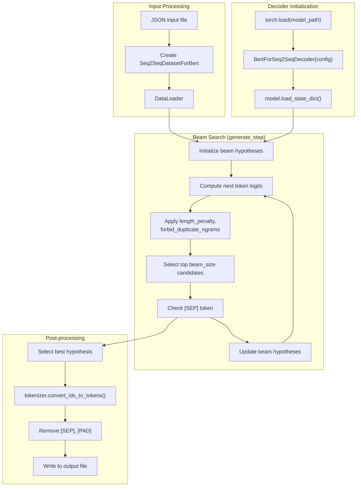

<!-- source: DeepWiki mcp.deepwiki.com · repo microsoft/unilm · page 7.1 s2s-ft: Sequence-to-Sequence Fine-tuning · fetched 2026-10-26 -->

# s2s-ft: Sequence-to-Sequence Fine-tuning

<details>
<summary>Relevant source files</summary>

The following files were used as context for generating this wiki page:

- [s2s-ft/README.md](s2s-ft/README.md)
- [s2s-ft/s2s_ft/configuration_minilm.py](s2s-ft/s2s_ft/configuration_minilm.py)
- [s2s-ft/s2s_ft/configuration_unilm.py](s2s-ft/s2s_ft/configuration_unilm.py)
- [s2s-ft/s2s_ft/modeling.py](s2s-ft/s2s_ft/modeling.py)
- [s2s-ft/s2s_ft/modeling_decoding.py](s2s-ft/s2s_ft/modeling_decoding.py)
- [s2s-ft/s2s_ft/tokenization_minilm.py](s2s-ft/s2s_ft/tokenization_minilm.py)
- [s2s-ft/s2s_ft/tokenization_unilm.py](s2s-ft/s2s_ft/tokenization_unilm.py)
- [unilm-v1/README.md](unilm-v1/README.md)

</details>


## Overview

s2s-ft (Sequence-to-Sequence Fine-Tuning) is a PyTorch package for fine-tuning pre-trained Transformer encoders for sequence-to-sequence language generation tasks. The toolkit adapts encoder-only models (BERT, RoBERTa) and unified models (UniLM, MiniLM) to sequence-to-sequence generation by modifying attention masks and training objectives.

The core implementation extends `BertPreTrainedForSeq2SeqModel` [s2s-ft/s2s_ft/modeling.py:44-161]() with custom configuration through `BertForSeq2SeqConfig` [s2s-ft/s2s_ft/config.py]() and provides specialized decoding through `BertForSeq2SeqDecoder` [s2s-ft/s2s_ft/modeling_decoding.py:703-1362](). The toolkit supports multiple pre-trained model types through model-specific tokenizers and configurations, including `UnilmTokenizer` [s2s-ft/s2s_ft/tokenization_unilm.py:65-82]() and `MinilmTokenizer` [s2s-ft/s2s_ft/tokenization_minilm.py:51-68]().

For information about the broader UniLM family of models that s2s-ft is designed to fine-tune, see page 3.1.

Sources: [s2s-ft/README.md:1-2](), [s2s-ft/s2s_ft/modeling.py:44-161](), [s2s-ft/s2s_ft/modeling_decoding.py:703-1362]()

## Architecture Overview

The s2s-ft toolkit architecture centers on `BertPreTrainedForSeq2SeqModel`, which extends HuggingFace's `BertPreTrainedModel` with sequence-to-sequence capabilities. The system supports multiple pre-trained model families through a unified interface.

### Component Architecture



Sources: [s2s-ft/s2s_ft/modeling.py:44-161](), [s2s-ft/s2s_ft/config.py](), [s2s-ft/s2s_ft/modeling_decoding.py:703-1362](), [s2s-ft/s2s_ft/configuration_unilm.py:48-118](), [s2s-ft/s2s_ft/configuration_minilm.py:41-111]()

## Training and Inference Pipeline

The s2s-ft toolkit implements a complete pipeline from data loading through model evaluation, with distinct components for training and inference.

### Pipeline Components



Sources: [s2s-ft/run_seq2seq.py](), [s2s-ft/decode_seq2seq.py](), [s2s-ft/s2s_ft/modeling.py:78-161](), [s2s-ft/s2s_ft/modeling_decoding.py:703-1362]()

## Model Architecture

The s2s-ft architecture builds on BERT's encoder-only design, adapting it for sequence-to-sequence generation through attention masking and training objectives. The key class hierarchy shows how pre-trained models are converted for seq2seq tasks.

### Class Hierarchy and Components



Sources: [s2s-ft/s2s_ft/modeling.py:44-500](), [s2s-ft/s2s_ft/modeling_decoding.py:30-68](), [s2s-ft/s2s_ft/modeling_decoding.py:212-304](), [s2s-ft/s2s_ft/config.py]()

## Supported Pre-trained Models

s2s-ft supports multiple pre-trained model families through `supported_convert_pretrained_model_archive_map` [s2s-ft/s2s_ft/modeling.py:49-55](). Each model type has associated configuration and tokenizer classes, with checkpoint URLs defined in model archive maps.

| Model Type | Archive Map | Configuration Class | Tokenizer Class | Example Models |
|------------|-------------|---------------------|-----------------|----------------|
| UniLM | `UNILM_PRETRAINED_MODEL_ARCHIVE_MAP` | `UnilmConfig` | `UnilmTokenizer` | unilm1.2-base-uncased, unilm1-base-cased, unilm1-large-cased, unilm2-base-uncased, unilm2-large-cased |
| MiniLM | `MINILM_PRETRAINED_MODEL_ARCHIVE_MAP` | `MinilmConfig` | `MinilmTokenizer` | minilm-l12-h384-uncased |
| BERT | `BERT_PRETRAINED_MODEL_ARCHIVE_MAP` | `BertConfig` (via transformers) | `BertTokenizer` (via transformers) | bert-base-uncased, bert-large-cased |
| RoBERTa | `ROBERTA_PRETRAINED_MODEL_ARCHIVE_MAP` | `RobertaConfig` (via transformers) | `RobertaTokenizer` (via transformers) | roberta-base, roberta-large |
| XLM-RoBERTa | `XLM_ROBERTA_PRETRAINED_MODEL_ARCHIVE_MAP` | `XLMRobertaConfig` (via transformers) | `XLMRobertaTokenizer` (via transformers) | xlm-roberta-base, xlm-roberta-large |
| Electra | `ELECTRA_PRETRAINED_MODEL_ARCHIVE_MAP` | `ElectraConfig` (via transformers) | `ElectraTokenizer` (via transformers) | electra-base, electra-large |

### Model Loading Process

Model loading in `BertPreTrainedForSeq2SeqModel.from_pretrained()` [s2s-ft/s2s_ft/modeling.py:78-161]() follows this process:

1. Check if `model_type` is in `supported_convert_pretrained_model_archive_map`
2. Download checkpoint from Azure blob storage or load from local path
3. Convert state dict using `state_dict_convert[model_type]()` [s2s-ft/s2s_ft/convert_state_dict.py]()
4. Resize position embeddings if `config.max_position_embeddings` differs from checkpoint [s2s-ft/s2s_ft/modeling.py:132-159]()

Sources: [s2s-ft/s2s_ft/modeling.py:29-64](), [s2s-ft/s2s_ft/configuration_unilm.py:36-45](), [s2s-ft/s2s_ft/configuration_minilm.py:36-38](), [s2s-ft/README.md:25-39]()

## Data Format and Processing

s2s-ft processes input data through `load_and_cache_examples()` which automatically detects format based on JSON structure. The data loader creates `Seq2seqDatasetForBert` instances for training and evaluation.

### Supported Data Formats

**Text Format**: Raw text strings in JSON
```json
{"src": "Messages posted on social media claimed the user planned to `` kill as many people as possible ''", "tgt": "Threats to kill pupils in a shooting at a Blackpool school are being investigated by Lancashire police ."}
```

**Tokenized Format**: Pre-tokenized WordPiece tokens
```json
{"src": ["messages", "posted", "on", "social", "media", "claimed", "the", "user", "planned", "to", "\"", "kill", "as", "many", "people", "as", "possible", "\""], "tgt": ["threats", "to", "kill", "pupils", "in", "a", "shooting", "at", "a", "blackpool", "school", "are", "being", "investigated", "by", "lancashire", "police", "."]}
```

### Data Processing Pipeline

The `Seq2seqDatasetForBert` class processes data through the following steps:

1. **Format Detection**: Checks if `src` field is `list` (tokenized) or `str` (text) 
2. **Tokenization**: Applies `tokenizer.tokenize()` if text format, otherwise uses tokens directly
3. **Token ID Conversion**: Converts tokens to IDs via `tokenizer.convert_tokens_to_ids()`
4. **Sequence Construction**:
   - Source: `[CLS] + src_tokens + [SEP]`
   - Target: `tgt_tokens + [SEP]`
5. **Attention Mask Creation**: Generates appropriate mask for source-to-target attention
6. **Feature Caching**: Optionally caches processed features to disk via `cached_train_features_file`

### Token Type IDs

Token type IDs differentiate source and target segments:
- `source_type_id` (default: 0): Applied to source tokens
- `target_type_id` (default: 1): Applied to target tokens

These are configured in `BertForSeq2SeqConfig` [s2s-ft/s2s_ft/config.py]() and used by `UnilmConfig` [s2s-ft/s2s_ft/configuration_unilm.py:90-91]() and `MinilmConfig` [s2s-ft/s2s_ft/configuration_minilm.py:83-84]().

Sources: [s2s-ft/README.md:40-60](), [s2s-ft/s2s_ft/utils.py](), [s2s-ft/s2s_ft/configuration_unilm.py:90-91](), [s2s-ft/s2s_ft/configuration_minilm.py:83-84]()

## Fine-tuning Implementation

The fine-tuning process in `run_seq2seq.py` adapts pre-trained encoders for sequence-to-sequence generation through masked language modeling with customized attention patterns.

### Training Loop Architecture



### Key Training Parameters

The following parameters control the fine-tuning behavior:

| Parameter | Purpose | Typical Values |
|-----------|---------|----------------|
| `--model_type` | Selects model architecture conversion | unilm, minilm, bert, roberta |
| `--model_name_or_path` | Pre-trained checkpoint to load | unilm1.2-base-uncased, minilm-l12-h384-uncased |
| `--max_source_seq_length` | Maximum tokens in source sequence | 464-720 |
| `--max_target_seq_length` | Maximum tokens in target sequence | 48-160 |
| `--label_smoothing` | Label smoothing coefficient | 0.1 (typical) |
| `--mask_way` | Masking strategy (v0/v1/v2) | v2 (pseudo-masking, default) |
| `--target_mask_prob` | Probability of masking target tokens | 0.4-0.8 (task-dependent) |
| `--learning_rate` | AdamW learning rate | 7e-5 (base), 1e-5 to 3e-5 (large) |
| `--num_warmup_steps` | Linear warmup steps | 500-1000 |
| `--num_training_steps` | Total optimization steps | 32000-108000 |
| `--per_gpu_train_batch_size` | Batch size per GPU | 8-16 |
| `--gradient_accumulation_steps` | Gradient accumulation | 1-2 |
| `--fp16` | Mixed precision training | Flag for FP16 |
| `--fp16_opt_level` | Apex optimization level | O2 (recommended) |

### Example Command

```bash
export CUDA_VISIBLE_DEVICES=0,1,2,3
python -m torch.distributed.launch --nproc_per_node=4 run_seq2seq.py \
  --train_file ${TRAIN_FILE} --output_dir ${OUTPUT_DIR} \
  --model_type unilm --model_name_or_path unilm1.2-base-uncased \
  --do_lower_case --fp16 --fp16_opt_level O2 \
  --max_source_seq_length 464 --max_target_seq_length 48 \
  --per_gpu_train_batch_size 16 --gradient_accumulation_steps 1 \
  --learning_rate 7e-5 --num_warmup_steps 500 --num_training_steps 32000 \
  --cache_dir ${CACHE_DIR}
```

**Effective batch size**: `num_gpus × per_gpu_train_batch_size × gradient_accumulation_steps` = 4 × 16 × 1 = 64

Sources: [s2s-ft/run_seq2seq.py](), [s2s-ft/README.md:63-88](), [s2s-ft/s2s_ft/modeling.py:78-161]()

## Decoding Implementation

The decoding implementation in `decode_seq2seq.py` uses `BertForSeq2SeqDecoder` [s2s-ft/s2s_ft/modeling_decoding.py:703-1362]() to generate text through beam search. The decoder performs autoregressive generation with support for length penalties, n-gram blocking, and minimum length constraints.

### Decoder Architecture



### Beam Search Parameters

The `generate_step()` method in `BertForSeq2SeqDecoder` [s2s-ft/s2s_ft/modeling_decoding.py:1055-1362]() implements beam search with the following controls:

| Parameter | Type | Purpose | Default |
|-----------|------|---------|---------|
| `beam_size` | int | Number of beams in beam search | 5 |
| `length_penalty` | float | Length penalty factor (α in formula `score/(len^α)`) | 0.0 |
| `forbid_duplicate_ngrams` | bool | Block repeated n-grams | False |
| `forbid_ignore_word` | str | Tokens to ignore in n-gram blocking | None |
| `ngram_size` | int | N-gram size for blocking | 3 |
| `min_len` | int | Minimum generation length | 1 |
| `mode` | str | Generation mode (s2s/l2r) | s2s |

### Decoding Command

```bash
export CUDA_VISIBLE_DEVICES=0
export OMP_NUM_THREADS=4
export MKL_NUM_THREADS=4

python decode_seq2seq.py \
  --fp16 --model_type unilm --tokenizer_name unilm1.2-base-uncased \
  --input_file ${INPUT_JSON} --split validation --do_lower_case \
  --model_path ${MODEL_PATH} --max_seq_length 512 --max_tgt_length 48 \
  --batch_size 32 --beam_size 5 --length_penalty 0 \
  --forbid_duplicate_ngrams --mode s2s --forbid_ignore_word "."
```

Output is saved to `${MODEL_PATH}.${SPLIT}` with one generated sequence per line.

### Attention Mask Construction

During decoding, the attention mask enables:
- Full attention over source tokens
- Causal (left-to-right) attention over generated target tokens
- Cross-attention from target to source

This is constructed in `BertForSeq2SeqDecoder.forward()` based on `position_ids` and `token_type_ids`.

Sources: [s2s-ft/decode_seq2seq.py](), [s2s-ft/s2s_ft/modeling_decoding.py:703-1362](), [s2s-ft/README.md:89-109]()

## Evaluation and Post-processing

s2s-ft includes evaluation utilities for computing ROUGE scores and post-processing generated sequences. The evaluation pipeline compares model outputs against reference texts using standard metrics.

### Evaluation Scripts

| Script | Task | Metrics | Usage |
|--------|------|---------|-------|
| `evaluations/eval_for_xsum.py` | XSum summarization | ROUGE-1, ROUGE-2, ROUGE-L | `--pred`, `--gold`, `--split` |
| `evaluations/eval_for_cnndm.py` | CNN/DailyMail summarization | ROUGE-1, ROUGE-2, ROUGE-L | `--pred`, `--gold`, `--split`, `--trunc_len` |

### Evaluation Example

```bash
# For XSum
SPLIT=validation
GOLD_PATH=/path/to/${SPLIT}.target
python evaluations/eval_for_xsum.py \
  --pred ${MODEL_PATH}.${SPLIT} \
  --gold ${GOLD_PATH} \
  --split ${SPLIT}

# For CNN/DailyMail (with truncation)
python evaluations/eval_for_cnndm.py \
  --pred ${MODEL_PATH}.${SPLIT} \
  --gold ${GOLD_PATH} \
  --split ${SPLIT} \
  --trunc_len 160
```

### Post-processing with Length Penalty Reranking

The `gen_seq_from_trace.py` script reranks beam search outputs by applying length penalties post-hoc:

```bash
python gen_seq_from_trace.py \
  --bert_model bert-large-cased \
  --alpha 0.6 \
  --input ${MODEL_RECOVER_PATH}.${EVAL_SPLIT}
```

This creates output file `${MODEL_RECOVER_PATH}.${EVAL_SPLIT}.alp${alpha}` with reranked sequences.

**Length penalty formula**: `score / (length ^ alpha)`
- `alpha = 0.0`: No penalty (default during decoding)
- `alpha = 0.6`: Moderate penalty (XSum)
- `alpha = 1.0`: Linear penalty (CNN/DailyMail)

### ROUGE Evaluation

The evaluation scripts use the `pyrouge` wrapper for ROUGE-1.5.5:
- **ROUGE-1**: Unigram overlap
- **ROUGE-2**: Bigram overlap  
- **ROUGE-L**: Longest common subsequence

Output format includes F-scores for each metric and averaged results.

Sources: [s2s-ft/README.md:111-120](), [s2s-ft/evaluations/](), [s2s-ft/gen_seq_from_trace.py]()

## Masking Strategies

s2s-ft implements three masking strategies controlled by `--mask_way` parameter. The masking approach determines how target tokens are masked during training, affecting the model's ability to learn sequence-to-sequence generation.

### Masking Strategy Details

| Strategy | Value | Description | Implementation |
|----------|-------|-------------|----------------|
| Position Shift | `v0` | Position-based masking with shifted positions | Legacy approach |
| Masked LM | `v1` | Standard BERT-style masking on target | Randomly mask target tokens |
| Pseudo-Masking | `v2` | Pseudo-masking (default, recommended) | Mask probabilities without actual masking |

### Target Masking Probability

The `--target_mask_prob` parameter controls masking density in target sequences:

| Dataset | Recommended Value | Rationale |
|---------|-------------------|-----------|
| XSum | 0.4 - 0.5 | Shorter summaries, less aggressive masking |
| CNN/DailyMail | 0.7 - 0.8 | Longer summaries, more aggressive masking |
| Question Generation | 0.7 | Moderate length outputs |

### Masking Implementation

The masking is applied in `Seq2seqDatasetForBert` during feature creation. For pseudo-masking (v2):

1. Calculate masking probability for each target token
2. Create `masked_lm_labels` tensor with token IDs
3. Set non-masked positions to `-1` (ignored in loss computation)
4. Apply `LabelSmoothingLoss` if `config.label_smoothing > 0`

The pseudo-masking approach allows the model to see full context during training while still learning to predict target tokens probabilistically.

Sources: [s2s-ft/run_seq2seq.py](), [s2s-ft/s2s_ft/utils.py](), [s2s-ft/README.md:338-359]()

## Task-Specific Configurations

s2s-ft provides task-specific configurations for different sequence-to-sequence tasks. The hyperparameters are tuned for optimal performance on benchmark datasets.

### XSum Summarization

**Task**: Extreme summarization (article → single sentence)

**Configuration**:
```bash
# Fine-tuning with unilm1.2-base-uncased
python -m torch.distributed.launch --nproc_per_node=4 run_seq2seq.py \
  --train_file ${TRAIN_FILE} --output_dir ${OUTPUT_DIR} \
  --model_type unilm --model_name_or_path unilm1.2-base-uncased \
  --do_lower_case --fp16 --fp16_opt_level O2 \
  --max_source_seq_length 464 --max_target_seq_length 48 \
  --per_gpu_train_batch_size 16 --gradient_accumulation_steps 1 \
  --learning_rate 7e-5 --num_warmup_steps 500 --num_training_steps 32000 \
  --cache_dir ${CACHE_DIR}

# Decoding
python decode_seq2seq.py \
  --fp16 --model_type unilm --tokenizer_name unilm1.2-base-uncased \
  --input_file ${INPUT_JSON} --split validation --do_lower_case \
  --model_path ${MODEL_PATH} --max_seq_length 512 --max_tgt_length 48 \
  --batch_size 32 --beam_size 5 --length_penalty 0 \
  --forbid_duplicate_ngrams --mode s2s --forbid_ignore_word "."
```

**Data**: [Text format](https://conversationhub.blob.core.windows.net/beit-share-public/s2s-ft-data/xsum.json.zip) | [Tokenized format](https://conversationhub.blob.core.windows.net/beit-share-public/s2s-ft-data/xsum.uncased_tokenized.zip)

### CNN/Daily Mail Summarization

**Task**: Multi-sentence abstractive summarization

**Configuration**:
```bash
# Fine-tuning with unilm1.2-base-uncased
python -m torch.distributed.launch --nproc_per_node=4 run_seq2seq.py \
  --train_file ${TRAIN_FILE} --output_dir ${OUTPUT_DIR} \
  --model_type unilm --model_name_or_path unilm1.2-base-uncased \
  --do_lower_case --fp16 --fp16_opt_level O2 \
  --max_source_seq_length 608 --max_target_seq_length 160 \
  --per_gpu_train_batch_size 8 --gradient_accumulation_steps 2 \
  --learning_rate 7e-5 --num_warmup_steps 1000 --num_training_steps 45000 \
  --cache_dir ${CACHE_DIR} --save_steps 1500

# Decoding with minimum length
python decode_seq2seq.py \
  --fp16 --model_type unilm --tokenizer_name unilm1.2-base-uncased \
  --input_file ${INPUT_JSON} --split dev --do_lower_case \
  --model_path ${MODEL_PATH} --max_seq_length 768 --max_tgt_length 160 \
  --batch_size 32 --beam_size 5 --length_penalty 0 \
  --forbid_duplicate_ngrams --mode s2s --forbid_ignore_word "." --min_len 48
```

**Data**: [Tokenized format](https://conversationhub.blob.core.windows.net/beit-share-public/s2s-ft-data/cnndm.uncased_tokenized.zip)

### MiniLM Fine-tuning

**Using smaller models for faster inference**:

```bash
# Fine-tuning with minilm-l12-h384-uncased
python -m torch.distributed.launch --nproc_per_node=4 run_seq2seq.py \
  --train_file ${TRAIN_FILE} --output_dir ${OUTPUT_DIR} \
  --model_type minilm --model_name_or_path minilm-l12-h384-uncased \
  --do_lower_case --fp16 --fp16_opt_level O2 \
  --max_source_seq_length 464 --max_target_seq_length 48 \
  --per_gpu_train_batch_size 16 --gradient_accumulation_steps 1 \
  --learning_rate 1e-4 --num_warmup_steps 500 --num_training_steps 108000 \
  --cache_dir ${CACHE_DIR}
```

**Note**: MiniLM requires higher learning rates (1e-4) and more training steps compared to UniLM base models.

Sources: [s2s-ft/README.md:63-180](), [s2s-ft/README.md:246-301](), [s2s-ft/README.md:123-180]()

## Advanced Features

### Mixed Precision Training with Apex

s2s-ft integrates NVIDIA Apex for FP16 mixed precision training [s2s-ft/run_seq2seq.py]():

```bash
--fp16 --fp16_opt_level O2
```

**Implementation**:
1. Model and optimizer wrapped with `amp.initialize()` 
2. Loss scaling handled automatically by Apex
3. Backward pass uses `scaled_loss.backward()` instead of `loss.backward()`

**Benefits**:
- ~2x speedup on V100/A100 GPUs
- ~50% memory reduction
- Maintains model accuracy with O2 optimization level

**Requirements**: Install Apex from source [s2s-ft/README.md:11-16]()
```bash
git clone https://github.com/NVIDIA/apex.git
cd apex
git reset --hard de6378f5dae8fcf2879a4be8ecea8bbcb9e59d5
python setup.py install --cuda_ext --cpp_ext
```

### Distributed Training

Multi-GPU training via PyTorch DistributedDataParallel:

```bash
export CUDA_VISIBLE_DEVICES=0,1,2,3
python -m torch.distributed.launch --nproc_per_node=4 run_seq2seq.py
```

**Effective batch size formula**:
```
total_batch_size = num_gpus × per_gpu_train_batch_size × gradient_accumulation_steps
```

Example: 4 GPUs × 16 per-GPU × 1 accumulation = 64 total batch size

### Position Embedding Resizing

The toolkit automatically resizes position embeddings when `max_position_embeddings` differs from checkpoint [s2s-ft/s2s_ft/modeling.py:132-159]():

**Expansion**: Copy and repeat existing embeddings
```python
# Copies embeddings cyclically to fill new positions
new_postion_embedding.data[shift: shift + delta, :] = state_dict[_k][:delta, :]
```

**Truncation**: Simply slice to new size

This enables fine-tuning models on longer sequences than pre-training length.

### UniLM v2 Target Masking

UniLM v2 models support target segment word drop via `--target_mask_prob` [s2s-ft/README.md:338-359]():

```bash
--target_mask_prob 0.4  # For XSum
--target_mask_prob 0.7  # For CNN/DailyMail
```

This parameter controls the probability of masking tokens in the target sequence during training, with task-specific recommendations based on output length characteristics.

Sources: [s2s-ft/README.md:11-16](), [s2s-ft/run_seq2seq.py](), [s2s-ft/s2s_ft/modeling.py:132-159](), [s2s-ft/README.md:338-359]()

## Citation

If you find s2s-ft useful in your work, you should cite the following paper:

```
@article{s2s-ft,
      title={s2s-ft: Fine-Tuning Pretrained Transformer Encoders for Sequence-to-Sequence Learning}, 
      author={Hangbo Bao and Li Dong and Wenhui Wang and Nan Yang and Furu Wei},
      year={2021},
      eprint={2110.13640},
      archivePrefix={arXiv},
      primaryClass={cs.CV}
}
```

Sources: [s2s-ft/README.md:303-315](https://github.com/microsoft/unilm/blob/master/s2s-ft/README.md)

---

