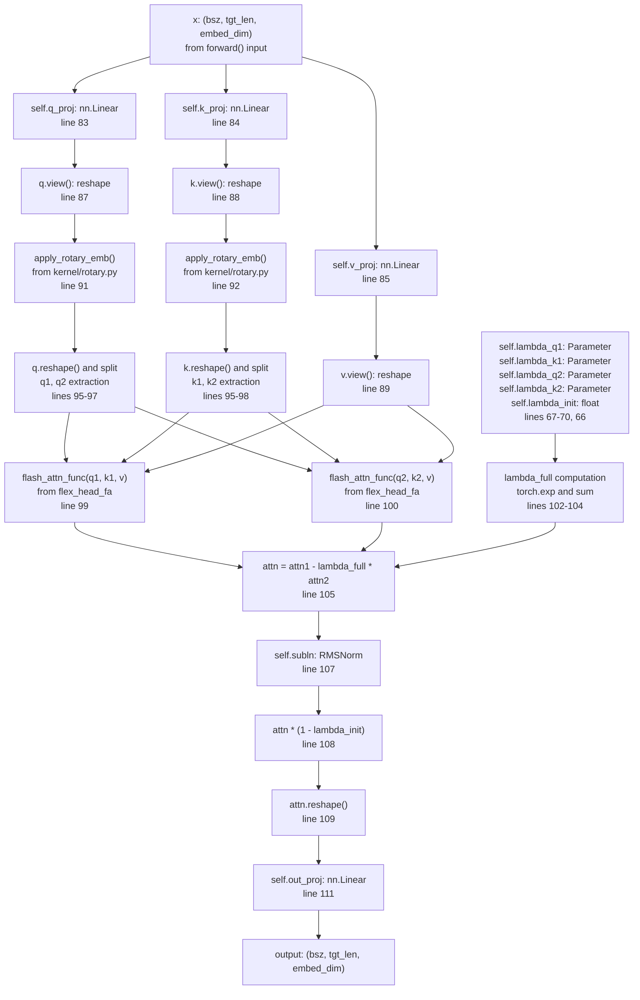
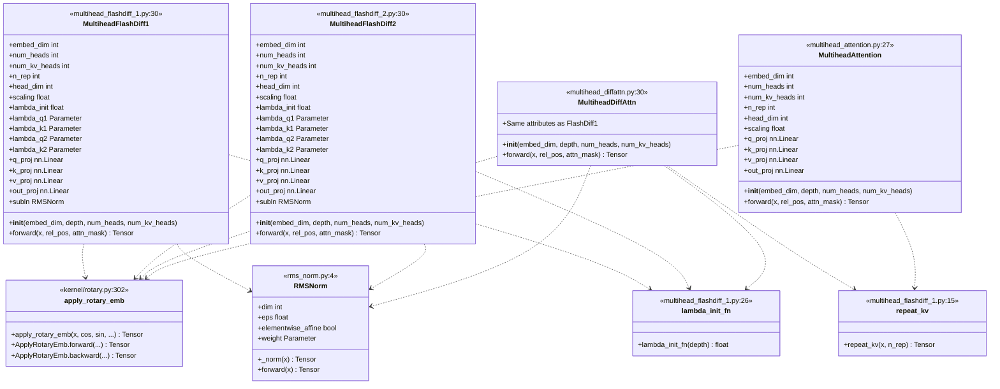
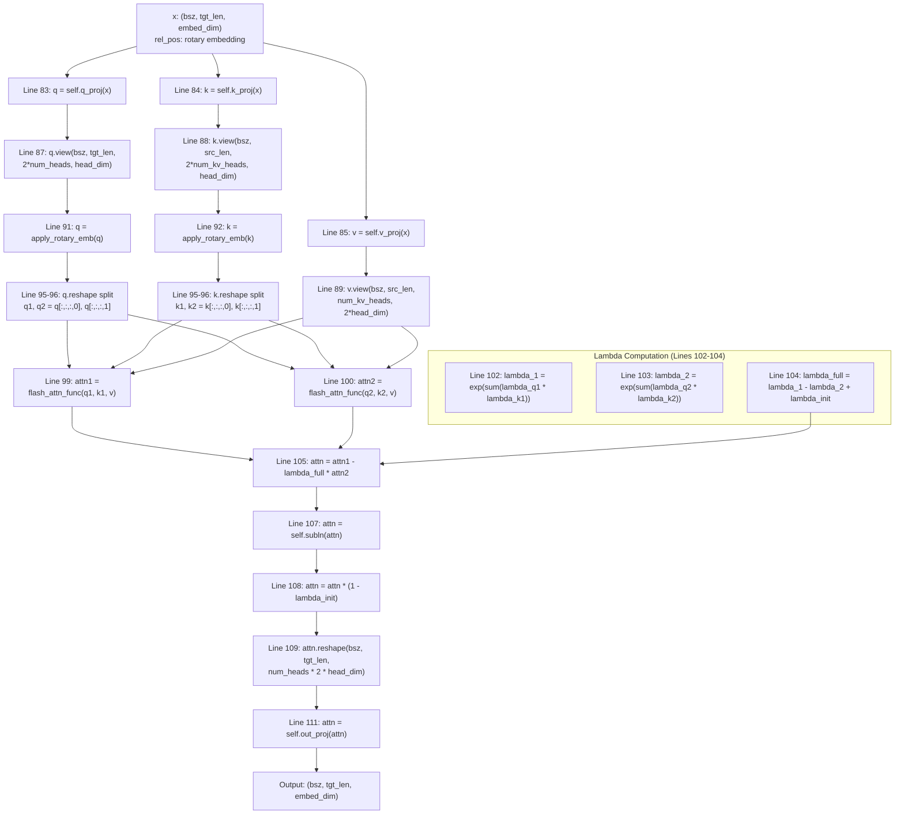
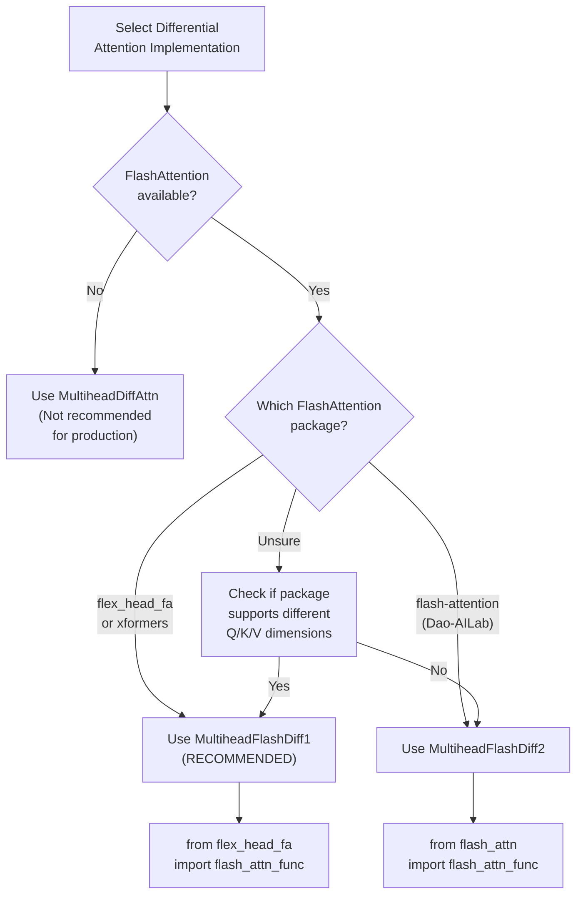

<!-- source: DeepWiki mcp.deepwiki.com · repo microsoft/unilm · page 7.2 Diff-Transformer: Differential Attention · fetched 2026-10-26 -->

# Diff-Transformer: Differential Attention

<details>
<summary>Relevant source files</summary>

The following files were used as context for generating this wiki page:

- [Diff-Transformer/README.md](Diff-Transformer/README.md)
- [Diff-Transformer/example.py](Diff-Transformer/example.py)
- [Diff-Transformer/imgs/code_highlight.png](Diff-Transformer/imgs/code_highlight.png)
- [Diff-Transformer/kernel/rotary.py](Diff-Transformer/kernel/rotary.py)
- [Diff-Transformer/multihead_attention.py](Diff-Transformer/multihead_attention.py)
- [Diff-Transformer/multihead_diffattn.py](Diff-Transformer/multihead_diffattn.py)
- [Diff-Transformer/multihead_flashdiff_1.py](Diff-Transformer/multihead_flashdiff_1.py)
- [Diff-Transformer/multihead_flashdiff_2.py](Diff-Transformer/multihead_flashdiff_2.py)
- [Diff-Transformer/rms_norm.py](Diff-Transformer/rms_norm.py)

</details>


Diff-Transformer implements a differential attention mechanism that computes weighted differences between paired attention patterns. The mechanism uses half the number of attention heads compared to standard Transformers (e.g., 8 heads vs. 16 heads) while maintaining parameter parity through doubled head dimensions. The implementation is located in [Diff-Transformer/]() and provides three variants: `MultiheadFlashDiff1`, `MultiheadFlashDiff2`, and `MultiheadDiffAttn`.

## Overview of Differential Attention

Differential Attention restructures the attention mechanism by computing N/2 pairs of attention heads instead of N independent heads. Each head has dimension `embed_dim // num_heads // 2` (double the standard head dimension), maintaining parameter parity with standard multi-head attention.

The differential attention formula for attention patterns A₁ and A₂ is:
```
DiffAttn = A₁ - λ × A₂
```
where λ is computed from learnable parameters `lambda_q1`, `lambda_k1`, `lambda_q2`, `lambda_k2` (each of shape `[head_dim]`) and a depth-dependent initialization `lambda_init` defined by `lambda_init_fn(depth)` at [Diff-Transformer/multihead_flashdiff_1.py:26-27]().

**High-Level Differential Attention Flow (MultiheadFlashDiff1)**



Sources: [Diff-Transformer/multihead_flashdiff_1.py:74-112](), [Diff-Transformer/multihead_flashdiff_1.py:30-72]()

## Key Features and Parameter Efficiency

### Half-Head Configuration

Diff-Transformer achieves parameter efficiency through a half-head configuration with doubled head dimensions:

| Configuration | Diff-Transformer | Standard Transformer | Notes |
|---------------|------------------|----------------------|-------|
| Attention Heads | `num_heads = n` | `num_heads = 2n` | Half the head count |
| KV Heads (with GQA) | `num_kv_heads = m` | `num_kv_heads = 2m` | Half the KV head count |
| Head Dimension | `embed_dim // num_heads // 2` | `embed_dim // num_heads` | Double per-head dimension |
| Total Parameters | ~Equal | ~Equal | Parameter parity maintained |

**Example Configuration**:
- Diff-Transformer: `embed_dim=1024, num_heads=8` → `head_dim=64` 
- Standard Transformer: `embed_dim=1024, num_heads=16` → `head_dim=64`
- Both configurations maintain similar parameter counts and performance

Sources: [Diff-Transformer/multihead_flashdiff_1.py:56-57](), [Diff-Transformer/example.py:6-11](), [Diff-Transformer/README.md:19-20]()

### Core Architectural Features

1. **Learned Differential Weighting**: Four learnable parameter vectors (`lambda_q1`, `lambda_k1`, `lambda_q2`, `lambda_k2`) per layer compute the weighting coefficient `lambda_full` that determines the differential combination of attention patterns.

2. **Depth-Dependent Initialization**: Lambda initialization follows `lambda_init_fn(depth) = 0.8 - 0.6 * exp(-0.3 * depth)`, causing deeper layers to have stronger differential effects.

3. **FlashAttention Integration**: Three implementation variants optimize for different FlashAttention packages:
   - `MultiheadFlashDiff1`: Supports different Q/K/V dimensions (recommended)
   - `MultiheadFlashDiff2`: Standard Q/K/V dimensions
   - `MultiheadDiffAttn`: Naive implementation without FlashAttention

4. **Grouped Query Attention (GQA) Support**: Compatible with GQA through `num_kv_heads` parameter, maintaining the half-head configuration for KV heads.

Sources: [Diff-Transformer/multihead_flashdiff_1.py:26-27](), [Diff-Transformer/multihead_flashdiff_1.py:62-71](), [Diff-Transformer/README.md:8-12]()

## Architecture and Implementation

### Module Structure and Code Entities



Sources: [Diff-Transformer/multihead_flashdiff_1.py:30-113](), [Diff-Transformer/multihead_flashdiff_2.py:30-119](), [Diff-Transformer/multihead_diffattn.py:30-122](), [Diff-Transformer/multihead_attention.py:27-96](), [Diff-Transformer/kernel/rotary.py:302-332](), [Diff-Transformer/rms_norm.py:4-26]()

### Implementation Variants

Three implementations are provided in [Diff-Transformer/]():

| Implementation | File | FlashAttention | Q/K/V Dimension Support | Import Statement |
|----------------|------|----------------|-------------------------|------------------|
| `MultiheadFlashDiff1` | `multihead_flashdiff_1.py` | Yes | Different Q/K/V dims | `from flex_head_fa import flash_attn_func` (line 7) |
| `MultiheadFlashDiff2` | `multihead_flashdiff_2.py` | Yes | Standard Q/K/V dims | `from flash_attn import flash_attn_func` (line 7) |
| `MultiheadDiffAttn` | `multihead_diffattn.py` | No | N/A | Uses standard `torch.matmul` and `F.softmax` |

**FlashAttention Package Requirements**:
- `MultiheadFlashDiff1`: Requires `flex_head_fa` package ([https://aka.ms/flash-diff]()) or `xformers`. Recommended for production use.
- `MultiheadFlashDiff2`: Works with `flash-attention` package from Dao-AILab ([https://github.com/Dao-AILab/flash-attention]()).
- `MultiheadDiffAttn`: No external dependencies. Not recommended for production due to performance.

Sources: [Diff-Transformer/README.md:8-12](), [Diff-Transformer/multihead_flashdiff_1.py:7](), [Diff-Transformer/multihead_flashdiff_1.py:30-36](), [Diff-Transformer/multihead_flashdiff_2.py:7](), [Diff-Transformer/multihead_flashdiff_2.py:30-34]()

### Constructor Parameters

**Required Parameters**:
- `embed_dim` (int): Input/output embedding dimension
- `depth` (int): Current layer index (0-indexed), used for `lambda_init_fn(depth)`
- `num_heads` (int): Number of attention head pairs (half of baseline Transformer's head count)

**Optional Parameters**:
- `num_kv_heads` (int, optional): Number of KV head pairs for GQA. If `None`, uses Multi-Head Attention (MHA) with `num_kv_heads = num_heads`

**Derived Attributes**:
- `head_dim = embed_dim // num_heads // 2`: Per-head dimension (doubled compared to standard attention)
- `n_rep = num_heads // num_kv_heads`: KV head repetition factor for GQA
- `lambda_init = lambda_init_fn(depth)`: Depth-dependent initialization constant

**Learnable Parameters** (per layer):
- `lambda_q1, lambda_k1, lambda_q2, lambda_k2`: Vectors of shape `[head_dim]` initialized from N(0, 0.1)
- `q_proj, k_proj, v_proj, out_proj`: Linear projection weights (no bias)
- `subln`: RMSNorm layer with learnable scale parameter

Sources: [Diff-Transformer/multihead_flashdiff_1.py:36-72](), [Diff-Transformer/multihead_diffattn.py:31-67]()

### Lambda Initialization and Computation

**Depth-Dependent Initialization**:

The `lambda_init` parameter is computed from layer depth using:
```python
def lambda_init_fn(depth):
    return 0.8 - 0.6 * math.exp(-0.3 * depth)
```

This creates a depth-dependent initialization profile:
- Layer 0: `lambda_init ≈ 0.20`
- Layer 5: `lambda_init ≈ 0.67`
- Layer 10+: `lambda_init → 0.80`

**Runtime Lambda Computation**:

During forward pass, the final weighting coefficient is computed as:
```python
lambda_1 = torch.exp(torch.sum(self.lambda_q1 * self.lambda_k1, dim=-1).float())
lambda_2 = torch.exp(torch.sum(self.lambda_q2 * self.lambda_k2, dim=-1).float())
lambda_full = lambda_1 - lambda_2 + self.lambda_init
```

This allows the model to learn head-specific differential weights that modulate around the depth-based initialization.

Sources: [Diff-Transformer/multihead_flashdiff_1.py:26-27](), [Diff-Transformer/multihead_flashdiff_1.py:102-104](), [Diff-Transformer/multihead_diffattn.py:109-111]()

## Forward Pass Computation Flow

**Detailed Forward Pass with Code References**



Sources: [Diff-Transformer/multihead_flashdiff_1.py:74-112]()

### Step-by-Step Computation

**1. Linear Projections** [lines 83-85]():
```python
q = self.q_proj(x)  # (bsz, tgt_len, embed_dim)
k = self.k_proj(x)  # (bsz, src_len, embed_dim // n_rep)
v = self.v_proj(x)  # (bsz, src_len, embed_dim // n_rep)
```

**2. Reshape to Multi-Head Format** [lines 87-89]():
```python
q = q.view(bsz, tgt_len, 2 * self.num_heads, self.head_dim)
k = k.view(bsz, src_len, 2 * self.num_kv_heads, self.head_dim)
v = v.view(bsz, src_len, self.num_kv_heads, 2 * self.head_dim)
```
Note: Q/K are split into `2*num_heads`/`2*num_kv_heads` with `head_dim`, while V has `num_kv_heads` with `2*head_dim`.

**3. Apply Rotary Position Embeddings** [lines 91-92]():
```python
q = apply_rotary_emb(q, *rel_pos, interleaved=True)
k = apply_rotary_emb(k, *rel_pos, interleaved=True)
```

**4. Split into Attention Pairs** [lines 95-98]():
```python
q = q.reshape(bsz, tgt_len, self.num_heads, 2, self.head_dim)
k = k.reshape(bsz, src_len, self.num_kv_heads, 2, self.head_dim)
q1, q2 = q[:, :, :, 0], q[:, :, :, 1]
k1, k2 = k[:, :, :, 0], k[:, :, :, 1]
```

**5. Compute Dual Attention Patterns** [lines 99-100]():
```python
attn1 = flash_attn_func(q1, k1, v, causal=True)
attn2 = flash_attn_func(q2, k2, v, causal=True)
```

**6. Compute Differential Weighting** [lines 102-105]():
```python
lambda_1 = torch.exp(torch.sum(self.lambda_q1 * self.lambda_k1, dim=-1))
lambda_2 = torch.exp(torch.sum(self.lambda_q2 * self.lambda_k2, dim=-1))
lambda_full = lambda_1 - lambda_2 + self.lambda_init
attn = attn1 - lambda_full * attn2
```

**7. Normalize and Scale** [lines 107-109]():
```python
attn = self.subln(attn)  # RMSNorm
attn = attn * (1 - self.lambda_init)  # Residual scaling
attn = attn.reshape(bsz, tgt_len, self.num_heads * 2 * self.head_dim)
```

**8. Output Projection** [line 111]():
```python
attn = self.out_proj(attn)  # Back to (bsz, tgt_len, embed_dim)
```

Sources: [Diff-Transformer/multihead_flashdiff_1.py:83-112]()

## FlashAttention Implementation Strategies

### Strategy 1: Different Q/K/V Dimensions (MultiheadFlashDiff1)

**Recommended Implementation** - Optimized for packages supporting different Q/K/V head dimensions.

**Key Insight**: V has dimension `2*head_dim` while Q/K have dimension `head_dim`, allowing a single FlashAttention call per attention pair.

```python
# multihead_flashdiff_1.py, lines 88-89
k = k.view(bsz, src_len, 2 * self.num_kv_heads, self.head_dim)
v = v.view(bsz, src_len, self.num_kv_heads, 2 * self.head_dim)

# lines 99-100
attn1 = flash_attn_func(q1, k1, v, causal=True)  # v: (num_kv_heads, 2*head_dim)
attn2 = flash_attn_func(q2, k2, v, causal=True)  # Same v for both
```

**Advantages**:
- Two FlashAttention calls total
- Minimal memory overhead
- Works with `flex_head_fa` and `xformers`

Sources: [Diff-Transformer/multihead_flashdiff_1.py:88-100](), [Diff-Transformer/README.md:10]()

### Strategy 2: Standard Q/K/V Dimensions (MultiheadFlashDiff2)

**Alternative Implementation** - For standard FlashAttention packages requiring matching Q/K/V dimensions.

**Approach**: Split V into two halves and compute attention separately, then concatenate.

```python
# multihead_flashdiff_2.py, lines 88, 98
v = v.view(bsz, src_len, self.num_kv_heads, 2, self.head_dim)
v1, v2 = v[:, :, :, 0], v[:, :, :, 1]

# lines 100-106
attn11 = flash_attn_func(q1, k1, v1, causal=True)
attn12 = flash_attn_func(q1, k1, v2, causal=True)
attn1 = torch.cat([attn11, attn12], dim=-1)

attn21 = flash_attn_func(q2, k2, v1, causal=True)
attn22 = flash_attn_func(q2, k2, v2, causal=True)
attn2 = torch.cat([attn21, attn22], dim=-1)
```

**Trade-offs**:
- Four FlashAttention calls (2x overhead)
- Compatible with `flash-attention` package
- Additional concatenation operations

Sources: [Diff-Transformer/multihead_flashdiff_2.py:88-106](), [Diff-Transformer/README.md:12]()

### Strategy 3: Naive Implementation (MultiheadDiffAttn)

**Educational Implementation** - Standard softmax attention without FlashAttention.

```python
# multihead_diffattn.py, lines 94, 104-113
q *= self.scaling
attn_weights = torch.matmul(q, k.transpose(-1, -2))
attn_weights += attn_mask
attn_weights = F.softmax(attn_weights, dim=-1)

# Differential computation
lambda_full = lambda_1 - lambda_2 + self.lambda_init
attn_weights = attn_weights.view(bsz, self.num_heads, 2, tgt_len, src_len)
attn_weights = attn_weights[:, :, 0] - lambda_full * attn_weights[:, :, 1]
attn = torch.matmul(attn_weights, v)
```

**Limitations**:
- Significantly slower than FlashAttention variants
- Higher memory consumption for attention weights
- Not recommended for production use

Sources: [Diff-Transformer/multihead_diffattn.py:90-115]()

### Implementation Comparison Table

| Feature | MultiheadFlashDiff1 | MultiheadFlashDiff2 | MultiheadDiffAttn |
|---------|---------------------|---------------------|-------------------|
| FlashAttention calls | 2 | 4 | 0 |
| Memory efficiency | Highest | High | Low |
| Speed | Fastest | Fast | Slow |
| Package requirement | flex_head_fa/xformers | flash-attention | None |
| Production-ready | ✓ | ✓ | ✗ |

Sources: [Diff-Transformer/README.md:8-12]()

## Comparison with Standard Multi-Head Attention

### Architectural Comparison Diagram

```mermaid
flowchart TB
    subgraph StandardMHA["Standard Multi-Head Attention (16 heads)"]
        S_In["x: (B, L, 1024)"] --> S_Q["self.q_proj<br/>→ (B, L, 1024)"]
        S_In --> S_K["self.k_proj<br/>→ (B, L, 1024)"]
        S_In --> S_V["self.v_proj<br/>→ (B, L, 1024)"]
        
        S_Q --> S_Split["Split 16 heads<br/>(B, L, 16, 64)"]
        S_K --> S_Split
        S_V --> S_Split
        
        S_Split --> S_Attn["flash_attn_func<br/>or standard attention"]
        S_Attn --> S_Concat["Concatenate heads<br/>(B, L, 1024)"]
        S_Concat --> S_Out["self.out_proj<br/>→ (B, L, 1024)"]
    end
    
    subgraph DiffAttn["Differential Attention (8 head pairs)"]
        D_In["x: (B, L, 1024)"] --> D_Q["self.q_proj<br/>→ (B, L, 1024)"]
        D_In --> D_K["self.k_proj<br/>→ (B, L, 1024)"]
        D_In --> D_V["self.v_proj<br/>→ (B, L, 1024)"]
        
        D_Q --> D_QSplit["Split 2×8 heads<br/>(B, L, 16, 32)"]
        D_K --> D_KSplit["Split 2×8 heads<br/>(B, L, 16, 32)"]
        D_V --> D_VSplit["Split 8 heads<br/>(B, L, 8, 64)"]
        
        D_QSplit --> D_Pair["Pair heads<br/>q1,q2 / k1,k2"]
        D_KSplit --> D_Pair
        
        D_Pair --> D_Attn1["flash_attn_func(q1,k1,v)"]
        D_Pair --> D_Attn2["flash_attn_func(q2,k2,v)"]
        D_VSplit --> D_Attn1
        D_VSplit --> D_Attn2
        
        D_Attn1 --> D_Diff["attn1 - λ*attn2"]
        D_Attn2 --> D_Diff
        D_Diff --> D_Norm["SubLN + Scale"]
        D_Norm --> D_Out["self.out_proj<br/>→ (B, L, 1024)"]
    end
```



Sources: [Diff-Transformer/multihead_attention.py:27-96](), [Diff-Transformer/multihead_flashdiff_1.py:30-113]()

### Quantitative Comparison

**Configuration Example** (embed_dim=1024):

| Aspect | Standard MHA | Differential Attention |
|--------|-------------|------------------------|
| `num_heads` | 16 | 8 |
| `head_dim` | 64 | 32 |
| Effective heads | 16 independent | 8 paired (16 internal) |
| `q_proj` params | 1024 × 1024 | 1024 × 1024 |
| `k_proj` params | 1024 × 1024 | 1024 × 1024 |
| `v_proj` params | 1024 × 1024 | 1024 × 1024 |
| `out_proj` params | 1024 × 1024 | 1024 × 1024 |
| Lambda params | 0 | 4 × 32 = 128 |
| SubLN params | 0 | 64 (RMSNorm) |
| **Total params** | ~4.2M | ~4.2M + 192 |

**Code verification**:
```python
# example.py, lines 6-11
diff_attn_mha = MultiheadDiffAttn(embed_dim=1024, depth=0, num_heads=8)
attn_mha = MultiheadAttention(embed_dim=1024, depth=0, num_heads=16)
# Both have approximately equal parameter counts
```

Sources: [Diff-Transformer/example.py:6-11](), [Diff-Transformer/multihead_flashdiff_1.py:60-72](), [Diff-Transformer/multihead_attention.py:46-49]()

### Grouped Query Attention (GQA) Comparison

**Configuration Example** (embed_dim=1024, GQA):

| Configuration | Diff-Transformer | Standard Transformer |
|---------------|------------------|----------------------|
| Constructor | `MultiheadDiffAttn(1024, 0, 8, 4)` | `MultiheadAttention(1024, 0, 16, 8)` |
| Q heads | 8 pairs (16 internal) | 16 |
| KV heads | 4 pairs (8 internal) | 8 |
| `n_rep` ratio | 2 | 2 |
| `k_proj` size | 1024 → 512 | 1024 → 512 |
| `v_proj` size | 1024 → 512 | 1024 → 512 |

Sources: [Diff-Transformer/example.py:14-19](), [Diff-Transformer/multihead_flashdiff_1.py:54-62]()

### Key Architectural Differences

1. **Attention Computation**: 
   - Standard: N independent attention heads
   - Differential: N/2 pairs of attention heads with learned differential weighting

2. **Head Pairing**:
   - Standard: Each head operates independently
   - Differential: Heads are paired; output is weighted difference of paired attention patterns

3. **Normalization**:
   - Standard: Typically uses LayerNorm after attention block
   - Differential: Uses RMSNorm (`subln`) within attention mechanism on concatenated head outputs

4. **Additional Learnable Parameters**:
   - Standard: Only projection matrices
   - Differential: Adds lambda parameters (4 vectors per layer) for differential weighting

Sources: [Diff-Transformer/multihead_attention.py:90-95](), [Diff-Transformer/multihead_flashdiff_1.py:102-109]()

## Usage Guidelines and Best Practices

### Head Count Recommendations

**Minimum Configuration**:
- Use at least `num_heads=8` in Diff-Transformer (equivalent to 16 heads in baseline)
- Rationale: The paper's minimum tested configuration uses 8 head pairs
- Lower head counts may degrade performance due to limited capacity for differential patterns

**Scaling Strategy**:
```python
# For a baseline Transformer with N heads:
baseline_config = {"embed_dim": 1024, "num_heads": 16}

# Configure Diff-Transformer with N/2 heads:
diff_config = {"embed_dim": 1024, "num_heads": 8, "depth": layer_idx}

# Verify parameter parity:
assert baseline_num_params ≈ diff_num_params
```

Sources: [Diff-Transformer/README.md:19-20]()

### Implementation Selection Decision Tree



Sources: [Diff-Transformer/README.md:8-12](), [Diff-Transformer/multihead_flashdiff_1.py:7](), [Diff-Transformer/multihead_flashdiff_2.py:7]()

### Configuration Patterns

**Multi-Head Attention (MHA)**:
```python
# Standard Transformer baseline
baseline = MultiheadAttention(
    embed_dim=1024,
    depth=layer_idx,
    num_heads=16,
    num_kv_heads=None  # MHA: num_kv_heads = num_heads
)

# Equivalent Diff-Transformer
diff_attn = MultiheadFlashDiff1(
    embed_dim=1024,
    depth=layer_idx,
    num_heads=8,        # Half the heads
    num_kv_heads=None   # MHA mode
)
```

**Grouped Query Attention (GQA)**:
```python
# Standard Transformer with GQA
baseline_gqa = MultiheadAttention(
    embed_dim=1024,
    depth=layer_idx,
    num_heads=16,
    num_kv_heads=8      # GQA: 16 Q heads, 8 KV heads
)

# Equivalent Diff-Transformer with GQA
diff_attn_gqa = MultiheadFlashDiff1(
    embed_dim=1024,
    depth=layer_idx,
    num_heads=8,        # Half of 16
    num_kv_heads=4      # Half of 8
)
```

Sources: [Diff-Transformer/example.py:4-20](), [Diff-Transformer/multihead_flashdiff_1.py:36-54]()

### Integration Checklist

When integrating Differential Attention into existing models:

- [ ] **Set `num_heads` to half** of baseline Transformer's head count
- [ ] **Set `num_kv_heads` to half** of baseline's KV head count (for GQA)
- [ ] **Pass `depth` parameter** correctly (0-indexed layer index)
- [ ] **Provide rotary embeddings** via `rel_pos` argument in forward pass
- [ ] **Ensure FlashAttention compatibility** (check Q/K/V dimension support)
- [ ] **Verify parameter count** matches baseline for fair comparison
- [ ] **Test with causal=True** if using autoregressive generation

**Rotary Embedding Integration**:
```python
# Forward pass requires rotary position embeddings
output = diff_attn(
    x=input_tensor,              # (bsz, seq_len, embed_dim)
    rel_pos=(cos, sin),          # Rotary embedding (cos, sin) tuple
    attn_mask=causal_mask        # Optional attention mask
)
```

Sources: [Diff-Transformer/multihead_flashdiff_1.py:74-79](), [Diff-Transformer/kernel/rotary.py:302-332]()

## Integration Considerations

When integrating Diff-Transformer into existing systems, keep in mind:

1. **Head Dimension Calculation**: The head dimension is calculated as `embed_dim / num_heads / 2` to accommodate the doubled head dimension.
2. **Compatibility with Rotary Embeddings**: Diff-Transformer is designed to work with rotary position embeddings.
3. **Causal Attention**: The implementations provided are designed for causal (autoregressive) attention.
4. **FlashAttention Dependency**: The optimized implementations depend on FlashAttention or a compatible package.

Sources: [Diff-Transformer/multihead_flashdiff_1.py:56-57](), [Diff-Transformer/multihead_flashdiff_1.py:86-92]()

---

