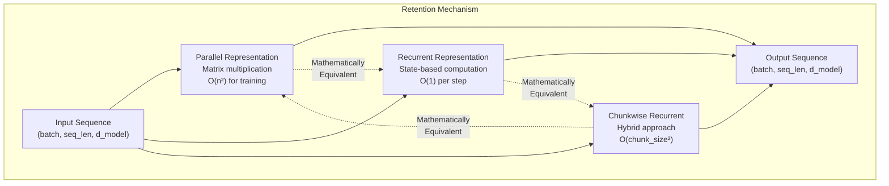
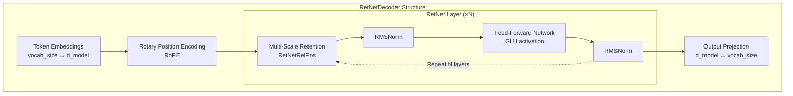
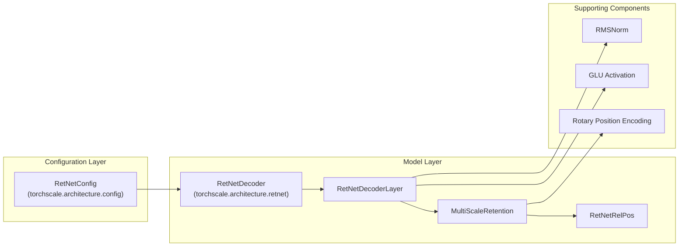
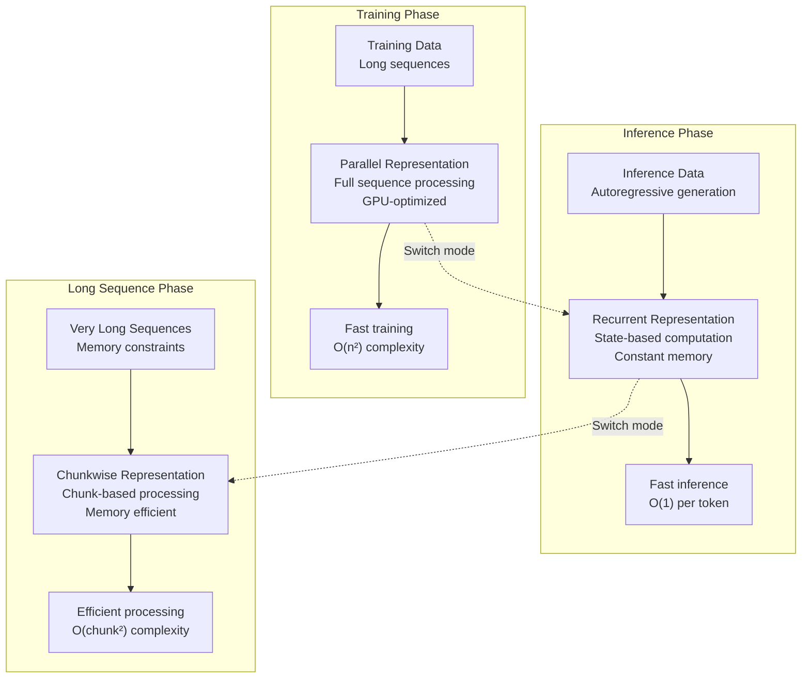
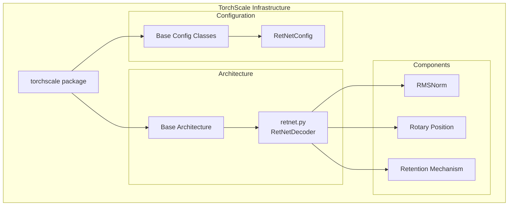

<!-- source: DeepWiki mcp.deepwiki.com · repo microsoft/unilm · page 7.3 RetNet: Retentive Networks · fetched 2026-10-26 -->

# RetNet: Retentive Networks

<details>
<summary>Relevant source files</summary>

The following files were used as context for generating this wiki page:

- [retnet/README.md](retnet/README.md)

</details>


## Purpose and Scope

This document describes RetNet (Retentive Network), an alternative to the Transformer architecture for large language models. RetNet provides an efficient sequence modeling approach through retention mechanisms that enable three different computational representations: parallel training, recurrent inference, and chunkwise recurrent processing. This page covers the RetNet architecture, its retention mechanism, implementation details, and usage through the TorchScale library.

For information about other architectural innovations in this repository, see [Diff-Transformer](#7.2). For the foundational scaling infrastructure that RetNet builds upon, see [Foundation Architectures](#1.1).

**Sources:** [retnet/README.md:1-67]()

---

## Overview

RetNet introduces a retention mechanism as an alternative to the self-attention mechanism used in Transformers. The key innovation is the ability to formulate the same model in three equivalent representations, each optimized for different computational scenarios:

- **Parallel representation**: For efficient training with GPU parallelization
- **Recurrent representation**: For low-latency, constant-memory inference
- **Chunkwise recurrent representation**: For efficient long-sequence processing

The RetNet architecture is implemented in the TorchScale library and can be instantiated with minimal code through the `RetNetConfig` and `RetNetDecoder` classes.

**Sources:** [retnet/README.md:1-6](), [retnet/README.md:28-40]()

---

## Architecture Components

### Retention Mechanism

The core innovation of RetNet is the retention mechanism, which replaces the standard self-attention mechanism. Unlike attention, retention can be computed in three mathematically equivalent ways:



The retention mechanism provides:
- **Training efficiency**: Uses parallel representation for fast batch processing
- **Inference efficiency**: Uses recurrent representation for O(1) complexity per token
- **Long-sequence handling**: Uses chunkwise representation for memory-efficient processing

**Sources:** [retnet/README.md:1-6]()

---

### RetNet Decoder Architecture

The RetNet decoder follows a similar structure to Transformer decoders but replaces multi-head attention with multi-scale retention (MSR):



Key architectural components:
- **RetNetConfig**: Configuration class defining model hyperparameters
- **RetNetDecoder**: Main decoder implementation
- **RetNetRelPos**: Relative position encoding for retention
- **RMSNorm**: Root Mean Square normalization for improved stability

**Sources:** [retnet/README.md:28-40]()

---

## Implementation Details

### Configuration and Instantiation

RetNet models are created through the `RetNetConfig` and `RetNetDecoder` classes from the TorchScale library:

```python
from torchscale.architecture.config import RetNetConfig
from torchscale.architecture.retnet import RetNetDecoder

config = RetNetConfig(vocab_size=64000)
retnet = RetNetDecoder(config)
```

The configuration class supports standard hyperparameters including:
- `vocab_size`: Size of the vocabulary
- `decoder_embed_dim`: Model dimension
- `decoder_layers`: Number of layers
- `decoder_retention_heads`: Number of retention heads per layer

**Sources:** [retnet/README.md:30-40]()

---

### Code Entity Mapping



**Sources:** [retnet/README.md:30-40]()

---

## Stability Improvements

RetNet has undergone multiple stability improvements since its initial release. These enhancements are critical for training large-scale language models:

### Normalization and Initialization

| Date | Improvement | Details |
|------|-------------|---------|
| Nov 2023 | Better initialization | Improved parameter initialization for training stability |
| Nov 2023 | Retention normalization fix | Fixed normalization in retention mechanism |
| Oct 2023 | RMSNorm adoption | Replaced LayerNorm with RMSNorm to eliminate LN_eps effects |
| Oct 2023 | LN epsilon adjustment | Modified from 1e-6 to 1e-5 for numerical stability |
| Oct 2023 | DeepNet initialization | Integrated DeepNet initialization principles |
| Oct 2023 | Bias removal | Removed layer bias to improve training stability |

**Sources:** [retnet/README.md:44-51]()

### Numerical Precision Fixes

| Date | Fix | Details |
|------|-----|---------|
| Aug 2023 | Chunkwise recurrent bug | Fixed bug in chunkwise recurrent representation |
| Aug 2023 | Recurrent precision | Improved numerical precision of recurrent representation |

**Sources:** [retnet/README.md:51-52]()

---

## Three Computational Representations

RetNet's key innovation is providing three mathematically equivalent representations for different computational scenarios:



### Parallel Representation
- Used during training for maximum throughput
- Processes entire sequences in parallel
- Leverages GPU parallelization
- O(n²) complexity similar to attention

### Recurrent Representation
- Used during inference for minimum latency
- Maintains a constant-size state vector
- Processes tokens one at a time
- O(1) memory complexity per step

### Chunkwise Recurrent Representation
- Used for very long sequences
- Processes chunks in parallel, recurrently across chunks
- Balances parallelization and memory efficiency
- O(chunk_size²) complexity per chunk

**Sources:** [retnet/README.md:51-52]()

---

## Integration with TorchScale

RetNet is implemented as part of the TorchScale library, sharing infrastructure with other models in the repository:



RetNet shares the following components with other TorchScale models:
- **RMSNorm**: Also used in Diff-Transformer (see [Diff-Transformer](#7.2))
- **Rotary Position Encoding**: Common positioning strategy
- **DeepNet initialization**: Foundational initialization principles

**Sources:** [retnet/README.md:4-5](), [retnet/README.md:14-24](), [retnet/README.md:47-49]()

---

## Installation and Usage

### Installation

RetNet is available through the TorchScale package:

```bash
# Install from PyPI
pip install torchscale

# Or install from source for development
git clone https://github.com/microsoft/torchscale.git
cd torchscale
pip install -e .
```

**Sources:** [retnet/README.md:12-24]()

### Basic Usage Example

Creating a RetNet model requires only a few lines of code:

```python
import torch
from torchscale.architecture.config import RetNetConfig
from torchscale.architecture.retnet import RetNetDecoder

# Configure the model
config = RetNetConfig(vocab_size=64000)

# Instantiate the decoder
retnet = RetNetDecoder(config)

# Use the model
print(retnet)
```

This instantiates a RetNet decoder with default hyperparameters and a vocabulary size of 64,000 tokens.

**Sources:** [retnet/README.md:28-40]()

---

## Evolution and Variants

### RetNet-3 (Gated RetNet)

In May 2024, a gated variant of RetNet (RetNet-3) was introduced as part of the YOCO (You Only Cache Once) architecture. This variant enhances the original retention mechanism with gating mechanisms for improved performance.

**Sources:** [retnet/README.md:3-4]()

---

## Changelog Summary

The RetNet implementation has undergone continuous refinement:

### Major Updates
- **May 2024**: Gated RetNet (RetNet-3) as part of YOCO
- **November 2023**: Better initialization and retention normalization fixes
- **October 2023**: RMSNorm adoption, epsilon adjustments, DeepNet initialization, bias removal
- **August 2023**: Chunkwise recurrent bug fix and numerical precision improvements
- **July 2023**: Initial preprint release

### Key Stability Recommendations
1. Use RMSNorm instead of LayerNorm
2. Set LN epsilon to 1e-5 (not 1e-6)
3. Apply DeepNet initialization principles
4. Remove layer bias for better stability
5. Avoid using `--subln` or `--deepnorm` arguments (already integrated)

**Sources:** [retnet/README.md:42-52]()

---

## References

The RetNet architecture is described in the following publication:

```
@article{retnet,
  author={Yutao Sun and Li Dong and Shaohan Huang and Shuming Ma and Yuqing Xia and Jilong Xue and Jianyong Wang and Furu Wei},
  title     = {Retentive Network: A Successor to {Transformer} for Large Language Models},
  journal   = {ArXiv},
  volume    = {abs/2307.08621},
  year      = {2023}
}
```

**Sources:** [retnet/README.md:54-66]()