# Page: Overview

# Overview

<details>
<summary>Relevant source files</summary>

The following files were used as context for generating this wiki page:

- [README.md](README.md)
- [deltalm/README.md](deltalm/README.md)
- [minilm/README.md](minilm/README.md)
- [minilm/examples/run_xnli.py](minilm/examples/run_xnli.py)
- [valle/README.md](valle/README.md)
- [wavlm/ASR.PNG](wavlm/ASR.PNG)
- [wavlm/README.md](wavlm/README.md)
- [wavlm/SUPERB_Results.png](wavlm/SUPERB_Results.png)
- [wavlm/screenshot.png](wavlm/screenshot.png)

</details>


The Microsoft UniLM repository is a collection of foundation models for large-scale self-supervised pre-training across natural language understanding (NLU), natural language generation (NLG), computer vision, speech processing, and multimodal AI tasks. The repository provides pre-trained models, training code, fine-tuning scripts, and evaluation benchmarks spanning 100+ languages and multiple modalities (text, images, audio, document layout).

This page provides a high-level overview of the repository's structure, model families, and architectural components. For specific model architectures and training details, see the individual model pages listed in sections 2-6. For the foundational scaling infrastructure (TorchScale, DeepNet, Magneto), see [Foundation Architectures](#1.1).

## Repository Scope and Model Categories

The repository contains six primary categories of models, each organized in dedicated subdirectories:

**Vision Models** ([BEiT](#2.1), [DiT](#2.2)): Self-supervised pre-training for image transformers using masked image modeling. BEiT targets general vision tasks (classification, segmentation), while DiT specializes in document image understanding.

**Language Models** ([UniLM](#3.1), [MiniLM](#3.2), [DeltaLM](#3.3), [E5](#3.4)): Unified pre-training for NLU and NLG tasks, including knowledge distillation approaches (MiniLM), multilingual translation (DeltaLM), and text embeddings (E5).

**Speech Models** ([WavLM](#4.1), [VALL-E](#4.2)): Pre-training for full-stack speech processing including ASR, speaker verification, and speech synthesis using neural codec language models.

**Document AI Models** ([LayoutLM series](#5.1-5.3), [TrOCR](#5.4)): Multimodal models combining text, layout, and visual information for document understanding tasks (forms, receipts, PDFs) and optical character recognition.

**Vision-Language Models** ([Kosmos-2](#6.1), [TextDiffuser](#6.2-6.3)): Models that ground language in visual contexts for tasks like phrase grounding, image captioning, and text-to-image generation with accurate text rendering.

**Toolkits and Infrastructure** ([s2s-ft](#7.1), [Diff-Transformer](#7.2), [RetNet](#7.3), TorchScale): Supporting frameworks for sequence-to-sequence fine-tuning, alternative attention mechanisms, and foundation architecture components.

Sources: [README.md:1-258]()

## Repository Structure and Code Organization

The repository follows a flat directory structure where each model family has its own top-level directory containing model code, configuration files, pre-trained checkpoints, and fine-tuning scripts.

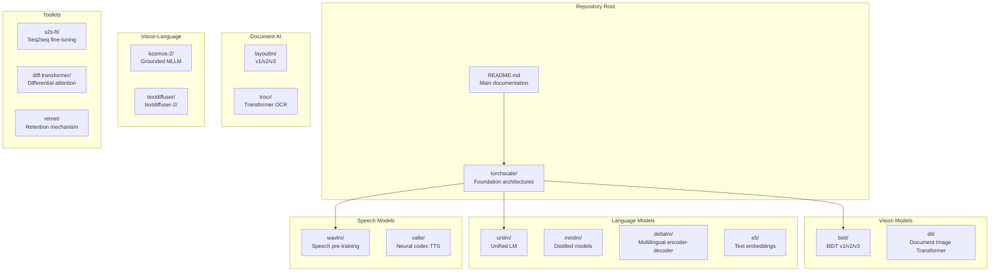

**Directory-to-Model Mapping**:
- `beit/`, `beit2/`, `beit3/`: Vision pre-training models
- `dit/`: Document image transformer
- `unilm/`, `unilm-v1/`: Unified language model versions
- `minilm/`: Knowledge distillation models with reduced parameters
- `deltalm/`: Encoder-decoder for 100+ languages
- `e5/`: Text embedding models evaluated on MTEB/BEIR
- `wavlm/`: Speech representation learning
- `valle/`: Text-to-speech synthesis
- `layoutlm/`, `layoutlmv2/`, `layoutlmv3/`, `layoutxlm/`: Multimodal document understanding
- `trocr/`: OCR with vision transformers and text decoders
- `kosmos-2/`, `kosmos-2.5/`: Multimodal large language models
- `textdiffuser/`, `textdiffuser-2/`: Diffusion models for text rendering
- `s2s-ft/`: Fine-tuning toolkit for sequence-to-sequence tasks
- `diff-transformer/`: Alternative attention mechanism implementations
- `retnet/`: Retention-based architecture as Transformer alternative

Sources: [README.md:1-258]()

## Foundation Architecture and Shared Components

The repository's models build upon shared architectural innovations provided by the TorchScale library, which implements core components for scaling transformers to thousands of layers while maintaining training stability and efficiency.

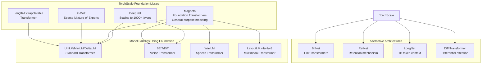

**Core Components**:
- **DeepNet**: Post-normalization architecture enabling stable training of 1,000+ layer transformers
- **Magneto (Foundation Transformers)**: Sub-layer normalization with weight initialization for true general-purpose modeling across tasks/modalities
- **X-MoE**: Scalable and fine-tunable sparse mixture-of-experts with efficient routing
- **Length Extrapolation**: Position encoding and attention mechanisms supporting context lengths beyond training data

**Alternative Architectures**:
- **BitNet**: 1-bit quantized transformers for extreme efficiency
- **RetNet**: Retention mechanism as alternative to attention with improved stability
- **LongNet**: Dilated attention patterns supporting 1 billion token contexts
- **Diff-Transformer**: Differential attention mechanism with noise cancellation properties

These components are implemented as reusable modules that can be composed to build new models. The TorchScale library is maintained separately at `https://github.com/microsoft/torchscale`.

Sources: [README.md:6-25]()

## Model Hosting and Distribution

Pre-trained models are distributed through multiple channels depending on the model family:

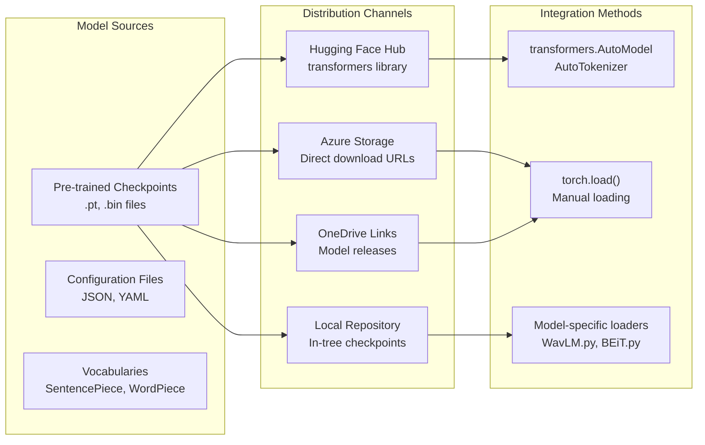

**Hugging Face Integration**: Most models (BEiT, LayoutLM series, TrOCR, MiniLM) are available via the `transformers` library:
```python
from transformers import AutoModel, AutoTokenizer
tokenizer = AutoTokenizer.from_pretrained("microsoft/MiniLM-L12-H384-uncased")
model = AutoModel.from_pretrained("microsoft/MiniLM-L12-H384-uncased")
```

**Direct Download**: Models like WavLM and DeltaLM provide direct download links via Azure Storage or Google Drive for checkpoint files, vocabularies, and SentencePiece models.

**Model-Specific Loaders**: Some models (WavLM, VALL-E) provide custom loading code:
```python
from WavLM import WavLM, WavLMConfig
checkpoint = torch.load('/path/to/wavlm.pt')
cfg = WavLMConfig(checkpoint['cfg'])
model = WavLM(cfg)
```

Sources: [README.md:149-157](), [wavlm/README.md:17-49](), [minilm/README.md:42-54]()

## Pre-training and Fine-tuning Pipeline

The typical workflow for using models in this repository follows a multi-stage pipeline from pre-training to downstream task evaluation:

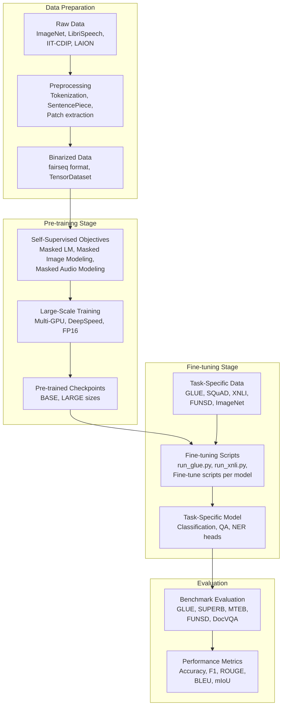

**Pre-training Objectives by Modality**:
- **Language**: Masked Language Modeling (UniLM, MiniLM), Pseudo-Masked LM (UniLM v2), Encoder-decoder objectives (DeltaLM)
- **Vision**: Masked Image Modeling with DALL-E tokenizer (BEiT), Visual token prediction (DiT)
- **Speech**: Masked Audio Modeling with utterance mixing (WavLM), Denoising objectives
- **Multimodal**: Joint text-image masking (LayoutLMv3), Word-patch alignment (LayoutLMv3), Cross-modal objectives

**Fine-tuning Tools**:
- Language models use standard `transformers` fine-tuning scripts with task-specific heads
- Vision models integrate with detectron2/MMDetection for object detection tasks
- The `s2s-ft` toolkit provides specialized support for sequence-to-sequence generation tasks
- Models support parameter-efficient fine-tuning via LoRA adapters where applicable

**Training Infrastructure**:
- Multi-GPU training with PyTorch DistributedDataParallel
- Mixed precision (FP16/BF16) via NVIDIA Apex or PyTorch AMP
- DeepSpeed integration for large models
- Gradient checkpointing for memory efficiency

Sources: [README.md:96-109](), [minilm/examples/run_xnli.py:1-463](), [deltalm/README.md:34-153]()

## Cross-Model Architectural Patterns

Despite diversity in modalities, models in the repository share common architectural patterns and components:

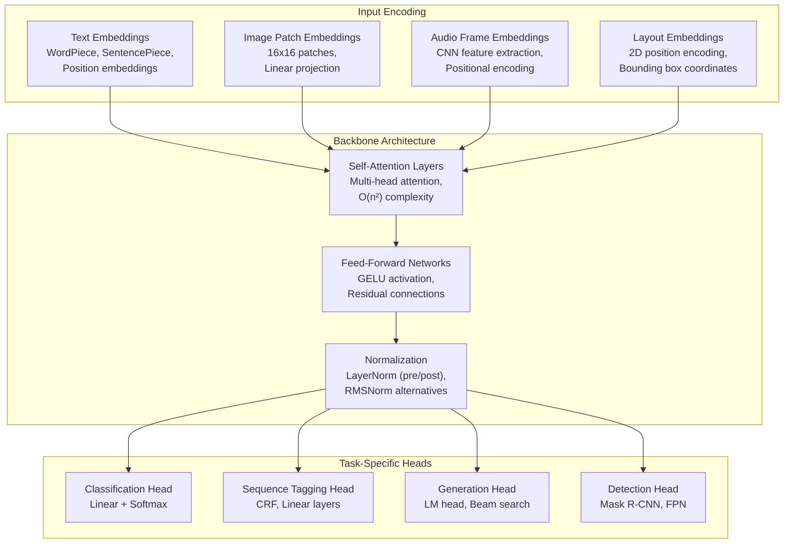

**Shared Components Across Models**:
1. **Transformer Backbone**: 12-layer (BASE) or 24-layer (LARGE) transformer encoder/decoder
2. **Position Encoding**: Learned absolute positions (UniLM, MiniLM), relative position bias (BEiT, WavLM), 2D position for documents (LayoutLM)
3. **Attention Mechanisms**: Standard multi-head self-attention with optional modifications (gated relative position in WavLM, window attention in BEiT)
4. **Normalization**: Pre-normalization (newer models) or post-normalization (older models), with LayerNorm as default
5. **Activation Functions**: GELU activation in feed-forward networks
6. **Residual Connections**: Standard residual connections around attention and FFN layers

**Model Size Conventions**:
- BASE: 12 layers, 768 hidden size, 12 attention heads (~110M parameters)
- LARGE: 24 layers, 1024 hidden size, 16 attention heads (~340M parameters)
- Efficient variants: 6/12 layers, 384 hidden size (MiniLM: 22M-33M parameters)

**Vocabulary and Tokenization**:
- English models: WordPiece vocabulary (BERT-style, 30K tokens)
- Multilingual models: SentencePiece unigram model (XLM-R style, 250K tokens)
- Vision models: Image patches as "visual tokens" (16×16 pixels)
- Speech models: Audio frames as input (25ms windows, 10ms stride)

Sources: [README.md:44-95](), [wavlm/README.md:1-135](), [minilm/README.md:1-287]()

## Evaluation Benchmarks and Performance

Models in the repository are evaluated on standardized benchmarks across modalities:

| Modality | Model | Primary Benchmarks | Metrics |
|----------|-------|-------------------|---------|
| **Language** | UniLM, MiniLM, DeltaLM, E5 | GLUE, SuperGLUE, XNLI, WMT, MTEB | Accuracy, F1, BLEU, NDCG |
| **Vision** | BEiT, DiT | ImageNet, COCO, ADE20K, RVL-CDIP | Top-1 Acc, mIoU, mAP |
| **Speech** | WavLM | SUPERB, LibriSpeech, VoxCeleb | WER, EER, Acc |
| **Document AI** | LayoutLM, TrOCR | FUNSD, XFUND, DocVQA, SROIE | F1, EM, CER, WER |
| **Vision-Language** | Kosmos-2, TextDiffuser | VQA, COCO Captions, Referring Expr | Acc, CIDEr, Recall@K |

**Key Benchmark Datasets**:
- **GLUE/SuperGLUE**: General language understanding (8-10 NLU tasks)
- **XNLI**: Cross-lingual natural language inference (15 languages)
- **SUPERB**: Speech processing benchmark (10 tasks including ASR, speaker ID, emotion)
- **MTEB**: Massive text embedding benchmark (56 datasets, 8 task types)
- **FUNSD/XFUND**: Form understanding in 7-8 languages
- **DocVQA**: Document visual question answering
- **SROIE**: Scanned receipt OCR and information extraction

Model cards and detailed results are available in individual model directories and on the Hugging Face Hub.

Sources: [README.md:115-168](), [wavlm/README.md:53-106](), [minilm/README.md:59-238]()

---

# Page: Foundation Architectures

# Foundation Architectures

<details>
<summary>Relevant source files</summary>

The following files were used as context for generating this wiki page:

- [README.md](README.md)
- [deltalm/README.md](deltalm/README.md)
- [minilm/README.md](minilm/README.md)
- [minilm/examples/run_xnli.py](minilm/examples/run_xnli.py)
- [valle/README.md](valle/README.md)
- [wavlm/ASR.PNG](wavlm/ASR.PNG)
- [wavlm/README.md](wavlm/README.md)
- [wavlm/SUPERB_Results.png](wavlm/SUPERB_Results.png)
- [wavlm/screenshot.png](wavlm/screenshot.png)

</details>


## Purpose and Scope

This document describes the **TorchScale** library and foundational architectural components that enable scaling across all model families in the UniLM repository. TorchScale provides the underlying building blocks for stability (DeepNet), generality (Magneto), efficiency (X-MoE), and architectural innovations (RetNet, BitNet, LongNet) that support language, vision, speech, and multimodal models.

For specific model implementations that use these foundations, see language models ([3](#3)), vision models ([2](#2)), speech models ([4](#4)), and multimodal models ([5](#5), [6](#6)).

---

## TorchScale: Foundation Architecture Library

**TorchScale** is an external library (https://github.com/microsoft/torchscale) that provides fundamental research on architectures for foundation models and AI. It focuses on:

- **Modeling Generality and Capability**: Architectures that work across tasks, languages, and modalities
- **Training Stability**: Techniques to scale Transformers to unprecedented depths
- **Training Efficiency**: Methods to reduce computational cost and improve transferability

TorchScale serves as the foundation layer that flows into multiple model families including UniLM, BEiT, WavLM, Diff-Transformer, and RetNet.

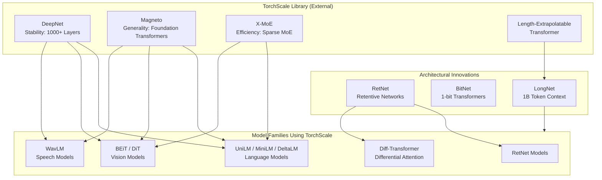

**Sources:** [README.md:6-26]()

---

## Stability: DeepNet

**DeepNet** provides architectural modifications to scale Transformers to **1,000+ layers** and beyond. Traditional Transformers suffer from training instability and gradient issues when scaled to extreme depths. DeepNet introduces stability techniques that enable:

- Deep pre-training for improved representation learning
- Stable gradient flow through hundreds of layers
- Foundation for models requiring high capacity

### Impact on Model Families

DeepNet's stability improvements are critical for:
- **UniLM**: Enables deeper encoder-decoder architectures for language understanding/generation
- **BEiT**: Supports deep vision transformers for self-supervised image pre-training
- **WavLM**: Allows deep speech processing models trained on 94k hours of audio

**Sources:** [README.md:11]()

---

## Generality: Magneto (Foundation Transformers)

**Magneto** (Foundation Transformers) provides architectural designs for **true general-purpose modeling** across:
- **Tasks**: Classification, generation, translation, retrieval
- **Modalities**: Language, vision, speech, multimodal fusion
- **Languages**: 100+ languages supported

### Key Architectural Principles

Magneto unifies model architectures to enable parameter sharing and transfer learning across diverse tasks without requiring modality-specific modifications. This allows models like BEiT-3 to achieve "The Big Convergence" - a single architecture for all tasks and modalities.

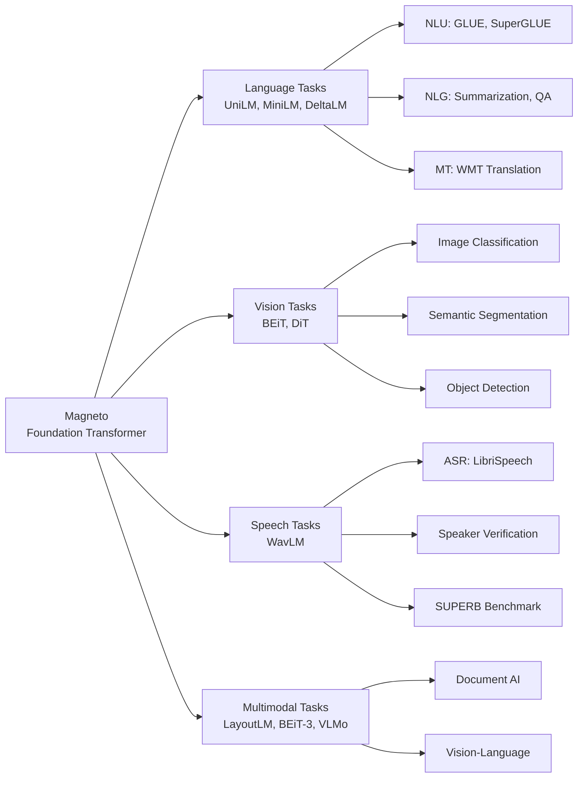

**Sources:** [README.md:13]()

---

## Efficiency and Transferability: X-MoE

**X-MoE** (Scalable Mixture-of-Experts) provides **sparse computation** through gated expert routing:

- **Scalability**: Increases model capacity without proportional compute cost
- **Fine-tunable**: Unlike some MoE approaches, X-MoE models can be efficiently fine-tuned
- **Transferability**: Supports transfer learning across tasks and domains

### Technical Approach

X-MoE replaces dense feed-forward networks with sparse expert layers:
- Each input token is routed to a subset of expert networks
- Only active experts perform computation
- Enables 10x+ model capacity increase with manageable compute costs

This approach is particularly valuable for:
- **UniLM variants**: Scaling language models while controlling training costs
- **BEiT variants**: Increasing vision model capacity for diverse visual tasks

**Sources:** [README.md:17]()

---

## Architectural Innovations

### RetNet: Retentive Networks

**RetNet** provides an alternative to standard Transformers using **retention mechanisms** instead of attention:

- **Training Efficiency**: O(1) complexity per step during training (vs O(n) for attention)
- **Inference Efficiency**: Constant-time decoding with linear complexity
- **Performance**: Competitive with Transformers while being more efficient

RetNet is positioned as a "Successor to Transformer for Large Language Models" and is explored in section [7.3](#7.3).

### BitNet: 1-bit Transformers

**BitNet** quantizes model weights to **1-bit representations**:

- Extreme compression for Large Language Models
- Reduces memory footprint by ~32x (vs FP32)
- Enables deployment on resource-constrained devices
- Maintains competitive performance through training techniques

### LongNet: Extreme Context Length

**LongNet** scales Transformers to **1,000,000,000 tokens** of context:

- Dilated attention mechanisms for long-range dependencies
- Enables processing of entire codebases, books, or long videos
- Foundation for long-context applications

**Sources:** [README.md:19-26]()

---

## Core Architectural Components

All models in the repository are built from shared architectural components that can be composed in different ways. This section catalogs the building blocks and their usage patterns.

### Attention Mechanisms

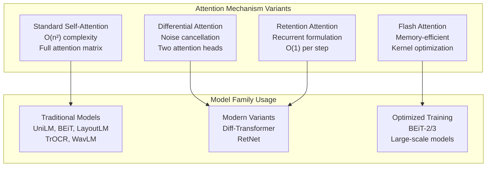

| Attention Type | Complexity | Models | Key Benefit |
|---|---|---|---|
| Standard Self-Attention | O(n²) | UniLM, BEiT, LayoutLM, TrOCR, WavLM | Proven architecture, wide compatibility |
| Differential Attention | O(n²) | Diff-Transformer | Improved signal-to-noise ratio |
| Retention Attention | O(1) per step | RetNet | Training efficiency, constant inference |
| Flash Attention | O(n²) optimized | BEiT-2/3, Diff-Transformer | Memory efficiency for large-scale training |

### Normalization Strategies

Different model families use different normalization approaches based on their architectural vintage and requirements:

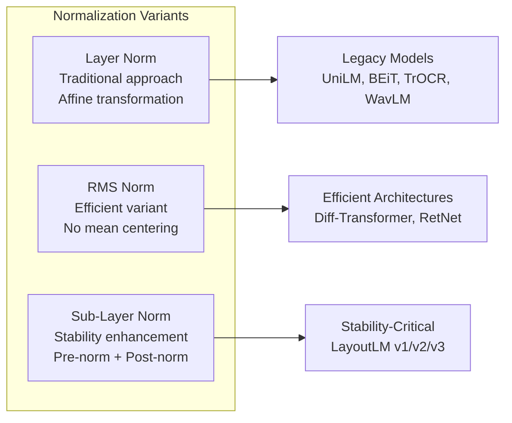

| Normalization | Computation | Models | Design Rationale |
|---|---|---|---|
| Layer Norm | Mean + Variance | UniLM, BEiT, TrOCR, WavLM | Standard choice for most Transformers |
| RMS Norm | RMS only (no mean) | Diff-Transformer, RetNet | ~10% faster, modern efficient architectures |
| Sub-Layer Norm | Dual normalization | LayoutLM family | Extra stability for multimodal fusion |

### Position Encoding

Position encoding strategies vary based on the nature of input data (sequential text, 2D images, 1D audio):

| Position Type | Models | Input Type | Implementation |
|---|---|---|---|
| Absolute Position | UniLM, TrOCR | Sequential text | Learned embeddings added to input |
| Relative Position | BEiT, LayoutLM, WavLM | 2D images, spatial data | Bias added to attention scores |
| RoPE (Rotary) | Diff-Transformer, RetNet | Modern architectures | Rotation-based, extrapolatable |
| Adaptive Position | BEiT | Multi-resolution images | Resolution-aware interpolation |

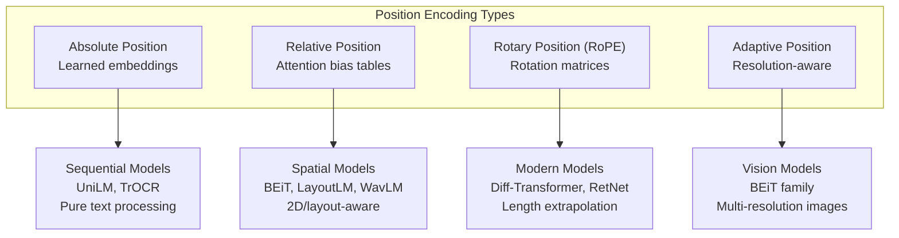

**Sources:** [README.md:1-260](), Diagram 5 from system architecture analysis

---

## Efficiency Techniques

All modern models in the repository employ combinations of efficiency techniques during training and deployment:

### Gradient Checkpointing

- **Purpose**: Trade computation for memory
- **Mechanism**: Recompute intermediate activations during backward pass instead of storing them
- **Used by**: BEiT, LayoutLM (necessary for high-resolution images and long documents)

### Mixed Precision Training (FP16/BF16)

- **Purpose**: Accelerate training on Tensor Core GPUs
- **Mechanism**: Use 16-bit floats for forward/backward, 32-bit for updates
- **Used by**: BEiT, LayoutLM, Diff-Transformer, most large-scale models

### Distributed Training

**Data Parallel (DDP)**:
- Replicate model across GPUs
- Each GPU processes different batch
- Used by: UniLM, BEiT for standard training

**DeepSpeed**:
- ZeRO optimizer for model parallelism
- Pipeline parallelism for very large models
- Used by: Large variants of all model families

### LoRA Fine-tuning

- **Purpose**: Parameter-efficient adaptation
- **Mechanism**: Low-rank adaptation matrices added to frozen base model
- **Used by**: UniLM, Diff-Transformer for efficient task-specific tuning

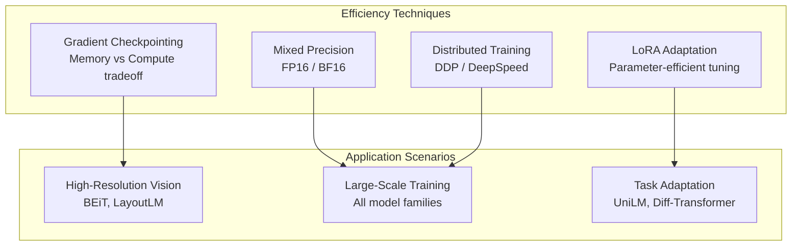

**Sources:** [README.md:137](), [wavlm/README.md:1-135](), [minilm/README.md:1-287]()

---

## Component Reuse Patterns Across Model Families

The following table shows how different model families compose the core architectural components:

| Model Family | Attention | Normalization | Position Encoding | Key Features |
|---|---|---|---|---|
| **UniLM / MiniLM / DeltaLM** | Self-Attention | Layer Norm | Absolute | Standard BERT-style, text-focused |
| **BEiT / DiT** | Self-Attention | Layer Norm | Relative + Adaptive | Vision Transformers, resolution-aware |
| **Diff-Transformer** | Differential Attn | RMS Norm | RoPE | Modern efficient architecture |
| **RetNet** | Retention Attn | RMS Norm | RoPE | Recurrent alternative, training efficiency |
| **LayoutLM v1/v2/v3** | Self-Attention | Sub-Layer Norm | Relative | Multimodal stability, spatial awareness |
| **TrOCR** | Self-Attention | Layer Norm | Absolute | Encoder-decoder for OCR |
| **WavLM** | Self-Attention | Layer Norm | Relative | Speech-specific, temporal modeling |

### Architecture Evolution Pattern

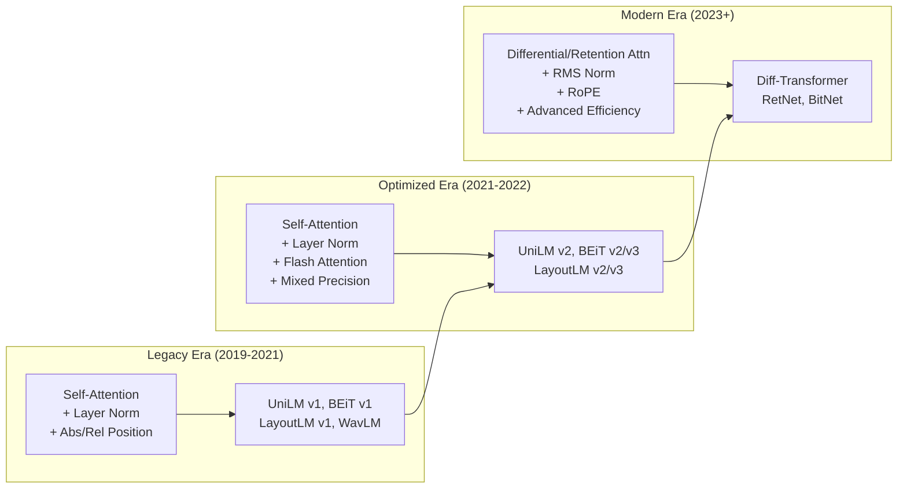

### Design Philosophy

The component reuse pattern follows a clear philosophy:

1. **Proven Components First**: New models start with battle-tested components (standard self-attention, layer norm)
2. **Incremental Innovation**: Models add targeted innovations (Flash Attention for memory, differential attention for signal quality)
3. **Efficiency Focus**: Modern models prioritize efficiency (RMS Norm over Layer Norm, retention over attention)
4. **Task-Specific Adaptations**: Components chosen based on input characteristics (relative position for spatial data, absolute for pure text)

**Sources:** [README.md:1-260](), Diagram 5 from system architecture analysis

---

## Integration with Model Families

### Language Models

Language models (UniLM, MiniLM, DeltaLM) leverage:
- **DeepNet**: Stability for deep encoder-decoder architectures
- **Magneto**: General-purpose design supporting both NLU and NLG
- **X-MoE**: Efficient scaling for large vocabularies (100+ languages)
- **Standard Components**: Self-attention, Layer Norm, Absolute Position (proven for text)

See [3](#3) for detailed language model documentation.

### Vision Models

Vision models (BEiT, DiT) leverage:
- **DeepNet**: Deep architectures for hierarchical visual representations
- **Magneto**: Unified design for classification, detection, segmentation
- **Adaptive Position Encoding**: Handle variable image resolutions
- **Flash Attention**: Memory-efficient processing of high-resolution images

See [2](#2) for detailed vision model documentation.

### Speech Models

Speech models (WavLM) leverage:
- **DeepNet**: Deep processing of temporal audio features
- **Relative Position**: Capture temporal relationships in speech
- **Magneto**: General design for ASR, speaker verification, speech separation

See [4](#4) for detailed speech model documentation.

### Multimodal Models

Multimodal models (LayoutLM, TrOCR, Kosmos) leverage:
- **Magneto**: Core design supporting fusion of text, layout, image modalities
- **Sub-Layer Norm**: Extra stability for multimodal fusion (LayoutLM)
- **Mixed Components**: Combine vision encoders (relative position) with text decoders (absolute position)

See [5](#5) and [6](#6) for detailed multimodal model documentation.

**Sources:** [README.md:6-96](), [wavlm/README.md:1-15](), [minilm/README.md:1-50](), [deltalm/README.md:1-20]()

---

# Page: Repository Structure and Model Distribution

# Repository Structure and Model Distribution

<details>
<summary>Relevant source files</summary>

The following files were used as context for generating this wiki page:

- [README.md](README.md)
- [deltalm/README.md](deltalm/README.md)
- [minilm/README.md](minilm/README.md)
- [minilm/examples/run_xnli.py](minilm/examples/run_xnli.py)
- [valle/README.md](valle/README.md)
- [wavlm/ASR.PNG](wavlm/ASR.PNG)
- [wavlm/README.md](wavlm/README.md)
- [wavlm/SUPERB_Results.png](wavlm/SUPERB_Results.png)
- [wavlm/screenshot.png](wavlm/screenshot.png)

</details>


## Purpose and Scope

This page documents the organizational structure of the Microsoft UniLM repository and explains how pre-trained models are distributed to users. It covers the directory layout, model family locations, checkpoint hosting infrastructure, and integration with model hubs. For details about specific model architectures and their training procedures, see the respective model family pages (e.g., [Vision Models](#2), [Language Models](#3), [Document AI](#5)).

---

## Repository Organization

The UniLM repository follows a modular structure where each model family occupies its own top-level directory. The repository contains foundation models across multiple modalities (language, vision, speech, multimodal), organized by model type rather than by research paper.

### Top-Level Directory Structure

```mermaid
graph TB
    Root["unilm/ (root)"]
    
    Root --> TorchScale["torchscale/<br/>(Foundation Architecture)"]
    Root --> Lang["Language Models"]
    Root --> Vision["Vision Models"]
    Root --> Speech["Speech Models"]
    Root --> DocAI["Document AI Models"]
    Root --> VisionLang["Vision-Language Models"]
    Root --> Toolkits["Toolkits & Utilities"]
    
    Lang --> UniLM["unilm/"]
    Lang --> MiniLM["minilm/"]
    Lang --> DeltaLM["deltalm/"]
    Lang --> E5["e5/"]
    Lang --> InfoXLM["infoxlm/"]
    
    Vision --> BEiT["beit/, beit2/, beit3/"]
    Vision --> DiT["dit/"]
    
    Speech --> WavLM["wavlm/"]
    Speech --> VALLE["valle/"]
    
    DocAI --> LayoutLM1["layoutlm/"]
    DocAI --> LayoutLM2["layoutlmv2/"]
    DocAI --> LayoutLM3["layoutlmv3/"]
    DocAI --> LayoutXLM["layoutxlm/"]
    DocAI --> TrOCR["trocr/"]
    
    VisionLang --> Kosmos["kosmos-2/, kosmos-2.5/"]
    VisionLang --> TextDiff["textdiffuser/, textdiffuser-2/"]
    
    Toolkits --> S2SFT["s2s-ft/"]
    Toolkits --> DiffTrans["diff-transformer/"]
    Toolkits --> RetNet["retnet/"]
```

**Sources:** [README.md:1-258]()

### Model Family Directory Structure

Each model directory typically contains:
- `README.md` - Model description, usage instructions, and performance metrics
- Model-specific code (training, inference, data processing)
- Configuration files
- Fine-tuning scripts
- Evaluation benchmarks

For example, the `wavlm/` directory structure:

```
wavlm/
├── README.md              # Model documentation
├── WavLM.py               # Model architecture
├── modules.py             # Component implementations
├── SUPERB_Results.png     # Benchmark visualizations
└── screenshot.png         # Additional documentation assets
```

**Sources:** [wavlm/README.md:1-135]()

---

## Model Family Locations

The following table maps model families to their repository locations and primary maintainers:

| Model Family | Directory | Modality | Key Models |
|-------------|-----------|----------|------------|
| **TorchScale** | `torchscale/` (external) | Foundation | DeepNet, Magneto, X-MoE |
| **UniLM** | `unilm/`, `unilm-v1/` | Language | UniLM v1, UniLM v2 |
| **MiniLM** | `minilm/` | Language | MiniLM v1, MiniLM v2, Multilingual variants |
| **DeltaLM** | `deltalm/` | Language | DeltaLM-base, DeltaLM-large |
| **E5** | `e5/` | Language | E5-small, E5-base, E5-large |
| **InfoXLM** | `infoxlm/` | Language | InfoXLM, XLM-E |
| **BEiT** | `beit/`, `beit2/`, `beit3/` | Vision | BEiT v1/v2/v3 variants |
| **DiT** | `dit/` | Vision | DiT-base, DiT-large |
| **WavLM** | `wavlm/` | Speech | WavLM-base, WavLM-base+, WavLM-large |
| **VALL-E** | `valle/` | Speech | VALL-E TTS models |
| **LayoutLM** | `layoutlm/`, `layoutlmv2/`, `layoutlmv3/` | Multimodal | LayoutLM v1/v2/v3 |
| **LayoutXLM** | `layoutxlm/` | Multimodal | LayoutXLM (multilingual) |
| **TrOCR** | `trocr/` | Multimodal | TrOCR-small, TrOCR-base, TrOCR-large |
| **Kosmos** | `kosmos-2/`, `kosmos-2.5/` | Multimodal | Kosmos-2, Kosmos-2.5 |
| **TextDiffuser** | `textdiffuser/`, `textdiffuser-2/` | Multimodal | TextDiffuser v1/v2 |

**Sources:** [README.md:6-107]()

---

## Model Distribution Channels

The repository provides models through multiple distribution channels to accommodate different user needs and geographic locations.

### Hugging Face Hub Integration

Most models are integrated with the Hugging Face Hub for easy loading through the `transformers` library:

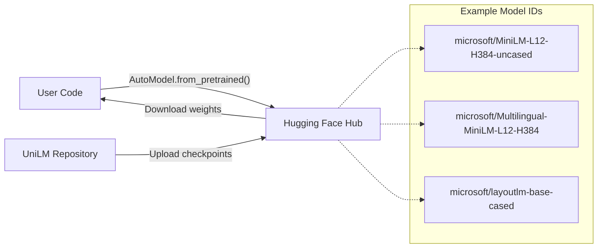

**Example usage patterns:**

For MiniLM models:
```python
from transformers import AutoTokenizer, AutoModel

tokenizer = AutoTokenizer.from_pretrained("microsoft/MiniLM-L12-H384-uncased")
model = AutoModel.from_pretrained("microsoft/MiniLM-L12-H384-uncased")
```

For multilingual models:
```python
tokenizer = AutoTokenizer.from_pretrained("microsoft/Multilingual-MiniLM-L12-H384")
model = AutoModel.from_pretrained("microsoft/Multilingual-MiniLM-L12-H384")
```

**Sources:** [minilm/README.md:46-54](), [README.md:149-158]()

### Direct Checkpoint Downloads

For models not yet on Hugging Face or for specific versions, the repository provides direct download links through cloud storage providers:

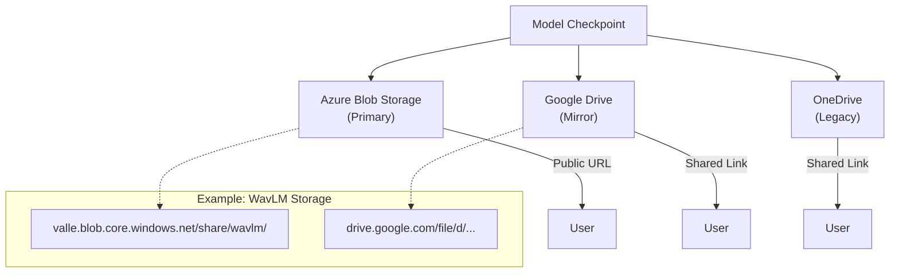

**WavLM checkpoint distribution example:**

| Model | Size | Azure Storage | Google Drive |
|-------|------|---------------|--------------|
| WavLM Base | ~90MB | `valle.blob.core.windows.net/.../WavLM-Base.pt` | Shared link provided |
| WavLM Base+ | ~90MB | `valle.blob.core.windows.net/.../WavLM-Base+.pt` | Shared link provided |
| WavLM Large | ~300MB | `valle.blob.core.windows.net/.../WavLM-Large.pt` | Shared link provided |

**Sources:** [wavlm/README.md:17-23]()

**DeltaLM checkpoint distribution:**

DeltaLM models are hosted on dedicated Azure Blob Storage:

```python
# Base model loading
checkpoint = torch.load('deltalm-base.pt')  # Downloaded from Azure
cfg = WavLMConfig(checkpoint['cfg'])
model = DeltaLM(cfg)
model.load_state_dict(checkpoint['model'])
```

Checkpoint URLs:
- DeltaLM-base: `deltalm.blob.core.windows.net/deltalm/deltalm-base.pt`
- DeltaLM-large: `deltalm.blob.core.windows.net/deltalm/deltalm-large.pt`
- Vocabulary: `deltalm.blob.core.windows.net/deltalm/dict.txt`
- SentencePiece model: `deltalm.blob.core.windows.net/deltalm/spm.model`

**Sources:** [deltalm/README.md:14-19]()

### Model Loading Patterns

Different model families use different loading mechanisms:

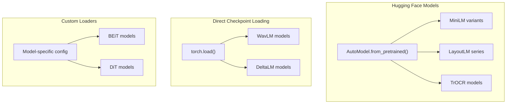

**WavLM loading pattern:**
```python
import torch
from WavLM import WavLM, WavLMConfig

checkpoint = torch.load('/path/to/wavlm.pt')
cfg = WavLMConfig(checkpoint['cfg'])
model = WavLM(cfg)
model.load_state_dict(checkpoint['model'])
model.eval()
```

**Sources:** [wavlm/README.md:26-35]()

---

## Model Versioning and Naming Conventions

The repository follows consistent naming patterns for model checkpoints and identifiers:

### Version Suffixes

- **v1, v2, v3**: Major architecture versions (e.g., `LayoutLM v1`, `LayoutLM v2`, `LayoutLM v3`)
- **Base, Large**: Model size variants (e.g., `WavLM Base`, `WavLM Large`)
- **Base+**: Enhanced base models with extended training (e.g., `WavLM Base+`)
- **Small, Base, Large**: Standardized size tiers for models like TrOCR

### Language/Domain Suffixes

- **Multilingual/mMiniLM**: Multilingual variants (e.g., `Multilingual-MiniLM-L12-H384`)
- **uncased/cased**: Text casing handling (e.g., `MiniLM-L12-H384-uncased`)
- **LxH**: Layer count × Hidden size (e.g., `L12-H384` = 12 layers, 384 hidden dimensions)

### Checkpoint File Naming

Standard patterns:
- PyTorch checkpoints: `{model-name}.pt` or `{model-name}.bin`
- Configuration files: `{model-name}-config.json`
- Vocabulary files: `vocab.txt` or `dict.txt`
- Tokenizer models: `spm.model` (SentencePiece)

**Sources:** [minilm/README.md:8-28](), [deltalm/README.md:14-19](), [wavlm/README.md:18-23]()

---

## Shared Infrastructure and Dependencies

Models in the repository share common dependencies and infrastructure components:

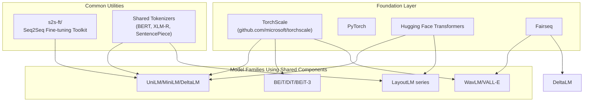

### TorchScale Foundation

TorchScale provides core architectural components used across model families:
- **DeepNet**: Stabilization for deep Transformers (1000+ layers)
- **Magneto**: General-purpose foundation architecture
- **X-MoE**: Scalable Mixture-of-Experts implementation

The TorchScale library is maintained as a separate repository: `github.com/microsoft/torchscale`

**Sources:** [README.md:6-17]()

### Shared Tokenizers

Models within the same language family often share tokenizers:

| Tokenizer Type | Used By | Vocabulary Size |
|----------------|---------|-----------------|
| BERT WordPiece | MiniLM (English), LayoutLM | ~30K tokens |
| XLM-RoBERTa SentencePiece | Multilingual MiniLM, LayoutXLM | ~250K tokens |
| Custom SentencePiece | DeltaLM | Model-specific |

**MiniLM tokenizer example:**
```python
from transformers import XLMRobertaTokenizer

# Multilingual MiniLM uses XLM-R tokenizer
tokenizer = XLMRobertaTokenizer.from_pretrained("xlm-roberta-base")
# But with MiniLM model weights
```

**Sources:** [minilm/README.md:56-57](), [minilm/examples/run_xnli.py:45-46]()

### Fairseq Integration

Speech and translation models leverage Fairseq for training infrastructure:

- **WavLM**: Built on Fairseq's wav2vec 2.0 framework
- **DeltaLM**: Uses Fairseq for sequence-to-sequence training

DeltaLM setup requires Fairseq submodule:
```bash
git submodule update --init deltalm/fairseq
cd deltalm/
pip install --editable fairseq/
```

**Sources:** [wavlm/README.md:113](), [deltalm/README.md:36-40]()

---

## Pre-training Data and Model Checkpoints

Different model families are pre-trained on domain-specific datasets and made available at various training stages:

### Dataset-Model Mapping

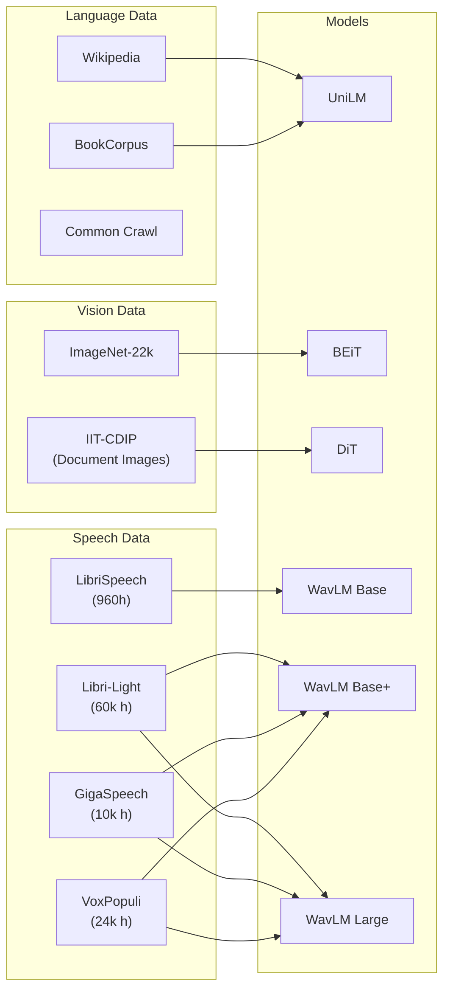

**Sources:** [README.md:43-95](), [wavlm/README.md:18-23]()

### Checkpoint Release Strategy

Models are released at strategic training milestones:

1. **Pre-trained base models**: Released after self-supervised pre-training
2. **Fine-tuned models**: Released for specific downstream tasks
3. **Intermediate checkpoints**: Occasionally released for research purposes

**Example: MiniLM checkpoints on OneDrive:**
- Base checkpoint: `1drv.ms/u/s!AjHn0yEmKG8qixAY...` (MiniLMv1-L12-H384-uncased)
- Fine-tuned variants: Available for specific tasks (SQuAD, XNLI, etc.)

**Sources:** [minilm/README.md:104-107]()

---

## Summary

The UniLM repository organizes models by modality and family, with each model residing in a dedicated top-level directory containing code, documentation, and training scripts. Models are distributed through Hugging Face Hub for easy integration and through direct checkpoint downloads via Azure Blob Storage and Google Drive for maximum availability. Shared infrastructure components like TorchScale and common tokenizers enable code reuse across model families, while maintaining flexibility for model-specific customizations.

**Sources:** [README.md:1-258](), [wavlm/README.md:1-135](), [minilm/README.md:1-287](), [deltalm/README.md:1-185]()

---

# Page: Vision Models

# Vision Models

<details>
<summary>Relevant source files</summary>

The following files were used as context for generating this wiki page:

- [beit/README.md](beit/README.md)
- [beit/datasets.py](beit/datasets.py)
- [beit/modeling_finetune.py](beit/modeling_finetune.py)
- [beit/modeling_pretrain.py](beit/modeling_pretrain.py)
- [beit/run_beit_pretraining.py](beit/run_beit_pretraining.py)
- [beit/run_class_finetuning.py](beit/run_class_finetuning.py)
- [beit/run_linear_eval.py](beit/run_linear_eval.py)
- [beit/semantic_segmentation/backbone/beit.py](beit/semantic_segmentation/backbone/beit.py)
- [beit/semantic_segmentation/mmcv_custom/checkpoint.py](beit/semantic_segmentation/mmcv_custom/checkpoint.py)
- [beit/utils.py](beit/utils.py)
- [dit/README.md](dit/README.md)
- [dit/object_detection/icdar19_configs/cascade/cascade_dit_base.yaml](dit/object_detection/icdar19_configs/cascade/cascade_dit_base.yaml)
- [dit/object_detection/icdar19_configs/cascade/cascade_dit_large.yaml](dit/object_detection/icdar19_configs/cascade/cascade_dit_large.yaml)

</details>


## Purpose and Scope

This document describes the vision pre-training models in the UniLM repository, specifically **BEiT** (BERT Pre-Training of Image Transformers) and **DiT** (Document Image Transformer). These models employ self-supervised learning on image data using masked image modeling objectives.

For multimodal document understanding models that combine vision and language, see [Document AI: Multimodal Models](#5). For vision-language generation models, see [Vision-Language Models](#6).

## Overview

The repository contains two primary vision transformer models:

| Model | Purpose | Pre-training Data | Key Innovation |
|-------|---------|------------------|----------------|
| BEiT | General vision pre-training | ImageNet-22k (14M images) | Masked image modeling with discrete VAE tokens |
| DiT | Document image understanding | IIT-CDIP (document corpus) | Self-supervised pre-training on document images |

Both models follow a Vision Transformer (ViT) architecture with patch-based image encoding, but differ in their pre-training objectives and target domains. BEiT serves as a foundational model for natural images, while DiT specializes in document layout analysis.

**Sources:** [beit/README.md:1-21](), [dit/README.md:1-13]()

## Model Architecture

### BEiT Architecture and Code Organization

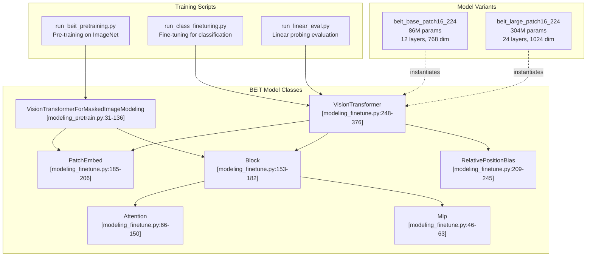

**BEiT Model Components:**

- **`PatchEmbed`**: Converts input images into patch embeddings using a convolutional projection with kernel size and stride equal to patch size (16x16)
- **`Attention`**: Multi-head self-attention with optional relative position bias
- **`Block`**: Standard transformer block with pre-normalization, attention, and MLP sublayers
- **`RelativePositionBias`**: Learnable relative position encodings based on spatial distances between patches
- **`VisionTransformer`**: Complete model for fine-tuning with classification head
- **`VisionTransformerForMaskedImageModeling`**: Pre-training model with mask token and language modeling head

**Sources:** [beit/modeling_finetune.py:1-421](), [beit/modeling_pretrain.py:1-164](), [beit/README.md:26-40]()

### DiT Architecture

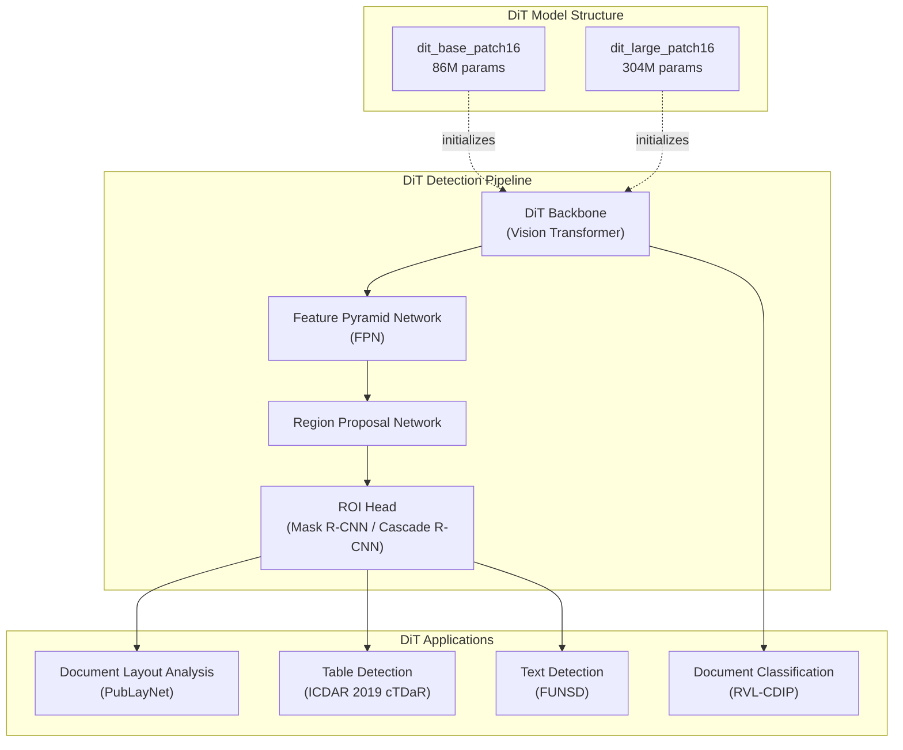

**DiT Architecture Details:**

DiT reuses the BEiT Vision Transformer architecture but is pre-trained on document images rather than natural images. The model uses the same patch embedding and transformer blocks as BEiT.

**Key Configuration Parameters:**
- Patch size: 16x16
- Input resolution: 224x224 (pre-training and fine-tuning)
- Pixel normalization: mean=[127.5, 127.5, 127.5], std=[127.5, 127.5, 127.5]

**Sources:** [dit/README.md:14-23](), [dit/object_detection/icdar19_configs/cascade/cascade_dit_base.yaml:1-22](), [dit/object_detection/icdar19_configs/cascade/cascade_dit_large.yaml:1-26]()

## Pre-training Process

### BEiT Masked Image Modeling

```mermaid
graph LR
    subgraph "Input Processing"
        InputImage["Input Image<br/>(224x224)"]
        Tokenizer["DALL-E dVAE Tokenizer<br/>(112x112 → 8192 vocab)"]
        VisualTokens["Visual Tokens<br/>(discrete codes)"]
    end
    
    subgraph "Masking Strategy"
        MaskGen["MaskingGenerator<br/>[masking_generator.py]"]
        NumPatches["num_mask_patches=75<br/>(out of 196 total)"]
    end
    
    subgraph "Model Training"
        PatchEmbed2["Patch Embedding<br/>(224x224 → 196 patches)"]
        MaskToken["Mask Token Replacement"]
        Transformer["BEiT Transformer<br/>(12 or 24 layers)"]
        LMHead["Language Model Head<br/>(predict masked tokens)"]
    end
    
    subgraph "Training Configuration"
        DataAug["DataAugmentationForBEiT<br/>[datasets.py:27-84]"]
        OptimConfig["AdamW optimizer<br/>lr=1.5e-3, warmup=10k steps"]
        Schedule["Cosine LR schedule<br/>150 epochs (ImageNet-22k)"]
    end
    
    InputImage --> Tokenizer
    Tokenizer --> VisualTokens
    InputImage --> DataAug
    DataAug --> PatchEmbed2
    
    MaskGen --> NumPatches
    NumPatches --> MaskToken
    
    PatchEmbed2 --> MaskToken
    MaskToken --> Transformer
    Transformer --> LMHead
    LMHead -.->|"cross-entropy loss"| VisualTokens
    
    OptimConfig --> Transformer
    Schedule --> Transformer
```

**Pre-training Implementation:**

The BEiT pre-training pipeline is implemented in [beit/run_beit_pretraining.py:1-281](). Key components:

1. **Visual Tokenizer**: Uses DALL-E's discrete VAE to tokenize images into discrete visual tokens (8192 vocabulary size)
2. **Masking**: Randomly masks 75 out of 196 patches (approximately 38%)
3. **Objective**: Predict masked visual tokens using cross-entropy loss
4. **Data Augmentation**: Color jitter, random horizontal flip, random resized crop with two different resolutions

**Key Training Function:**
```python
# From run_beit_pretraining.py
def get_model(args):
    model = create_model(
        args.model,  # e.g., 'beit_base_patch16_224_8k_vocab'
        pretrained=False,
        drop_path_rate=args.drop_path,
        use_shared_rel_pos_bias=args.rel_pos_bias,
        use_abs_pos_emb=args.abs_pos_emb,
        init_values=args.layer_scale_init_value,  # 0.1 for base, 1e-5 for large
    )
    return model
```

**Sources:** [beit/run_beit_pretraining.py:32-148](), [beit/datasets.py:27-91](), [beit/README.md:90-143]()

### DiT Pre-training

DiT follows a similar masked image modeling approach but operates directly on document images without an external visual tokenizer:

```mermaid
graph LR
    subgraph "DiT Pre-training Data"
        IITCDIP["IIT-CDIP Test Collection 1.0<br/>(document corpus)"]
        DocImages["Document Images<br/>(500k steps)"]
    end
    
    subgraph "Self-supervised Objective"
        MaskedDoc["Masked Document Patches"]
        DiTModel["DiT Transformer<br/>(base or large)"]
        Reconstruction["Image Reconstruction<br/>or Classification"]
    end
    
    IITCDIP --> DocImages
    DocImages --> MaskedDoc
    MaskedDoc --> DiTModel
    DiTModel --> Reconstruction
```

**Pre-trained Checkpoints:**
- **DiT-base**: 86M parameters, pre-trained for 500k steps on IIT-CDIP
- **DiT-large**: 304M parameters, pre-trained for 500k steps on IIT-CDIP

**Checkpoint URLs:**
- `dit_base_patch16_224`: [dit-pts/dit-base-224-p16-500k-62d53a.pth]()
- `dit_large_patch16_224`: [dit-pts/dit-large-224-p16-500k-d7a2fb.pth]()

**Sources:** [dit/README.md:14-24](), [dit/object_detection/icdar19_configs/cascade/cascade_dit_base.yaml:5-6]()

## Fine-tuning and Applications

### BEiT Fine-tuning Pipeline

```mermaid
graph TB
    subgraph "Pre-trained Checkpoints"
        PT22K["beit_base_patch16_224_pt22k<br/>(self-supervised on ImageNet-22k)"]
        FT22K["beit_base_patch16_224_pt22k_ft22k<br/>(+ intermediate fine-tuning)"]
    end
    
    subgraph "Fine-tuning Tasks"
        ImageClass["Image Classification<br/>(ImageNet-1k)"]
        SemanticSeg["Semantic Segmentation<br/>(ADE20K)"]
        LinearProbe["Linear Probing"]
    end
    
    subgraph "Fine-tuning Configuration"
        LayerDecay["Layer-wise Learning Rate Decay<br/>layer_decay=0.65 (base), 0.75 (large)"]
        DropPath["Stochastic Depth<br/>drop_path=0.1 (base), 0.2 (large)"]
        PosInterp["Position Embedding Interpolation<br/>(224→384 or 512)"]
    end
    
    PT22K --> FT22K
    FT22K --> ImageClass
    FT22K --> SemanticSeg
    PT22K --> LinearProbe
    
    LayerDecay --> ImageClass
    DropPath --> ImageClass
    PosInterp --> ImageClass
```

**BEiT Fine-tuning Results:**

| Model | Resolution | Pre-training | ImageNet-1k Acc@1 |
|-------|-----------|--------------|-------------------|
| BEiT-base | 224×224 | PT22K | 83.7% |
| BEiT-base | 224×224 | PT22K+FT22K | 85.2% |
| BEiT-base | 384×384 | PT22K+FT22K | 86.8% |
| BEiT-large | 224×224 | PT22K+FT22K | 87.4% |
| BEiT-large | 512×512 | PT22K+FT22K | 88.6% |

**Position Embedding Interpolation:**

When fine-tuning at different resolutions, BEiT interpolates position embeddings using geometric progression-based interpolation (implemented in [beit/run_class_finetuning.py:351-411]()):

```python
# Geometric progression for position interpolation
def geometric_progression(a, r, n):
    return a * (1.0 - r ** n) / (1.0 - r)

# Binary search to find optimal scaling factor
left, right = 1.01, 1.5
while right - left > 1e-6:
    q = (left + right) / 2.0
    gp = geometric_progression(1, q, src_size // 2)
    if gp > dst_size // 2:
        right = q
    else:
        left = q
```

**Sources:** [beit/README.md:65-88](), [beit/run_class_finetuning.py:217-594](), [beit/semantic_segmentation/mmcv_custom/checkpoint.py:310-483]()

### DiT Applications

```mermaid
graph TB
    subgraph "DiT Fine-tuning Tasks"
        DocClass["Document Classification<br/>(RVL-CDIP, 16 classes)"]
        LayoutDet["Layout Analysis<br/>(PubLayNet, 5 classes)"]
        TableDet["Table Detection<br/>(ICDAR 2019 cTDaR)"]
        TextDet["Text Detection<br/>(FUNSD)"]
    end
    
    subgraph "Detection Frameworks"
        MaskRCNN["Mask R-CNN"]
        CascadeRCNN["Cascade R-CNN"]
    end
    
    subgraph "DiT Base Checkpoints"
        DiTBase224["dit_base_patch16_224"]
    end
    
    subgraph "DiT Large Checkpoints"
        DiTLarge224["dit_large_patch16_224"]
    end
    
    DiTBase224 --> DocClass
    DiTBase224 --> MaskRCNN
    DiTBase224 --> CascadeRCNN
    DiTLarge224 --> DocClass
    DiTLarge224 --> MaskRCNN
    DiTLarge224 --> CascadeRCNN
    
    MaskRCNN --> LayoutDet
    MaskRCNN --> TableDet
    MaskRCNN --> TextDet
    CascadeRCNN --> LayoutDet
    CascadeRCNN --> TableDet
    CascadeRCNN --> TextDet
```

**DiT Performance on Document Tasks:**

| Task | Dataset | DiT-base (Mask R-CNN) | DiT-large (Cascade R-CNN) |
|------|---------|----------------------|---------------------------|
| Document Classification | RVL-CDIP | 92.11% accuracy | 92.69% accuracy |
| Layout Analysis | PubLayNet | 93.5 mAP | 94.9 mAP |
| Table Detection (Modern) | ICDAR 2019 | 94.74 F1 | 96.29 F1 |
| Table Detection (Archival) | ICDAR 2019 | 96.24 F1 | 97.00 F1 |

**Detection Configuration:**

DiT uses Detectron2 for object detection tasks. The configuration includes:
- **FPN (Feature Pyramid Network)**: Multi-scale features from layers [7, 11, 15, 23] for DiT-large
- **RPN**: Region Proposal Network with 2000 top-K proposals during training
- **ROI Head**: Class-agnostic bounding box regression for better generalization

Example configuration from [dit/object_detection/icdar19_configs/cascade/cascade_dit_large.yaml:1-26]():
```yaml
MODEL:
  PIXEL_MEAN: [127.5, 127.5, 127.5]
  PIXEL_STD: [127.5, 127.5, 127.5]
  WEIGHTS: "dit-pts/dit-large-224-p16-500k-d7a2fb.pth"
  VIT:
    NAME: "dit_large_patch16"
    OUT_FEATURES: ["layer7", "layer11", "layer15", "layer23"]
  ROI_HEADS:
    NAME: CascadeROIHeads
  RPN:
    POST_NMS_TOPK_TRAIN: 2000
```

**Sources:** [dit/README.md:54-105](), [dit/object_detection/icdar19_configs/cascade/cascade_dit_base.yaml:1-22](), [dit/object_detection/icdar19_configs/cascade/cascade_dit_large.yaml:1-26]()

## Key Implementation Details

### Model Initialization and Layer Scaling

Both BEiT and DiT use layer-wise parameter scaling to stabilize training of deep transformers:

```python
# From modeling_finetune.py and modeling_pretrain.py
def fix_init_weight(self):
    """Rescale parameters based on layer depth"""
    def rescale(param, layer_id):
        param.div_(math.sqrt(2.0 * layer_id))
    
    for layer_id, layer in enumerate(self.blocks):
        rescale(layer.attn.proj.weight.data, layer_id + 1)
        rescale(layer.mlp.fc2.weight.data, layer_id + 1)
```

**Layer Scale Initialization:**
- BEiT-base: `init_values=0.1`
- BEiT-large: `init_values=1e-5`
- Can be disabled by setting `init_values=0`

**Sources:** [beit/modeling_finetune.py:302-308](), [beit/modeling_pretrain.py:78-84]()

### Relative Position Bias

BEiT and DiT support relative position bias for spatial awareness:

```python
# From modeling_finetune.py
class RelativePositionBias(nn.Module):
    def __init__(self, window_size, num_heads):
        super().__init__()
        self.window_size = window_size
        # (2*Wh-1) * (2*Ww-1) + 3 (cls-to-token, token-to-cls, cls-to-cls)
        self.num_relative_distance = (2 * window_size[0] - 1) * (2 * window_size[1] - 1) + 3
        self.relative_position_bias_table = nn.Parameter(
            torch.zeros(self.num_relative_distance, num_heads))
```

The relative position bias table is shared across all layers when using `use_shared_rel_pos_bias=True`, or can be layer-specific.

**Sources:** [beit/modeling_finetune.py:209-245](), [beit/semantic_segmentation/backbone/beit.py:245-281]()

### Data Augmentation

BEiT uses specialized data augmentation for pre-training:

```python
# From datasets.py
class DataAugmentationForBEiT(object):
    def __init__(self, args):
        self.common_transform = transforms.Compose([
            transforms.ColorJitter(0.4, 0.4, 0.4),
            transforms.RandomHorizontalFlip(p=0.5),
            RandomResizedCropAndInterpolationWithTwoPic(
                size=args.input_size,  # 224 for patches
                second_size=args.second_input_size,  # 112 for visual tokens
                interpolation=args.train_interpolation,
                second_interpolation=args.second_interpolation,
            ),
        ])
```

Two different resolutions are used:
1. **High resolution (224×224)**: For patch embeddings input to the model
2. **Low resolution (112×112)**: For discrete VAE tokenization target

**Sources:** [beit/datasets.py:27-84]()

## Training Infrastructure

### Distributed Training Support

Both models support distributed training with the following features:

| Feature | Implementation |
|---------|---------------|
| Data Parallelism | `torch.nn.parallel.DistributedDataParallel` |
| Mixed Precision | `torch.cuda.amp.GradScaler` via `NativeScalerWithGradNormCount` |
| DeepSpeed | Optional integration for large-scale training |
| Gradient Checkpointing | Available for memory-efficient training |

**Gradient Clipping:**
- BEiT pre-training: `clip_grad=3.0`
- BEiT fine-tuning: `clip_grad=1.0` (large), `clip_grad=3.0` (base)

**Sources:** [beit/run_beit_pretraining.py:219-221](), [beit/run_class_finetuning.py:479-500](), [beit/utils.py:339-366]()

### Checkpoint Management

Models support automatic checkpoint resumption and saving:

```python
# From utils.py
def auto_load_model(args, model, model_without_ddp, optimizer, loss_scaler, model_ema=None):
    """Automatically finds and loads the latest checkpoint"""
    if args.auto_resume and len(args.resume) == 0:
        all_checkpoints = glob.glob(os.path.join(output_dir, 'checkpoint-*.pth'))
        latest_ckpt = max([int(ckpt.split('-')[-1].split('.')[0]) 
                          for ckpt in all_checkpoints if ckpt.split('-')[-1].split('.')[0].isdigit()])
        args.resume = os.path.join(output_dir, f'checkpoint-{latest_ckpt}.pth')
```

**Sources:** [beit/utils.py:473-523]()

## Model Variants and Checkpoints

### BEiT Model Zoo

| Model | Layers | Hidden Dim | Heads | Patch Size | Parameters | Checkpoint |
|-------|--------|-----------|-------|-----------|-----------|-----------|
| BEiT-base | 12 | 768 | 12 | 16×16 | 86M | `beit_base_patch16_224` |
| BEiT-large | 24 | 1024 | 16 | 16×16 | 304M | `beit_large_patch16_224` |

**Registered Model Functions:**
- `beit_base_patch16_224()` - [modeling_finetune.py:379-384]()
- `beit_base_patch16_384()` - [modeling_finetune.py:388-393]()
- `beit_large_patch16_224()` - [modeling_finetune.py:397-402]()
- `beit_large_patch16_384()` - [modeling_finetune.py:406-411]()
- `beit_large_patch16_512()` - [modeling_finetune.py:415-420]()

**Sources:** [beit/modeling_finetune.py:378-421](), [beit/README.md:26-40]()

### DiT Model Zoo

| Model | Parameters | Pre-training Steps | Applications |
|-------|-----------|-------------------|--------------|
| DiT-base | 86M | 500k | Document classification, layout analysis, table/text detection |
| DiT-large | 304M | 500k | Document classification, layout analysis, table/text detection |

**Configuration Names:**
- `dit_base_patch16` - DiT-base with 16×16 patch size
- `dit_large_patch16` - DiT-large with 16×16 patch size

**Sources:** [dit/README.md:14-23](), [dit/object_detection/icdar19_configs/cascade/cascade_dit_base.yaml:7-8]()

## Comparison with BEiT v2 and v3

This page covers BEiT v1. The repository also contains:
- **BEiT v2**: Uses vector-quantized visual tokenizers (not covered here)
- **BEiT-3**: Unified pre-training for vision and vision-language tasks (not covered here)

See the respective subdirectories `beit2/` and `beit3/` for these advanced versions.

**Sources:** [beit/README.md:5-13]()

---

# Page: BEiT: BERT Pre-Training of Image Transformers

# BEiT: BERT Pre-Training of Image Transformers

<details>
<summary>Relevant source files</summary>

The following files were used as context for generating this wiki page:

- [beit/README.md](beit/README.md)
- [beit/datasets.py](beit/datasets.py)
- [beit/modeling_finetune.py](beit/modeling_finetune.py)
- [beit/modeling_pretrain.py](beit/modeling_pretrain.py)
- [beit/run_beit_pretraining.py](beit/run_beit_pretraining.py)
- [beit/run_class_finetuning.py](beit/run_class_finetuning.py)
- [beit/run_linear_eval.py](beit/run_linear_eval.py)
- [beit/semantic_segmentation/backbone/beit.py](beit/semantic_segmentation/backbone/beit.py)
- [beit/semantic_segmentation/mmcv_custom/checkpoint.py](beit/semantic_segmentation/mmcv_custom/checkpoint.py)
- [beit/utils.py](beit/utils.py)

</details>


## Overview

BEiT (BERT Pre-Training of Image Transformers) adapts masked language modeling to vision by treating images as sequences of visual tokens. Instead of predicting masked words in text, BEiT predicts masked image patches using a discrete vocabulary of 8,192 visual tokens from DALL-E's discrete VAE. This self-supervised approach achieves state-of-the-art results: 88.6% top-1 accuracy on ImageNet-1k and 57.0 mIoU on ADE20K semantic segmentation.

**Core Innovation**: Block-wise masking of image patches (75 out of 196 patches) combined with discrete visual token prediction enables effective representation learning without labels.

**Key Components**:
- `VisionTransformerForMaskedImageModeling` - Pre-training model with mask token and LM head
- `Dalle_VAE` - Discrete tokenizer producing 8,192 visual tokens
- `MaskingGenerator` - Block-wise masking strategy for spatial coherence
- `run_beit_pretraining.py` - Pre-training script with distributed training support

For subsequent versions, see [BEiT v2 and BEiT-3](#2.2). For detailed architecture and fine-tuning, see subsections [2.1.1](#2.1.1) and [2.1.2](#2.1.2).

**Sources**: [beit/README.md:1-21](), [beit/run_beit_pretraining.py:1-280](), [beit/modeling_pretrain.py:31-136]()

## Pre-training Pipeline

### Masked Image Modeling Process

**Pre-training Pipeline Flow Diagram**
```mermaid
graph TB
    subgraph InputProcessing["Input Processing"]
        Image["Image<br/>(224×224×3)"]
        DVAETransform["DataAugmentationForBEiT<br/>visual_token_transform"]
        PatchTransform["DataAugmentationForBEiT<br/>patch_transform"]
    end
    
    subgraph Tokenization["Visual Tokenization"]
        DVAE["Dalle_VAE.get_codebook_indices()<br/>112×112 → 14×14 tokens"]
        TokenIDs["Visual Token IDs<br/>[0, 8191]"]
    end
    
    subgraph ModelForward["Model Forward"]
        PatchEmbed["PatchEmbed.forward()<br/>Conv2d: 224×224 → 14×14 patches"]
        Mask["MaskingGenerator()<br/>75 masked positions"]
        Replace["Replace with mask_token<br/>modeling_pretrain.py:114"]
        Blocks["Block.forward() × depth<br/>Attention + MLP"]
        LMHead["lm_head(x[bool_masked_pos])<br/>Linear(768 → 8192)"]
    end
    
    subgraph Loss["Loss Computation"]
        CE["CrossEntropyLoss<br/>predictions vs TokenIDs"]
    end
    
    Image --> DVAETransform
    Image --> PatchTransform
    DVAETransform --> DVAE
    DVAE --> TokenIDs
    PatchTransform --> PatchEmbed
    PatchEmbed --> Mask
    Mask --> Replace
    Replace --> Blocks
    Blocks --> LMHead
    LMHead --> CE
    TokenIDs --> CE
```

**Sources**: [beit/run_beit_pretraining.py:165-177](), [beit/modeling_pretrain.py:106-135](), [beit/datasets.py:27-84](), [beit/utils.py:525-537]()

### Visual Tokenization with DALL-E VAE

BEiT uses DALL-E's discrete VAE (`Dalle_VAE` in [beit/modeling_discrete_vae.py]()) to convert images into discrete visual tokens. The tokenizer processes a 112×112 downsampled version of each image and produces a 14×14 grid of token IDs from a vocabulary of 8,192 tokens.

| Component | Purpose | Code Entity |
|-----------|---------|-------------|
| **Discrete VAE** | Image → discrete tokens | `Dalle_VAE` class, `get_codebook_indices()` method |
| **Vocabulary Size** | Token ID range | `vocab_size=8192` in `VisionTransformerForMaskedImageModeling.__init__()` |
| **Tokenizer Resolution** | Downsampled input | `second_input_size=112` argument |
| **Token Transform** | Image preprocessing | `visual_token_transform` in `DataAugmentationForBEiT` |
| **Loading Function** | Create tokenizer instance | `utils.create_d_vae()` [beit/utils.py:525-537]() |

**Sources**: [beit/utils.py:525-537](), [beit/run_beit_pretraining.py:58-59,99-103,175-177](), [beit/datasets.py:49-63]()

### Block-wise Masking Strategy

BEiT masks 75 out of 196 patches (~40%) using block-wise masking (`MaskingGenerator` class) which masks contiguous regions rather than random individual patches. This encourages the model to learn spatial coherence and contextual relationships.

**Masking Implementation**:
```python
# From datasets.py:65-69
self.masked_position_generator = MaskingGenerator(
    args.window_size,                    # (14, 14) for 224x224 images
    num_masking_patches=args.num_mask_patches,  # 75
    max_num_patches=args.max_mask_patches_per_block,
    min_num_patches=args.min_mask_patches_per_block,  # 16
)
```

| Parameter | Default Value | Purpose |
|-----------|---------------|---------|
| `num_mask_patches` | 75 | Total patches to mask |
| `window_size` | (14, 14) | Patch grid dimensions |
| `min_mask_patches_per_block` | 16 | Minimum block size |
| `max_mask_patches_per_block` | None | Maximum block size (unconstrained) |

The masked positions are returned as a boolean tensor (`bool_masked_pos`) used to replace visible patches with `mask_token` in `VisionTransformerForMaskedImageModeling.forward()` [beit/modeling_pretrain.py:114-115]().

**Sources**: [beit/datasets.py:65-69](), [beit/run_beit_pretraining.py:51-54](), [beit/modeling_pretrain.py:106-115]()

## Architecture Components

### Model Class Hierarchy

**BEiT Model Architecture and Code Mapping**
```mermaid
graph TB
    subgraph PretrainModel["Pre-training: VisionTransformerForMaskedImageModeling"]
        PretrainInit["__init__()<br/>modeling_pretrain.py:32-76"]
        PretrainEmbed["self.patch_embed<br/>PatchEmbed instance"]
        PretrainTokens["self.cls_token<br/>self.mask_token<br/>self.pos_embed"]
        PretrainBlocks["self.blocks<br/>nn.ModuleList[Block]"]
        PretrainLM["self.lm_head<br/>Linear(embed_dim, 8192)"]
        PretrainFwd["forward(x, bool_masked_pos)<br/>modeling_pretrain.py:128-135"]
    end
    
    subgraph FinetuneModel["Fine-tuning: VisionTransformer"]
        FinetuneInit["__init__()<br/>modeling_finetune.py:251-300"]
        FinetuneEmbed["self.patch_embed<br/>PatchEmbed instance"]
        FinetuneTokens["self.cls_token<br/>self.pos_embed"]
        FinetuneBlocks["self.blocks<br/>nn.ModuleList[Block]"]
        FinetuneHead["self.head<br/>Linear(embed_dim, num_classes)"]
        FinetuneFwd["forward(x)<br/>modeling_finetune.py:354-357"]
    end
    
    subgraph SharedModules["Shared Building Blocks"]
        PatchEmbedClass["PatchEmbed<br/>Conv2d(in_chans, embed_dim,<br/>kernel_size=patch_size,<br/>stride=patch_size)"]
        BlockClass["Block<br/>norm1 → attn → norm2 → mlp<br/>with DropPath + layer_scale"]
        AttentionClass["Attention<br/>qkv → attention scores<br/>+ relative_position_bias"]
        MlpClass["Mlp<br/>fc1 → GELU → fc2"]
    end
    
    PretrainInit --> PretrainEmbed
    PretrainInit --> PretrainTokens
    PretrainInit --> PretrainBlocks
    PretrainInit --> PretrainLM
    PretrainEmbed --> PretrainFwd
    PretrainBlocks --> PretrainFwd
    
    FinetuneInit --> FinetuneEmbed
    FinetuneInit --> FinetuneTokens
    FinetuneInit --> FinetuneBlocks
    FinetuneInit --> FinetuneHead
    FinetuneEmbed --> FinetuneFwd
    FinetuneBlocks --> FinetuneFwd
    
    PretrainEmbed -.instantiates.-> PatchEmbedClass
    FinetuneEmbed -.instantiates.-> PatchEmbedClass
    PretrainBlocks -.contains.-> BlockClass
    FinetuneBlocks -.contains.-> BlockClass
    BlockClass -.contains.-> AttentionClass
    BlockClass -.contains.-> MlpClass
```

**Sources**: [beit/modeling_pretrain.py:31-136](), [beit/modeling_finetune.py:248-376](), [beit/modeling_finetune.py:153-182](), [beit/modeling_finetune.py:66-150]()

### Model Variant Specifications

| Model | Embed Dim | Depth | Heads | MLP Ratio | Params | Layer Scale | Code Registration |
|-------|-----------|-------|-------|-----------|--------|-------------|-------------------|
| **BEiT-Base** | 768 | 12 | 12 | 4x | 86M | 0.1 | `beit_base_patch16_224` in [modeling_finetune.py:379-384]() |
| **BEiT-Large** | 1024 | 24 | 16 | 4x | 304M | 1e-5 | `beit_large_patch16_224` in [modeling_finetune.py:397-402]() |

Both models use:
- **Patch size**: 16×16
- **QKV bias**: True
- **Relative position bias**: True (default)
- **Absolute position embedding**: Optional (disabled by default)

**Sources**: [beit/modeling_finetune.py:379-420](), [beit/modeling_pretrain.py:139-163](), [beit/README.md:30-31]()

### Attention Mechanism with Relative Position Bias

BEiT uses relative position bias to encode spatial relationships between patches. The bias is computed from a learnable table and added to attention scores before softmax.

```mermaid
graph TB
    subgraph "Attention Forward Pass"
        Input["Input: x<br/>(B, N, C)"]
        QKV["qkv = Linear(x)<br/>with q_bias and v_bias"]
        Split["Reshape to<br/>(B, num_heads, N, head_dim)"]
        Scores["attn = (Q @ K.T) * scale"]
        RelBias["relative_position_bias<br/>from bias_table[position_index]"]
        AddBias["attn = attn + rel_pos_bias"]
        Softmax["softmax(attn)"]
        Values["output = attn @ V"]
        Proj["Linear projection<br/>output: (B, N, C)"]
    end
    
    Input --> QKV
    QKV --> Split
    Split --> Scores
    RelBias --> AddBias
    Scores --> AddBias
    AddBias --> Softmax
    Softmax --> Values
    Values --> Proj
```

The relative position bias table has shape `(num_relative_distance, num_heads)` where:
- `num_relative_distance = (2*H-1) * (2*W-1) + 3` for H×W patch grid
- The "+3" accounts for: cls-to-token, token-to-cls, and cls-to-cls interactions

**Sources**: [beit/modeling_finetune.py:66-150](), [beit/modeling_finetune.py:209-245]()

### Layer Scale Initialization

BEiT introduces layer-wise scaling factors (`gamma_1`, `gamma_2`) applied to attention and MLP outputs, initialized to small values for training stability:

```python
# In Block.forward()
if self.gamma_1 is not None:
    x = x + self.drop_path(self.gamma_1 * self.attn(self.norm1(x)))
    x = x + self.drop_path(self.gamma_2 * self.mlp(self.norm2(x)))
```

| Model | Layer Scale Init Value | Rationale |
|-------|------------------------|-----------|
| **Base** | 0.1 | Standard initialization for 12-layer model |
| **Large** | 1e-5 | Smaller value for deeper 24-layer model improves stability |

**Sources**: [beit/modeling_finetune.py:169-181](), [beit/run_beit_pretraining.py:48-49](), [beit/README.md:120]()

## Pre-training Implementation

### Training Script Flow

**run_beit_pretraining.py Execution Flow**
```mermaid
graph TB
    subgraph Setup["Setup Phase (main function)"]
        ParseArgs["get_args()<br/>line 33-132"]
        InitDist["utils.init_distributed_mode()<br/>line 151"]
        CreateModel["get_model(args)<br/>create_model(beit_base_patch16_224_8k_vocab)<br/>line 135-147"]
        LoadDVAE["utils.create_d_vae()<br/>weight_path=discrete_vae_weight_path<br/>line 175-177"]
        BuildDataset["build_beit_pretraining_dataset(args)<br/>DataAugmentationForBEiT transform<br/>line 172"]
    end
    
    subgraph TrainingLoop["Training Loop (epochs 0 to args.epochs)"]
        CreateOptim["create_optimizer(args, model)<br/>AdamW with weight_decay<br/>line 223-224"]
        CreateScheduler["utils.cosine_scheduler()<br/>lr_schedule_values, wd_schedule_values<br/>line 228-235"]
        EpochLoop["for epoch in range(start_epoch, epochs)<br/>line 243"]
        TrainEpoch["train_one_epoch()<br/>model, d_vae, data_loader,<br/>optimizer, loss_scaler<br/>line 248-255"]
        SaveCkpt["utils.save_model()<br/>if (epoch+1) % save_ckpt_freq == 0<br/>line 257-260"]
    end
    
    ParseArgs --> InitDist
    InitDist --> CreateModel
    InitDist --> LoadDVAE
    InitDist --> BuildDataset
    CreateModel --> CreateOptim
    CreateOptim --> CreateScheduler
    CreateScheduler --> EpochLoop
    EpochLoop --> TrainEpoch
    TrainEpoch --> SaveCkpt
    SaveCkpt --> EpochLoop
```

**Key Functions**:
- `get_args()` [beit/run_beit_pretraining.py:33-132]() - Parses command-line arguments
- `get_model()` [beit/run_beit_pretraining.py:135-147]() - Creates model via `timm.models.create_model()`
- `build_beit_pretraining_dataset()` [beit/datasets.py:87-90]() - Returns `ImageFolder` with `DataAugmentationForBEiT`
- `train_one_epoch()` [beit/engine_for_pretraining.py]() - Training loop implementation

**Sources**: [beit/run_beit_pretraining.py:33-280](), [beit/datasets.py:27-90]()

### Data Augmentation Pipeline

The pre-training pipeline applies specific augmentations and generates two views of each image: one for patch embeddings (224×224) and one for the discrete VAE (112×112).

| Augmentation | Purpose | Implementation |
|--------------|---------|----------------|
| **ColorJitter(0.4)** | Color variation | [datasets.py:34]() |
| **RandomHorizontalFlip(0.5)** | Horizontal flipping | [datasets.py:35]() |
| **RandomResizedCropAndInterpolationWithTwoPic** | Crop with dual output | [datasets.py:36-39]() |
| **Normalization** | Mean=[0.5, 0.5, 0.5], Std=[0.5, 0.5, 0.5] | [datasets.py:42-47]() |
| **Visual token transform** | map_pixels for DALL-E | [datasets.py:49-53]() |

**Sources**: [beit/datasets.py:27-90]()

### Pre-training Configuration

#### Example: Pre-training BEiT-Base on ImageNet-22k

Command to pre-train BEiT-Base on ImageNet-22k using 16 GPUs:

```bash
OMP_NUM_THREADS=1 python -m torch.distributed.launch --nproc_per_node=16 \
    run_beit_pretraining.py \
    --data_path ${DATA_PATH} \
    --output_dir ${OUTPUT_DIR} \
    --num_mask_patches 75 \
    --model beit_base_patch16_224_8k_vocab \
    --discrete_vae_weight_path ${TOKENIZER_PATH} \
    --batch_size 128 \
    --lr 1.5e-3 \
    --warmup_steps 10000 \
    --epochs 150 \
    --clip_grad 3.0 \
    --drop_path 0.1 \
    --layer_scale_init_value 0.1
```

#### Hyperparameter Settings

| Parameter | BEiT-Base | BEiT-Large | Code Reference |
|-----------|-----------|------------|----------------|
| `--batch_size` | 128 | 128 | Per-GPU batch size [line 35]() |
| `--lr` | 1.5e-3 | 1.5e-3 | Peak learning rate [line 81]() |
| `--warmup_steps` | 10,000 | 10,000 | LR warmup steps [line 90]() |
| `--epochs` | 150 | 150 | Total epochs [line 36]() |
| `--weight_decay` | 0.05 | 0.05 | AdamW weight decay [line 75]() |
| `--clip_grad` | 3.0 | 3.0 | Gradient clipping norm [line 71]() |
| `--drop_path` | 0.1 | 0.1 | Stochastic depth [line 61]() |
| `--layer_scale_init_value` | 0.1 | 1e-5 | Layer scale init [line 48]() |
| `--num_mask_patches` | 75 | 75 | Patches to mask [line 51]() |

**Effective batch size** = `batch_size` × `nproc_per_node` = 128 × 16 = **2048**

**Sources**: [beit/README.md:90-121](), [beit/run_beit_pretraining.py:35-90]()

### Optimizer and Scheduler Configuration

```mermaid
graph LR
    subgraph "Optimizer Setup"
        Params["Model Parameters"]
        AdamW["AdamW Optimizer<br/>β1=0.9, β2=0.999<br/>eps=1e-8"]
        WDSchedule["Weight Decay Schedule<br/>Cosine decay"]
    end
    
    subgraph "Learning Rate Schedule"
        WarmupLR["Warmup Phase<br/>10k steps<br/>1e-6 → 1.5e-3"]
        CosineLR["Cosine Decay<br/>1.5e-3 → 1e-5"]
    end
    
    Params --> AdamW
    AdamW --> WDSchedule
    WarmupLR --> CosineLR
```

The learning rate schedule uses cosine annealing with linear warmup:
- **Warmup**: 10,000 steps from 1e-6 to 1.5e-3
- **Cosine decay**: 1.5e-3 to 1e-5 over remaining steps
- **Weight decay**: Cosine schedule from 0.05 to 0.05 (constant by default)

**Sources**: [beit/run_beit_pretraining.py:223-236](), [beit/utils.py:383-400]()

## Fine-tuning Procedures

### Fine-tuning Strategy

**Two-Stage vs. Direct Fine-tuning Paths**
```mermaid
graph TB
    subgraph TwoStage["Recommended: Two-Stage Fine-tuning"]
        PT22K["beit_*_patch16_224_pt22k.pth<br/>Self-supervised pre-training"]
        FT22K["Stage 1: run_class_finetuning.py<br/>--finetune pt22k.pth<br/>--nb_classes 21841<br/>--epochs 90<br/>→ beit_*_pt22k_ft22k.pth"]
        FT1K["Stage 2: run_class_finetuning.py<br/>--finetune pt22k_ft22k.pth<br/>--nb_classes 1000<br/>--epochs 20-100<br/>→ beit_*_ft22kto1k.pth"]
    end
    
    subgraph DirectPath["Alternative: Direct Fine-tuning"]
        PT22KDirect["beit_*_patch16_224_pt22k.pth"]
        FT1KDirect["run_class_finetuning.py<br/>--finetune pt22k.pth<br/>--nb_classes 1000<br/>--epochs 100<br/>→ beit_*_pt22k_ft1k.pth"]
    end
    
    PT22K --> FT22K
    FT22K --> FT1K
    PT22KDirect --> FT1KDirect
```

**Performance comparison**: Two-stage fine-tuning (pt22k → ft22k → ft1k) improves ImageNet-1k top-1 accuracy by **1.5%** compared to direct fine-tuning (pt22k → ft1k):
- BEiT-Base: 83.7% (direct) vs. **85.2%** (two-stage)
- BEiT-Large: 86.0% (direct) vs. **87.4%** (two-stage)

**Sources**: [beit/README.md:33-36,69-77]()

### Model Adaptation for Fine-tuning

#### Architectural Changes

When loading pre-trained weights for fine-tuning, BEiT adapts the model architecture:

| Component | Pre-training | Fine-tuning | Code Location |
|-----------|--------------|-------------|---------------|
| **Output Head** | `lm_head: Linear(embed_dim, 8192)` | `head: Linear(embed_dim, num_classes)` | [modeling_finetune.py:287]() |
| **Pooling** | Predict masked tokens | Mean pooling (default) or CLS token | [modeling_finetune.py:285-286,348-352]() |
| **Position Embeddings** | 224×224 resolution | Bicubic interpolation for higher res | [run_class_finetuning.py:413-434]() |
| **Relative Position Bias** | Shared or per-layer | Geometric interpolation | [run_class_finetuning.py:337-411]() |
| **Tokens** | `cls_token` + `mask_token` | `cls_token` only | [modeling_finetune.py:264]() |

The fine-tuning script (`run_class_finetuning.py`) automatically handles:
1. Loading checkpoint from `--finetune` path [line 315-320]()
2. Removing incompatible head weights [line 332-335]()
3. Expanding shared relative position bias to per-layer [line 337-344]()
4. Interpolating position embeddings if resolution changes [line 413-434]()

**Sources**: [beit/modeling_finetune.py:248-357](), [beit/run_class_finetuning.py:295-437]()

#### Example: Fine-tuning BEiT-Large on ImageNet-22k

Stage 1 command (ImageNet-22k classification with 21,841 classes):

```bash
OMP_NUM_THREADS=1 python -m torch.distributed.launch --nproc_per_node=16 \
    run_class_finetuning.py \
    --model beit_large_patch16_224 \
    --data_path $DATA_PATH \
    --nb_classes 21841 \
    --data_set image_folder \
    --disable_eval_during_finetuning \
    --finetune https://github.com/addf400/files/releases/download/v1.0/beit_large_patch16_224_pt22k.pth \
    --output_dir $OUTPUT_DIR \
    --batch_size 64 \
    --lr 2e-3 \
    --update_freq 2 \
    --warmup_epochs 5 \
    --epochs 90 \
    --layer_decay 0.75 \
    --drop_path 0.2 \
    --weight_decay 0.05 \
    --enable_deepspeed \
    --layer_scale_init_value 1e-5 \
    --clip_grad 1.0
```

#### Fine-tuning Hyperparameters

| Parameter | BEiT-Base | BEiT-Large | Purpose |
|-----------|-----------|------------|---------|
| `--lr` | 3e-3 | 2e-3 | Peak learning rate |
| `--layer_decay` | 0.65 | 0.75 | Layer-wise LR scaling |
| `--drop_path` | 0.2 | 0.2 | Stochastic depth |
| `--epochs` | 90 | 90 | Training epochs |
| `--batch_size` | 256 | 64 | Per-GPU batch size |
| `--update_freq` | 1 | 2 | Gradient accumulation steps |
| **Effective Batch** | 4096 | 2048 | `batch_size × update_freq × 16` |

**Sources**: [beit/README.md:144-186](), [beit/run_class_finetuning.py:37-214]()

### Layer-wise Learning Rate Decay

BEiT implements layer-wise LR decay where earlier layers (closer to input) receive exponentially smaller learning rates:

```python
# From run_class_finetuning.py:465-472
if args.layer_decay < 1.0:
    assigner = LayerDecayValueAssigner(
        list(args.layer_decay ** (num_layers + 1 - i) for i in range(num_layers + 2))
    )
```

**Decay formula**: `lr_layer_i = base_lr × (layer_decay)^(num_layers + 1 - i)`

**Example for BEiT-Large** (`layer_decay=0.75`, `num_layers=24`):

| Layer | Layer Index | Decay Factor | Effective LR (if base=2e-3) |
|-------|-------------|--------------|------------------------------|
| Patch embedding | 0 | 0.75^25 | 2e-3 × 0.75^25 ≈ 2e-6 |
| Block 0 | 1 | 0.75^24 | 2e-3 × 0.75^24 ≈ 3e-6 |
| Block 23 | 24 | 0.75^1 | 2e-3 × 0.75 = 1.5e-3 |
| Head | 25 | 0.75^0 = 1.0 | 2e-3 × 1.0 = 2e-3 |

This strategy prevents catastrophic forgetting in lower layers while allowing upper layers to adapt more quickly to downstream tasks.

**Sources**: [beit/run_class_finetuning.py:465-472](), [beit/optim_factory.py:27-50]() (imported `LayerDecayValueAssigner`)

### Position Embedding Interpolation

When fine-tuning at different resolutions, BEiT interpolates position embeddings using geometric progression for relative position bias and bicubic interpolation for absolute position embeddings.

```mermaid
graph TB
    subgraph "Position Interpolation"
        CheckSrc["Source: 14×14 grid<br/>(196 patches at 224px)"]
        CheckDst["Target: 24×24 grid<br/>(576 patches at 384px)"]
        
        subgraph "Absolute Position Embedding"
            AbsInterp["Bicubic Interpolation<br/>pos_embed[1:] reshaped<br/>(14,14,768) → (24,24,768)"]
        end
        
        subgraph "Relative Position Bias"
            GeomProg["Geometric Progression<br/>Find scaling factor q"]
            CubicInterp["Cubic 2D Interpolation<br/>bias_table per head"]
        end
    end
    
    CheckSrc --> CheckDst
    CheckDst --> AbsInterp
    CheckDst --> GeomProg
    GeomProg --> CubicInterp
```

**Sources**: [beit/run_class_finetuning.py:413-434](), [beit/run_class_finetuning.py:337-411](), [beit/semantic_segmentation/mmcv_custom/checkpoint.py:440-479]()

## Checkpoint Management and Model Loading

### Available Pre-trained Checkpoints

BEiT provides checkpoints at different training stages:

| Checkpoint Type | Description | File Pattern | Use Case |
|-----------------|-------------|--------------|----------|
| **Self-supervised Pre-trained** | ImageNet-22k MIM pre-training | `beit_*_pt22k.pth` | Research, custom fine-tuning |
| **Intermediate Fine-tuned** | Pre-trained + IN22k fine-tuning | `beit_*_pt22k_ft22k.pth` | Recommended starting point |
| **Final Fine-tuned** | Fully fine-tuned on IN1k | `beit_*_ft1k.pth` or `beit_*_ft22kto1k.pth` | Direct evaluation |

**Download locations**:
- Base self-supervised: [beit/README.md:38]()
- Large self-supervised: [beit/README.md:39]()
- Base intermediate: [beit/README.md:34]()
- Large intermediate: [beit/README.md:35]()

**Sources**: [beit/README.md:26-40](), [beit/README.md:69-77]()

### Loading and State Dict Handling

BEiT implements flexible checkpoint loading with support for different state dict keys and automatic interpolation:

```mermaid
graph TB
    subgraph "Checkpoint Loading Pipeline"
        Load["Load checkpoint file<br/>torch.load() or hub.load_state_dict_from_url()"]
        ExtractKey["Extract state_dict<br/>Try keys: model | module | teacher"]
        RemoveHead["Remove head weights<br/>if shape mismatch"]
        ExpandRelPos["Expand shared rel_pos_bias<br/>to per-layer if needed"]
        InterpolatePos["Interpolate position embeddings<br/>if resolution differs"]
        InterpolateRel["Interpolate relative position bias<br/>if resolution differs"]
        LoadState["utils.load_state_dict()<br/>Load with strict=False"]
    end
    
    Load --> ExtractKey
    ExtractKey --> RemoveHead
    RemoveHead --> ExpandRelPos
    ExpandRelPos --> InterpolatePos
    InterpolatePos --> InterpolateRel
    InterpolateRel --> LoadState
```

**Sources**: [beit/run_class_finetuning.py:315-437](), [beit/utils.py:290-337]()

### Checkpoint Key Handling

The loading logic tries multiple possible keys in the checkpoint:

```python
# From run_class_finetuning.py
for model_key in args.model_key.split('|'):  # Default: "model|module"
    if model_key in checkpoint:
        checkpoint_model = checkpoint[model_key]
        break
```

This handles checkpoints saved from:
- Single GPU training: `checkpoint['model']`
- DistributedDataParallel: `checkpoint['module']`  
- EMA models: `checkpoint['teacher']`

**Sources**: [beit/run_class_finetuning.py:324-330](), [beit/utils.py:290-337]()

## Performance Benchmarks

### ImageNet-1k Classification Results

| Model | Init Checkpoint | Resolution | Top-1 | Top-5 | Params | Weight | Log |
|-------|----------------|------------|-------|-------|--------|--------|-----|
| BEiT-Base | pt22k | 224 | 83.7% | 96.6% | 87M | [link](https://github.com/addf400/files/releases/download/v1.0/beit_base_patch16_224_pt22k_ft1k.pth) | [link](https://paste.ubuntu.com/p/79z5PncrKZ/) |
| BEiT-Base | pt22k_ft22k | 224 | **85.2%** | **97.6%** | 87M | [link](https://github.com/addf400/files/releases/download/v1.0/beit_base_patch16_224_pt22k_ft22kto1k.pth) | [link](https://paste.ubuntu.com/p/KqFh55cwq4/) |
| BEiT-Base | pt22k_ft22k | 384 | **86.8%** | **98.1%** | 87M | [link](https://github.com/addf400/files/releases/download/v1.0/beit_base_patch16_384_pt22k_ft22kto1k.pth) | [link](https://paste.ubuntu.com/p/jnpD4NGZQn/) |
| BEiT-Large | pt22k | 224 | 86.0% | 97.6% | 304M | [link](https://github.com/addf400/files/releases/download/v1.0/beit_large_patch16_224_pt22k_ft1k.pth) | [link](https://paste.ubuntu.com/p/r4X4gHq6W5/) |
| BEiT-Large | pt22k_ft22k | 224 | **87.4%** | **98.3%** | 304M | [link](https://github.com/addf400/files/releases/download/v1.0/beit_large_patch16_224_pt22k_ft22kto1k.pth) | [link](https://paste.ubuntu.com/p/DpHhW5Zgk5/) |
| BEiT-Large | pt22k_ft22k | 384 | **88.4%** | **98.6%** | 305M | [link](https://github.com/addf400/files/releases/download/v1.0/beit_large_patch16_384_pt22k_ft22kto1k.pth) | [link](https://paste.ubuntu.com/p/xKTBDwPMd2/) |
| BEiT-Large | pt22k_ft22k | 512 | **88.6%** | **98.7%** | 306M | [link](https://github.com/addf400/files/releases/download/v1.0/beit_large_patch16_512_pt22k_ft22kto1k.pth) | [link](https://paste.ubuntu.com/p/Wsb3NwkfCR/) |

**Key findings**:
- **Two-stage fine-tuning** improves accuracy by 1.5% (Base) and 1.4% (Large)
- **Higher resolution** consistently improves performance
- **State-of-the-art**: 88.6% top-1 accuracy (BEiT-Large @ 512×512) without external data beyond ImageNet-22k

**Sources**: [beit/README.md:69-77]()

### ADE20K Semantic Segmentation Results

| Model | Init Checkpoint | Backbone | Decoder | mIoU | mIoU (ms+flip) | Params |
|-------|----------------|----------|---------|------|----------------|--------|
| BEiT-Base | pt22k_ft22k | BEiT-Base | UPerNet | 53.6 | **54.2** | 163M |
| BEiT-Large | pt22k_ft22k | BEiT-Large | UPerNet | 56.7 | **57.0** | 441M |

**Training setup**: 640×640 crop size, 160k iterations, UPerNet decoder

BEiT-Large achieves **57.0 mIoU** with multi-scale testing and horizontal flipping, setting a new state-of-the-art on ADE20K (as of July 2021).

**Sources**: [beit/README.md:80-87](), [beit/README.md:18]()

## Semantic Segmentation Integration

### BEiT Backbone for MMSegmentation

BEiT provides a custom backbone (`BEiT` class in [beit/semantic_segmentation/backbone/beit.py:284-449]()) that integrates with MMSegmentation. The backbone extracts multi-scale features from specified transformer layers.

**BEiT Backbone Feature Extraction**
```mermaid
graph TB
    subgraph InputStage["Input Stage"]
        Image["Image<br/>(H, W, 3)"]
        PE["self.patch_embed(x)<br/>→ (Hp, Wp) patches"]
        AddCLS["Add cls_token<br/>Add pos_embed"]
    end
    
    subgraph BlocksStage["Transformer Blocks"]
        B0["blocks[0](x)"]
        B3["blocks[3](x)<br/>Extract if 3 in out_indices"]
        B5["blocks[5](x)<br/>Extract if 5 in out_indices"]
        B7["blocks[7](x)<br/>Extract if 7 in out_indices"]
        B11["blocks[11](x)<br/>Extract if 11 in out_indices"]
    end
    
    subgraph FPNStage["Feature Pyramid Network"]
        F1["self.fpn1(features[0])<br/>ConvTranspose2d 4× upsample"]
        F2["self.fpn2(features[1])<br/>ConvTranspose2d 2× upsample"]
        F3["self.fpn3(features[2])<br/>Identity"]
        F4["self.fpn4(features[3])<br/>MaxPool2d 2× downsample"]
    end
    
    subgraph Output["Output Features"]
        MS["Multi-scale features<br/>strides: [4, 8, 16, 32]"]
    end
    
    Image --> PE
    PE --> AddCLS
    AddCLS --> B0
    B0 --> B3
    B3 --> B5
    B5 --> B7
    B7 --> B11
    
    B3 --> F1
    B5 --> F2
    B7 --> F3
    B11 --> F4
    
    F1 --> MS
    F2 --> MS
    F3 --> MS
    F4 --> MS
```

**Sources**: [beit/semantic_segmentation/backbone/beit.py:284-449]()

### Backbone Configuration Parameters

The `BEiT` backbone class is registered with MMSegmentation using `@BACKBONES.register_module()` decorator [beit/semantic_segmentation/backbone/beit.py:284]():

| Parameter | Purpose | Default | Usage |
|-----------|---------|---------|-------|
| `out_indices` | Which block outputs to extract | `[3, 5, 7, 11]` | Controls multi-scale feature layers |
| `use_checkpoint` | Enable gradient checkpointing | `False` | Set `True` for memory-constrained training |
| `patch_size` | Patch dimension | `16` | Use `8` for higher resolution |
| `embed_dim` | Model width | `768` (Base) | `1024` for Large |
| `depth` | Number of transformer blocks | `12` (Base) | `24` for Large |
| `use_abs_pos_emb` | Absolute position embedding | `True` | Set `False` for relative-only |
| `use_rel_pos_bias` | Relative position bias | `False` | Set `True` for per-layer bias |
| `use_shared_rel_pos_bias` | Shared relative position bias | `False` | Set `True` for shared bias |

**Sources**: [beit/semantic_segmentation/backbone/beit.py:284-334]()

### Feature Pyramid Network Heads

For `patch_size=16`, the backbone creates 4-scale outputs via FPN heads [beit/semantic_segmentation/backbone/beit.py:336-364]():

| FPN Head | Operation | Stride Change | Output Stride |
|----------|-----------|---------------|---------------|
| `self.fpn1` | ConvTranspose2d(×2) → BN → GELU → ConvTranspose2d(×2) | 16 → 4 | 4 |
| `self.fpn2` | ConvTranspose2d(×2) | 16 → 8 | 8 |
| `self.fpn3` | Identity | 16 → 16 | 16 |
| `self.fpn4` | MaxPool2d(×2) | 16 → 32 | 32 |

This creates a feature pyramid at strides {4, 8, 16, 32}, compatible with decoders like UPerNet and FPN.

**Sources**: [beit/semantic_segmentation/backbone/beit.py:336-364]()

## Training Infrastructure

### Distributed Training Modes

**Distributed Training Configuration**
```mermaid
graph TB
    subgraph Launch["Launcher"]
        TorchLaunch["torch.distributed.launch<br/>--nproc_per_node=N<br/>--nnodes=M"]
    end
    
    subgraph DDPMode["DDP Mode (Default)"]
        InitDist["utils.init_distributed_mode(args)<br/>line 256-287"]
        WrapDDP["torch.nn.parallel.DistributedDataParallel<br/>find_unused_parameters=True<br/>line 220, 493"]
        Scaler["NativeScalerWithGradNormCount<br/>torch.cuda.amp.GradScaler<br/>line 225, 500"]
    end
    
    subgraph DeepSpeedMode["DeepSpeed Mode (Optional)"]
        CreateConfig["utils.create_ds_config(args)<br/>line 221, 560-590"]
        DSInit["deepspeed.initialize()<br/>line 485-487"]
        GradAccum["Gradient accumulation<br/>model.gradient_accumulation_steps()"]
    end
    
    TorchLaunch --> InitDist
    InitDist --> WrapDDP
    InitDist --> CreateConfig
    WrapDDP --> Scaler
    CreateConfig --> DSInit
    DSInit --> GradAccum
```

**Enabling DeepSpeed**: Add `--enable_deepspeed` flag to `run_class_finetuning.py` [line 198]()

**Sources**: [beit/run_beit_pretraining.py:219-221](), [beit/run_class_finetuning.py:198,479-500](), [beit/utils.py:256-287,560-590]()

### Mixed Precision Training

BEiT uses PyTorch's native AMP via `NativeScalerWithGradNormCount` [beit/utils.py:339-366]():

```python
# From utils.py:339-366
class NativeScalerWithGradNormCount:
    state_dict_key = "amp_scaler"
    
    def __init__(self):
        self._scaler = torch.cuda.amp.GradScaler()
    
    def __call__(self, loss, optimizer, clip_grad=None, parameters=None, ...):
        self._scaler.scale(loss).backward(create_graph=create_graph)
        if update_grad:
            if clip_grad is not None:
                self._scaler.unscale_(optimizer)
                norm = torch.nn.utils.clip_grad_norm_(parameters, clip_grad)
            else:
                self._scaler.unscale_(optimizer)
                norm = get_grad_norm_(parameters)
            self._scaler.step(optimizer)
            self._scaler.update()
        return norm
```

**Benefits**:
- **Faster training**: FP16 reduces memory bandwidth and enables larger batches
- **Gradient clipping**: Applies clipping after unscaling for stability
- **Loss scaling**: Automatic dynamic loss scaling prevents underflow

**Required dependency**: PyTorch >= 1.6 with CUDA support

**Sources**: [beit/utils.py:339-366](), [beit/README.md:55-62]()

### Gradient Accumulation and Update Frequency

For fine-tuning with limited GPU memory:

```python
# Effective batch size = batch_size × update_freq × num_gpus
# Example: 64 × 2 × 16 = 2048
--batch_size 64 --update_freq 2
```

Gradients are accumulated for `update_freq` iterations before updating parameters, allowing larger effective batch sizes without increased memory.

**Sources**: [beit/run_class_finetuning.py:41](), [beit/run_class_finetuning.py:163](), [beit/engine_for_finetuning.py]() (referenced)

## Linear Probing Evaluation

BEiT supports linear probing evaluation where a linear classifier is trained on frozen features to assess representation quality.

### Linear Classifier Architecture

```python
class LinearClassifier(nn.Module):
    def __init__(self, num_layers, dim, num_labels=1000):
        super().__init__()
        self.num_labels = num_labels
        self.linear = nn.ModuleList()
        self.num_classifier = num_layers
        for i in range(self.num_classifier):
            linear = nn.Linear(dim, num_labels)
            linear.weight.data.normal_(mean=0.0, std=0.01)
            linear.bias.data.zero_()
            self.linear.append(linear)
```

Linear probing trains separate classifiers for each layer's output, evaluating how well each layer's representations capture semantic information.

**Sources**: [beit/run_linear_eval.py:283-300]()

### Feature Extraction for Linear Probe

```mermaid
graph LR
    subgraph "Linear Probe Feature Extraction"
        Input["Input Image"]
        Backbone["Frozen BEiT Model<br/>get_intermediate_layers()"]
        CLS["CLS Token<br/>each_layer[:, 0]"]
        Mean["Mean Pool<br/>mean(each_layer[:, 1:])"]
        Concat["Concatenate<br/>cat([CLS, Mean])"]
        Classifiers["Layer-specific<br/>Linear Classifiers"]
        Loss["Cross-Entropy Loss<br/>per layer"]
    end
    
    Input --> Backbone
    Backbone --> CLS
    Backbone --> Mean
    CLS --> Concat
    Mean --> Concat
    Concat --> Classifiers
    Classifiers --> Loss
```

**Sources**: [beit/run_linear_eval.py:177-223](), [beit/modeling_finetune.py:359-375]()

## Summary

BEiT establishes masked image modeling as an effective self-supervised learning approach for Vision Transformers, achieving state-of-the-art results on ImageNet classification (88.6% top-1) and ADE20K semantic segmentation (57.0 mIoU). Key innovations include:

1. **Discrete Visual Tokens**: Using DALL-E's VAE to create a discrete vocabulary for vision
2. **Block-wise Masking**: Masking contiguous regions rather than random patches
3. **Layer Scale**: Scaling factors for training stability in deep models
4. **Relative Position Bias**: Learnable spatial bias for better position encoding
5. **Two-stage Fine-tuning**: Intermediate fine-tuning on ImageNet-22k improves transfer learning

The implementation provides comprehensive support for pre-training, fine-tuning, and evaluation across image classification and semantic segmentation tasks, with flexible checkpoint loading, distributed training, and mixed precision support.

**Sources**: [beit/README.md:1-221](), [beit/run_beit_pretraining.py:1-280](), [beit/run_class_finetuning.py:1-593](), [beit/modeling_pretrain.py:1-163](), [beit/modeling_finetune.py:1-420]()

---

# Page: BEiT Architecture and Pre-training

# BEiT Architecture and Pre-training

<details>
<summary>Relevant source files</summary>

The following files were used as context for generating this wiki page:

- [beit/README.md](beit/README.md)
- [beit/datasets.py](beit/datasets.py)
- [beit/modeling_finetune.py](beit/modeling_finetune.py)
- [beit/modeling_pretrain.py](beit/modeling_pretrain.py)
- [beit/run_beit_pretraining.py](beit/run_beit_pretraining.py)
- [beit/run_class_finetuning.py](beit/run_class_finetuning.py)
- [beit/run_linear_eval.py](beit/run_linear_eval.py)
- [beit/semantic_segmentation/backbone/beit.py](beit/semantic_segmentation/backbone/beit.py)
- [beit/semantic_segmentation/mmcv_custom/checkpoint.py](beit/semantic_segmentation/mmcv_custom/checkpoint.py)
- [beit/utils.py](beit/utils.py)

</details>


This page provides a detailed technical explanation of the BEiT (BERT Pre-Training of Image Transformers) architecture and pre-training methodology. BEiT introduces masked image modeling to Vision Transformers, treating images as sequences of visual tokens and predicting masked patches using a discrete VAE tokenizer from DALL-E.

**Key Topics Covered:**
- Vision Transformer backbone architecture with patch embeddings
- Position encoding strategies (absolute and relative position bias)
- Masked image modeling objective with DALL-E visual tokenization  
- Pre-training configuration and hyperparameters for ImageNet-22k
- Model variants (base and large) and training infrastructure

---

## Overview

BEiT introduces masked image modeling to Vision Transformers, drawing inspiration from BERT's masked language modeling. The key innovation is treating images as sequences of visual tokens and predicting masked patches using a discrete VAE (DALL-E tokenizer).

**Key Components:**
- Vision Transformer backbone with patch-based input processing
- Masked image modeling (MIM) pre-training objective
- DALL-E discrete VAE for visual token generation
- Relative and absolute position embeddings
- Layer-wise scaling for training stability

**Model Variants:**

| Model | Depth | Hidden Dim | Num Heads | MLP Ratio | Patch Size | Parameters | Class Name |
|-------|-------|------------|-----------|-----------|------------|------------|------------|
| BEiT-base | 12 | 768 | 12 | 4× | 16×16 | 86M | `beit_base_patch16_224_8k_vocab` |
| BEiT-large | 24 | 1024 | 16 | 4× | 16×16 | 304M | `beit_large_patch16_224_8k_vocab` |

Sources: [beit/README.md:30-31](), [beit/modeling_pretrain.py:138-163]()

---

## Vision Transformer Architecture

### High-Level Architecture Flow

```mermaid
graph TB
    subgraph "Input Processing"
        IMG["Input Image<br/>(3 × H × W)"]
        PE["PatchEmbed Module"]
        PATCHES["Patch Tokens<br/>(N × embed_dim)"]
    end
    
    subgraph "Position Encoding"
        CLS["CLS Token<br/>(1 × embed_dim)"]
        ABS["Absolute Position<br/>Embeddings"]
        REL["Relative Position<br/>Bias"]
    end
    
    subgraph "Transformer Blocks"
        B1["Block 0:<br/>Attention + MLP"]
        B2["Block 1:<br/>Attention + MLP"]
        BDOTS["..."]
        BN["Block N-1:<br/>Attention + MLP"]
    end
    
    subgraph "Output"
        NORM["LayerNorm"]
        HEAD["Classification Head<br/>or LM Head"]
        OUT["Output"]
    end
    
    IMG --> PE
    PE --> PATCHES
    PATCHES --> CLS
    CLS --> ABS
    ABS --> REL
    REL --> B1
    B1 --> B2
    B2 --> BDOTS
    BDOTS --> BN
    BN --> NORM
    NORM --> HEAD
    HEAD --> OUT
```

**Core Architecture Components:**

| Component | File Path | Description |
|-----------|-----------|-------------|
| `VisionTransformerForMaskedImageModeling` | [modeling_pretrain.py:31-136]() | Pre-training architecture with mask token |
| `VisionTransformer` | [modeling_finetune.py:248-357]() | Fine-tuning architecture |
| `PatchEmbed` | [modeling_finetune.py:185-206]() | Converts images to patch embeddings |
| `Block` | [modeling_finetune.py:153-182]() | Transformer block (attention + MLP) |
| `Attention` | [modeling_finetune.py:66-150]() | Multi-head self-attention with bias |
| `RelativePositionBias` | [modeling_finetune.py:209-245]() | Learnable relative position encodings |
| `Mlp` | [modeling_finetune.py:46-63]() | Feed-forward network with GELU |

Sources: [beit/modeling_finetune.py:46-357](), [beit/modeling_pretrain.py:31-136]()

---

## Patch Embedding

### Patch Embedding Process

```mermaid
graph LR
    subgraph "PatchEmbed Module"
        IMG["Image<br/>(B, 3, 224, 224)"]
        CONV["Conv2d<br/>kernel=16, stride=16"]
        FLAT["Flatten & Transpose"]
        TOKENS["Patch Tokens<br/>(B, 196, 768)"]
    end
    
    IMG --> CONV
    CONV --> FLAT
    FLAT --> TOKENS
    
    subgraph "Configuration"
        PS["patch_size = 16"]
        NP["num_patches = 196<br/>(14×14)"]
        ED["embed_dim = 768"]
    end
    
    PS -.defines.-> CONV
    NP -.determines.-> TOKENS
    ED -.defines.-> TOKENS
```

**Implementation:**

The `PatchEmbed` class ([modeling_finetune.py:185-206]()) uses a convolutional layer to extract patches:

```python
class PatchEmbed(nn.Module):
    def __init__(self, img_size=224, patch_size=16, in_chans=3, embed_dim=768):
        # Convolution with kernel=stride=patch_size (non-overlapping patches)
        self.proj = nn.Conv2d(in_chans, embed_dim, 
                             kernel_size=patch_size, stride=patch_size)
```

**Key Properties:**
- Input: `(B, 3, 224, 224)` RGB image
- Convolution: `kernel_size=patch_size, stride=patch_size` (non-overlapping)
- Output shape: `(B, num_patches, embed_dim)` where `num_patches = (H/patch_size) × (W/patch_size)`
- For 224×224 images with 16×16 patches: `num_patches = 196` (14×14 grid)

**Patch Shape Tracking:**

The `PatchEmbed` module maintains the `patch_shape` attribute `(img_size[0]//patch_size[0], img_size[1]//patch_size[1])` which is used by:
- `RelativePositionBias` module to compute position indices
- Downstream heads to reshape flattened features back to 2D
- Position interpolation when changing input resolution

Sources: [beit/modeling_finetune.py:185-206](), [beit/modeling_pretrain.py:39-41]()

---

## Position Embeddings

BEiT supports two position encoding strategies that can be used independently or together:

### Position Embedding Mechanisms

```mermaid
graph TB
    subgraph "Absolute Position Embeddings"
        APE_PARAM["pos_embed Parameter<br/>(1, N+1, embed_dim)"]
        APE_INIT["Initialized with<br/>trunc_normal(std=0.02)"]
        APE_ADD["Added to<br/>CLS + Patches"]
    end
    
    subgraph "Relative Position Bias"
        RPB_TABLE["relative_position_bias_table<br/>(num_relative_distance, num_heads)"]
        RPB_INDEX["relative_position_index<br/>(N+1, N+1)"]
        RPB_BIAS["Relative Position Bias<br/>(num_heads, N+1, N+1)"]
        RPB_ATTN["Added to<br/>Attention Matrix"]
    end
    
    subgraph "Configuration"
        USE_ABS["use_abs_pos_emb flag"]
        USE_REL["use_rel_pos_bias flag"]
        SHARED["use_shared_rel_pos_bias<br/>flag"]
    end
    
    APE_PARAM --> APE_ADD
    APE_INIT -.initializes.-> APE_PARAM
    USE_ABS -.controls.-> APE_PARAM
    
    RPB_TABLE --> RPB_BIAS
    RPB_INDEX --> RPB_BIAS
    RPB_BIAS --> RPB_ATTN
    USE_REL -.controls.-> RPB_TABLE
    SHARED -.controls sharing.-> RPB_TABLE
```

### Absolute Position Embeddings

**Implementation:**

When `use_abs_pos_emb=True`, learnable position embeddings are created:

```python
# From modeling_finetune.py:266-269
if use_abs_pos_emb:
    self.pos_embed = nn.Parameter(torch.zeros(1, num_patches + 1, embed_dim))
else:
    self.pos_embed = None
```

- Shape: `(1, num_patches + 1, embed_dim)` (includes CLS token position)
- Initialization: Truncated normal with `std=0.02` ([modeling_finetune.py:290]())
- Added directly to token embeddings after concatenating CLS token
- **Position Interpolation**: When fine-tuning at different resolutions, positions are interpolated using bicubic interpolation ([run_class_finetuning.py:413-434]())

### Relative Position Bias

**Mechanism:**

Relative position bias adds learnable attention biases based on spatial relationships between patches:

```python
# From modeling_finetune.py:209-245
class RelativePositionBias(nn.Module):
    def __init__(self, window_size, num_heads):
        self.num_relative_distance = (2 * window_size[0] - 1) * (2 * window_size[1] - 1) + 3
        self.relative_position_bias_table = nn.Parameter(
            torch.zeros(self.num_relative_distance, num_heads))
```

**Key Features:**

- **Bias Table Size**: `(2*H-1) × (2*W-1) + 3` entries for H×W patch grid
  - Extra 3 entries for CLS-to-token, token-to-CLS, and CLS-to-CLS interactions
- **Per-Head Bias**: Independent bias values for each attention head
- **Shared vs. Per-Layer**: 
  - `use_shared_rel_pos_bias=True`: Single `RelativePositionBias` module shared across layers
  - `use_shared_rel_pos_bias=False`: Each attention layer has its own bias table
- **Geometric Interpolation**: When changing resolution, uses geometric progression for better interpolation ([run_class_finetuning.py:367-411](), [semantic_segmentation/mmcv_custom/checkpoint.py:395-438]())

**Relative Position Index Computation:**

The `relative_position_index` buffer maps each (query, key) pair to an entry in the bias table:

1. Compute relative coordinates for all patch pairs
2. Shift coordinates to make them non-negative
3. Flatten to 1D indices
4. Handle CLS token specially with reserved indices

Sources: [beit/modeling_finetune.py:209-245](), [beit/modeling_finetune.py:86-110](), [beit/run_class_finetuning.py:337-411]()

---

## Attention Mechanism

### Multi-Head Self-Attention with Bias

```mermaid
graph TB
    subgraph "Attention Computation"
        INPUT["Input<br/>(B, N, C)"]
        QKV["QKV Linear<br/>(C, 3*all_head_dim)"]
        Q["Query"]
        K["Key"]
        V["Value"]
        SCALE["Scale by<br/>head_dim^-0.5"]
        MATMUL1["Q @ K^T"]
        RPB["+ Relative<br/>Position Bias"]
        SOFTMAX["Softmax"]
        ATTN_DROP["Attention<br/>Dropout"]
        MATMUL2["@ V"]
        PROJ["Output<br/>Projection"]
        OUTPUT["Output<br/>(B, N, C)"]
    end
    
    subgraph "QKV Bias"
        Q_BIAS["q_bias<br/>(all_head_dim)"]
        V_BIAS["v_bias<br/>(all_head_dim)"]
        ZERO["zeros for k_bias"]
    end
    
    INPUT --> QKV
    QKV --> Q
    QKV --> K
    QKV --> V
    
    Q_BIAS -.added to.-> Q
    ZERO -.added to.-> K
    V_BIAS -.added to.-> V
    
    Q --> SCALE
    SCALE --> MATMUL1
    K --> MATMUL1
    MATMUL1 --> RPB
    RPB --> SOFTMAX
    SOFTMAX --> ATTN_DROP
    ATTN_DROP --> MATMUL2
    V --> MATMUL2
    MATMUL2 --> PROJ
    PROJ --> OUTPUT
```

**Attention Implementation:**

The `Attention` module ([modeling_finetune.py:66-150]()) implements multi-head self-attention with several key features:

**QKV Projection with Bias:**
- Uses separate biases for Q and V, but no bias for K (following BEiT design)
- `qkv_bias=True` enables learnable `q_bias` and `v_bias` parameters
- Concatenates biases as `[q_bias, zeros_like(k_bias), v_bias]` before linear projection

**Attention Head Configuration:**
- Default: `head_dim = embed_dim // num_heads`
- Optional: `attn_head_dim` parameter allows custom head dimension
- Total dimension: `all_head_dim = head_dim * num_heads`

**Attention Computation Flow:**
1. Project input to Q, K, V using `qkv` linear layer with concatenated bias
2. Reshape to `(B, num_heads, N, head_dim)`
3. Compute `attn = (Q @ K^T) * scale` where `scale = head_dim^-0.5`
4. Add relative position bias if available: `attn = attn + rel_pos_bias`
5. Apply softmax and attention dropout
6. Compute output: `output = attn @ V`
7. Reshape and project back to `embed_dim`

Sources: [beit/modeling_finetune.py:66-150](), [beit/modeling_pretrain.py:31-64]()

---

## Transformer Block

### Block Architecture

```mermaid
graph TB
    subgraph "Block Forward Pass"
        X_IN["x input"]
        NORM1["LayerNorm 1"]
        ATTN["Multi-Head<br/>Attention"]
        GAMMA1["× gamma_1<br/>(LayerScale)"]
        DROP1["DropPath"]
        ADD1["+"]
        NORM2["LayerNorm 2"]
        MLP["MLP<br/>(FC → GELU → FC)"]
        GAMMA2["× gamma_2<br/>(LayerScale)"]
        DROP2["DropPath"]
        ADD2["+"]
        X_OUT["x output"]
    end
    
    X_IN --> ADD1
    X_IN --> NORM1
    NORM1 --> ATTN
    ATTN --> GAMMA1
    GAMMA1 --> DROP1
    DROP1 --> ADD1
    ADD1 --> ADD2
    ADD1 --> NORM2
    NORM2 --> MLP
    MLP --> GAMMA2
    GAMMA2 --> DROP2
    DROP2 --> ADD2
    ADD2 --> X_OUT
```

**Block Implementation:**

Each `Block` ([modeling_finetune.py:153-182]()) consists of:

**Normalization**: Pre-norm architecture with LayerNorm before attention and MLP

**Attention Module**: 
- Multi-head self-attention with relative position bias
- Receives `rel_pos_bias` parameter from shared or per-layer bias module

**MLP Module**:
- Two linear layers: `dim → hidden_dim → dim` where `hidden_dim = dim * mlp_ratio`
- Default `mlp_ratio=4` (4× expansion)
- GELU activation function
- Dropout applied after second linear layer

**LayerScale** (optional):
- When `init_values > 0`, learnable scaling parameters `gamma_1` and `gamma_2`
- Initialized with small values for training stability:
  - BEiT-base: `init_values=0.1`
  - BEiT-large: `init_values=1e-5`
- Scales attention and MLP outputs before residual connection

**Stochastic Depth (DropPath)**:
- Randomly drops entire residual branches during training
- Drop probability increases linearly from 0 to `drop_path_rate` across layers
- Helps regularization and improves feature diversity

**Weight Initialization**:

The model uses careful weight initialization ([modeling_finetune.py:302-308]()):

```python
def fix_init_weight(self):
    def rescale(param, layer_id):
        param.div_(math.sqrt(2.0 * layer_id))
    
    for layer_id, layer in enumerate(self.blocks):
        rescale(layer.attn.proj.weight.data, layer_id + 1)
        rescale(layer.mlp.fc2.weight.data, layer_id + 1)
```

This rescales projection weights by `1/sqrt(2*layer_id)` to stabilize deep network training.

Sources: [beit/modeling_finetune.py:153-182](), [beit/modeling_finetune.py:302-308](), [beit/modeling_pretrain.py:78-84]()

---

## Masked Image Modeling for Pre-training

### Pre-training Architecture

```mermaid
graph TB
    subgraph "Input Processing"
        IMG["Original Image<br/>(224×224)"]
        DALLEVAE["DALL-E VAE"]
        VTOKENS["Visual Tokens<br/>(8192 vocab)"]
        
        IMG_PATCH["Image for Patches<br/>(224×224)"]
        MASK_GEN["MaskingGenerator"]
        BOOL_MASK["bool_masked_pos<br/>(196 patches)"]
    end
    
    subgraph "Model Architecture"
        PATCH_EMB["PatchEmbed"]
        PATCHES["Patch Embeddings"]
        MASK_TOKEN["mask_token<br/>Parameter"]
        REPLACE["Replace Masked<br/>Positions"]
        CLS_CAT["Concat CLS Token"]
        POS_EMB["+ Position<br/>Embeddings"]
        BLOCKS["Transformer<br/>Blocks"]
        NORM["LayerNorm"]
        LM_HEAD["LM Head<br/>(Linear to vocab_size)"]
        PRED["Predicted<br/>Visual Tokens"]
    end
    
    subgraph "Training Objective"
        LOSS["Cross-Entropy Loss<br/>on Masked Positions"]
    end
    
    IMG --> DALLEVAE
    DALLEVAE --> VTOKENS
    IMG_PATCH --> MASK_GEN
    MASK_GEN --> BOOL_MASK
    
    IMG_PATCH --> PATCH_EMB
    PATCH_EMB --> PATCHES
    MASK_TOKEN --> REPLACE
    PATCHES --> REPLACE
    BOOL_MASK --> REPLACE
    REPLACE --> CLS_CAT
    CLS_CAT --> POS_EMB
    POS_EMB --> BLOCKS
    BLOCKS --> NORM
    NORM --> LM_HEAD
    LM_HEAD --> PRED
    
    PRED --> LOSS
    VTOKENS --> LOSS
    BOOL_MASK --> LOSS
```

### Masked Image Modeling Process

**1. Visual Token Generation:**

BEiT uses DALL-E's discrete VAE to tokenize images into discrete visual tokens:

- **DALL-E VAE**: Pre-trained discrete variational autoencoder ([utils.py:525-537]())
- **Vocabulary Size**: 8192 discrete visual tokens
- **Token Resolution**: Images downsampled to 112×112 before tokenization (controlled by `second_input_size`)
- **Token Mapping**: `map_pixels` transform converts pixels to [-1, 1] range for DALL-E input

**Loading DALL-E VAE:**

The `get_dalle_vae` function ([utils.py:534-537]()) loads pre-trained DALL-E weights:

```python
def get_dalle_vae(weight_path, image_size, device):
    vae = Dalle_VAE(image_size)
    vae.load_model(model_dir=weight_path, device=device)
    return vae
```

The weights (`encoder.pkl` and `decoder.pkl`) are downloaded from OpenAI's CDN as shown in [run_beit_pretraining.py:102-103]().

**2. Masking Strategy:**

The `MaskingGenerator` ([datasets.py:65-69]()) creates random block-wise masks:

- **Default Mask Ratio**: 75 out of 196 patches (≈40%)
- **Block Masking**: Configurable `min_mask_patches_per_block` and `max_mask_patches_per_block`
- **Random Masking**: Different masks for each image in the batch

**3. Model Forward with Masking:**

The `VisionTransformerForMaskedImageModeling.forward` method ([modeling_pretrain.py:128-136]()):

1. Extract patch embeddings from the image
2. Replace masked patch positions with the learnable `mask_token` parameter
3. Concatenate `cls_token` and add `pos_embed` 
4. Process through transformer blocks
5. Apply `lm_head` (linear layer to vocab_size) to predict visual tokens
6. Return predictions only for masked positions

Key masking logic:
```python
w = bool_masked_pos.unsqueeze(-1).type_as(mask_token)
x = x * (1 - w) + mask_token * w  # Replace masked positions
```

**4. Training Objective:**

Cross-entropy loss between predicted and true visual tokens for masked positions only:

```
Loss = CrossEntropy(predicted_tokens[masked_positions], 
                    true_visual_tokens[masked_positions])
```

Sources: [beit/modeling_pretrain.py:31-136](), [beit/datasets.py:27-84](), [beit/utils.py:525-537](), [beit/run_beit_pretraining.py:99-110]()

---

## Data Augmentation Pipeline

### Pre-training Data Augmentation

```mermaid
graph LR
    subgraph "DataAugmentationForBEiT"
        IMG["Input Image"]
        
        subgraph "Common Transform"
            CJ["ColorJitter<br/>(0.4, 0.4, 0.4)"]
            HF["RandomHorizontalFlip<br/>(p=0.5)"]
            RC["RandomResizedCrop<br/>TwoPic"]
        end
        
        subgraph "Two Outputs"
            P1["For Patches<br/>(224×224)"]
            P2["For VAE Tokens<br/>(112×112)"]
        end
        
        subgraph "Patch Transform"
            TT1["ToTensor"]
            NORM1["Normalize<br/>mean=(0.5,0.5,0.5)<br/>std=(0.5,0.5,0.5)"]
            OUT1["Patch Input"]
        end
        
        subgraph "Visual Token Transform"
            TT2["ToTensor"]
            MAP["map_pixels<br/>(DALL-E)"]
            OUT2["VAE Input"]
        end
        
        subgraph "Mask Generator"
            MG["MaskingGenerator"]
            MASK["bool_masked_pos"]
        end
    end
    
    IMG --> CJ
    CJ --> HF
    HF --> RC
    RC --> P1
    RC --> P2
    
    P1 --> TT1
    TT1 --> NORM1
    NORM1 --> OUT1
    
    P2 --> TT2
    TT2 --> MAP
    MAP --> OUT2
    
    MG --> MASK
```

**Data Augmentation Details:**

The `DataAugmentationForBEiT` class ([datasets.py:27-84]()) implements specialized augmentation for pre-training:

**Common Transformations** (applied to both views):
- **Color Jitter**: Brightness, contrast, saturation, and hue with factor 0.4
- **Random Horizontal Flip**: 50% probability
- **Random Resized Crop with Two Resolutions**:
  - Primary crop: `input_size` (224×224) for patch embedding
  - Secondary crop: `second_input_size` (112×112) for DALL-E VAE
  - Two interpolation methods: `train_interpolation` (bicubic) and `second_interpolation` (lanczos)

**Patch Transform Path**:
- Convert to tensor
- Normalize with mean/std (default: `(0.5, 0.5, 0.5)` unless `imagenet_default_mean_and_std=True`)

**Visual Token Transform Path**:
- Convert to tensor
- Apply `map_pixels` function from DALL-E utilities (maps to [-1, 1])

**Masking**:
- `MaskingGenerator` creates boolean mask with `num_mask_patches=75` (default)
- Supports block-wise masking with configurable min/max patches per block

Sources: [beit/datasets.py:27-84]()

---

## Pre-training Configuration

### Training Hyperparameters

**Pre-training Command Example** ([README.md:94-110]()):

```bash
OMP_NUM_THREADS=1 python -m torch.distributed.launch --nproc_per_node=16 run_beit_pretraining.py \
    --data_path ${DATA_PATH} \
    --output_dir ${OUTPUT_DIR} \
    --num_mask_patches 75 \
    --model beit_base_patch16_224_8k_vocab \
    --discrete_vae_weight_path ${TOKENIZER_PATH} \
    --batch_size 128 \
    --lr 1.5e-3 \
    --warmup_steps 10000 \
    --epochs 150 \
    --clip_grad 3.0 \
    --drop_path 0.1 \
    --layer_scale_init_value 0.1
```

### Key Training Parameters

| Parameter | BEiT-base | BEiT-large | Description |
|-----------|-----------|------------|-------------|
| `batch_size` | 128 per GPU | 64 per GPU | Local batch size |
| Effective batch size | 2048 (16 GPUs) | 2048 (16 GPUs × 2 update_freq) | Total batch size |
| `lr` | 1.5e-3 | 1.5e-3 | Peak learning rate |
| `warmup_steps` | 10000 | 10000 | Linear warmup steps |
| `epochs` | 150 (IN-22k), 800 (IN-1k) | 150 (IN-22k) | Training epochs |
| `num_mask_patches` | 75 | 75 | Number of masked patches |
| `drop_path` | 0.1 | 0.1 | Stochastic depth rate |
| `layer_scale_init_value` | 0.1 | 1e-5 | LayerScale initialization |
| `clip_grad` | 3.0 | 3.0 | Gradient clipping norm |

**Learning Rate Schedule:**

Cosine annealing with linear warmup ([utils.py:383-400]()):

```python
def cosine_scheduler(base_value, final_value, epochs, niter_per_ep, 
                     warmup_epochs=0, start_warmup_value=0, warmup_steps=-1):
    warmup_schedule = np.linspace(start_warmup_value, base_value, warmup_iters)
    schedule = np.array([
        final_value + 0.5 * (base_value - final_value) * 
        (1 + math.cos(math.pi * i / len(iters))) for i in iters
    ])
    return np.concatenate((warmup_schedule, schedule))
```

**Weight Decay Schedule:**

Cosine schedule from `weight_decay` (0.05) to `weight_decay_end` (0.05 by default)

**Mixed Precision Training:**

- Uses `torch.cuda.amp.GradScaler` for automatic mixed precision
- Gradient scaling prevents underflow
- Gradient norm computed before scaling for monitoring

Sources: [beit/README.md:90-142](), [beit/run_beit_pretraining.py:33-132](), [beit/utils.py:383-400]()

---

## Model Variants and Registration

### Model Registration

```mermaid
graph TB
    subgraph "Pre-training Models"
        BASE_PRE["beit_base_patch16_224_8k_vocab"]
        LARGE_PRE["beit_large_patch16_224_8k_vocab"]
    end
    
    subgraph "Fine-tuning Models"
        BASE_224["beit_base_patch16_224"]
        BASE_384["beit_base_patch16_384"]
        LARGE_224["beit_large_patch16_224"]
        LARGE_384["beit_large_patch16_384"]
        LARGE_512["beit_large_patch16_512"]
    end
    
    subgraph "Configuration"
        VOCAB["vocab_size=8192<br/>(Pre-training)"]
        CLS["num_classes<br/>(Fine-tuning)"]
        EMBED["embed_dim"]
        DEPTH["depth"]
        HEADS["num_heads"]
    end
    
    BASE_PRE --> EMBED
    LARGE_PRE --> EMBED
    BASE_224 --> CLS
    
    EMBED -.768 for base.-> BASE_PRE
    EMBED -.1024 for large.-> LARGE_PRE
    DEPTH -.12 for base.-> BASE_PRE
    DEPTH -.24 for large.-> LARGE_PRE
    HEADS -.12 for base.-> BASE_PRE
    HEADS -.16 for large.-> LARGE_PRE
```

**Pre-training Model Definitions:**

Models are registered using Timm's `@register_model` decorator:

**BEiT-base Pre-training** ([modeling_pretrain.py:138-149]()):
```python
@register_model
def beit_base_patch16_224_8k_vocab(pretrained=False, **kwargs):
    model = VisionTransformerForMaskedImageModeling(
        patch_size=16, embed_dim=768, depth=12, num_heads=12, 
        mlp_ratio=4, qkv_bias=True,
        norm_layer=partial(nn.LayerNorm, eps=1e-6), 
        vocab_size=8192, **kwargs)
```

**BEiT-large Pre-training** ([modeling_pretrain.py:152-163]()):
```python
@register_model
def beit_large_patch16_224_8k_vocab(pretrained=False, **kwargs):
    model = VisionTransformerForMaskedImageModeling(
        patch_size=16, embed_dim=1024, depth=24, num_heads=16, 
        mlp_ratio=4, qkv_bias=True,
        norm_layer=partial(nn.LayerNorm, eps=1e-6), 
        vocab_size=8192, **kwargs)
```

**Fine-tuning Model Definitions:**

Similar registrations in [modeling_finetune.py:378-420]() for different input resolutions:
- `beit_base_patch16_224`: 224×224 input
- `beit_base_patch16_384`: 384×384 input  
- `beit_large_patch16_224`: 224×224 input
- `beit_large_patch16_384`: 384×384 input
- `beit_large_patch16_512`: 512×512 input

**Creating Models:**

Models are instantiated using Timm's `create_model` factory:

```python
from timm.models import create_model
model = create_model(
    'beit_base_patch16_224_8k_vocab',
    pretrained=False,
    drop_path_rate=args.drop_path,
    use_shared_rel_pos_bias=args.rel_pos_bias,
    use_abs_pos_emb=args.abs_pos_emb,
    init_values=args.layer_scale_init_value,
)
```

Sources: [beit/modeling_pretrain.py:138-163](), [beit/modeling_finetune.py:378-420](), [beit/run_beit_pretraining.py:135-147]()

---

## Training Infrastructure

### Distributed Training Setup

```mermaid
graph TB
    subgraph "Distributed Components"
        INIT["init_distributed_mode"]
        DDP["DistributedDataParallel"]
        SAMPLER["DistributedSampler"]
    end
    
    subgraph "Optimization"
        OPT["AdamW Optimizer"]
        SCHED["Cosine LR Schedule"]
        SCALER["GradScaler<br/>(Mixed Precision)"]
        CLIP["Gradient Clipping"]
    end
    
    subgraph "Training Loop"
        EPOCH["For each epoch"]
        BATCH["For each batch"]
        FWD["Forward pass"]
        LOSS_COMP["Compute loss"]
        BWD["Backward pass"]
        STEP["Optimizer step"]
        LOG["Log metrics"]
    end
    
    INIT --> DDP
    INIT --> SAMPLER
    DDP --> FWD
    SAMPLER --> BATCH
    
    OPT --> STEP
    SCHED --> OPT
    SCALER --> BWD
    CLIP --> STEP
    
    EPOCH --> BATCH
    BATCH --> FWD
    FWD --> LOSS_COMP
    LOSS_COMP --> BWD
    BWD --> CLIP
    CLIP --> STEP
    STEP --> LOG
```

**Distributed Initialization:**

The training script supports multiple distributed backends ([utils.py:256-288]()):
- **PyTorch DDP**: Standard `RANK`, `WORLD_SIZE`, `LOCAL_RANK` environment variables
- **SLURM**: Automatic detection via `SLURM_PROCID`
- **ITP cluster**: Via `OMPI_COMM_WORLD_RANK` environment variables

**Data Loading:**

Distributed sampler ensures each GPU processes different data:
```python
sampler_train = torch.utils.data.DistributedSampler(
    dataset_train, num_replicas=num_tasks, rank=sampler_rank, shuffle=True
)
data_loader_train = torch.utils.data.DataLoader(
    dataset_train, sampler=sampler_train,
    batch_size=args.batch_size,
    num_workers=args.num_workers,
    pin_memory=args.pin_mem,
    drop_last=True,
)
```

**Mixed Precision Training:**

The `NativeScalerWithGradNormCount` class ([utils.py:339-365]()) wraps PyTorch's `GradScaler`:

```python
def __call__(self, loss, optimizer, clip_grad=None, parameters=None, ...):
    self._scaler.scale(loss).backward(create_graph=create_graph)
    if update_grad:
        if clip_grad is not None:
            self._scaler.unscale_(optimizer)
            norm = torch.nn.utils.clip_grad_norm_(parameters, clip_grad)
        self._scaler.step(optimizer)
        self._scaler.update()
```

**Checkpointing:**

Models are saved periodically with full state ([utils.py:413-436]()):
- Model state dict
- Optimizer state
- Loss scaler state  
- Current epoch
- Training arguments

**Auto-resume**: Automatically finds latest checkpoint and resumes training ([utils.py:473-523]())

Sources: [beit/utils.py:256-288](), [beit/utils.py:339-365](), [beit/utils.py:413-523](), [beit/run_beit_pretraining.py:150-274]()

---

## Key Implementation Details

### Important Design Choices

**1. QKV Bias Design:**
- Uses bias only for Q and V projections, not K
- Improves training stability and performance
- Implementation: `qkv_bias = torch.cat([q_bias, zeros_like(k_bias), v_bias])`

**2. LayerScale:**
- Scales attention and MLP outputs by learnable parameters
- Essential for training stability of large/deep models
- Different initialization for base (0.1) vs. large (1e-5)

**3. Weight Initialization:**
- Truncated normal for most parameters (`std=0.02`)
- Layer-wise rescaling by `1/sqrt(2*layer_id)` for projection weights
- Helps gradient flow in deep networks

**4. Position Encoding Strategy:**
- Both absolute and relative position encodings supported
- Can use either, both, or neither (controlled by flags)
- Relative position bias shared across layers by default in pre-training
- Geometric progression interpolation for resolution changes

**5. Masking Strategy:**
- Block-wise masking more effective than random individual patches
- 40% masking ratio (75/196 patches) balances difficulty and learning
- Mask token replaces features before transformer blocks (not at input)

**6. DALL-E Tokenization:**
- Uses pre-trained DALL-E discrete VAE (8192 vocabulary)
- Provides semantically meaningful visual tokens
- Separate resolution (112×112) for tokenization vs. patches (224×224)

Sources: [beit/modeling_finetune.py:66-150](), [beit/modeling_finetune.py:169-173](), [beit/modeling_pretrain.py:78-84](), [beit/datasets.py:27-84]()

---

This page covered the core BEiT architecture and training methodology. For information on fine-tuning BEiT models on downstream tasks, see [BEiT Fine-tuning and Applications](#2.1.2). For the evolution to BEiT v2 and v3 with improved visual tokenization and multimodal capabilities, see [BEiT Evolution: v2 and v3](#2.2).

---

# Page: BEiT Fine-tuning and Applications

# BEiT Fine-tuning and Applications

<details>
<summary>Relevant source files</summary>

The following files were used as context for generating this wiki page:

- [beit/README.md](beit/README.md)
- [beit/datasets.py](beit/datasets.py)
- [beit/modeling_finetune.py](beit/modeling_finetune.py)
- [beit/modeling_pretrain.py](beit/modeling_pretrain.py)
- [beit/run_beit_pretraining.py](beit/run_beit_pretraining.py)
- [beit/run_class_finetuning.py](beit/run_class_finetuning.py)
- [beit/run_linear_eval.py](beit/run_linear_eval.py)
- [beit/semantic_segmentation/backbone/beit.py](beit/semantic_segmentation/backbone/beit.py)
- [beit/semantic_segmentation/mmcv_custom/checkpoint.py](beit/semantic_segmentation/mmcv_custom/checkpoint.py)
- [beit/utils.py](beit/utils.py)

</details>


This document describes the fine-tuning procedures and downstream applications for BEiT (BERT Pre-Training of Image Transformers) models. For information about BEiT architecture and pre-training, see [2.1.1](#2.1.1). This page covers checkpoint initialization, position embedding interpolation, image classification, semantic segmentation, and linear evaluation.

## Overview

BEiT models pre-trained with masked image modeling can be adapted to downstream vision tasks through fine-tuning or linear probing. The fine-tuning process involves loading pre-trained checkpoints, adjusting position embeddings for different input resolutions, and task-specific training with appropriate heads.

**Sources:** [beit/README.md:65-88]()

## Fine-tuning Pipeline

```mermaid
graph TB
    subgraph "Checkpoint Loading"
        PT["Pre-trained Checkpoint<br/>(pt22k or pt22k_ft22k)"]
        CL["load_checkpoint()"]
        PT --> CL
    end
    
    subgraph "Position Adjustment"
        PosEmb["pos_embed interpolation"]
        RelBias["relative_position_bias_table<br/>interpolation"]
        CL --> PosEmb
        CL --> RelBias
    end
    
    subgraph "Model Initialization"
        Model["VisionTransformer"]
        PosEmb --> Model
        RelBias --> Model
    end
    
    subgraph "Task-Specific Setup"
        Head["Classification Head<br/>or<br/>Segmentation Decoder"]
        Model --> Head
    end
    
    subgraph "Training"
        DataLoader["build_dataset()"]
        Optimizer["create_optimizer()<br/>with layer_decay"]
        Scheduler["cosine_scheduler"]
        Train["train_one_epoch()"]
        
        DataLoader --> Train
        Optimizer --> Train
        Scheduler --> Train
        Head --> Train
    end
    
    subgraph "Evaluation"
        Eval["evaluate()"]
        Train --> Eval
    end
```

**Sources:** [beit/run_class_finetuning.py:217-587](), [beit/semantic_segmentation/mmcv_custom/checkpoint.py:310-483]()

## Image Classification Fine-tuning

### Checkpoint Initialization

The fine-tuning process begins by loading a pre-trained checkpoint. BEiT supports two initialization strategies:

| Checkpoint Type | Description | Recommended Use |
|----------------|-------------|-----------------|
| `pt22k` | Self-supervised pre-training only on ImageNet-22k | Direct fine-tuning to ImageNet-1k |
| `pt22k_ft22k` | Pre-trained then intermediate fine-tuned on ImageNet-22k | Better performance for ImageNet-1k and other tasks |

**Key Script:** `run_class_finetuning.py`

```mermaid
graph LR
    subgraph "Checkpoint Loading Process"
        Load["torch.load() or<br/>torch.hub.load_state_dict_from_url()"]
        Extract["Extract state_dict by model_key<br/>(model|module)"]
        Filter["Filter head.weight/head.bias<br/>if shape mismatch"]
        
        Load --> Extract
        Extract --> Filter
    end
    
    subgraph "Position Embedding Processing"
        CheckPos["Check pos_embed shape"]
        InterpPos["Interpolate if orig_size ≠ new_size<br/>using bicubic interpolation"]
        
        Filter --> CheckPos
        CheckPos --> InterpPos
    end
    
    subgraph "Relative Position Bias Processing"
        CheckRel["Check relative_position_bias_table"]
        ExpandShared["Expand shared rel_pos_bias<br/>to each layer"]
        InterpRel["Geometric progression interpolation<br/>if src_size ≠ dst_size"]
        
        Filter --> CheckRel
        CheckRel --> ExpandShared
        ExpandShared --> InterpRel
    end
    
    subgraph "Model Update"
        LoadState["load_state_dict()"]
        InterpPos --> LoadState
        InterpRel --> LoadState
    end
```

**Sources:** [beit/run_class_finetuning.py:315-437]()

### Position Embedding Interpolation

When fine-tuning at different resolutions than pre-training (e.g., pre-trained at 224×224, fine-tuned at 384×384), position embeddings must be interpolated:

**Absolute Position Embeddings:**

The `pos_embed` parameter has shape `[1, num_patches + 1, embed_dim]` where the first token is the class token. Interpolation preserves the class token and resizes the spatial position embeddings.

```mermaid
graph TB
    subgraph "Position Embedding Interpolation"
        Input["pos_embed: [1, N_old+1, D]"]
        Split["Split cls token [1,1,D]<br/>and position tokens [1,N_old,D]"]
        Reshape["Reshape to [1, D, H_old, W_old]"]
        Interp["F.interpolate(mode='bicubic')<br/>to [1, D, H_new, W_new]"]
        Flatten["Flatten to [1, N_new, D]"]
        Concat["Concatenate cls token<br/>Result: [1, N_new+1, D]"]
        
        Input --> Split
        Split --> Reshape
        Reshape --> Interp
        Interp --> Flatten
        Flatten --> Concat
    end
```

**Sources:** [beit/run_class_finetuning.py:413-434](), [beit/semantic_segmentation/mmcv_custom/checkpoint.py:440-461]()

### Relative Position Bias Interpolation

BEiT uses relative position bias in attention layers. When changing resolution, the bias tables require geometric progression-based interpolation:

**Interpolation Algorithm:**

1. **Extract bias table:** Shape `[num_relative_distances, num_heads]`
2. **Compute source and destination sizes:** `src_size = sqrt(num_pos - extra_tokens)`, `dst_size = sqrt(num_pos_new - extra_tokens)`
3. **Geometric progression:** Find parameter `q` such that geometric progression from center matches destination size
4. **2D cubic interpolation:** Apply `scipy.interpolate.interp2d` with 'cubic' kind
5. **Restore extra tokens:** Concatenate cls-to-token, token-to-cls, cls-to-cls biases

**Sources:** [beit/run_class_finetuning.py:351-411](), [beit/semantic_segmentation/mmcv_custom/checkpoint.py:378-438]()

### Training Configuration

```mermaid
graph LR
    subgraph "Optimizer Setup"
        LayerDecay["LayerDecayValueAssigner<br/>layer_decay^(L+1-i)"]
        AdamW["AdamW optimizer"]
        NoDecay["Skip weight decay for:<br/>pos_embed, cls_token,<br/>relative_position_bias_table"]
        
        LayerDecay --> AdamW
        NoDecay --> AdamW
    end
    
    subgraph "Scheduler"
        CosineScheduler["cosine_scheduler<br/>with warmup"]
        WDScheduler["Weight decay scheduler"]
    end
    
    subgraph "Loss & Augmentation"
        Mixup["Mixup/CutMix"]
        LabelSmooth["LabelSmoothingCrossEntropy<br/>or SoftTargetCrossEntropy"]
        
        Mixup --> LabelSmooth
    end
    
    AdamW --> Training["Training Loop"]
    CosineScheduler --> Training
    WDScheduler --> Training
    LabelSmooth --> Training
```

**Key Parameters:**

| Parameter | BEiT-base | BEiT-large | Description |
|-----------|-----------|------------|-------------|
| `layer_decay` | 0.65-0.75 | 0.75 | Layer-wise learning rate decay |
| `layer_scale_init_value` | 0.1 | 1e-5 | LayerScale initialization |
| `drop_path` | 0.1-0.2 | 0.2 | Stochastic depth rate |
| `warmup_epochs` | 5 | 5 | Learning rate warmup |
| `lr` | 2e-3 to 3e-3 | 2e-3 | Base learning rate |

**Sources:** [beit/run_class_finetuning.py:37-214](), [beit/README.md:65-77]()

### Fine-tuning Script Example

The main entry point for classification fine-tuning:

**Command Structure:**
```bash
python run_class_finetuning.py \
    --model beit_base_patch16_224 \
    --data_path /path/to/imagenet \
    --finetune /path/to/pretrained/checkpoint.pth \
    --output_dir /path/to/output \
    --batch_size 128 \
    --lr 4e-3 \
    --epochs 100 \
    --layer_decay 0.65 \
    --drop_path 0.1
```

**Sources:** [beit/run_class_finetuning.py:37-214](), [beit/README.md:144-186]()

## Semantic Segmentation Application

### UPerNet Integration

BEiT serves as a backbone for semantic segmentation using the UPerNet framework. The backbone extracts multi-scale features from intermediate transformer blocks.

```mermaid
graph TB
    subgraph "BEiT Backbone"
        Input["Input Image<br/>640×640"]
        PatchEmbed["PatchEmbed<br/>patch_size=16"]
        Blocks["Transformer Blocks<br/>depth=12 or 24"]
        OutIndices["out_indices=[3,5,7,11]<br/>Extract at specific layers"]
        
        Input --> PatchEmbed
        PatchEmbed --> Blocks
        Blocks --> OutIndices
    end
    
    subgraph "Feature Pyramid"
        FPN1["fpn1: ConvTranspose2d×2<br/>4× upsampling"]
        FPN2["fpn2: ConvTranspose2d<br/>2× upsampling"]
        FPN3["fpn3: Identity<br/>Same resolution"]
        FPN4["fpn4: MaxPool2d<br/>2× downsampling"]
        
        OutIndices --> FPN1
        OutIndices --> FPN2
        OutIndices --> FPN3
        OutIndices --> FPN4
    end
    
    subgraph "UPerNet Decoder"
        Decoder["UPerNet Head"]
        FPN1 --> Decoder
        FPN2 --> Decoder
        FPN3 --> Decoder
        FPN4 --> Decoder
    end
    
    subgraph "Output"
        Pred["Segmentation Mask"]
        Decoder --> Pred
    end
```

**Sources:** [beit/semantic_segmentation/backbone/beit.py:284-449]()

### Backbone Configuration

The `BEiT` class in the semantic segmentation backbone implements:

**Key Components:**

1. **Multi-scale Feature Extraction:** Outputs features at layers `[3, 5, 7, 11]` for BEiT-base
2. **Feature Pyramid Network:** Adapts features to different scales:
   - For `patch_size=16`: 4×, 2×, 1×, 0.5× resolutions relative to patch-level features
   - For `patch_size=8`: 2×, 1×, 0.5×, 0.25× resolutions
3. **Gradient Checkpointing:** Optional `use_checkpoint` for memory efficiency

**Configuration Example (from mmsegmentation config):**
```python
backbone=dict(
    type='BEiT',
    img_size=640,
    patch_size=16,
    embed_dim=768,  # BEiT-base
    depth=12,
    num_heads=12,
    mlp_ratio=4,
    qkv_bias=True,
    use_abs_pos_emb=False,
    use_rel_pos_bias=True,
    init_values=0.1,
    drop_path_rate=0.1,
    out_indices=[3, 5, 7, 11]
)
```

**Sources:** [beit/semantic_segmentation/backbone/beit.py:284-449](), [beit/README.md:80-88]()

## Linear Evaluation and Probing

Linear evaluation measures the quality of learned representations by training a linear classifier on frozen features.

```mermaid
graph TB
    subgraph "Feature Extraction"
        Model["Frozen BEiT Model"]
        GetIntermediate["get_intermediate_layers()"]
        Model --> GetIntermediate
    end
    
    subgraph "Feature Aggregation"
        ClsToken["CLS token: x[:, 0]"]
        PatchTokens["Patch tokens: x[:, 1:]"]
        MeanPool["torch.mean(dim=1)"]
        Concat["Concatenate<br/>[cls_rep, mean_rep]"]
        
        GetIntermediate --> ClsToken
        GetIntermediate --> PatchTokens
        PatchTokens --> MeanPool
        ClsToken --> Concat
        MeanPool --> Concat
    end
    
    subgraph "Linear Classifiers"
        LC["LinearClassifier<br/>num_layers linear heads"]
        Loss["CrossEntropyLoss<br/>sum over all layers"]
        
        Concat --> LC
        LC --> Loss
    end
    
    subgraph "Training"
        SGD["SGD or AdamW"]
        CosineScheduler["CosineAnnealingLR"]
        
        Loss --> SGD
        SGD --> CosineScheduler
    end
```

**Key Implementation Details:**

1. **Multi-layer Probing:** `LinearClassifier` creates separate linear layers for each transformer block output
2. **Feature Concatenation:** Combines CLS token with mean-pooled patch tokens: `dim = embed_dim * 2`
3. **Training:** All layers trained jointly with sum of losses

**Sources:** [beit/run_linear_eval.py:177-301]()

### Linear Evaluation Script

**Command Example:**
```bash
python run_linear_eval.py \
    --model beit_base_patch16_224 \
    --pretrained_weights /path/to/checkpoint.pth \
    --data_path /path/to/imagenet \
    --avgpool_patchtokens True \
    --epochs 100 \
    --batch_size_per_gpu 128
```

**Sources:** [beit/run_linear_eval.py:47-175](), [beit/README.md:15]()

## Checkpoint Management Utilities

### State Dictionary Loading

The repository provides robust checkpoint loading with automatic interpolation:

```mermaid
graph TB
    subgraph "Checkpoint Source Handling"
        URL["URL (https://...)"]
        Local["Local File Path"]
        HF["torch.hub"]
        
        URL --> Load
        Local --> Load
        HF --> Load
    end
    
    subgraph "Load & Extract"
        Load["_load_checkpoint()"]
        Extract["Extract by key:<br/>state_dict, model, module"]
        Strip["Strip 'module.' prefix"]
        
        Load --> Extract
        Extract --> Strip
    end
    
    subgraph "Interpolation"
        CheckPosEmb["Interpolate pos_embed"]
        CheckRelBias["Interpolate relative_position_bias_table"]
        ExpandShared["Expand shared rel_pos_bias"]
        
        Strip --> CheckPosEmb
        Strip --> CheckRelBias
        Strip --> ExpandShared
    end
    
    subgraph "Model Update"
        LoadState["load_state_dict(strict=False)"]
        CheckPosEmb --> LoadState
        CheckRelBias --> LoadState
        ExpandShared --> LoadState
    end
```

**Key Functions:**

| Function | Location | Purpose |
|----------|----------|---------|
| `load_checkpoint()` | `semantic_segmentation/mmcv_custom/checkpoint.py:310` | Main checkpoint loading with all interpolations |
| `load_state_dict()` | `utils.py:290` | Basic state dict loading with filtering |
| `auto_load_model()` | `utils.py:473` | Automatic checkpoint resumption |

**Sources:** [beit/semantic_segmentation/mmcv_custom/checkpoint.py:310-483](), [beit/utils.py:290-337](), [beit/utils.py:473-523]()

## Performance Results

### ImageNet-1k Classification

| Model | Resolution | Init Checkpoint | Top-1 Acc | Parameters |
|-------|-----------|-----------------|-----------|------------|
| BEiT-base | 224×224 | pt22k | 83.7% | 87M |
| BEiT-base | 224×224 | pt22k_ft22k | 85.2% | 87M |
| BEiT-base | 384×384 | pt22k_ft22k | 86.8% | 87M |
| BEiT-large | 224×224 | pt22k | 86.0% | 304M |
| BEiT-large | 224×224 | pt22k_ft22k | 87.4% | 304M |
| BEiT-large | 384×384 | pt22k_ft22k | 88.4% | 305M |
| BEiT-large | 512×512 | pt22k_ft22k | 88.6% | 306M |

**Sources:** [beit/README.md:69-77]()

### ADE20K Semantic Segmentation

| Model | Method | Resolution | mIoU | mIoU (ms+flip) | Parameters |
|-------|--------|-----------|------|----------------|------------|
| BEiT-base | UPerNet | 640×640 | 53.6 | 54.2 | 163M |
| BEiT-large | UPerNet | 640×640 | 56.7 | 57.0 | 441M |

BEiT-large achieves state-of-the-art results on ADE20K with a significant improvement (57.0 mIoU with multi-scale + flip).

**Sources:** [beit/README.md:84-87](), [beit/README.md:18]()

## Data Augmentation for Fine-tuning

Fine-tuning uses standard ImageNet augmentation strategies:

| Augmentation | Configuration |
|-------------|---------------|
| Random Resize Crop | Standard random crop |
| Horizontal Flip | p=0.5 |
| Color Jitter | 0.4 (brightness, contrast, saturation, hue) |
| AutoAugment | `rand-m9-mstd0.5-inc1` |
| Random Erasing | prob=0.25, mode='pixel' |
| Mixup/CutMix | Optional, alpha=0.8/1.0 |
| Label Smoothing | 0.1 |

**Sources:** [beit/run_class_finetuning.py:102-137](), [beit/datasets.py:127-169]()

---

# Page: DiT: Document Image Transformer

# DiT: Document Image Transformer

<details>
<summary>Relevant source files</summary>

The following files were used as context for generating this wiki page:

- [dit/README.md](dit/README.md)
- [dit/object_detection/icdar19_configs/cascade/cascade_dit_base.yaml](dit/object_detection/icdar19_configs/cascade/cascade_dit_base.yaml)
- [dit/object_detection/icdar19_configs/cascade/cascade_dit_large.yaml](dit/object_detection/icdar19_configs/cascade/cascade_dit_large.yaml)

</details>


## Purpose and Scope

This document describes the DiT (Document Image Transformer) model, a self-supervised vision transformer pre-trained on document images for Document AI tasks. DiT applies masked image modeling to learn visual representations specifically optimized for document understanding, distinct from natural image domains.

For information about BEiT, the natural image transformer that DiT is based on, see [BEiT: BERT Pre-Training of Image Transformers](#2.1). For specific downstream applications, see [DiT for Document Layout Analysis](#2.2.1), [DiT for Table Detection](#2.2.2), and [DiT for Text Detection](#2.2.3). For multimodal document understanding models that combine text and layout information with visual features, see [LayoutLM v1: Document Understanding Foundation](#5.1).

## Overview

DiT is a vision transformer model that extends the BEiT architecture to the document image domain. Unlike general vision models pre-trained on natural images (ImageNet), DiT is pre-trained using self-supervised learning on the IIT-CDIP Test Collection 1.0, a large-scale unlabeled corpus of approximately 42 million document images. This domain-specific pre-training enables DiT to capture visual patterns unique to document layouts, typography, tables, and textual arrangements that are critical for document understanding tasks.

The model employs masked image modeling as its pre-training objective, where random patches of the input image are masked and the model learns to reconstruct the visual tokens. After pre-training, DiT serves as a powerful visual backbone for various downstream tasks including document classification, layout analysis, table detection, and text detection.

**Key Characteristics:**
- **Domain-Specific Pre-training:** Trained on document images rather than natural images
- **Self-Supervised Learning:** Uses masked image modeling without requiring labeled data
- **Vision Transformer Architecture:** Based on BEiT with patch-based image encoding
- **Multi-Scale Feature Extraction:** Supports Feature Pyramid Networks for object detection tasks
- **Two Model Sizes:** DiT-base (86M parameters) and DiT-large (304M parameters)

Sources: [dit/README.md:1-24]()

## System Architecture

### DiT in the Document AI Ecosystem

```mermaid
graph TB
    subgraph "Pre-training Data"
        IIT["IIT-CDIP Dataset<br/>42M Document Images"]
        ImageNet["ImageNet<br/>Natural Images"]
    end
    
    subgraph "Foundation Models"
        BEiT["BEiT<br/>Vision Transformer<br/>Natural Image Pre-training"]
        DiT["DiT<br/>Document Image Transformer<br/>Document-Specific Pre-training"]
    end
    
    subgraph "Downstream Tasks"
        DocClass["Document Classification<br/>RVL-CDIP"]
        LayoutAnalysis["Layout Analysis<br/>PubLayNet"]
        TableDet["Table Detection<br/>ICDAR 2019 cTDaR"]
        TextDet["Text Detection<br/>FUNSD"]
    end
    
    subgraph "Multimodal Extensions"
        LayoutLM["LayoutLM Family<br/>Text + Layout + Image"]
    end
    
    ImageNet --> BEiT
    IIT --> DiT
    BEiT -.->|Architecture<br/>Inspiration| DiT
    
    DiT --> DocClass
    DiT --> LayoutAnalysis
    DiT --> TableDet
    DiT --> TextDet
    
    DiT -.->|Visual<br/>Features| LayoutLM
    
    style DiT fill:#f9f9f9,stroke:#333,stroke-width:3px
    style IIT fill:#e8f4f8,stroke:#333,stroke-width:2px
```

**Diagram: DiT Position in Document AI Pipeline**

This diagram shows DiT's relationship to other models in the repository. DiT adapts the BEiT architecture from natural images to document images, creating a specialized visual backbone for document understanding tasks.

Sources: [dit/README.md:1-3]()

### Core Architecture Components

```mermaid
graph LR
    subgraph "Input Processing"
        DocImg["Document Image<br/>224x224 RGB"]
        PatchEmbed["Patch Embedding<br/>16x16 patches<br/>flatten to vectors"]
    end
    
    subgraph "Transformer Backbone"
        PosEmbed["Positional<br/>Embeddings"]
        TransBlocks["Transformer Blocks<br/>Self-Attention + FFN<br/>Base: 12 layers<br/>Large: 24 layers"]
    end
    
    subgraph "Model Variants"
        DitBase["dit_base_patch16<br/>Hidden: 768<br/>Heads: 12<br/>FFN: 4x<br/>Params: 86M"]
        DitLarge["dit_large_patch16<br/>Hidden: 1024<br/>Heads: 16<br/>FFN: 4x<br/>Params: 304M"]
    end
    
    subgraph "Output Features"
        MultiLayer["Multi-Layer Features<br/>layer7, layer11, layer15, layer23"]
        FPN["Feature Pyramid Network<br/>For Detection Tasks"]
    end
    
    DocImg --> PatchEmbed
    PatchEmbed --> PosEmbed
    PosEmbed --> TransBlocks
    
    TransBlocks --> DitBase
    TransBlocks --> DitLarge
    
    DitBase --> MultiLayer
    DitLarge --> MultiLayer
    MultiLayer --> FPN
    
    style TransBlocks fill:#f9f9f9,stroke:#333,stroke-width:2px
    style MultiLayer fill:#e8f4f8,stroke:#333,stroke-width:2px
```

**Diagram: DiT Architecture Components**

DiT follows a standard Vision Transformer architecture with patch-based image encoding. The input document image is divided into 16×16 patches, which are linearly embedded and fed through multiple transformer layers with self-attention and feed-forward networks.

Sources: [dit/README.md:18-19](), [dit/object_detection/icdar19_configs/cascade/cascade_dit_large.yaml:7-8]()

## Architecture Details

### Model Configuration

DiT is available in two sizes, both using 16×16 patch size and 224×224 input resolution:

| Configuration | Layers | Hidden Size | Attention Heads | FFN Factor | Parameters |
|--------------|--------|-------------|-----------------|------------|------------|
| **DiT-base** | 12 | 768 | 12 | 4× | 86M |
| **DiT-large** | 24 | 1024 | 16 | 4× | 304M |

The feed-forward network (FFN) factor of 4× means the intermediate dimension in the FFN is 4 times the hidden size (e.g., 3072 for base, 4096 for large).

Sources: [dit/README.md:18-19]()

### Patch Embedding and Input Processing

DiT processes document images through the following pipeline:

1. **Input Normalization:** Images are normalized with pixel mean and standard deviation of [127.5, 127.5, 127.5], centering pixel values around zero
2. **Patch Extraction:** The 224×224 image is divided into 14×14 grid of 16×16 patches (196 patches total)
3. **Linear Projection:** Each patch is flattened and linearly projected to the hidden dimension
4. **Position Encoding:** Learnable positional embeddings are added to preserve spatial relationships

Sources: [dit/object_detection/icdar19_configs/cascade/cascade_dit_large.yaml:3-4]()

### Feature Extraction Layers

For object detection tasks, DiT extracts features from multiple transformer layers to create a feature pyramid. The specific layers vary by model size:

**DiT-base:**
- Uses intermediate layer features for Feature Pyramid Network (FPN)
- Default feature extraction points determined during fine-tuning

**DiT-large:**
- Extracts features from layers 7, 11, 15, and 23
- These multi-scale features enable detection at different granularities
- Layer selection provides hierarchical representations: early layers capture low-level patterns, deeper layers capture high-level semantic structures

Sources: [dit/object_detection/icdar19_configs/cascade/cascade_dit_large.yaml:8-11]()

## Pre-training Strategy

### Dataset: IIT-CDIP Test Collection 1.0

DiT is pre-trained on the IIT-CDIP Test Collection 1.0, a large-scale corpus of document images. This dataset consists of approximately 42 million document images scanned from legacy document archives, representing diverse document types including:

- Business correspondence and forms
- Technical documentation and manuals
- Legal documents and contracts
- Scientific papers and reports
- Administrative documents

The scale and diversity of this corpus enable DiT to learn robust visual representations for document understanding without requiring manual annotations.

**Reference:** The IIT-CDIP dataset is described in the ACM publication at https://dl.acm.org/doi/10.1145/1148170.1148307

Sources: [dit/README.md:16]()

### Masked Image Modeling Objective

DiT employs self-supervised masked image modeling, following the approach pioneered by BEiT:

```mermaid
graph TB
    subgraph "Pre-training Process"
        Input["Original Document Image<br/>224x224"]
        Masking["Random Patch Masking<br/>Mask ~40% of patches"]
        Tokenizer["Visual Token Discretization<br/>VQ-VAE from BEiT"]
        Encoder["DiT Encoder<br/>Processes masked image"]
        Prediction["Predict Masked Tokens<br/>Classification task"]
        Loss["Cross-Entropy Loss<br/>Compare predictions vs. targets"]
    end
    
    Input --> Tokenizer
    Tokenizer --> Masking
    Masking --> Encoder
    Encoder --> Prediction
    Prediction --> Loss
    
    style Encoder fill:#f9f9f9,stroke:#333,stroke-width:2px
    style Loss fill:#e8f4f8,stroke:#333,stroke-width:2px
```

**Diagram: Self-Supervised Pre-training Pipeline**

The pre-training process:
1. **Tokenization:** Document images are converted to discrete visual tokens using a pre-trained VQ-VAE tokenizer from BEiT
2. **Masking:** Random patches in the input image are masked (replaced with a learnable mask token)
3. **Encoding:** The masked image is processed through the DiT transformer encoder
4. **Prediction:** The model predicts the original visual tokens for the masked patches
5. **Loss Computation:** Cross-entropy loss is computed between predicted and target tokens

This self-supervised objective enables the model to learn meaningful visual representations of document structure, layout, and typography without requiring labeled data.

Sources: [dit/README.md:3]()

## Pre-trained Model Checkpoints

DiT provides two pre-trained checkpoints, both trained with 500k iterations on IIT-CDIP:

### Available Checkpoints

| Model | Checkpoint Name | Parameters | Download |
|-------|----------------|------------|----------|
| **DiT-base** | `dit_base_patch16_224` | 86M | [dit-base-224-p16-500k-62d53a.pth](https://huggingface.co/HYPJUDY/dit/resolve/main/dit-pts/dit-base-224-p16-500k-62d53a.pth) |
| **DiT-large** | `dit_large_patch16_224` | 304M | [dit-large-224-p16-500k-d7a2fb.pth](https://huggingface.co/HYPJUDY/dit/resolve/main/dit-pts/dit-large-224-p16-500k-d7a2fb.pth) |

Both checkpoints are hosted on Hugging Face Hub under the repository `HYPJUDY/dit`. These checkpoints serve as initialization weights for fine-tuning on downstream document understanding tasks.

### Checkpoint Loading in Configuration

The model weights are referenced in configuration files for downstream tasks. For example, in Cascade R-CNN configurations:

```yaml
# DiT-base configuration
MODEL:
  WEIGHTS: "https://layoutlm.blob.core.windows.net/dit/dit-pts/dit-base-224-p16-500k-62d53a.pth"
  VIT:
    NAME: "dit_base_patch16"
```

```yaml
# DiT-large configuration  
MODEL:
  WEIGHTS: "https://layoutlm.blob.core.windows.net/dit/dit-pts/dit-large-224-p16-500k-d7a2fb.pth"
  VIT:
    NAME: "dit_large_patch16"
```

Sources: [dit/README.md:14-24](), [dit/object_detection/icdar19_configs/cascade/cascade_dit_base.yaml:5-7](), [dit/object_detection/icdar19_configs/cascade/cascade_dit_large.yaml:5-7]()

## Setup and Dependencies

### Installation Requirements

DiT requires specific versions of core dependencies for compatibility:

| Package | Version | Purpose |
|---------|---------|---------|
| **PyTorch** | 1.9.0 | Deep learning framework |
| **torchvision** | 0.10.0 | Image transformations and models |
| **Timm** | 0.5.4 | Transformer model implementations |
| **detectron2** | Compatible with PyTorch 1.9 | Object detection framework |
| **apex** | Latest | Mixed-precision training |
| **shapely** | Latest | Geometric operations for detection |

### Installation Steps

The basic installation process:

```bash
# Clone repository
git clone https://github.com/microsoft/unilm.git
cd unilm/dit

# Install core dependencies
pip install -r requirements.txt

# Install apex for mixed-precision training (optional but recommended)
git clone https://github.com/NVIDIA/apex
cd apex
pip install -v --disable-pip-version-check --no-cache-dir \
  --global-option="--cpp_ext" --global-option="--cuda_ext" ./

# Install detectron2 for object detection tasks
python -m pip install detectron2 -f \
  https://dl.fbaipublicfiles.com/detectron2/wheels/cu111/torch1.9/index.html

# Install shapely for geometric operations
pip install shapely
```

**Note:** The `apex` library enables mixed-precision (FP16) training for improved performance and reduced memory usage. Detectron2 is only required for object detection tasks (layout analysis, table detection, text detection).

Sources: [dit/README.md:26-52]()

## Downstream Task Configurations

### Object Detection Framework Integration

```mermaid
graph TB
    subgraph "DiT Backbone Configuration"
        Config["YAML Configuration Files<br/>Base-RCNN-FPN.yaml<br/>cascade_dit_base.yaml<br/>cascade_dit_large.yaml"]
        ViTConfig["VIT Model Settings<br/>NAME: dit_base_patch16<br/>OUT_FEATURES: layer indices<br/>DROP_PATH: dropout rate"]
    end
    
    subgraph "Detection Head Options"
        MaskRCNN["Mask R-CNN<br/>ROI_HEADS: StandardROIHeads<br/>Instance segmentation"]
        CascadeRCNN["Cascade R-CNN<br/>ROI_HEADS: CascadeROIHeads<br/>Iterative refinement"]
    end
    
    subgraph "Training Configuration"
        Solver["SOLVER Settings<br/>WARMUP_ITERS: 1000<br/>IMS_PER_BATCH: 16<br/>MAX_ITER: 60000<br/>BASE_LR: 0.00005"]
        FPN["Feature Pyramid Network<br/>IN_FEATURES: layer7-23<br/>Multi-scale detection"]
    end
    
    Config --> ViTConfig
    ViTConfig --> FPN
    FPN --> MaskRCNN
    FPN --> CascadeRCNN
    
    Solver -.->|Training| MaskRCNN
    Solver -.->|Training| CascadeRCNN
    
    style ViTConfig fill:#f9f9f9,stroke:#333,stroke-width:2px
    style FPN fill:#e8f4f8,stroke:#333,stroke-width:2px
```

**Diagram: Detection Framework Configuration**

DiT integrates with detectron2's object detection framework through YAML configuration files. The backbone configuration specifies the DiT model variant, feature extraction layers, and hyperparameters. Detection heads (Mask R-CNN or Cascade R-CNN) are connected to the multi-scale FPN features.

Sources: [dit/object_detection/icdar19_configs/cascade/cascade_dit_base.yaml:1-22](), [dit/object_detection/icdar19_configs/cascade/cascade_dit_large.yaml:1-26]()

### Common Configuration Parameters

**Model Parameters:**
- `PIXEL_MEAN` and `PIXEL_STD`: Set to [127.5, 127.5, 127.5] for zero-centered normalization
- `VIT.NAME`: Specifies the model variant (`dit_base_patch16` or `dit_large_patch16`)
- `VIT.OUT_FEATURES`: Layers from which to extract features for FPN
- `VIT.DROP_PATH`: Stochastic depth rate (0.2 for DiT-large)

**Detection Parameters:**
- `ROI_HEADS.NAME`: `CascadeROIHeads` for Cascade R-CNN, `StandardROIHeads` for Mask R-CNN
- `ROI_BOX_HEAD.CLS_AGNOSTIC_BBOX_REG`: Set to `True` for class-agnostic bounding box regression
- `RPN.POST_NMS_TOPK_TRAIN`: Number of proposals to keep after NMS (2000)

**Training Parameters:**
- `SOLVER.BASE_LR`: Base learning rate (5e-5)
- `SOLVER.WARMUP_ITERS`: Warmup iterations (1000)
- `SOLVER.MAX_ITER`: Maximum training iterations (60000)
- `SOLVER.IMS_PER_BATCH`: Batch size (16)
- `TEST.EVAL_PERIOD`: Evaluation frequency (every 1000 iterations)

Sources: [dit/object_detection/icdar19_configs/cascade/cascade_dit_base.yaml:2-21](), [dit/object_detection/icdar19_configs/cascade/cascade_dit_large.yaml:2-25]()

## Fine-tuning Task Overview

DiT demonstrates strong performance across multiple document understanding tasks when fine-tuned from the self-supervised pre-trained checkpoints. The model serves as a visual backbone for three primary categories of downstream applications:

### 1. Document Image Classification

**Dataset:** RVL-CDIP (Ryerson Vision Lab Complex Document Information Processing)

**Task:** Classify document images into 16 categories (letter, form, email, resume, memo, etc.)

**Performance Highlights:**
- DiT-base: 92.11% accuracy
- DiT-large: 92.69% accuracy

Detailed instructions and results: See [DiT for Document Layout Analysis](#2.2.1)

### 2. Document Layout Analysis

**Dataset:** PubLayNet (Publication Layout Analysis)

**Task:** Detect and segment layout elements (text, title, list, table, figure) in scientific documents

**Detection Frameworks:** Mask R-CNN and Cascade R-CNN

**Performance Highlights:**
- DiT-base + Cascade R-CNN: 94.5 mAP
- DiT-large + Cascade R-CNN: 94.9 mAP

Detailed instructions and results: See [DiT for Document Layout Analysis](#2.2.1)

### 3. Table Detection

**Dataset:** ICDAR 2019 cTDaR (Competition on Table Detection and Recognition)

**Task:** Detect table regions in modern and archival document images

**Tracks:** Modern, Archival, and Combined

**Performance Highlights:**
- DiT-large + Cascade R-CNN (Modern): 96.29 F1
- DiT-large + Cascade R-CNN (Archival): 97.00 F1

Detailed instructions and results: See [DiT for Table Detection](#2.2.2)

### 4. Text Detection

**Dataset:** FUNSD (Form Understanding in Noisy Scanned Documents)

**Task:** Detect text regions in noisy form documents

Detailed instructions and results: See [DiT for Text Detection](#2.2.3)

Sources: [dit/README.md:54-105]()

## Performance Summary

### Comparison of Detection Frameworks

The following table summarizes DiT performance across tasks using different detection algorithms:

| Task | Model | Mask R-CNN | Cascade R-CNN | Best Result |
|------|-------|-----------|--------------|-------------|
| **PubLayNet (Layout Analysis)** | DiT-base | 93.5 mAP | 94.5 mAP | 94.5 |
| | DiT-large | 94.1 mAP | 94.9 mAP | **94.9** |
| **ICDAR Modern (Table Detection)** | DiT-base | 94.74 F1 | 95.85 F1 | 95.85 |
| | DiT-large | 95.50 F1 | 96.29 F1 | **96.29** |
| **ICDAR Archival (Table Detection)** | DiT-base | 96.24 F1 | 96.63 F1 | 96.63 |
| | DiT-large | 96.46 F1 | 97.00 F1 | **97.00** |

**Observations:**
- Cascade R-CNN consistently outperforms Mask R-CNN across all tasks
- DiT-large provides consistent improvements over DiT-base
- Performance gains from Cascade R-CNN are most pronounced on modern document layouts
- Archival document detection achieves higher F1 scores due to simpler layouts

Sources: [dit/README.md:64-95]()

## Relationship to Other Models

### Integration with LayoutLM

DiT serves as a visual backbone that can provide image features to multimodal document understanding models in the LayoutLM family. While DiT processes raw document images through pure vision transformers, LayoutLM models combine these visual features with text tokens and layout information for comprehensive document understanding.

**Key Differences:**
- **DiT:** Vision-only model, processes document images as pixel arrays
- **LayoutLM:** Multimodal model, combines text, 2D position, and image features

### Comparison with BEiT

DiT adapts the BEiT architecture from natural images to document images:

| Aspect | BEiT | DiT |
|--------|------|-----|
| **Pre-training Domain** | Natural images (ImageNet) | Document images (IIT-CDIP) |
| **Primary Tasks** | Image classification, semantic segmentation | Document classification, layout analysis, table/text detection |
| **Visual Patterns** | Objects, scenes, textures | Layouts, typography, tables, document structures |
| **Downstream Applications** | General computer vision | Document AI and understanding |

The architectural similarity allows DiT to leverage BEiT's proven transformer design while specializing for document-specific visual patterns through domain-specific pre-training.

Sources: [dit/README.md:1-3]()

## Demos and Model Cards

DiT models and fine-tuned checkpoints are publicly available through Hugging Face:

**Interactive Demos:**
- [Document Layout Analysis Demo](https://huggingface.co/spaces/nielsr/dit-document-layout-analysis): Visualize layout detection on PubLayNet
- [Document Image Classification Demo](https://huggingface.co/spaces/microsoft/document-image-transformer): Classify documents into RVL-CDIP categories

**Model Repository:**
- Pre-trained checkpoints: [HYPJUDY/dit](https://huggingface.co/HYPJUDY/dit/tree/main/dit-pts)
- Fine-tuned checkpoints: [HYPJUDY/dit](https://huggingface.co/HYPJUDY/dit/tree/main/dit-fts)

These resources enable quick experimentation and deployment of DiT for document understanding applications.

Sources: [dit/README.md:10-11]()

---

# Page: DiT for Document Layout Analysis

# DiT for Document Layout Analysis

<details>
<summary>Relevant source files</summary>

The following files were used as context for generating this wiki page:

- [dit/README.md](dit/README.md)
- [dit/object_detection/README.md](dit/object_detection/README.md)
- [dit/object_detection/convert_to_coco_format.py](dit/object_detection/convert_to_coco_format.py)
- [dit/object_detection/icdar19_configs/cascade/cascade_dit_base.yaml](dit/object_detection/icdar19_configs/cascade/cascade_dit_base.yaml)
- [dit/object_detection/icdar19_configs/cascade/cascade_dit_large.yaml](dit/object_detection/icdar19_configs/cascade/cascade_dit_large.yaml)
- [dit/object_detection/inference.py](dit/object_detection/inference.py)
- [dit/object_detection/publaynet_example.jpeg](dit/object_detection/publaynet_example.jpeg)

</details>


## Purpose and Scope

This document covers DiT's integration with Detectron2 for object detection tasks in document images, specifically document layout analysis and table detection. DiT serves as a pre-trained backbone that is fine-tuned using Mask R-CNN and Cascade R-CNN detection frameworks.

**Scope:**
- Integration of DiT with Detectron2 for object detection
- Document layout analysis on PubLayNet dataset (5 categories: text, title, list, table, figure)
- Table detection on ICDAR 2019 cTDaR dataset (archival and modern documents)
- Configuration system, training procedures, and inference pipelines

**Related Pages:**
- For DiT's self-supervised pre-training and architecture details, see [DiT: Document Image Transformer](#2.3)
- For BEiT architecture which inspired DiT's Vision Transformer design, see [BEiT Architecture and Training](#2.1.1)

Sources: [dit/README.md:1-132](), [dit/object_detection/README.md:1-121]()

---

## System Architecture

DiT for document layout analysis combines a self-supervised pre-trained Vision Transformer backbone with Detectron2's object detection frameworks. The system adapts DiT's image-level representations for region-based detection tasks.

### Overall Architecture Diagram

```mermaid
graph TB
    subgraph "Pre-trained DiT Backbone"
        Input["Document Image<br/>(224×224)"]
        PatchEmbed["Patch Embedding<br/>(16×16 patches)"]
        ViTLayers["Vision Transformer Layers<br/>Base: 12 layers<br/>Large: 24 layers"]
        MultiScale["Multi-scale Features<br/>layer7, layer11, layer15, layer23"]
    end
    
    subgraph "Detectron2 Detection Framework"
        FPN["Feature Pyramid Network<br/>FPN"]
        RPN["Region Proposal Network<br/>RPN"]
        ROIHeads["ROI Heads<br/>MaskRCNN or CascadeROIHeads"]
        BoxHead["Box Head<br/>Classification + Regression"]
        MaskHead["Mask Head<br/>Instance Segmentation"]
    end
    
    subgraph "Output"
        Boxes["Bounding Boxes"]
        Classes["Class Labels<br/>PubLayNet: 5 classes<br/>ICDAR: 1 class"]
        Masks["Instance Masks"]
    end
    
    Input --> PatchEmbed
    PatchEmbed --> ViTLayers
    ViTLayers --> MultiScale
    MultiScale --> FPN
    FPN --> RPN
    RPN --> ROIHeads
    ROIHeads --> BoxHead
    ROIHeads --> MaskHead
    BoxHead --> Boxes
    BoxHead --> Classes
    MaskHead --> Masks
```

**DiT as Backbone:** DiT replaces traditional CNN backbones (e.g., ResNet-50) in Detectron2. The Vision Transformer architecture extracts hierarchical features at multiple scales, which are fed into the Feature Pyramid Network.

**Multi-scale Feature Extraction:** For DiT-Large, features are extracted from layers 7, 11, 15, and 23 to create a multi-resolution feature pyramid, enabling detection of objects at different scales.

Sources: [dit/object_detection/icdar19_configs/cascade/cascade_dit_large.yaml:1-26](), [dit/object_detection/icdar19_configs/cascade/cascade_dit_base.yaml:1-22]()

---

## Integration with Detectron2

### Configuration System

DiT extends Detectron2's configuration system with Vision Transformer-specific parameters through the `add_vit_config` function.

```mermaid
graph LR
    BaseConfig["Base-RCNN-FPN.yaml<br/>Standard Detectron2 config"]
    VITConfig["add_vit_config<br/>Adds MODEL.VIT parameters"]
    TaskConfig["cascade_dit_base.yaml<br/>Task-specific config"]
    
    BaseConfig --> TaskConfig
    VITConfig --> TaskConfig
    
    subgraph "VIT Configuration Parameters"
        NAME["MODEL.VIT.NAME<br/>dit_base_patch16 or dit_large_patch16"]
        OUTFEAT["MODEL.VIT.OUT_FEATURES<br/>[layer7, layer11, layer15, layer23]"]
        DROPPATH["MODEL.VIT.DROP_PATH<br/>0.2 for regularization"]
    end
    
    TaskConfig --> NAME
    TaskConfig --> OUTFEAT
    TaskConfig --> DROPPATH
```

**Key Configuration Parameters:**

| Parameter | Description | Example Value |
|-----------|-------------|---------------|
| `MODEL.VIT.NAME` | DiT model variant | `"dit_base_patch16"` or `"dit_large_patch16"` |
| `MODEL.VIT.OUT_FEATURES` | Transformer layers for feature extraction | `["layer7", "layer11", "layer15", "layer23"]` (Large) |
| `MODEL.VIT.DROP_PATH` | Drop path rate for regularization | `0.2` |
| `MODEL.FPN.IN_FEATURES` | FPN input features (matches OUT_FEATURES) | `["layer7", "layer11", "layer15", "layer23"]` |
| `MODEL.PIXEL_MEAN` | Pixel normalization mean | `[127.5, 127.5, 127.5]` |
| `MODEL.PIXEL_STD` | Pixel normalization std | `[127.5, 127.5, 127.5]` |

Sources: [dit/object_detection/icdar19_configs/cascade/cascade_dit_large.yaml:1-26](), [dit/object_detection/inference.py:43-46]()

### Inference Pipeline

The inference process follows Detectron2's standard pipeline with DiT-specific configurations:

```mermaid
graph TB
    LoadImage["cv2.imread<br/>Load input image"]
    InitConfig["get_cfg + add_vit_config<br/>Initialize config"]
    MergeConfig["merge_from_file<br/>Load YAML config"]
    SetWeights["merge_from_list<br/>Set MODEL.WEIGHTS"]
    CreatePredictor["DefaultPredictor<br/>Create predictor instance"]
    RunInference["predictor(img)<br/>Run detection"]
    GetInstances["output['instances']<br/>Get detected instances"]
    
    subgraph "Visualization"
        CreateViz["Visualizer<br/>ColorMode.SEGMENTATION"]
        DrawInstances["draw_instance_predictions<br/>Overlay on image"]
        SaveOutput["cv2.imwrite<br/>Save result"]
    end
    
    LoadImage --> InitConfig
    InitConfig --> MergeConfig
    MergeConfig --> SetWeights
    SetWeights --> CreatePredictor
    CreatePredictor --> RunInference
    RunInference --> GetInstances
    GetInstances --> CreateViz
    CreateViz --> DrawInstances
    DrawInstances --> SaveOutput
```

**Metadata Configuration:** The system assigns class names based on the dataset:
- **PubLayNet:** `["text", "title", "list", "table", "figure"]`
- **ICDAR 2019 cTDaR:** `["table"]`

Sources: [dit/object_detection/inference.py:1-81]()

---

## Dataset Preparation

### PubLayNet Dataset

**PubLayNet** is a large-scale dataset for document layout analysis containing over 1 million document images with layout annotations.

**Preparation Steps:**
1. Download dataset (~96GB): [PubLayNet archive](https://dax-cdn.cdn.appdomain.cloud/dax-publaynet/1.0.0/publaynet.tar.gz)
2. Extract to target directory
3. Create symbolic link: `ln -s PATH-to-PubLayNet publaynet_data`

**Categories:** text, title, list, table, figure

### ICDAR 2019 cTDaR Dataset

**ICDAR 2019 cTDaR** (Complex Table Detection and Recognition) contains table detection annotations for modern and archival documents.

**Dataset Structure:**

```mermaid
graph TB
    RawData["ICDAR 2019 Raw Data"]
    
    subgraph "Modern Track"
        ModernTrain["trackA_modern/train"]
        ModernTest["trackA_modern/test"]
    end
    
    subgraph "Archival Track"
        ArchivalTrain["trackA_archival/train"]
        ArchivalTest["trackA_archival/test"]
        ArchivalBin["at_trackA_archival<br/>Adaptively binarized"]
    end
    
    RawData --> ModernTrain
    RawData --> ModernTest
    RawData --> ArchivalTrain
    RawData --> ArchivalTest
    ArchivalTrain --> ArchivalBin
    ArchivalTest --> ArchivalBin
    
    subgraph "COCO Format Conversion"
        XMLParse["Parse XML annotations"]
        ExtractCoords["Extract table coordinates"]
        GenerateCOCO["Generate COCO JSON"]
    end
    
    ModernTrain --> XMLParse
    XMLParse --> ExtractCoords
    ExtractCoords --> GenerateCOCO
```

**Preparation Steps:**
1. Download ICDAR 2019 cTDaR dataset (~4GB)
2. Run conversion script: [dit/object_detection/convert_to_coco_format.py:1-105]()
   ```bash
   python convert_to_coco_format.py --root_dir=PATH-to-ICDARrepo --target_dir=PATH-to-ICDAR
   ```
3. For archival subset, apply adaptive binarization:
   ```bash
   cp -r PATH-to-ICDAR/trackA_archival PATH-to-ICDAR/at_trackA_archival
   python adaptive_binarize.py --root_dir PATH-to-ICDAR/at_trackA_archival
   ```
4. Create symbolic link to appropriate subset:
   - Modern: `ln -s PATH-to-ICDAR/trackA_modern data`
   - Archival: `ln -s PATH-to-ICDAR/at_trackA_archival data`

### COCO Format Conversion

The conversion script [dit/object_detection/convert_to_coco_format.py:10-62]() transforms ICDAR XML annotations to COCO JSON format:

**COCO JSON Structure:**
```json
{
  "images": [
    {
      "file_name": "cTDaR_t0XXXX.jpg",
      "height": 2592,
      "width": 1944,
      "id": 1234
    }
  ],
  "annotations": [
    {
      "segmentation": [[x1,y1,x2,y2,x3,y3,x4,y4]],
      "area": width * height,
      "iscrowd": 0,
      "image_id": 1234,
      "bbox": [x, y, width, height],
      "category_id": 1,
      "id": 0
    }
  ],
  "categories": [
    {"id": 1, "name": "table"}
  ]
}
```

Sources: [dit/object_detection/README.md:23-47](), [dit/object_detection/convert_to_coco_format.py:1-105]()

---

## Model Variants and Detection Algorithms

### Model Variants

| Model Variant | Layers | Hidden Dim | FFN Factor | Heads | Parameters | Patch Size |
|---------------|--------|------------|------------|-------|------------|------------|
| DiT-Base | 12 | 768 | 4× | 12 | 86M | 16×16 |
| DiT-Large | 24 | 1024 | 4× | 16 | 304M | 16×16 |

### Detection Algorithms

Two detection frameworks are supported, each with different trade-offs:

#### Mask R-CNN

**Architecture:**
- Single-stage ROI head
- Parallel box and mask prediction branches
- Faster training and inference

**Configuration:** [dit/object_detection/publaynet_configs/maskrcnn/maskrcnn_dit_base.yaml]()

#### Cascade R-CNN

**Architecture:**
- Multi-stage refinement with cascaded ROI heads
- Progressive IoU threshold increase: 0.5 → 0.6 → 0.7
- Higher quality detections at cost of speed

**Configuration:** Specified via `MODEL.ROI_HEADS.NAME: CascadeROIHeads` in [dit/object_detection/icdar19_configs/cascade/cascade_dit_base.yaml:8-15]()

**Key Parameters:**
- `CLS_AGNOSTIC_BBOX_REG: True` - Class-agnostic bounding box regression
- `POST_NMS_TOPK_TRAIN: 2000` - Top-k proposals after NMS during training

Sources: [dit/README.md:14-24](), [dit/object_detection/icdar19_configs/cascade/cascade_dit_base.yaml:1-22]()

---

## Training Procedures

### Pre-trained Checkpoint Loading

Training begins with loading self-supervised pre-trained DiT checkpoints:

**DiT-Base checkpoint:**
```
https://layoutlm.blob.core.windows.net/dit/dit-pts/dit-base-224-p16-500k-62d53a.pth
```

**DiT-Large checkpoint:**
```
https://layoutlm.blob.core.windows.net/dit/dit-pts/dit-large-224-p16-500k-d7a2fb.pth
```

### Training Configuration

**Hardware Requirements:** 8× 32GB NVIDIA V100 GPUs

**Key Hyperparameters:**

| Parameter | Value | Description |
|-----------|-------|-------------|
| `IMS_PER_BATCH` | 16 | Total batch size across all GPUs (2 per GPU) |
| `BASE_LR` | 0.00005 | Base learning rate |
| `MAX_ITER` | 60000 | Maximum training iterations |
| `WARMUP_ITERS` | 1000 | Learning rate warmup iterations |
| `CHECKPOINT_PERIOD` | 1000 | Checkpoint saving frequency |
| `EVAL_PERIOD` | 1000 | Evaluation frequency |

### Training Commands

**Example 1: Fine-tune DiT-Base with Cascade R-CNN on PubLayNet**
```bash
python train_net.py \
  --config-file publaynet_configs/cascade/cascade_dit_base.yaml \
  --num-gpus 8 \
  MODEL.WEIGHTS <DiT-Base checkpoint path or URL> \
  OUTPUT_DIR <output directory>
```

**Example 2: Fine-tune DiT-Large with Mask R-CNN on ICDAR 2019 cTDaR**
```bash
python train_net.py \
  --config-file icdar19_configs/maskrcnn/maskrcnn_dit_large.yaml \
  --num-gpus 8 \
  MODEL.WEIGHTS <DiT-Large checkpoint path or URL> \
  OUTPUT_DIR <output directory>
```

Sources: [dit/object_detection/README.md:84-100](), [dit/object_detection/icdar19_configs/cascade/cascade_dit_base.yaml:14-22]()

---

## Evaluation and Results

### Evaluation Commands

**Evaluate on PubLayNet:**
```bash
python train_net.py \
  --config-file publaynet_configs/maskrcnn/maskrcnn_dit_base.yaml \
  --eval-only \
  --num-gpus 8 \
  MODEL.WEIGHTS <fine-tuned checkpoint path or URL> \
  OUTPUT_DIR <output directory>
```

**Evaluate on ICDAR 2019 cTDaR Archival:**
```bash
python train_net.py \
  --config-file icdar19_configs/cascade/cascade_dit_large.yaml \
  --eval-only \
  --num-gpus 8 \
  MODEL.WEIGHTS <fine-tuned checkpoint path or URL> \
  OUTPUT_DIR <output directory>
```

### Performance Results

#### PubLayNet (Document Layout Analysis)

Metric: mean Average Precision (mAP)

| Model | Detection Algorithm | mAP | Fine-tuned Weights |
|-------|---------------------|-----|-------------------|
| DiT-Base | Mask R-CNN | 0.935 | [checkpoint](https://mail2sysueducn-my.sharepoint.com/:u:/g/personal/huangyp28_mail2_sysu_edu_cn/EdRCgV60BxNJkMW-DUwg5toBYrfZ13Taiuwidx24LL9uCQ?e=zXH3et) |
| DiT-Large | Mask R-CNN | 0.941 | [checkpoint](https://mail2sysueducn-my.sharepoint.com/:u:/g/personal/huangyp28_mail2_sysu_edu_cn/EbiF6b0pushDuMGeL13uEFMBI-tO8UdGuOaKF1jAJhqjWg?e=hKhaL7) |
| DiT-Base | Cascade R-CNN | 0.945 | [checkpoint](https://mail2sysueducn-my.sharepoint.com/:u:/g/personal/huangyp28_mail2_sysu_edu_cn/Ebu8BdNRx6ZBp4t1KHWyy8cBeytG3evrVm8ae7XVf8Ox0A?e=hlfaML) |
| DiT-Large | Cascade R-CNN | 0.949 | [checkpoint](https://mail2sysueducn-my.sharepoint.com/:u:/g/personal/huangyp28_mail2_sysu_edu_cn/ESKnk2I_O09Em52V1xb2Ux0BrO_Z-7cuzL3H1KQRxipb7Q?e=iqTfGc) |

**Key Findings:**
- DiT-Large + Cascade R-CNN achieves highest mAP of 0.949
- Cascade R-CNN consistently outperforms Mask R-CNN by ~0.8-1.0%
- Model scaling from Base to Large provides ~0.4-0.6% improvement

#### ICDAR 2019 cTDaR (Table Detection)

Metric: Weighted Average F1 Score

**Modern Documents:**

| Model | Detection Algorithm | Weighted F1 | Fine-tuned Weights |
|-------|---------------------|-------------|-------------------|
| DiT-Base | Mask R-CNN | 94.74 | [checkpoint](https://mail2sysueducn-my.sharepoint.com/:u:/g/personal/huangyp28_mail2_sysu_edu_cn/EfJ-YwqPB99FjDL4M-Vc8SgBDLlU3A-YOVlmGy6Cpkwc4A?e=2hr83V) |
| DiT-Large | Mask R-CNN | 95.50 | [checkpoint](https://mail2sysueducn-my.sharepoint.com/:u:/g/personal/huangyp28_mail2_sysu_edu_cn/EfzBky0q6ulGr5AWFDMJOAUBkQu1HWCfeL8Cuuqvdcb5ow?e=tZysTu) |
| DiT-Base | Cascade R-CNN | 95.85 | [checkpoint](https://mail2sysueducn-my.sharepoint.com/:u:/g/personal/huangyp28_mail2_sysu_edu_cn/EeK-N5V6FFhKkReVk6VPWg8Be_PRySGwSBSUyNVjz8Djew?e=fnVxUg) |
| DiT-Large | Cascade R-CNN | 96.29 | [checkpoint](https://mail2sysueducn-my.sharepoint.com/:u:/g/personal/huangyp28_mail2_sysu_edu_cn/EWZYlqMX8HpMoSTkdBOBCY0BWtYlXPfXfWavDsXUjG1xWg?e=dR4YUc) |

**Archival Documents:**

| Model | Detection Algorithm | Weighted F1 | Fine-tuned Weights |
|-------|---------------------|-------------|-------------------|
| DiT-Base | Mask R-CNN | 96.24 | [checkpoint](https://mail2sysueducn-my.sharepoint.com/:u:/g/personal/huangyp28_mail2_sysu_edu_cn/EWAzBbNFunZBvPXVo7oeLK0B52fqOofE60JhzYVmEo4SSg?e=IOQgbl) |
| DiT-Large | Mask R-CNN | 96.46 | [checkpoint](https://mail2sysueducn-my.sharepoint.com/:u:/g/personal/huangyp28_mail2_sysu_edu_cn/ETI0TwK9MsdBlK5k2KDPRzcBDxpQ1tlS6H2qS94SI0s2rQ?e=fx3htJ) |
| DiT-Base | Cascade R-CNN | 96.63 | [checkpoint](https://mail2sysueducn-my.sharepoint.com/:u:/g/personal/huangyp28_mail2_sysu_edu_cn/EWmpA4gS58tOj8kPmIl72ZQBWh11eqsjRKR30ZGTRLYbOg?e=yXdfp8) |
| DiT-Large | Cascade R-CNN | 97.00 | [checkpoint](https://mail2sysueducn-my.sharepoint.com/:u:/g/personal/huangyp28_mail2_sysu_edu_cn/EQY8PZMPCIVKrtJuwJOdSRABOwwsP937dr0EHKCILhCOgQ?e=zeCuNa) |

**Combined (Modern + Archival):**

| Model | Detection Algorithm | Weighted F1 |
|-------|---------------------|-------------|
| DiT-Base | Mask R-CNN | 95.30 |
| DiT-Large | Mask R-CNN | 95.85 |
| DiT-Base | Cascade R-CNN | 96.14 |
| DiT-Large | Cascade R-CNN | 96.55 |

**Key Findings:**
- Archival documents show higher F1 scores than modern documents
- DiT-Large + Cascade R-CNN achieves 97.00 F1 on archival documents
- Adaptive binarization preprocessing improves archival document detection

Sources: [dit/README.md:64-105](), [dit/object_detection/README.md:48-82]()

---

## Implementation Details

### Code Structure

```mermaid
graph TB
    subgraph "dit/object_detection/"
        InferenceScript["inference.py<br/>Inference pipeline"]
        TrainScript["train_net.py<br/>Training and evaluation"]
        ConvertScript["convert_to_coco_format.py<br/>Data preparation"]
        
        subgraph "Configuration Files"
            PubLayNetConfigs["publaynet_configs/<br/>maskrcnn/, cascade/"]
            ICDARConfigs["icdar19_configs/<br/>maskrcnn/, cascade/"]
            BaseConfig["Base-RCNN-FPN.yaml<br/>Shared base config"]
        end
        
        subgraph "DiTOD Module"
            VITConfig["add_vit_config<br/>Extend Detectron2 config"]
            Backbone["VisionTransformer<br/>DiT backbone implementation"]
            FPNWrapper["Simple feature pyramid<br/>wrapper"]
        end
    end
    
    TrainScript --> PubLayNetConfigs
    TrainScript --> ICDARConfigs
    InferenceScript --> PubLayNetConfigs
    InferenceScript --> ICDARConfigs
    PubLayNetConfigs --> BaseConfig
    ICDARConfigs --> BaseConfig
    
    TrainScript --> VITConfig
    InferenceScript --> VITConfig
    VITConfig --> Backbone
    Backbone --> FPNWrapper
```

### Key Classes and Functions

**Inference Pipeline** [dit/object_detection/inference.py:15-79]()
- `main()`: Entry point for inference
- Uses `get_cfg()` to initialize Detectron2 config
- Calls `add_vit_config(cfg)` to extend with VIT parameters
- Creates `DefaultPredictor` instance for detection
- Uses `Visualizer` with `ColorMode.SEGMENTATION` for visualization

**Data Conversion** [dit/object_detection/convert_to_coco_format.py:10-105]()
- `convert(ROOT, TRACK, SPLIT)`: Converts ICDAR XML to COCO JSON
- `clean_img(DATA_DIR)`: Standardizes image formats (JPG, TIFF, PNG → JPG)
- Extracts 4-point table coordinates from XML
- Generates bounding boxes and segmentation masks

### Detectron2 Integration Points

```mermaid
graph LR
    subgraph "Standard Detectron2"
        D2Config["CfgNode<br/>Configuration"]
        D2Backbone["Backbone Registry<br/>ResNet, FPN"]
        D2ROI["ROI Heads<br/>Box, Mask Heads"]
    end
    
    subgraph "DiT Extensions"
        VITConfigExt["add_vit_config<br/>Adds MODEL.VIT node"]
        VITBackbone["VisionTransformer<br/>Registered as backbone"]
        CustomFPN["ViT + FPN<br/>Feature pyramid"]
    end
    
    D2Config -->|extends| VITConfigExt
    D2Backbone -->|registers| VITBackbone
    VITBackbone --> CustomFPN
    CustomFPN --> D2ROI
```

**Extension Mechanism:**
1. `add_vit_config(cfg)` extends Detectron2's `CfgNode` with `MODEL.VIT` parameters
2. DiT backbone is registered in Detectron2's backbone registry
3. Feature extraction layers are specified via `MODEL.VIT.OUT_FEATURES`
4. FPN consumes multi-scale features from specified layers
5. Standard ROI heads remain unchanged

Sources: [dit/object_detection/inference.py:1-81](), [dit/object_detection/convert_to_coco_format.py:1-105](), [dit/object_detection/icdar19_configs/cascade/cascade_dit_large.yaml:1-26]()

---

## Web Demos and Resources

### Hugging Face Spaces

Two interactive demos are available:

1. **Document Layout Analysis:** [https://huggingface.co/spaces/nielsr/dit-document-layout-analysis](https://huggingface.co/spaces/nielsr/dit-document-layout-analysis)
   - Interactive layout detection on document images
   - Visualizes detected regions with class labels

2. **Document Image Classification:** [https://huggingface.co/spaces/microsoft/document-image-transformer](https://huggingface.co/spaces/microsoft/document-image-transformer)
   - RVL-CDIP document classification
   - 16 document categories

### Pre-trained and Fine-tuned Checkpoints

**Pre-trained (Self-supervised):**
- [DiT-Base (86M params)](https://mail2sysueducn-my.sharepoint.com/:u:/g/personal/huangyp28_mail2_sysu_edu_cn/ERfMnkSl2mZFlv68E6xxhH4BvJVQOYcwpna3QMbbbLDQCA?e=tOPZRx)
- [DiT-Large (304M params)](https://mail2sysueducn-my.sharepoint.com/:u:/g/personal/huangyp28_mail2_sysu_edu_cn/Ec3vqfjSDLBMoVI9WIK6vZUBEtEFlOD163ChojDQzPoUvQ?e=ccEeNc)

**Fine-tuned (Task-specific):**
- All fine-tuned checkpoints available in tables above
- Organized by dataset (PubLayNet, ICDAR 2019 cTDaR) and detection algorithm

### Citation

```bibtex
@misc{li2022dit,
    title={DiT: Self-supervised Pre-training for Document Image Transformer},
    author={Junlong Li and Yiheng Xu and Tengchao Lv and Lei Cui and Cha Zhang and Furu Wei},
    year={2022},
    eprint={2203.02378},
    archivePrefix={arXiv},
    primaryClass={cs.CV}
}
```

Sources: [dit/README.md:9-12](), [dit/README.md:107-119](), [dit/object_detection/README.md:9-10]()

---

# Page: DiT for Table Detection

# DiT for Table Detection

<details>
<summary>Relevant source files</summary>

The following files were used as context for generating this wiki page:

- [dit/README.md](dit/README.md)
- [dit/object_detection/README.md](dit/object_detection/README.md)
- [dit/object_detection/convert_to_coco_format.py](dit/object_detection/convert_to_coco_format.py)
- [dit/object_detection/icdar19_configs/cascade/cascade_dit_base.yaml](dit/object_detection/icdar19_configs/cascade/cascade_dit_base.yaml)
- [dit/object_detection/icdar19_configs/cascade/cascade_dit_large.yaml](dit/object_detection/icdar19_configs/cascade/cascade_dit_large.yaml)
- [dit/object_detection/inference.py](dit/object_detection/inference.py)
- [dit/object_detection/publaynet_example.jpeg](dit/object_detection/publaynet_example.jpeg)

</details>


## Purpose and Scope

This document describes the application of DiT (Document Image Transformer) to table detection tasks using the ICDAR 2019 cTDaR dataset. Table detection involves localizing and segmenting table regions in document images, distinguishing between modern (born-digital) and archival (scanned historical) documents.

For general DiT architecture and pre-training, see [DiT: Document Image Transformer](#2.2). For other DiT applications, see [DiT for Document Layout Analysis](#2.2.1) and [DiT for Text Detection](#2.2.3).

**Sources:** [dit/README.md:1-132]()

## Task Overview

Table detection on ICDAR 2019 cTDaR (Complex Table Detection and Recognition) focuses on detecting table boundaries in two document subsets:

| Subset | Description | Characteristics |
|--------|-------------|-----------------|
| **Modern** | Born-digital documents | Clean layouts, consistent formatting, high resolution |
| **Archival** | Scanned historical documents | Degraded quality, noise, variable contrast |

The task requires predicting bounding boxes and segmentation masks for table regions. Performance is measured using Weighted Average F1 score, which accounts for both precision and recall across detection confidence thresholds.

**Sources:** [dit/README.md:75-105](), [dit/object_detection/README.md:31-46]()

## Dataset: ICDAR 2019 cTDaR

### Dataset Structure

```mermaid
graph TB
    subgraph "ICDAR 2019 Raw Data"
        RawTrain["training/TRACKA/<br/>ground_truth"]
        RawTest["test/TRACKA"]
        RawTestGT["test_ground_truth/<br/>TRACKA"]
    end
    
    subgraph "Processed Data"
        Modern["trackA_modern/<br/>train, test"]
        Archival["trackA_archival/<br/>train, test"]
        ArchivalBin["at_trackA_archival/<br/>Binarized archival"]
    end
    
    subgraph "Annotations"
        ModernJSON["train.json, test.json<br/>(Modern)"]
        ArchivalJSON["train.json, test.json<br/>(Archival)"]
    end
    
    subgraph "Image Files"
        ModernImg["cTDaR_t1*.jpg<br/>(Modern prefix)"]
        ArchivalImg["cTDaR_t0*.jpg<br/>(Archival prefix)"]
    end
    
    RawTrain --> Modern
    RawTrain --> Archival
    RawTest --> Modern
    RawTest --> Archival
    RawTestGT --> Modern
    RawTestGT --> Archival
    
    Modern --> ModernJSON
    Modern --> ModernImg
    Archival --> ArchivalJSON
    Archival --> ArchivalImg
    Archival --> ArchivalBin
```

**Diagram: ICDAR 2019 cTDaR Dataset Organization**

The dataset uses file prefixes to distinguish subsets: `cTDaR_t1` for modern documents and `cTDaR_t0` for archival documents.

**Sources:** [dit/object_detection/README.md:31-46](), [dit/object_detection/convert_to_coco_format.py:10-62]()

### COCO Format Conversion

The `convert_to_coco_format.py` script transforms ICDAR XML annotations to COCO JSON format:

```mermaid
graph LR
    subgraph "Input"
        XML["XML Annotations<br/>table/Coords/points"]
        JPG["Image Files<br/>.jpg, .JPG, .TIFF, .png"]
    end
    
    subgraph "Conversion Process"
        Parse["parse_xml()<br/>Extract 4-point coordinates"]
        Convert["convert_coordinates()<br/>points → bbox + segmentation"]
        Clean["clean_img()<br/>Normalize extensions to .jpg"]
    end
    
    subgraph "Output"
        COCO["COCO JSON<br/>images, annotations, categories"]
    end
    
    XML --> Parse
    JPG --> Clean
    Parse --> Convert
    Convert --> COCO
    Clean --> COCO
```

**Diagram: COCO Format Conversion Pipeline**

Key functions in [dit/object_detection/convert_to_coco_format.py:1-105]():
- `convert()`: Main conversion function that processes XML annotations and generates COCO JSON
- `clean_img()`: Normalizes image file extensions (.JPG, .TIFF, .png) to .jpg

The conversion process:
1. **Parse XML**: Extract table coordinates from `<table><Coords points="...">` elements [dit/object_detection/convert_to_coco_format.py:33-40]()
2. **Convert coordinates**: Transform 4-point polygons to COCO bounding boxes and segmentation masks [dit/object_detection/convert_to_coco_format.py:41-46]()
3. **Generate annotations**: Create COCO-format annotation entries with category_id=1 (table) [dit/object_detection/convert_to_coco_format.py:47-57]()

**Sources:** [dit/object_detection/convert_to_coco_format.py:1-105]()

### Archival Subset Preprocessing

Archival documents undergo adaptive binarization to improve detection accuracy on degraded images:

```bash
cp -r PATH-to-ICDAR/trackA_archival PATH-to-ICDAR/at_trackA_archival
python adaptive_binarize.py --root_dir PATH-to-ICDAR/at_trackA_archival
```

This preprocessing step enhances contrast and removes noise from scanned historical documents before training.

**Sources:** [dit/object_detection/README.md:37-44]()

## Detection Architecture

DiT uses Detectron2's Mask R-CNN and Cascade R-CNN frameworks for table detection:

```mermaid
graph TB
    subgraph "Input"
        DocImg["Document Image<br/>224×224 or larger"]
    end
    
    subgraph "DiT Backbone"
        Patch["Patch Embedding<br/>16×16 patches"]
        ViT["Vision Transformer<br/>dit_base_patch16 or<br/>dit_large_patch16"]
        Features["Multi-scale Features<br/>layer3, layer5, layer7, layer11<br/>(base) or layer7, layer11,<br/>layer15, layer23 (large)"]
    end
    
    subgraph "Detection Framework"
        FPN["Feature Pyramid Network<br/>FPN module"]
        RPN["Region Proposal Network<br/>POST_NMS_TOPK_TRAIN=2000"]
        ROI["ROI Head<br/>Mask R-CNN or<br/>CascadeROIHeads"]
    end
    
    subgraph "Output"
        Boxes["Bounding Boxes<br/>CLS_AGNOSTIC_BBOX_REG"]
        Masks["Segmentation Masks"]
    end
    
    DocImg --> Patch
    Patch --> ViT
    ViT --> Features
    Features --> FPN
    FPN --> RPN
    RPN --> ROI
    ROI --> Boxes
    ROI --> Masks
```

**Diagram: DiT Table Detection Architecture**

### Model Variants

| Model | Layers | Hidden Size | Heads | Parameters | Output Features |
|-------|--------|-------------|-------|------------|-----------------|
| **DiT-base** | 12 | 768 | 12 | 86M | layer3, layer5, layer7, layer11 |
| **DiT-large** | 24 | 1024 | 16 | 304M | layer7, layer11, layer15, layer23 |

**Sources:** [dit/README.md:18-19](), [dit/object_detection/icdar19_configs/cascade/cascade_dit_base.yaml:1-22](), [dit/object_detection/icdar19_configs/cascade/cascade_dit_large.yaml:1-26]()

### Detection Framework Options

**Mask R-CNN**: Single-stage region-based detector
- Predicts bounding boxes and segmentation masks simultaneously
- Uses `StandardROIHeads` from Detectron2

**Cascade R-CNN**: Multi-stage refinement detector
- Applies cascaded detection heads with increasing IoU thresholds
- Uses `CascadeROIHeads` for improved localization accuracy
- Configuration: `ROI_HEADS.NAME: CascadeROIHeads` [dit/object_detection/icdar19_configs/cascade/cascade_dit_base.yaml:8-9]()

**Sources:** [dit/object_detection/icdar19_configs/cascade/cascade_dit_base.yaml:1-22](), [dit/object_detection/icdar19_configs/cascade/cascade_dit_large.yaml:1-26]()

## Training Configuration

### Configuration Files

Training configurations are defined in YAML files under `dit/object_detection/icdar19_configs/`:

```mermaid
graph TB
    subgraph "Base Configuration"
        Base["Base-RCNN-FPN.yaml<br/>Common settings"]
    end
    
    subgraph "Mask R-CNN Configs"
        MBase["maskrcnn_dit_base.yaml<br/>BASE_LR: 0.00005<br/>MAX_ITER: 60000"]
        MLarge["maskrcnn_dit_large.yaml<br/>BASE_LR: 0.00005<br/>MAX_ITER: 60000"]
    end
    
    subgraph "Cascade R-CNN Configs"
        CBase["cascade_dit_base.yaml<br/>ROI_HEADS.NAME:<br/>CascadeROIHeads"]
        CLarge["cascade_dit_large.yaml<br/>OUT_FEATURES: layer7,<br/>layer11, layer15, layer23<br/>DROP_PATH: 0.2"]
    end
    
    Base --> MBase
    Base --> MLarge
    Base --> CBase
    Base --> CLarge
```

**Diagram: Configuration Hierarchy for Table Detection**

### Key Hyperparameters

Configuration parameters in [dit/object_detection/icdar19_configs/cascade/cascade_dit_base.yaml:1-22]():

| Parameter | Value | Description |
|-----------|-------|-------------|
| `MODEL.PIXEL_MEAN` | [127.5, 127.5, 127.5] | Input normalization mean |
| `MODEL.PIXEL_STD` | [127.5, 127.5, 127.5] | Input normalization std |
| `MODEL.VIT.NAME` | dit_base_patch16 / dit_large_patch16 | Backbone architecture |
| `MODEL.VIT.DROP_PATH` | 0.2 (large only) | Stochastic depth rate |
| `SOLVER.BASE_LR` | 0.00005 | Base learning rate |
| `SOLVER.WARMUP_ITERS` | 1000 | Learning rate warmup steps |
| `SOLVER.MAX_ITER` | 60000 | Total training iterations |
| `SOLVER.IMS_PER_BATCH` | 16 | Batch size (across GPUs) |
| `SOLVER.CHECKPOINT_PERIOD` | 1000 | Checkpoint save frequency |
| `TEST.EVAL_PERIOD` | 1000 | Evaluation frequency |
| `MODEL.RPN.POST_NMS_TOPK_TRAIN` | 2000 | Top proposals after NMS |
| `MODEL.ROI_BOX_HEAD.CLS_AGNOSTIC_BBOX_REG` | True | Class-agnostic bounding box regression |

**Sources:** [dit/object_detection/icdar19_configs/cascade/cascade_dit_base.yaml:1-22](), [dit/object_detection/icdar19_configs/cascade/cascade_dit_large.yaml:1-26]()

### Training Command

Fine-tuning on ICDAR 2019 cTDaR modern subset:

```bash
python train_net.py \
  --config-file icdar19_configs/markrcnn/maskrcnn_dit_large.yaml \
  --num-gpus 8 \
  MODEL.WEIGHTS <DiT-Large_file_path or link> \
  OUTPUT_DIR <your_output_dir>
```

Training requires 8 × 32GB Nvidia V100 GPUs. The script uses Detectron2's `train_net.py` as the entry point.

**Sources:** [dit/object_detection/README.md:84-96]()

## Evaluation and Results

### Evaluation Process

```mermaid
graph LR
    subgraph "Evaluation Script"
        TrainNet["train_net.py<br/>--eval-only flag"]
    end
    
    subgraph "Model"
        Config["Config YAML<br/>CASCADE_RCNN or<br/>MASK_RCNN"]
        Weights["Fine-tuned checkpoint<br/>MODEL.WEIGHTS"]
    end
    
    subgraph "Dataset"
        TestSet["ICDAR 2019 Test Set<br/>Modern or Archival"]
        SoftLink["Symbolic link to data/"]
    end
    
    subgraph "Metrics"
        CTDAR["cTDaR Measurement Tool<br/>Weighted Average F1"]
    end
    
    Config --> TrainNet
    Weights --> TrainNet
    TestSet --> SoftLink
    SoftLink --> TrainNet
    TrainNet --> CTDAR
```

**Diagram: Evaluation Pipeline**

Evaluation command:

```bash
python train_net.py \
  --config-file icdar19_configs/cascade/cascade_dit_large.yaml \
  --eval-only \
  --num-gpus 8 \
  MODEL.WEIGHTS <finetuned_checkpoint_file_path or link> \
  OUTPUT_DIR <your_output_dir>
```

**Sources:** [dit/object_detection/README.md:48-62]()

### Performance Results

#### Modern Subset

| Model | Detection Algorithm | Weighted Average F1 | Checkpoint |
|-------|---------------------|---------------------|------------|
| DiT-base | Mask R-CNN | 94.74 | icdar19modern_dit-b_mrcnn.pth |
| DiT-large | Mask R-CNN | 95.50 | icdar19modern_dit-l_mrcnn.pth |
| DiT-base | Cascade R-CNN | **95.85** | icdar19modern_dit-b_cascade.pth |
| DiT-large | Cascade R-CNN | **96.29** | icdar19modern_dit-l_cascade.pth |

**Sources:** [dit/README.md:79-86]()

#### Archival Subset

| Model | Detection Algorithm | Weighted Average F1 | Checkpoint |
|-------|---------------------|---------------------|------------|
| DiT-base | Mask R-CNN | 96.24 | icdar19archival_dit-b_mrcnn.pth |
| DiT-large | Mask R-CNN | 96.46 | icdar19archival_dit-l_mrcnn.pth |
| DiT-base | Cascade R-CNN | 96.63 | icdar19archival_dit-b_cascade.pth |
| DiT-large | Cascade R-CNN | **97.00** | icdar19archival_dit-l_cascade.pth |

**Sources:** [dit/README.md:88-95]()

#### Combined Results

Combined results merge predictions from both modern and archival models:

| Model | Detection Algorithm | Weighted Average F1 |
|-------|---------------------|---------------------|
| DiT-base | Mask R-CNN | 95.30 |
| DiT-large | Mask R-CNN | 95.85 |
| DiT-base | Cascade R-CNN | 96.14 |
| DiT-large | Cascade R-CNN | **96.55** |

**Key Observations:**
- Cascade R-CNN consistently outperforms Mask R-CNN by ~1-2 F1 points
- DiT-large achieves best results: 96.29 (modern), 97.00 (archival)
- Archival subset shows higher scores, likely due to adaptive binarization preprocessing

**Sources:** [dit/README.md:97-104]()

### Measurement Tool Bug Fix

The ICDAR 2019 measurement tool contains a bug in file filtering logic. The corrected code [dit/object_detection/README.md:76-78]():

```python
# Incorrect (original):
# for file in gt_file_lst:
#     if file.split(".") != "xml":
#         gt_file_lst.remove(file)

# Correct (fixed):
for i in range(len(gt_file_lst) - 1, -1, -1):
    if gt_file_lst[i].split(".")[-1] != "xml":
        del gt_file_lst[i]
```

This fix ensures proper XML file filtering during evaluation.

**Sources:** [dit/object_detection/README.md:64-82]()

## Inference

### Inference Script

The `inference.py` script performs table detection on individual images:

```mermaid
graph TB
    subgraph "Input"
        ImgPath["--image_path<br/>Input document image"]
        ConfigFile["--config-file<br/>YAML configuration"]
        ModelWeights["--opts MODEL.WEIGHTS<br/>Fine-tuned checkpoint"]
    end
    
    subgraph "Inference Pipeline"
        LoadConfig["get_cfg()<br/>add_vit_config()"]
        LoadModel["DefaultPredictor<br/>predictor()"]
        Detection["predictor(img)<br/>Returns instances"]
        Visualize["Visualizer<br/>draw_instance_predictions()"]
    end
    
    subgraph "Output"
        OutImg["--output_file_name<br/>Visualization image"]
    end
    
    ImgPath --> LoadModel
    ConfigFile --> LoadConfig
    ModelWeights --> LoadConfig
    LoadConfig --> LoadModel
    LoadModel --> Detection
    Detection --> Visualize
    Visualize --> OutImg
```

**Diagram: Inference Pipeline Code Flow**

### Running Inference

Command to detect tables in a document image:

```bash
python ./dit/object_detection/inference.py \
  --image_path ./dit/object_detection/publaynet_example.jpeg \
  --output_file_name output.jpg \
  --config ./dit/object_detection/publaynet_configs/maskrcnn/maskrcnn_dit_base.yaml \
  --opts MODEL.WEIGHTS https://layoutlm.blob.core.windows.net/dit/dit-fts/publaynet_dit-b_mrcnn.pth
```

**Note:** For ICDAR 2019 table detection, use the appropriate ICDAR configuration file and checkpoint instead of PubLayNet.

**Sources:** [dit/object_detection/README.md:8-21](), [dit/object_detection/inference.py:1-80]()

### Inference Code Components

Key code sections in [dit/object_detection/inference.py:1-80]():

1. **Configuration loading** [dit/object_detection/inference.py:44-53]():
   - `get_cfg()`: Load base Detectron2 config
   - `add_vit_config()`: Add DiT-specific ViT config options
   - `merge_from_file()`: Load task-specific YAML
   - `merge_from_list()`: Apply command-line overrides (MODEL.WEIGHTS)

2. **Model instantiation** [dit/object_detection/inference.py:56]():
   - `DefaultPredictor(cfg)`: Creates predictor with loaded config

3. **Inference execution** [dit/object_detection/inference.py:59-67]():
   - `cv2.imread()`: Load input image
   - `predictor(img)["instances"]`: Run detection, returns instances with boxes and masks

4. **Metadata handling** [dit/object_detection/inference.py:61-65]():
   - For ICDAR 2019 (`cfg.DATASETS.TEST[0]=='icdar2019_test'`): Uses single class `["table"]`
   - For PubLayNet: Uses five classes `["text","title","list","table","figure"]`

5. **Visualization** [dit/object_detection/inference.py:68-73]():
   - `Visualizer`: Renders predictions on image
   - `draw_instance_predictions()`: Draws bounding boxes and masks
   - `cv2.imwrite()`: Saves output image

**Sources:** [dit/object_detection/inference.py:1-80]()

---

## Summary

DiT for table detection achieves state-of-the-art results on ICDAR 2019 cTDaR dataset:
- **Best performance**: DiT-large with Cascade R-CNN (96.29 F1 modern, 97.00 F1 archival)
- **Preprocessing**: Adaptive binarization improves archival subset performance
- **Architecture**: DiT backbone + Detectron2 Mask R-CNN/Cascade R-CNN framework
- **Training**: 60K iterations with batch size 16 on 8 GPUs

All model checkpoints and configurations are available through Hugging Face at `https://huggingface.co/HYPJUDY/dit/tree/main/dit-fts`.

**Sources:** [dit/README.md:75-105](), [dit/object_detection/README.md:1-121]()

---

# Page: DiT for Text Detection

# DiT for Text Detection

<details>
<summary>Relevant source files</summary>

The following files were used as context for generating this wiki page:

- [dit/text_detection/README.md](dit/text_detection/README.md)
- [dit/text_detection/configs/Base-RCNN-FPN.yaml](dit/text_detection/configs/Base-RCNN-FPN.yaml)
- [dit/text_detection/configs/mask_rcnn_dit_base.yaml](dit/text_detection/configs/mask_rcnn_dit_base.yaml)
- [dit/text_detection/configs/mask_rcnn_dit_large.yaml](dit/text_detection/configs/mask_rcnn_dit_large.yaml)
- [dit/text_detection/ditod/__init__.py](dit/text_detection/ditod/__init__.py)
- [dit/text_detection/ditod/backbone.py](dit/text_detection/ditod/backbone.py)
- [dit/text_detection/ditod/beit.py](dit/text_detection/ditod/beit.py)
- [dit/text_detection/ditod/concern/__init__.py](dit/text_detection/ditod/concern/__init__.py)
- [dit/text_detection/ditod/concern/average_meter.py](dit/text_detection/ditod/concern/average_meter.py)
- [dit/text_detection/ditod/concern/box2seg.py](dit/text_detection/ditod/concern/box2seg.py)
- [dit/text_detection/ditod/concern/config.py](dit/text_detection/ditod/concern/config.py)

</details>


This document describes the text detection system that applies DiT (Document Image Transformer) as a backbone for the Mask R-CNN detection framework. The system is designed for detecting text regions in document images, specifically evaluated on the FUNSD (Form Understanding in Noisy Scanned Documents) dataset.

For document layout analysis using DiT, see [2.2.1](#2.2.1). For table detection with DiT, see [2.2.2](#2.2.2). For the BEiT vision pre-training that DiT extends, see [2.1](#2.1).

## System Overview

The DiT text detection system combines a self-supervised pre-trained DiT backbone with the Mask R-CNN object detection framework. The architecture processes document images through a Vision Transformer backbone, extracts multi-scale features via FPN (Feature Pyramid Network), and performs instance segmentation to detect text regions.

```mermaid
graph LR
    Input["Document Image<br/>(H×W×3)"]
    Backbone["DiT Backbone<br/>dit_base_patch16 or<br/>dit_large_patch16"]
    FPN["FPN<br/>Feature Pyramid"]
    RPN["Region Proposal<br/>Network"]
    ROIHead["ROI Heads<br/>Box + Mask"]
    Output["Text Detections<br/>Bounding Boxes<br/>+ Segmentation Masks"]
    
    Input --> Backbone
    Backbone --> FPN
    FPN --> RPN
    RPN --> ROIHead
    FPN --> ROIHead
    ROIHead --> Output
    
    style Backbone fill:#f9f9f9
    style FPN fill:#f9f9f9
```

**Sources:** [dit/text_detection/README.md:1-63](), [dit/text_detection/configs/Base-RCNN-FPN.yaml:1-69]()

## Architecture Components

### DiT Vision Transformer Backbone

The DiT backbone is a Vision Transformer adapted for document image understanding. The system supports two model variants defined in `ditod/beit.py`:

| Model | Embedding Dim | Depth | Heads | Init Values | Output Layers |
|-------|---------------|-------|-------|-------------|---------------|
| `dit_base_patch16` | 768 | 12 | 12 | 0.1 | layer3, layer5, layer7, layer11 |
| `dit_large_patch16` | 1024 | 24 | 16 | 1e-5 | layer7, layer11, layer15, layer23 |

The `VIT_Backbone` class in [dit/text_detection/ditod/backbone.py:31-110]() wraps the DiT model to provide a Detectron2-compatible interface. Key features:

- **Patch Embedding**: Converts input images to patch tokens via `PatchEmbed` [dit/text_detection/ditod/beit.py:259-294]()
- **Position Encoding**: Supports absolute (`abs`), relative (`rel`), or shared relative (`shared_rel`) position biases
- **Multi-scale Output**: Extracts features from intermediate transformer layers with configurable strides (4×, 8×, 16×, 32×)
- **FPN Adapters**: Applies upsampling/downsampling operations (`fpn1`, `fpn2`, `fpn3`, `fpn4`) to normalize feature map resolutions [dit/text_detection/ditod/beit.py:485-514]()

**Sources:** [dit/text_detection/ditod/backbone.py:31-156](), [dit/text_detection/ditod/beit.py:414-677]()

### Feature Pyramid Network Integration

```mermaid
graph TB
    subgraph "DiT Backbone"
        Layer3["layer3<br/>Stride: 4<br/>Channels: 768/1024"]
        Layer5["layer5<br/>Stride: 8"]
        Layer7["layer7<br/>Stride: 16"]
        Layer11["layer11<br/>Stride: 32"]
    end
    
    subgraph "FPN Transformation"
        FPN1["fpn1<br/>ConvTranspose2d×2<br/>Upsample 4×"]
        FPN2["fpn2<br/>ConvTranspose2d<br/>Upsample 2×"]
        FPN3["fpn3<br/>Identity"]
        FPN4["fpn4<br/>MaxPool2d<br/>Downsample 2×"]
    end
    
    subgraph "FPN Output"
        P2["p2 (256 channels)"]
        P3["p3 (256 channels)"]
        P4["p4 (256 channels)"]
        P5["p5 (256 channels)"]
        P6["p6 (256 channels)"]
    end
    
    Layer3 --> FPN1 --> P2
    Layer5 --> FPN2 --> P3
    Layer7 --> FPN3 --> P4
    Layer11 --> FPN4 --> P5
    P5 --> P6
```

The FPN configuration is specified in [dit/text_detection/configs/Base-RCNN-FPN.yaml:13-14]() with input features from the backbone layers and 256 output channels per pyramid level.

**Sources:** [dit/text_detection/ditod/backbone.py:144-156](), [dit/text_detection/configs/Base-RCNN-FPN.yaml:6-26]()

## Dataset and Task Configuration

### FUNSD Dataset

The system targets the FUNSD dataset for text detection. Data preparation follows MMOCR conventions:

```
data/
├── annotations/
├── imgs/
├── instances_test.json
└── instances_training.json
```

The dataset configuration in [dit/text_detection/configs/Base-RCNN-FPN.yaml:39-41]() specifies:
- Training set: `funsd_train`
- Test set: `funsd_test`
- Single class detection (`NUM_CLASSES: 1`) for text regions

**Sources:** [dit/text_detection/README.md:18-28](), [dit/text_detection/configs/Base-RCNN-FPN.yaml:39-41]()

### Detection Configuration

The Mask R-CNN detection head uses specialized anchor configurations optimized for text regions:

| Parameter | DiT-Base | DiT-Large | Purpose |
|-----------|----------|-----------|---------|
| `SIZES` | [4, 8, 16, 32, 64] | [4, 8, 16, 32, 64] | Multi-scale anchor sizes (pixels) |
| `ASPECT_RATIOS` | [1.5, 3.5, 6.5] | [1.5, 3.5, 6.5] | Wide aspect ratios for text |
| `DETECTIONS_PER_IMAGE` | 1000 | 2000 | Maximum detections per image |

The elongated aspect ratios (1.5, 3.5, 6.5) are specifically designed for horizontal text regions common in document forms.

**Sources:** [dit/text_detection/configs/mask_rcnn_dit_base.yaml:8-19](), [dit/text_detection/configs/mask_rcnn_dit_large.yaml:12-25]()

## Training Pipeline

### Training Configuration

```mermaid
graph TB
    PreTrain["Pre-trained DiT<br/>dit_base_patch16_224_syn or<br/>dit_large_patch16_224_syn"]
    Init["Model Initialization<br/>MODEL.WEIGHTS"]
    
    subgraph "Training Loop"
        DataLoad["Data Loading<br/>DetrDatasetMapper<br/>with augmentation"]
        Forward["Forward Pass<br/>DiT → FPN → Mask R-CNN"]
        Loss["Loss Computation<br/>RPN + Box + Mask losses"]
        Backward["Backward Pass<br/>ADAMW optimizer<br/>with gradient clipping"]
    end
    
    Checkpoint["Checkpoint Saving<br/>MyDetectionCheckpointer<br/>every 1000 iters"]
    Eval["Evaluation<br/>FUNSDEvaluator<br/>every 1000 iters"]
    
    PreTrain --> Init
    Init --> DataLoad
    DataLoad --> Forward
    Forward --> Loss
    Loss --> Backward
    Backward --> DataLoad
    
    Backward --> Checkpoint
    Backward --> Eval
```

**Sources:** [dit/text_detection/README.md:29-43](), [dit/text_detection/ditod/__init__.py:10-15]()

### Optimizer and Training Hyperparameters

The training configuration in [dit/text_detection/configs/Base-RCNN-FPN.yaml:42-56]() specifies:

**Optimizer Settings:**
- Optimizer: `ADAMW` with weight decay `0.05`
- Base learning rate: `0.0001` (DiT-Base) / `0.00005` (DiT-Large)
- LR Schedule: `WarmupCosineLR` with 1000 warmup iterations
- Gradient clipping: Full model clipping with max norm 1.0

**Training Parameters:**
- Batch size: 16 (DiT-Base) / 8 (DiT-Large) images per batch
- Max iterations: 60,000
- Mixed precision (AMP): Enabled
- Checkpoint interval: Every 1000 iterations
- Evaluation interval: Every 1000 iterations

**Data Augmentation:**
- Random cropping: 384×600 pixels
- Multi-scale training: Image sizes from 480 to 800 pixels
- DETR-style augmentations enabled

**Sources:** [dit/text_detection/configs/mask_rcnn_dit_base.yaml:11-20](), [dit/text_detection/configs/mask_rcnn_dit_large.yaml:15-26](), [dit/text_detection/configs/Base-RCNN-FPN.yaml:42-69]()

### Training Command

```bash
python train_net.py \
    --config-file configs/mask_rcnn_dit_base.yaml \
    --num-gpus 8 \
    --resume \
    MODEL.WEIGHTS path/to/pretrained/model.pth \
    OUTPUT_DIR path/to/output
```

The `train_net.py` script uses the `MyTrainer` class which extends Detectron2's default trainer with custom checkpoint loading (`MyDetectionCheckpointer`) and evaluation (`FUNSDEvaluator`).

**Sources:** [dit/text_detection/README.md:29-36](), [dit/text_detection/ditod/__init__.py:13-15]()

## Model Architecture Details

### BEiT/DiT Block Structure

Each transformer block in the DiT backbone follows the standard Vision Transformer architecture with document-specific adaptations:

```mermaid
graph TB
    Input["Input Features<br/>(B, N, C)"]
    
    subgraph "Block (12 or 24 layers)"
        LN1["LayerNorm"]
        Attn["Multi-Head Attention<br/>with relative position bias"]
        Drop1["DropPath<br/>(Stochastic Depth)"]
        Add1["Residual Add"]
        LN2["LayerNorm"]
        MLP["MLP<br/>(4× expansion)"]
        Drop2["DropPath"]
        Add2["Residual Add"]
    end
    
    Output["Output Features<br/>(B, N, C)"]
    
    Input --> LN1
    LN1 --> Attn
    Attn --> Drop1
    Drop1 --> Add1
    Input --> Add1
    Add1 --> LN2
    LN2 --> MLP
    MLP --> Drop2
    Drop2 --> Add2
    Add1 --> Add2
    Add2 --> Output
```

**Key Components:**

1. **Attention Module** [dit/text_detection/ditod/beit.py:78-223]()
   - Multi-head self-attention with configurable QKV bias
   - Optional relative position bias tables for spatial awareness
   - Window-based position encoding with interpolation for variable image sizes
   - Attention dropout for regularization

2. **MLP Module** [dit/text_detection/ditod/beit.py:58-76]()
   - Two-layer feed-forward network
   - GELU activation
   - Hidden dimension = 4 × embedding dimension
   - Dropout on output

3. **Position Encoding** [dit/text_detection/ditod/beit.py:332-412]()
   - `RelativePositionBias` class for learnable relative position encodings
   - Supports dynamic resolution via bilinear interpolation
   - Handles CLS token special cases

**Sources:** [dit/text_detection/ditod/beit.py:225-257](), [dit/text_detection/ditod/beit.py:78-223]()

### Patch Embedding and Feature Extraction

The `PatchEmbed` module [dit/text_detection/ditod/beit.py:259-294]() converts document images to token sequences:

1. **Patch Projection**: Conv2d with kernel size = patch size (16×16) and stride = patch size
2. **Position Interpolation**: For variable input sizes, interpolates position embeddings to match actual patch grid
3. **Flattening**: Reshapes spatial features to sequence (H×W) → N tokens

The `forward_features` method [dit/text_detection/ditod/beit.py:580-615]() orchestrates the full forward pass:
1. Patch embedding with position encoding
2. CLS token concatenation
3. Sequential transformer blocks with gradient checkpointing
4. Multi-scale feature extraction from specified layers
5. FPN adapter operations for output normalization

**Sources:** [dit/text_detection/ditod/beit.py:259-294](), [dit/text_detection/ditod/beit.py:580-615]()

## Evaluation

### Evaluation Command

```bash
python train_net.py \
    --config-file configs/mask_rcnn_dit_base.yaml \
    --eval-only \
    --num-gpus 8 \
    --resume \
    MODEL.WEIGHTS path/to/checkpoint.pth \
    OUTPUT_DIR path/to/output
```

The evaluation uses `FUNSDEvaluator` [dit/text_detection/ditod/__init__.py:14]() which computes standard COCO-style metrics for text detection, including:
- Average Precision (AP) at different IoU thresholds
- Per-category metrics
- Segmentation mask quality

**Sources:** [dit/text_detection/README.md:38-43](), [dit/text_detection/ditod/__init__.py:14]()

### Model Performance

Performance results on FUNSD validation set:

| Model | Pre-trained Checkpoint | Detection Algorithm | F1 Score | Fine-tuned Weights |
|-------|------------------------|---------------------|----------|-------------------|
| DiT-Base | [dit_base_patch16_224_syn](https://layoutlm.blob.core.windows.net/dit/dit-fts/td-syn_dit-b_mrcnn.pth) | Mask R-CNN | 94.25 | [link](https://layoutlm.blob.core.windows.net/dit/dit-fts/funsd_dit-b_mrcnn.pth) |
| DiT-Large | [dit_large_patch16_224_syn](https://layoutlm.blob.core.windows.net/dit/dit-fts/td-syn_dit-l_mrcnn.pth) | Mask R-CNN | 94.29 | [link](https://layoutlm.blob.core.windows.net/dit/dit-fts/funsd_dit-l_mrcnn.pth) |

Both models achieve similar performance (~94% F1), with DiT-Large showing marginal improvement. The pre-trained checkpoints are initialized from synthetic text detection training before fine-tuning on FUNSD.

**Sources:** [dit/text_detection/README.md:7-14]()

## Implementation Details

### Model Registration and Configuration

The backbone is registered with Detectron2's registry system via the `@BACKBONE_REGISTRY.register()` decorator on `build_vit_fpn_backbone` [dit/text_detection/ditod/backbone.py:134-156](). Configuration parameters are accessed through the cfg object:

**VIT Configuration Keys:**
- `MODEL.VIT.NAME`: Model architecture (`dit_base_patch16` or `dit_large_patch16`)
- `MODEL.VIT.OUT_FEATURES`: Output layer names (e.g., `["layer3", "layer5", "layer7", "layer11"]`)
- `MODEL.VIT.DROP_PATH`: Stochastic depth drop path rate
- `MODEL.VIT.IMG_SIZE`: Input image size for position encoding
- `MODEL.VIT.POS_TYPE`: Position encoding type (`abs`, `rel`, or `shared_rel`)
- `MODEL.VIT.MODEL_KWARGS`: Additional model-specific arguments

**Sources:** [dit/text_detection/ditod/backbone.py:112-156](), [dit/text_detection/configs/Base-RCNN-FPN.yaml:8-12]()

### Custom Components

The system includes several custom Detectron2 components registered in [dit/text_detection/ditod/__init__.py:1-15]():

1. **`add_vit_config`**: Extends Detectron2 config with VIT-specific parameters
2. **`DetrDatasetMapper`**: Custom data mapper supporting DETR-style augmentations
3. **`MyDetectionCheckpointer`**: Checkpoint loader handling pre-trained weight compatibility
4. **`FUNSDEvaluator`**: Dataset-specific evaluation metrics
5. **`MyTrainer`**: Training loop with custom checkpoint and evaluation integration

These components enable seamless integration of DiT-based models with Detectron2's training infrastructure.

**Sources:** [dit/text_detection/ditod/__init__.py:1-15]()

### Gradient Checkpointing and Memory Optimization

The model supports gradient checkpointing [dit/text_detection/ditod/beit.py:598-601]() to reduce memory usage during training:

```python
if self.use_checkpoint:
    x = checkpoint.checkpoint(blk, x, rel_pos_bias, training_window_size)
else:
    x = blk(x, rel_pos_bias=rel_pos_bias, training_window_size=training_window_size)
```

This trades computation for memory by recomputing activations during backward pass, enabling training of larger models or higher resolution images.

**Sources:** [dit/text_detection/ditod/beit.py:438-601]()

## Configuration System Summary

```mermaid
graph LR
    BaseConfig["Base-RCNN-FPN.yaml<br/>Common settings:<br/>- Backbone: build_vit_fpn_backbone<br/>- FPN layers<br/>- ROI heads<br/>- Dataset paths"]
    
    BaseModel["mask_rcnn_dit_base.yaml<br/>DiT-Base specific:<br/>- NAME: dit_base_patch16<br/>- Anchors: [4,8,16,32,64]<br/>- LR: 0.0001<br/>- Batch: 16"]
    
    LargeModel["mask_rcnn_dit_large.yaml<br/>DiT-Large specific:<br/>- NAME: dit_large_patch16<br/>- OUT_FEATURES: layer7,11,15,23<br/>- LR: 0.00005<br/>- Batch: 8"]
    
    TrainScript["train_net.py<br/>Loads config<br/>Instantiates model<br/>Runs training loop"]
    
    BaseConfig --> BaseModel
    BaseConfig --> LargeModel
    BaseModel --> TrainScript
    LargeModel --> TrainScript
```

The configuration system follows a hierarchical structure where base settings are shared and model-specific parameters override or extend them. The `_BASE_` key in model configs imports common settings from `Base-RCNN-FPN.yaml`.

**Sources:** [dit/text_detection/configs/Base-RCNN-FPN.yaml:1-69](), [dit/text_detection/configs/mask_rcnn_dit_base.yaml:1-21](), [dit/text_detection/configs/mask_rcnn_dit_large.yaml:1-27]()

---

# Page: Language Models

# Language Models

<details>
<summary>Relevant source files</summary>

The following files were used as context for generating this wiki page:

- [README.md](README.md)
- [deltalm/README.md](deltalm/README.md)
- [minilm/README.md](minilm/README.md)
- [minilm/examples/run_xnli.py](minilm/examples/run_xnli.py)
- [unilm/README.md](unilm/README.md)
- [valle/README.md](valle/README.md)
- [wavlm/ASR.PNG](wavlm/ASR.PNG)
- [wavlm/README.md](wavlm/README.md)
- [wavlm/SUPERB_Results.png](wavlm/SUPERB_Results.png)
- [wavlm/screenshot.png](wavlm/screenshot.png)

</details>


This page provides an overview of the language models in Microsoft's UniLM repository. The focus is on foundation models for natural language understanding and generation tasks. For information about multimodal models that combine language with other modalities, see [Multimodal Models](#5).

## Overview of Language Models

The UniLM repository contains several families of language models, each designed with specific goals and capabilities. These models represent Microsoft's research efforts in creating pre-trained language models that can be adapted to various downstream tasks.

```mermaid
graph TD
    LM["Language Models"]
    LM --> UniLM["UniLM: Unified Language<br>Model Pre-training"]
    LM --> MiniLM["MiniLM: Compact & Efficient<br>Language Models"]
    LM --> InfoXLM["InfoXLM/XLM-E:<br>Multilingual Models"]
    LM --> DeltaLM["DeltaLM/mT6: Encoder-Decoder<br>Pre-training"]
    LM --> E5["E5: Text Embeddings"]
    LM --> Others["Other Language Models"]
    
    Others --> AdaLM["AdaLM: Domain & Language<br>Adaptation"]
    Others --> EdgeLM["EdgeLM: Edge/Client<br>Device Models"]
    Others --> SimLM["SimLM: Similarity<br>Matching"]
    Others --> MiniLLM["MiniLLM: LLM<br>Knowledge Distillation"]
    
    class UniLM,MiniLM,InfoXLM,DeltaLM,E5 highlight
    classDef highlight stroke-width:2px
```

Sources: [README.md:43-59](). [minilm/README.md:2-3]().

## Core Language Model Families

### UniLM

UniLM (Unified Language Model) implements a unified pre-training approach that handles both language understanding and generation tasks within a single model architecture.

Key characteristics:
- Uses shared Transformer networks with specific self-attention masks
- Pre-trained with masked language modeling objectives
- Can be fine-tuned for both understanding tasks (classification, sequence labeling) and generation tasks (summarization, translation)
- Has evolved through multiple versions (UniLMv1, UniLMv2, UniLMv3)

UniLM serves as a foundation architecture for many other models in the repository, demonstrating that a single pre-trained model can effectively perform various NLP tasks.

Sources: [README.md:44-45]().

### MiniLM

MiniLM focuses on creating compact, efficient pre-trained models through knowledge distillation, while maintaining competitive performance on language tasks.

Key characteristics:
- Uses deep self-attention distillation in MiniLMv1
- Implements multi-head self-attention relation distillation in MiniLMv2
- Available in different configurations:
  - MiniLM-L12-H384: 12-layer model with 384 hidden size (2.7x speedup vs. BERT-Base)
  - MiniLM-L6-H384: 6-layer model with 384 hidden size (5.3x speedup vs. BERT-Base)
  - MiniLM-L6-H768: 6-layer model with 768 hidden size (2.0x speedup vs. BERT-Base)
- Both English and multilingual versions are available

MiniLM models are particularly suitable for resource-constrained environments where computational efficiency is important.

Sources: [README.md:50-52](). [minilm/README.md:2-5]().

### InfoXLM/XLM-E

InfoXLM and its successor XLM-E are multilingual pre-trained models that support 100+ languages.

Key characteristics:
- Designed for cross-lingual transfer learning
- Pre-trained using multilingual masked language modeling, translation language modeling, and cross-lingual contrastive learning
- Strong performance on cross-lingual benchmarks like XNLI and MLQA
- State-of-the-art results on the XTREME leaderboard

These models enable effective transfer of knowledge across different languages, helping to address the language diversity challenge in NLP.

Sources: [README.md:46-47]().

### DeltaLM/mT6

DeltaLM (also known as mT6) is an encoder-decoder pre-training approach specifically designed for language generation and translation tasks.

Key characteristics:
- Encoder-decoder architecture based on Transformers
- Supports 100+ languages for multilingual generation and translation
- Pre-trained by augmenting existing multilingual encoders
- Achieved first place on the WMT21 multilingual translation task

DeltaLM addresses the challenges of sequence-to-sequence tasks in multilingual settings, making it valuable for cross-lingual applications.

Sources: [README.md:48-49](). [deltalm/README.md:1-7]().

### E5 Text Embeddings

E5 is a family of text embedding models focusing on generating high-quality text representations through weakly-supervised contrastive pre-training.

Key characteristics:
- Creates dense vector representations of text that capture semantic meaning
- Optimized for retrieval, similarity matching, and other embedding-based applications
- Trained using contrastive learning objectives

E5 embeddings can be used for a wide range of applications including semantic search, recommendation systems, and clustering.

Sources: [README.md:58]().

## Model Architectures and Design Patterns

The language models in the UniLM repository utilize various Transformer-based architectures with specific design choices to address different NLP challenges.

```mermaid
graph TD
    Arch["Language Model Architectures"]
    Arch --> Encoder["Encoder-only Models"]
    Arch --> EncoderDecoder["Encoder-Decoder Models"]
    Arch --> Unified["Unified Architecture Models"]
    Arch --> Distilled["Distilled Models"]
    
    Encoder --> BERT["Traditional BERT-style<br>Masked Language Modeling"]
    
    EncoderDecoder --> DeltaLM_Arch["DeltaLM/mT6<br>Sequence-to-Sequence"]
    
    Unified --> UniLM_Arch["UniLM<br>Multi-Task Architecture"]
    
    Distilled --> MiniLM_Arch["MiniLM<br>Self-Attention Distillation"]
    Distilled --> MiniLLM_Arch["MiniLLM<br>LLM Knowledge Distillation"]
    
    subgraph "Pre-training Objectives"
        MLM["Masked Language Modeling"]
        TLM["Translation Language Modeling"]
        CLC["Cross-Lingual Contrast"]
        SAD["Self-Attention Distillation"]
        PMLM["Pseudo-Masked LM"]
    end
    
    BERT --> MLM
    DeltaLM_Arch --> TLM
    UniLM_Arch --> PMLM
    MiniLM_Arch --> SAD
    
    class UniLM_Arch,MiniLM_Arch,DeltaLM_Arch highlight
    classDef highlight stroke-width:2px
```

Sources: [README.md:43-59](). [minilm/README.md:6-39]().

### Architectural Variations

Different models in the repository employ specific architectural variations:

1. **Encoder-only models**:
   - Focus primarily on understanding tasks
   - Examples: BERT-based variants in the repository
   - Typically used for classification, sequence labeling, etc.

2. **Encoder-decoder models**:
   - Designed for sequence-to-sequence tasks
   - Examples: DeltaLM/mT6
   - Used for machine translation, summarization, etc.

3. **Unified models**:
   - Handle both understanding and generation tasks
   - Examples: UniLM with specific attention masks
   - Can be fine-tuned for diverse downstream applications

4. **Distilled models**:
   - Smaller, faster versions of larger models
   - Examples: MiniLM, MiniLLM
   - Trade off some accuracy for efficiency

### Model Scaling

The repository includes models at various scales to accommodate different resource constraints:

| Model Family | Configurations | Parameters | Relative Speed |
|--------------|---------------|------------|----------------|
| UniLM        | Base size     | ~110M      | 1.0x baseline  |
| MiniLM       | L12-H384      | ~33M       | 2.7x faster    |
| MiniLM       | L6-H384       | ~22M       | 5.3x faster    |
| MiniLM       | L6-H768       | ~66M       | 2.0x faster    |
| DeltaLM      | Base          | ~360M      | -              |
| DeltaLM      | Large         | ~830M      | -              |

Sources: [minilm/README.md:19-27](). [deltalm/README.md:14-18]().

## Pre-training Approaches

The language models in the UniLM repository employ various pre-training objectives and techniques:

### Masked Language Modeling (MLM)

Used in models like UniLM, where a percentage of input tokens are masked and the model is trained to predict them based on context.

### Pseudo-Masked Language Modeling

Introduced in UniLMv2, this extends masked language modeling to support both autoencoding and partially autoregressive language modeling within a unified framework.

### Translation Language Modeling (TLM)

Used in multilingual models like InfoXLM, where parallel sentences in different languages have tokens masked, and the model learns to predict them using cross-lingual context.

### Self-Attention Distillation

Used in MiniLM to transfer knowledge from a larger teacher model to a smaller student model by matching the self-attention distributions:
- MiniLMv1: Deep self-attention distillation
- MiniLMv2: Multi-head self-attention relation distillation

Sources: [minilm/README.md:5-8](), [README.md:237]().

## Fine-tuning and Applications

The language models in the UniLM repository can be fine-tuned for various downstream tasks using dedicated toolkits and techniques.

### Natural Language Understanding Tasks

Language models like UniLM and MiniLM can be fine-tuned for:
- Text classification (e.g., sentiment analysis)
- Natural language inference
- Question answering
- Named entity recognition

Example performance on NLU tasks (dev set results):

| Model              | SQuAD 2.0 | MNLI-m | SST-2 | QNLI | CoLA | RTE  | MRPC | QQP  |
|--------------------|-----------|--------|-------|------|------|------|------|------|
| BERT-Base          | 76.8      | 84.5   | 93.2  | 91.7 | 58.9 | 68.6 | 87.3 | 91.3 |
| MiniLM-L12-H384    | 81.7      | 85.7   | 93.0  | 91.5 | 58.5 | 73.3 | 89.5 | 91.3 |
| MiniLM-L6-H384     | 75.6      | 83.3   | 91.5  | 90.5 | 47.5 | 68.8 | 88.9 | 90.6 |

Sources: [minilm/README.md:124-130]().

### Natural Language Generation Tasks

Models like UniLM and DeltaLM excel at generation tasks such as:
- Abstractive summarization
- Question generation
- Machine translation
- Text completion

Example performance on CNN/Daily Mail summarization:

| Model                | ROUGE-1 | ROUGE-2 | ROUGE-L |
|----------------------|---------|---------|---------|
| BART                 | 44.16   | 21.28   | 40.90   |
| UniLM V1             | 43.08   | 20.43   | 40.34   |
| MiniLM-L12-H384      | 42.66   | 19.91   | 39.73   |
| MiniLM-L6-H384       | 41.57   | 19.21   | 38.64   |

Sources: [minilm/README.md:206-215]().

### Cross-lingual Tasks

Multilingual models like InfoXLM/XLM-E and DeltaLM support:
- Cross-lingual natural language inference (XNLI)
- Cross-lingual question answering (MLQA)
- Multilingual machine translation

Example performance on XNLI:

| Model            | Avg  | en   | fr   | es   | de   | el   | bg   | ru   | tr   | ar   | vi   | th   | zh   | hi   | sw   | ur   |
|------------------|------|------|------|------|------|------|------|------|------|------|------|------|------|------|------|------|
| XLM-R Base       | 74.5 | 84.6 | 78.4 | 78.9 | 76.8 | 75.9 | 77.3 | 75.4 | 73.2 | 71.5 | 75.4 | 72.5 | 74.9 | 71.1 | 65.2 | 66.5 |
| mMiniLM-L12-H384 | 71.1 | 81.5 | 74.8 | 75.7 | 72.9 | 73.0 | 74.5 | 71.3 | 69.7 | 68.8 | 72.1 | 67.8 | 70.0 | 66.2 | 63.3 | 64.2 |

Sources: [minilm/README.md:64-70]().

### Fine-tuning Toolkits

The repository includes specialized toolkits for fine-tuning:

1. **s2s-ft**: Sequence-to-sequence fine-tuning toolkit
   - Designed for adapting pre-trained models for generation tasks
   - Supports various sequence-to-sequence tasks like summarization, translation, and question generation
   - Compatible with models like UniLM and MiniLM

2. **Aggressive Decoding**:
   - Accelerates the decoding process for sequence-to-sequence generation
   - Provides up to 7-9x speedup for specific tasks without quality loss
   - Compatible with fine-tuned models from the repository

Sources: [README.md:96-100]().

## Integration Within the UniLM Ecosystem

The language models in the UniLM repository are part of a broader ecosystem that includes vision, speech, and multimodal models. They are designed to be interoperable and can be combined for various applications.

```mermaid
graph LR
    LM["Language Models"]
    VM["Vision Models"]
    SPM["Speech Models"]
    MM["Multimodal Models"]
    TK["Toolkits"]
    AP["Applications"]
    
    LM --> MM
    VM --> MM
    SPM --> MM
    
    LM --> AP
    MM --> AP
    
    TK --> LM
    TK --> MM
    
    subgraph "Language Models"
        UniLM["UniLM"]
        MiniLM["MiniLM"]
        InfoXLM["InfoXLM/XLM-E"]
        DeltaLM["DeltaLM"]
        E5["E5"]
    end
    
    subgraph "Toolkits"
        s2s["s2s-ft"]
        AggressiveDec["Aggressive Decoding"]
    end
    
    subgraph "Applications"
        Translation["Machine Translation"]
        Summarization["Summarization"]
        QA["Question Answering"]
        QG["Question Generation"]
    end
    
    UniLM --> s2s
    MiniLM --> s2s
    
    s2s --> Translation
    s2s --> Summarization
    s2s --> QA
    s2s --> QG
    
    AggressiveDec --> Translation
    AggressiveDec --> Summarization
    
    class UniLM,MiniLM,InfoXLM,DeltaLM,E5 highlight
    classDef highlight stroke-width:2px
```

Sources: [README.md:19-108]().

## Usage Examples

### Loading and Using MiniLM

```python
# Example for loading a MiniLM model
from transformers import AutoTokenizer, AutoModel
  
tokenizer = AutoTokenizer.from_pretrained("microsoft/MiniLM-L12-H384-uncased")
model = AutoModel.from_pretrained("microsoft/MiniLM-L12-H384-uncased")

inputs = tokenizer("Hello world!", return_tensors="pt")
outputs = model(**inputs)
```

Sources: [minilm/README.md:110-118]().

### Using Multilingual MiniLM

```python
# Example for loading a multilingual MiniLM model
from transformers import AutoTokenizer, AutoModel
  
tokenizer = AutoTokenizer.from_pretrained("microsoft/Multilingual-MiniLM-L12-H384")
model = AutoModel.from_pretrained("microsoft/Multilingual-MiniLM-L12-H384")

inputs = tokenizer("Hello world!", return_tensors="pt")
outputs = model(**inputs)
```

Sources: [minilm/README.md:46-54]().

### Fine-tuning MiniLM for NLU Tasks

```bash
# Example command for fine-tuning MiniLM on SQuAD 2.0
python -m torch.distributed.launch --nproc_per_node=4 ./examples/run_squad.py \
  --model_type bert \
  --output_dir ${OUTPUT_DIR} --data_dir ${DATA_DIR} \
  --model_name_or_path ${MODEL_PATH}/minilm-l12-h384-uncased.bin \
  --tokenizer_name ${MODEL_PATH}/vocab.txt \
  --config_name ${MODEL_PATH}/minilm-l12-h384-uncased-config.json \
  --do_train --do_eval --do_lower_case \
  --train_file train-v2.0.json --predict_file dev-v2.0.json \
  --learning_rate 4e-5 --num_train_epochs 4 \
  --max_seq_length 384 --doc_stride 128 \
  --per_gpu_eval_batch_size=12 --per_gpu_train_batch_size=12 --save_steps 5000 \
  --version_2_with_negative
```

Sources: [minilm/README.md:133-150]().

### Fine-tuning on Cross-lingual Tasks

```bash
# Example for fine-tuning multilingual MiniLM on XNLI
python ./examples/run_xnli.py --model_type minilm \
 --output_dir ${OUTPUT_DIR} --data_dir ${DATA_DIR} \
 --model_name_or_path ${MODEL_PATH}/multilingual-minilm-l12-h384.bin \
 --tokenizer_name xlm-roberta-base \
 --config_name ${MODEL_PATH}/multilingual-minilm-l12-h384-config.json \
 --do_train --do_eval \
 --max_seq_length 128 --per_gpu_train_batch_size 128 \
 --learning_rate 5e-5 --num_train_epochs 5 --per_gpu_eval_batch_size 32 \
 --weight_decay 0.001 \
 --warmup_steps 500 --save_steps 1500 --logging_steps 1500 --eval_all_checkpoints\
 --language en --fp16 --fp16_opt_level O2
```

Sources: [minilm/README.md:73-86](). [minilm/examples/run_xnli.py:16-17]().

## Conclusion

The language models in the Microsoft UniLM repository represent a diverse set of approaches to pre-trained language modeling, from unified architectures that handle both understanding and generation (UniLM) to compact, efficient models (MiniLM) and multilingual models (InfoXLM, DeltaLM). These models serve as powerful foundation systems that can be fine-tuned for a wide range of natural language processing tasks.

The ongoing development of these models reflects Microsoft's research efforts to advance the state of the art in NLP through pre-training methods that are efficient, versatile, and performant across different languages and tasks.

---

# Page: UniLM: Unified Language Model Pre-training

# UniLM: Unified Language Model Pre-training

<details>
<summary>Relevant source files</summary>

The following files were used as context for generating this wiki page:

- [s2s-ft/README.md](s2s-ft/README.md)
- [s2s-ft/s2s_ft/configuration_minilm.py](s2s-ft/s2s_ft/configuration_minilm.py)
- [s2s-ft/s2s_ft/configuration_unilm.py](s2s-ft/s2s_ft/configuration_unilm.py)
- [s2s-ft/s2s_ft/modeling.py](s2s-ft/s2s_ft/modeling.py)
- [s2s-ft/s2s_ft/modeling_decoding.py](s2s-ft/s2s_ft/modeling_decoding.py)
- [s2s-ft/s2s_ft/tokenization_minilm.py](s2s-ft/s2s_ft/tokenization_minilm.py)
- [s2s-ft/s2s_ft/tokenization_unilm.py](s2s-ft/s2s_ft/tokenization_unilm.py)
- [unilm-v1/README.md](unilm-v1/README.md)
- [unilm/README.md](unilm/README.md)

</details>


This document covers the UniLM (Unified Language Model) family of models, which pioneered unified pre-training for both natural language understanding (NLU) and natural language generation (NLG) tasks. UniLM demonstrates that a single pre-trained Transformer model can be effectively fine-tuned for both discriminative and generative tasks through specialized self-attention masks.

For knowledge distillation from UniLM models, see [MiniLM: Knowledge Distillation](#3.2). For sequence-to-sequence fine-tuning infrastructure, see [s2s-ft: Sequence-to-Sequence Fine-tuning](#7.1). For multilingual encoder-decoder pre-training, see [DeltaLM and Multilingual Models](#3.3).

---

## Overview and Model Evolution

UniLM introduced a paradigm shift by demonstrating that pre-trained language models could handle both understanding and generation tasks without architectural modifications. The key innovation is the use of different self-attention masking patterns during pre-training to enable bidirectional, unidirectional, and sequence-to-sequence modeling within a single model.

### Version Timeline

```mermaid
graph LR
    BERT[BERT/RoBERTa<br/>Bidirectional Encoder<br/>2018-2019] --> UniLMv1[UniLM v1<br/>Unified Pre-training<br/>NeurIPS 2019]
    UniLMv1 --> UniLMv2[UniLM v2<br/>Pseudo-Masked LM<br/>ICML 2020]
    UniLMv1 --> MiniLM[MiniLM v1/v2<br/>Knowledge Distillation<br/>2020-2021]
    UniLMv2 --> s2sft[s2s-ft Toolkit<br/>Fine-tuning Framework]
    UniLMv2 --> DeltaLM[DeltaLM<br/>Multilingual Seq2Seq<br/>2021]
```

**Sources:** [README.md:44-48](), [unilm/README.md:4-8]()

---

## UniLM v1: Unified Language Model Pre-training

UniLM v1, published at NeurIPS 2019, introduced the core concept of unified pre-training by training a single Transformer model with multiple self-attention masking patterns.

### Pre-training Objectives

UniLM v1 uses three types of Language Modeling (LM) objectives during pre-training:

1. **Bidirectional LM** (for NLU tasks): Full bidirectional attention, similar to BERT
2. **Unidirectional LM** (left-to-right): Causal masking for autoregressive generation
3. **Sequence-to-Sequence LM**: Bidirectional attention over source, causal masking over target

```mermaid
graph TB
    subgraph "UniLM v1 Pre-training Objectives"
        Input[Input Tokens:<br/>Masked Text Sequence]
        
        BiLM[Bidirectional LM<br/>Full Attention Matrix<br/>BERT-style Masking]
        UniLM_Left[Unidirectional LM<br/>Causal Attention<br/>Left-to-Right]
        S2S[Sequence-to-Sequence LM<br/>Source: Bidirectional<br/>Target: Causal]
        
        Input --> BiLM
        Input --> UniLM_Left
        Input --> S2S
        
        BiLM --> Loss1[MLM Loss]
        UniLM_Left --> Loss2[LM Loss]
        S2S --> Loss3[Seq2Seq Loss]
        
        Loss1 --> Combined[Combined Loss]
        Loss2 --> Combined
        Loss3 --> Combined
    end
```

**Key Technical Details:**
- **Shared Parameters**: All three objectives share the same Transformer parameters
- **Attention Masks**: Different masking patterns control information flow during self-attention
- **Input Format**: `[CLS] source_tokens [SEP] target_tokens [SEP]` for seq2seq tasks
- **Masking Strategy**: 15% of tokens masked following BERT's masking procedure

### Architecture

UniLM v1 uses a standard Transformer encoder architecture identical to BERT:
- **Base Model**: 12 layers, 768 hidden dimensions, 12 attention heads (110M parameters)
- **Large Model**: 24 layers, 1024 hidden dimensions, 16 attention heads (340M parameters)
- **Vocabulary**: WordPiece tokenization with 28,996 tokens (same as BERT)

```mermaid
graph TB
    subgraph "UniLM v1 Architecture"
        Input[Input IDs]
        TokenEmbed[Token Embeddings]
        PosEmbed[Position Embeddings]
        SegEmbed[Segment Embeddings]
        
        Input --> TokenEmbed
        Input --> PosEmbed
        Input --> SegEmbed
        
        TokenEmbed --> Sum[Sum]
        PosEmbed --> Sum
        SegEmbed --> Sum
        
        Sum --> LayerNorm[Layer Normalization]
        
        LayerNorm --> Trans1[Transformer Layer 1<br/>Multi-Head Self-Attention<br/>+ Feed-Forward]
        Trans1 --> Trans2[Transformer Layer 2-11<br/>...]
        Trans2 --> Trans12[Transformer Layer 12]
        
        Trans12 --> Output[Output Hidden States]
        
        MaskType[Attention Mask Type<br/>Bidirectional/Unidirectional/Seq2Seq]
        MaskType -.controls.-> Trans1
        MaskType -.controls.-> Trans2
        MaskType -.controls.-> Trans12
    end
```

**Sources:** [README.md:44](), [unilm/README.md:8]()

---

## UniLM v2: Pseudo-Masked Language Models

UniLM v2, published at ICML 2020, introduces the **Pseudo-Masked Language Model (PMLM)** objective, which improves upon v1 by addressing the discrepancy between pre-training and fine-tuning.

### Key Innovation: PMLM Objective

The PMLM objective combines:
1. **Partially Autoregressive**: Models dependencies within masked spans
2. **Partially Autoencoding**: Uses bidirectional context outside masked spans

```mermaid
graph TB
    subgraph "PMLM vs Traditional Masking"
        subgraph "Traditional MLM BERT"
            Input1["Input: The [MASK] is [MASK]"]
            Pred1["Predict: cat, sleeping"]
            Note1["Independent predictions<br/>No dependency between masks"]
            Input1 --> Pred1 --> Note1
        end
        
        subgraph "PMLM UniLM v2"
            Input2["Input: The [MASK] [MASK] [MASK]"]
            Pred2["Predict Sequentially:<br/>1. cat given context<br/>2. is given context + cat<br/>3. sleeping given context + cat + is"]
            Note2["Autoregressive within span<br/>Bidirectional outside span"]
            Input2 --> Pred2 --> Note2
        end
    end
```

### Technical Details

**PMLM Formulation:**
- **Span Selection**: Randomly select spans of text to mask (similar to SpanBERT)
- **Factorization**: Within each span, model tokens autoregressively from left to right
- **Context**: Bidirectional attention over unmasked tokens
- **Training**: Optimize the joint probability of the masked span given context

**Advantages over UniLM v1:**
- Better alignment between pre-training and generation fine-tuning
- No need to sample different attention patterns (always uses partial autoregression)
- Improved performance on both NLU and NLG tasks

```mermaid
graph LR
    subgraph "UniLM v2 PMLM Architecture"
        Encoder[Bidirectional Encoder<br/>Unmasked Context]
        Decoder[Partial Autoregression<br/>Masked Spans]
        
        Context["Unmasked Tokens:<br/>Bidirectional Attention"]
        Span["Masked Span:<br/>Autoregressive Attention"]
        
        Context --> Encoder
        Span --> Decoder
        
        Encoder -.provides context.-> Decoder
        
        Decoder --> Output[Token Predictions<br/>Within Span]
    end
```

**Sources:** [README.md:237](), [unilm/README.md:4-6]()

---

## Code Organization and File Structure

The UniLM codebase is organized into version-specific directories with shared dependencies on the Transformers library.

```mermaid
graph TB
    subgraph "UniLM Repository Structure"
        Root[unilm/]
        
        V1[unilm-v1/<br/>NeurIPS 2019 Implementation]
        V2[unilm/<br/>Current v2 Implementation]
        S2S[s2s-ft/<br/>Fine-tuning Toolkit]
        
        Root --> V1
        Root --> V2
        Root --> S2S
        
        V1 --> V1Code[pytorch-transformers v0.4.0<br/>BERT Architecture<br/>Custom Attention Masks]
        
        V2 --> V2Code[PMLM Objective<br/>Partial Autoregression<br/>Span Masking]
        
        S2S --> S2SCode[Seq2Seq Fine-tuning<br/>Decoding Utilities<br/>Beam Search]
        
        V1Code -.shared with.-> S2S
        V2Code -.shared with.-> S2S
    end
```

**Key Directories:**
- `unilm-v1/`: Original NeurIPS 2019 implementation with three-objective pre-training
- `unilm/`: Current directory with UniLM v2 PMLM implementation and documentation
- Integration with `s2s-ft/` toolkit for fine-tuning on generation tasks

**Sources:** [README.md:44](), [unilm/README.md:1-36]()

---

## Pre-training Configuration

### Model Variants

UniLM models follow BERT's size conventions:

| Variant | Layers | Hidden Size | Attention Heads | Parameters | Training Data |
|---------|--------|-------------|-----------------|------------|---------------|
| **UniLM v1 Base** | 12 | 768 | 12 | 110M | BERT corpus (16GB) |
| **UniLM v1 Large** | 24 | 1024 | 16 | 340M | BERT corpus (16GB) |
| **UniLM v2** | 12/24 | 768/1024 | 12/16 | 110M/340M | BERT corpus + extensions |

### Pre-training Hyperparameters

**UniLM v1:**
- **Batch Size**: 512 sequences
- **Max Sequence Length**: 512 tokens
- **Learning Rate**: 3e-5 (Base), 2e-5 (Large)
- **Warmup**: 10,000 steps
- **Training Steps**: ~500k-1M depending on configuration
- **Optimization**: Adam with linear warmup and decay

**UniLM v2:**
- Similar hyperparameters to v1
- **Span Masking Probability**: 15% of tokens in spans
- **Average Span Length**: 3-5 tokens
- **PMLM Objective**: Autoregressive factorization within spans

**Sources:** [README.md:44-48](), [unilm/README.md:1-20]()

---

## Fine-tuning for Downstream Tasks

UniLM models can be fine-tuned for both NLU and NLG tasks with appropriate attention masks.

### Natural Language Understanding Tasks

For NLU tasks (classification, NER, QA extraction), UniLM uses **bidirectional attention** during fine-tuning:

```mermaid
graph LR
    subgraph "NLU Fine-tuning Sequence Classification"
        Input["[CLS] text [SEP]"]
        UniLM[UniLM Encoder<br/>Bidirectional Attention]
        CLS["[CLS] Representation"]
        Classifier[Linear Classifier<br/>3-way for XNLI]
        Output[Class Prediction]
        
        Input --> UniLM
        UniLM --> CLS
        CLS --> Classifier
        Classifier --> Output
    end
```

**Common NLU Tasks:**
- **GLUE Benchmark**: Classification tasks (MNLI, SST-2, QNLI, etc.)
- **XNLI**: Cross-lingual natural language inference
- **SQuAD**: Question answering (span extraction)

**Example Configuration:**
- Task-specific head added on top of `[CLS]` token representation
- Bidirectional attention mask throughout the sequence
- Fine-tuning learning rate: 1e-5 to 5e-5

### Natural Language Generation Tasks

For NLG tasks, UniLM uses **sequence-to-sequence attention**:

```mermaid
graph TB
    subgraph "NLG Fine-tuning Seq2Seq"
        Input["[CLS] source [SEP] target [SEP]"]
        
        Source[Source Tokens<br/>Bidirectional Attention]
        Target[Target Tokens<br/>Causal Attention]
        
        Input --> Source
        Input --> Target
        
        Source -.cross-attention.-> Target
        
        Target --> LMHead[Language Model Head<br/>Token Prediction]
        LMHead --> Loss[Cross-Entropy Loss]
    end
```

**Common NLG Tasks:**
- **Abstractive Summarization**: CNN/DM, XSum
- **Question Generation**: SQuAD QG
- **Machine Translation**: WMT datasets
- **Text Simplification**
- **Paraphrase Generation**

**Training Strategy:**
- Teacher forcing during training (use gold target tokens as context)
- Sequence-to-sequence attention mask: bidirectional for source, causal for target
- Fine-tuning via `s2s-ft` toolkit (see [s2s-ft: Sequence-to-Sequence Fine-tuning](#7.1))

**Sources:** [README.md:44](), [README.md:235-237]()

---

## Integration with s2s-ft Toolkit

The `s2s-ft` (sequence-to-sequence fine-tuning) toolkit provides infrastructure for fine-tuning UniLM on generation tasks.

```mermaid
graph TB
    subgraph "s2s-ft Integration with UniLM"
        UniLM[UniLM Pre-trained Model<br/>unilm-base/large]
        
        subgraph "Fine-tuning Pipeline"
            Data[Training Data<br/>Source-Target Pairs]
            Tokenize[Tokenization<br/>BERT WordPiece]
            Format["Format: [CLS] src [SEP] tgt [SEP]"]
            Train[Fine-tuning Training<br/>Seq2Seq Loss]
            
            Data --> Tokenize
            Tokenize --> Format
            Format --> Train
        end
        
        UniLM --> Train
        
        subgraph "Decoding"
            Model[Fine-tuned Model]
            Beam[Beam Search Decoder<br/>Length Penalty<br/>Coverage Penalty]
            Output[Generated Text]
            
            Model --> Beam
            Beam --> Output
        end
        
        Train --> Model
    end
```

**Key Components in s2s-ft:**
- **Model Loading**: Load pre-trained UniLM checkpoints
- **Input Formatting**: Create sequence-to-sequence input format
- **Training Loop**: Sequence generation training with teacher forcing
- **Decoding**: Beam search with configurable hyperparameters
- **Evaluation**: Automatic metrics (ROUGE, BLEU, METEOR)

**Sources:** [README.md:97](), [README.md:235-236]()

---

## Performance Highlights

### NLU Tasks (UniLM v1)

UniLM v1 achieved competitive results on GLUE benchmark tasks:

| Task | Metric | BERT-Base | UniLM-Base |
|------|--------|-----------|------------|
| MNLI-m | Accuracy | 84.5 | 85.7 |
| SST-2 | Accuracy | 93.2 | 93.0 |
| QNLI | Accuracy | 91.7 | 91.5 |
| CoLA | Matthews Corr. | 58.9 | 58.5 |
| SQuAD 2.0 | F1 | 76.8 | 81.7 |

### NLG Tasks (UniLM v1)

UniLM v1 demonstrated strong performance on generation tasks:

**Abstractive Summarization (XSum):**
- ROUGE-1: 40.43 (vs 38.76 for BertSumAbs)
- ROUGE-2: 17.72 (vs 16.33 for BertSumAbs)
- ROUGE-L: 32.60 (vs 31.15 for BertSumAbs)

**Question Generation (SQuAD QG):**
- BLEU-4: 22.78 (state-of-the-art at time of publication)
- METEOR: 25.49
- ROUGE-L: 51.57

### UniLM v2 Improvements

UniLM v2 with PMLM showed consistent improvements across both NLU and NLG tasks compared to v1, particularly on generation tasks where the PMLM objective better aligns with the autoregressive nature of decoding.

**Sources:** [README.md:44](), [README.md:243]()

---

## Knowledge Distillation to MiniLM

UniLM serves as the teacher model for MiniLM distillation, which compresses the model while maintaining performance:

```mermaid
graph LR
    subgraph "UniLM to MiniLM Distillation"
        Teacher[UniLM Teacher<br/>12-layer, 768-hidden<br/>110M parameters]
        
        KD[Deep Self-Attention<br/>Distillation]
        
        Student[MiniLM Student<br/>6-layer, 384-hidden<br/>22M parameters]
        
        Teacher --> KD
        KD --> Student
        
        Perf[Performance:<br/>5.3x speedup<br/>Competitive results]
        Student --> Perf
    end
```

MiniLM distills knowledge from UniLM's self-attention distributions, achieving substantial compression with minimal performance degradation. For details, see [MiniLM: Knowledge Distillation](#3.2).

**Sources:** [README.md:50](), [minilm/README.md:39]()

---

## Usage and Model Loading

### Loading Pre-trained Models

UniLM models can be loaded using the Hugging Face Transformers library:

```python
from transformers import BertConfig, BertForSequenceClassification, BertTokenizer

# Load configuration
config = BertConfig.from_pretrained("path/to/unilm-config.json")

# Load pre-trained model
model = BertForSequenceClassification.from_pretrained(
    "path/to/unilm-model.bin",
    config=config
)

# Load tokenizer (BERT WordPiece)
tokenizer = BertTokenizer.from_pretrained("path/to/vocab.txt")
```

### Fine-tuning for Sequence-to-Sequence

For NLG tasks, use the s2s-ft toolkit:

```bash
# Fine-tuning on summarization task
python run_seq2seq.py \
  --train_file data/train.json \
  --output_dir output/ \
  --model_type bert \
  --model_name_or_path unilm-base-cased.bin \
  --tokenizer_name bert-base-cased \
  --do_lower_case \
  --fp16 \
  --max_source_seq_length 464 \
  --max_target_seq_length 48 \
  --per_gpu_train_batch_size 16 \
  --learning_rate 1e-4
```

**Sources:** [README.md:44](), [unilm/README.md:22-24]()

---

## Evolution to Multilingual Models

UniLM's unified pre-training approach influenced several multilingual developments:

```mermaid
graph TB
    UniLM[UniLM v1/v2<br/>English Pre-training]
    
    InfoXLM[InfoXLM<br/>Cross-lingual MLM<br/>100+ languages]
    
    DeltaLM[DeltaLM<br/>Encoder-Decoder<br/>Multilingual Seq2Seq]
    
    UniLM --> InfoXLM
    UniLM --> DeltaLM
    
    InfoXLM --> Applications1[Cross-lingual NLU<br/>XTREME Benchmark]
    DeltaLM --> Applications2[Multilingual Translation<br/>WMT21 Task]
```

- **InfoXLM**: Extends masked language modeling to 100+ languages with cross-lingual objectives
- **DeltaLM**: Applies UniLM's seq2seq pre-training to multilingual encoder-decoder architecture
- Both leverage UniLM's core insight of unified pre-training objectives

For details on multilingual models, see [DeltaLM and Multilingual Models](#3.3).

**Sources:** [README.md:46-48](), [deltalm/README.md:1-10]()

---

## Citations and References

**UniLM v1:**
```bibtex
@inproceedings{unilm,
    title = "Unified Language Model Pre-training for Natural Language Understanding and Generation",
    author = "Dong, Li and Yang, Nan and Wang, Wenhui and Wei, Furu and Liu, Xiaodong and Wang, Yu and Gao, Jianfeng and Zhou, Ming and Hon, Hsiao-Wuen",
    booktitle = "NeurIPS",
    year = "2019"
}
```

**UniLM v2:**
```bibtex
@inproceedings{unilmv2,
    title = "UniLMv2: Pseudo-Masked Language Models for Unified Language Model Pre-Training",
    author = "Bao, Hangbo and Dong, Li and Wei, Furu and Wang, Wenhui and Yang, Nan and Liu, Xiaodong and Wang, Yu and Piao, Songhao and Gao, Jianfeng and Zhou, Ming and Hon, Hsiao-Wuen",
    booktitle = "ICML",
    year = "2020"
}
```

**Sources:** [README.md:243](), [unilm/README.md:13-20]()

---

## Limitations and Considerations

**Computational Requirements:**
- Pre-training UniLM requires significant computational resources (8-16 GPUs for several days)
- Large model (340M parameters) requires substantial GPU memory during fine-tuning

**Model Selection:**
- For pure NLU tasks, BERT/RoBERTa may be more efficient
- For pure generation, GPT-style models may be simpler
- UniLM is most beneficial when both NLU and NLG capabilities are needed

**Vocabulary:**
- Limited to BERT's WordPiece vocabulary (28,996 tokens)
- May not be optimal for domain-specific applications without vocabulary extension

**Sources:** [README.md:44](), [unilm/README.md:1-36]()

---

# Page: MiniLM: Knowledge Distillation

# MiniLM: Knowledge Distillation

<details>
<summary>Relevant source files</summary>

The following files were used as context for generating this wiki page:

- [README.md](README.md)
- [deltalm/README.md](deltalm/README.md)
- [minilm/README.md](minilm/README.md)
- [minilm/examples/run_xnli.py](minilm/examples/run_xnli.py)
- [valle/README.md](valle/README.md)
- [wavlm/ASR.PNG](wavlm/ASR.PNG)
- [wavlm/README.md](wavlm/README.md)
- [wavlm/SUPERB_Results.png](wavlm/SUPERB_Results.png)
- [wavlm/screenshot.png](wavlm/screenshot.png)

</details>


## Purpose and Scope

This page documents the MiniLM system for knowledge distillation of pre-trained Transformer models. MiniLM produces small, fast models that achieve 2-5.3x speedup while maintaining competitive performance on both Natural Language Understanding (NLU) and Natural Language Generation (NLG) tasks. The system includes two versions:

- **MiniLM v1**: Deep self-attention distillation for task-agnostic compression
- **MiniLM v2**: Multi-head self-attention relation distillation with improved generalization

For information about the broader unified pre-training approach that MiniLM distills from, see [UniLM](#3.1). For information about multilingual models beyond compression, see [DeltaLM](#3.3). For text embedding models, see [E5](#3.4).

Sources: [README.md:50](), [minilm/README.md:1-6]()

---

## Knowledge Distillation Approach

MiniLM employs task-agnostic knowledge distillation to compress large pre-trained Transformers (BERT, RoBERTa, UniLM) into smaller, faster models without task-specific fine-tuning first. The key innovation is distilling knowledge from the teacher's self-attention distributions rather than just final layer representations.

### MiniLM v1: Deep Self-Attention Distillation

**Deep Self-Attention Distillation Architecture**:
```mermaid
graph TB
    subgraph Teacher["Teacher Model (BERT-Base/Large, RoBERTa-Large, UniLM)"]
        T_Emb["BertEmbeddings<br/>Token + Position + Segment"]
        T_L1["BertLayer[0]<br/>BertAttention<br/>attention_probs shape: [B,H,L,L]"]
        T_L2["BertLayer[1]<br/>BertAttention"]
        T_Lm["BertLayer[m-1]<br/>BertAttention"]
        T_Out["Pooler Output<br/>hidden_states"]
        
        T_Emb --> T_L1
        T_L1 --> T_L2
        T_L2 --> T_Lm
        T_Lm --> T_Out
    end
    
    subgraph Student["Student Model (MiniLM - Smaller Architecture)"]
        S_Emb["BertEmbeddings<br/>Same vocab size"]
        S_L1["BertLayer[0]<br/>hidden_size=384 or 768"]
        S_L2["BertLayer[1]"]
        S_Ln["BertLayer[n-1]<br/>n=6 or 12 layers"]
        S_Out["Pooler Output"]
        
        S_Emb --> S_L1
        S_L1 --> S_L2
        S_L2 --> S_Ln
        S_Ln --> S_Out
    end
    
    subgraph Loss["Distillation Loss Components"]
        KL_L1["KL-Divergence Loss<br/>Teacher[i].attention_probs vs<br/>Student[i].attention_probs"]
        KL_L2["KL-Divergence Loss<br/>Per head attention"]
        KL_Ln["KL-Divergence Loss<br/>Summed across layers"]
    end
    
    T_L1 -.->|"Attention Transfer"| KL_L1
    T_L2 -.->|"Attention Transfer"| KL_L2
    T_Lm -.->|"Attention Transfer"| KL_Ln
    
    S_L1 -.-> KL_L1
    S_L2 -.-> KL_L2
    S_Ln -.-> KL_Ln
```

**MiniLM v1 Distillation Process**:

MiniLM v1 transfers knowledge through **layer-to-layer attention distribution matching**. For each layer `i` in the student (mapped to layer `j` in the teacher), the distillation loss minimizes the KL divergence between attention probability distributions:

- **Input**: Teacher and student models process the same input tokens
- **Attention Extraction**: Extract `attention_probs` tensors from each `BertLayer`'s `BertAttention` module (shape `[batch_size, num_heads, seq_len, seq_len]`)
- **Loss Computation**: Compute KL divergence between corresponding teacher-student attention pairs, averaged over all heads and sequence positions
- **Objective**: Student learns to mimic the teacher's attention patterns, capturing relational knowledge

The key insight is that **"deep self-attention distillation is all you need"** for effective compression - no need for intermediate feature matching or task-specific objectives during distillation.

Sources: [minilm/README.md:39](), [README.md:50](), [README.md:236]()

### MiniLM v2: Multi-Head Self-Attention Relation Distillation

MiniLM v2 generalizes the approach by introducing **self-attention relation distillation**, which removes the constraint that the student must have the same number of attention heads as the teacher. This enables more flexible student architectures.

**Self-Attention Relation** concept:
- Instead of transferring raw attention distributions (which requires matching head counts)
- MiniLM v2 transfers **relations between attention distributions** across different heads
- This is computed as the correlation/similarity between attention distributions of different heads
- Allows student models with fewer heads to learn from teachers with more heads

Sources: [minilm/README.md:6](), [minilm/README.md:226]()

---

## Model Variants and Pre-trained Models

### Architecture Variants

MiniLM provides multiple size-speed tradeoffs through different architectural configurations:

| Configuration | Layers | Hidden Size | Heads | Parameters | Speedup vs BERT-Base |
|--------------|--------|-------------|-------|------------|---------------------|
| L12xH384 | 12 | 384 | 12 | 33M (41M total) | 2.7x |
| L6xH384 | 6 | 384 | 12 | 22M (30M total) | 5.3x |
| L6xH768 | 6 | 768 | 12 | 66M (81M total) | 2.0x |

**Note**: Total parameters include embedding parameters (~8M for English models, ~75M for multilingual models using XLM-R vocabulary).

Sources: [minilm/README.md:102-107]()

### Model Variants Diagram

```mermaid
graph LR
    subgraph Teachers["Teacher Models"]
        BERT_Base["BERT-Base<br/>12L-768H<br/>109M params"]
        BERT_Large["BERT-Large<br/>24L-1024H"]
        RoBERTa["RoBERTa-Large<br/>24L-1024H"]
        UniLM["UniLM v2<br/>12L-768H"]
        XLMR["XLM-R Large<br/>24L-1024H"]
    end
    
    subgraph English["English MiniLM Models"]
        E_L12H384["L12xH384<br/>33M params<br/>2.7x speedup"]
        E_L6H384["L6xH384<br/>22M params<br/>5.3x speedup"]
        E_L6H768["L6xH768<br/>66M params<br/>2.0x speedup"]
    end
    
    subgraph Multilingual["Multilingual MiniLM Models"]
        M_L12H384["L12xH384<br/>117M params<br/>2.7x speedup"]
        M_L6H384["L6xH384<br/>107M params<br/>5.3x speedup"]
    end
    
    UniLM -->|"v1 Distill"| E_L12H384
    UniLM -->|"v1 Distill"| E_L6H384
    BERT_Base -->|"v1 Distill"| E_L6H768
    RoBERTa -->|"v2 Distill"| E_L12H384
    RoBERTa -->|"v2 Distill"| E_L6H384
    XLMR -->|"v2 Distill"| M_L12H384
    XLMR -->|"v2 Distill"| M_L6H384
```

Sources: [minilm/README.md:8-29](), [minilm/README.md:102-107]()

### English Pre-trained Models

**MiniLM v2 English Models**:

| Model | Teacher | Speedup | Params | MNLI-m | SQuAD 2.0 F1 | Download |
|-------|---------|---------|--------|--------|--------------|----------|
| **L6xH768** | RoBERTa-Large | 2.0x | 81M | 87.0 | 81.6 | OneDrive |
| **L12xH384** | RoBERTa-Large | 2.7x | 41M | 86.9 | 82.3 | OneDrive |
| **L6xH384** | RoBERTa-Large | 5.3x | 30M | 84.4 | 76.4 | OneDrive |
| L6xH768 | BERT-Large | 2.0x | 66M | 85.0 | 77.7 | OneDrive |
| L6xH384 | BERT-Large | 5.3x | 22M | 83.0 | 74.3 | OneDrive |

Models use the same WordPiece vocabulary as BERT and are compatible with HuggingFace Transformers through the BERT model classes.

Sources: [minilm/README.md:17-28](), [minilm/README.md:102-108]()

### Multilingual Pre-trained Models

**MiniLM v1/v2 Multilingual Models** (XLM-R tokenizer):

| Model | Teacher | Speedup | Params | XNLI (Acc) | MLQA (F1) |
|-------|---------|---------|--------|------------|-----------|
| **L12xH384** | XLMR-Large | 2.7x | 117M | 72.9 | 64.9 |
| **L6xH384** | XLMR-Large | 5.3x | 107M | 69.3 | 59.0 |

These models support 100+ languages using the XLM-RoBERTa tokenizer but with BERT-style Transformer architecture.

Sources: [minilm/README.md:8-14](), [minilm/README.md:42-44]()

---

## Distillation Loss Functions

### MiniLM v1 Loss Function

The distillation loss for MiniLM v1 combines attention transfer losses across all layers:

**Loss Components**:
1. **Attention Transfer Loss** (per layer): KL divergence between teacher and student attention distributions
2. **Last Layer Value-Relation Transfer** (optional): Transfer of value-value relations in the final layer

The student model is trained to minimize:
```
L = Σ(layers) KL(A_teacher || A_student)
```

where `A` represents the self-attention distribution matrices.

Sources: [minilm/README.md:39](), [README.md:236]()

### MiniLM v2 Loss Function

MiniLM v2 uses **self-attention relation distillation** to enable flexible head configurations:

**Self-Attention Relations**: For a teacher with `H` heads, compute pairwise relations between attention distributions to form an `H×H` relation matrix. The student (with potentially fewer heads `h < H`) learns a similar `h×h` relation structure.

This removes the architectural constraint while preserving the knowledge about how different attention patterns relate to each other.

Sources: [minilm/README.md:6](), [minilm/README.md:258-273]()

---

## Fine-tuning for NLU Tasks

### Using HuggingFace Transformers

MiniLM models can be loaded and fine-tuned using the HuggingFace Transformers library with BERT model classes:

```python
from transformers import AutoTokenizer, AutoModel

# Load pre-trained MiniLM
tokenizer = AutoTokenizer.from_pretrained("microsoft/MiniLM-L12-H384-uncased")
model = AutoModel.from_pretrained("microsoft/MiniLM-L12-H384-uncased")

# Use for downstream tasks
inputs = tokenizer("Hello world!", return_tensors="pt")
outputs = model(**inputs)
```

Sources: [minilm/README.md:110-118]()

### Fine-tuning on XNLI (Cross-lingual NLI)

**XNLI Fine-tuning Architecture**:
```mermaid
graph TB
    Input["Input:<br/>Premise + Hypothesis<br/>(15 languages)"]
    Tokenizer["XLM-RoBERTa Tokenizer<br/>Subword Tokenization"]
    MiniLM["MiniLM Encoder<br/>L12xH384 or L6xH384"]
    Classifier["Classification Head<br/>3 classes:<br/>entailment/neutral/contradiction"]
    Output["Prediction"]
    
    Input --> Tokenizer
    Tokenizer --> MiniLM
    MiniLM --> Classifier
    Classifier --> Output
    
    TrainEn["Training:<br/>English XNLI data"]
    EvalMulti["Evaluation:<br/>Zero-shot transfer<br/>to 14 other languages"]
    
    TrainEn -.-> MiniLM
    MiniLM -.-> EvalMulti
```

**Fine-tuning Example** (XNLI):
```bash
# Fine-tune multilingual MiniLM on XNLI
python ./examples/run_xnli.py --model_type minilm \
    --output_dir ${OUTPUT_DIR} --data_dir ${DATA_DIR} \
    --model_name_or_path ${MODEL_PATH}/multilingual-minilm-l12-h384.bin \
    --tokenizer_name xlm-roberta-base \
    --config_name ${MODEL_PATH}/multilingual-minilm-l12-h384-config.json \
    --do_train --do_eval \
    --max_seq_length 128 --per_gpu_train_batch_size 128 \
    --learning_rate 5e-5 --num_train_epochs 5 \
    --warmup_steps 500 --weight_decay 0.001 \
    --language en --fp16 --fp16_opt_level O2
```

Sources: [minilm/README.md:72-87](), [minilm/examples/run_xnli.py:1-17]()

### XNLI Performance

Evaluation on zero-shot cross-lingual transfer (train on English, evaluate on all languages):

| Model | #Layers | #Hidden | #Params | Average | en | fr | es | de | ... |
|-------|---------|---------|---------|---------|----|----|----|----|-----|
| mBERT | 12 | 768 | 85M | 66.3 | 82.1 | 73.8 | 74.3 | 71.1 | ... |
| XLM-R Base | 12 | 768 | 85M | 74.5 | 84.6 | 78.4 | 78.9 | 76.8 | ... |
| **mMiniLM-L12xH384** | 12 | 384 | 21M | 71.1 | 81.5 | 74.8 | 75.7 | 72.9 | ... |

Despite having only 21M Transformer parameters (vs 85M for baselines), multilingual MiniLM achieves competitive cross-lingual transfer.

Sources: [minilm/README.md:64-70]()

### MLQA Performance (Cross-lingual QA)

| Model | #Params | Average | en | es | de | ar | hi | vi | zh |
|-------|---------|---------|----|----|----|----|----|----|-----|
| mBERT | 85M | 57.7 | 77.7 | 64.3 | 57.9 | 45.7 | 43.8 | 57.1 | 57.5 |
| XLM-R Base | 85M | 64.9 | 80.3 | 67.0 | 62.7 | 55.0 | 60.4 | 66.5 | 62.3 |
| **mMiniLM-L12xH384** | 21M | 63.2 | 79.4 | 66.1 | 61.2 | 54.9 | 58.5 | 63.1 | 59.0 |

Sources: [minilm/README.md:93-99]()

### SQuAD 2.0 and GLUE Benchmarks

**English MiniLM performance** on development sets:

| Model | #Param | SQuAD 2.0 | MNLI-m | SST-2 | QNLI | CoLA | RTE | MRPC | QQP |
|-------|--------|-----------|--------|-------|------|------|-----|------|-----|
| BERT-Base | 109M | 76.8 | 84.5 | 93.2 | 91.7 | 58.9 | 68.6 | 87.3 | 91.3 |
| **MiniLM-L12xH384** | 33M | 81.7 | 85.7 | 93.0 | 91.5 | 58.5 | 73.3 | 89.5 | 91.3 |
| **MiniLM-L6xH384** | 22M | 75.6 | 83.3 | 91.5 | 90.5 | 47.5 | 68.8 | 88.9 | 90.6 |

MiniLM-L12xH384 matches or exceeds BERT-Base performance with only 30% of the parameters and 2.7x faster inference.

Sources: [minilm/README.md:125-129]()

---

## Fine-tuning for NLG Tasks

MiniLM can be fine-tuned for sequence-to-sequence generation tasks using the [s2s-ft toolkit](#7.1). This requires using a specific self-attention mask that enables autoregressive decoding.

### NLG Fine-tuning Process

**Sequence-to-Sequence Training**:
```mermaid
graph LR
    subgraph Input["Input Processing"]
        Src["Source Text<br/>(e.g., document)"]
        SrcEnc["Source Encoding"]
    end
    
    subgraph MiniLM["MiniLM with S2S Mask"]
        BidirAttn["Bidirectional<br/>Self-Attention<br/>(source)"]
        SeqAttn["Sequential<br/>Self-Attention<br/>(target)"]
        CrossAttn["Cross Attention<br/>(target → source)"]
    end
    
    subgraph Output["Output Generation"]
        TgtDec["Target Decoding"]
        Tgt["Target Text<br/>(e.g., summary)"]
    end
    
    Src --> SrcEnc
    SrcEnc --> BidirAttn
    BidirAttn --> CrossAttn
    CrossAttn --> SeqAttn
    SeqAttn --> TgtDec
    TgtDec --> Tgt
```

Sources: [minilm/README.md:152-153]()

### Abstractive Summarization: XSum

**XSum Results**:

| Model | #Param | ROUGE-1 | ROUGE-2 | ROUGE-L |
|-------|--------|---------|---------|---------|
| BART | 400M | 45.14 | 22.27 | 37.25 |
| MASS | 123M | 39.75 | 17.24 | 31.95 |
| BertSumAbs | 156M | 38.76 | 16.33 | 31.15 |
| **MiniLM-L12xH384** | 33M | 40.43 | 17.72 | 32.60 |
| **MiniLM-L6xH384** | 22M | 38.79 | 16.39 | 31.10 |

MiniLM-L12xH384 outperforms MASS and BertSumAbs with far fewer parameters.

**Fine-tuning Command** (XSum):
```bash
python -m torch.distributed.launch --nproc_per_node=4 run_seq2seq.py \
    --train_file ${TRAIN_FILE} \
    --output_dir ${OUTPUT_DIR} \
    --model_type bert \
    --model_name_or_path ${MODEL_PATH}/minilm-l12-h384-uncased.bin \
    --tokenizer_name ${MODEL_PATH}/minilm-l12-h384-uncased-vocab-nlg.txt \
    --do_lower_case --fp16 --fp16_opt_level O2 \
    --max_source_seq_length 464 --max_target_seq_length 48 \
    --per_gpu_train_batch_size 16 \
    --learning_rate 1e-4 --num_warmup_steps 500 --num_training_steps 108000
```

Sources: [minilm/README.md:157-185]()

### Abstractive Summarization: CNN/Daily Mail

**CNN/DM Results**:

| Model | #Param | ROUGE-1 | ROUGE-2 | ROUGE-L |
|-------|--------|---------|---------|---------|
| T5-11B | 11B | 43.52 | 21.55 | 40.69 |
| BART | 400M | 44.16 | 21.28 | 40.90 |
| UniLM V1 | 340M | 43.08 | 20.43 | 40.34 |
| **MiniLM-L12xH384** | 33M | 42.66 | 19.91 | 39.73 |
| **MiniLM-L6xH384** | 22M | 41.57 | 19.21 | 38.64 |

Sources: [minilm/README.md:206-215]()

### Question Generation: SQuAD QG

MiniLM achieves strong results on question generation benchmarks:

**SQuAD QG (Du et al. split)**:

| Model | #Param | BLEU-4 | METEOR | ROUGE-L |
|-------|--------|--------|--------|---------|
| UniLM V1 | 340M | 22.78 | 25.49 | 51.57 |
| **MiniLM-L12xH384** | 33M | 21.07 | 24.09 | 49.14 |
| **MiniLM-L6xH384** | 22M | 20.31 | 23.43 | 48.21 |

Sources: [minilm/README.md:217-228]()

---

## Code Organization

### Key Components

**Code Structure and Entry Points**:
```mermaid
graph TB
    subgraph ExamplesDir["minilm/examples/ - Fine-tuning Scripts"]
        XNLI["run_xnli.py<br/>- XnliProcessor.get_train_examples()<br/>- convert_examples_to_features()<br/>- train() function (line 81)<br/>- evaluate() function (line 214)"]
        SQuAD["run_squad.py<br/>- SquadV2Processor<br/>- Fine-tune on SQuAD 2.0<br/>- Returns F1 + Exact Match"]
    end
    
    subgraph S2SFTDir["../s2s-ft/ - Seq2Seq Toolkit"]
        S2STrain["run_seq2seq.py<br/>- Seq2SeqDataset class<br/>- Special attention masks<br/>- Supports UniLM/MiniLM"]
        S2SDecode["decode_seq2seq.py<br/>- Beam search (beam_size=5)<br/>- Length penalty<br/>- Forbid duplicate n-grams"]
    end
    
    subgraph Transformers["HuggingFace transformers library"]
        BERTModel["BertForSequenceClassification<br/>- forward() returns (loss, logits)<br/>- Used for classification tasks"]
        BERTEncoder["BertModel<br/>- Used as base for S2S<br/>- Returns sequence_output"]
        Tokenizers["BertTokenizer (English)<br/>XLMRobertaTokenizer (Multilingual)<br/>- from_pretrained() loads vocab"]
    end
    
    subgraph Processors["Data Processors"]
        XNLIProc["xnli_processors.XnliProcessor<br/>- get_train_examples()<br/>- get_dev_examples()<br/>- Returns InputExample objects"]
        Features["convert_examples_to_features()<br/>- Tokenization<br/>- Returns input_ids, attention_mask,<br/>  token_type_ids, labels"]
    end
    
    XNLI --> BERTModel
    XNLI --> Tokenizers
    XNLI --> XNLIProc
    XNLIProc --> Features
    SQuAD --> BERTModel
    S2STrain --> BERTEncoder
    S2SDecode --> BERTEncoder
```

**File Organization**:

```
minilm/
├── README.md                           # Documentation and model links
├── examples/
│   ├── run_xnli.py                    # XNLI fine-tuning script
│   │   ├── train() function (line 81-213)
│   │   ├── evaluate() function (line 214-268)
│   │   └── main() (line 271-391)
│   └── run_squad.py                   # SQuAD fine-tuning (similar structure)
├── configs/
│   ├── minilm-l12-h384-uncased-config.json
│   └── multilingual-minilm-l12-h384-config.json
└── [Pre-trained model files downloaded separately]

../s2s-ft/                              # Sequence-to-sequence toolkit
├── run_seq2seq.py                      # Training for NLG tasks
├── decode_seq2seq.py                   # Beam search decoding
└── [Additional S2S utilities]
```

**Key Functions**:
- `train()` in [run_xnli.py:81-213](): Main training loop with optimizer, scheduler, FP16
- `evaluate()` in [run_xnli.py:214-268](): Evaluation on dev/test sets with metrics
- `convert_examples_to_features()`: Converts raw text to model inputs (input_ids, masks)
- Model loading: Uses `BertConfig.from_pretrained()` and `BertForSequenceClassification.from_pretrained()`

Sources: [minilm/README.md:72-87](), [minilm/README.md:131-150](), [minilm/README.md:167-185](), [minilm/examples/run_xnli.py:1-17]()

### Model Classes and Configuration

**Model Type Definitions and Components**:

```mermaid
graph TB
    subgraph ModelClasses["MODEL_CLASSES (run_xnli.py:65-70)"]
        MiniLMEntry["'minilm': (BertConfig,<br/>BertForSequenceClassification,<br/>XLMRobertaTokenizer)"]
    end
    
    subgraph Config["BertConfig Parameters"]
        ConfigParams["hidden_size: 384 or 768<br/>num_hidden_layers: 6 or 12<br/>num_attention_heads: 12<br/>intermediate_size: 1536 or 3072<br/>vocab_size: 250002 (multilingual)<br/>or 30522 (English)"]
    end
    
    subgraph Model["BertForSequenceClassification"]
        BertModel["BertModel<br/>(embeddings + encoder)"]
        Dropout["Dropout"]
        Classifier["Linear(hidden_size, num_labels)"]
        
        BertModel --> Dropout
        Dropout --> Classifier
    end
    
    subgraph Tokenizer["Tokenizer Types"]
        XLMRTok["XLMRobertaTokenizer<br/>(multilingual MiniLM)<br/>SentencePiece-based<br/>250k vocab"]
        BERTTok["BertTokenizer<br/>(English MiniLM)<br/>WordPiece-based<br/>30k vocab"]
    end
    
    MiniLMEntry --> ConfigParams
    MiniLMEntry --> BertModel
    MiniLMEntry --> XLMRTok
    MiniLMEntry -.->|"English variant"| BERTTok
```

**Key Implementation Details**:

MiniLM reuses HuggingFace Transformers components:
- **Config**: `BertConfig` with modified `hidden_size` (384 instead of 768) and `num_hidden_layers` (6 or 12 instead of 12)
- **Model Architecture**: Standard `BertForSequenceClassification` from HuggingFace
  - Contains: `BertModel` (encoder) + dropout + classification head
  - No architectural changes needed - only size parameters differ
- **Tokenizer**:
  - Multilingual: `XLMRobertaTokenizer` (vocab size 250002, SentencePiece)
  - English: `BertTokenizer` (vocab size 30522, WordPiece)

This design allows MiniLM models to be drop-in replacements for BERT in existing codebases.

Sources: [minilm/examples/run_xnli.py:65-70](), [minilm/README.md:46-54](), [minilm/README.md:102-107]()

### Training Infrastructure

**Training Pipeline** in `run_xnli.py`:

```mermaid
graph LR
    subgraph DataLoading["Data Loading (run_xnli.py:81-88)"]
        Dataset["TensorDataset<br/>(input_ids, attention_mask,<br/>token_type_ids, labels)"]
        Sampler["RandomSampler or<br/>DistributedSampler"]
        DataLoader["DataLoader<br/>(batch_size per GPU)"]
        
        Dataset --> Sampler
        Sampler --> DataLoader
    end
    
    subgraph Optimization["Optimization (run_xnli.py:96-108)"]
        OptParams["optimizer_grouped_parameters<br/>- no_decay params (bias, LayerNorm)<br/>- decay params (weights)"]
        AdamW["AdamW optimizer<br/>lr=5e-5, eps=1e-8"]
        Scheduler["get_linear_schedule_with_warmup<br/>warmup_steps=500"]
        
        OptParams --> AdamW
        AdamW --> Scheduler
    end
    
    subgraph Training["Training Loop (run_xnli.py:174-201)"]
        Forward["model(**inputs)<br/>returns (loss, logits)"]
        Backward["loss.backward() or<br/>amp.scale_loss (FP16)"]
        ClipGrad["clip_grad_norm_<br/>(max_grad_norm=1.0)"]
        OptStep["optimizer.step()<br/>scheduler.step()"]
        
        Forward --> Backward
        Backward --> ClipGrad
        ClipGrad --> OptStep
    end
    
    DataLoader --> Forward
    Scheduler --> OptStep
```

**Key Training Components**:

1. **Optimizer Setup** ([run_xnli.py:96-108]()):
   - `AdamW` optimizer with weight decay (default 0.001)
   - Separate parameter groups: decay for weights, no decay for biases and LayerNorm
   - Linear warmup schedule with configurable warmup steps

2. **Mixed Precision Training** ([run_xnli.py:118-123]()):
   - NVIDIA Apex `amp.initialize()` for FP16 training
   - `opt_level="O2"` for mixed precision
   - Gradient scaling via `amp.scale_loss()`

3. **Distributed Training** ([run_xnli.py:130-133]()):
   - PyTorch `DistributedDataParallel` wrapper
   - `DistributedSampler` for data parallelism
   - Gradient synchronization across GPUs

4. **Gradient Accumulation** ([run_xnli.py:204-208]()):
   - Accumulate gradients over `gradient_accumulation_steps` before optimizer step
   - Enables large effective batch sizes (e.g., 128 × 4 GPUs = 512)

Sources: [minilm/examples/run_xnli.py:81-208]()

---

## Integration with UniLM Ecosystem

**MiniLM's Role in the UniLM Repository**:
```mermaid
graph TB
    subgraph TeacherModels["Teacher Models"]
        UniLMv2["UniLM v2<br/>Unified Pre-training<br/>340M params"]
        BERT["BERT/RoBERTa<br/>Pre-trained Encoders<br/>100M-340M params"]
    end
    
    subgraph MiniLM["MiniLM<br/>Knowledge Distillation"]
        V1["MiniLM v1<br/>Deep Self-Attention<br/>Distillation"]
        V2["MiniLM v2<br/>Multi-Head Self-Attention<br/>Relation Distillation"]
    end
    
    subgraph StudentModels["Student Models"]
        Small["Small Models<br/>22-117M params<br/>2.7-5.3x speedup"]
    end
    
    subgraph Applications["Downstream Applications"]
        NLU["NLU Tasks<br/>XNLI, GLUE, SQuAD"]
        NLG["NLG Tasks<br/>Summarization<br/>Question Generation"]
    end
    
    UniLMv2 -->|"Distill"| V1
    BERT -->|"Distill"| V1
    BERT -->|"Distill"| V2
    V1 --> Small
    V2 --> Small
    Small --> NLU
    Small --> NLG
```

MiniLM enables deployment of UniLM-quality models in resource-constrained environments by providing:
- **Compression**: 3-10x parameter reduction
- **Speed**: 2-5.3x inference speedup
- **Versatility**: Support for both NLU and NLG tasks
- **Multilingual**: Models covering 100+ languages

Sources: [minilm/README.md:1-6](), [minilm/README.md:239-257](), [README.md:50]()

---

## Citations

**MiniLM v1 Paper** (NeurIPS 2020):
```latex
@inproceedings{minilm,
  author = {Wang, Wenhui and Wei, Furu and Dong, Li and Bao, Hangbo and Yang, Nan and Zhou, Ming},
  title = {{MiniLM}: Deep Self-Attention Distillation for Task-Agnostic Compression of Pre-Trained Transformers},
  year = {2020},
  publisher = {Curran Associates Inc.},
  booktitle = {Proceedings of NeurIPS 2020}
}
```

**MiniLM v2 Paper** (ACL 2021 Findings):
```latex
@inproceedings{minilmv2,
  title = "{M}ini{LM}v2: Multi-Head Self-Attention Relation Distillation for Compressing Pretrained Transformers",
  author = "Wang, Wenhui and Bao, Hangbo and Huang, Shaohan and Dong, Li and Wei, Furu",
  booktitle = "Findings of ACL-IJCNLP 2021",
  year = "2021"
}
```

Sources: [minilm/README.md:243-273]()

---

# Page: DeltaLM and Multilingual Models

# DeltaLM and Multilingual Models

<details>
<summary>Relevant source files</summary>

The following files were used as context for generating this wiki page:

- [README.md](README.md)
- [deltalm/README.md](deltalm/README.md)
- [minilm/README.md](minilm/README.md)
- [minilm/examples/run_xnli.py](minilm/examples/run_xnli.py)
- [valle/README.md](valle/README.md)
- [wavlm/ASR.PNG](wavlm/ASR.PNG)
- [wavlm/README.md](wavlm/README.md)
- [wavlm/SUPERB_Results.png](wavlm/SUPERB_Results.png)
- [wavlm/screenshot.png](wavlm/screenshot.png)

</details>


This document covers DeltaLM, an encoder-decoder pre-training approach for multilingual language generation and translation supporting 100+ languages. DeltaLM augments pretrained multilingual encoders with decoder components to enable cross-lingual generation tasks. For general language understanding (NLU) tasks, see [UniLM](#3.1). For monolingual distillation, see [MiniLM](#3.2). For text embeddings, see [E5](#3.4).

## Architecture Overview

DeltaLM employs an encoder-decoder transformer architecture specifically designed for sequence-to-sequence tasks across multiple languages. The model augments pretrained multilingual encoders with decoder layers to support both language generation and translation.

```mermaid
graph TB
    subgraph "DeltaLM Architecture"
        Input["Input Text<br/>(100+ languages)"]
        SPM["Sentencepiece Tokenizer<br/>spm.model"]
        Encoder["Transformer Encoder<br/>Base: 12 layers, 768 hidden<br/>Large: 24 layers, 1024 hidden"]
        Decoder["Transformer Decoder<br/>Base: 6 layers<br/>Large: 12 layers"]
        Output["Generated Text<br/>(Cross-lingual)"]
    end
    
    subgraph "Fine-tuning Components"
        PrepData["preprocess.py<br/>Data Binarization"]
        TrainScript["train.py<br/>--arch deltalm_base/large<br/>--pretrained-deltalm-checkpoint"]
        GenScript["generate.py<br/>--beam 5<br/>--remove-bpe=sentencepiece"]
    end
    
    Input --> SPM
    SPM --> Encoder
    Encoder --> Decoder
    Decoder --> Output
    
    PrepData --> TrainScript
    TrainScript --> GenScript
```

**DeltaLM Encoder-Decoder Architecture and Fine-tuning Pipeline**

The architecture uses separate encoder and decoder stacks, with the encoder processing source language input and the decoder generating target language output autoregressively.

Sources: [deltalm/README.md:1-20](), [README.md:48]()

## Pre-trained Models

DeltaLM provides two model variants with different capacity levels:

| Model | Encoder Layers | Decoder Layers | Hidden Size | FFN Size | Attention Heads | Parameters |
|-------|----------------|----------------|-------------|----------|-----------------|------------|
| DeltaLM-base | 12 | 6 | 768 | 3072 | 12 | 360M |
| DeltaLM-large | 24 | 12 | 1024 | 4096 | 16 | 830M |

Both models share:
- **Vocabulary**: Sentencepiece model with shared dictionary across 100+ languages
- **Pre-training Data**: Multilingual text corpora
- **Tokenization**: Subword tokenization via sentencepiece
- **Architecture Type**: Encoder-decoder with shared embeddings

Model checkpoints and vocabulary files:
- `deltalm-base.pt` - Base model checkpoint
- `deltalm-large.pt` - Large model checkpoint  
- `dict.txt` - Shared vocabulary dictionary
- `spm.model` - Sentencepiece tokenizer model

Sources: [deltalm/README.md:14-20]()

## Training and Pre-training Approach

DeltaLM's pre-training strategy augments existing multilingual encoders with decoder components:

```mermaid
graph LR
    subgraph "Pre-training Strategy"
        MLEncoder["Pretrained Multilingual<br/>Encoder<br/>(e.g., XLM-R)"]
        Decoder["Randomly Initialized<br/>Decoder Layers"]
        Objectives["Training Objectives:<br/>- Translation pairs<br/>- Monolingual generation<br/>- Cross-lingual transfer"]
    end
    
    subgraph "Model Configuration"
        ArchFlag["--arch deltalm_base<br/>or deltalm_large"]
        CheckpointFlag["--pretrained-deltalm-checkpoint<br/>path/to/model.pt"]
        ShareEmbed["--share-all-embeddings"]
    end
    
    MLEncoder --> Decoder
    Decoder --> Objectives
    ArchFlag --> CheckpointFlag
    CheckpointFlag --> ShareEmbed
```

**DeltaLM Pre-training and Configuration Strategy**

The model leverages transfer learning by initializing the encoder from pretrained multilingual models while training the decoder from scratch on multilingual parallel and monolingual data.

Sources: [deltalm/README.md:1-11]()

## Fine-tuning Pipeline

The fine-tuning process involves data preparation, tokenization, binarization, training, and evaluation stages:

```mermaid
graph TB
    subgraph "Data Preparation"
        RawData["Raw Parallel Data<br/>train.src, train.tgt<br/>valid.src, valid.tgt"]
        SPMEncode["spm_encode<br/>--model spm.model<br/>--output_format=piece"]
        SPMData["Tokenized Data<br/>train.spm.src<br/>train.spm.tgt"]
    end
    
    subgraph "Binarization"
        Preprocess["preprocess.py<br/>--trainpref train.spm<br/>--validpref valid.spm<br/>--srcdict dict.txt<br/>--tgtdict dict.txt"]
        BinData["Binary Data<br/>data-bin/"]
    end
    
    subgraph "Training"
        TrainPy["train.py<br/>--arch deltalm_base<br/>--pretrained-deltalm-checkpoint<br/>--criterion label_smoothed_cross_entropy<br/>--optimizer adam<br/>--lr-scheduler inverse_sqrt"]
        Checkpoint["checkpoint_best.pt"]
    end
    
    subgraph "Evaluation"
        GeneratePy["generate.py<br/>--beam 5<br/>--batch-size 128<br/>--remove-bpe=sentencepiece"]
        Results["Translation/Generation<br/>Results"]
    end
    
    RawData --> SPMEncode
    SPMEncode --> SPMData
    SPMData --> Preprocess
    Preprocess --> BinData
    BinData --> TrainPy
    TrainPy --> Checkpoint
    Checkpoint --> GeneratePy
    GeneratePy --> Results
```

**Complete Fine-tuning Pipeline from Raw Data to Evaluation**

### Data Preparation Steps

1. **Organize Raw Data**: Structure parallel text files as `train.src`, `train.tgt`, `valid.src`, `valid.tgt`

2. **Tokenization**: Apply sentencepiece tokenization:
   ```bash
   spm_encode --model=/path/to/checkpoint/spm.model --output_format=piece < train.src > train.spm.src
   ```

3. **Binarization**: Convert to fairseq binary format using `preprocess.py` with shared dictionaries for source and target languages

4. **Fine-tuning**: Train with `train.py` specifying architecture and pretrained checkpoint:
   - `--arch deltalm_base` or `--arch deltalm_large`
   - `--pretrained-deltalm-checkpoint` pointing to model file
   - Label smoothing with `--criterion label_smoothed_cross_entropy`
   - Inverse square root learning rate schedule

5. **Evaluation**: Generate outputs with `generate.py` using beam search

Sources: [deltalm/README.md:34-154]()

## Training Configuration

Key hyperparameters and settings for fine-tuning:

| Parameter | Value | Purpose |
|-----------|-------|---------|
| `max_source_positions` | 512 | Maximum source sequence length |
| `max_target_positions` | 512 | Maximum target sequence length |
| `label_smoothing` | 0.1 | Label smoothing for cross-entropy |
| `optimizer` | adam | Optimizer algorithm |
| `adam_betas` | (0.9, 0.98) | Adam beta parameters |
| `lr_scheduler` | inverse_sqrt | Learning rate decay schedule |
| `warmup_updates` | 4000 | Warmup steps for learning rate |
| `max_tokens` | 4096 * 128 | Recommended batch size in tokens |

**Important Notes**:
- For large checkpoint: use `--arch deltalm_large`
- Adjust `max_tokens` and `update_freq` based on GPU memory
- Use `--fp16` for mixed precision training on devices with Tensor Cores

Sources: [deltalm/README.md:102-131]()

## Applications and Performance

### Cross-lingual Abstractive Summarization

DeltaLM demonstrates strong performance on WikiLingua benchmark for cross-lingual abstractive summarization:

| Model | Parameters | ROUGE-1 | ROUGE-2 | ROUGE-L |
|-------|------------|---------|---------|---------|
| mBART | 610M | 34.5 | 12.9 | **28.7** |
| mT5 | 300M | 27.5 | 8.8 | 22.8 |
| mT5 | 580M | 31.8 | 11.5 | 26.0 |
| DeltaLM | 360M | **35.3** | **13.4** | **28.7** |

DeltaLM achieves the best ROUGE-1 and ROUGE-2 scores while matching mBART's ROUGE-L performance with significantly fewer parameters (360M vs 610M).

Sources: [deltalm/README.md:22-32]()

### Multilingual Machine Translation

DeltaLM achieved first place on the WMT21 multilingual translation task, which requires translating between 102 languages. This demonstrates the model's capability for large-scale multilingual translation.

Sources: [deltalm/README.md:9](), [README.md:214]()

## Implementation Details

### Codebase Structure

DeltaLM is implemented as a Fairseq extension:

```mermaid
graph TB
    subgraph "Core Implementation"
        FairseqSubmod["deltalm/fairseq/<br/>Fairseq submodule"]
        TrainScript["train.py<br/>Main training loop"]
        PreprocessScript["preprocess.py<br/>Data binarization"]
        GenerateScript["generate.py<br/>Inference & generation"]
    end
    
    subgraph "Model Architecture"
        ArchDef["--arch deltalm_base<br/>Architecture definition"]
        ConfigBase["12 encoder layers<br/>6 decoder layers<br/>768 hidden size"]
        ConfigLarge["24 encoder layers<br/>12 decoder layers<br/>1024 hidden size"]
    end
    
    subgraph "Assets"
        ModelPT["deltalm-base.pt<br/>deltalm-large.pt"]
        VocabDict["dict.txt<br/>Vocabulary"]
        SPMModel["spm.model<br/>Tokenizer"]
    end
    
    FairseqSubmod --> TrainScript
    FairseqSubmod --> PreprocessScript
    FairseqSubmod --> GenerateScript
    
    ArchDef --> ConfigBase
    ArchDef --> ConfigLarge
    
    ModelPT --> TrainScript
    VocabDict --> PreprocessScript
    SPMModel --> PreprocessScript
```

**DeltaLM Implementation Components and Dependencies**

### Key Scripts and Modules

1. **train.py**: Main training script
   - Loads pretrained checkpoint via `--pretrained-deltalm-checkpoint`
   - Configures architecture with `--arch` flag
   - Supports distributed training and mixed precision

2. **preprocess.py**: Data preparation
   - Binarizes text data for efficient loading
   - Creates fairseq dataset objects
   - Uses shared dictionaries for multilingual support

3. **generate.py**: Inference script
   - Beam search decoding (default beam size: 5)
   - Removes BPE with `--remove-bpe=sentencepiece`
   - Batch processing for efficiency

Sources: [deltalm/README.md:34-154]()

## Usage Example

Complete example for IWSLT14 German-English translation:

```bash
# 1. Prepare raw data
bash examples/prepare_iwslt14.sh /tmp/iwslt14

# 2. Tokenize with sentencepiece
bash examples/binary_iwslt14.sh \
     /tmp/iwslt14/iwslt14.tokenized.de-en \
     /tmp/iwslt14/iwslt14.spm \
     /path/to/checkpoint/spm.model

# 3. Binarize data
bash examples/binary_iwslt14.sh \
     /tmp/iwslt14/iwslt14.spm \
     /tmp/iwslt14/iwslt14.bin \
     /path/to/checkpoint/dict.txt

# 4. Fine-tune model
bash examples/train_iwslt14.sh \
     /tmp/iwslt14/iwslt14.bin \
     /tmp/iwslt14/checkpoints \
     /path/to/checkpoint/model.pt

# 5. Evaluate
bash examples/evaluate_iwslt14.sh \
     /tmp/iwslt14/iwslt14.bin \
     /tmp/iwslt14/checkpoints
```

The repository includes example scripts for the complete pipeline, demonstrating data preparation, training, and evaluation on standard benchmarks.

Sources: [deltalm/README.md:54-153]()

## Related Work

DeltaLM is accompanied by mT6 (Multilingual Pretrained Text-to-Text Transformer with Translation Pairs), which shares similar goals for multilingual generation. Both approaches focus on encoder-decoder pre-training for cross-lingual tasks.

The model builds upon the UniLM family of models (see [UniLM](#3.1)) by extending the architecture to explicitly support encoder-decoder structures for generation-focused tasks rather than masked language modeling approaches used in encoder-only models.

Sources: [deltalm/README.md:1-8](), [README.md:48]()

---

# Page: E5: Text Embeddings

# E5: Text Embeddings

<details>
<summary>Relevant source files</summary>

The following files were used as context for generating this wiki page:

- [e5/README.md](e5/README.md)
- [e5/model_config.py](e5/model_config.py)
- [e5/mteb_beir_eval.py](e5/mteb_beir_eval.py)
- [e5/mteb_except_retrieval_eval.py](e5/mteb_except_retrieval_eval.py)
- [e5/requirements.txt](e5/requirements.txt)
- [e5/scripts/eval_mteb_beir.sh](e5/scripts/eval_mteb_beir.sh)
- [e5/scripts/eval_mteb_except_retrieval.sh](e5/scripts/eval_mteb_except_retrieval.sh)
- [e5/utils.py](e5/utils.py)

</details>


## Purpose and Scope

This document covers the E5 text embedding models, a series of text embedding models developed as part of the UniLM project. E5 models transform text into dense vector representations that capture semantic meaning, making them particularly useful for information retrieval, semantic search, and a variety of natural language understanding tasks.

The document explains the model architecture, variants, technical implementation, and usage of E5 text embeddings, as well as how to evaluate these models using standard benchmarks.

Sources: [e5/README.md:1-10]()

## Overview of E5 Text Embeddings

E5 (Embeddings from bidirectional Encoder representations) are text embedding models pre-trained using contrastive learning approaches. The series includes models of various sizes, both English and multilingual versions, as well as models based on large language models (LLMs).

### E5 Model Architecture and Variants

```mermaid
graph TD
    E5["E5 Text Embeddings"] --> EnglishModels["English Models"]
    E5 --> MultilingualModels["Multilingual Models"]
    E5 --> LLMModels["LLM-based Models"]
    
    EnglishModels --> E5Versions["Standard Versions"]
    EnglishModels --> E5V2["V2 Versions"]
    EnglishModels --> E5Unsupervised["Unsupervised Versions"]
    
    E5Versions --> E5S["e5-small (12 layers, 384 dim)"]
    E5Versions --> E5B["e5-base (12 layers, 768 dim)"]
    E5Versions --> E5L["e5-large (24 layers, 1024 dim)"]
    
    E5V2 --> E5SV2["e5-small-v2 (12 layers, 384 dim)"]
    E5V2 --> E5BV2["e5-base-v2 (12 layers, 768 dim)"]
    E5V2 --> E5LV2["e5-large-v2 (24 layers, 1024 dim)"]
    
    E5Unsupervised --> E5SU["e5-small-unsupervised (12 layers, 384 dim)"]
    E5Unsupervised --> E5BU["e5-base-unsupervised (12 layers, 768 dim)"]
    E5Unsupervised --> E5LU["e5-large-unsupervised (24 layers, 1024 dim)"]
    
    MultilingualModels --> ME5S["multilingual-e5-small (12 layers, 384 dim)"]
    MultilingualModels --> ME5B["multilingual-e5-base (12 layers, 768 dim)"]
    MultilingualModels --> ME5L["multilingual-e5-large (24 layers, 1024 dim)"]
    MultilingualModels --> ME5LI["multilingual-e5-large-instruct (24 layers, 1024 dim)"]
    
    LLMModels --> E5Mistral["e5-mistral-7b-instruct (32 layers, 4096 dim)"]
```

Sources: [e5/README.md:12-43]()

E5 models are available in different configurations:

1. **English Models**: Available in standard, v2, and unsupervised variants, each in three sizes (small, base, large).
2. **Multilingual Models**: Support multiple languages, with variants including small, base, large, and a specialized large-instruct model.
3. **LLM-based Models**: Leverage large language models like Mistral for improved embedding quality.

The models with `-unsupervised` suffix are pre-trained only on unlabeled datasets, while the standard models incorporate supervised learning signals.

## Model Performance

E5 models are evaluated on standard benchmarks such as BEIR (Benchmark for Information Retrieval), with performance generally improving with model size:

| Model | BEIR Score | Layers | Embedding Dimension |
|-------|-----------|--------|---------------------|
| E5-small-v2 | 49.0 | 12 | 384 |
| E5-base-v2 | 50.3 | 12 | 768 |
| E5-large-v2 | 50.6 | 24 | 1024 |
| E5-small | 46.0 | 12 | 384 |
| E5-base | 48.8 | 12 | 768 |
| E5-large | 50.0 | 24 | 1024 |
| multilingual-e5-large | 51.4 | 24 | 1024 |
| multilingual-e5-large-instruct | 52.5 | 24 | 1024 |
| E5-mistral-7b-instruct | 56.9 | 32 | 4096 |

Sources: [e5/README.md:12-43]()

## Technical Implementation

### Embedding Generation Process

```mermaid
flowchart LR
    Input["Input Text"] --> Preprocess["Add Prefix"]
    Preprocess --> Tokenize["Tokenizer"]
    Tokenize --> Encode["Encoder Model"]
    Encode --> Pool["Pooling Layer"]
    Pool --> Normalize["L2 Normalization"]
    Normalize --> Embedding["Final Embedding"]

    subgraph "Prefix Types (prefix_type)"
        Query["query: {text}"]
        Passage["passage: {text}"]
        Instruction["Instruct: {task_description}\nQuery: {text}"]
    end
    
    subgraph "Pooling Strategies (pool_type)"
        Avg["avg - Average Pooling"]
        WeightedAvg["weightedavg - Position Weighted"]
        Cls["cls - CLS Token"]
        Last["last - Last Token"]
    end
    
    Preprocess -->|"query_or_passage"| Query
    Preprocess -->|"query_or_passage"| Passage
    Preprocess -->|"instruction"| Instruction
    
    Pool --> Avg
    Pool --> WeightedAvg
    Pool --> Cls
    Pool --> Last

    class Tokenize,Encode,Pool,Normalize implementation
    classDef implementation fill:#f5f5f5,stroke:#333,stroke-width:1px
```

Sources: [e5/utils.py:45-70](), [e5/model_config.py:1-34](), [e5/mteb_beir_eval.py:51-70]()

The E5 embedding generation process involves:

1. **Text Preprocessing**: Adding appropriate prefixes based on input type
   - `query_or_passage` type: Adds "query: " or "passage: " prefixes
   - `instruction` type: Adds task-specific instructions and "Query: " prefix

2. **Tokenization**: Converting text to token IDs using the model's tokenizer

3. **Encoding**: Passing tokens through the transformer model to get contextual representations

4. **Pooling**: Combining token representations into a single vector using one of several strategies:
   - `avg`: Simple mean pooling over all tokens
   - `weightedavg`: Position-weighted mean pooling (from SGPT)
   - `cls`: Using the [CLS] token representation
   - `last`: Using the last token representation

5. **Normalization**: L2-normalizing the final vector for cosine similarity calculations

Different E5 models use different default pooling strategies, as defined in the model configuration:

```python
# Default pooling strategies by model
MODEL_NAME_TO_POOL_TYPE = {
    'e5-small': 'avg',
    'e5-base': 'avg',
    'e5-large': 'avg',
    # [...]
    'e5-mistral-7b-instruct': 'last',
}
```

Sources: [e5/model_config.py:1-16]()

### Task-Specific Instructions

For instruction-based models, E5 employs task-specific prompts to guide the embedding generation. For example:

- For retrieval tasks: "Given a question, retrieve Wikipedia passages that answer the question"
- For classification tasks: "Classify the sentiment expressed in the given movie review text"

The system contains a comprehensive dictionary of task-specific instructions for different benchmarks and tasks.

Sources: [e5/utils.py:85-204]()

## Evaluation

E5 models can be evaluated on two main benchmarks:

### BEIR Benchmark Evaluation

```mermaid
flowchart TD
    Model["E5 Embedding Model"] --> DocEncoder["Document Encoder"]
    Model --> QueryEncoder["Query Encoder"]
    
    DocEncoder --> DocEmbeddings["Document Embeddings"]
    QueryEncoder --> QueryEmbeddings["Query Embeddings"]
    
    DocEmbeddings --> Similarity["Cosine Similarity"]
    QueryEmbeddings --> Similarity
    
    Similarity --> Ranking["Ranked Results"]
    
    Ranking --> Metrics["Evaluation Metrics\n(NDCG@10, etc)"]
    
    subgraph "Implementation Components"
        RetrievalModel["RetrievalModel Class\n(DRESModel)"]
        EncodeQueries["encode_queries()"]
        EncodeCorpus["encode_corpus()"]
    end
    
    RetrievalModel --> EncodeQueries
    RetrievalModel --> EncodeCorpus
    
    EncodeQueries --> QueryEncoder
    EncodeCorpus --> DocEncoder
```

Sources: [e5/mteb_beir_eval.py:39-92](), [e5/scripts/eval_mteb_beir.sh:1-24]()

The BEIR benchmark focuses on information retrieval tasks across various domains. To evaluate an E5 model on BEIR:

```bash
bash scripts/eval_mteb_beir.sh intfloat/e5-small-v2
```

This runs the evaluation script that:
1. Loads the specified model
2. Encodes queries and documents
3. Calculates retrieval metrics (NDCG, recall, etc.)

### MTEB Benchmark Evaluation

The MTEB (Massive Text Embedding Benchmark) evaluates models on a broader range of tasks beyond retrieval:

```bash
bash scripts/eval_mteb_except_retrieval.sh intfloat/e5-base-v2
```

For multilingual models, add the `--multilingual` flag:

```bash
bash scripts/eval_mteb_except_retrieval.sh intfloat/multilingual-e5-base --multilingual
```

This evaluates the model on:
- STS (Semantic Textual Similarity)
- Summarization
- Classification
- Clustering
- Reranking
- BitextMining
- PairClassification

Sources: [e5/mteb_except_retrieval_eval.py:1-129](), [e5/scripts/eval_mteb_except_retrieval.sh:1-25]()

## Usage Guide

### Installation

To use E5 models, install the required dependencies:

```bash
pip install -r requirements.txt
```

For the `e5-mistral-7b-instruct` model, you'll need `transformers>=4.34` to properly load the Mistral model.

Sources: [e5/requirements.txt:1-6](), [e5/README.md:45-51]()

### Basic Usage Example

Here's a simplified example of using an E5 model to generate embeddings:

```python
from transformers import AutoModel, AutoTokenizer
import torch.nn.functional as F
from utils import pool, create_batch_dict

# Load model and tokenizer
model_name = "intfloat/e5-base-v2"
tokenizer = AutoTokenizer.from_pretrained(model_name)
model = AutoModel.from_pretrained(model_name)

# Prepare input texts
query_text = "query: what is the capital of France?"
passage_text = "passage: Paris is the capital and most populous city of France."

# Create batch and generate embeddings
batch_dict = create_batch_dict(tokenizer, [query_text, passage_text])
outputs = model(**batch_dict)
embeddings = pool(outputs.last_hidden_state, batch_dict['attention_mask'], "avg")
normalized_embeddings = F.normalize(embeddings, p=2, dim=1)

# Calculate similarity
similarity = (normalized_embeddings[0] * normalized_embeddings[1]).sum()
```

## Performance Considerations

When evaluating or using E5 models, consider:

1. **Memory Usage**: Evaluation on large corpora can be memory-intensive. Reduce batch size if you encounter OOM errors.

2. **Processing Time**: Full benchmark evaluation can take significant time (up to 10 hours for standard models, several days for LLM-based models like `e5-mistral-7b-instruct`).

3. **GPU Utilization**: By default, evaluation scripts use all available GPUs. For the LLM-based models, ensure you have sufficient GPU memory.

Sources: [e5/README.md:86-88](), [e5/README.md:64-66]()

## Integration with Other UniLM Components

E5 embeddings are part of the broader UniLM ecosystem of language models. They can be used as standalone embedding models or integrated with other UniLM components for more complex NLP tasks.

In the context of the wider UniLM architecture, E5 serves as a specialized component for generating high-quality text representations that can be used for retrieval, matching, and similarity-based tasks.

---

# Page: Speech Models

# Speech Models

<details>
<summary>Relevant source files</summary>

The following files were used as context for generating this wiki page:

- [README.md](README.md)
- [deltalm/README.md](deltalm/README.md)
- [minilm/README.md](minilm/README.md)
- [minilm/examples/run_xnli.py](minilm/examples/run_xnli.py)
- [valle/README.md](valle/README.md)
- [wavlm/ASR.PNG](wavlm/ASR.PNG)
- [wavlm/README.md](wavlm/README.md)
- [wavlm/SUPERB_Results.png](wavlm/SUPERB_Results.png)
- [wavlm/screenshot.png](wavlm/screenshot.png)

</details>


This page documents the speech processing models in the Microsoft UniLM repository, focusing on self-supervised pre-training approaches for universal speech representation and synthesis. For language models, see [Language Models](#3). For vision models, see [Vision Models](#2). For multimodal document understanding, see [Document AI: Multimodal Models](#5).

## Overview

The repository includes two primary speech model families:

- **WavLM**: Large-scale self-supervised pre-training for universal speech representation learning, applicable to ASR, speaker verification, speech separation, and other downstream tasks
- **VALL-E**: Neural codec language model for zero-shot text-to-speech synthesis

Both models employ self-supervised pre-training strategies inspired by masked language modeling, adapted for the audio modality.

**Sources:** [README.md:69-72](), [wavlm/README.md:1-14](), [valle/README.md:1-5]()

## Architecture Overview

```mermaid
graph TB
    subgraph "Speech Pre-training Data"
        LS["LibriSpeech<br/>960 hours"]
        LL["Libri-Light<br/>60k hours"]
        GS["GigaSpeech<br/>10k hours"]
        VP["VoxPopuli<br/>24k hours"]
    end
    
    subgraph "WavLM Pre-training"
        WavLMArch["WavLM Architecture<br/>Transformer Encoder"]
        MaskedAudio["Masked Audio Modeling<br/>+ Gated Relative Position<br/>+ Utterance Mixing"]
        WavLMArch --> MaskedAudio
    end
    
    subgraph "Model Variants"
        WavLMBase["WavLM Base<br/>12 layers, 768 hidden"]
        WavLMBasePlus["WavLM Base+<br/>12 layers, 768 hidden<br/>94k hours data"]
        WavLMLarge["WavLM Large<br/>24 layers, 1024 hidden<br/>94k hours data"]
    end
    
    subgraph "Downstream Tasks"
        ASR["Automatic Speech Recognition<br/>LibriSpeech"]
        SV["Speaker Verification<br/>VoxCeleb"]
        SS["Speech Separation<br/>LibriCSS"]
        SD["Speaker Diarization<br/>CALLHOME"]
        SUPERB["SUPERB Benchmark<br/>10 speech tasks"]
    end
    
    subgraph "VALL-E TTS"
        VALLEArch["Neural Codec Language Model"]
        TTS["Text-to-Speech Synthesis<br/>Zero-shot generation"]
        VALLEArch --> TTS
    end
    
    LS --> WavLMBase
    LL --> WavLMBasePlus
    GS --> WavLMBasePlus
    VP --> WavLMBasePlus
    LL --> WavLMLarge
    GS --> WavLMLarge
    VP --> WavLMLarge
    
    WavLMBase --> ASR
    WavLMBasePlus --> SV
    WavLMLarge --> SS
    WavLMLarge --> SD
    WavLMLarge --> SUPERB
    
    MaskedAudio --> WavLMBase
    MaskedAudio --> WavLMBasePlus
    MaskedAudio --> WavLMLarge
```

**Sources:** [wavlm/README.md:18-23](), [README.md:69-72]()

## WavLM Model Architecture

WavLM applies masked audio modeling with architectural innovations for robust speech representation learning across diverse speech processing tasks.

### Core Components

```mermaid
graph LR
    subgraph "WavLM Model Structure"
        Input["Raw Waveform<br/>16kHz audio"]
        Conv["Convolutional<br/>Feature Encoder"]
        Norm["Layer Normalization"]
        Transformer["Transformer Encoder<br/>with Gated RPE"]
        Output["Contextualized<br/>Speech Representations"]
    end
    
    subgraph "Training Objectives"
        MaskedPred["Masked Prediction<br/>Random masking"]
        UtterMix["Utterance Mixing<br/>Speaker identity"]
    end
    
    subgraph "Position Encoding"
        GatedRPE["Gated Relative<br/>Position Embedding"]
    end
    
    Input --> Conv
    Conv --> Norm
    Norm --> Transformer
    Transformer --> Output
    
    GatedRPE --> Transformer
    MaskedPred --> Transformer
    UtterMix --> Transformer
```

The model uses a convolutional feature encoder to process raw waveforms, followed by Transformer layers with gated relative position embeddings. The pre-training combines masked prediction and utterance mixing to learn both content and speaker representations.

**Sources:** [wavlm/README.md:7-14](), [README.md:70]()

### Model Variants

| Model | Layers | Hidden Size | Heads | FFN Dim | Parameters | Training Data |
|-------|--------|-------------|-------|---------|------------|---------------|
| WavLM Base | 12 | 768 | 12 | 3072 | ~95M | 960h LibriSpeech |
| WavLM Base+ | 12 | 768 | 12 | 3072 | ~95M | 94k hours (Libri-Light + GigaSpeech + VoxPopuli) |
| WavLM Large | 24 | 1024 | 16 | 4096 | ~315M | 94k hours (Libri-Light + GigaSpeech + VoxPopuli) |

**Sources:** [wavlm/README.md:18-23]()

## Code Integration and Usage

### Loading Pre-trained Models

The following code demonstrates loading WavLM checkpoints programmatically:

```python
import torch
from WavLM import WavLM, WavLMConfig

# Load checkpoint
checkpoint = torch.load('/path/to/wavlm.pt')
cfg = WavLMConfig(checkpoint['cfg'])
model = WavLM(cfg)
model.load_state_dict(checkpoint['model'])
model.eval()
```

**Sources:** [wavlm/README.md:26-35]()

### Feature Extraction

```mermaid
graph LR
    subgraph "Feature Extraction Pipeline"
        Audio["Input Audio<br/>torch.randn(1,10000)"]
        LayerNorm["Optional Layer<br/>Normalization"]
        Extract["model.extract_features()"]
        LastLayer["Last Layer<br/>Representation"]
        AllLayers["All Layer<br/>Representations"]
    end
    
    Audio --> LayerNorm
    LayerNorm --> Extract
    Extract --> LastLayer
    Extract --> AllLayers
    
    subgraph "Configuration"
        NormFlag["cfg.normalize"]
        NormFlag -.->|if True| LayerNorm
    end
```

To extract representations from the last layer:

```python
wav_input_16khz = torch.randn(1,10000)
if cfg.normalize:
    wav_input_16khz = torch.nn.functional.layer_norm(wav_input_16khz, wav_input_16khz.shape)
rep = model.extract_features(wav_input_16khz)[0]
```

To extract representations from all layers:

```python
rep, layer_results = model.extract_features(
    wav_input_16khz, 
    output_layer=model.cfg.encoder_layers, 
    ret_layer_results=True
)[0]
layer_reps = [x.transpose(0, 1) for x, _ in layer_results]
```

**Sources:** [wavlm/README.md:37-49]()

### Integration with Hugging Face and S3PRL

WavLM models are supported by both Hugging Face Transformers and the S3PRL (Self-Supervised Speech Pre-training and Representation Learning) toolkit. For downstream task fine-tuning, weighted sum of layer representations is recommended:

```
# Weighted sum approach (recommended)
weighted_rep = sum(w_i * layer_reps[i] for i in range(num_layers))
```

**Sources:** [wavlm/README.md:51]()

## Downstream Task Performance

### SUPERB Benchmark

WavLM Large achieves state-of-the-art performance on the SUPERB (Speech processing Universal PERformance Benchmark), which evaluates models across 10 diverse speech tasks including content, speaker, semantics, and paralinguistics understanding.

**Sources:** [wavlm/README.md:53-56](), [README.md:147]()

### Speaker Verification

Performance on VoxCeleb1 benchmark (EER %):

| Model | Fix Pre-train | Vox1-O | Vox1-E | Vox1-H |
|-------|--------------|--------|--------|--------|
| ECAPA-TDNN | - | 0.87 | 1.12 | 2.12 |
| HuBERT Large | Yes | 0.888 | 0.912 | 1.853 |
| UniSpeech-SAT Large | Yes | 0.771 | 0.781 | 1.669 |
| **WavLM Large** | Yes | **0.59** | **0.65** | **1.328** |
| **WavLM Large** | No | **0.505** | **0.579** | **1.176** |

With large margin fine-tuning and score calibration:

| Model | Vox1-O | Vox1-E | Vox1-H |
|-------|--------|--------|--------|
| **WavLM Large** | **0.33** | **0.477** | **0.984** |

**Sources:** [wavlm/README.md:59-74]()

### Speech Separation

Evaluation on LibriCSS dataset (WER %):

| Model | 0S | 0L | OV10 | OV20 | OV30 | OV40 |
|-------|----|----|------|------|------|------|
| Conformer (SOTA) | 4.5 | 4.4 | 6.2 | 8.5 | 11 | 12.6 |
| UniSpeech-SAT Large | 4.3 | 4.2 | 5.0 | 6.3 | 8.2 | 8.8 |
| **WavLM Large** | **4.2** | **4.1** | **4.8** | **5.8** | **7.4** | **8.5** |

**Sources:** [wavlm/README.md:77-87]()

### Speaker Diarization

Evaluation on CALLHOME dataset (DER %):

| Model | spk_2 | spk_3 | spk_4 | spk_5 | spk_6 | spk_all |
|-------|-------|-------|-------|-------|-------|---------|
| EEND-EDA clustering (SOTA) | 7.11 | 11.88 | 14.37 | 25.95 | 21.95 | 11.84 |
| UniSpeech-SAT Large | 5.93 | 10.66 | 12.9 | 16.48 | 23.25 | 10.92 |
| **WavLM Large** | **6.46** | **10.69** | **11.84** | **12.89** | **20.70** | **10.35** |

**Sources:** [wavlm/README.md:90-101]()

### Automatic Speech Recognition

WavLM models demonstrate strong ASR performance on LibriSpeech when fine-tuned with CTC or seq2seq objectives.

**Sources:** [wavlm/README.md:103-106]()

## VALL-E: Neural Codec Language Model

VALL-E introduces a language modeling approach for text-to-speech synthesis, treating TTS as a conditional codec language modeling task. The model achieves state-of-the-art zero-shot TTS performance, capable of synthesizing high-quality personalized speech with only a 3-second enrollment recording.

```mermaid
graph TB
    subgraph "VALL-E Architecture"
        TextInput["Text Input<br/>Phoneme sequence"]
        AudioPrompt["Audio Prompt<br/>3-second enrollment"]
        CodecEncode["Neural Codec<br/>Encoder"]
        LM["Autoregressive<br/>Language Model"]
        CodecDecode["Neural Codec<br/>Decoder"]
        SynthAudio["Synthesized<br/>Speech"]
    end
    
    TextInput --> LM
    AudioPrompt --> CodecEncode
    CodecEncode --> LM
    LM --> CodecDecode
    CodecDecode --> SynthAudio
    
    subgraph "Capabilities"
        ZeroShot["Zero-shot TTS<br/>Novel speakers"]
        Emotion["Emotion preservation"]
        Accent["Acoustic environment<br/>preservation"]
    end
    
    LM --> ZeroShot
    LM --> Emotion
    LM --> Accent
```

### Key Characteristics

- **Zero-shot capability**: Synthesize speech for any speaker with minimal audio prompt
- **Neural codec representation**: Uses discrete acoustic tokens from neural audio codecs
- **Language modeling paradigm**: Treats TTS as a conditional generation task
- **High-quality synthesis**: Achieves competitive naturalness and speaker similarity

### Demo and Resources

Demo samples are available at https://aka.ms/valle demonstrating the model's capabilities across various speakers and acoustic conditions.

**Sources:** [valle/README.md:1-5](), [README.md:72](), [README.md:123]()

## Model Checkpoints and Access

### WavLM Checkpoint URLs

Pre-trained models are hosted on Azure Storage and Google Drive:

**WavLM Base:**
- Azure: `https://valle.blob.core.windows.net/share/wavlm/WavLM-Base.pt`
- Training: 960 hours LibriSpeech

**WavLM Base+:**
- Azure: `https://valle.blob.core.windows.net/share/wavlm/WavLM-Base+.pt`
- Training: 94k hours (Libri-Light + GigaSpeech + VoxPopuli)

**WavLM Large:**
- Azure: `https://valle.blob.core.windows.net/share/wavlm/WavLM-Large.pt`
- Training: 94k hours (Libri-Light + GigaSpeech + VoxPopuli)

All checkpoints are also available through Hugging Face Hub for seamless integration.

**Sources:** [wavlm/README.md:18-23](), [README.md:148-149]()

## Training Infrastructure

### Pre-training Data Sources

```mermaid
graph TB
    subgraph "Small Scale: 960 hours"
        LS960["LibriSpeech<br/>960h read speech<br/>English"]
    end
    
    subgraph "Large Scale: 94k hours"
        LL60k["Libri-Light<br/>60,000h unlabeled<br/>English read speech"]
        GS10k["GigaSpeech<br/>10,000h<br/>English podcast/audiobook"]
        VP24k["VoxPopuli<br/>24,000h<br/>Multilingual parliamentary"]
    end
    
    subgraph "Model Training"
        BaseModel["WavLM Base<br/>Small scale"]
        LargeModels["WavLM Base+ & Large<br/>Large scale"]
    end
    
    LS960 --> BaseModel
    LL60k --> LargeModels
    GS10k --> LargeModels
    VP24k --> LargeModels
```

The training pipeline uses public datasets totaling up to 94k hours of speech, significantly larger than previous English speech models. This scale enables robust representations across diverse acoustic conditions and speaking styles.

**Sources:** [wavlm/README.md:18-23](), [wavlm/README.md:198]()

## Related Models

For additional speech pre-training models, including UniSpeech, UniSpeech-SAT, SpeechT5, and SpeechLM, see the [UniSpeech repository](https://github.com/microsoft/UniSpeech).

**Sources:** [wavlm/README.md:108-109](), [README.md:83-90]()

## Citation

When using WavLM in research, cite:

```latex
@article{Chen2021WavLM,
  title   = {WavLM: Large-Scale Self-Supervised Pre-training for Full Stack Speech Processing},
  author  = {Sanyuan Chen and Chengyi Wang and Zhengyang Chen and Yu Wu and Shujie Liu and Zhuo Chen and Jinyu Li and Naoyuki Kanda and Takuya Yoshioka and Xiong Xiao and Jian Wu and Long Zhou and Shuo Ren and Yanmin Qian and Yao Qian and Jian Wu and Michael Zeng and Furu Wei},
  eprint={2110.13900},
  archivePrefix={arXiv},
  primaryClass={cs.CL},
  year={2021}
}
```

For VALL-E, cite:

```latex
@article{VALLE2023,
  title={Neural Codec Language Models are Zero-Shot Text to Speech Synthesizers},
  author={Wang, Chengyi and Chen, Sanyuan and Wu, Yu and Zhang, Ziqiang and Zhou, Long and Liu, Shujie and Chen, Zhuo and Liu, Yanqing and Wang, Huaming and Li, Jinyu and others},
  journal={arXiv preprint arXiv:2301.02111},
  year={2023}
}
```

**Sources:** [wavlm/README.md:118-129](), [valle/README.md:5]()

---

# Page: WavLM: Universal Speech Representation

# WavLM: Universal Speech Representation

<details>
<summary>Relevant source files</summary>

The following files were used as context for generating this wiki page:

- [README.md](README.md)
- [deltalm/README.md](deltalm/README.md)
- [minilm/README.md](minilm/README.md)
- [minilm/examples/run_xnli.py](minilm/examples/run_xnli.py)
- [valle/README.md](valle/README.md)
- [wavlm/ASR.PNG](wavlm/ASR.PNG)
- [wavlm/README.md](wavlm/README.md)
- [wavlm/SUPERB_Results.png](wavlm/SUPERB_Results.png)
- [wavlm/screenshot.png](wavlm/screenshot.png)

</details>


## Overview

WavLM is a large-scale self-supervised pre-trained model for speech processing that solves full-stack downstream speech tasks. Pre-trained on 94,000 hours of publicly available audio data, WavLM achieves state-of-the-art performance on the SUPERB benchmark and demonstrates significant improvements across various speech tasks including automatic speech recognition (ASR), speaker verification, speech separation, and speaker diarization.

For language models, see [UniLM](#3.1). For vision pre-training, see [BEiT](#2.1). For neural codec speech synthesis, see [VALL-E](#4.2).

**Sources:** [wavlm/README.md:1-15](), [README.md:69-71]()

---

## Architecture and Pre-training

WavLM builds on the wav2vec 2.0 framework with key innovations to handle both spoken content and speaker identity preservation. The model integrates gated relative position embedding structures and an utterance mixing training method.

### Core Components

```mermaid
graph TB
    Input["Raw Waveform<br/>(16kHz audio)"]
    CNN["Feature Encoder<br/>(CNN layers)"]
    Norm["Layer Normalization<br/>(if cfg.normalize=True)"]
    Masking["Masked Span Selection<br/>(training only)"]
    Transformer["Transformer Encoder<br/>(12 or 24 layers)"]
    Output["Contextualized Representations<br/>(per time step)"]
    
    Input --> CNN
    CNN --> Norm
    Norm --> Masking
    Masking --> Transformer
    Transformer --> Output
    
    subgraph "Key Innovations"
        GatedRPE["Gated Relative Position<br/>Embedding"]
        UtterMix["Utterance Mixing<br/>(Speaker Denoising)"]
    end
    
    Transformer -.uses.-> GatedRPE
    Masking -.applies.-> UtterMix
```

**Sources:** [wavlm/README.md:7-10, 196-198]()

### Training Objectives

WavLM employs two primary training objectives:

1. **Masked Prediction**: Random spans of latent speech representations are masked, and the model learns to predict masked units using a contrastive task over quantized targets.

2. **Utterance Mixing with Speaker Denoising**: Multiple utterances are mixed together during training, forcing the model to learn speaker-invariant content representations while maintaining the ability to distinguish speakers.

```mermaid
graph LR
    Spk1["Speaker 1 Audio"]
    Spk2["Speaker 2 Audio"]
    Mix["Mixed Utterance"]
    Mask["Apply Masking"]
    Model["WavLM Encoder"]
    Pred["Predict Masked<br/>Content"]
    Sep["Denoise Speaker"]
    
    Spk1 --> Mix
    Spk2 --> Mix
    Mix --> Mask
    Mask --> Model
    Model --> Pred
    Model --> Sep
```

**Sources:** [wavlm/README.md:196-198]()

---

## Pre-training Data

WavLM models are trained on combinations of public speech datasets totaling up to 94,000 hours:

| Dataset | Hours | Description | Used In |
|---------|-------|-------------|---------|
| **LibriSpeech** | 960h | English audiobook readings | WavLM Base |
| **Libri-Light** | 60,000h | Unlabeled LibriVox audiobooks | WavLM Base+, Large |
| **GigaSpeech** | 10,000h | English podcast/audiobook corpus | WavLM Base+, Large |
| **VoxPopuli** | 24,000h | European Parliament recordings | WavLM Base+, Large |

**Total training data**: 94,960 hours for WavLM Large

**Sources:** [wavlm/README.md:20-22](), [README.md:70]()

---

## Model Variants

WavLM is released in three configurations with different capacities and pre-training data scales:

| Model | Layers | Hidden Size | Attention Heads | FFN Dim | Parameters | Pre-training Data |
|-------|--------|-------------|-----------------|---------|------------|-------------------|
| **WavLM Base** | 12 | 768 | 12 | 3072 | ~95M | 960h LibriSpeech |
| **WavLM Base+** | 12 | 768 | 12 | 3072 | ~95M | 94k hours (Libri-Light + GigaSpeech + VoxPopuli) |
| **WavLM Large** | 24 | 1024 | 16 | 4096 | ~317M | 94k hours (Libri-Light + GigaSpeech + VoxPopuli) |

All models are available for download via Azure Storage and Google Drive.

**Sources:** [wavlm/README.md:18-22]()

---

## Loading and Usage

### Model Loading

```mermaid
graph LR
    Checkpoint["checkpoint.pt<br/>(downloaded model)"]
    LoadCkpt["torch.load()"]
    Config["WavLMConfig(cfg)"]
    Model["WavLM(cfg)"]
    LoadState["model.load_state_dict()"]
    Ready["Model Ready<br/>for Inference"]
    
    Checkpoint --> LoadCkpt
    LoadCkpt --> Config
    Config --> Model
    LoadCkpt --> LoadState
    Model --> LoadState
    LoadState --> Ready
```

### Basic Inference Pattern

The following code demonstrates loading a pre-trained WavLM model and extracting representations:

```python
import torch
from WavLM import WavLM, WavLMConfig

# Load checkpoint
checkpoint = torch.load('/path/to/wavlm.pt')
cfg = WavLMConfig(checkpoint['cfg'])
model = WavLM(cfg)
model.load_state_dict(checkpoint['model'])
model.eval()

# Prepare input (16kHz waveform)
wav_input_16khz = torch.randn(1, 10000)
if cfg.normalize:
    wav_input_16khz = torch.nn.functional.layer_norm(
        wav_input_16khz, wav_input_16khz.shape
    )

# Extract last layer representation
rep = model.extract_features(wav_input_16khz)[0]

# Extract all layer representations
rep, layer_results = model.extract_features(
    wav_input_16khz, 
    output_layer=model.cfg.encoder_layers, 
    ret_layer_results=True
)[0]
layer_reps = [x.transpose(0, 1) for x, _ in layer_results]
```

**Key Methods:**
- `WavLM.extract_features()`: Main inference method for extracting contextualized speech representations
- `cfg.normalize`: Controls whether to apply layer normalization to input waveforms

**Sources:** [wavlm/README.md:24-49]()

### Integration with HuggingFace and S3PRL

WavLM models are also supported by:
- **HuggingFace Transformers**: Direct loading via model hub
- **S3PRL toolkit**: Self-supervised speech representation learning framework

The recommended approach for downstream tasks is to extract representations from each layer and compute a weighted sum of these representations.

**Sources:** [wavlm/README.md:51](), [wavlm/README.md:11-12]()

---

## Downstream Task Performance

### SUPERB Benchmark

WavLM Large achieves state-of-the-art results on the SUPERB (Speech processing Universal PERformance Benchmark), which evaluates models across 10 diverse speech tasks.

```mermaid
graph TB
    WavLM["WavLM Large<br/>(94k hours pre-training)"]
    
    subgraph "SUPERB Tasks"
        PR["Phoneme Recognition<br/>(Content)"]
        ASR["Automatic Speech Recognition<br/>(Content)"]
        KS["Keyword Spotting<br/>(Content)"]
        IC["Intent Classification<br/>(Semantics)"]
        SID["Speaker Identification<br/>(Speaker)"]
        ER["Emotion Recognition<br/>(Paralinguistics)"]
        ASV["Speaker Verification<br/>(Speaker)"]
        SD["Speaker Diarization<br/>(Speaker)"]
        SE["Speech Enhancement<br/>(Degradation)"]
        SS["Speech Separation<br/>(Degradation)"]
    end
    
    WavLM --> PR
    WavLM --> ASR
    WavLM --> KS
    WavLM --> IC
    WavLM --> SID
    WavLM --> ER
    WavLM --> ASV
    WavLM --> SD
    WavLM --> SE
    WavLM --> SS
```

**Sources:** [wavlm/README.md:53-56](), [wavlm/README.md:147]()

### Speaker Verification Results

Performance on VoxCeleb1 benchmark (Error Rate %, lower is better):

| Model | Fix Pre-train | Vox1-O | Vox1-E | Vox1-H |
|-------|---------------|--------|--------|--------|
| ECAPA-TDNN | - | 0.87 | 1.12 | 2.12 |
| HuBERT Large | Yes | 0.888 | 0.912 | 1.853 |
| Wav2Vec2.0 (XLSR) | Yes | 0.915 | 0.945 | 1.895 |
| UniSpeech-SAT Large | Yes | 0.771 | 0.781 | 1.669 |
| **WavLM Large** | Yes | **0.59** | **0.65** | **1.328** |
| **WavLM Large** | No | **0.505** | **0.579** | **1.176** |

With large margin fine-tuning and score calibration:

| Model | Vox1-O | Vox1-E | Vox1-H |
|-------|--------|--------|--------|
| **WavLM Large** | **0.33** | **0.477** | **0.984** |

**Sources:** [wavlm/README.md:59-73]()

### Speech Separation Results

Word Error Rate (%) on LibriCSS benchmark (lower is better):

| Model | 0S | 0L | OV10 | OV20 | OV30 | OV40 |
|-------|----|----|------|------|------|------|
| Conformer (SOTA) | 4.5 | 4.4 | 6.2 | 8.5 | 11.0 | 12.6 |
| HuBERT Base | 4.7 | 4.6 | 6.1 | 7.9 | 10.6 | 12.3 |
| UniSpeech-SAT Base | 4.4 | 4.4 | 5.4 | 7.2 | 9.2 | 10.5 |
| UniSpeech-SAT Large | 4.3 | 4.2 | 5.0 | 6.3 | 8.2 | 8.8 |
| WavLM Base+ | 4.5 | 4.4 | 5.6 | 7.5 | 9.4 | 10.9 |
| **WavLM Large** | **4.2** | **4.1** | **4.8** | **5.8** | **7.4** | **8.5** |

**Sources:** [wavlm/README.md:76-86]()

### Speaker Diarization Results

Diarization Error Rate (%) on CALLHOME dataset (lower is better):

| Model | spk_2 | spk_3 | spk_4 | spk_5 | spk_6 | spk_all |
|-------|-------|-------|-------|-------|-------|---------|
| EEND-vector clustering | 7.96 | 11.93 | 16.38 | 21.21 | 23.10 | 12.49 |
| EEND-EDA clustering (SOTA) | 7.11 | 11.88 | 14.37 | 25.95 | 21.95 | 11.84 |
| HuBERT Base | 7.93 | 12.07 | 15.21 | 19.59 | 23.32 | 12.63 |
| HuBERT Large | 7.39 | 11.97 | 15.76 | 19.82 | 22.10 | 12.40 |
| UniSpeech-SAT Large | 5.93 | 10.66 | 12.90 | 16.48 | 23.25 | 10.92 |
| WavLM Base | 6.99 | 11.12 | 15.20 | 16.48 | 21.61 | 11.75 |
| **WavLM Large** | **6.46** | **10.69** | **11.84** | **12.89** | **20.70** | **10.35** |

**Sources:** [wavlm/README.md:89-100]()

### Automatic Speech Recognition

LibriSpeech test results demonstrate WavLM's effectiveness for content understanding tasks. The model serves as a strong foundation for ASR systems when fine-tuned on transcribed speech data.

**Sources:** [wavlm/README.md:102-105]()

---

## Implementation Architecture

### File Structure

```mermaid
graph TB
    Root["wavlm/"]
    
    subgraph "Core Files"
        README["README.md<br/>(Documentation)"]
        WavLMPy["WavLM.py<br/>(Model Definition)"]
        Config["WavLMConfig<br/>(Configuration)"]
    end
    
    subgraph "Model Assets"
        BaseModel["WavLM-Base.pt"]
        BasePlusModel["WavLM-Base+.pt"]
        LargeModel["WavLM-Large.pt"]
    end
    
    subgraph "Resources"
        Screenshots["SUPERB_Results.png<br/>screenshot.png"]
    end
    
    Root --> README
    Root --> WavLMPy
    Root --> Config
    Root --> BaseModel
    Root --> BasePlusModel
    Root --> LargeModel
    Root --> Screenshots
```

### Key Classes and Configuration

**WavLMConfig**: Configuration class that defines model architecture parameters including:
- `encoder_layers`: Number of transformer layers (12 for Base/Base+, 24 for Large)
- `normalize`: Whether to apply layer normalization to input
- Encoder configuration (hidden size, attention heads, FFN dimensions)

**WavLM**: Main model class that implements:
- `extract_features()`: Primary method for feature extraction from raw audio
- `load_state_dict()`: Loads pre-trained weights from checkpoint
- Support for both single-layer and multi-layer representation extraction

**Sources:** [wavlm/README.md:24-49]()

---

## Related Models and Resources

WavLM is part of Microsoft's broader speech pre-training research, which includes:

- **UniSpeech**: Unified pre-training for self-supervised and supervised learning
- **UniSpeech-SAT**: Universal speech representation with speaker-aware pre-training
- **SpeechT5**: Encoder-decoder pre-training for spoken language processing
- **SpeechLM**: Enhanced speech pre-training with unpaired textual data

For more speech pre-trained models, visit the [UniSpeech repository](https://github.com/microsoft/UniSpeech).

**Sources:** [wavlm/README.md:108-109](), [README.md:83-89]()

---

## Citation

```latex
@article{Chen2021WavLM,
  title   = {WavLM: Large-Scale Self-Supervised Pre-training for Full Stack Speech Processing},
  author  = {Sanyuan Chen and Chengyi Wang and Zhengyang Chen and Yu Wu and 
             Shujie Liu and Zhuo Chen and Jinyu Li and Naoyuki Kanda and 
             Takuya Yoshioka and Xiong Xiao and Jian Wu and Long Zhou and 
             Shuo Ren and Yanmin Qian and Yao Qian and Jian Wu and 
             Michael Zeng and Furu Wei},
  eprint={2110.13900},
  archivePrefix={arXiv},
  primaryClass={cs.CL},
  year={2021}
}
```

**Sources:** [wavlm/README.md:120-128]()

---

# Page: VALL-E: Neural Codec Language Model

# VALL-E: Neural Codec Language Model

<details>
<summary>Relevant source files</summary>

The following files were used as context for generating this wiki page:

- [README.md](README.md)
- [deltalm/README.md](deltalm/README.md)
- [minilm/README.md](minilm/README.md)
- [minilm/examples/run_xnli.py](minilm/examples/run_xnli.py)
- [valle/README.md](valle/README.md)
- [wavlm/ASR.PNG](wavlm/ASR.PNG)
- [wavlm/README.md](wavlm/README.md)
- [wavlm/SUPERB_Results.png](wavlm/SUPERB_Results.png)
- [wavlm/screenshot.png](wavlm/screenshot.png)

</details>


## Overview

VALL-E is a neural codec language model for text-to-speech (TTS) synthesis that achieves state-of-the-art zero-shot TTS performance. Unlike traditional TTS systems, VALL-E applies language modeling techniques to discrete acoustic tokens derived from neural audio codecs, enabling it to synthesize speech in voices not seen during training.

This page documents the VALL-E system as represented in the UniLM repository. For pre-training and fine-tuning of general speech representations, see [WavLM](#4.1). For language model distillation techniques, see [MiniLM](#3.2).

**Note:** The VALL-E implementation in this repository is currently a research release with limited code availability. The main resources are the research paper and demo materials.

Sources: [README.md:72](), [valle/README.md:1-5]()

## System Architecture

### Neural Codec Language Model Concept

VALL-E treats text-to-speech as a conditional language modeling problem over discrete audio codes. The system consists of three primary stages:

```mermaid
graph TB
    subgraph "Input Processing"
        Text["Text Input"]
        Prompt["Audio Prompt<br/>(Speaker Reference)"]
    end
    
    subgraph "Neural Codec Encoding"
        AudioEncoder["Neural Audio Codec<br/>Encoder"]
        Prompt --> AudioEncoder
        AudioEncoder --> DiscreteTokens["Discrete Acoustic<br/>Tokens"]
    end
    
    subgraph "Language Modeling"
        TextEncoder["Text Encoder"]
        Text --> TextEncoder
        TextEncoder --> TextRep["Text<br/>Representation"]
        
        LM["Autoregressive<br/>Language Model"]
        TextRep --> LM
        DiscreteTokens --> LM
        LM --> PredictedTokens["Predicted Acoustic<br/>Tokens"]
    end
    
    subgraph "Audio Synthesis"
        Decoder["Neural Audio Codec<br/>Decoder"]
        PredictedTokens --> Decoder
        Decoder --> Waveform["Synthesized<br/>Waveform"]
    end
    
    style Text fill:#f9f9f9
    style Prompt fill:#f9f9f9
    style Waveform fill:#f9f9f9
```

**Figure 1: VALL-E Neural Codec Language Model Architecture**

The architecture transforms TTS from a continuous signal generation problem into a discrete sequence modeling problem, enabling the application of powerful language modeling techniques developed for NLP.

Sources: [README.md:72](), [valle/README.md:5]()

### Key Components

| Component | Function | Description |
|-----------|----------|-------------|
| **Neural Audio Codec** | Audio Tokenization | Converts continuous audio waveforms into discrete tokens and back |
| **Text Encoder** | Text Processing | Encodes input text into representations suitable for conditioning |
| **Autoregressive LM** | Sequence Prediction | Predicts acoustic token sequences conditioned on text and speaker prompt |
| **Codec Decoder** | Waveform Synthesis | Reconstructs audio waveform from predicted discrete tokens |

Sources: [README.md:72](), [valle/README.md:1-5]()

## Language Modeling for Speech

### Discrete Acoustic Tokens

VALL-E leverages neural audio codecs to convert continuous audio signals into discrete token sequences. This discretization enables:

1. **Application of NLP techniques**: Standard language modeling architectures (e.g., Transformers) can be directly applied
2. **Efficient training**: Discrete tokens allow for straightforward next-token prediction objectives
3. **Zero-shot capability**: The model learns general acoustic-linguistic mappings that generalize to unseen speakers

```mermaid
graph LR
    subgraph "Continuous Space"
        Audio["Raw Audio<br/>Waveform"]
    end
    
    subgraph "Discrete Space"
        Tokens["Token Sequence<br/>[t₁, t₂, ..., tₙ]"]
    end
    
    subgraph "Language Model Space"
        LMProb["P(tᵢ | text, t₁...tᵢ₋₁)"]
    end
    
    Audio -->|"Neural Codec<br/>Encoder"| Tokens
    Tokens -->|"Autoregressive<br/>Modeling"| LMProb
    LMProb -->|"Sampling/<br/>Decoding"| Tokens
    Tokens -->|"Neural Codec<br/>Decoder"| Audio
```

**Figure 2: Discretization and Language Modeling Pipeline**

Sources: [README.md:72](), [valle/README.md:5]()

### Training Objective

The model is trained to maximize the likelihood of acoustic token sequences given text and optional speaker prompts:

```
L = log P(acoustic_tokens | text, speaker_prompt)
```

This formulation treats TTS as a sequence-to-sequence translation task in the discrete token space, similar to machine translation or text generation.

Sources: [valle/README.md:5]()

## Zero-Shot Text-to-Speech

### Zero-Shot Capability

VALL-E's key innovation is its ability to perform **zero-shot TTS**: synthesizing speech in the voice of a target speaker using only a short (3-second) audio prompt, without any fine-tuning or speaker-specific training.

```mermaid
graph TB
    subgraph "Input"
        InputText["Target Text:<br/>'Hello, how are you?'"]
        SpeakerPrompt["Speaker Prompt:<br/>3-second audio<br/>from target speaker"]
    end
    
    subgraph "VALL-E Processing"
        PromptEncode["Encode speaker<br/>prompt to tokens"]
        SpeakerPrompt --> PromptEncode
        
        Condition["Condition language model<br/>on speaker tokens + text"]
        PromptEncode --> Condition
        InputText --> Condition
        
        Generate["Generate acoustic<br/>tokens autoregressively"]
        Condition --> Generate
    end
    
    subgraph "Output"
        SynthAudio["Synthesized speech<br/>in target speaker's voice"]
        Generate --> SynthAudio
    end
    
    style InputText fill:#f9f9f9
    style SpeakerPrompt fill:#f9f9f9
    style SynthAudio fill:#f9f9f9
```

**Figure 3: Zero-Shot TTS Process**

This capability emerges from:
- **Large-scale training**: Model trained on diverse speakers and acoustic conditions
- **In-context learning**: Similar to few-shot learning in language models, acoustic patterns are learned from context
- **Codec representations**: Discrete tokens capture speaker characteristics efficiently

Sources: [README.md:72-73](), [README.md:123](), [valle/README.md:5]()

## Relationship to Other Speech Models

VALL-E complements other speech processing models in the UniLM ecosystem:

```mermaid
graph TB
    subgraph "Pre-training Foundation"
        WavLM["WavLM<br/>Speech Pre-training<br/>94k hours"]
    end
    
    subgraph "Speech Understanding"
        ASR["Automatic Speech<br/>Recognition"]
        SV["Speaker<br/>Verification"]
        SD["Speaker<br/>Diarization"]
        WavLM --> ASR
        WavLM --> SV
        WavLM --> SD
    end
    
    subgraph "Speech Generation"
        VALLE["VALL-E<br/>Neural Codec LM<br/>Zero-shot TTS"]
    end
    
    subgraph "Applications"
        Dialog["Dialog Systems"]
        Voiceover["Voiceover<br/>Generation"]
        Accessibility["Accessibility<br/>Tools"]
    end
    
    WavLM -.->|"Potential<br/>integration"| VALLE
    VALLE --> Dialog
    VALLE --> Voiceover
    VALLE --> Accessibility
    
    style WavLM fill:#e8f4f8
    style VALLE fill:#f8e8e8
```

**Figure 4: Speech Models Ecosystem**

| Model | Focus | Key Capability |
|-------|-------|----------------|
| **WavLM** | Speech understanding | Universal speech representations for ASR, speaker tasks |
| **VALL-E** | Speech generation | Zero-shot TTS with neural codec language modeling |

**Integration Opportunities:**
- WavLM representations could potentially enhance VALL-E's speaker encoding
- VALL-E's discrete tokens could be used for speech-to-speech tasks
- Combined pipeline for speech understanding + generation

Sources: [README.md:70-73](), [wavlm/README.md:1-15]()

## Available Resources

### Repository Contents

The VALL-E directory in the UniLM repository currently contains:

```
valle/
└── README.md  # Brief description and links to resources
```

Sources: [valle/README.md:1-5]()

### External Resources

| Resource | Description | Link |
|----------|-------------|------|
| **Demo Page** | Audio samples demonstrating zero-shot TTS | https://aka.ms/valle |
| **Research Paper** | "Neural Codec Language Models are Zero-Shot Text to Speech Synthesizers" | arXiv:2301.02111 |
| **Announcement** | January 2023 release announcement | README news section |

Sources: [valle/README.md:4-5](), [README.md:123]()

### Publication Details

**Title:** Neural Codec Language Models are Zero-Shot Text to Speech Synthesizers

**Release Date:** January 2023

**Key Contributions:**
1. Novel application of language modeling to TTS via neural codecs
2. State-of-the-art zero-shot TTS performance
3. In-context learning for voice cloning without fine-tuning

Sources: [README.md:123](), [valle/README.md:5]()

## Technical Approach Summary

VALL-E's approach represents a paradigm shift in TTS:

**Traditional TTS Approach:**
```
Text → Acoustic Features → Waveform
(continuous signal processing)
```

**VALL-E Approach:**
```
Text + Speaker Prompt → Discrete Tokens → Waveform
(language modeling over discrete codes)
```

This reformulation enables:
- **Leverage of language model advances**: Transformer architectures, attention mechanisms, scaling laws
- **Data efficiency**: Pre-trained models can adapt to new speakers with minimal data
- **Naturalness**: Autoregressive generation captures complex prosodic patterns
- **Flexibility**: Easy conditioning on various attributes (speaker, emotion, style)

Sources: [README.md:72-73](), [valle/README.md:1-5]()

## Future Directions

The repository indicates that future updates will be posted to the VALL-E directory. Potential areas of development include:

1. **Model Release**: Pre-trained checkpoints and inference code
2. **Training Code**: Scripts for training on custom datasets
3. **Integration Examples**: Combining with other UniLM models
4. **Extensions**: Multi-lingual support, controllable generation, real-time inference

Users interested in VALL-E should monitor:
- [valle/README.md:1-5]() for announcements
- The demo page at https://aka.ms/valle for latest samples
- The research paper for technical details

Sources: [valle/README.md:3](), [README.md:115-123]()

---

# Page: Document AI: Multimodal Models

# Document AI: Multimodal Models

<details>
<summary>Relevant source files</summary>

The following files were used as context for generating this wiki page:

- [layoutlm/README.md](layoutlm/README.md)
- [layoutlmft/layoutlmft/modules/decoders/re.py](layoutlmft/layoutlmft/modules/decoders/re.py)
- [layoutlmv3/README.md](layoutlmv3/README.md)
- [layoutlmv3/examples/run_xfund.py](layoutlmv3/examples/run_xfund.py)
- [layoutlmv3/layoutlmft/data/data_collator.py](layoutlmv3/layoutlmft/data/data_collator.py)
- [layoutlmv3/layoutlmft/data/xfund.py](layoutlmv3/layoutlmft/data/xfund.py)
- [layoutlmv3/layoutlmft/models/layoutlmv3/modeling_layoutlmv3.py](layoutlmv3/layoutlmft/models/layoutlmv3/modeling_layoutlmv3.py)
- [layoutxlm/README.md](layoutxlm/README.md)
- [trocr/README.md](trocr/README.md)
- [trocr/__init__.py](trocr/__init__.py)
- [trocr/data_aug.py](trocr/data_aug.py)
- [trocr/deit.py](trocr/deit.py)
- [trocr/pic_inference.py](trocr/pic_inference.py)
- [trocr/task.py](trocr/task.py)
- [trocr/unilm3-cased.model](trocr/unilm3-cased.model)
- [trocr/unilm_models.py](trocr/unilm_models.py)

</details>


## Purpose and Scope

This section provides an overview of multimodal foundation models designed for Document AI tasks, which combine text, layout (2D position), and image information for understanding visually-rich documents such as forms, receipts, and PDFs. These models represent a key application area of "The Big Convergence" vision, bridging vision and language modalities for document-centric tasks.

**Covered in this section:**
- Common architectural patterns for multimodal document understanding
- Key model families: LayoutLM series, TrOCR
- Input modalities: text tokens, bounding box coordinates, document images
- Typical downstream tasks: form understanding, receipt extraction, document VQA

**Related sections:**
- For DiT (Document Image Transformer) pre-training, see [DiT: Document Image Transformer](#2.3)
- For specific LayoutLM variants and training details, see subsections [5.1](#5.1), [5.2](#5.2), [5.3](#5.3)
- For TrOCR architecture and OCR applications, see [TrOCR: Transformer-based OCR](#5.4)

---

## Multimodal Document Understanding Architecture

### Core Modalities

Document AI models process three complementary modalities:

| Modality | Representation | Purpose |
|----------|---------------|---------|
| **Text** | Token IDs from tokenizer | Semantic content understanding |
| **Layout** | 2D bounding boxes `[x0, y0, x1, y1]` | Spatial relationship modeling |
| **Image** | Pixel values or patch embeddings | Visual appearance features |

```mermaid
graph TB
    subgraph "Input Document"
        DocImage["Document Image<br/>(PDF/Scan)"]
        OCRText["OCR Text<br/>+ Bounding Boxes"]
    end
    
    subgraph "Multimodal Embedding Layer"
        TextEmbed["Text Embeddings<br/>token_ids → hidden_dim"]
        LayoutEmbed["Layout Embeddings<br/>[x0,y0,x1,y1] → hidden_dim"]
        VisualEmbed["Visual Embeddings<br/>PatchEmbed or ResNet"]
    end
    
    subgraph "Transformer Encoder"
        SelfAttn["Multi-Head Self-Attention<br/>Cross-modal fusion"]
        FFN["Feed-Forward Network"]
    end
    
    subgraph "Task Heads"
        SeqLabel["Token Classification<br/>LayoutLMv3ForTokenClassification"]
        DocVQA["Document VQA<br/>Question Answering"]
        DocClass["Document Classification"]
    end
    
    DocImage --> VisualEmbed
    OCRText --> TextEmbed
    OCRText --> LayoutEmbed
    
    TextEmbed --> SelfAttn
    LayoutEmbed --> SelfAttn
    VisualEmbed --> SelfAttn
    
    SelfAttn --> FFN
    FFN --> SeqLabel
    FFN --> DocVQA
    FFN --> DocClass
```

**Sources:** [README.md:74-79](), [layoutlmv3/README.md:1-5]()

---

## LayoutLM Architecture Evolution

The LayoutLM family demonstrates progressive integration of visual features:

```mermaid
graph LR
    subgraph "LayoutLM v1 (KDD 2020)"
        v1_text["Text Tokens"]
        v1_layout["2D Position"]
        v1_combine["Transformer Encoder"]
        v1_text --> v1_combine
        v1_layout --> v1_combine
    end
    
    subgraph "LayoutLM v2 (ACL 2021)"
        v2_text["Text Tokens"]
        v2_layout["2D Position"]
        v2_image["Image Features<br/>ResNet-101"]
        v2_combine["Transformer Encoder<br/>+ Visual Attention"]
        v2_text --> v2_combine
        v2_layout --> v2_combine
        v2_image --> v2_combine
    end
    
    subgraph "LayoutLM v3 (ACM MM 2022)"
        v3_text["Text Tokens"]
        v3_layout["2D Position"]
        v3_patch["Patch Embeddings<br/>PatchEmbed Conv2D"]
        v3_unified["Unified Transformer<br/>+ Word-Patch Alignment"]
        v3_text --> v3_unified
        v3_layout --> v3_unified
        v3_patch --> v3_unified
    end
    
    v1_combine -.evolves to.-> v2_combine
    v2_combine -.evolves to.-> v3_unified
```

**Key evolution milestones:**
- **v1**: Text + layout only, BERT-style pre-training
- **v2**: Added ResNet-101 visual features, separate image encoder
- **v3**: Unified text-image masking with patch embeddings (similar to BEiT), word-patch alignment objective

**Sources:** [README.md:74-79](), [layoutlm/README.md:7-18](), [layoutlmv3/README.md:1-5]()

---

## LayoutLMv3 Implementation

### Model Architecture Components

```mermaid
graph TB
    subgraph "LayoutLMv3 Model Structure"
        Config["LayoutLMv3Config<br/>layoutlmv3/configuration_layoutlmv3.py"]
        
        subgraph "Embedding Layers"
            TextEmb["text_embed<br/>word_embeddings"]
            PosEmb["position_embeddings"]
            X_Emb["x_position_embeddings"]
            Y_Emb["y_position_embeddings"]
            H_Emb["h_position_embeddings"]
            W_Emb["w_position_embeddings"]
            PatchEmb["PatchEmbed<br/>Conv2d 16x16 patches"]
        end
        
        subgraph "Transformer Layers"
            Encoder["LayoutLMv3Encoder<br/>12 or 24 layers"]
            Attention["LayoutLMv3SelfAttention<br/>Multi-head attention"]
        end
        
        subgraph "Task-Specific Heads"
            TokenClass["LayoutLMv3ForTokenClassification<br/>sequence_output → classifier"]
            QA["LayoutLMv3ForQuestionAnswering<br/>start/end span prediction"]
            SeqClass["LayoutLMv3ForSequenceClassification"]
        end
    end
    
    Config --> TextEmb
    Config --> PatchEmb
    
    TextEmb --> Encoder
    PosEmb --> Encoder
    X_Emb --> Encoder
    Y_Emb --> Encoder
    H_Emb --> Encoder
    W_Emb --> Encoder
    PatchEmb --> Encoder
    
    Encoder --> Attention
    Encoder --> TokenClass
    Encoder --> QA
    Encoder --> SeqClass
```

**Sources:** [layoutlmv3/layoutlmft/models/layoutlmv3/modeling_layoutlmv3.py:50-76](), [layoutlmv3/layoutlmft/models/layoutlmv3/modeling_layoutlmv3.py:77-157]()

### Key Implementation Details

**PatchEmbed Layer:** Converts document images into patch embeddings using convolution.

```python
# From layoutlmv3/layoutlmft/models/layoutlmv3/modeling_layoutlmv3.py:50-76
class PatchEmbed(nn.Module):
    """Image to Patch Embedding"""
    def __init__(self, img_size=224, patch_size=16, in_chans=3, embed_dim=768):
        # Conv2d with kernel_size=patch_size, stride=patch_size
        self.proj = nn.Conv2d(in_chans, embed_dim, 
                             kernel_size=patch_size, stride=patch_size)
```

**Layout Embeddings:** Bounding boxes `[x0, y0, x1, y1]` are decomposed into separate embeddings for each dimension, normalized to `[0, 1000]` range.

```python
# Normalization example from layoutlmv3/layoutlmft/data/xfund.py:22-33
def box_norm(self, box, width, height):
    x0, y0, x1, y1 = box
    x0 = int((x0 / width) * 1000)  # Normalize to 0-1000
    y0 = int((y0 / height) * 1000)
    x1 = int((x1 / width) * 1000)
    y1 = int((y1 / height) * 1000)
    return [x0, y0, x1, y1]
```

**Segment IDs:** Group tokens belonging to the same text segment (same bounding box) for better relational modeling.

```python
# From layoutlmv3/layoutlmft/data/xfund.py:35-45
def get_segment_ids(self, bboxs):
    segment_ids = []
    for i in range(len(bboxs)):
        if bboxs[i-1] == bboxs[i]:
            segment_ids.append(segment_ids[-1])  # Same segment
        else:
            segment_ids.append(segment_ids[-1] + 1)  # New segment
```

**Sources:** [layoutlmv3/layoutlmft/models/layoutlmv3/modeling_layoutlmv3.py:50-76](), [layoutlmv3/layoutlmft/data/xfund.py:22-57]()

---

## Data Processing Pipeline

### XFUND Dataset Format

The XFUND dataset (cross-lingual form understanding) represents a typical Document AI dataset structure:

```mermaid
graph TB
    subgraph "Raw XFUND Data Structure"
        JSON["XFUND JSON File<br/>{documents: [...]}"]
        Doc["Document Entry<br/>{img: {...}, document: [...]}"]
        Img["Image Metadata<br/>{fname, width, height}"]
        Annot["Annotations<br/>[{text, box, label}, ...]"]
    end
    
    subgraph "Dataset Processing"
        Loader["xfund_dataset class<br/>layoutlmft/data/xfund.py"]
        BoxNorm["box_norm()<br/>Normalize to [0,1000]"]
        Tokenize["Tokenizer.tokenize()<br/>Subword tokenization"]
        SegmentID["get_segment_ids()<br/>Group by bbox"]
    end
    
    subgraph "Model Inputs"
        InputIDs["input_ids<br/>Token IDs"]
        BBox["bbox<br/>Normalized coordinates"]
        Labels["labels<br/>NER tags"]
        PixelVals["pixel_values<br/>Image tensor"]
    end
    
    JSON --> Doc
    Doc --> Img
    Doc --> Annot
    
    Annot --> Loader
    Img --> Loader
    
    Loader --> BoxNorm
    Loader --> Tokenize
    Loader --> SegmentID
    
    BoxNorm --> BBox
    Tokenize --> InputIDs
    Annot --> Labels
    Img --> PixelVals
```

**Label Schema for Named Entity Recognition:**

| Label | ID | Description |
|-------|----|-----------| 
| `O` | 0 | Outside any entity |
| `B-HEADER` | 1 | Beginning of header |
| `I-HEADER` | 2 | Inside header |
| `B-QUESTION` | 3 | Beginning of question |
| `I-QUESTION` | 4 | Inside question |
| `B-ANSWER` | 5 | Beginning of answer |
| `I-ANSWER` | 6 | Inside answer |

**Sources:** [layoutlmv3/layoutlmft/data/xfund.py:11-19](), [layoutlmv3/layoutlmft/data/xfund.py:59-80]()

### Data Collation

The `DataCollatorForKeyValueExtraction` handles batching with proper padding:

```mermaid
graph LR
    subgraph "Batch Samples"
        S1["Sample 1<br/>length=128"]
        S2["Sample 2<br/>length=95"]
        S3["Sample 3<br/>length=203"]
    end
    
    subgraph "DataCollatorForKeyValueExtraction"
        Pad["Dynamic Padding<br/>to max_length in batch"]
        BBoxPad["bbox padding<br/>with [0,0,0,0]"]
        LabelPad["label padding<br/>with -100"]
        SegValid["pre_calc_rel_mat()<br/>segment validity mask"]
    end
    
    subgraph "Batched Tensors"
        BatchInput["input_ids<br/>[batch_size, max_len]"]
        BatchBBox["bbox<br/>[batch_size, max_len, 4]"]
        BatchLabel["labels<br/>[batch_size, max_len]"]
        ValidSpan["valid_span<br/>[batch_size, max_len, max_len]"]
    end
    
    S1 --> Pad
    S2 --> Pad
    S3 --> Pad
    
    Pad --> BBoxPad
    Pad --> LabelPad
    Pad --> SegValid
    
    BBoxPad --> BatchBBox
    LabelPad --> BatchLabel
    SegValid --> ValidSpan
    Pad --> BatchInput
```

**Sources:** [layoutlmv3/layoutlmft/data/data_collator.py:15-22](), [layoutlmv3/layoutlmft/data/data_collator.py:24-56]()

---

## Training Workflow

### Fine-tuning Script Structure

The training workflow for LayoutLMv3 on XFUND dataset:

```mermaid
graph TB
    subgraph "run_xfund.py Training Script"
        Args["HfArgumentParser<br/>ModelArguments<br/>DataTrainingArguments<br/>TrainingArguments"]
        
        Dataset["xfund_dataset<br/>Load train/val JSON"]
        
        Model["AutoModelForTokenClassification.from_pretrained<br/>microsoft/layoutlmv3-base"]
        
        Collator["DataCollatorForKeyValueExtraction<br/>Handle padding/batching"]
        
        Trainer["transformers.Trainer<br/>Training loop"]
        
        Eval["Compute metrics<br/>precision/recall/f1"]
    end
    
    Args --> Dataset
    Args --> Model
    
    Dataset --> Collator
    Model --> Trainer
    Collator --> Trainer
    
    Trainer --> Eval
```

**Key Training Arguments:**

```bash
# From layoutlmv3/README.md:97-108
python -m torch.distributed.launch \
  --nproc_per_node=8 examples/run_xfund.py \
  --model_name_or_path microsoft/layoutlmv3-base-chinese \
  --output_dir path/to/output \
  --do_train --do_eval \
  --segment_level_layout 1 \
  --visual_embed 1 \
  --input_size 224 \
  --max_steps 1000 \
  --learning_rate 7e-5 \
  --per_device_train_batch_size 2
```

**Configuration Flags:**
- `segment_level_layout=1`: Enable segment-level layout features (group tokens by bbox)
- `visual_embed=1`: Enable visual embeddings from document images
- `input_size=224`: Image resolution for PatchEmbed layer

**Sources:** [layoutlmv3/examples/run_xfund.py:1-91](), [layoutlmv3/README.md:97-108]()

---

## Pre-trained Models and Benchmarks

### Available Checkpoints

| Model | Parameters | Languages | HuggingFace Path |
|-------|-----------|-----------|------------------|
| LayoutLMv3-Base | 133M | English | `microsoft/layoutlmv3-base` |
| LayoutLMv3-Large | 368M | English | `microsoft/layoutlmv3-large` |
| LayoutLMv3-Base-Chinese | 133M | Chinese | `microsoft/layoutlmv3-base-chinese` |

**Pre-training Data:**
- IIT-CDIP: 11M scanned document images (carefully excluding overlap with downstream datasets)
- Unlabeled document images for self-supervised masked visual-language modeling

**Sources:** [layoutlmv3/README.md:21-27](), [layoutlm/README.md:31-41]()

### Benchmark Results

**FUNSD (Form Understanding in Noisy Scanned Documents):**

| Model | Precision | Recall | F1 |
|-------|-----------|--------|-----|
| BERT-Large | 0.6113 | 0.7085 | 0.6563 |
| RoBERTa-Large | 0.6780 | 0.7391 | 0.7072 |
| LayoutLM v1 | 0.7677 | 0.8195 | 0.7927 |
| LayoutLMv3-Base | 0.8955 | 0.9165 | 0.9059 |
| LayoutLMv3-Large | 0.9219 | 0.9210 | 0.9215 |

**XFUND Chinese (Multilingual Form Understanding):**

| Model | Precision | Recall | F1 |
|-------|-----------|--------|-----|
| LayoutLMv3-Base-Chinese | 0.8980 | 0.9435 | 0.9202 |

**Sources:** [layoutlm/README.md:98-104](), [layoutlmv3/README.md:55-58](), [layoutlmv3/README.md:122-125]()

---

## Multimodal Fusion Mechanisms

### Unified Masking Strategy

LayoutLMv3 employs unified text-image masking for pre-training:

```mermaid
graph TB
    subgraph "Pre-training Objectives"
        MLM["Masked Language Modeling<br/>Mask 15% of text tokens"]
        MIM["Masked Image Modeling<br/>Mask 40% of image patches"]
        WPA["Word-Patch Alignment<br/>Predict if patch is masked"]
    end
    
    subgraph "Masking Strategies"
        TextMask["Text: Replace with [MASK]"]
        PatchMask["Patches: Zero out features"]
        AlignLabel["Binary labels:<br/>1=patch masked, 0=not masked"]
    end
    
    subgraph "Loss Functions"
        MLM_Loss["Cross-entropy<br/>over vocabulary"]
        MIM_Loss["Cross-entropy<br/>over visual tokens"]
        WPA_Loss["Binary cross-entropy"]
    end
    
    MLM --> TextMask
    MIM --> PatchMask
    WPA --> AlignLabel
    
    TextMask --> MLM_Loss
    PatchMask --> MIM_Loss
    AlignLabel --> WPA_Loss
```

**Word-Patch Alignment:** A novel pre-training objective that learns cross-modal alignment by predicting whether the image patch corresponding to a text word is masked. This helps the model learn fine-grained visual-textual correspondences.

**Sources:** [layoutlmv3/README.md:1-5](), [README.md:182-183]()

---

## Relationship to Other Modalities

Document AI multimodal models build upon and interact with other model families:

```mermaid
graph TB
    subgraph "Vision Models (Section 2)"
        BEiT["BEiT<br/>Masked image modeling"]
        DiT["DiT<br/>Document image pre-training"]
    end
    
    subgraph "Language Models (Section 3)"
        BERT["BERT/RoBERTa<br/>Text understanding"]
        UniLM["UniLM<br/>Unified NLU/NLG"]
    end
    
    subgraph "Document AI Models (Section 5)"
        LayoutLM["LayoutLM Series<br/>Text + Layout + Image"]
        TrOCR["TrOCR<br/>Vision encoder + text decoder"]
    end
    
    subgraph "Applications"
        FormKV["Form Understanding<br/>Key-value extraction"]
        DocVQA["Document VQA<br/>Question answering"]
        Receipt["Receipt Understanding<br/>SROIE dataset"]
    end
    
    BEiT -.visual encoder.-> LayoutLM
    BEiT -.visual encoder.-> TrOCR
    DiT -.document images.-> LayoutLM
    
    BERT -.text encoder.-> LayoutLM
    UniLM -.text decoder.-> TrOCR
    
    LayoutLM --> FormKV
    LayoutLM --> DocVQA
    LayoutLM --> Receipt
    TrOCR --> FormKV
```

**Key Integration Points:**
- **BEiT influence:** LayoutLMv3 adopts patch embedding and masked image modeling from BEiT
- **BERT backbone:** Text encoding follows BERT architecture (word embeddings + position embeddings)
- **TrOCR synergy:** Can provide text+bbox inputs for LayoutLM models
- **DiT collaboration:** DiT focuses on image-only pre-training while LayoutLM handles multimodal fusion

**Sources:** [README.md:63-65](), [README.md:74-77](), [README.md:95]()

---

# Page: LayoutLM v1: Document Understanding Foundation

# LayoutLM: Document Understanding Foundation

<details>
<summary>Relevant source files</summary>

The following files were used as context for generating this wiki page:

- [layoutlm/README.md](layoutlm/README.md)
- [layoutlmft/layoutlmft/modules/decoders/re.py](layoutlmft/layoutlmft/modules/decoders/re.py)
- [layoutxlm/README.md](layoutxlm/README.md)

</details>


## Purpose and Scope

This document covers **LayoutLM v1**, the original multimodal pre-training approach that combines text and layout information for document understanding tasks. LayoutLM v1 introduced the foundational concept of jointly modeling text content and spatial layout in a unified Transformer architecture. For subsequent improvements that incorporate visual image features, see [LayoutLMv2 and LayoutXLM](#5.2). For the unified masking approach in version 3, see [LayoutLMv3: Unified Multimodal Pre-training](#5.3). For OCR-specific applications, see [TrOCR: Transformer-based OCR](#5.4).

Sources: [layoutlm/README.md:1-12]()

---

## Overview

LayoutLM is a **simple but effective multi-modal pre-training method** that combines text, layout (2D position), and image information for visually-rich document understanding. The key insight is that document understanding tasks (form extraction, receipt parsing, document classification) require understanding not just the text content, but also the spatial arrangement of text elements on the page.

### Problem Statement

Traditional NLP models like BERT and RoBERTa process text as a linear sequence, losing critical spatial information that humans rely on when reading documents:
- **Form fields** are identified by their position relative to labels
- **Table cells** derive meaning from row/column positions
- **Receipt items** follow structured spatial patterns
- **Document layouts** provide hierarchical structure cues

LayoutLM addresses this by pre-training a Transformer model that jointly learns representations of both text semantics and layout structure.

### Key Contributions

| Aspect | Description |
|--------|-------------|
| **Multimodal Input** | Text tokens + 2D position (bounding boxes) |
| **Pre-training** | Masked Visual-Language Modeling on 11M+ documents |
| **Dataset** | IIT-CDIP Test Collection 1.0 (carefully filtered) |
| **SOTA Results** | FUNSD (79.27% F1), SROIE (96.04%), RVL-CDIP (94.42%) |
| **Publication** | KDD 2020 (full paper, research track) |

Sources: [layoutlm/README.md:7-12](), [layoutlm/README.md:76-105]()

---

## Architecture

### Input Representation

LayoutLM extends the standard BERT architecture by adding **2D position embeddings** alongside text embeddings. Each token receives three types of embeddings:

```mermaid
graph TB
    subgraph "Input Token Processing"
        Token["Document Token<br/>(e.g., 'Invoice')"]
        
        subgraph "Embedding Components"
            TextEmb["Text Embedding<br/>WordPiece tokenization"]
            PosEmb1D["1D Position Embedding<br/>Sequence position (0...511)"]
            LayoutEmb["2D Layout Embedding<br/>Bounding box (x0, y0, x1, y1, w, h)"]
            SegEmb["Segment Embedding<br/>(optional for multi-segment)"]
        end
        
        Concat["Concatenate/Add Embeddings"]
        TransformerEnc["Transformer Encoder<br/>12 or 24 layers"]
        Output["Contextualized Representation"]
    end
    
    Token --> TextEmb
    Token --> PosEmb1D
    Token --> LayoutEmb
    Token --> SegEmb
    
    TextEmb --> Concat
    PosEmb1D --> Concat
    LayoutEmb --> Concat
    SegEmb --> Concat
    
    Concat --> TransformerEnc
    TransformerEnc --> Output
```

**2D Position Representation**: Each token's bounding box is represented as a tuple `(x0, y0, x1, y1, width, height)` normalized to the document dimensions. These coordinates are embedded into separate learnable position embeddings for each dimension.

Sources: [layoutlm/README.md:9-12]()

### Model Variants

LayoutLM provides three official pre-trained checkpoints:

| Model | Parameters | Tokenization | Architecture | HuggingFace Hub |
|-------|-----------|--------------|--------------|-----------------|
| **LayoutLM-Base-Uncased** | 113M | BERT WordPiece (uncased) | 12 layers, 768 hidden | `microsoft/layoutlm-base-uncased` |
| **LayoutLM-Base-Cased** | 113M | RoBERTa BPE (cased) | 12 layers, 768 hidden | `microsoft/layoutlm-base-cased` |
| **LayoutLM-Large-Uncased** | 343M | BERT WordPiece (uncased) | 24 layers, 1024 hidden | `microsoft/layoutlm-large-uncased` |

**Important**: The cased variant uses a **different tokenizer** (RoBERTa-based) and requires special initialization:

```python
from transformers import AutoTokenizer
tokenizer = AutoTokenizer.from_pretrained('microsoft/layoutlm-base-cased')
```

Sources: [layoutlm/README.md:29-50]()

---

## Pre-training

### Dataset: IIT-CDIP Test Collection 1.0

LayoutLM is pre-trained on the **IIT-CDIP Test Collection 1.0**, a large-scale dataset containing:
- **11 million** scanned document images
- Diverse document types (invoices, forms, letters, tables, etc.)
- OCR-extracted text with bounding box annotations

**Critical Detail**: Since some downstream benchmark datasets (FUNSD, RVL-CDIP) are subsets of IIT-CDIP, the authors **carefully excluded overlapping documents** from the pre-training corpus to prevent data leakage.

Sources: [layoutlm/README.md:31-41]()

### Pre-training Objectives

LayoutLM employs two self-supervised objectives:

```mermaid
graph LR
    subgraph "Pre-training Objectives"
        subgraph "Masked Visual-Language Model (MVLM)"
            Doc1["Document Image<br/>+ OCR Text + Layout"]
            Mask1["Mask random tokens<br/>(15% masking rate)"]
            Pred1["Predict masked tokens<br/>using text + layout context"]
        end
        
        subgraph "Multi-label Document Classification (MDC)"
            Doc2["Document Image<br/>+ OCR Text + Layout"]
            CLS["[CLS] representation"]
            Pred2["Predict document tags<br/>(metadata-based labels)"]
        end
    end
    
    Doc1 --> Mask1
    Mask1 --> Pred1
    
    Doc2 --> CLS
    CLS --> Pred2
    
    Pred1 --> Loss1["MLM Loss"]
    Pred2 --> Loss2["Classification Loss"]
    
    Loss1 --> Combined["Combined Loss"]
    Loss2 --> Combined
```

1. **Masked Visual-Language Model (MVLM)**: Similar to BERT's MLM, but the model predicts masked tokens using both text context and layout (2D position) information
2. **Multi-label Document Classification (MDC)**: Predicts document-level tags using the `[CLS]` token representation

Sources: [layoutlm/README.md:9-12]()

---

## Applications and Fine-tuning

### Supported Task Types

LayoutLM can be fine-tuned for various document understanding tasks:

| Task Type | Example Datasets | Prediction Target |
|-----------|-----------------|-------------------|
| **Named Entity Recognition** | FUNSD (form fields) | Token-level labels (B-HEADER, I-QUESTION, etc.) |
| **Key Information Extraction** | SROIE (receipts), CORD (receipts) | Entity-level extraction (company, date, total) |
| **Document Classification** | RVL-CDIP (16 classes) | Document-level category |
| **Table Understanding** | TableBank, PubTabNet | Table structure detection |

### Fine-tuning Integration

LayoutLM integrates with the **layoutlmft** toolkit for fine-tuning. The toolkit provides:
- Distributed training support (`torch.distributed.launch`)
- Mixed precision training (`--fp16`)
- Standard training/evaluation pipelines

Example command for FUNSD fine-tuning:

```bash
cd layoutlmft
python -m torch.distributed.launch --nproc_per_node=4 examples/run_funsd.py \
    --model_name_or_path microsoft/layoutlm-base-uncased \
    --output_dir /tmp/test-ner \
    --do_train \
    --do_predict \
    --max_steps 1000 \
    --warmup_ratio 0.1 \
    --fp16
```

Sources: [layoutlm/README.md:52-71]()

---

## Benchmark Results

### SROIE (Receipt Understanding)

LayoutLM achieved **96.04% Hmean** on the SROIE field-level task, significantly outperforming the previous ranking #1 system:

| Model | Hmean | Notes |
|-------|-------|-------|
| BERT-Large | 90.99% | Text-only baseline |
| RoBERTa-Large | 92.80% | Text-only baseline |
| Ranking 1st in SROIE | 94.02% | Previous SOTA |
| **LayoutLM** | **96.04%** | +2.02% improvement |

The SROIE dataset contains scanned receipts with key information extraction tasks (company, date, address, total).

Sources: [layoutlm/README.md:76-85]()

### RVL-CDIP (Document Classification)

LayoutLM achieved **94.42% accuracy** on the RVL-CDIP document image classification benchmark (16 categories):

| Model | Accuracy | Notes |
|-------|----------|-------|
| BERT-Large | 89.92% | Text-only baseline |
| VGG-16 (Afzal et al., 2017) | 90.97% | Vision-only baseline |
| Stacked CNN Ensemble | 92.21% | Vision-based ensemble |
| Multimodal Ensemble (2019) | 93.07% | Previous SOTA |
| **LayoutLM** | **94.42%** | +1.35% improvement |

Sources: [layoutlm/README.md:86-97]()

### FUNSD (Form Understanding)

LayoutLM achieved **79.27% F1** on the FUNSD field-level entity recognition task:

| Model | Precision | Recall | F1 |
|-------|-----------|--------|-----|
| BERT-Large | 0.6113 | 0.7085 | 0.6563 |
| RoBERTa-Large | 0.6780 | 0.7391 | 0.7072 |
| **LayoutLM** | **0.7677** | **0.8195** | **0.7927** |

The FUNSD dataset contains 199 real, fully annotated forms with semantic entity types (header, question, answer, other).

Sources: [layoutlm/README.md:98-105]()

---

## Integration with Ecosystem

### HuggingFace Hub

All LayoutLM models are distributed via HuggingFace Model Hub, enabling easy integration:

```mermaid
graph TB
    subgraph "LayoutLM Distribution"
        Pretrain["Pre-training<br/>IIT-CDIP 11M docs"]
        
        subgraph "Model Hub"
            BaseUncased["microsoft/layoutlm-base-uncased<br/>113M params"]
            BaseCased["microsoft/layoutlm-base-cased<br/>113M params (RoBERTa tokenizer)"]
            LargeUncased["microsoft/layoutlm-large-uncased<br/>343M params"]
        end
        
        subgraph "Usage APIs"
            AutoModel["transformers.AutoModel<br/>Load model"]
            AutoTokenizer["transformers.AutoTokenizer<br/>Load tokenizer"]
            Pipeline["Custom pipelines<br/>via layoutlmft"]
        end
        
        subgraph "Downstream Tasks"
            NER["Token Classification<br/>(FUNSD, CORD)"]
            DocClass["Document Classification<br/>(RVL-CDIP)"]
            IE["Information Extraction<br/>(SROIE)"]
        end
    end
    
    Pretrain --> BaseUncased
    Pretrain --> BaseCased
    Pretrain --> LargeUncased
    
    BaseUncased --> AutoModel
    BaseCased --> AutoModel
    LargeUncased --> AutoModel
    
    BaseUncased --> AutoTokenizer
    BaseCased --> AutoTokenizer
    LargeUncased --> AutoTokenizer
    
    AutoModel --> Pipeline
    AutoTokenizer --> Pipeline
    
    Pipeline --> NER
    Pipeline --> DocClass
    Pipeline --> IE
```

Sources: [layoutlm/README.md:21-50]()

### Code Structure

LayoutLM v1 code is integrated into the broader UniLM ecosystem:

```mermaid
graph TB
    subgraph "LayoutLM v1 Components"
        README["layoutlm/README.md<br/>Documentation & Results"]
        
        subgraph "Fine-tuning Infrastructure"
            LMFT["layoutlmft/<br/>Fine-tuning toolkit"]
            Examples["layoutlmft/examples/<br/>Task-specific scripts"]
            RunFUNSD["layoutlmft/examples/run_funsd.py<br/>FUNSD fine-tuning"]
        end
        
        subgraph "HuggingFace Integration"
            HFTransformers["transformers library<br/>LayoutLMModel, LayoutLMForTokenClassification"]
            HFTokenizer["transformers tokenizers<br/>BERT WordPiece / RoBERTa BPE"]
        end
        
        subgraph "Related Datasets"
            TableBank["TableBank dataset<br/>(LREC 2020)"]
            DocBank["DocBank dataset<br/>(COLING 2020)"]
        end
    end
    
    README -.references.-> LMFT
    LMFT --> Examples
    Examples --> RunFUNSD
    
    LMFT -.uses.-> HFTransformers
    RunFUNSD -.uses.-> HFTransformers
    RunFUNSD -.uses.-> HFTokenizer
    
    README -.mentions.-> TableBank
    README -.mentions.-> DocBank
```

Sources: [layoutlm/README.md:1-130]()

---

## Evolution and Next Steps

LayoutLM v1 established the foundation for document understanding with text + layout. Subsequent versions introduced major improvements:

| Version | Key Innovation | Release Date | Reference |
|---------|---------------|--------------|-----------|
| **LayoutLM v1** | Text + Layout embeddings | KDD 2020 | [Paper](https://arxiv.org/abs/1912.13318) |
| **LayoutLMv2** | + Image features (ResNeXT-FPN) | ACL 2021 | See [LayoutLMv2](#5.2) |
| **LayoutXLM** | + Multilingual support (7 languages) | 2021 | See [LayoutLMv2](#5.2) |
| **LayoutLMv3** | Unified text-image masking | 2022 | See [LayoutLMv3](#5.3) |

**Design Philosophy**: LayoutLM v1 deliberately focused on text + layout to isolate the contribution of spatial information. The image features were added in v2 after establishing the effectiveness of layout embeddings.

Sources: [layoutlm/README.md:4-18]()

---

## Release History

| Date | Event |
|------|-------|
| **February 18, 2020** | Initial release of pre-trained models and fine-tuning code |
| **May 16, 2020** | Paper accepted to KDD 2020 (research track, full paper) |
| **August 7, 2020** | Release of TableBank and DocBank datasets |
| **September 27, 2021** | LayoutLM-cased models released on HuggingFace |

Sources: [layoutlm/README.md:20-27]()

---

## Citation

```latex
@inproceedings{Xu2020LayoutLMPO,
  title   = {LayoutLM: Pre-training of Text and Layout for Document Image Understanding},
  author  = {Yiheng Xu and Minghao Li and Lei Cui and Shaohan Huang and Furu Wei and Ming Zhou},
  journal = {Proceedings of the 26th ACM SIGKDD International Conference on Knowledge Discovery & Data Mining},
  year    = {2020}
}
```

Sources: [layoutlm/README.md:106-117]()

---

## Contact and Support

For issues or questions about LayoutLM:
- **GitHub Issues**: Submit issues on the repository
- **Technical Contact**: Lei Cui (lecu@microsoft.com), Furu Wei (fuwei@microsoft.com)
- **License**: MIT License (Microsoft Open Source Code of Conduct)
- **Base Framework**: Built on [HuggingFace Transformers](https://github.com/huggingface/transformers)

Sources: [layoutlm/README.md:119-130]()

---

# Page: LayoutLMv2 and LayoutXLM

# LayoutLMv2 and LayoutXLM

<details>
<summary>Relevant source files</summary>

The following files were used as context for generating this wiki page:

- [layoutlm/README.md](layoutlm/README.md)
- [layoutlmft/layoutlmft/modules/decoders/re.py](layoutlmft/layoutlmft/modules/decoders/re.py)
- [layoutxlm/README.md](layoutxlm/README.md)

</details>


## Overview

LayoutLMv2 and LayoutXLM are multimodal pre-trained models that extend LayoutLM v1 by integrating visual features from document images. The key advancement is the addition of CNN-based visual embeddings and spatial-aware self-attention mechanisms.

**LayoutLMv2** (December 2020) introduces ResNeXt-FPN visual backbone for image feature extraction and achieves SOTA on DocVQA, SROIE, FUNSD, and CORD benchmarks. Published in ACL 2021.

**LayoutXLM** (April 2021) extends LayoutLMv2 architecture to support multilingual document understanding across 7 languages using XLM-RoBERTa tokenizer. Introduces the XFUND benchmark dataset for cross-lingual form understanding.

Related pages: [LayoutLM v1](#5.1), [LayoutLMv3](#5.3), [TrOCR](#5.4)

**Sources:** [layoutlm/README.md:1-18](), [layoutxlm/README.md:1-9]()

---

## LayoutLMv2 Architecture

LayoutLMv2 extends LayoutLM v1 with three key components:

1. **Visual Backbone**: ResNeXt-101-FPN CNN for image feature extraction
2. **Spatial-Aware Self-Attention**: Modified attention mechanism incorporating 2D spatial relationships between tokens
3. **Multi-task Pre-training**: MVLM (Masked Visual-Language Modeling), TIA (Text-Image Alignment), TIM (Text-Image Matching)

### Model Architecture Comparison

| Component | LayoutLM v1 | LayoutLMv2 |
|-----------|-------------|------------|
| Text Encoder | BERT tokenizer | RoBERTa tokenizer |
| Layout Encoding | 2D position embeddings (6 values) | 2D position embeddings (6 values) |
| Visual Features | None | ResNeXt-FPN image patches |
| Attention | Standard self-attention | Spatial-aware self-attention |
| Pre-training | MLM + 2D position | MVLM + TIA + TIM |

**Diagram: LayoutLMv2 Multimodal Fusion**

```mermaid
graph TB
    subgraph "Input"
        DocImg["Document Image"]
        OCRData["OCR Tokens + Bboxes"]
    end
    
    subgraph "Feature Extraction"
        DocImg --> ResNeXt["ResNeXt-101-FPN"]
        OCRData --> RoBERTa["RoBERTa Tokenizer"]
        OCRData --> BboxEnc["2D Position Encoder"]
        
        ResNeXt --> VisEmb["Visual Embeddings"]
        RoBERTa --> TextEmb["Text Embeddings"]
        BboxEnc --> PosEmb["Position Embeddings<br/>(x0,y0,x1,y1,w,h)"]
    end
    
    subgraph "Transformer Layers"
        VisEmb --> SpatialAttn["Spatial-Aware Self-Attention"]
        TextEmb --> SpatialAttn
        PosEmb --> SpatialAttn
        
        SpatialAttn --> TransEnc["Transformer Encoder<br/>(12 layers base, 24 large)"]
    end
    
    subgraph "Pre-training Objectives"
        TransEnc --> MVLM["Masked Visual-Language Modeling"]
        TransEnc --> TIA["Text-Image Alignment"]
        TransEnc --> TIM["Text-Image Matching"]
    end
```

**Sources:** [layoutlm/README.md:14-15]()

---

## LayoutXLM: Multilingual Extension

LayoutXLM maintains LayoutLMv2's architecture while extending to multilingual document understanding through XLM-RoBERTa tokenization. The model supports 7 languages: English, Chinese, Japanese, Spanish, French, Italian, German, and Portuguese.

### Architecture Differences from LayoutLMv2

| Component | LayoutLMv2 | LayoutXLM |
|-----------|------------|-----------|
| Text Tokenizer | RoBERTa | XLM-RoBERTa (multilingual) |
| Vocabulary | English only | 250k multilingual vocab |
| Training Data | IIT-CDIP (English docs) | IIT-CDIP + multilingual docs |
| Language Support | 1 language | 7 languages |
| Benchmark | FUNSD, CORD, SROIE | XFUND (7 languages) |

### XFUND Dataset

The XFUND (Multilingual Form Understanding) dataset provides human-labeled key-value pairs for form understanding across 7 languages. Each language subset contains labeled forms for two tasks:

- **Semantic Entity Recognition (SER)**: Identify and classify form fields
- **Relation Extraction (RE)**: Link questions to answers in forms

**Diagram: LayoutXLM Cross-lingual Architecture**

```mermaid
graph TB
    subgraph "Tokenizer Layer"
        XLMRoBERTa["XLM-RoBERTa Tokenizer<br/>(250k vocab, 7 languages)"]
    end
    
    subgraph "Language-Agnostic Encoders"
        VisualEnc["ResNeXt-FPN<br/>Visual Encoder"]
        LayoutEnc["2D Position Encoder<br/>(normalized coordinates)"]
    end
    
    subgraph "Shared Transformer"
        XLMRoBERTa --> SharedTrans["12-layer Transformer<br/>Spatial-Aware Attention"]
        VisualEnc --> SharedTrans
        LayoutEnc --> SharedTrans
    end
    
    subgraph "Task Heads"
        SharedTrans --> SER["Semantic Entity Recognition"]
        SharedTrans --> RE["Relation Extraction<br/>BiaffineAttention"]
    end
    
    subgraph "Supported Languages"
        SER --> FUNSD["FUNSD (EN)"]
        SER --> XFUND_ZH["XFUND-ZH"]
        SER --> XFUND_JA["XFUND-JA"]
        SER --> XFUND_ES["XFUND-ES"]
        SER --> XFUND_FR["XFUND-FR"]
        SER --> XFUND_IT["XFUND-IT"]
        SER --> XFUND_DE["XFUND-DE"]
        SER --> XFUND_PT["XFUND-PT"]
    end
```

**Sources:** [layoutxlm/README.md:1-9](), [layoutxlm/README.md:14-49]()

---

## Fine-tuning and Task Adapters

### Relation Extraction Decoder

LayoutXLM uses a biaffine attention mechanism for relation extraction tasks (linking question entities to answer entities in forms). The implementation is in `REDecoder` class.

**Diagram: Relation Extraction Pipeline**

```mermaid
graph TB
    subgraph "Input"
        HiddenStates["Hidden States from LayoutXLM<br/>(batch_size, seq_len, hidden_dim)"]
        Entities["Entity Annotations<br/>(start, end, label)"]
        Relations["Relation Annotations<br/>(head, tail, label)"]
    end
    
    subgraph "REDecoder Components"
        HiddenStates --> EntityEmb["entity_emb<br/>Embedding(3, hidden_size)"]
        
        EntityEmb --> FFNN_Head["ffnn_head<br/>Linear → ReLU → Dropout"]
        EntityEmb --> FFNN_Tail["ffnn_tail<br/>Linear → ReLU → Dropout"]
        
        FFNN_Head --> BiaffineAttn["BiaffineAttention<br/>rel_classifier"]
        FFNN_Tail --> BiaffineAttn
    end
    
    subgraph "Output"
        BiaffineAttn --> Logits["Relation Logits<br/>(positive/negative)"]
        Logits --> Loss["CrossEntropyLoss"]
        Logits --> Predictions["Predicted Relations<br/>(head_id, tail_id, type)"]
    end
```

The `BiaffineAttention` class combines bilinear and linear transformations for relation classification:

- **Bilinear layer**: `torch.nn.Bilinear(in_features, in_features, out_features)`
- **Linear layer**: `torch.nn.Linear(2 * in_features, out_features)`
- **Forward**: `bilinear(x_1, x_2) + linear(concat(x_1, x_2))`

**Sources:** [layoutlmft/layoutlmft/modules/decoders/re.py:1-155]()

---

## Available Models

| Model | Parameters | Hidden Size | Layers | HuggingFace Model ID |
|-------|------------|-------------|--------|---------------------|
| LayoutLMv2-Base | ~200M | 768 | 12 | `microsoft/layoutlmv2-base-uncased` |
| LayoutLMv2-Large | ~426M | 1024 | 24 | `microsoft/layoutlmv2-large-uncased` |
| LayoutXLM-Base | ~200M | 768 | 12 | `microsoft/layoutxlm-base` |

All models are available through Hugging Face Transformers with standard `AutoModel` and `AutoTokenizer` APIs.

**Sources:** [layoutxlm/README.md:12]()

---

## Benchmark Results

### LayoutLMv2 Performance

| Dataset | Task | Metric | LayoutLM v1 | LayoutLMv2 |
|---------|------|--------|-------------|------------|
| FUNSD | Entity Recognition | F1 | 79.27% | 84.20% |
| SROIE | Receipt Understanding | Hmean | 96.04% | **97.81%** |
| CORD | Receipt Parsing | F1 | - | 96.01% |
| DocVQA | Visual QA | ANLS | - | **86.72%** |

### LayoutXLM Performance on XFUND

Language-specific fine-tuning results:

| Task | Model | EN | ZH | JA | ES | FR | IT | DE | PT | Avg |
|------|-------|----|----|----|----|----|----|----|----|-----|
| SER | xlm-roberta-base | 66.7 | 87.7 | 77.6 | 61.1 | 67.4 | 66.9 | 68.1 | 68.2 | 70.5 |
| SER | **layoutxlm-base** | **79.4** | **89.2** | **79.2** | **75.5** | **79.0** | **80.8** | **82.2** | **79.0** | **80.6** |
| RE | xlm-roberta-base | 26.6 | 51.1 | 58.0 | 52.9 | 49.7 | 53.1 | 50.4 | 39.8 | 47.7 |
| RE | **layoutxlm-base** | **54.8** | **70.7** | **69.6** | **69.0** | **63.5** | **64.2** | **65.5** | **57.2** | **64.3** |

Zero-shot transfer (trained on English FUNSD, tested on other languages):

| Task | Model | ZH | JA | ES | FR | IT | DE | PT | Avg |
|------|-------|----|----|----|----|----|----|----|----|
| SER | xlm-roberta-base | 41.4 | 30.2 | 30.6 | 37.1 | 27.7 | 32.9 | 39.4 | 38.2 |
| SER | **layoutxlm-base** | **60.2** | **47.2** | **45.7** | **57.6** | **48.5** | **52.5** | **53.9** | **55.6** |

**Sources:** [layoutxlm/README.md:51-72]()

---

## Training Details

### Pre-training

Both models are pre-trained on IIT-CDIP Test Collection 1.0 (11M scanned documents). Overlapping documents with downstream evaluation datasets are excluded to prevent data leakage.

**Pre-training objectives:**
1. **Masked Visual-Language Modeling (MVLM)**: Reconstruct randomly masked text tokens (15%) and visual regions (15%)
2. **Text-Image Alignment (TIA)**: Predict whether text lines align with corresponding image regions
3. **Text-Image Matching (TIM)**: Binary classification of whether text and image come from the same document

### Fine-tuning Examples

**LayoutLMv2 on FUNSD (Entity Recognition):**
```bash
cd layoutlmft
python -m torch.distributed.launch --nproc_per_node=4 examples/run_funsd.py \
    --model_name_or_path microsoft/layoutlmv2-base-uncased \
    --output_dir /tmp/test-ner \
    --do_train --do_predict \
    --max_steps 1000 --warmup_ratio 0.1 --fp16
```

**LayoutXLM on XFUND (Semantic Entity Recognition):**
```bash
cd layoutlmft
python -m torch.distributed.launch --nproc_per_node=4 examples/run_xfun_ser.py \
    --model_name_or_path microsoft/layoutxlm-base \
    --output_dir /tmp/test-ner \
    --do_train --do_eval --lang zh \
    --max_steps 1000 --warmup_ratio 0.1 --fp16
```

**LayoutXLM on XFUND (Relation Extraction):**
```bash
cd layoutlmft
python -m torch.distributed.launch --nproc_per_node=4 examples/run_xfun_re.py \
    --model_name_or_path microsoft/layoutxlm-base \
    --output_dir /tmp/test-re \
    --do_train --do_eval --lang zh \
    --max_steps 2500 --per_device_train_batch_size 2 \
    --warmup_ratio 0.1 --fp16
```

**Sources:** [layoutlm/README.md:31-41](), [layoutlm/README.md:60-70](), [layoutxlm/README.md:20-49]()

---

## Model Family Comparison

| Feature | LayoutLM v1 | LayoutLMv2 | LayoutXLM | LayoutLMv3 |
|---------|-------------|------------|-----------|------------|
| Text Tokenizer | BERT | RoBERTa | XLM-RoBERTa | RoBERTa/XLM-R |
| 2D Position | ✓ | ✓ | ✓ | ✓ |
| Visual Encoder | None | ResNeXt-101-FPN | ResNeXt-101-FPN | Linear Projection |
| Languages | 1 | 1 | 7 | 53 |
| Pre-training | MLM + Layout | MVLM + TIA + TIM | MVLM + TIA + TIM | Unified Masking |
| Parameters (Base) | 113M | ~200M | ~200M | ~125M |
| Release | 2020 | Dec 2020 | Apr 2021 | 2022 |

LayoutLMv2 introduced CNN-based visual features and spatial-aware attention. LayoutXLM extended this to multilingual scenarios with XLM-RoBERTa. LayoutLMv3 further simplified the architecture with unified text-image masking.

**Sources:** [layoutlm/README.md:1-18](), [layoutxlm/README.md:1-9]()

---

## Training Infrastructure and Utilities

### Distributed Training

LayoutLMv2 and LayoutXLM training leverages:

- **Mixed Precision Training**: FP16/AMP for memory efficiency
- **Distributed Data Parallel (DDP)**: Multi-GPU training
- **Gradient Accumulation**: Effective large batch training

### Related Tooling

The models integrate with broader UniLM infrastructure:

- **s2s-ft toolkit**: For sequence-to-sequence fine-tuning tasks (see [s2s-ft: Sequence-to-Sequence Fine-tuning](#7.1))
- **Detectron2 integration**: Used by DiT for layout analysis tasks, leveraging similar document understanding principles

**Sources:** [README.md:97]()

---

## Summary

**LayoutLMv2** and **LayoutXLM** marked a significant advancement in document AI by successfully integrating visual features with text and layout information. The key contributions include:

1. **Multimodal Architecture**: First LayoutLM models to incorporate image features through CNN-based visual embeddings
2. **Spatial-Aware Attention**: Enhanced attention mechanisms for 2D spatial reasoning
3. **Multilingual Extension**: LayoutXLM's support for 7 languages with the XFUND benchmark
4. **Strong Performance**: State-of-the-art results on DocVQA, SROIE, FUNSD, and CORD at release
5. **Ecosystem Integration**: Seamless integration with Hugging Face Transformers

These models laid the groundwork for LayoutLMv3's unified architecture and demonstrated the importance of visual features for document understanding tasks. They remain important milestones in the progression toward general-purpose document AI.

**Sources:** [README.md:75-77](), [README.md:229-230](), [layoutlm/README.md:1-18]()

---

# Page: LayoutLMv3: Unified Multimodal Pre-training

# LayoutLMv3: Unified Multimodal Pre-training

<details>
<summary>Relevant source files</summary>

The following files were used as context for generating this wiki page:

- [layoutlmv3/README.md](layoutlmv3/README.md)
- [layoutlmv3/examples/run_xfund.py](layoutlmv3/examples/run_xfund.py)
- [layoutlmv3/layoutlmft/data/data_collator.py](layoutlmv3/layoutlmft/data/data_collator.py)
- [layoutlmv3/layoutlmft/data/xfund.py](layoutlmv3/layoutlmft/data/xfund.py)
- [layoutlmv3/layoutlmft/models/layoutlmv3/modeling_layoutlmv3.py](layoutlmv3/layoutlmft/models/layoutlmv3/modeling_layoutlmv3.py)

</details>


## Purpose and Scope

This page documents **LayoutLMv3**, a unified multimodal pre-trained model for Document AI that combines text, layout, and image information through unified text-image masking and word-patch alignment objectives. LayoutLMv3 represents the third generation in the LayoutLM series, achieving state-of-the-art performance on both text-centric tasks (form understanding, receipt understanding, document VQA) and image-centric tasks (document classification, layout analysis).

For the foundational LayoutLM v1 architecture, see [LayoutLM v1](#5.1). For improvements in LayoutLMv2 and multilingual LayoutXLM, see [LayoutLMv2 and LayoutXLM](#5.2). For vision-only document understanding with DiT, see [DiT](#2.2). For optical character recognition using TrOCR, see [TrOCR](#5.4).

## Architecture Overview

LayoutLMv3 introduces a **unified text-image multimodal architecture** that processes document images and their associated text/layout information through a shared Transformer encoder. Unlike previous versions that used separate masking strategies for text and image modalities, LayoutLMv3 applies unified masking to both modalities and adds a word-patch alignment objective to learn cross-modal alignment.

### Unified Multimodal Architecture

```mermaid
graph TB
    subgraph "Input Processing"
        DocImg["Document Image<br/>(224x224)"]
        OCRText["OCR Text Tokens"]
        BBox["Bounding Boxes<br/>(x0,y0,x1,y1)"]
    end
    
    subgraph "Embedding Layer"
        PatchEmbed["PatchEmbed<br/>Conv2d 16x16 patches<br/>→ 197 patches"]
        TextEmbed["LayoutLMv3Embeddings<br/>word_embeddings<br/>position_embeddings<br/>x/y/h/w_position_embeddings"]
    end
    
    subgraph "LayoutLMv3Encoder"
        RelPos["1D Position Bias<br/>_cal_1d_pos_emb()<br/>rel_pos_bias"]
        Spatial["2D Spatial Bias<br/>_cal_2d_pos_emb()<br/>rel_pos_x_bias<br/>rel_pos_y_bias"]
        Layers["12 LayoutLMv3Layer<br/>LayoutLMv3SelfAttention<br/>RobertaIntermediate<br/>RobertaOutput"]
    end
    
    subgraph "Task Heads"
        TokenCls["LayoutLMv3ForTokenClassification<br/>Token-level tasks"]
        SeqCls["LayoutLMv3ForSequenceClassification<br/>Document-level tasks"]
        QA["LayoutLMv3ForQuestionAnswering<br/>Span extraction tasks"]
    end
    
    DocImg --> PatchEmbed
    OCRText --> TextEmbed
    BBox --> TextEmbed
    
    PatchEmbed --> |"visual_emb"| Layers
    TextEmbed --> |"embedding_output"| Layers
    
    RelPos --> Layers
    Spatial --> Layers
    
    Layers --> TokenCls
    Layers --> SeqCls
    Layers --> QA
    
    classDef embedding fill:#f9f9f9,stroke:#333,stroke-width:2px
    class PatchEmbed,TextEmbed embedding
```

**Sources:** [layoutlmv3/layoutlmft/models/layoutlmv3/modeling_layoutlmv3.py:50-76](), [layoutlmv3/layoutlmft/models/layoutlmv3/modeling_layoutlmv3.py:77-186](), [layoutlmv3/layoutlmft/models/layoutlmv3/modeling_layoutlmv3.py:461-506](), [layoutlmv3/layoutlmft/models/layoutlmv3/modeling_layoutlmv3.py:699-744]()

### Key Innovations

| Feature | Description | Implementation |
|---------|-------------|----------------|
| **Unified Masking** | Same masking strategy for text and image patches | Applied during pre-training (not in fine-tuning code) |
| **Word-Patch Alignment** | Predicts whether image patch corresponds to text word | Pre-training objective |
| **Spatial Attention Bias** | 2D relative position bias for layout-aware attention | `_cal_2d_pos_emb()` in encoder |
| **1D Relative Bias** | Sequential position bias with segment awareness | `_cal_1d_pos_emb()` in encoder |
| **Patch Interpolation** | Supports variable image resolutions during fine-tuning | `PatchEmbed.forward()` with position_embedding |

**Sources:** [layoutlmv3/README.md:1-6](), [layoutlmv3/layoutlmft/models/layoutlmv3/modeling_layoutlmv3.py:530-577]()

## Core Components

### Text and Layout Embeddings

The `LayoutLMv3Embeddings` class combines multiple embedding types to represent document text with its spatial layout:

```mermaid
graph LR
    subgraph "Input Tokens"
        InputIDs["input_ids"]
        BBoxCoords["bbox<br/>[x0,y0,x1,y1]"]
        TokenTypes["token_type_ids"]
        PosIDs["position_ids"]
    end
    
    subgraph "Embedding Layers"
        WordEmb["word_embeddings<br/>vocab_size × hidden_size"]
        PosEmb["position_embeddings<br/>max_position_embeddings"]
        TypeEmb["token_type_embeddings<br/>type_vocab_size"]
        XEmb["x_position_embeddings<br/>max_2d_position_embeddings"]
        YEmb["y_position_embeddings"]
        HEmb["h_position_embeddings"]
        WEmb["w_position_embeddings"]
    end
    
    subgraph "Spatial Calculation"
        CalcSpatial["_calc_spatial_position_embeddings()<br/>Concatenates [left, upper, right, lower, h, w]"]
    end
    
    Output["Final Embeddings<br/>LayerNorm + Dropout"]
    
    InputIDs --> WordEmb
    PosIDs --> PosEmb
    TokenTypes --> TypeEmb
    BBoxCoords --> CalcSpatial
    
    BBoxCoords --> XEmb
    BBoxCoords --> YEmb
    BBoxCoords --> HEmb
    BBoxCoords --> WEmb
    
    XEmb --> CalcSpatial
    YEmb --> CalcSpatial
    HEmb --> CalcSpatial
    WEmb --> CalcSpatial
    
    WordEmb --> Output
    PosEmb --> Output
    TypeEmb --> Output
    CalcSpatial --> Output
```

**Sources:** [layoutlmv3/layoutlmft/models/layoutlmv3/modeling_layoutlmv3.py:77-186](), [layoutlmv3/layoutlmft/models/layoutlmv3/modeling_layoutlmv3.py:105-130]()

The spatial position embeddings encode six values:
- **Left (x0)**: Left boundary of bounding box
- **Upper (y0)**: Top boundary of bounding box  
- **Right (x2)**: Right boundary of bounding box
- **Lower (y3)**: Bottom boundary of bounding box
- **Height**: `clip(y1 - y0, 0, 1023)`
- **Width**: `clip(x1 - x0, 0, 1023)`

All coordinates are normalized to the range [0, 1000] before embedding lookup.

**Sources:** [layoutlmv3/layoutlmft/models/layoutlmv3/modeling_layoutlmv3.py:100-130]()

### Visual Patch Embeddings

The `PatchEmbed` module converts document images into patch embeddings using a convolutional layer:

```mermaid
graph TB
    subgraph "PatchEmbed Configuration"
        ImgSize["img_size=224<br/>Default for fine-tuning"]
        PatchSize["patch_size=16"]
        Channels["in_chans=3<br/>RGB channels"]
        EmbedDim["embed_dim=768<br/>hidden_size"]
    end
    
    subgraph "Patch Processing"
        Conv["Conv2d<br/>kernel_size=16, stride=16<br/>3→768 channels"]
        PosInterp["Position Embedding<br/>Interpolation<br/>Bicubic if size changes"]
        Flatten["Flatten + Transpose<br/>(B,C,H,W)→(B,N,C)"]
    end
    
    subgraph "Output"
        NumPatches["num_patches = 196<br/>(14×14 grid)"]
        ClsToken["cls_token prepended<br/>Total: 197 patches"]
    end
    
    ImgSize --> Conv
    PatchSize --> Conv
    Channels --> Conv
    EmbedDim --> Conv
    
    Conv --> PosInterp
    PosInterp --> Flatten
    Flatten --> NumPatches
    NumPatches --> ClsToken
```

**Sources:** [layoutlmv3/layoutlmft/models/layoutlmv3/modeling_layoutlmv3.py:50-75](), [layoutlmv3/layoutlmft/models/layoutlmv3/modeling_layoutlmv3.py:722-732]()

The patch embedding process:
1. **Convolutional Projection**: Splits 224×224 image into 14×14 grid of 16×16 patches (196 total)
2. **Position Embedding Addition**: Adds learned 2D position embeddings with interpolation for variable sizes
3. **CLS Token Prepending**: Adds special classification token at position 0
4. **Visual BBox Assignment**: Assigns pseudo bounding boxes to patches for spatial attention

**Sources:** [layoutlmv3/layoutlmft/models/layoutlmv3/modeling_layoutlmv3.py:64-75](), [layoutlmv3/layoutlmft/models/layoutlmv3/modeling_layoutlmv3.py:760-776]()

### Encoder with Attention Biases

The `LayoutLMv3Encoder` implements a 12-layer Transformer with specialized attention biases for document understanding:

```mermaid
graph TB
    subgraph "Attention Bias Computation"
        Input1D["position_ids<br/>valid_span"]
        Input2D["bbox coordinates"]
        
        Rel1D["_cal_1d_pos_emb()<br/>Relative position matrix<br/>rel_pos_bins=32<br/>max_rel_pos=128"]
        Rel2D["_cal_2d_pos_emb()<br/>2D spatial position<br/>rel_2d_pos_bins=64<br/>max_rel_2d_pos=1024"]
        
        BiasLinear1D["rel_pos_bias<br/>Linear(32, num_heads)"]
        BiasLinearX["rel_pos_x_bias<br/>Linear(64, num_heads)"]
        BiasLinearY["rel_pos_y_bias<br/>Linear(64, num_heads)"]
    end
    
    subgraph "LayoutLMv3SelfAttention"
        QKV["Query, Key, Value<br/>Linear projections"]
        AttnScores["Attention Scores<br/>Q @ K^T / sqrt(d)"]
        AddBias["Add Biases<br/>(rel_pos + rel_2d_pos) / sqrt(d)"]
        CogView["cogview_attn()<br/>Stabilized softmax"]
        AttnOut["Context Layer"]
    end
    
    Input1D --> Rel1D
    Input2D --> Rel2D
    
    Rel1D --> BiasLinear1D
    Rel2D --> BiasLinearX
    Rel2D --> BiasLinearY
    
    BiasLinear1D --> AddBias
    BiasLinearX --> AddBias
    BiasLinearY --> AddBias
    
    QKV --> AttnScores
    AttnScores --> AddBias
    AddBias --> CogView
    CogView --> AttnOut
```

**Sources:** [layoutlmv3/layoutlmft/models/layoutlmv3/modeling_layoutlmv3.py:233-354](), [layoutlmv3/layoutlmft/models/layoutlmv3/modeling_layoutlmv3.py:469-483](), [layoutlmv3/layoutlmft/models/layoutlmv3/modeling_layoutlmv3.py:530-577]()

#### Attention Bias Features

**1D Relative Position Bias** (`_cal_1d_pos_emb`):
- Computes relative distance between tokens: `position_ids[i] - position_ids[j]`
- Uses `valid_span` matrix to enforce segment-level constraints (tokens in different text segments get maximum distance)
- Image-text pairs get minimum distance (0) for cross-modal attention
- Applies `relative_position_bucket()` to discretize continuous distances into 32 bins

**2D Spatial Position Bias** (`_cal_2d_pos_emb`):
- Computes horizontal distance: `bbox[i][x0] - bbox[j][x0]`
- Computes vertical distance: `bbox[i][y3] - bbox[j][y3]`
- Separate learned biases for X and Y dimensions, then summed
- Enables layout-aware attention (e.g., attending to spatially nearby words)

**CogView Attention Stabilization**:
The `cogview_attn()` method improves training stability by rescaling attention scores before softmax to avoid precision bottlenecks.

**Sources:** [layoutlmv3/layoutlmft/models/layoutlmv3/modeling_layoutlmv3.py:259-272](), [layoutlmv3/layoutlmft/models/layoutlmv3/modeling_layoutlmv3.py:314-335](), [layoutlmv3/layoutlmft/models/layoutlmv3/modeling_layoutlmv3.py:530-577]()

## Pre-training Objectives

LayoutLMv3 uses three complementary pre-training objectives (implemented outside this codebase, but the architecture supports them):

| Objective | Description | Purpose |
|-----------|-------------|---------|
| **Masked Language Modeling (MLM)** | Predict masked text tokens | Learn text representations |
| **Masked Image Modeling (MIM)** | Predict masked image patches | Learn visual representations |
| **Word-Patch Alignment (WPA)** | Predict if image patch corresponds to text word | Learn cross-modal alignment |

The unified masking strategy applies the same masking approach to both text tokens and image patches, unlike LayoutLMv2 which used different strategies. This simplifies the pre-training process and improves multimodal representation learning.

**Sources:** [layoutlmv3/README.md:1-6]()

## Fine-tuning Applications

### Model Configuration

LayoutLMv3 provides three pre-trained checkpoints:

| Model | Parameters | Hidden Size | Layers | Attention Heads | Hugging Face Path |
|-------|-----------|-------------|--------|-----------------|-------------------|
| **layoutlmv3-base** | ~125M | 768 | 12 | 12 | `microsoft/layoutlmv3-base` |
| **layoutlmv3-large** | ~368M | 1024 | 24 | 16 | `microsoft/layoutlmv3-large` |
| **layoutlmv3-base-chinese** | ~125M | 768 | 12 | 12 | `microsoft/layoutlmv3-base-chinese` |

**Sources:** [layoutlmv3/README.md:21-26]()

### Task-Specific Model Classes

```mermaid
graph TB
    subgraph "Base Model"
        Base["LayoutLMv3Model<br/>Shared encoder"]
    end
    
    subgraph "Task Heads"
        TokenClass["LayoutLMv3ForTokenClassification<br/>For: FUNSD, XFUND, CORD<br/>Output: per-token labels"]
        SeqClass["LayoutLMv3ForSequenceClassification<br/>For: RVL-CDIP classification<br/>Output: document label"]
        QAHead["LayoutLMv3ForQuestionAnswering<br/>For: DocVQA<br/>Output: start/end positions"]
    end
    
    subgraph "Classification Heads"
        SimpleHead["nn.Linear<br/>num_labels < 10"]
        PoolHead["LayoutLMv3ClassificationHead<br/>num_labels >= 10<br/>dense→tanh→dropout→out_proj"]
    end
    
    Base --> TokenClass
    Base --> SeqClass
    Base --> QAHead
    
    TokenClass --> SimpleHead
    TokenClass --> PoolHead
    SeqClass --> PoolHead
    QAHead --> PoolHead
```

**Sources:** [layoutlmv3/layoutlmft/models/layoutlmv3/modeling_layoutlmv3.py:986-1012](), [layoutlmv3/layoutlmft/models/layoutlmv3/modeling_layoutlmv3.py:1015-1098](), [layoutlmv3/layoutlmft/models/layoutlmv3/modeling_layoutlmv3.py:1101-1193](), [layoutlmv3/layoutlmft/models/layoutlmv3/modeling_layoutlmv3.py:1196-1282]()

### Form Understanding on FUNSD and XFUND

**FUNSD** (Form Understanding in Noisy Scanned Documents) and **XFUND** (multilingual form understanding) are token classification tasks where the model must label each word as `HEADER`, `QUESTION`, `ANSWER`, or `OTHER`.

#### XFUND Data Processing Pipeline

```mermaid
graph TB
    subgraph "Input Data"
        JSON["XFUND JSON<br/>zh.train.json<br/>zh.val.json"]
        Images["Document Images<br/>zh_train_*.jpg<br/>zh_val_*.jpg"]
    end
    
    subgraph "xfund_dataset Class"
        Load["load_data()<br/>Parse JSON structure"]
        BoxNorm["box_norm()<br/>Normalize to [0,1000]"]
        Tokenize["Tokenize text<br/>Handle truncation"]
        Segment["get_segment_ids()<br/>Track word boundaries"]
        Position["get_position_ids()<br/>Sequential within segment"]
        Split["Split into 510-token chunks<br/>Add [CLS] and [SEP]"]
    end
    
    subgraph "Image Processing"
        Crop["RandomResizedCropAndInterpolationWithTwoPic<br/>size=224"]
        Normalize["Normalize<br/>mean=0.5, std=0.5"]
    end
    
    subgraph "DataCollatorForKeyValueExtraction"
        Pad["Pad sequences<br/>max_length=512"]
        ValidSpan["pre_calc_rel_mat()<br/>Create valid_span matrix"]
        ConcatVisual["Concatenate visual attention<br/>IMAGE_LEN=197"]
    end
    
    Output["Model Input<br/>input_ids, bbox, labels<br/>attention_mask, images<br/>segment_ids, position_ids"]
    
    JSON --> Load
    Images --> Crop
    
    Load --> BoxNorm
    BoxNorm --> Tokenize
    Tokenize --> Segment
    Segment --> Position
    Position --> Split
    
    Crop --> Normalize
    
    Split --> Pad
    Normalize --> ConcatVisual
    Pad --> ValidSpan
    ValidSpan --> Output
    ConcatVisual --> Output
```

**Sources:** [layoutlmv3/layoutlmft/data/xfund.py:21-208](), [layoutlmv3/layoutlmft/data/data_collator.py:24-124](), [layoutlmv3/examples/run_xfund.py:1-369]()

#### Label Schema

The XFUND dataset uses BIO tagging for entity recognition:

| Label | ID | Description |
|-------|-----|-------------|
| `O` | 0 | Outside any entity |
| `B-HEADER` | 1 | Beginning of header |
| `I-HEADER` | 2 | Inside header |
| `B-QUESTION` | 3 | Beginning of question |
| `I-QUESTION` | 4 | Inside question |
| `B-ANSWER` | 5 | Beginning of answer |
| `I-ANSWER` | 6 | Inside answer |

**Sources:** [layoutlmv3/layoutlmft/data/xfund.py:11-19]()

#### Segment-Level Layout Encoding

The `segment_ids` and `position_ids` mechanism enables the model to understand word-level boundaries:

1. **Segment IDs**: Each word gets a unique segment ID. If consecutive tokens have the same bounding box, they belong to the same word and share a segment ID.
2. **Position IDs**: Reset to 2 (after [CLS]=0, [SEP]=1) at the start of each new word, then increment sequentially.
3. **Valid Span Matrix**: A boolean matrix where `valid_span[i,j] = True` if tokens i and j belong to the same segment. Used in 1D position bias calculation to prevent cross-segment attention beyond intended distance.

**Sources:** [layoutlmv3/layoutlmft/data/xfund.py:35-57](), [layoutlmv3/layoutlmft/data/data_collator.py:15-22](), [layoutlmv3/layoutlmft/data/data_collator.py:105-118]()

#### Training Configuration

Example training command for XFUND Chinese:

```bash
python -m torch.distributed.launch \
  --nproc_per_node=8 examples/run_xfund.py \
  --data_dir data --language zh \
  --model_name_or_path microsoft/layoutlmv3-base-chinese \
  --segment_level_layout 1 --visual_embed 1 --input_size 224 \
  --max_steps 1000 --learning_rate 7e-5 \
  --per_device_train_batch_size 2
```

**Key hyperparameters:**
- `segment_level_layout=1`: Enable segment-aware position encoding
- `visual_embed=1`: Include image patches
- `input_size=224`: Image resolution (can be interpolated during fine-tuning)
- Effective batch size: 2 × 8 GPUs = 16

**Performance on XFUND (Chinese):**
- Precision: 0.8980
- Recall: 0.9435
- F1: 0.9202

**Sources:** [layoutlmv3/README.md:83-130]()

### Document Layout Analysis on PubLayNet

For document layout analysis (detecting text regions, titles, lists, tables, figures), LayoutLMv3 uses a **Cascade Mask R-CNN** detection framework. This task is image-centric, so the model operates in `image_only` mode without text tokens.

The encoder outputs multi-scale features through FPN (Feature Pyramid Network) layers:

```python
# In LayoutLMv3Encoder for detection=True
self.fpn1 = nn.Sequential(
    nn.ConvTranspose2d(embed_dim, embed_dim, kernel_size=2, stride=2),
    nn.BatchNorm2d(embed_dim),
    nn.GELU(),
    nn.ConvTranspose2d(embed_dim, embed_dim, kernel_size=2, stride=2),
)
self.fpn2 = nn.Sequential(nn.ConvTranspose2d(..., stride=2))
self.fpn3 = nn.Identity()
self.fpn4 = nn.MaxPool2d(kernel_size=2, stride=2)
```

**Sources:** [layoutlmv3/layoutlmft/models/layoutlmv3/modeling_layoutlmv3.py:485-505]()

Training uses Detectron2 framework with configuration in `cascade_layoutlmv3.yaml`:

```bash
python train_net.py --config-file cascade_layoutlmv3.yaml --num-gpus 16 \
  MODEL.WEIGHTS /path/to/layoutlmv3-base/pytorch_model.bin \
  OUTPUT_DIR /path/to/output
```

**Performance on PubLayNet:**

| Category | AP |
|----------|-----|
| Text | 94.5 |
| Title | 90.6 |
| List | 95.5 |
| Table | 97.9 |
| Figure | 97.0 |
| **Overall mAP** | **95.1** |

**Sources:** [layoutlmv3/README.md:60-82]()

## Data Processing Details

### Bounding Box Normalization

All bounding boxes are normalized to the range [0, 1000] to ensure consistent spatial embeddings:

```python
def box_norm(self, box, width, height):
    x0, y0, x1, y1 = box
    x0 = clip(0, int((x0 / width) * 1000), 1000)
    y0 = clip(0, int((y0 / height) * 1000), 1000)
    x1 = clip(0, int((x1 / width) * 1000), 1000)
    y1 = clip(0, int((y1 / height) * 1000), 1000)
    return [x0, y0, x1, y1]
```

**Sources:** [layoutlmv3/layoutlmft/data/xfund.py:22-33]()

### Visual Bounding Boxes for Image Patches

For each image patch in the 14×14 grid, the model computes a pseudo bounding box:

```python
def _init_visual_bbox(self, img_size=(14, 14), max_len=1000):
    visual_bbox_x = torch.div(torch.arange(0, max_len * (img_size[1] + 1), max_len),
                              img_size[1], rounding_mode='trunc')
    visual_bbox_y = torch.div(torch.arange(0, max_len * (img_size[0] + 1), max_len),
                              img_size[0], rounding_mode='trunc')
    visual_bbox = torch.stack([
        visual_bbox_x[:-1].repeat(img_size[0], 1),
        visual_bbox_y[:-1].repeat(img_size[1], 1).transpose(0, 1),
        visual_bbox_x[1:].repeat(img_size[0], 1),
        visual_bbox_y[1:].repeat(img_size[1], 1).transpose(0, 1),
    ], dim=-1).view(-1, 4)
```

This creates a grid of bounding boxes covering the entire document image, enabling spatial attention between text and image patches.

**Sources:** [layoutlmv3/layoutlmft/models/layoutlmv3/modeling_layoutlmv3.py:760-776]()

### Concatenation of Text and Visual Embeddings

The forward pass combines text and visual modalities:

```python
# Text embeddings: [batch_size, seq_length, hidden_size]
embedding_output = self.embeddings(input_ids, bbox, ...)

# Visual embeddings: [batch_size, 197, hidden_size]  (196 patches + 1 CLS)
visual_emb = self.forward_image(images)

# Concatenate: [batch_size, seq_length + 197, hidden_size]
embedding_output = torch.cat([embedding_output, visual_emb], dim=1)

# Extend attention mask for visual tokens
visual_attention_mask = torch.ones((batch_size, 197), dtype=torch.long)
attention_mask = torch.cat([attention_mask, visual_attention_mask], dim=1)
```

**Sources:** [layoutlmv3/layoutlmft/models/layoutlmv3/modeling_layoutlmv3.py:903-938](), [layoutlmv3/layoutlmft/data/data_collator.py:74-79]()

## Model Variants and Checkpoints

### Available Models

| Model | Size | Use Case | Hugging Face Hub |
|-------|------|----------|------------------|
| `layoutlmv3-base` | Base | General English documents | [microsoft/layoutlmv3-base](https://huggingface.co/microsoft/layoutlmv3-base) |
| `layoutlmv3-large` | Large | Higher accuracy for English | [microsoft/layoutlmv3-large](https://huggingface.co/microsoft/layoutlmv3-large) |
| `layoutlmv3-base-chinese` | Base | Chinese documents (XFUND, EPHOIE) | [microsoft/layoutlmv3-base-chinese](https://huggingface.co/microsoft/layoutlmv3-base-chinese) |

### Fine-tuned Checkpoints

Community-contributed fine-tuned models:

| Task | Model | Performance | Hub |
|------|-------|-------------|-----|
| FUNSD (base) | layoutlmv3-base-finetuned-funsd | F1: 0.9059 | [HYPJUDY/layoutlmv3-base-finetuned-funsd](https://huggingface.co/HYPJUDY/layoutlmv3-base-finetuned-funsd) |
| FUNSD (large) | layoutlmv3-large-finetuned-funsd | F1: 0.9215 | [HYPJUDY/layoutlmv3-large-finetuned-funsd](https://huggingface.co/HYPJUDY/layoutlmv3-large-finetuned-funsd) |
| PubLayNet (base) | layoutlmv3-base-finetuned-publaynet | mAP: 95.1 | [HYPJUDY/layoutlmv3-base-finetuned-publaynet](https://huggingface.co/HYPJUDY/layoutlmv3-base-finetuned-publaynet) |

**Sources:** [layoutlmv3/README.md:21-82]()

## Implementation Dependencies

LayoutLMv3 builds upon several foundational components:

| Component | Source | Purpose |
|-----------|--------|---------|
| **Embeddings** | Adapted from BERT/RoBERTa | Word and position embeddings |
| **Intermediate/Output layers** | `RobertaIntermediate`, `RobertaOutput` | Feed-forward networks |
| **Self-attention output** | `RobertaSelfOutput` | Attention projection and residual |
| **Patch embedding** | Adapted from BEiT/ViT | Image patch processing |
| **Position encoding** | `timm.models.layers.to_2tuple` | 2D position utilities |
| **Detection framework** | Detectron2 | Layout analysis tasks |

**Sources:** [layoutlmv3/README.md:145-151](), [layoutlmv3/layoutlmft/models/layoutlmv3/modeling_layoutlmv3.py:25-44]()

## Configuration Parameters

Key configuration options in `LayoutLMv3Config`:

| Parameter | Default | Description |
|-----------|---------|-------------|
| `hidden_size` | 768 (base) | Transformer hidden dimension |
| `num_hidden_layers` | 12 (base) | Number of Transformer layers |
| `num_attention_heads` | 12 (base) | Number of attention heads |
| `max_position_embeddings` | 512 | Maximum text sequence length |
| `max_2d_position_embeddings` | 1024 | Maximum coordinate value + 1 |
| `coordinate_size` | 128 | Dimension for x/y position embeddings |
| `shape_size` | 128 | Dimension for height/width embeddings |
| `has_relative_attention_bias` | True | Enable 1D relative position bias |
| `has_spatial_attention_bias` | True | Enable 2D spatial position bias |
| `rel_pos_bins` | 32 | Number of bins for 1D position |
| `max_rel_pos` | 128 | Maximum 1D relative position |
| `rel_2d_pos_bins` | 64 | Number of bins for 2D position |
| `max_rel_2d_pos` | 1024 | Maximum 2D relative position |
| `input_size` | 224 | Default image resolution |
| `visual_embed` | True | Enable visual embeddings |

**Sources:** [layoutlmv3/layoutlmft/models/layoutlmv3/modeling_layoutlmv3.py:83-104](), [layoutlmv3/layoutlmft/models/layoutlmv3/modeling_layoutlmv3.py:469-483]()

---

# Page: TrOCR: Transformer-based OCR

# TrOCR: Transformer-based OCR

<details>
<summary>Relevant source files</summary>

The following files were used as context for generating this wiki page:

- [trocr/README.md](trocr/README.md)
- [trocr/__init__.py](trocr/__init__.py)
- [trocr/data_aug.py](trocr/data_aug.py)
- [trocr/deit.py](trocr/deit.py)
- [trocr/pic_inference.py](trocr/pic_inference.py)
- [trocr/task.py](trocr/task.py)
- [trocr/unilm3-cased.model](trocr/unilm3-cased.model)
- [trocr/unilm_models.py](trocr/unilm_models.py)

</details>


## Purpose and Scope

This document describes TrOCR, an end-to-end text recognition approach that uses pre-trained image Transformer and text Transformer models. TrOCR leverages the Transformer architecture for both image understanding and wordpiece-level text generation, providing a unified approach to optical character recognition (OCR). This document covers the architecture, available models, performance metrics, usage instructions for fine-tuning and inference, and implementation details.

Sources: [trocr/README.md:3-8]()

## Architecture Overview

TrOCR implements an encoder-decoder architecture where both components are based on the Transformer architecture.

```mermaid
graph TD
    subgraph "TrOCR Architecture"
        Input["Input Image"] --> ImgEncoder["Vision Transformer Encoder"]
        ImgEncoder --> Features["Image Features"]
        Features --> TextDecoder["Text Transformer Decoder"]
        TextDecoder --> Output["Recognized Text"]
    end

    subgraph "Implementation Classes"
        ImgEncoder --> AdaptedVisionTransformer["AdaptedVisionTransformer"]
        TextDecoder --> TextTransformer["Text Transformer"]
    end

    subgraph "Configuration Variants"
        AdaptedVisionTransformer --> Small["Small: 62M params"]
        AdaptedVisionTransformer --> Base["Base: 334M params"]
        AdaptedVisionTransformer --> Large["Large: 558M params"]
    end
```

- **Encoder**: Uses a Vision Transformer (ViT) architecture to process the input image. The model divides the image into patches, processes them with self-attention layers, and produces a sequence of feature vectors.
- **Decoder**: Employs a text Transformer (based on models like RoBERTa or UniLM) that attends to the image features and generates text tokens in an autoregressive manner.

The encoder implementation is based on the `AdaptedVisionTransformer` class, which modifies the standard Vision Transformer for OCR tasks. Various image preprocessing and data augmentation techniques are applied to ensure model robustness.

Sources: [trocr/deit.py:58-128](), [trocr/README.md:4-6]()

## Available Models and Performance

TrOCR is available in three model sizes with varying parameter counts:

| Model | Parameters | Pre-trained Weights |
|-------|------------|---------------------|
| TrOCR-Small | 62M | `trocr-small-handwritten.pt`, `trocr-small-printed.pt` |
| TrOCR-Base | 334M | `trocr-base-handwritten.pt`, `trocr-base-printed.pt` |
| TrOCR-Large | 558M | `trocr-large-handwritten.pt`, `trocr-large-printed.pt` |

Each size variant is trained for different domains:
- **Handwritten text** (trained on IAM dataset)
- **Printed text** (trained on SROIE dataset)

### Performance Metrics

#### IAM Dataset (Handwritten Text)

| Model | Character Error Rate (CER) |
|-------|----------------------------|
| TrOCR-Small | 4.22 |
| TrOCR-Base | 3.42 |
| TrOCR-Large | 2.89 |

#### SROIE Dataset (Printed Text)

| Model | F1 Score |
|-------|----------|
| TrOCR-Small | 95.86 |
| TrOCR-Base | 96.34 |
| TrOCR-Large | 96.60 |

#### Scene Text Recognition Benchmarks

| Model | IIIT5K-3000 | SVT-647 | ICDAR2013-857 | ICDAR2013-1015 | ICDAR2015-1811 | ICDAR2015-2077 | SVTP-645 | CT80-288 |
|-------|-------------|---------|---------------|----------------|----------------|----------------|----------|----------|
| TrOCR-Base | 93.4 | 95.2 | 98.4 | 97.4 | 86.9 | 81.2 | 92.1 | 90.6 |
| TrOCR-Large | 94.1 | 96.1 | 98.4 | 97.3 | 88.1 | 84.1 | 93.0 | 95.1 |

Sources: [trocr/README.md:14-26]()

## Integration in UniLM Ecosystem

TrOCR is positioned within the Document AI ecosystem as a specialized application for text recognition.

```mermaid
graph LR
    subgraph "UniLM Document AI Ecosystem"
        DocAI["Document AI"] --> Layout["Layout Understanding"]
        DocAI --> OCR["Text Recognition"]
        DocAI --> Synthesis["Document Synthesis"]
        
        Layout --> LayoutLMFamily["LayoutLM Family"]
        LayoutLMFamily --> LayoutLM["LayoutLM"]
        LayoutLMFamily --> LayoutLMv2["LayoutLMv2"]
        LayoutLMFamily --> LayoutLMv3["LayoutLMv3"]
        
        OCR --> TrOCRSystem["TextRecognitionTask"]
        TrOCRSystem --> TrOCRModels["TrOCRModel"]
        OCR --> LayoutReaderSystem["LayoutReader"]
        
        Synthesis --> TextDiffuserSystem["TextDiffuser"]
        
        TrOCRSystem --> DataProcessing["Data Processing"]
        DataProcessing --> DataAugment["DataAugment class"]
        DataProcessing --> ResizePad["ResizePad class"]
    end
```

While the LayoutLM family focuses on understanding the layout and structure of documents, TrOCR specifically handles the text recognition component. It can be used independently for OCR tasks or as part of a larger document processing pipeline.

Sources: [trocr/task.py:23-110](), [trocr/__init__.py:1-6]()

## Installation and Setup

```bash
conda create -n trocr python=3.7
conda activate trocr
git clone https://github.com/microsoft/unilm.git
cd unilm/trocr
pip install pybind11
pip install -r requirements.txt
pip install -v --no-cache-dir --global-option="--cpp_ext" --global-option="--cuda_ext" 'git+https://github.com/NVIDIA/apex.git'
```

Sources: [trocr/README.md:27-37]()

## Usage

### Fine-tuning on IAM Dataset (Handwritten Text)

```bash
export MODEL_NAME=ft_iam
export SAVE_PATH=/path/to/save/${MODEL_NAME}
export LOG_DIR=log_${MODEL_NAME}
export DATA=/path/to/data
mkdir ${LOG_DIR}
export BSZ=8
export valid_BSZ=16

CUDA_VISIBLE_DEVICES=0,1,2,3,4,5,6,7 python -m torch.distributed.launch --nproc_per_node=8 \
    $(which fairseq-train) \
    --data-type STR --user-dir ./ --task text_recognition --input-size 384 \
    --arch trocr_large \   # or trocr_base
    --seed 1111 --optimizer adam --lr 2e-05 --lr-scheduler inverse_sqrt \
    --warmup-init-lr 1e-8 --warmup-updates 500 --weight-decay 0.0001 --log-format tqdm \
    --log-interval 10 --batch-size ${BSZ} --batch-size-valid ${valid_BSZ} --save-dir ${SAVE_PATH} \
    --tensorboard-logdir ${LOG_DIR} --max-epoch 300 --patience 20 --ddp-backend legacy_ddp \
    --num-workers 8 --preprocess DA2 --update-freq 1 \
    --bpe gpt2 --decoder-pretrained roberta2 \
    --finetune-from-model /path/to/model --fp16 \
    ${DATA} 
```

Sources: [trocr/README.md:65-87]()

### Fine-tuning on SROIE Dataset (Printed Text)

```bash
export MODEL_NAME=ft_SROIE
export SAVE_PATH=/path/to/save/${MODEL_NAME}
export LOG_DIR=log_${MODEL_NAME}
export DATA=/path/to/data
mkdir ${LOG_DIR}
export BSZ=16
export valid_BSZ=16

CUDA_VISIBLE_DEVICES=0,1,2,3,4,5,6,7 python -m torch.distributed.launch --nproc_per_node=8 \
    $(which fairseq-train) \
    --data-type SROIE --user-dir ./ --task text_recognition --input-size 384 \
    --arch trocr_large \   # or trocr_base
    --seed 1111 --optimizer adam --lr 5e-05 --lr-scheduler inverse_sqrt \
    --warmup-init-lr 1e-8 --warmup-updates 800 --weight-decay 0.0001 --log-format tqdm \
    --log-interval 10 --batch-size ${BSZ} --batch-size-valid ${valid_BSZ} \
    --save-dir ${SAVE_PATH} --tensorboard-logdir ${LOG_DIR} --max-epoch 300 \
    --patience 10 --ddp-backend legacy_ddp --num-workers 10 --preprocess DA2 \
    --bpe gpt2 --decoder-pretrained roberta2 \
    --update-freq 16 --finetune-from-model /path/to/model --fp16 \
    ${DATA}
```

Sources: [trocr/README.md:105-127]()

### Evaluation

#### IAM Dataset Evaluation

```bash
export DATA=/path/to/data
export MODEL=/path/to/model
export RESULT_PATH=/path/to/result
export BSZ=16

$(which fairseq-generate) \
        --data-type STR --user-dir ./ --task text_recognition --input-size 384 \
        --beam 10 --scoring cer2 --gen-subset test --batch-size ${BSZ} \
        --path ${MODEL} --results-path ${RESULT_PATH} --preprocess DA2 \
        --bpe gpt2 --dict-path-or-url https://layoutlm.blob.core.windows.net/trocr/dictionaries/gpt2_with_mask.dict.txt \
        --fp16 \
        ${DATA}
```

Sources: [trocr/README.md:89-103]()

### Inference Example

The following code demonstrates how to perform inference with a pre-trained TrOCR model:

```python
import task
import deit
import trocr_models
import torch
import fairseq
from fairseq import utils
from fairseq_cli import generate
from PIL import Image
import torchvision.transforms as transforms

# Initialize model
model_path = 'path/to/model'
model, cfg, task = fairseq.checkpoint_utils.load_model_ensemble_and_task(
    [model_path],
    arg_overrides={"beam": 5, "task": "text_recognition", "data": "", "fp16": False})

device = "cuda" if torch.cuda.is_available() else "cpu"
model[0].to(device)

# Define image transform
img_transform = transforms.Compose([
    transforms.Resize((384, 384), interpolation=3),
    transforms.ToTensor(),
    transforms.Normalize(0.5, 0.5)
])

# Process image
im = Image.open('path/to/pic').convert('RGB').resize((384, 384))
im = img_transform(im).unsqueeze(0).to(device).float()

sample = {
    'net_input': {"imgs": im},
}

# Generate text
generator = task.build_generator(
    model, cfg.generation, extra_gen_cls_kwargs={'lm_model': None, 'lm_weight': None}
)
bpe = task.build_bpe(cfg.bpe)

decoder_output = task.inference_step(generator, model, sample, prefix_tokens=None, constraints=None)
decoder_output = decoder_output[0][0]  # top1

hypo_tokens, hypo_str, alignment = utils.post_process_prediction(
    hypo_tokens=decoder_output["tokens"].int().cpu(),
    src_str="",
    alignment=decoder_output["alignment"],
    align_dict=None,
    tgt_dict=model[0].decoder.dictionary,
    remove_bpe=cfg.common_eval.post_process,
    extra_symbols_to_ignore=generate.get_symbols_to_strip_from_output(generator),
)

text = bpe.decode(hypo_str)
print(text)
```

Sources: [trocr/pic_inference.py:1-79]()

## Implementation Details

### Task Registration and Configuration

TrOCR is implemented as a Fairseq task called `TextRecognitionTask`. This task handles dataset loading, model building, and inference procedures.

```mermaid
graph TD
    subgraph "TextRecognitionTask Components"
        TRTask["TextRecognitionTask"] --> setup["setup_task()"]
        TRTask --> loadDS["load_dataset()"]
        TRTask --> buildGen["build_generator()"]
        
        setup --> dictLoad["Load Dictionary"]
        dictLoad --> targetDict["target_dictionary"]
        
        loadDS --> dataType["Data Type Selection"]
        dataType --> SROIE["SROIETextRecognitionDataset"]
        dataType --> Receipt["Receipt53KDataset"]
        dataType --> STR["SyntheticTextRecognitionDataset"]
        
        loadDS --> dataAug["Create Data Augmentations"]
        dataAug --> DA2["build_data_aug()"]
        dataAug --> RandAug["RandAugment"]
        
        buildGen --> searchStrategy["Search Strategy"]
        searchStrategy --> beamSearch["BeamSearch"]
        searchStrategy --> sampling["Sampling"]
    end
```

The task supports different data types:
- `SROIE`: For printed text recognition
- `Receipt53K`: For receipt text recognition
- `STR`: For synthetic text recognition

It also configures different preprocessing and data augmentation strategies based on the training or evaluation mode.

Sources: [trocr/task.py:23-281]()

### Data Augmentation

TrOCR employs extensive data augmentation strategies to improve model robustness. The `DataAugment` class applies various transformations to the input images:

1. **Geometric transformations**: Rotation, perspective transformation, scaling
2. **Noise injection**: Gaussian noise, impulse noise, speckle noise
3. **Blur operations**: Gaussian blur, motion blur, defocus blur
4. **Weather effects**: Fog, snow, frost, rain
5. **Camera simulation**: Contrast, brightness adjustments, JPEG compression

For training, multiple augmentations are randomly applied with configurable magnitudes.

Sources: [trocr/data_aug.py:17-323]()

### Model Architecture Adaptations

The `AdaptedVisionTransformer` class modifies the standard Vision Transformer for OCR tasks:

1. Adds support for Absolute Position Embedding (APE)
2. Implements masking during training
3. Adds FP16 precision handling for attention computation
4. Supports custom image sizes and patch configurations

Additional modules like `Fp16FixedAttention` implement specialized attention mechanisms to improve training stability with FP16 precision.

Sources: [trocr/deit.py:17-56](), [trocr/deit.py:58-128]()

## Conclusion

TrOCR represents a significant advancement in OCR technology by leveraging the power of Transformer architectures for both image understanding and text generation. Its end-to-end approach eliminates the need for complex pipelines that were common in traditional OCR systems.

The model's flexible architecture allows it to handle both handwritten and printed text with state-of-the-art accuracy. The availability of different model sizes enables deployment in various scenarios based on the computational constraints and accuracy requirements.

For integration with other document understanding technologies in the UniLM ecosystem, TrOCR can be combined with layout analysis tools like the LayoutLM family to create comprehensive document understanding solutions.

Sources: [trocr/README.md:3-8](), [trocr/README.md:191-202]()

---

# Page: Vision-Language Models

# Vision-Language Models

<details>
<summary>Relevant source files</summary>

The following files were used as context for generating this wiki page:

- [kosmos-2/README.md](kosmos-2/README.md)
- [kosmos-2/data/generate_config.py](kosmos-2/data/generate_config.py)
- [kosmos-2/data/prepare_grit.py](kosmos-2/data/prepare_grit.py)
- [kosmos-2/data/visualize_grit.py](kosmos-2/data/visualize_grit.py)
- [kosmos-2/demo/gradio_app.py](kosmos-2/demo/gradio_app.py)
- [kosmos-2/train.sh](kosmos-2/train.sh)
- [kosmos-2/vl_setup_xl.sh](kosmos-2/vl_setup_xl.sh)
- [metalm/README.md](metalm/README.md)
- [textdiffuser-2/README.md](textdiffuser-2/README.md)
- [textdiffuser-2/assets/arial.ttf](textdiffuser-2/assets/arial.ttf)
- [textdiffuser-2/assets/attention_processor.py](textdiffuser-2/assets/attention_processor.py)
- [textdiffuser-2/assets/readme_images/architecture.jpg](textdiffuser-2/assets/readme_images/architecture.jpg)
- [textdiffuser-2/assets/readme_images/demo.jpg](textdiffuser-2/assets/readme_images/demo.jpg)
- [textdiffuser-2/assets/readme_images/m1_loss.jpg](textdiffuser-2/assets/readme_images/m1_loss.jpg)
- [textdiffuser-2/assets/readme_images/teaser.jpg](textdiffuser-2/assets/readme_images/teaser.jpg)
- [textdiffuser-2/assets/reference_requirements.txt](textdiffuser-2/assets/reference_requirements.txt)
- [textdiffuser-2/cog.yaml](textdiffuser-2/cog.yaml)
- [textdiffuser-2/data/check_layout_planner_data.py](textdiffuser-2/data/check_layout_planner_data.py)
- [textdiffuser-2/data/layout_planner_data_5k.json](textdiffuser-2/data/layout_planner_data_5k.json)
- [textdiffuser-2/inference_textdiffuser2_t2i_full.py](textdiffuser-2/inference_textdiffuser2_t2i_full.py)
- [textdiffuser-2/predict.py](textdiffuser-2/predict.py)
- [textdiffuser/README.md](textdiffuser/README.md)

</details>


## Purpose and Scope

This document covers vision-language multimodal models in the Microsoft UniLM repository that focus on combining visual and linguistic understanding. These models handle tasks involving both image and text modalities, with emphasis on generative capabilities.

**Scope:** This page covers the Kosmos series (Multimodal Large Language Models) and TextDiffuser series (diffusion-based text rendering in images). For document-specific vision-language models that process structured documents (forms, receipts, PDFs), see [Document AI: Multimodal Models](#5). For pure vision models without language integration, see [Vision Models](#2).

The vision-language models in this repository represent a key component of "The Big Convergence" vision - unified modeling across tasks, languages, and modalities.

Sources: [README.md:29-39](), [README.md:74-95]()

## Model Categories

The repository contains two primary categories of vision-language models:

| Category | Models | Primary Capability | Key Innovation |
|----------|--------|-------------------|----------------|
| **Multimodal LLMs** | Kosmos-1, Kosmos-2, Kosmos-2.5 | General multimodal understanding, perception, grounding | Unified MLLM architecture for diverse tasks |
| **Text Rendering** | TextDiffuser, TextDiffuser-2 | Accurate text generation in images | Diffusion models with character-aware loss and layout planning |

Sources: [README.md:29-36](), [README.md:66-67]()

## Kosmos-2: Grounding Multimodal Large Language Models to the World

### Architecture Overview

Kosmos-2 is implemented as a unified transformer-based MLLM that grounds language to visual coordinates. The model extends standard LLM capabilities with spatial grounding tokens.

```mermaid
graph TB
    subgraph "kosmos-2/ Implementation"
        TrainScript["train.py<br/>Main training loop"]
        TaskDef["unilm/tasks/<br/>gpt_interleaved_laion_obj.py<br/>Task definition"]
        ModelDef["unilm/models/<br/>unigpt.py<br/>unigptmodel_xl architecture"]
        
        subgraph "Data Processing"
            GritPrep["data/prepare_grit.py<br/>TSV file generation"]
            ConfigGen["data/generate_config.py<br/>Dataset config"]
            VisGrit["data/visualize_grit.py<br/>Visualization utilities"]
        end
        
        subgraph "Visual Encoding"
            ClipEnc["OpenCLIP<br/>ViT-L-14<br/>visual_pretrained checkpoint"]
            Connector["unilm/models/connector.py<br/>xconnector resampler"]
        end
        
        subgraph "Language Model"
            UniGPT["UniGPT XL<br/>64 latent queries"]
            Dict["data/dict.txt<br/>Token dictionary"]
            SPM["data/sentencepiece.bpe.model<br/>Tokenizer"]
        end
    end
    
    TrainScript --> TaskDef
    TrainScript --> ModelDef
    GritPrep --> ConfigGen
    ClipEnc --> Connector
    Connector --> UniGPT
    Dict --> UniGPT
    SPM --> UniGPT
```

**Diagram: Kosmos-2 Codebase Architecture**

The model uses a two-stage architecture: (1) CLIP ViT-L/14 for visual encoding, (2) UniGPT XL for multimodal language modeling with grounding capabilities.

**Key Implementation Details:**

**Model Configuration:**
- Architecture: `unigptmodel_xl` defined in [unilm/models/unigpt.py]()
- Visual encoder: ViT-L-14 with 1024-dim output
- Connector: `xconnector` resampler with 64 latent queries ([train.sh:48]())
- Context length: 2048 tokens ([train.sh:5]())
- Coordinate quantization: 32 buckets ([train.sh:43]())

**Training Task:**
- Task class: `image_gpt_interleaved_laion_obj` in [unilm/tasks/gpt_interleaved_laion_obj.py]()
- Supports interleaved image-text data and LAION/COYO datasets
- Special token: `<grounding>` to trigger bounding box generation ([train.sh:45]())

Sources: [kosmos-2/train.sh:1-53](), [kosmos-2/data/prepare_grit.py:1-54](), [kosmos-2/data/generate_config.py:1-25]()

### GRIT Dataset Structure

Kosmos-2 training uses GRIT (Grounded Image-Text pairs), a dataset of 20M+ image-text pairs with phrase grounding annotations.

```mermaid
graph TB
    subgraph "GRIT Data Pipeline"
        COYO["COYO-700M subset<br/>Raw image URLs"]
        Download["img2dataset downloader"]
        
        subgraph "Per-Sample Files"
            JSON["*.json<br/>Metadata + annotations"]
            JPG["*.jpg<br/>Image file"]
        end
        
        subgraph "prepare_grit.py Processing"
            MD5["calculate_md5()<br/>Image hash"]
            Base64["base64 encoding"]
            TSV["*.tsv output<br/>Tab-separated format"]
        end
        
        subgraph "TSV Columns"
            Col1["md5 hash"]
            Col2["caption text"]
            Col3["image base64"]
            Col4["width"]
            Col5["height"]
            Col6["combined_data_str:<br/>noun_chunks + ref_exps"]
        end
    end
    
    COYO --> Download
    Download --> JSON
    Download --> JPG
    JSON --> MD5
    JPG --> MD5
    JPG --> Base64
    MD5 --> TSV
    Base64 --> TSV
    TSV --> Col1
    TSV --> Col2
    TSV --> Col3
    TSV --> Col4
    TSV --> Col5
    TSV --> Col6
```

**Diagram: GRIT Dataset Processing Pipeline**

**Data Format:**

Each sample in GRIT contains:
- `noun_chunks`: Noun phrases with bounding boxes `[start, end, x1_norm, y1_norm, x2_norm, y2_norm, score]`
- `ref_exps`: Full referring expressions with same format
- Normalized coordinates in range [0, 1]

Processing script [data/prepare_grit.py:9-53]() converts JSON+JPG pairs to TSV:
```python
# Key functions in prepare_grit.py
def calculate_md5(image)  # Lines 9-15
def process_files(directory)  # Lines 17-43
def write_tsv(tsv_data, output_file)  # Lines 45-47
```

Configuration generation [data/generate_config.py:6-22]() creates training manifests:
```json
{
  "source": ["../grit/file1.tsv", "../grit/file2.tsv"],
  "source_lang": "grit",
  "weight": 1.0,
  "name": "grit"
}
```

Sources: [kosmos-2/data/prepare_grit.py:1-54](), [kosmos-2/data/generate_config.py:1-25](), [kosmos-2/README.md:83-108]()

### Training Configuration

Training is configured through [train.sh]() with the following key parameters:

**Model Parameters:**
- `--arch unigptmodel_xl`: Architecture defined in [unilm/models/unigpt.py]()
- `--latent-query-num 64`: Number of latent queries for visual features
- `--connector xconnector`: Resampler type from [unilm/models/connector.py]()

**Data Parameters:**
- `--phrase-mode 'expression'`: Use full referring expressions vs phrases
- `--quantized-size 32`: Coordinate discretization buckets
- `--locate-special-token 1`: Enable `<grounding>` token
- `--box-score-threshold 0.65`: Minimum confidence for bounding boxes
- `--use-object-bbox-prob 0.5`: Probability of using grounding annotations

**Optimization:**
- `--optimizer adam` with `--adam-betas '(0.9,0.98)'`
- `--lr 0.0002` with polynomial decay scheduler
- `--max-update 60000` training steps
- `--memory-efficient-fp16` for mixed precision
- `--checkpoint-activations` for memory efficiency

Sources: [kosmos-2/train.sh:1-74]()

### Evaluation Tasks

Kosmos-2 supports evaluation across multiple vision-language tasks:

| Task | Dataset | Key Metric | Implementation |
|------|---------|------------|----------------|
| Phrase Grounding | Flickr30k Entities | Recall@1 | [evaluation/flickr_entities/README.md]() |
| Referring Expression Comprehension | RefCOCO/RefCOCO+/RefCOCOg | Accuracy | [evaluation/refcoco/README.md]() |
| Referring Expression Generation | RefCOCOg | Meteor, CIDEr | [evaluation/]() |
| Image Captioning | Flickr30K | CIDEr | [evaluation/]() |
| Visual Question Answering | VQAv2 | Accuracy | [evaluation/]() |

**Phrase Grounding Results:**
- Flickr30k val: 77.8% Recall@1
- Flickr30k test: 78.7% Recall@1

**Referring Expression Comprehension:**
- RefCOCO val: 52.32% accuracy
- RefCOCO+ val: 45.48% accuracy  
- RefCOCOg val: 60.57% accuracy

Sources: [kosmos-2/README.md:119-171]()

### Inference Interface

The model provides inference through [demo/gradio_app.py]() with the following pipeline:

```mermaid
graph TB
    subgraph "gradio_app.py Inference Pipeline"
        Input["User Input:<br/>image path + text prompt"]
        
        subgraph "Token Processing - get_interactive_tokens_and_lengths()"
            ImageLoad["Image.open() + square_transform()"]
            BOS["Add bos_id token"]
            ImageTokens["Add boi_id + range(4, 68) + eoi_id"]
            TextTokens["sentencepiece.encode() text"]
            Combine["Concatenate tokens"]
        end
        
        subgraph "Model Inference"
            Batch["make_batches()<br/>Create inference batch"]
            Generate["task.inference_step()<br/>generator.generate()"]
            Decode["decode_fn()<br/>Post-process output"]
        end
        
        subgraph "Visualization"
            Extract["Extract <phrase>...</phrase> tags"]
            DrawBox["visualize_results_on_image()<br/>from draw_box module"]
            Highlight["mark_texts()<br/>Create highlighted text"]
        end
        
        Output["Image with boxes +<br/>Highlighted text"]
    end
    
    Input --> ImageLoad
    ImageLoad --> BOS
    BOS --> ImageTokens
    ImageTokens --> TextTokens
    TextTokens --> Combine
    Combine --> Batch
    Batch --> Generate
    Generate --> Decode
    Decode --> Extract
    Extract --> DrawBox
    Extract --> Highlight
    DrawBox --> Output
    Highlight --> Output
```

**Diagram: Kosmos-2 Gradio Demo Inference Flow**

**Key Functions:**

1. **Token Encoding** [demo/gradio_app.py:88-162]():
   - `get_interactive_tokens_and_lengths()`: Converts image+text to token IDs
   - Handles `[image]path<tab>text` format
   - Image features: tokens 4-67 (64 total)
   - Special tokens: `<image>`, `</image>`, `<grounding>`

2. **Batch Creation** [demo/gradio_app.py:165-224]():
   - `make_batches()`: Creates inference batches with constraints
   - Uses `task.build_dataset_for_caption_inference()`

3. **Text Highlighting** [demo/gradio_app.py:528-579]():
   - `mark_texts()`: Extracts and highlights grounded phrases
   - Pattern: `<phrase>text</phrase>` in model output

Sources: [kosmos-2/demo/gradio_app.py:1-527](), [kosmos-2/README.md:63-71]()

### Kosmos Series Context

Kosmos-2 builds on earlier work:
- **MetaLM** (June 2022): General-purpose interfaces concept
- **Kosmos-1** (February 2023): Foundation MLLM architecture
- **Kosmos-2** (June 2023): Added grounding capabilities
- **Kosmos-2.5** (September 2023): Added multimodal literacy for text-intensive images

Sources: [kosmos-2/README.md:1-9](), [metalm/README.md:1-6]()

## TextDiffuser: Diffusion Models as Text Painters

### Architecture Overview

TextDiffuser implements a two-stage pipeline based on Stable Diffusion v1.5 with custom modifications for text rendering.

```mermaid
graph TB
    subgraph "textdiffuser/ Codebase"
        Train["train.py<br/>Main training script"]
        Infer["inference.py<br/>Three inference modes"]
        Eval["evaluate.py<br/>MARIO-Eval benchmarking"]
        
        subgraph "Modified Diffusers Components"
            DDPM["scheduling_ddpm.py<br/>Custom scheduler"]
            UNet2D["unet_2d_condition.py<br/>Modified U-Net"]
            ModelUtils["modeling_utils.py<br/>Loading utilities"]
        end
        
        subgraph "Model Checkpoints"
            Backbone["diffusion_backbone/<br/>SD v1.5 base"]
            CharLoss["character_aware_loss_unet.pth<br/>Character-level guidance"]
            LayoutT["layout_transformer.pth<br/>Spatial layout prediction"]
            Segmenter["text_segmenter.pth<br/>Template extraction"]
        end
        
        subgraph "Dataset Processing"
            DataFolder["laion-ocr-unzip/<br/>28330/283305839/"]
            Files["caption.txt, charseg.npy,<br/>info.json, ocr.txt"]
        end
    end
    
    Train --> DDPM
    Train --> UNet2D
    Train --> DataFolder
    Infer --> Backbone
    Infer --> CharLoss
    Infer --> LayoutT
    Infer --> Segmenter
    Eval --> Infer
```

**Diagram: TextDiffuser Implementation Structure**

**File Replacement Requirements:**

The diffusers library requires custom modifications at [textdiffuser/README.md:53-60]():
```bash
# Modified files must replace standard diffusers
cp ./assets/files/scheduling_ddpm.py ./diffusers/src/diffusers/schedulers/
cp ./assets/files/unet_2d_condition.py ./diffusers/src/diffusers/models/
cp ./assets/files/modeling_utils.py ./diffusers/src/diffusers/models/
```

Sources: [textdiffuser/README.md:1-80](), [textdiffuser/README.md:53-60]()

### Core Components

#### 1. Layout Transformer

The Layout Transformer generates spatial layouts for keywords in the prompt. It predicts bounding box coordinates for where text should appear in the generated image.

**Model Details:**
- Checkpoint: `layout_transformer.pth`
- Produces character-level layout information
- Coordinates in normalized space (128x128 grid)

Sources: [textdiffuser/README.md:75-78]()

#### 2. Character-Level Segmentation

A pre-trained segmentation model extracts character-level masks from template images, enabling precise layout control.

**Model Details:**
- Checkpoint: `text_segmenter.pth`
- Outputs character-level segmentation masks stored as `.npy` files
- Used in text-to-image-with-template mode

Sources: [textdiffuser/README.md:77-78](), [textdiffuser/README.md:94-96]()

#### 3. Diffusion Backbone

The core generation model based on Stable Diffusion v1.5 with modifications for text rendering.

**Architecture:**
- Base: Stable Diffusion v1.5
- Modified U-Net with character-aware loss integration
- CLIP text encoder for prompt encoding
- DDPM scheduler for denoising

**Checkpoint Structure:**
```
textdiffuser-ckpt/
├── diffusion_backbone/           # Main generation model
├── character_aware_loss_unet.pth # Character-level guidance
├── layout_transformer.pth        # Layout planning
└── text_segmenter.pth           # Character segmentation
```

Sources: [textdiffuser/README.md:68-80](), [textdiffuser/README.md:54-60]()

### Character-Aware Loss

A key innovation in TextDiffuser is the character-aware loss function that guides the diffusion model to generate accurate text at the character level.

**Mechanism:**
- Computed using `character_aware_loss_unet.pth`
- Applied during training with lambda weight (default: 0.01)
- Ensures character-level accuracy in generated text

**Training Parameter:**
```bash
--character_aware_loss_lambda=0.01
```

Sources: [textdiffuser/README.md:76](), [textdiffuser/README.md:142]()

### MARIO-10M Dataset

TextDiffuser training uses MARIO-10M, a large-scale dataset of image-text pairs with OCR annotations.

```mermaid
graph LR
    subgraph "MARIO-10M Structure"
        Meta["Meta Information<br/>9,194,613 samples"]
        
        subgraph "Per Sample"
            Caption["caption.txt"]
            CharSeg["charseg.npy<br/>Character Masks"]
            Info["info.json<br/>Original metadata"]
            OCR["ocr.txt<br/>Detection + Recognition"]
        end
        
        URLs["Image URLs<br/>794.6MB url file"]
    end
    
    Meta --> Caption
    Meta --> CharSeg
    Meta --> Info
    Meta --> OCR
    URLs -.download via img2dataset.-> Meta
```

**Diagram: MARIO-10M Dataset Organization**

**Dataset Characteristics:**
- **Size:** 9.2M+ samples
- **Annotations:** OCR detection, recognition, character-level segmentation
- **Source:** LAION dataset with OCR processing
- **Storage:** Organized by folder structure (e.g., `28330/283305839/`)

**File Structure per Sample:**
- `caption.txt` - Image caption
- `charseg.npy` - Character-level segmentation masks (512×512)
- `info.json` - Metadata from LAION (height, width, etc.)
- `ocr.txt` - OCR detection and recognition results

Sources: [textdiffuser/README.md:82-113]()

### Training Implementation

Training is orchestrated through [train.py]() using Accelerate for distributed training.

**Command-line Arguments** [train.py:116-149]():

```bash
accelerate launch train.py \
    --train_batch_size=24 \
    --gradient_accumulation_steps=4 \
    --gradient_checkpointing \
    --mixed_precision="fp16" \
    --num_train_epochs=2 \
    --learning_rate=1e-5 \
    --max_grad_norm=1 \
    --lr_scheduler="constant" \
    --output_dir="experiment_name" \
    --enable_xformers_memory_efficient_attention \
    --character_aware_loss_lambda=0.01 \
    --drop_caption \
    --mask_all_ratio=0.5 \
    --segmentation_mask_aug \
    --dataset_path=/path/to/laion-ocr-unzip \
    --train_dataset_index_file=/path/to/index_file.txt \
    --vis_num=8
```

**Key Training Parameters:**
- Effective batch size: 24 × 4 = 96
- Character-aware loss lambda: 0.01
- Caption dropout: 50% probability
- Mask augmentation ratio: 0.5

**Data Loading:**

Index file format [train.py:117-124]():
```txt
06269_062690093
27197_271975251
27197_271978467
```

Each line references a sample in the dataset hierarchy: `folder_id/sample_id`

Sources: [textdiffuser/README.md:116-150]()

### Inference Modes

The [inference.py]() script implements three mode branches controlled by `--mode` parameter:

```mermaid
graph TB
    subgraph "inference.py Mode Routing"
        Start["Parse --mode argument"]
        
        subgraph "text-to-image Mode"
            T2I_Input["Prompt with 'quoted' keywords"]
            T2I_Layout["layout_transformer.pth<br/>predicts coordinates"]
            T2I_Encode["Encode to token sequence"]
            T2I_Diff["Diffusion generation"]
        end
        
        subgraph "text-to-image-with-template Mode"
            T2IT_Input["Prompt + template image"]
            T2IT_Seg["text_segmenter.pth<br/>extracts layout"]
            T2IT_Encode["Layout to tokens"]
            T2IT_Diff["Guided diffusion"]
        end
        
        subgraph "text-inpainting Mode"
            TI_Input["Prompt + original + mask"]
            TI_Layout["Mask defines region"]
            TI_Encode["Masked diffusion"]
            TI_Diff["Inpainting generation"]
        end
    end
    
    Start -->|"mode='text-to-image'"| T2I_Input
    Start -->|"mode='text-to-image-with-template'"| T2IT_Input
    Start -->|"mode='text-inpainting'"| TI_Input
    
    T2I_Input --> T2I_Layout
    T2I_Layout --> T2I_Encode
    T2I_Encode --> T2I_Diff
    
    T2IT_Input --> T2IT_Seg
    T2IT_Seg --> T2IT_Encode
    T2IT_Encode --> T2IT_Diff
    
    TI_Input --> TI_Layout
    TI_Layout --> TI_Encode
    TI_Encode --> TI_Diff
```

**Diagram: TextDiffuser Inference Mode Dispatch**

**Mode 1: Text-to-Image** [inference.py:163-169]()

Keywords enclosed in single quotes trigger layout prediction:
```bash
python inference.py \
  --mode="text-to-image" \
  --prompt="A sign that says 'Hello'" \
  --vis_num=4
```

**Mode 2: Text-to-Image-with-Template** [inference.py:171-182]()

Template image provides layout via character-level segmenter:
```bash
python inference.py \
  --mode="text-to-image-with-template" \
  --prompt="a poster of monkey music festival" \
  --template_image="assets/examples/text-to-image-with-template/case2.jpg"
```

**Mode 3: Text-Inpainting** [inference.py:184-196]()

Mask image defines inpainting region:
```bash
python inference.py \
  --mode="text-inpainting" \
  --prompt="a boy draws good morning on a board" \
  --original_image="assets/examples/text-inpainting/case2.jpg" \
  --text_mask="assets/examples/text-inpainting/case2_mask.jpg"
```

Sources: [textdiffuser/README.md:155-196]()

### Evaluation Framework

TextDiffuser uses MARIO-Eval, a comprehensive benchmark with 10K prompts across multiple subsets.

```mermaid
graph TB
    subgraph "MARIO-Eval Benchmark"
        Total["10,000+ Prompts"]
        
        subgraph "Subsets"
            LAION["LAIONEval4000<br/>4,000 samples<br/>with GT images"]
            TMDB["TMDBEval500<br/>500 samples<br/>with GT images"]
            OpenLib["OpenLibrary500<br/>500 samples<br/>with GT images"]
            Chinese["ChineseDrawText<br/>175 samples"]
            DrawBench["DrawBenchText<br/>21 samples"]
            Creative["DrawTextCreative<br/>218 samples"]
        end
        
        subgraph "Metrics"
            FID["FID Score<br/>Image Quality"]
            CLIP["CLIP Score<br/>Text-Image Alignment"]
            OCRMetrics["OCR Metrics<br/>Accuracy, Precision,<br/>Recall, F-measure"]
        end
    end
    
    Total --> LAION
    Total --> TMDB
    Total --> OpenLib
    Total --> Chinese
    Total --> DrawBench
    Total --> Creative
    
    LAION --> FID
    LAION --> CLIP
    LAION --> OCRMetrics
```

**Diagram: MARIO-Eval Benchmark Structure**

**Evaluation Results (on LAIONEval4000):**

| Metric | Stable Diffusion | ControlNet | DeepFloyd | TextDiffuser |
|--------|-----------------|------------|-----------|--------------|
| FID↓ | 51.295 | 51.485 | **34.902** | 38.758 |
| CLIP Score↑ | 0.3015 | 0.3424 | 0.3267 | **0.3436** |
| OCR Accuracy↑ | 0.0003 | 0.2390 | 0.0262 | **0.5609** |
| OCR Precision↑ | 0.0173 | 0.5211 | 0.1450 | **0.7846** |
| OCR Recall↑ | 0.0280 | 0.6707 | 0.2245 | **0.7802** |
| OCR F-measure↑ | 0.0214 | 0.5865 | 0.1762 | **0.7824** |

Sources: [textdiffuser/README.md:198-250]()

## TextDiffuser-2: LLM-Enhanced Layout Planning

### Architecture Overview

TextDiffuser-2 splits layout planning and image generation into two separately trained modules.

```mermaid
graph TB
    subgraph "textdiffuser-2/ Implementation"
        
        subgraph "M1: Layout Planner Training"
            M1Train["fastchat/train/train_mem.py<br/>FSDP training"]
            M1Data["data/layout_planner_data_5k.json<br/>Conversation format"]
            M1Base["lmsys/vicuna-7b-v1.5<br/>Base model"]
            M1Ckpt["JingyeChen22/textdiffuser2_layout_planner<br/>Fine-tuned checkpoint"]
        end
        
        subgraph "M2: Diffusion Model Training"
            M2TrainFull["train_textdiffuser2_t2i_full.py<br/>Full fine-tuning"]
            M2TrainLoRA["train_textdiffuser2_t2i_lora.py<br/>LoRA fine-tuning"]
            M2Base["runwayml/stable-diffusion-v1-5<br/>Base model"]
            M2CkptFull["JingyeChen22/textdiffuser2-full-ft"]
            M2CkptLoRA["JingyeChen22/textdiffuser2-lora-ft"]
        end
        
        subgraph "Inference Scripts"
            InferFull["inference_textdiffuser2_t2i_full.py"]
            InferLoRA["inference_textdiffuser2_t2i_lora.py"]
            Predict["predict.py<br/>Cog Predictor class"]
            Gradio["gradio_demo.py<br/>Web interface"]
        end
        
        subgraph "Token Vocabulary Extension"
            CoordTokens["l0-l519, t0-t519<br/>r0-r519, b0-b519<br/>2080 tokens"]
            CharTokens["Single backtick[0-9a-zA-Z punct single backtick<br/>95 tokens"]
            Resize["text_encoder.resize_token_embeddings()"]
        end
    end
    
    M1Data --> M1Train
    M1Base --> M1Train
    M1Train --> M1Ckpt
    
    M2Base --> M2TrainFull
    M2Base --> M2TrainLoRA
    M2TrainFull --> M2CkptFull
    M2TrainLoRA --> M2CkptLoRA
    
    M1Ckpt --> InferFull
    M1Ckpt --> InferLoRA
    M1Ckpt --> Predict
    M2CkptFull --> InferFull
    M2CkptLoRA --> InferLoRA
    M2CkptFull --> Predict
    
    CoordTokens --> Resize
    CharTokens --> Resize
    Resize --> M2TrainFull
    Resize --> M2TrainLoRA
```

**Diagram: TextDiffuser-2 Training and Inference Pipeline**

**Key Implementation Classes:**

1. **Predictor** [predict.py:45-358](): Production inference interface
   - `setup()` [predict.py:46-136](): Load M1 + M2 models
   - `predict()` [predict.py:138-358](): End-to-end generation

2. **Token Vocabulary** [predict.py:84-94]():
   ```python
   # Coordinate tokens (2080 total)
   for i in range(520):
       tokenizer.add_tokens([f"l{i}", f"t{i}", f"r{i}", f"b{i}"])
   
   # Character tokens (95 total)
   for c in alphabet:
       tokenizer.add_tokens([f"[{c}]"])
   ```

Sources: [textdiffuser-2/README.md:1-24](), [textdiffuser-2/predict.py:45-358]()

### Key Improvements over TextDiffuser

1. **Flexible Layout Planning:** LLM-based layout generation replaces rigid transformer-based approach
2. **Conversational Editing:** Support for iterative layout refinement through dialogue
3. **Style Diversity:** Enhanced variety in text rendering styles
4. **Automated Keyword Detection:** Language model can identify keywords automatically

Sources: [textdiffuser-2/README.md:18-21]()

### M1: Layout Planner Implementation

The layout planner module fine-tunes Vicuna-7B to generate spatial layouts from text prompts.

#### Training Data Structure

**Dataset Format** [data/layout_planner_data_5k.json:1-14]():
```json
{
  "id": "identity_0",
  "conversations": [
    {
      "from": "human",
      "value": "Given a prompt... Prompt: FirstService Residential builder"
    },
    {
      "from": "gpt", 
      "value": "FirstService 0,91,127,112\nRESIDENTIAL 51,117,127,127\n"
    }
  ]
}
```

Each entry contains a prompt and corresponding layout with format `keyword left,top,right,bottom`.

**Data Validation** [data/check_layout_planner_data.py:1-33]():
```python
# Visualize layout predictions
f = open('layout_planner_data_5k.json')
items = json.load(f)
layout = random.sample(items, k=1)[0]['conversations'][1]['value']

# Parse layout format
for line in layout.split('\n'):
    pred = ' '.join(line.split()[:-1])  # keyword
    box = line.split()[-1]              # coordinates
    l, t, r, b = [int(i)*2 for i in box.split(',')]
```

#### Training Configuration

**Command** [README.md:97-122]():
```bash
torchrun --nproc_per_node=8 --master_port=20003 fastchat/train/train_mem.py \
    --model_name_or_path lmsys/vicuna-7b-v1.5 \
    --data_path data/layout_planner_data_5k.json \
    --bf16 True \
    --output_dir experiment_result \
    --num_train_epochs 6 \
    --per_device_train_batch_size 2 \
    --gradient_accumulation_steps 16 \
    --learning_rate 2e-5 \
    --warmup_ratio 0.03 \
    --lr_scheduler_type "cosine" \
    --fsdp "full_shard auto_wrap" \
    --fsdp_transformer_layer_cls_to_wrap 'LlamaDecoderLayer' \
    --model_max_length 2048 \
    --gradient_checkpointing True \
    --lazy_preprocess True
```

**Training Parameters:**
- Effective batch size: 2 × 16 × 8 = 256
- Total training samples: 5,000
- FSDP sharding across 8 GPUs
- Gradient checkpointing for memory efficiency
- Lazy preprocessing for efficiency

#### Inference Integration

**Conversation Template** [predict.py:193-207]():
```python
from fastchat.model import get_conversation_template

template = f"Given a prompt that will be used to generate an image, plan the layout..."
conv = get_conversation_template(self.m1_model_path)
conv.append_message(conv.roles[0], template)  # User message
conv.append_message(conv.roles[1], None)      # Assistant placeholder
prompt = conv.get_prompt()

# Generate layout
output_ids = self.m1_model.generate(
    **inputs,
    do_sample=True,
    temperature=temperature,
    max_new_tokens=512
)
```

Sources: [textdiffuser-2/README.md:95-126](), [textdiffuser-2/data/layout_planner_data_5k.json:1-14](), [textdiffuser-2/data/check_layout_planner_data.py:1-33](), [textdiffuser-2/predict.py:193-217]()

#### Layout Planner Integration

The layout planner integrates with the diffusion model through specialized token encoding:

```python
# Coordinate tokens
for i in range(520):
    tokenizer.add_tokens(["l" + str(i)])  # left
    tokenizer.add_tokens(["t" + str(i)])  # top
    tokenizer.add_tokens(["r" + str(i)])  # right
    tokenizer.add_tokens(["b" + str(i)])  # bottom

# Character tokens
for c in alphabet:
    tokenizer.add_tokens([f"[{c}]"])
```

**Alphabet Definition:**
```python
alphabet = (
    string.digits +
    string.ascii_lowercase +
    string.ascii_uppercase +
    string.punctuation +
    " "
)  # len(alphabet) = 95
```

Sources: [textdiffuser-2/predict.py:26-35](), [textdiffuser-2/predict.py:84-94]()

### M2: Diffusion Model Implementation

The diffusion module extends Stable Diffusion v1.5 with custom token embeddings for layout encoding.

#### Token Vocabulary Extension

**Implementation** [predict.py:83-94]():
```python
tokenizer = CLIPTokenizer.from_pretrained("runwayml/stable-diffusion-v1-5", subfolder="tokenizer")
print(f"tokenizer size: {len(tokenizer)}")  # 49408

# Add coordinate tokens
for i in range(520):
    tokenizer.add_tokens([f"l{i}"])  # left
    tokenizer.add_tokens([f"t{i}"])  # top
    tokenizer.add_tokens([f"r{i}"])  # right
    tokenizer.add_tokens([f"b{i}"])  # bottom

# Add character tokens
alphabet = string.digits + string.ascii_lowercase + string.ascii_uppercase + string.punctuation + ' '
for c in alphabet:
    tokenizer.add_tokens([f"[{c}]"])

print(f"new tokenizer size: {len(tokenizer)}")  # 51583

# Resize embeddings
text_encoder.resize_token_embeddings(len(tokenizer))
```

**Vocabulary Breakdown:**
- Base CLIP: 49,408 tokens
- Coordinate tokens: 520 × 4 = 2,080 (`l0`...`l519`, `t0`...`t519`, `r0`...`r519`, `b0`...`b519`)
- Character tokens: 95 (`[0]`...`[9]`, `[a]`...`[z]`, `[A]`...`[Z]`, punctuation)
- **Total: 51,583 tokens**

#### Model Components

**Setup Method** [predict.py:46-123]():
```python
def setup(self):
    # M1: Layout planner
    self.m1_tokenizer = AutoTokenizer.from_pretrained(
        "JingyeChen22/textdiffuser2_layout_planner"
    )
    self.m1_model = AutoModelForCausalLM.from_pretrained(
        "JingyeChen22/textdiffuser2_layout_planner",
        torch_dtype=torch.float16
    ).cuda()
    
    # M2: Text encoder with expanded vocabulary
    self.text_encoder = CLIPTextModel.from_pretrained(
        "JingyeChen22/textdiffuser2-full-ft",
        subfolder="text_encoder"
    ).cuda().half()
    
    # M2: VAE
    self.vae = AutoencoderKL.from_pretrained(
        "runwayml/stable-diffusion-v1-5",
        subfolder="vae"
    ).half().cuda()
    
    # M2: U-Net
    self.unet = UNet2DConditionModel.from_pretrained(
        "JingyeChen22/textdiffuser2-full-ft",
        subfolder="unet"
    ).half().cuda()
    
    # M2: Scheduler
    self.scheduler = DDPMScheduler.from_pretrained(
        "runwayml/stable-diffusion-v1-5",
        subfolder="scheduler"
    )
```

Sources: [textdiffuser-2/predict.py:46-123](), [textdiffuser-2/predict.py:83-94]()

#### Training Approaches

**1. Full Fine-tuning** [train_textdiffuser2_t2i_full.py]()

Updates all parameters of text encoder and U-Net:
```bash
accelerate launch train_textdiffuser2_t2i_full.py \
    --pretrained_model_name_or_path="runwayml/stable-diffusion-v1-5" \
    --train_batch_size=18 \
    --gradient_accumulation_steps=4 \
    --gradient_checkpointing \
    --mixed_precision="fp16" \
    --num_train_epochs=6 \
    --learning_rate=1e-5 \
    --max_grad_norm=1 \
    --lr_scheduler="constant" \
    --output_dir="diffusion_experiment_result" \
    --enable_xformers_memory_efficient_attention \
    --dataloader_num_workers=8 \
    --index_file_path='/path/to/train_dataset_index.txt' \
    --dataset_path='/path/to/laion-ocr-select/' \
    --granularity=128 \
    --coord_mode="ltrb" \
    --max_length=77 \
    --resume_from_checkpoint="latest"
```

**Parameters:**
- Effective batch size: 18 × 4 = 72
- Learning rate: 1e-5 (all parameters)
- Checkpoint: `JingyeChen22/textdiffuser2-full-ft`

**2. LoRA Fine-tuning** [train_textdiffuser2_t2i_lora.py]()

Low-rank adaptation for parameter efficiency:
```bash
accelerate launch train_textdiffuser2_t2i_lora.py \
    --pretrained_model_name_or_path="runwayml/stable-diffusion-v1-5" \
    --train_batch_size=18 \
    --gradient_accumulation_steps=4 \
    --num_train_epochs=6 \
    --learning_rate=1e-4 \
    --text_encoder_learning_rate=1e-5 \
    --granularity=128 \
    --coord_mode="ltrb" \
    --max_length=77
```

**Parameters:**
- U-Net LoRA learning rate: 1e-4
- Text encoder learning rate: 1e-5 
- Checkpoint: `JingyeChen22/textdiffuser2-lora-ft`
- Reduced memory footprint vs full fine-tuning

**Coordinate Modes** [inference_textdiffuser2_t2i_full.py:203-208]():
- `ltrb`: Left, top, right, bottom (default)
- `lt`: Left, top only
- `center`: Center coordinates

Sources: [textdiffuser-2/README.md:128-174](), [textdiffuser-2/inference_textdiffuser2_t2i_full.py:203-208]()

### Dataset and Training

TextDiffuser-2 uses the same MARIO-10M dataset as TextDiffuser but processes it differently through the layout planner.

**Training Data Organization:**
```
dataset_path/
├── 28330/
│   ├── 283305839/
│   │   ├── caption.txt
│   │   ├── charseg.npy
│   │   ├── info.json
│   │   └── ocr.txt
```

**Index File Format:**
```
06269_062690093
27197_271975251
27197_271978467
...
```

Sources: [textdiffuser-2/README.md:78-91]()

### Inference Pipeline

#### Command-Line Inference

**Full Fine-tuning** [inference_textdiffuser2_t2i_full.py]():
```bash
accelerate launch inference_textdiffuser2_t2i_full.py \
  --pretrained_model_name_or_path="runwayml/stable-diffusion-v1-5" \
  --mixed_precision="fp16" \
  --output_dir="inference_results" \
  --enable_xformers_memory_efficient_attention \
  --resume_from_checkpoint="JingyeChen22/textdiffuser2-full-ft" \
  --granularity=128 \
  --max_length=77 \
  --coord_mode="ltrb" \
  --cfg=7.5 \
  --sample_steps=20 \
  --seed=43555 \
  --m1_model_path="JingyeChen22/textdiffuser2_layout_planner" \
  --input_format='prompt' \
  --input_prompt='a hotdog with mustard and other toppings on it'
```

**LoRA Inference** [inference_textdiffuser2_t2i_lora.py]():
```bash
accelerate launch inference_textdiffuser2_t2i_lora.py \
  --pretrained_model_name_or_path="runwayml/stable-diffusion-v1-5" \
  --resume_from_checkpoint="JingyeChen22/textdiffuser2-lora-ft" \
  --cfg=7.5 \
  --sample_steps=50 \
  --m1_model_path="JingyeChen22/textdiffuser2_layout_planner" \
  --input_format='prompt' \
  --input_prompt='a stamp of u.s.a'
```

**Input Format Options** [inference_textdiffuser2_t2i_full.py:228-233]():
- `prompt`: Single prompt string
- `prompts_txt_file`: File with one prompt per line
- `prompt_layout_txt_file`: Pre-specified layouts

#### Programmatic Inference

**Predictor.predict() Method** [predict.py:138-358]():

```python
class Predictor(BasePredictor):
    def predict(
        self,
        prompt: str,
        keywords: str = None,
        positive_prompt: str = None,
        use_lcm: bool = False,
        generate_natural_image: bool = False,
        num_images: int = 1,
        num_inference_steps: int = 20,
        guidance_scale: float = 7.5,
        temperature: float = 1.4,
    ) -> ModelOutput:
```

**Pipeline Steps:**
1. **Keyword Detection** [predict.py:192-197](): Automatic or manual keyword specification
2. **Layout Generation** [predict.py:199-225](): M1 model generates coordinates
3. **Token Encoding** [predict.py:227-268](): Convert layout to token IDs
4. **Diffusion Generation** [predict.py:274-346](): Standard or LCM sampling
5. **Post-processing** [predict.py:319-334](): VAE decode to images

Sources: [textdiffuser-2/README.md:180-217](), [textdiffuser-2/predict.py:138-358](), [textdiffuser-2/inference_textdiffuser2_t2i_full.py:228-233]()

#### Production Deployment (Cog/Replicate)

The [predict.py]() file implements the `Predictor` class for containerized deployment.

```mermaid
graph TB
    subgraph "predict.py Predictor Class"
        Setup["setup() method<br/>Lines 46-136"]
        
        subgraph "Model Loading"
            LoadM1["self.m1_model<br/>AutoModelForCausalLM.from_pretrained()"]
            LoadTE["self.text_encoder<br/>CLIPTextModel.from_pretrained()"]
            LoadVAE["self.vae<br/>AutoencoderKL.from_pretrained()"]
            LoadUNet["self.unet<br/>UNet2DConditionModel.from_pretrained()"]
            LoadLCM["self.pipe<br/>DiffusionPipeline with LCMScheduler"]
        end
        
        Predict["predict() method<br/>Lines 138-358"]
        
        subgraph "Inference Steps"
            Keywords["Keyword extraction<br/>Lines 192-197"]
            M1Generate["M1 layout generation<br/>Lines 199-225"]
            ParseLayout["Parse layout output<br/>Lines 227-253"]
            TokenEncode["Encode to token IDs<br/>Lines 255-268"]
            
            Branch{use_lcm?}
            StandardDiff["Standard DDPM<br/>Lines 274-318"]
            LCMDiff["LCM fast generation<br/>Lines 336-345"]
            
            VAEDecode["VAE decode<br/>Lines 319-334"]
        end
        
        Output["ModelOutput<br/>output_images + composed_prompt"]
    end
    
    Setup --> LoadM1
    Setup --> LoadTE
    Setup --> LoadVAE
    Setup --> LoadUNet
    Setup --> LoadLCM
    
    Predict --> Keywords
    Keywords --> M1Generate
    M1Generate --> ParseLayout
    ParseLayout --> TokenEncode
    TokenEncode --> Branch
    Branch -->|False| StandardDiff
    Branch -->|True| LCMDiff
    StandardDiff --> VAEDecode
    LCMDiff --> Output
    VAEDecode --> Output
```

**Diagram: Predictor Class Execution Flow**

**Cog Configuration** [cog.yaml:1-16]():
```yaml
build:
  gpu: true
  python_version: "3.11"
  python_packages:
    - torch==2.0.1
    - diffusers==0.24.0
    - transformers==4.28.1
    - fschat==0.2.26
predict: "predict.py:Predictor"
```

**Key Implementation Details:**

1. **Alphabet Definition** [predict.py:26-35]():
   ```python
   alphabet = string.digits + string.ascii_lowercase + string.ascii_uppercase + string.punctuation + ' '
   # Total: 95 characters
   ```

2. **Layout Parsing** [predict.py:227-253]():
   ```python
   ocrs = outputs.split('\n')
   for ocr in current_ocr:
       items = ocr.split()
       pred = ' '.join(items[:-1])  # keyword
       box = items[-1]               # coordinates
       l, t, r, b = box.split(',')
       ocr_ids.extend([f"l{l}", f"t{t}", f"r{r}", f"b{b}"])
       char_list = [f"[{i}]" for i in list(pred)]
       ocr_ids.extend(char_list)
   ```

3. **LCM Integration** [predict.py:124-136]():
   ```python
   self.pipe = DiffusionPipeline.from_pretrained(
       "lambdalabs/sd-pokemon-diffusers",
       unet=copy.deepcopy(self.unet),
       text_encoder=copy.deepcopy(self.text_encoder)
   )
   self.pipe.scheduler = LCMScheduler.from_config(self.pipe.scheduler.config)
   self.pipe.load_lora_weights("latent-consistency/lcm-lora-sdv1-5")
   ```

Sources: [textdiffuser-2/predict.py:45-358](), [textdiffuser-2/cog.yaml:1-16]()

### Advanced Features

#### Latent Consistent Model (LCM) Support

TextDiffuser-2 integrates LCM for accelerated inference:

```python
# LCM pipeline setup
self.pipe = DiffusionPipeline.from_pretrained(
    "lambdalabs/sd-pokemon-diffusers",
    unet=copy.deepcopy(self.unet),
    tokenizer=self.tokenizer,
    text_encoder=copy.deepcopy(self.text_encoder),
    torch_dtype=torch.float16,
)
self.pipe.scheduler = LCMScheduler.from_config(self.pipe.scheduler.config)
self.pipe.load_lora_weights("latent-consistency/lcm-lora-sdv1-5")
```

**LCM Benefits:**
- 4-8× faster inference
- Guidance scale set to 1.0
- Requires fewer sampling steps

Sources: [textdiffuser-2/predict.py:124-136]()

#### Conversational Layout Editing

The LLM-based layout planner enables iterative refinement through natural language:

1. Generate initial layout from prompt
2. Review layout
3. Request modifications (e.g., "move the title higher", "make the text larger")
4. Layout planner adjusts coordinates
5. Regenerate image

This feature distinguishes TextDiffuser-2 from the original TextDiffuser's fixed layout approach.

Sources: [textdiffuser-2/README.md:22]()

#### Extended Coordinate Modes

TextDiffuser-2 supports multiple coordinate representations:

1. **LTRB (Left-Top-Right-Bottom):** Default mode used in training
2. **Angle:** Rotated bounding boxes (checkpoint available)
3. **Quadrilateral:** Arbitrary four-point polygons (checkpoint available)

**Extended Checkpoints:**
- Angle support: Available at Google Drive
- Quadrilateral support: Available at Google Drive

Sources: [textdiffuser-2/README.md:35-36]()

## Model Distribution and Deployment

### Hugging Face Integration

All models are distributed through Hugging Face for easy access:

```mermaid
graph LR
    subgraph "Hugging Face Distribution"
        TD1Ckpt["TextDiffuser Checkpoint<br/>JingyeChen22/TextDiffuser"]
        TD2Full["TextDiffuser-2 Full<br/>JingyeChen22/textdiffuser2-full-ft"]
        TD2LoRA["TextDiffuser-2 LoRA<br/>JingyeChen22/textdiffuser2-lora-ft"]
        M1Model["Layout Planner<br/>JingyeChen22/textdiffuser2_layout_planner"]
    end
    
    subgraph "Deployment Options"
        HFSpace["Hugging Face Spaces<br/>Demo"]
        Replicate["Replicate API<br/>cjwbw/textdiffuser-2"]
        Local["Local Deployment<br/>gradio_demo.py"]
    end
    
    TD2Full --> HFSpace
    TD2LoRA --> HFSpace
    M1Model --> HFSpace
    TD2Full --> Replicate
    TD2Full --> Local
```

**Diagram: Model Distribution and Deployment Options**

Sources: [textdiffuser/README.md:6](), [textdiffuser-2/README.md:6-8](), [textdiffuser-2/README.md:220]()

### Demo Applications

#### TextDiffuser Demo

```bash
CUDA_VISIBLE_DEVICES=0 python gradio_app.py
```

**Features:**
- Text-to-image generation
- Template-based generation
- Text inpainting
- Interactive parameter tuning

Sources: [textdiffuser/README.md:257-266]()

#### TextDiffuser-2 Demo

```bash
python gradio_demo.py
```

**Enhanced Features:**
- Automatic keyword detection
- Conversational layout editing
- LCM fast generation
- Natural image mode (without layout encoding)

**Live Demo:** Available at `huggingface.co/spaces/JingyeChen22/TextDiffuser-2`

Sources: [textdiffuser-2/README.md:219-223]()

### Cog Integration

TextDiffuser-2 provides Cog configuration for containerized deployment:

```yaml
# cog.yaml
build:
  gpu: true
  python_version: "3.11"
  python_packages:
    - torch==2.0.1
    - torchvision==0.15.2
    - diffusers==0.24.0
    - transformers==4.28.1
    - fschat==0.2.26
predict: "predict.py:Predictor"
```

**Replicate Deployment:** Available at `replicate.com/cjwbw/textdiffuser-2`

Sources: [textdiffuser-2/cog.yaml:1-16](), [textdiffuser-2/README.md:8]()

## Comparative Analysis

### TextDiffuser vs TextDiffuser-2

| Aspect | TextDiffuser | TextDiffuser-2 |
|--------|-------------|----------------|
| **Layout Planning** | Transformer-based | LLM-based (Vicuna-7B) |
| **Flexibility** | Fixed pipeline | Conversational editing |
| **Keyword Detection** | Manual specification | Automatic + manual |
| **Coordinate Modes** | LTRB only | LTRB, angle, quadrilateral |
| **Training Approaches** | Full fine-tuning | Full + LoRA options |
| **Inference Speed** | Standard DDPM | Standard + LCM support |
| **Model Size** | 3.2GB checkpoint | Multiple checkpoint options |
| **Acceptance** | NeurIPS 2023 | ECCV 2024 Oral |

### Kosmos Series vs TextDiffuser Series

| Characteristic | Kosmos Series | TextDiffuser Series |
|----------------|---------------|---------------------|
| **Primary Task** | General multimodal understanding | Text rendering in images |
| **Architecture** | Autoregressive LLM | Diffusion model |
| **Input** | Text + images | Text prompts (+ optional templates) |
| **Output** | Text, classifications, answers | Generated images with text |
| **Text Capability** | Understanding existing text | Generating new text |
| **Training Paradigm** | Language model pre-training | Diffusion pre-training |
| **Grounding** | Visual-spatial grounding | Layout coordinate grounding |

## Related Components and Dependencies

### Shared Infrastructure

```mermaid
graph TB
    subgraph "Shared Components"
        CLIP["CLIP Text Encoder<br/>OpenAI"]
        SD["Stable Diffusion v1.5<br/>runwayml"]
        HFDiff["Hugging Face Diffusers<br/>Library"]
        HFTrans["Hugging Face Transformers<br/>Library"]
    end
    
    subgraph "Vision-Language Models"
        TD["TextDiffuser"]
        TD2["TextDiffuser-2"]
        Kosmos["Kosmos Series"]
    end
    
    subgraph "Related Models"
        LayoutLM["LayoutLM Series<br/>Document AI"]
        BEiT["BEiT Series<br/>Vision Foundation"]
    end
    
    CLIP --> TD
    CLIP --> TD2
    SD --> TD
    SD --> TD2
    HFDiff --> TD
    HFDiff --> TD2
    HFTrans --> TD2
    HFTrans --> Kosmos
    
    BEiT -.vision backbone.-> Kosmos
    LayoutLM -.document understanding.-> TD
```

**Diagram: Component Dependencies and Related Models**

### External Dependencies

**TextDiffuser Dependencies:**
- PyTorch + torchvision
- Hugging Face Diffusers (custom modifications)
- CLIP (for text encoding)
- Stable Diffusion v1.5 (base model)
- img2dataset (for MARIO-10M download)
- Custom files: `scheduling_ddpm.py`, `unet_2d_condition.py`, `modeling_utils.py`

**TextDiffuser-2 Additional Dependencies:**
- FastChat (for layout planner training)
- Accelerate (for distributed training)
- Flash-attention (for efficient attention in LLM)
- LCM LoRA weights (for fast inference)

Sources: [textdiffuser/README.md:44-63](), [textdiffuser-2/README.md:47-64]()

## Performance Metrics

### TextDiffuser Benchmark Results

Evaluated on LAIONEval4000 subset of MARIO-Eval:

**Image Quality:**
- FID: 38.758 (vs DeepFloyd: 34.902, SD: 51.295)
- Best CLIP Score: 0.3436

**Text Accuracy (Microsoft OCR API):**
- OCR Accuracy: 56.09% (vs ControlNet: 23.90%)
- OCR Precision: 78.46%
- OCR Recall: 78.02%
- OCR F-measure: 78.24%

**Text Accuracy (MaskTextSpotter V3):**
- OCR Accuracy: 57.12%
- OCR Precision: 77.95%
- OCR Recall: 74.98%
- OCR F-measure: 76.43%

Sources: [textdiffuser/README.md:235-246]()

### User Study Results

**Whole-Image Generation:**
- TextDiffuser significantly outperforms competitors in text rendering quality
- Superior image-text matching compared to Stable Diffusion, ControlNet, DeepFloyd

**Part-Image Generation (Inpainting):**
- High scores in text rendering quality
- High scores in image-text matching

Sources: [textdiffuser/README.md:251-254]()

## Future Directions and Extensions

Based on the evolution from TextDiffuser to TextDiffuser-2, potential future directions include:

1. **Multi-language Support:** Extending beyond English to support diverse scripts (Chinese, Arabic, etc.)
2. **3D Text Rendering:** Generating text with perspective and depth
3. **Style Transfer:** Fine-grained control over font styles and artistic effects
4. **Real-time Generation:** Further optimization for interactive applications
5. **Integration with Document AI:** Combining with LayoutLM series for end-to-end document generation

The modular architecture of TextDiffuser-2 with separate layout planning and rendering stages facilitates these extensions.

Sources: [textdiffuser-2/README.md:18-21]()

---

# Page: Kosmos-2: Grounding Multimodal LLMs

# Kosmos-2: Grounding Multimodal LLMs

<details>
<summary>Relevant source files</summary>

The following files were used as context for generating this wiki page:

- [kosmos-2/README.md](kosmos-2/README.md)
- [kosmos-2/data/generate_config.py](kosmos-2/data/generate_config.py)
- [kosmos-2/data/prepare_grit.py](kosmos-2/data/prepare_grit.py)
- [kosmos-2/data/visualize_grit.py](kosmos-2/data/visualize_grit.py)
- [kosmos-2/demo/gradio_app.py](kosmos-2/demo/gradio_app.py)
- [kosmos-2/train.sh](kosmos-2/train.sh)
- [kosmos-2/vl_setup_xl.sh](kosmos-2/vl_setup_xl.sh)
- [metalm/README.md](metalm/README.md)

</details>


## Overview

Kosmos-2 is a Multimodal Large Language Model (MLLM) that grounds language to visual regions in images. Released in June 2023, it extends multimodal understanding by linking text phrases to specific spatial locations, enabling capabilities such as phrase grounding, referring expression comprehension, and visual question answering with spatial reasoning.

The model is built on a foundation of large-scale pre-training using the GRIT dataset (Grounded Image-Text pairs) and combines a CLIP ViT-L/14 vision encoder with a language model decoder. Kosmos-2 is part of the broader Kosmos series, which began with Kosmos-1 (foundation MLLM) in February 2023 and was followed by Kosmos-2.5 (multimodal literacy) in September 2023. MetaLM (June 2022) served as an earlier exploration of language models as general-purpose interfaces.

**Sources:** [kosmos-2/README.md:1-7](), [metalm/README.md:1-6]()

---

## Key Capabilities

Kosmos-2 enables several grounding-focused capabilities that connect language to visual regions:

| Capability | Description | Evaluation Dataset |
|------------|-------------|-------------------|
| **Phrase Grounding** | Locating image regions corresponding to text phrases | Flickr30k Entities |
| **Referring Expression Comprehension** | Understanding references to specific objects in images | RefCOCO, RefCOCO+, RefCOCOg |
| **Referring Expression Generation** | Generating descriptions that refer to specific regions | RefCOCOg |
| **Image Captioning** | Describing image content with spatial awareness | Flickr30K |
| **Visual Question Answering** | Answering questions about images | VQAv2 |

**Sources:** [kosmos-2/README.md:119-171]()

---

## Architecture

### High-Level Design

Kosmos-2 combines a vision encoder with a language model decoder to process multimodal inputs and generate grounded outputs:

**Architecture Flow Diagram**

```mermaid
graph TB
    ImageInput["Image Input"]
    TextInput["Text Input with Special Tokens"]
    
    CLIP["CLIP ViT-L/14 Vision Encoder<br/>(visual-pretrained)"]
    Connector["Resampler/Connector<br/>(latent-query-num=64)"]
    
    ImageTokens["Image Tokens<br/>(64 latent queries)"]
    TextTokens["Text Tokens<br/>(sentencepiece.bpe.model)"]
    
    UniGPT["unigptmodel_xl Decoder<br/>(Transformer with subln, flash-attention)"]
    
    TextOut["Text Output"]
    BBoxOut["Bounding Box Output<br/>(quantized-size=32)"]
    
    ImageInput --> CLIP
    CLIP --> Connector
    Connector --> ImageTokens
    TextInput --> TextTokens
    ImageTokens --> UniGPT
    TextTokens --> UniGPT
    UniGPT --> TextOut
    UniGPT --> BBoxOut
```

**Sources:** [kosmos-2/train.sh:36-52](), [kosmos-2/README.md:36]()

### Core Components

| Component | Implementation | Description |
|-----------|---------------|-------------|
| **Vision Encoder** | `CLIP ViT-L/14` | Pre-trained OpenAI CLIP model with 1024-dimensional output |
| **Connector** | `xconnector` resampler | Maps visual features to 64 latent query tokens for language model |
| **Language Model** | `unigptmodel_xl` | Decoder-only transformer with Sub-LN, flash attention, and SoPE relative position |
| **Tokenizer** | SentencePiece BPE | Text tokenization with special tokens for grounding |
| **Coordinate System** | Quantized (32 bins) | Discretizes bounding box coordinates into 32x32 grid |

**Sources:** [kosmos-2/train.sh:36-52](), [kosmos-2/demo/gradio_app.py:88-163]()

### Special Tokens and Grounding Format

Kosmos-2 uses special tokens to represent image regions and grounding information:

- `<image>` / `</image>`: Delimit image token sequences
- `<grounding>`: Prompt token to trigger bounding box generation
- `<phrase>` / `</phrase>`: Mark text phrases that correspond to image regions
- `<object>` / `</object>`: Wrap bounding box coordinates

The model represents bounding boxes as quantized coordinates (normalized to 32x32 grid) and interleaves them with text tokens.

**Sources:** [kosmos-2/demo/gradio_app.py:96-150](), [kosmos-2/train.sh:43-44]()

---

## GRIT Dataset: Grounded Image-Text Pairs

### Overview

GRIT (Grounded Image-Text) is a large-scale dataset of grounded image-caption pairs created specifically for training Kosmos-2. The dataset contains approximately 20 million pairs (GrIT-20M split) processed from COYO-700M and LAION-2B.

**GRIT Data Processing Pipeline**

```mermaid
graph LR
    COYO["COYO-700M<br/>Image-Text Pairs"]
    LAION["LAION-2B<br/>Image-Text Pairs"]
    
    Extract["Text Extraction<br/>(spaCy noun chunks)"]
    Detect["Object Detection<br/>(GLIP)"]
    Link["Linking<br/>(Noun chunks to boxes)"]
    Expand["Expression Expansion<br/>(Referring expressions)"]
    
    GRIT["GRIT Dataset<br/>(20M grounded pairs)"]
    
    COYO --> Extract
    LAION --> Extract
    Extract --> Detect
    Detect --> Link
    Link --> Expand
    Expand --> GRIT
```

**Sources:** [kosmos-2/README.md:73-108]()

### Data Format

Each GRIT data instance contains:

| Field | Type | Description |
|-------|------|-------------|
| `url` | string | Image URL |
| `caption` | string | Image caption text |
| `width` / `height` | int | Image dimensions |
| `noun_chunks` | list | Noun phrases with bounding boxes: `[start, end, x_min, y_min, x_max, y_max, score]` |
| `ref_exps` | list | Referring expressions with bounding boxes (expanded from noun chunks) |
| `clip_similarity_*` | float | CLIP similarity scores (ViT-B/32 and ViT-L/14) |

Bounding box coordinates are normalized to [0, 1] range.

**Sources:** [kosmos-2/README.md:83-108]()

### Data Preparation

The repository provides scripts to prepare GRIT data for training:

1. **prepare_grit.py**: Converts downloaded images and JSON files to TSV format
   - Computes MD5 hashes for images
   - Encodes images as base64 strings
   - Combines noun chunks and referring expressions
   - Output: TSV files with format `[md5, caption, image_base64, width, height, combined_data]`

2. **generate_config.py**: Creates dataset configuration files
   - Generates JSON config listing all TSV files
   - Specifies data source, language, and weight

3. **visualize_grit.py**: Visualizes grounding annotations
   - Downloads images from URLs
   - Draws bounding boxes on images
   - Labels boxes with corresponding phrases
   - Handles overlapping annotations

**Sources:** [kosmos-2/data/prepare_grit.py:1-54](), [kosmos-2/data/generate_config.py:1-25](), [kosmos-2/data/visualize_grit.py:1-166]()

---

## Training Configuration

### Training Script Parameters

The training script (`train.sh`) specifies the model architecture and training procedure:

**Task and Model Configuration**

```mermaid
graph TB
    Task["image_gpt_interleaved_laion_obj<br/>(Task Definition)"]
    
    Arch["unigptmodel_xl<br/>(Model Architecture)"]
    
    Data["Data Sources"]
    Text["Text Data<br/>(MTNLG corpus)"]
    Interleaved["Interleaved Data<br/>(MMC4-like)"]
    GRIT["GRIT/LAION<br/>(Grounded pairs)"]
    
    DataWeights["Data Weights: 0,8,0<br/>(interleaved, laion, text)"]
    
    Task --> Arch
    Data --> DataWeights
    Text --> Data
    Interleaved --> Data
    GRIT --> Data
    DataWeights --> Arch
```

**Sources:** [kosmos-2/train.sh:1-53]()

### Key Training Parameters

| Parameter | Value | Description |
|-----------|-------|-------------|
| `--arch` | `unigptmodel_xl` | Model architecture defined in `unilm/models/unigpt.py` |
| `--task` | `image_gpt_interleaved_laion_obj` | Task defined in `unilm/tasks/gpt_interleaved_laion_obj.py` |
| `--tokens-per-sample` | 2048 | Maximum sequence length |
| `--lr` | 0.0002 | Peak learning rate |
| `--warmup-updates` | 375 | Learning rate warmup steps |
| `--max-update` | 60000 | Total training steps |
| `--update-freq` | 8 | Gradient accumulation steps |
| `--latent-query-num` | 64 | Number of image tokens for language model |
| `--quantized-size` | 32 | Size of coordinate quantization grid |
| `--phrase-mode` | `expression` | Use referring expressions vs. phrases |
| `--box-score-threshold` | 0.65 | Minimum confidence for bounding boxes |
| `--use-object-bbox-prob` | 0.5 | Probability of using grounded pairs |

**Sources:** [kosmos-2/train.sh:3-52]()

### Architecture Features

The model uses several advanced architectural features:

- `--subln`: Sub-Layer Normalization for training stability
- `--flash-attention`: Memory-efficient attention implementation
- `--sope-rel-pos`: SoPE (Self-Optimal Position Encoding) relative position embeddings
- `--checkpoint-activations`: Gradient checkpointing to reduce memory
- `--memory-efficient-fp16`: Mixed precision training (FP16)

**Sources:** [kosmos-2/train.sh:50-52]()

### Data Configuration

Training combines three data sources with configurable weights:

1. **Text Data**: Pure language modeling (weight: 0 in default config)
2. **Interleaved Data**: Multi-image, multi-turn conversations (weight: 0 in default config)
3. **LAION/GRIT Data**: Grounded image-text pairs (weight: 8 in default config)

The `--laion-batch-size 6` and `--interleaved-batch-size 1` parameters control batch composition.

**Sources:** [kosmos-2/train.sh:35-51]()

---

## Model Checkpoints and Distribution

### Hugging Face Integration

Kosmos-2 is available through Hugging Face's transformers library:

```python
# Load model using Hugging Face transformers
from transformers import AutoProcessor, AutoModelForVision2Seq

processor = AutoProcessor.from_pretrained("microsoft/kosmos-2-patch14-224")
model = AutoModelForVision2Seq.from_pretrained("microsoft/kosmos-2-patch14-224")
```

The model checkpoint is hosted at: `microsoft/kosmos-2-patch14-224`

An online demo is available at Hugging Face Spaces: `ydshieh/Kosmos-2`

**Sources:** [kosmos-2/README.md:34-36](), [kosmos-2/README.md:5](), [kosmos-2/README.md:65]()

### Direct Download

The checkpoint can be downloaded directly from Azure Blob Storage:

```bash
DLINK=$(echo -n "aHR0cHM6Ly9jb252ZXJzYXRpb25odWIuYmxvYi5jb3JlLndpbmRvd3MubmV0L2JlaXQtc2hhcmUtcHVibGljL2tvc21vcy0yL2tvc21vcy0yLnB0P3N2PTIwMjMtMDEtMDMmc3Q9MjAyNC0wNC0xMFQxMyUzQTExJTNBNDRaJnNlPTIwNTAtMDQtMTFUMTMlM0ExMSUzQTAwWiZzcj1jJnNwPXImc2lnPTRjWEpJalZSWkhJQldxSGpQZ0RuJTJGMDFvY3pwRFdYaXBtUENVazNaOHZiUSUzRA==" | base64 --decode)
wget -O kosmos-2.pt $DLINK
```

**Sources:** [kosmos-2/README.md:39-42]()

---

## Evaluation Benchmarks

### Phrase Grounding

Evaluated on Flickr30k Entities dataset under zero-shot setting:

| Model | Recall@1 (val) | Recall@1 (test) |
|-------|----------------|-----------------|
| Kosmos-2 | 77.8 | 78.7 |

**Sources:** [kosmos-2/README.md:121-127]()

### Referring Expression Comprehension

Evaluated on RefCOCO, RefCOCO+, and RefCOCOg datasets (zero-shot accuracy):

| Model | RefCOCO val | RefCOCO testA | RefCOCO testB | RefCOCO+ val | RefCOCO+ testA | RefCOCO+ testB | RefCOCOg val | RefCOCOg test |
|-------|-------------|---------------|---------------|--------------|----------------|----------------|--------------|---------------|
| Kosmos-2 | 52.32 | 57.42 | 47.26 | 45.48 | 50.73 | 42.24 | 60.57 | 61.65 |

**Sources:** [kosmos-2/README.md:129-136]()

### Referring Expression Generation

Evaluated on RefCOCOg with Meteor and CIDEr metrics:

| Model | Setting | Meteor | CIDEr |
|-------|---------|--------|-------|
| Kosmos-2 | Zero-shot | 12.2 | 60.3 |
| Kosmos-2 | Few-shot (k=2) | 13.8 | 62.2 |
| Kosmos-2 | Few-shot (k=4) | 14.1 | 62.2 |

**Sources:** [kosmos-2/README.md:138-146]()

### Image Captioning

Evaluated on Flickr30K Karpathy test split (zero-shot CIDEr):

| Model | CIDEr |
|-------|-------|
| Flamingo-3B | 60.6 |
| Flamingo-9B | 61.5 |
| Kosmos-1 | 67.1 |
| Kosmos-2 | 80.5 |

**Sources:** [kosmos-2/README.md:149-158]()

### Visual Question Answering

Evaluated on VQAv2 test-dev set (zero-shot):

| Model | Accuracy |
|-------|----------|
| Flamingo-3B | 49.2 |
| Flamingo-9B | 51.8 |
| Kosmos-1 | 51.0 |
| Kosmos-2 | 51.1 |

**Sources:** [kosmos-2/README.md:161-170]()

---

## Setup and Installation

### Environment Setup

The recommended setup uses an NVIDIA PyTorch Docker container:

```bash
alias=`whoami | cut -d'.' -f2`
docker run -it --rm --runtime=nvidia --ipc=host --privileged \
  -v /home/${alias}:/home/${alias} \
  nvcr.io/nvidia/pytorch:22.10-py3 bash
```

Clone the repository and navigate to the Kosmos-2 directory:

```bash
git clone https://github.com/microsoft/unilm.git
cd unilm/kosmos-2
```

**Sources:** [kosmos-2/README.md:44-54]()

### Dependencies

Install required packages using the provided setup script:

```bash
bash vl_setup_xl.sh
```

The script installs:
- `fairseq/` - Sequence modeling framework
- `infinibatch/` - Efficient data loading
- `torchscale/` - Foundation architectures
- `open_clip/` - CLIP vision encoder
- `DeepSpeed` - Distributed training
- `xformers` - Memory-efficient attention (v0.0.22)
- Additional dependencies: `numpy==1.23.0`, `tiktoken`, `ftfy`, `sentencepiece`, `gradio==3.37.0`, `spacy==3.6.0`

**Sources:** [kosmos-2/vl_setup_xl.sh:1-8](), [kosmos-2/README.md:55-59]()

### Alternative Conda Setup

A conda-based setup guide is also available at `docs/install.md`.

**Sources:** [kosmos-2/README.md:61]()

---

## Demo Application

### Gradio Interface

The repository provides a Gradio-based demo for interactive testing:

```bash
bash run_gradio.sh
```

**Demo Components and Data Flow**

```mermaid
graph TB
    User["User Interface"]
    
    ImageUpload["Image Upload<br/>(gr.Image)"]
    TextSelect["Description Type<br/>(Brief/Detailed)"]
    SampleParams["Sampling Parameters<br/>(Top-P, Temperature)"]
    
    Process["generate_predictions()<br/>(demo/gradio_app.py)"]
    
    Tokenize["get_interactive_tokens_and_lengths()<br/>(Process image + text)"]
    Inference["task.inference_step()<br/>(Generate predictions)"]
    Visualize["visualize_results_on_image()<br/>(Draw bounding boxes)"]
    
    OutputImage["Output Image<br/>(with boxes)"]
    OutputText["Highlighted Text<br/>(marked phrases)"]
    
    User --> ImageUpload
    User --> TextSelect
    User --> SampleParams
    
    ImageUpload --> Process
    TextSelect --> Process
    SampleParams --> Process
    
    Process --> Tokenize
    Tokenize --> Inference
    Inference --> Visualize
    
    Visualize --> OutputImage
    Visualize --> OutputText
    
    OutputImage --> User
    OutputText --> User
```

**Sources:** [kosmos-2/README.md:68-71](), [kosmos-2/demo/gradio_app.py:1-527]()

### Input Format

The demo accepts image and text inputs with special formatting:
- Input format: `[image]{path}<tab><grounding>{prompt}`
- Brief prompt: `"<grounding>An image of"`
- Detailed prompt: `"<grounding>Describe this image in detail:"`

**Sources:** [kosmos-2/demo/gradio_app.py:348-351]()

### Output Processing

The demo processes model outputs to:
1. Extract phrases marked with `<phrase>` tags
2. Extract bounding boxes marked with `<object>` tags
3. Visualize boxes on the input image
4. Highlight grounded phrases in the text output

Functions involved:
- `mark_texts()` - Highlights phrases in output text
- `visualize_results_on_image()` - Draws bounding boxes on images
- `post_process_prediction()` - Decodes model outputs

**Sources:** [kosmos-2/demo/gradio_app.py:433-469](), [kosmos-2/demo/gradio_app.py:528-580](), [kosmos-2/demo/gradio_app.py:582-602]()

---

## Future Directions

The Kosmos series continues to evolve as part of the UniLM project's vision for unified multimodal understanding. Future developments may include:

1. **Extended Modalities**: Incorporation of audio, video, and other modalities
2. **Improved Grounding**: More precise spatial understanding and manipulation
3. **Interactive Capabilities**: Multi-turn dialogue with multimodal context
4. **Specialized Literacy**: Domain-specific document understanding

The series represents ongoing progress toward true general-purpose multimodal AI that can perceive, understand, and reason across all modalities.

**Sources:** [README.md:1-6](), [README.md:39]()

---

# Page: TextDiffuser: Text Rendering with Diffusion

# TextDiffuser: Text Rendering with Diffusion

<details>
<summary>Relevant source files</summary>

The following files were used as context for generating this wiki page:

- [textdiffuser/README.md](textdiffuser/README.md)

</details>


## Purpose and Scope

This document provides comprehensive technical documentation for **TextDiffuser**, a two-stage diffusion-based framework for generating images with visually appealing, accurate, and contextually coherent text. TextDiffuser addresses the challenging problem of text rendering in images by combining diffusion models with character-level supervision and layout planning.

TextDiffuser is positioned within the Vision-Language multimodal models (section [6](#6)) and complements the Kosmos series ([6.1](#6.1)) by focusing specifically on text rendering rather than general vision-language understanding. For the successor model that incorporates language model-based layout planning, see TextDiffuser-2 ([6.3](#6.3)).

**Key capabilities:**
- Text-to-image generation with accurate text rendering from prompts alone
- Text-to-image-with-template generation using template images for layout guidance
- Text inpainting for reconstructing or modifying text in existing images
- Character-level supervision through segmentation masks
- Support for printed, handwritten, and scene text in various languages

Sources: [textdiffuser/README.md:1-34]()

## Architecture Overview

TextDiffuser employs a two-stage architecture that combines diffusion modeling with character-aware supervision and layout planning. The framework extends Stable Diffusion with specialized components for accurate text rendering.

### System Architecture Diagram

```mermaid
graph TB
    subgraph "Input Processing"
        TextPrompt["Text Prompt<br/>(with keywords in quotes)"]
        TemplateImage["Template Image<br/>(optional)"]
        TextMask["Text Mask<br/>(for inpainting)"]
    end
    
    subgraph "Layout Generation"
        LayoutTransformer["Layout Transformer<br/>layout_transformer.pth"]
        TextSegmenter["Character-Level Segmenter<br/>text_segmenter.pth"]
        FontRenderer["Font Renderer<br/>(Arial.ttf)"]
    end
    
    subgraph "Diffusion Pipeline"
        UNet["Modified UNet2DConditionModel<br/>unet_2d_condition.py"]
        Scheduler["DDPM Scheduler<br/>scheduling_ddpm.py"]
        VAE["Variational Autoencoder<br/>(SD backbone)"]
        CLIPText["CLIP Text Encoder<br/>(SD backbone)"]
    end
    
    subgraph "Character-Aware Loss"
        CharLoss["Character-Aware Loss Module<br/>character_aware_loss_unet.pth"]
        CharSegMask["Character Segmentation Masks<br/>(from MARIO-10M)"]
    end
    
    subgraph "Output"
        GeneratedImage["Generated Image<br/>(512x512)"]
    end
    
    TextPrompt --> LayoutTransformer
    TextPrompt --> CLIPText
    TemplateImage --> TextSegmenter
    TextSegmenter --> LayoutTransformer
    LayoutTransformer --> FontRenderer
    FontRenderer --> UNet
    
    CLIPText --> UNet
    UNet --> CharLoss
    CharSegMask --> CharLoss
    CharLoss --> UNet
    
    UNet --> Scheduler
    Scheduler --> VAE
    VAE --> GeneratedImage
    
    TextMask --> UNet
```

**Two-Stage Framework:**
1. **Layout Planning Stage**: Generates text layout information from prompts (via Layout Transformer) or extracts layout from template images (via Character Segmenter)
2. **Diffusion Generation Stage**: Renders images with text using a modified diffusion backbone guided by character-aware loss

Sources: [textdiffuser/README.md:10-16](), [textdiffuser/README.md:66-80]()

## Core Components

### Diffusion Backbone

The diffusion backbone is based on Stable Diffusion with critical modifications to support text rendering tasks. The model uses customized UNet architecture and scheduler.

**Modified Components:**

| Component | File | Purpose |
|-----------|------|---------|
| UNet2DConditionModel | `unet_2d_condition.py` | Modified attention and conditioning mechanisms |
| DDPM Scheduler | `scheduling_ddpm.py` | Customized noise scheduling for text rendering |
| Model Utils | `modeling_utils.py` | Modified model loading and saving utilities |

The checkpoint structure is organized as follows:

```
textdiffuser-ckpt/
├── diffusion_backbone/           # Main diffusion model
│   ├── unet/                     # Modified UNet weights
│   ├── vae/                      # VAE weights
│   ├── text_encoder/             # CLIP text encoder
│   └── scheduler/                # DDPM scheduler config
├── character_aware_loss_unet.pth # Character-aware loss network
├── layout_transformer.pth        # Layout generation model
└── text_segmenter.pth           # Character-level segmentation
```

**Installation Requirements:**
The system requires a modified version of Hugging Face Diffusers with custom files replacing standard components [textdiffuser/README.md:53-60](). The modifications enable character-level conditioning and specialized attention mechanisms for text rendering.

Sources: [textdiffuser/README.md:53-63](), [textdiffuser/README.md:66-80]()

### Character-Aware Loss

The character-aware loss is a key innovation that provides fine-grained supervision at the character level during training. This component ensures accurate text rendering by comparing generated character segmentation masks with ground truth annotations.

**Training Configuration:**
```python
# Key training parameter
--character_aware_loss_lambda=0.01
```

The character-aware loss weight (`character_aware_loss_lambda`) balances text accuracy with image quality. The loss operates on character-level segmentation masks from the MARIO-10M dataset, providing supervision that guides the diffusion model to render text accurately.

**Data Augmentation:**
The system applies segmentation mask augmentation (`--segmentation_mask_aug`) during training to improve robustness across different text styles and layouts.

Sources: [textdiffuser/README.md:76](), [textdiffuser/README.md:142-149]()

### Layout Transformer

The Layout Transformer generates spatial layouts for keywords identified in text prompts. It takes text prompts with keywords enclosed in single quotes and produces bounding box coordinates for where each text element should appear.

**Workflow:**
1. Parse input prompt to extract keywords in quotes (e.g., "A sign that says 'Hello'")
2. Generate spatial layout with bounding boxes for each keyword
3. Render layout as image template using font renderer (requires `Arial.ttf` in `assets/font/`)
4. Pass layout information to diffusion backbone for conditioning

The layout transformer enables the model to plan text placement before generation, ensuring coherent spatial arrangement of text elements in the final image.

Sources: [textdiffuser/README.md:62](), [textdiffuser/README.md:77](), [textdiffuser/README.md:160-169]()

### Character-Level Segmenter

The text segmenter performs character-level segmentation on template images, extracting layout information that can guide text-to-image-with-template generation.

**Segmentation Pipeline:**
```mermaid
graph LR
    Template["Template Image<br/>(any resolution)"] --> Resize["Resize to 512x512"]
    Resize --> Segment["text_segmenter.pth<br/>Character Segmentation"]
    Segment --> CharMask["Character-Level Masks<br/>(H×W per character)"]
    CharMask --> Layout["Extract Layout Info<br/>(bounding boxes + text)"]
    Layout --> Condition["Condition Diffusion Model"]
```

The segmenter enables the system to work with template images containing printed, handwritten, or scene text, extracting precise character-level layout information for conditioning the generation process.

Sources: [textdiffuser/README.md:78](), [textdiffuser/README.md:171-182]()

## MARIO-10M Dataset

TextDiffuser is trained on **MARIO-10M** (MARIO-LAION), a large-scale dataset containing 9,194,613 image-text pairs with rich OCR annotations. This dataset is a crucial contribution that enables character-level supervision for text rendering.

### Dataset Structure

Each sample in MARIO-10M includes:

```
├── <part_id>/                    # e.g., 28330
│   ├── <image_id>/              # e.g., 283305839
│   │   ├── caption.txt          # Image caption from LAION
│   │   ├── charseg.npy         # Character-level segmentation masks
│   │   ├── info.json           # Metadata (original height, width, etc.)
│   │   └── ocr.txt             # OCR detection and recognition results
```

**Data Components:**

| Component | Format | Description |
|-----------|--------|-------------|
| `caption.txt` | Plain text | Natural language description of the image |
| `charseg.npy` | NumPy array | Character-level segmentation masks (one per character) |
| `info.json` | JSON | LAION metadata including original dimensions |
| `ocr.txt` | Text | OCR detection (bounding boxes) and recognition results |

### Dataset Acquisition

```mermaid
graph TB
    LAION["LAION-400M<br/>Source Dataset"] --> Filter["Filter for Text Images"]
    Filter --> Download["Download via img2dataset<br/>(mario-laion-url.txt)"]
    Download --> Resize["Resize to 512×512"]
    Resize --> OCR["OCR Processing<br/>(DB + PARSeq)"]
    OCR --> CharSeg["Character-Level Segmentation"]
    CharSeg --> MARIO["MARIO-10M<br/>(9.2M samples)"]
    
    MARIO --> Train["Training Set<br/>(exclude test indices)"]
    MARIO --> Test["Test Set<br/>(mario-laion-test-index.txt)"]
```

**Download Process:**
1. Download URLs from Google Drive (794.6MB compressed)
2. Use `img2dataset` for parallel downloading: `img2dataset --url_list=url.txt --output_folder=laion_ocr --thread_count=64 --resize_mode=no`
3. Resize images to 512×512
4. Organize according to `mario-laion-index-url.txt` structure
5. Exclude test set indices listed in `mario-laion-test-index.txt`

**Important Note:** Some URLs may be invalid as original image hosts may have removed content.

Sources: [textdiffuser/README.md:83-114](), [textdiffuser/README.md:87-96](), [textdiffuser/README.md:98-105]()

## Training Procedure

### Training Pipeline

```mermaid
graph TB
    subgraph "Data Loading"
        IndexFile["Train Dataset Index File<br/>(line-separated sample IDs)"]
        DataPath["Dataset Path<br/>(MARIO-10M)"]
        Loader["DataLoader<br/>(num_workers=4)"]
    end
    
    subgraph "Training Configuration"
        BatchSize["Batch Size: 24"]
        GradAcc["Gradient Accumulation: 4<br/>(effective batch: 96)"]
        MixedPrec["Mixed Precision: FP16"]
        GradCheck["Gradient Checkpointing"]
        XFormers["xFormers Memory Efficient"]
    end
    
    subgraph "Data Augmentation"
        MaskRatio["Mask All Ratio: 0.5<br/>(random masking)"]
        SegAug["Segmentation Mask Aug"]
        DropCap["Drop Caption<br/>(optional)"]
    end
    
    subgraph "Training Loop"
        Forward["Forward Pass<br/>(UNet + Scheduler)"]
        CharLoss["Character-Aware Loss<br/>(λ=0.01)"]
        DiffLoss["Diffusion Loss"]
        TotalLoss["Total Loss = DiffLoss + λ×CharLoss"]
        Backward["Backward + Optimizer Step"]
    end
    
    subgraph "Training Management"
        Checkpoint["Save Checkpoint<br/>(resume_from_checkpoint='latest')"]
        Vis["Visualization<br/>(vis_num=8 samples)"]
    end
    
    IndexFile --> Loader
    DataPath --> Loader
    Loader --> Forward
    
    BatchSize --> Forward
    GradAcc --> Forward
    MixedPrec --> Forward
    GradCheck --> Forward
    XFormers --> Forward
    
    MaskRatio --> Forward
    SegAug --> Forward
    DropCap --> Forward
    
    Forward --> CharLoss
    Forward --> DiffLoss
    CharLoss --> TotalLoss
    DiffLoss --> TotalLoss
    TotalLoss --> Backward
    
    Backward --> Checkpoint
    Backward --> Vis
    Checkpoint --> Forward
```

### Training Command Structure

The training script uses Hugging Face Accelerate for distributed training. Key configuration:

```bash
accelerate launch train.py \
    --train_batch_size=24 \
    --gradient_accumulation_steps=4 \
    --gradient_checkpointing \
    --mixed_precision="fp16" \
    --num_train_epochs=2 \
    --learning_rate=1e-5 \
    --max_grad_norm=1 \
    --lr_scheduler="constant" \
    --lr_warmup_steps=0 \
    --output_dir="experiment_name" \
    --enable_xformers_memory_efficient_attention \
    --dataloader_num_workers=4 \
    --character_aware_loss_lambda=0.01 \
    --resume_from_checkpoint="latest" \
    --drop_caption \
    --mask_all_ratio=0.5 \
    --segmentation_mask_aug \
    --dataset_path=/path/to/laion-ocr-unzip \
    --train_dataset_index_file=/path/to/index_file.txt \
    --vis_num=8
```

**Training Parameters:**

| Parameter | Value | Purpose |
|-----------|-------|---------|
| `train_batch_size` | 24 | Per-device batch size |
| `gradient_accumulation_steps` | 4 | Effective batch size = 96 |
| `mixed_precision` | fp16 | Memory efficiency via FP16 |
| `learning_rate` | 1e-5 | Conservative LR for fine-tuning |
| `character_aware_loss_lambda` | 0.01 | Weight for character supervision |
| `mask_all_ratio` | 0.5 | Probability of masking all text |
| `segmentation_mask_aug` | flag | Enable mask augmentation |
| `drop_caption` | flag | Randomly drop captions (CFG) |

**Dataset Index File Format:**
```
06269_062690093
27197_271975251
27197_271978467
...
```
Each line contains a sample ID in format `<part_id>_<image_id>`.

**Pre-requisite:** Configure acceleration policy with `accelerate config` before training.

Sources: [textdiffuser/README.md:115-153]()

## Inference Modes

TextDiffuser supports three distinct inference modes, each addressing different text rendering scenarios.

### Mode 1: Text-to-Image

Generates images from text prompts alone, with keywords to render enclosed in single quotes.

```bash
CUDA_VISIBLE_DEVICES=0 python inference.py \
  --mode="text-to-image" \
  --resume_from_checkpoint="textdiffuser-ckpt/diffusion_backbone" \
  --prompt="A sign that says 'Hello'" \
  --output_dir="./output" \
  --vis_num=4
```

**Workflow:**
1. Parse prompt to extract quoted keywords
2. Layout Transformer generates spatial layout for keywords
3. Font renderer creates layout conditioning image
4. Diffusion model generates image conditioned on prompt and layout
5. Character-aware loss guides accurate text rendering

**Example Prompts:**
- `"A sign that says 'Hello'"`
- `"A poster with 'SALE' written in large letters"`
- `"A book cover with title 'Machine Learning'"`

Sources: [textdiffuser/README.md:157-169]()

### Mode 2: Text-to-Image-with-Template

Generates images using a template image to guide text layout and style. The template can contain printed, handwritten, or scene text.

```bash
CUDA_VISIBLE_DEVICES=0 python inference.py \
  --mode="text-to-image-with-template" \
  --resume_from_checkpoint="textdiffuser-ckpt/diffusion_backbone" \
  --prompt="a poster of monkey music festival" \
  --template_image="assets/examples/text-to-image-with-template/case2.jpg" \
  --output_dir="./output" \
  --vis_num=4
```

**Workflow:**
```mermaid
graph LR
    Template["Template Image"] --> Segment["text_segmenter.pth<br/>Extract Layout"]
    Prompt["Text Prompt"] --> Combine["Combine Layout + Prompt"]
    Segment --> Combine
    Combine --> Diffusion["Diffusion Generation"]
    Diffusion --> Output["Generated Image<br/>(maintains template layout)"]
```

This mode is particularly useful for:
- Maintaining consistent text layout across image variations
- Adopting text styles from reference images
- Generating images that match specific design templates

Sources: [textdiffuser/README.md:171-182]()

### Mode 3: Text-Inpainting

Modifies existing images by inpainting text in specified regions. Requires both an original image and a text mask indicating the inpainting region and desired text.

```bash
CUDA_VISIBLE_DEVICES=0 python inference.py \
  --mode="text-inpainting" \
  --resume_from_checkpoint="textdiffuser-ckpt/diffusion_backbone" \
  --prompt="a boy draws good morning on a board" \
  --original_image="assets/examples/text-inpainting/case2.jpg" \
  --text_mask="assets/examples/text-inpainting/case2_mask.jpg" \
  --output_dir="./output" \
  --vis_num=4
```

**Text Mask Requirements:**
- Specifies the inpainting region (white = inpaint, black = preserve)
- Indicates the text content to render within the region
- Must match dimensions of original image

**Applications:**
- Correcting text in images
- Translating text while preserving visual context
- Replacing outdated text (e.g., dates, names) in images

Sources: [textdiffuser/README.md:184-196]()

## Evaluation Framework

### MARIO-Eval Benchmark

TextDiffuser introduces **MARIO-Eval**, a comprehensive benchmark containing 10,000 prompts (5,414 after curation) for evaluating text rendering quality.

**Benchmark Subsets:**

| Subset | Samples | Description |
|--------|---------|-------------|
| LAIONEval4000 | 4,000 | General text rendering from LAION |
| TMDBEval500 | 500 | Movie posters and entertainment |
| OpenLibrary500 | 500 | Book covers and library materials |
| ChineseDrawText | 175 | Chinese text rendering |
| DrawBenchText | 21 | Creative text rendering |
| DrawTextCreative | 218 | Artistic text generation |

**Dataset Structure:**
```
MARIOEval/
├── LAIONEval4000/
│   ├── images/                      # Ground truth images
│   ├── render/                      # Layout Transformer outputs
│   ├── LAIONEval4000.txt           # Prompts with quoted keywords
│   └── LAIONEval4000_wo_quote.txt  # Original prompts
├── TMDBEval500/
├── OpenLibrary500/
└── ...
```

Ground truth images are available only for LAIONEval4000, TMDBEval500, and OpenLibrary500. Render images contain layout information for ControlNet baseline evaluation.

Sources: [textdiffuser/README.md:198-219]()

### Evaluation Metrics

TextDiffuser employs multiple metrics to assess both image quality and text rendering accuracy.

**Image Quality Metrics:**
- **FID (Fréchet Inception Distance)**: Measures image quality and diversity
- **CLIP Score**: Evaluates text-image alignment

**OCR-Based Metrics:**
- **OCR Accuracy**: Exact match of rendered text with ground truth
- **OCR Precision**: Correctness of detected text
- **OCR Recall**: Coverage of expected text
- **OCR F-measure**: Harmonic mean of precision and recall

**Dual OCR Evaluation:**
The benchmark uses two OCR systems for robustness:
1. Microsoft OCR API (Azure Computer Vision v3)
2. Open-source MaskTextSpotterV3

Metrics prefixed with "*" indicate MaskTextSpotterV3 results.

### Performance Comparison

**Results on MARIO-Eval (LAIONEval4000):**

| Metrics | Stable Diffusion | ControlNet | DeepFloyd | TextDiffuser |
|:--------|:----------------:|:----------:|:---------:|:------------:|
| FID↓ | 51.295 | 51.485 | **34.902** | 38.758 |
| CLIPScore↑ | 0.3015 | 0.3424 | 0.3267 | **0.3436** |
| OCR-Accuracy↑ | 0.0003 | 0.2390 | 0.0262 | **0.5609** |
| OCR-Precision↑ | 0.0173 | 0.5211 | 0.1450 | **0.7846** |
| OCR-Recall↑ | 0.0280 | 0.6707 | 0.2245 | **0.7802** |
| OCR-Fmeasure↑ | 0.0214 | 0.5865 | 0.1762 | **0.7824** |

**Key Findings:**
- TextDiffuser achieves best text rendering quality (OCR metrics)
- Highest CLIP Score indicates superior text-image alignment
- Competitive FID score compared to specialized methods
- Dramatically outperforms vanilla Stable Diffusion on text accuracy

### Evaluation Scripts

**Sampling Command:**
```bash
CUDA_VISIBLE_DEVICES=0 python evaluate.py \
  --mode="text-to-image" \
  --resume_from_checkpoint="textdiffuser-ckpt/diffusion_backbone" \
  --prompt_list="/path/to/MARIOEval/TMDBEval500/TMDBEval500.txt" \
  --output_dir="/path/to/output_dir" \
  --vis_num=4
```

Evaluation scripts for baseline methods and metric calculation are provided in `./eval` folder, including:
- Stable Diffusion baseline sampling
- ControlNet baseline sampling
- DeepFloyd baseline sampling
- FID calculation
- CLIP Score calculation
- OCR metrics calculation (both Microsoft API and MaskTextSpotterV3)

Sources: [textdiffuser/README.md:221-249]()

### User Study Results

Human evaluation demonstrates TextDiffuser's superiority across two dimensions:

1. **Text Rendering Quality**: Clarity, legibility, and accuracy of rendered text
2. **Image-Text Matching**: Coherence between text content and visual context

The model receives consistently higher scores from human evaluators compared to Stable Diffusion, ControlNet, and DeepFloyd baselines, validating the effectiveness of character-aware supervision.

Sources: [textdiffuser/README.md:251-253]()

## Model Checkpoints and Deployment

### Checkpoint Distribution

Pre-trained checkpoints are hosted on Hugging Face Hub (3.2GB compressed):
- **HF Link**: `https://huggingface.co/datasets/JingyeChen22/TextDiffuser`
- **File**: `textdiffuser-ckpt-new.zip`

After extraction, the checkpoint directory contains four key components:

```
textdiffuser-ckpt/
├── diffusion_backbone/              # Full diffusion model (SD-based)
│   ├── unet/                        # Modified UNet2DConditionModel
│   ├── vae/                         # VAE encoder-decoder
│   ├── text_encoder/                # CLIP text encoder
│   ├── tokenizer/                   # CLIP tokenizer
│   └── scheduler/                   # DDPM scheduler
├── character_aware_loss_unet.pth    # Character-level loss network (~MB)
├── layout_transformer.pth           # Layout generation model (~MB)
└── text_segmenter.pth              # Character segmentation model (~MB)
```

### Deployment Options

**1. Hugging Face Spaces Demo:**
- Public deployment: `https://huggingface.co/spaces/JingyeChen22/TextDiffuser`
- No local setup required
- Web-based interface for all three inference modes

**2. Local Gradio Deployment:**
```bash
CUDA_VISIBLE_DEVICES=0 python gradio_app.py
```
Launches local web interface accessible via browser. Recommended for users with advanced GPUs.

**3. Google Colab:**
- Interactive notebook available at provided Colab link
- Free GPU access for experimentation
- Pre-configured environment

**4. Command-Line Interface:**
Use `inference.py` for programmatic access:
```bash
python inference.py --mode=<mode> --prompt=<prompt> [--template_image=<path>] [--text_mask=<path>]
```

Sources: [textdiffuser/README.md:66-80](), [textdiffuser/README.md:256-265]()

## Dependencies and External Projects

### Core Dependencies

```mermaid
graph TB
    subgraph "Foundation Libraries"
        PyTorch["PyTorch<br/>(Deep Learning)"]
        Torchvision["Torchvision<br/>(Vision Utils)"]
        HFAccelerate["HF Accelerate<br/>(Distributed Training)"]
    end
    
    subgraph "Diffusion Framework"
        HFDiffusers["Hugging Face Diffusers<br/>(Modified Fork)"]
        StableDiff["Stable Diffusion<br/>(Base Model)"]
    end
    
    subgraph "OCR and Vision"
        DB["DB Text Detector<br/>(Layout Detection)"]
        PARSeq["PARSeq<br/>(Text Recognition)"]
    end
    
    subgraph "Dataset"
        LAION["LAION-400M<br/>(Source Images)"]
        Img2Dataset["img2dataset<br/>(Downloading Tool)"]
    end
    
    subgraph "Deployment"
        Gradio["Gradio<br/>(Web Interface)"]
        HFHub["Hugging Face Hub<br/>(Model Hosting)"]
    end
    
    PyTorch --> HFDiffusers
    Torchvision --> HFDiffusers
    StableDiff --> HFDiffusers
    HFDiffusers --> TextDiffuser["TextDiffuser<br/>(This Project)"]
    
    DB --> DataPrep["Data Preparation"]
    PARSeq --> DataPrep
    LAION --> Img2Dataset
    Img2Dataset --> DataPrep
    DataPrep --> TextDiffuser
    
    HFAccelerate --> TextDiffuser
    TextDiffuser --> Gradio
    TextDiffuser --> HFHub
```

**Required Modifications:**
TextDiffuser requires a forked version of Hugging Face Diffusers with custom modifications:
- **Repository**: `https://github.com/JingyeChen/diffusers`
- **Modified Files**:
  - `scheduling_ddpm.py`: Custom noise scheduling
  - `unet_2d_condition.py`: Modified attention mechanisms
  - `modeling_utils.py`: Updated model utilities

**Installation Sequence:**
1. Install base dependencies: `pip install -r requirements.txt`
2. Install PyTorch/Torchvision matching CUDA version
3. Clone and install modified Diffusers fork
4. Replace standard Diffusers files with custom versions
5. Add font file (`Arial.ttf`) to `assets/font/`

Sources: [textdiffuser/README.md:35-63](), [textdiffuser/README.md:281-285]()

## Code Organization

### Key Python Scripts

```mermaid
graph TB
    subgraph "Training Pipeline"
        TrainScript["train.py<br/>Main training script"]
        TrainDataset["Dataset loading<br/>(MARIO-10M loader)"]
        TrainLoop["Training loop<br/>(accelerate-based)"]
    end
    
    subgraph "Inference Pipeline"
        InferScript["inference.py<br/>Three-mode inference"]
        InferT2I["Text-to-Image"]
        InferT2IT["Text-to-Image-Template"]
        InferInpaint["Text-Inpainting"]
    end
    
    subgraph "Evaluation"
        EvalScript["evaluate.py<br/>Batch evaluation"]
        EvalMetrics["eval/<br/>Metric scripts"]
    end
    
    subgraph "Deployment"
        GradioApp["gradio_app.py<br/>Web interface"]
    end
    
    subgraph "Data Utilities"
        Unzip["data/maion-laion-unzip.py<br/>Dataset unpacking"]
        Visualize["data/visualize_charseg.ipynb<br/>Mask visualization"]
    end
    
    TrainScript --> TrainDataset
    TrainDataset --> TrainLoop
    
    InferScript --> InferT2I
    InferScript --> InferT2IT
    InferScript --> InferInpaint
    
    EvalScript --> EvalMetrics
    
    Unzip --> TrainDataset
```

**Directory Structure:**
```
textdiffuser/
├── train.py                    # Training entry point
├── inference.py                # Inference entry point
├── evaluate.py                 # Evaluation on benchmarks
├── gradio_app.py              # Web demo interface
├── requirements.txt           # Python dependencies
├── assets/
│   ├── font/                  # Font files (Arial.ttf)
│   ├── files/                 # Modified Diffusers files
│   ├── examples/              # Example inputs for inference
│   └── readme_images/         # Documentation images
├── data/
│   ├── maion-laion-unzip.py  # Dataset unpacking utility
│   ├── visualize_charseg.ipynb # Visualization notebook
│   └── maion-laion-example/  # Sample data structure
├── eval/                      # Evaluation scripts and baselines
└── textdiffuser-ckpt/        # Model checkpoints (after download)
```

Sources: [textdiffuser/README.md:1-307]()

## Research Impact and Publication

**Publication:**
- **Conference**: NeurIPS 2023 (Neural Information Processing Systems)
- **Paper**: "TextDiffuser: Diffusion Models as Text Painters"
- **ArXiv**: 2305.10855
- **Authors**: Jingye Chen, Yupan Huang, Tengchao Lv, Lei Cui, Qifeng Chen, Furu Wei

**Key Contributions:**
1. Two-stage diffusion framework for accurate text rendering
2. Character-aware loss for fine-grained supervision
3. MARIO-10M dataset with 9.2M image-text pairs and character-level annotations
4. MARIO-Eval benchmark for comprehensive text rendering evaluation
5. Support for multilingual text rendering (including Chinese)

**Project Links:**
- Paper: `https://arxiv.org/pdf/2305.10855.pdf`
- Project Page: `https://jingyechen.github.io/textdiffuser/`
- Code: `https://github.com/microsoft/unilm/tree/master/textdiffuser`
- Demo: `https://huggingface.co/spaces/JingyeChen22/TextDiffuser`
- Colab: Provided in README

Sources: [textdiffuser/README.md:1-7](), [textdiffuser/README.md:24-33](), [textdiffuser/README.md:297-306]()

## Important Disclaimers

**Academic and Research Use Only:**
The code is intended strictly for academic and research purposes. Any use for generating inappropriate content is prohibited. Users are solely responsible for any misuse, and the code maintainers are not liable for inappropriate use.

**Dataset Availability:**
Some image URLs in MARIO-10M may be invalid as original hosts may have removed content. This is a known limitation of web-scraped datasets.

**Hardware Requirements:**
Training requires significant GPU resources. For users with limited hardware, consider:
- Reducing batch size (may affect quality)
- Using gradient accumulation to maintain effective batch size
- Using the pre-trained checkpoints for inference only
- Deploying via cloud services (Colab, Hugging Face Spaces)

Sources: [textdiffuser/README.md:112-113](), [textdiffuser/README.md:152](), [textdiffuser/README.md:288-289]()

---

# Page: TextDiffuser-2: LLM-Enhanced Layout Planning

# TextDiffuser-2: LLM-Enhanced Layout Planning

<details>
<summary>Relevant source files</summary>

The following files were used as context for generating this wiki page:

- [textdiffuser-2/README.md](textdiffuser-2/README.md)
- [textdiffuser-2/assets/arial.ttf](textdiffuser-2/assets/arial.ttf)
- [textdiffuser-2/assets/attention_processor.py](textdiffuser-2/assets/attention_processor.py)
- [textdiffuser-2/assets/readme_images/architecture.jpg](textdiffuser-2/assets/readme_images/architecture.jpg)
- [textdiffuser-2/assets/readme_images/demo.jpg](textdiffuser-2/assets/readme_images/demo.jpg)
- [textdiffuser-2/assets/readme_images/m1_loss.jpg](textdiffuser-2/assets/readme_images/m1_loss.jpg)
- [textdiffuser-2/assets/readme_images/teaser.jpg](textdiffuser-2/assets/readme_images/teaser.jpg)
- [textdiffuser-2/assets/reference_requirements.txt](textdiffuser-2/assets/reference_requirements.txt)
- [textdiffuser-2/cog.yaml](textdiffuser-2/cog.yaml)
- [textdiffuser-2/data/check_layout_planner_data.py](textdiffuser-2/data/check_layout_planner_data.py)
- [textdiffuser-2/data/layout_planner_data_5k.json](textdiffuser-2/data/layout_planner_data_5k.json)
- [textdiffuser-2/inference_textdiffuser2_t2i_full.py](textdiffuser-2/inference_textdiffuser2_t2i_full.py)
- [textdiffuser-2/predict.py](textdiffuser-2/predict.py)

</details>


## Purpose and Scope

TextDiffuser-2 is an advanced text rendering system that leverages language models for layout planning in text-to-image generation. This document covers the architecture, training procedures, and inference pipeline for TextDiffuser-2, which represents a significant evolution over its predecessor by introducing LLM-based layout planning and conversational layout editing capabilities. The system supports text-to-image generation, template-based generation, and text inpainting tasks.

For the original TextDiffuser approach using two-stage diffusion, see [TextDiffuser: Text Rendering with Diffusion](#6.2). For other vision-language multimodal models in the repository, see [Vision-Language Models](#6).

---

## Architecture Overview

TextDiffuser-2 introduces a two-language-model architecture: a layout planner for generating text layouts and a layout encoder integrated into the diffusion process.

### High-Level System Architecture

```mermaid
graph TB
    Input["User Prompt<br/>input_prompt"]
    Keywords["Optional Keywords<br/>keywords parameter"]
    
    subgraph "Layout Planning (M1)"
        M1Model["AutoModelForCausalLM<br/>m1_model<br/>lmsys/vicuna-7b-v1.5"]
        M1Tokenizer["AutoTokenizer<br/>m1_tokenizer"]
        ConvTemplate["get_conversation_template()<br/>FastChat format"]
        Generate["model.generate()<br/>do_sample=True<br/>temperature param"]
    end
    
    subgraph "Layout Encoding"
        Parser["Parse output_ids<br/>split on newline<br/>extract word + coords"]
        CLIPTokenizer["CLIPTokenizer<br/>Extended with 2175 tokens<br/>alphabet var (95 chars)<br/>520x4 coord tokens"]
        TokenSeq["Build token sequence<br/>caption_ids + ocr_ids<br/>pad to max_length=77"]
    end
    
    subgraph "Diffusion Components"
        TextEnc["CLIPTextModel<br/>text_encoder<br/>resize_token_embeddings()"]
        UNetModel["UNet2DConditionModel<br/>unet<br/>from resume_from_checkpoint"]
        VAEModel["AutoencoderKL<br/>vae<br/>runwayml/sd-v1-5"]
        Sched["DDPMScheduler<br/>scheduler<br/>or LCMScheduler"]
    end
    
    Output["Generated Image<br/>512x512 PIL.Image"]
    
    Input --> ConvTemplate
    Keywords --> ConvTemplate
    ConvTemplate --> M1Tokenizer
    M1Tokenizer --> M1Model
    M1Model --> Generate
    Generate --> Parser
    
    Input --> CLIPTokenizer
    Parser --> CLIPTokenizer
    CLIPTokenizer --> TokenSeq
    
    TokenSeq --> TextEnc
    TextEnc --> UNetModel
    UNetModel --> Sched
    Sched --> UNetModel
    Sched --> VAEModel
    VAEModel --> Output
```

**Sources:** [textdiffuser-2/README.md:14-22](), [textdiffuser-2/predict.py:46-137](), [textdiffuser-2/inference_textdiffuser2_t2i_full.py:327-419]()

---

## Layout Planner Component

The layout planner is a fine-tuned Vicuna-7b-v1.5 language model that generates structured text layouts from user prompts. This is the key innovation ("M1 model") that distinguishes TextDiffuser-2 from its predecessor.

### Layout Planner Architecture

The M1 model is the layout planning component that uses Vicuna-7b-v1.5 to generate structured text layouts.

```mermaid
graph TB
    subgraph "M1 Model Loading"
        M1Path["m1_model_path<br/>JingyeChen22/textdiffuser2_layout_planner"]
        LoadTokenizer["AutoTokenizer.from_pretrained()<br/>use_fast=False"]
        LoadModel["AutoModelForCausalLM.from_pretrained()<br/>torch_dtype=torch.float16<br/>low_cpu_mem_usage=True"]
    end
    
    subgraph "Template Construction"
        BasePrompt["Template string:<br/>Given a prompt... plan layout...<br/>Image size 128x128<br/>Format: keyword l,t,r,b"]
        UserPrompt["user_prompt"]
        KeywordList["Optional: keywords.split('/')"]
        ConvTemp["get_conversation_template(m1_model_path)<br/>conv.append_message(roles[0], msg)<br/>conv.get_prompt()"]
    end
    
    subgraph "Generation Process"
        TokenizeInput["tokenizer(prompt)<br/>return_token_type_ids=False"]
        ModelGen["model.generate()<br/>do_sample=True<br/>temperature=1.4 (default)<br/>repetition_penalty=1.0<br/>max_new_tokens=512"]
        DecodeOutput["tokenizer.decode(output_ids)<br/>skip_special_tokens=True"]
    end
    
    subgraph "Parse Layout"
        SplitLines["outputs.split('\\n')"]
        ParseLine["For each line:<br/>items = line.split()<br/>pred = items[:-1]<br/>box = items[-1]<br/>l,t,r,b = box.split(',')"]
    end
    
    M1Path --> LoadTokenizer
    M1Path --> LoadModel
    
    UserPrompt --> BasePrompt
    KeywordList --> BasePrompt
    BasePrompt --> ConvTemp
    ConvTemp --> TokenizeInput
    TokenizeInput --> ModelGen
    ModelGen --> DecodeOutput
    DecodeOutput --> SplitLines
    SplitLines --> ParseLine
    ParseLine --> LayoutData["Layout data:<br/>text strings + coords"]
```

**Sources:** [textdiffuser-2/predict.py:51-226](), [textdiffuser-2/inference_textdiffuser2_t2i_full.py:421-515]()

### Layout Generation Process

The layout planner uses a carefully engineered prompt template that instructs the LLM to generate layouts in a specific format:

**Template Structure:**
- Image size specification (128x128 coordinate space)
- Task description: plan visual text layout
- Format specification: `keyword left,top,right,bottom` per line
- Optional keyword hints for better control

**Key Configuration:**
- **Model:** `lmsys/vicuna-7b-v1.5` fine-tuned on 5k layout examples
- **Temperature:** 1.4 (default) for diversity control
- **Max tokens:** 512 for layout generation
- **Coordinate mode:** `ltrb` (left, top, right, bottom)
- **Granularity:** 128 (coordinate quantization)

**Sources:** [textdiffuser-2/README.md:96-122](), [textdiffuser-2/predict.py:193-226](), [textdiffuser-2/inference_textdiffuser2_t2i_full.py:1-300]()

---

## Layout Encoding and Tokenization

TextDiffuser-2 extends the standard CLIP tokenizer with special tokens for coordinates and characters to encode the structured layout into the text conditioning.

### Extended Tokenization Scheme

TextDiffuser-2 extends the CLIP tokenizer vocabulary to encode spatial layout and character information explicitly.

```mermaid
graph TB
    subgraph "CLIPTokenizer Extension"
        BaseTokenizer["CLIPTokenizer.from_pretrained()<br/>runwayml/stable-diffusion-v1-5<br/>Original size: 49408 tokens"]
        AddCoordTokens["for i in range(520):<br/>tokenizer.add_tokens(['l'+str(i)])<br/>tokenizer.add_tokens(['t'+str(i)])<br/>tokenizer.add_tokens(['r'+str(i)])<br/>tokenizer.add_tokens(['b'+str(i)])"]
        AddCharTokens["alphabet = string.digits + ...<br/>for c in alphabet:<br/>tokenizer.add_tokens([f'[{c}]'])<br/>95 character tokens"]
        NewSize["New tokenizer size: 51583<br/>(49408 + 2080 + 95)"]
    end
    
    subgraph "Encoding Process"
        CaptionEncode["caption_ids = tokenizer.encode()<br/>user_prompt string"]
        LayoutParse["For each OCR region:<br/>l,t,r,b = coords<br/>pred = text string"]
        CoordEncode["ocr_ids += ['l'+str(l),<br/>'t'+str(t),<br/>'r'+str(r),<br/>'b'+str(b)]"]
        CharEncode["char_list = list(pred)<br/>char_list = [f'[{i}]' for i]<br/>ocr_ids += char_list"]
        EOS["ocr_ids.append(tokenizer.eos_token_id)"]
    end
    
    subgraph "Final Sequence"
        Concat["prompt = caption_ids + ocr_ids"]
        Truncate["prompt = prompt[:77]<br/>max_length constraint"]
        Pad["while len(prompt) < 77:<br/>prompt.append(pad_token_id)"]
        FinalSeq["Final: List[int] length 77"]
    end
    
    BaseTokenizer --> AddCoordTokens
    AddCoordTokens --> AddCharTokens
    AddCharTokens --> NewSize
    
    NewSize --> CaptionEncode
    NewSize --> LayoutParse
    
    LayoutParse --> CoordEncode
    LayoutParse --> CharEncode
    CoordEncode --> EOS
    CharEncode --> EOS
    
    CaptionEncode --> Concat
    EOS --> Concat
    Concat --> Truncate
    Truncate --> Pad
    Pad --> FinalSeq
```

**Sources:** [textdiffuser-2/predict.py:84-273](), [textdiffuser-2/inference_textdiffuser2_t2i_full.py:332-342]()

### Tokenization Implementation

The tokenizer is extended with 2,175 new tokens:
- **520 × 4 = 2,080 coordinate tokens:** For encoding spatial positions (0-519 range with granularity scaling)
- **95 character tokens:** For explicit character-level encoding using format `[char]`

**Alphabet Definition:**
```python
alphabet = string.digits + string.ascii_lowercase + string.ascii_uppercase + string.punctuation + " "
# 0-9, a-z, A-Z, punctuation, space = 95 characters total
```

**Coordinate Encoding:**
- Layout coordinates are in [0, 128) range (granularity=128)
- Scaled from 128 to 512 for token representation: `coord * 512 // 128`
- Encoded as special tokens: `l50`, `t20`, `r100`, `b80`

**Character Encoding:**
- Each character wrapped in brackets: `[H][e][l][l][o]`
- EOS token separates different text regions

**Sources:** [textdiffuser-2/predict.py:26-94](), [textdiffuser-2/inference_textdiffuser2_t2i_full.py:100-150]()

---

## Diffusion Model Integration

The diffusion model is based on Stable Diffusion v1.5 with modifications to handle the extended token vocabulary and layout-aware generation.

### Diffusion Model Components

The diffusion generation uses modified Stable Diffusion v1.5 components with extended token support.

```mermaid
graph TB
    subgraph "Component Initialization"
        LoadTE["CLIPTextModel.from_pretrained()<br/>resume_from_checkpoint/text_encoder<br/>max_position_embeddings param"]
        ResizeEmbed["text_encoder.resize_token_embeddings()<br/>len(tokenizer) = 51583"]
        LoadUNet["UNet2DConditionModel.from_pretrained()<br/>resume_from_checkpoint/unet"]
        LoadVAE["AutoencoderKL.from_pretrained()<br/>runwayml/stable-diffusion-v1-5/vae"]
        LoadSched["DDPMScheduler.from_pretrained()<br/>runwayml/stable-diffusion-v1-5/scheduler"]
    end
    
    subgraph "Inference Forward Pass"
        TokenInput["prompts_cond: torch.Tensor<br/>shape (batch_size, 77)<br/>dtype long"]
        Encode["encoder_hidden_states =<br/>text_encoder(prompts_cond)[0]<br/>shape (B, 77, 768)"]
        InitNoise["noise = torch.randn((B, 4, 64, 64))<br/>input latent"]
        UNetStep["for t in scheduler.timesteps:<br/>noise_pred = unet(sample=input,<br/>timestep=t,<br/>encoder_hidden_states=states).sample"]
        CFGuidance["noisy_residual =<br/>uncond_pred + cfg_scale *<br/>(cond_pred - uncond_pred)"]
        SchedulerStep["input = scheduler.step(<br/>noisy_residual, t, input).prev_sample"]
        Decode["input = input / vae.config.scaling_factor<br/>images = vae.decode(input)[0]"]
    end
    
    subgraph "Post-processing"
        Normalize["image = (image / 2 + 0.5).clamp(0, 1)"]
        ToNumpy["image = image.permute(0,2,3,1).numpy()"]
        ToPIL["Image.fromarray((img*255).astype('uint8'))"]
    end
    
    LoadTE --> ResizeEmbed
    ResizeEmbed --> TokenInput
    TokenInput --> Encode
    
    LoadUNet --> UNetStep
    LoadVAE --> Decode
    LoadSched --> SchedulerStep
    
    Encode --> UNetStep
    InitNoise --> UNetStep
    UNetStep --> CFGuidance
    CFGuidance --> SchedulerStep
    SchedulerStep --> UNetStep
    SchedulerStep --> Decode
    
    Decode --> Normalize
    Normalize --> ToNumpy
    ToNumpy --> ToPIL
```

**Sources:** [textdiffuser-2/predict.py:66-332](), [textdiffuser-2/inference_textdiffuser2_t2i_full.py:343-419]()

### Model Configuration

**Base Model:** `runwayml/stable-diffusion-v1.5`

**Modified Components:**
- **Text Encoder:** Resized from 49,408 to 51,583 tokens (49,408 + 2,175 new tokens)
- **Embedding Initialization:** New token embeddings initialized randomly or from nearest neighbors
- **Cross-Attention:** Standard Stable Diffusion attention mechanism handles layout tokens

**Training Modes:**

1. **Full-Parameter Training:**
   - All UNet and text encoder parameters trainable
   - Learning rate: 1e-5
   - Batch size: 18 with gradient accumulation
   - Memory efficient with gradient checkpointing

2. **LoRA Training:**
   - Low-rank adaptation for efficient fine-tuning
   - UNet learning rate: 1e-4
   - Text encoder learning rate: 1e-5
   - Significantly reduced memory footprint

**Sources:** [textdiffuser-2/README.md:129-174](), [textdiffuser-2/predict.py:66-123](), [textdiffuser-2/inference_textdiffuser2_t2i_full.py:1-300]()

---

## Training Procedures

TextDiffuser-2 requires training two separate models: the layout planner and the diffusion model.

### Training Pipeline Overview

```mermaid
graph TB
    subgraph "Stage 1: Layout Planner"
        Data1["data/layout_planner_data_5k.json<br/>5000 conversation pairs<br/>FastChat format"]
        Script1["fastchat/train/train_mem.py<br/>torchrun distributed training<br/>FSDP full_shard auto_wrap"]
        BaseM1["lmsys/vicuna-7b-v1.5<br/>--model_name_or_path"]
        Config1["Training config:<br/>--num_train_epochs 6<br/>--per_device_train_batch_size 2<br/>--gradient_accumulation_steps 16<br/>--learning_rate 2e-5<br/>--model_max_length 2048"]
        
        Data1 --> Script1
        BaseM1 --> Script1
        Config1 --> Script1
        Script1 --> M1Out["experiment_result/<br/>checkpoint-{step}/"]
    end
    
    subgraph "Stage 2: Diffusion Training"
        Data2["MARIO-10M dataset<br/>--dataset_path<br/>laion-ocr-select/"]
        Index["--index_file_path<br/>train_dataset_index.txt<br/>List of sample IDs"]
        Script2Full["train_textdiffuser2_t2i_full.py<br/>Full-parameter training"]
        Script2LoRA["train_textdiffuser2_t2i_lora.py<br/>LoRA training"]
        BaseSD["runwayml/stable-diffusion-v1-5<br/>--pretrained_model_name_or_path"]
        Config2["Training config:<br/>--train_batch_size 18<br/>--gradient_accumulation_steps 4<br/>--num_train_epochs 6<br/>--granularity 128<br/>--coord_mode ltrb<br/>--max_length 77"]
        
        Data2 --> Script2Full
        Data2 --> Script2LoRA
        Index --> Script2Full
        Index --> Script2LoRA
        BaseSD --> Script2Full
        BaseSD --> Script2LoRA
        Config2 --> Script2Full
        Config2 --> Script2LoRA
        
        Script2Full --> TD2Full["diffusion_experiment_result/<br/>checkpoint-{step}/unet/<br/>checkpoint-{step}/text_encoder/"]
        Script2LoRA --> TD2LoRA["diffusion_experiment_result/<br/>checkpoint-{step}/unet/<br/>LoRA weights only"]
    end
```

**Sources:** [textdiffuser-2/README.md:94-174]()

### Layout Planner Training Details

**Dataset:** [data/layout_planner_data_5k.json]()

The dataset contains 5,000 conversation pairs in FastChat format:

```python
# Example structure from layout_planner_data_5k.json
{
  "id": "identity_0",
  "conversations": [
    {"from": "human", "value": "Given a prompt... plan layout... Prompt: ..."},
    {"from": "gpt", "value": "keyword1 l,t,r,b\nkeyword2 l,t,r,b\n"}
  ]
}
```

**Training Command:**
```bash
CUDA_VISIBLE_DEVICES=0,1,2,3,4,5,6,7 torchrun --nproc_per_node=8 --master_port=20003 \
  fastchat/train/train_mem.py \
  --model_name_or_path lmsys/vicuna-7b-v1.5 \
  --data_path data/layout_planner_data_5k.json \
  --bf16 True \
  --output_dir experiment_result \
  --num_train_epochs 6 \
  --per_device_train_batch_size 2 \
  --per_device_eval_batch_size 2 \
  --gradient_accumulation_steps 16 \
  --evaluation_strategy "no" \
  --save_strategy "steps" \
  --save_steps 500 \
  --save_total_limit 5 \
  --learning_rate 2e-5 \
  --weight_decay 0. \
  --warmup_ratio 0.03 \
  --lr_scheduler_type "cosine" \
  --logging_steps 1 \
  --fsdp "full_shard auto_wrap" \
  --fsdp_transformer_layer_cls_to_wrap 'LlamaDecoderLayer' \
  --tf32 True \
  --model_max_length 2048 \
  --gradient_checkpointing True \
  --lazy_preprocess True
```

**Key Training Configuration:**

| Parameter | Value | Purpose |
|-----------|-------|---------|
| Base model | `lmsys/vicuna-7b-v1.5` | Pretrained LLM |
| Batch size | 2 per device | Memory constraint |
| Gradient accumulation | 16 steps | Effective batch size 256 |
| Learning rate | 2e-5 | AdamW optimizer |
| LR scheduler | cosine | Gradual decay |
| FSDP | `full_shard auto_wrap` | Distributed training |
| Max length | 2048 tokens | Context window |
| Precision | bf16 | Mixed precision training |
| Checkpointing | Every 500 steps | Save progress |

**Loss Behavior:**

The training loss exhibits a characteristic staircase pattern, which is expected behavior for this task. See [textdiffuser-2/assets/readme_images/m1_loss.jpg]() for visualization.

**Sources:** [textdiffuser-2/README.md:96-126](), [textdiffuser-2/data/layout_planner_data_5k.json:1-30]()

### Diffusion Model Training

**Dataset:** MARIO-10M
- Same dataset as TextDiffuser v1
- Contains image-text pairs with OCR annotations
- Training uses index file specifying sample IDs

**Full-Parameter Training:**
```bash
accelerate launch train_textdiffuser2_t2i_full.py \
  --pretrained_model_name_or_path="runwayml/stable-diffusion-v1-5" \
  --train_batch_size=18 \
  --num_train_epochs=6 \
  --learning_rate=1e-5 \
  --mixed_precision="fp16" \
  --enable_xformers_memory_efficient_attention
```

**LoRA Training:**
```bash
accelerate launch train_textdiffuser2_t2i_lora.py \
  --pretrained_model_name_or_path="runwayml/stable-diffusion-v1-5" \
  --train_batch_size=18 \
  --num_train_epochs=6 \
  --learning_rate=1e-4 \
  --text_encoder_learning_rate=1e-5
```

**Training Configuration:**
- **Granularity:** 128 (coordinate quantization)
- **Coordinate mode:** `ltrb` (left, top, right, bottom)
- **Max length:** 77 tokens (CLIP limit)
- **Optimizer:** AdamW with constant learning rate schedule
- **Mixed precision:** FP16 for efficiency
- **XFormers:** Memory-efficient attention when available

**Sources:** [textdiffuser-2/README.md:94-174](), [textdiffuser-2/data/check_layout_planner_data.py:1-35]()

---

## Inference Pipeline

The inference process combines the layout planner and diffusion model to generate images with accurate text rendering.

### Full Inference Flow

The inference process combines M1 layout generation with diffusion-based image synthesis.

```mermaid
graph TB
    Input["Predictor.predict()<br/>prompt, keywords, cfg, steps, etc."]
    
    subgraph "M1 Layout Generation"
        CheckNatural["if generate_natural_image:<br/>skip M1, use caption only"]
        BuildTemplate["template = f'Given a prompt...'<br/>+ user_prompt<br/>+ optional keywords"]
        GetConv["conv = get_conversation_template()<br/>conv.append_message(roles[0], msg)<br/>prompt = conv.get_prompt()"]
        Tokenize["inputs = m1_tokenizer([prompt])<br/>to device cuda"]
        Generate["output_ids = m1_model.generate()<br/>do_sample=True, temperature=temp<br/>max_new_tokens=512"]
        Decode["outputs = m1_tokenizer.decode()<br/>skip_special_tokens=True"]
        Split["ocrs = outputs.split('\\n')"]
    end
    
    subgraph "Parse and Encode Layout"
        IterateOCR["for ocr in current_ocr:<br/>items = ocr.split()<br/>pred = ' '.join(items[:-1])<br/>box = items[-1]"]
        ExtractCoords["l,t,r,b = box.split(',')<br/>l,t,r,b = int(l),int(t),int(r),int(b)"]
        BuildOCRIds["ocr_ids += ['l'+str(l), 't'+str(t),<br/>'r'+str(r), 'b'+str(b)]"]
        BuildCharList["char_list = list(pred)<br/>char_list = [f'[{i}]' for i]<br/>ocr_ids += char_list<br/>ocr_ids.append(eos_token_id)"]
        EncodeCaption["caption_ids = tokenizer(user_prompt)"]
        EncodeOCR["ocr_ids = tokenizer.encode(ocr_ids)"]
        CombinePrompt["prompt = caption_ids + ocr_ids"]
        TruncatePad["prompt = prompt[:77]<br/>while len(prompt) < 77:<br/>prompt.append(pad_token_id)"]
    end
    
    subgraph "Diffusion Generation"
        PreparePrompts["prompts_cond = [prompt] * num_images<br/>prompts_nocond = [pad_token] * 77"]
        ToTensor["prompts_cond = torch.Tensor().long().cuda()"]
        SetTimesteps["scheduler.set_timesteps(num_inference_steps)"]
        InitNoise["noise = torch.randn((num_images,4,64,64))"]
        EncodeText["encoder_hidden_states_cond =<br/>text_encoder(prompts_cond)[0]"]
        LoopDenoise["for t in scheduler.timesteps:<br/>noise_pred_cond = unet(input, t, states)<br/>noise_pred_uncond = unet(input, t, uncond)<br/>residual = uncond + guidance * (cond-uncond)<br/>input = scheduler.step(residual, t, input)"]
        DecodeVAE["input = input / vae.config.scaling_factor<br/>images = vae.decode(input)[0]"]
        Postprocess["image = (image/2 + 0.5).clamp(0,1)<br/>to PIL Image"]
    end
    
    Output["ModelOutput:<br/>output_images: List[Path]<br/>composed_prompt: str"]
    
    Input --> CheckNatural
    CheckNatural -->|False| BuildTemplate
    BuildTemplate --> GetConv
    GetConv --> Tokenize
    Tokenize --> Generate
    Generate --> Decode
    Decode --> Split
    
    Split --> IterateOCR
    IterateOCR --> ExtractCoords
    ExtractCoords --> BuildOCRIds
    ExtractCoords --> BuildCharList
    
    CheckNatural -->|True| EncodeCaption
    BuildOCRIds --> EncodeOCR
    BuildCharList --> EncodeOCR
    Input --> EncodeCaption
    
    EncodeCaption --> CombinePrompt
    EncodeOCR --> CombinePrompt
    CombinePrompt --> TruncatePad
    
    TruncatePad --> PreparePrompts
    PreparePrompts --> ToTensor
    ToTensor --> EncodeText
    ToTensor --> SetTimesteps
    SetTimesteps --> InitNoise
    EncodeText --> LoopDenoise
    InitNoise --> LoopDenoise
    LoopDenoise --> DecodeVAE
    DecodeVAE --> Postprocess
    Postprocess --> Output
```

**Sources:** [textdiffuser-2/predict.py:138-359](), [textdiffuser-2/inference_textdiffuser2_t2i_full.py:421-600]()

### Inference Modes

**1. Text-to-Image with Automatic Layout:**
```python
# M1 automatically identifies keywords and generates layout
input_prompt = "A beautiful city skyline stamp of Shanghai"
# M1 generates: "Shanghai 10,15,118,45"
```

**2. Text-to-Image with Provided Keywords:**
```python
# User provides keywords to control layout
input_prompt = "A stamp with text"
keywords = "CHINA/2023/BEIJING"
# M1 generates layout for specified keywords
```

**3. Natural Image Generation (No Layout):**
```python
# Skip layout generation for natural images without text
generate_natural_image = True
# Layout encoding bypassed
```

### Inference Configuration

**Model Loading:**
- **Layout Planner:** `JingyeChen22/textdiffuser2_layout_planner`
- **Full-FT Diffusion:** `JingyeChen22/textdiffuser2-full-ft`
- **LoRA Diffusion:** `JingyeChen22/textdiffuser2-lora-ft`

**Generation Parameters:**
- **CFG Scale:** 7.5 (default) for guidance strength
- **Sampling Steps:** 20-50 (full), 4 (LCM for fast inference)
- **Scheduler:** DDPMScheduler or LCMScheduler
- **Seed:** Configurable for reproducibility
- **Temperature:** 1.4 (M1) for layout diversity

**Inference Commands:**

Full-parameter inference:
```bash
accelerate launch inference_textdiffuser2_t2i_full.py \
  --resume_from_checkpoint="JingyeChen22/textdiffuser2-full-ft" \
  --m1_model_path="JingyeChen22/textdiffuser2_layout_planner" \
  --input_prompt='a hotdog with mustard and other toppings on it' \
  --cfg=7.5 \
  --sample_steps=20
```

LoRA inference:
```bash
accelerate launch inference_textdiffuser2_t2i_lora.py \
  --resume_from_checkpoint="JingyeChen22/textdiffuser2-lora-ft" \
  --m1_model_path="JingyeChen22/textdiffuser2_layout_planner" \
  --input_prompt='a stamp of u.s.a' \
  --sample_steps=50
```

**Sources:** [textdiffuser-2/README.md:178-217](), [textdiffuser-2/predict.py:138-359](), [textdiffuser-2/inference_textdiffuser2_t2i_full.py:1-300]()

---

## Data Format and Datasets

### Layout Planner Training Data

The layout planner is trained on structured conversation data in FastChat format:

**Data Structure:**
```json
{
  "id": "sample_001",
  "conversations": [
    {
      "from": "human",
      "value": "Given a prompt... plan the layout... Prompt: A vintage poster with retro text"
    },
    {
      "from": "gpt", 
      "value": "RETRO 25,10,103,35\nVINTAGE 30,50,98,75"
    }
  ]
}
```

**Dataset:** [data/layout_planner_data_5k.json]()
- 5,000 training examples
- Each example contains prompt and corresponding layout
- Layout format: `keyword left,top,right,bottom` per line
- Coordinates in [0, 128) range

**Layout Verification:**
The repository includes a verification script to visualize layouts:

```python
# data/check_layout_planner_data.py
# Loads random sample and visualizes layout on 256×256 canvas
# Useful for dataset quality checking
```

### MARIO-10M Dataset

The diffusion model is trained on MARIO-10M, the same dataset used by TextDiffuser v1:

**Dataset Structure:**
- **Images:** 10M+ images with text content
- **Annotations:** OCR text, bounding boxes, categories
- **Index file:** `train_dataset_index.txt` specifies training samples

**Index File Format:**
```
06269_062690093
27197_271975251
27197_271978467
...
```

Each line is a sample ID referencing the dataset.

**Data Loading:**
- Custom PyTorch Dataset class loads images and annotations
- Applies augmentations and prepares layout encoding
- Granularity parameter controls coordinate quantization

**Sources:** [textdiffuser-2/README.md:78-91](), [textdiffuser-2/data/check_layout_planner_data.py:1-35]()

---

## Key Implementation Details

### Coordinate System and Transformation

TextDiffuser-2 uses coordinate quantization to represent spatial positions as discrete tokens.

**Coordinate Spaces:**

| Space | Range | Location in Code | Purpose |
|-------|-------|------------------|---------|
| M1 Output | [0, 128) | `outputs.split()` result | Layout planner generation space |
| Token Space | [0, 520) | `'l'+str(i)` tokens | Tokenizer vocabulary space |
| Image Space | [0, 512) | Final rendering | Output image coordinates |

**Granularity Parameter:**

The `--granularity` parameter (default 128) controls coordinate quantization:

```python
# From inference script
granularity = 128  # Grid resolution for layout

# M1 outputs coordinates in [0, granularity) range
l, t, r, b = 50, 20, 100, 60  # Example from M1

# No transformation needed for tokenization
# Coordinates directly map to token indices
coord_tokens = ['l50', 't20', 'r100', 'b60']

# For rendering, scale to image space (512x512)
scale_factor = 512 / granularity  # 512 / 128 = 4
image_l = l * scale_factor  # 50 * 4 = 200
image_t = t * scale_factor  # 20 * 4 = 80
```

The coordinate mode (`--coord_mode`) supports different representations:
- `lt`: left, top + implicit width/height
- `ltrb`: left, top, right, bottom (default)
- `center`: center x, center y + width/height

**Sources:** [textdiffuser-2/inference_textdiffuser2_t2i_full.py:196-210](), [textdiffuser-2/predict.py:244-248]()

### Alphabet Coverage

The character token set covers 95 ASCII characters:

| Category | Characters | Count |
|----------|-----------|--------|
| Digits | 0-9 | 10 |
| Lowercase | a-z | 26 |
| Uppercase | A-Z | 26 |
| Punctuation | !"#$%&'()*+,-./:;<=>?@[\]^_`{\|}~ | 32 |
| Space | ' ' | 1 |
| **Total** | | **95** |

### Model Checkpoints

**Available Checkpoints:**

| Component | HuggingFace Path | Type |
|-----------|-----------------|------|
| Layout Planner | `JingyeChen22/textdiffuser2_layout_planner` | Full Vicuna-7b-v1.5 |
| Diffusion (Full) | `JingyeChen22/textdiffuser2-full-ft` | Full SD v1.5 weights |
| Diffusion (LoRA) | `JingyeChen22/textdiffuser2-lora-ft` | LoRA adapters only |
| Angle Extension | Google Drive | Full model with angle support |
| Quadrilateral Extension | Google Drive | Full model with quad boxes |

**Context Length Variants:**
- Standard: 77 tokens (default)
- Extended: Longer context for complex layouts

**Sources:** [textdiffuser-2/README.md:68-77](), [textdiffuser-2/predict.py:46-137]()

---

## Advanced Features

### Conversational Layout Editing

TextDiffuser-2 supports iterative refinement of layouts through conversation:

```
User: Create a poster with "SUMMER SALE"
M1: SUMMER 20,10,100,40
    SALE 25,50,95,80

User: Move SALE text to the top
M1: SALE 25,10,95,40
    SUMMER 20,50,100,80
```

The layout planner maintains context and can modify layouts based on user feedback.

### Latent Consistency Model (LCM) Support

For fast inference, TextDiffuser-2 integrates LCM:

```python
# Enable LCM for 4-step generation (vs 20-50 steps)
pipe.scheduler = LCMScheduler.from_config(pipe.scheduler.config)
pipe.load_lora_weights("latent-consistency/lcm-lora-sdv1-5")
# Generate with guidance_scale=1, num_inference_steps=4
```

**Performance:**
- Standard: 20-50 denoising steps
- LCM: 4 denoising steps (~5-10× speedup)

### Extensions

**Angle Support:**
- Rotated text rendering
- Extended coordinate encoding with angle parameter
- Checkpoint: [Google Drive link]()

**Quadrilateral Support:**
- Arbitrary quadrilateral bounding boxes
- Non-axis-aligned text placement
- Checkpoint: [Google Drive link]()

**Sources:** [textdiffuser-2/README.md:22-36](), [textdiffuser-2/predict.py:124-136](), [textdiffuser-2/cog.yaml:1-17]()

---

## Deployment and Demo

### Gradio Demo

TextDiffuser-2 includes a Gradio interface for interactive use:

```bash
python gradio_demo.py
```

**Features:**
- Text prompt input with optional keywords
- Temperature slider for layout diversity
- CFG scale control
- LCM toggle for fast generation
- Multiple output images

**Public Demo:**
- HuggingFace Space: `JingyeChen22/TextDiffuser-2`
- Replicate API: `cjwbw/textdiffuser-2`

### Cog Deployment

The system includes Cog configuration for containerized deployment:

**Configuration:** [cog.yaml]()
- Python 3.11
- GPU required
- Dependencies: torch, diffusers, transformers, fschat

**Predictor Interface:**
```python
class Predictor(BasePredictor):
    def setup():
        # Load M1 model, text encoder, UNet, VAE
    
    def predict(prompt, keywords, use_lcm, ...):
        # Generate layout with M1
        # Encode layout to tokens
        # Run diffusion generation
        # Return images and composed prompt
```

**Sources:** [textdiffuser-2/README.md:219-223](), [textdiffuser-2/cog.yaml:1-17](), [textdiffuser-2/predict.py:45-359]()

---

## Related Systems

TextDiffuser-2 builds upon and relates to several other systems in the repository:

- **[TextDiffuser v1](#6.2):** Original two-stage diffusion approach
- **[Kosmos Series](#6.1):** Multimodal LLMs for perception and generation
- **[LayoutLM Series](#5):** Document understanding with layout information
- **[BEiT](#2):** Vision transformer foundations for image encoding

The LLM-based layout planning approach represents a key architectural innovation that increases flexibility and enables conversational editing compared to the fixed-layout approach in TextDiffuser v1.

---

# Page: Toolkits and Infrastructure

# Toolkits and Infrastructure

<details>
<summary>Relevant source files</summary>

The following files were used as context for generating this wiki page:

- [Diff-Transformer/README.md](Diff-Transformer/README.md)
- [Diff-Transformer/example.py](Diff-Transformer/example.py)
- [Diff-Transformer/imgs/code_highlight.png](Diff-Transformer/imgs/code_highlight.png)
- [Diff-Transformer/kernel/rotary.py](Diff-Transformer/kernel/rotary.py)
- [Diff-Transformer/multihead_attention.py](Diff-Transformer/multihead_attention.py)
- [Diff-Transformer/multihead_diffattn.py](Diff-Transformer/multihead_diffattn.py)
- [Diff-Transformer/multihead_flashdiff_1.py](Diff-Transformer/multihead_flashdiff_1.py)
- [Diff-Transformer/multihead_flashdiff_2.py](Diff-Transformer/multihead_flashdiff_2.py)
- [Diff-Transformer/rms_norm.py](Diff-Transformer/rms_norm.py)
- [retnet/README.md](retnet/README.md)
- [s2s-ft/README.md](s2s-ft/README.md)
- [s2s-ft/s2s_ft/configuration_minilm.py](s2s-ft/s2s_ft/configuration_minilm.py)
- [s2s-ft/s2s_ft/configuration_unilm.py](s2s-ft/s2s_ft/configuration_unilm.py)
- [s2s-ft/s2s_ft/modeling.py](s2s-ft/s2s_ft/modeling.py)
- [s2s-ft/s2s_ft/modeling_decoding.py](s2s-ft/s2s_ft/modeling_decoding.py)
- [s2s-ft/s2s_ft/tokenization_minilm.py](s2s-ft/s2s_ft/tokenization_minilm.py)
- [s2s-ft/s2s_ft/tokenization_unilm.py](s2s-ft/s2s_ft/tokenization_unilm.py)
- [unilm-v1/README.md](unilm-v1/README.md)

</details>


This page documents the reusable toolkits, optimized architectures, and infrastructure components that support the broader model ecosystem in the UniLM repository. These tools enable efficient fine-tuning, decoding, and deployment of pre-trained models across various tasks and modalities.

For pre-trained models themselves, see [Foundation Architectures](#1.1). For model-specific applications, see individual model pages such as [UniLM](#3.1), [MiniLM](#3.2), or [BEiT](#2.1).

## Overview

The repository provides three primary infrastructure categories:

1. **Fine-tuning Toolkits**: The s2s-ft package enables sequence-to-sequence fine-tuning of pre-trained models
2. **Efficient Architectures**: Differential Transformer and other architectural innovations for improved parameter efficiency
3. **Decoding and Deployment**: Tools for accelerated inference and production deployment

```mermaid
graph TB
    subgraph "Pre-trained Models"
        UniLM["UniLM v1/v2<br/>Unified Pre-training"]
        MiniLM["MiniLM<br/>Knowledge Distillation"]
        BEiT["BEiT Series<br/>Vision Models"]
        WavLM["WavLM<br/>Speech Processing"]
    end
    
    subgraph "Fine-tuning Infrastructure"
        S2SFT["s2s-ft Package<br/>run_seq2seq.py<br/>decode_seq2seq.py"]
        ModelLoading["Model Loading<br/>BertForSeq2SeqModel<br/>from_pretrained()"]
        Training["Training Loop<br/>label_smoothing<br/>gradient_accumulation"]
    end
    
    subgraph "Efficient Architectures"
        DiffTrans["Differential Transformer<br/>MultiheadFlashDiff1<br/>differential attention"]
        FlashAttn["FlashAttention<br/>flash_attn_func"]
        RMSNorm["RMSNorm<br/>FusedRMSNorm"]
    end
    
    subgraph "Decoding Infrastructure"
        BeamSearch["Beam Search<br/>beam_size parameter"]
        LengthPenalty["Length Penalty<br/>length_penalty"]
        AggressiveDec["Aggressive Decoding<br/>lossless speedup"]
    end
    
    UniLM --> S2SFT
    MiniLM --> S2SFT
    S2SFT --> Training
    S2SFT --> BeamSearch
    
    DiffTrans --> FlashAttn
    DiffTrans --> RMSNorm
    
    BeamSearch --> AggressiveDec
    
    style S2SFT fill:#f9f9f9
    style DiffTrans fill:#f9f9f9
    style AggressiveDec fill:#f9f9f9
```

**Sources:** [README.md:96-100](), [s2s-ft/README.md:1-2](), [Diff-Transformer/README.md:1-26]()

## s2s-ft: Sequence-to-Sequence Fine-tuning Toolkit

The `s2s-ft` package is a PyTorch-based toolkit designed to fine-tune pre-trained Transformer encoders for sequence-to-sequence language generation tasks. It supports multiple pre-trained model families including UniLM, MiniLM, BERT, and RoBERTa.

### Supported Model Types

The toolkit defines model type mappings in the configuration infrastructure:

| Model Type | Archive Map | Configuration |
|------------|-------------|---------------|
| `unilm` | UNILM_PRETRAINED_MODEL_ARCHIVE_MAP | UnilmConfig |
| `minilm` | MINILM_PRETRAINED_MODEL_ARCHIVE_MAP | MinilmConfig |
| `bert` | BERT_PRETRAINED_MODEL_ARCHIVE_MAP | BertConfig |
| `roberta` | ROBERTA_PRETRAINED_MODEL_ARCHIVE_MAP | RobertaConfig |

**Sources:** [s2s-ft/s2s_ft/modeling.py:29-63](), [s2s-ft/s2s_ft/configuration_unilm.py:36-45](), [s2s-ft/s2s_ft/configuration_minilm.py:36-38]()

### Core Components

```mermaid
graph LR
    subgraph "Data Preparation"
        RawData["Raw JSON Data<br/>src/tgt pairs"]
        Tokenizer["Tokenizer<br/>UnilmTokenizer<br/>MinilmTokenizer<br/>BertTokenizer"]
        Features["Feature Extraction<br/>max_source_seq_length<br/>max_target_seq_length"]
    end
    
    subgraph "Model Architecture"
        BertSeq2Seq["BertForSeq2SeqModel<br/>s2s_ft/modeling.py"]
        Encoder["Encoder Layers<br/>BertEncoder"]
        Decoder["Decoder Layers<br/>shared with encoder"]
        LMHead["LM Head<br/>BertLMPredictionHead"]
    end
    
    subgraph "Training"
        Loss["LabelSmoothingLoss<br/>label_smoothing parameter"]
        Optimizer["AdamW Optimizer<br/>learning_rate<br/>warmup_steps"]
        FP16["Mixed Precision<br/>fp16<br/>fp16_opt_level"]
    end
    
    subgraph "Decoding"
        BeamDec["Beam Search<br/>decode_seq2seq.py<br/>beam_size=5"]
        Constraints["Constraints<br/>forbid_duplicate_ngrams<br/>length_penalty"]
        Output["Generated Output<br/>model.split file"]
    end
    
    RawData --> Tokenizer
    Tokenizer --> Features
    Features --> BertSeq2Seq
    BertSeq2Seq --> Encoder
    Encoder --> Decoder
    Decoder --> LMHead
    
    BertSeq2Seq --> Loss
    Loss --> Optimizer
    Optimizer --> FP16
    
    BertSeq2Seq --> BeamDec
    BeamDec --> Constraints
    Constraints --> Output
```

**Sources:** [s2s-ft/s2s_ft/modeling.py:1-100](), [s2s-ft/s2s_ft/modeling_decoding.py:30-68](), [s2s-ft/README.md:40-61]()

### Input Format

The toolkit supports two dataset formats for flexibility:

**Text Format** - Each line contains a JSON object:
```json
{"src": "Messages posted on social media...", "tgt": "Threats to kill pupils..."}
```

**Tokenized Format** - Pre-tokenized with WordPiece tokens:
```json
{"src": ["messages", "posted", "on", "social", "media", ...], "tgt": ["threats", "to", "kill", ...]}
```

The code automatically detects the format by checking if the JSON values are lists or strings.

**Sources:** [s2s-ft/README.md:40-61]()

### Training Configuration

Key hyperparameters for fine-tuning:

| Parameter | Description | Typical Values |
|-----------|-------------|----------------|
| `model_type` | Pre-trained model family | `unilm`, `minilm`, `bert` |
| `max_source_seq_length` | Maximum source sequence length | 464, 512, 608 |
| `max_target_seq_length` | Maximum target sequence length | 48, 160 |
| `per_gpu_train_batch_size` | Batch size per GPU | 8, 16 |
| `gradient_accumulation_steps` | Gradient accumulation | 1, 2 |
| `learning_rate` | Learning rate | 7e-5, 1e-4 |
| `num_warmup_steps` | Warmup steps | 500, 1000 |
| `label_smoothing` | Label smoothing parameter | 0.1 |

The effective batch size is: `num_gpus × per_gpu_train_batch_size × gradient_accumulation_steps`

**Sources:** [s2s-ft/README.md:78-84](), [s2s-ft/README.md:126-144]()

### Model Loading and State Dictionary Conversion

The toolkit includes sophisticated model loading logic in `BertPreTrainedForSeq2SeqModel` that converts checkpoints from different model families:

```mermaid
graph TB
    Input["from_pretrained()<br/>pretrained_model_name_or_path"]
    
    subgraph "Model Type Detection"
        TypeCheck["Check model_type parameter"]
        ArchiveMap["supported_convert_pretrained_model_archive_map"]
    end
    
    subgraph "Checkpoint Loading"
        Cache["get_checkpoint_from_transformer_cache()"]
        StateDict["Load state_dict"]
        Convert["state_dict_convert[model_type]()"]
    end
    
    subgraph "Model Initialization"
        Config["BertForSeq2SeqConfig"]
        InitWeights["_init_weights()"]
        LoadState["load_state_dict()"]
    end
    
    Input --> TypeCheck
    TypeCheck --> ArchiveMap
    ArchiveMap --> Cache
    Cache --> StateDict
    StateDict --> Convert
    Convert --> Config
    Config --> InitWeights
    InitWeights --> LoadState
```

**Sources:** [s2s-ft/s2s_ft/modeling.py:78-120]()

### Label Smoothing Implementation

The toolkit implements label smoothing via `LabelSmoothingLoss` class:

```python
# Smoothing value distributed across vocabulary
smoothing_value = label_smoothing / (tgt_vocab_size - 2)
# Confidence for correct token
confidence = 1.0 - label_smoothing
# KL divergence loss between smoothed distribution and model prediction
```

**Sources:** [s2s-ft/s2s_ft/modeling_decoding.py:30-68]()

### Decoding Strategies

The `decode_seq2seq.py` script supports multiple decoding configurations:

| Parameter | Function | Example Values |
|-----------|----------|----------------|
| `beam_size` | Beam search width | 5, 8 |
| `length_penalty` | Length normalization | 0, 0.6, 0.9, 1.0 |
| `forbid_duplicate_ngrams` | Prevent n-gram repetition | flag |
| `forbid_ignore_word` | Constraints on specific tokens | "." |
| `min_len` | Minimum generation length | 1, 48 |
| `max_tgt_length` | Maximum generation length | 48, 160 |

**Sources:** [s2s-ft/README.md:102-106](), [s2s-ft/README.md:162-166]()

## Differential Transformer Architecture

The Differential Transformer introduces a novel attention mechanism that achieves parameter efficiency through differential attention, using half the number of attention heads compared to baseline Transformers while maintaining comparable performance.

### Architecture Innovation

```mermaid
graph TB
    subgraph "Standard Multi-Head Attention"
        StdQ["Q Projection<br/>embed_dim → embed_dim"]
        StdK["K Projection<br/>embed_dim → embed_dim"]
        StdV["V Projection<br/>embed_dim → embed_dim"]
        StdAttn["Attention<br/>softmax(QK^T/√d)V"]
        StdOut["Output Projection<br/>embed_dim → embed_dim"]
    end
    
    subgraph "Differential Attention"
        DiffQ["Q Projection<br/>embed_dim → embed_dim<br/>(2 × num_heads × head_dim)"]
        DiffK["K Projection<br/>embed_dim → embed_dim/n_rep<br/>(2 × num_kv_heads × head_dim)"]
        DiffV["V Projection<br/>embed_dim → embed_dim/n_rep<br/>(num_kv_heads × 2×head_dim)"]
        
        Split["Split into 2 groups<br/>q1, q2 / k1, k2"]
        
        Attn1["attn1 = flash_attn_func(q1, k1, v)"]
        Attn2["attn2 = flash_attn_func(q2, k2, v)"]
        
        Lambda["Lambda Calculation<br/>λ_full = λ_1 - λ_2 + λ_init"]
        DiffCalc["attn = attn1 - λ_full × attn2"]
        
        SubLN["RMSNorm<br/>subln layer"]
        Scale["Scale by (1 - λ_init)"]
        DiffOut["Output Projection"]
    end
    
    DiffQ --> Split
    DiffK --> Split
    DiffV --> Attn1
    DiffV --> Attn2
    
    Split --> Attn1
    Split --> Attn2
    
    Attn1 --> DiffCalc
    Attn2 --> Lambda
    Lambda --> DiffCalc
    
    DiffCalc --> SubLN
    SubLN --> Scale
    Scale --> DiffOut
```

**Sources:** [Diff-Transformer/multihead_flashdiff_1.py:30-113](), [Diff-Transformer/README.md:1-26]()

### Implementation Variants

The repository provides three implementation variants:

| Implementation | File | Purpose | FlashAttention Support |
|----------------|------|---------|------------------------|
| Naive | `multihead_diffattn.py` | Reference implementation | No |
| FlashDiff-1 | `multihead_flashdiff_1.py` | Optimized for flex_head_fa/xformers | Different qk/v dims supported |
| FlashDiff-2 | `multihead_flashdiff_2.py` | Optimized for standard flash-attention | Same qk/v dims required |

**Recommended:** Use `MultiheadFlashDiff1` for faster training and inference when using the customized FlashAttention implementation.

**Sources:** [Diff-Transformer/README.md:7-12]()

### Key Code Components

**Head Dimension Calculation:**
```python
# Differential attention uses half the heads with half the head dimension
self.head_dim = embed_dim // num_heads // 2
```

**Lambda Initialization Function:**
```python
def lambda_init_fn(depth):
    return 0.8 - 0.6 * math.exp(-0.3 * depth)
```

**Differential Attention Computation:**
```python
lambda_1 = torch.exp(torch.sum(self.lambda_q1 * self.lambda_k1, dim=-1).float()).type_as(q)
lambda_2 = torch.exp(torch.sum(self.lambda_q2 * self.lambda_k2, dim=-1).float()).type_as(q)
lambda_full = lambda_1 - lambda_2 + self.lambda_init
attn = attn1 - lambda_full * attn2
```

**Sources:** [Diff-Transformer/multihead_flashdiff_1.py:26-28](), [Diff-Transformer/multihead_flashdiff_1.py:56-111]()

### Multi-Head vs. Grouped-Query Attention

The architecture supports both MHA and GQA configurations:

```mermaid
graph LR
    subgraph "MHA Configuration"
        MHA_Diff["Differential Transformer<br/>num_heads=8<br/>num_kv_heads=None (8)"]
        MHA_Base["Baseline Transformer<br/>num_heads=16<br/>num_kv_heads=None (16)"]
    end
    
    subgraph "GQA Configuration"
        GQA_Diff["Differential Transformer<br/>num_heads=8<br/>num_kv_heads=4"]
        GQA_Base["Baseline Transformer<br/>num_heads=16<br/>num_kv_heads=8"]
    end
    
    subgraph "Parameter Count"
        Comparison["Same parameter count<br/>when comparing<br/>Diff(n heads) vs Base(2n heads)"]
    end
    
    MHA_Diff -.comparable.-> MHA_Base
    GQA_Diff -.comparable.-> GQA_Base
    
    MHA_Diff --> Comparison
    MHA_Base --> Comparison
    GQA_Diff --> Comparison
    GQA_Base --> Comparison
```

**Sources:** [Diff-Transformer/multihead_flashdiff_1.py:36-55](), [Diff-Transformer/example.py:4-19]()

### FlashAttention Integration

The implementation integrates with FlashAttention for efficiency:

```python
# Import customized flash attention supporting different qk/v dimensions
from flex_head_fa import flash_attn_func

# Or use standard flash attention
from flash_attn import flash_attn_func

# Usage in forward pass
attn1 = flash_attn_func(q1, k1, v, causal=True)
attn2 = flash_attn_func(q2, k2, v, causal=True)
```

**Rotary Position Embeddings** are applied before attention computation:
```python
q = apply_rotary_emb(q, *rel_pos, interleaved=True)
k = apply_rotary_emb(k, *rel_pos, interleaved=True)
```

**Sources:** [Diff-Transformer/multihead_flashdiff_1.py:7-8](), [Diff-Transformer/multihead_flashdiff_1.py:90-100](), [Diff-Transformer/kernel/rotary.py:1-50]()

### RMSNorm Layer

The architecture uses RMSNorm for normalization:

```python
# Attempt to use fused implementation from apex
try:
    from apex.normalization import FusedRMSNorm as RMSNorm 
except ModuleNotFoundError:
    # Fallback to custom implementation
    from rms_norm import RMSNorm

# Applied after differential attention
self.subln = RMSNorm(2 * self.head_dim, eps=1e-5, elementwise_affine=True)
attn = self.subln(attn)
```

**Sources:** [Diff-Transformer/multihead_flashdiff_1.py:8-12](), [Diff-Transformer/rms_norm.py:4-26]()

## Additional Infrastructure Components

### WavLM Speech Processing

WavLM provides pre-trained models for full-stack speech processing tasks, trained on 94k hours of audio data.

**Model Loading:**
```python
import torch
from WavLM import WavLM, WavLMConfig

checkpoint = torch.load('/path/to/wavlm.pt')
cfg = WavLMConfig(checkpoint['cfg'])
model = WavLM(cfg)
model.load_state_dict(checkpoint['model'])
```

**Feature Extraction:**
```python
# Extract last layer representation
rep = model.extract_features(wav_input_16khz)[0]

# Extract all layer representations
rep, layer_results = model.extract_features(
    wav_input_16khz, 
    output_layer=model.cfg.encoder_layers, 
    ret_layer_results=True
)[0]
layer_reps = [x.transpose(0, 1) for x, _ in layer_results]
```

**Available Models:**

| Model | Training Data | Parameters | Link |
|-------|---------------|------------|------|
| WavLM Base | 960 hrs LibriSpeech | ~95M | Azure Storage / Google Drive |
| WavLM Base+ | 94k hrs (Libri-Light + GigaSpeech + VoxPopuli) | ~95M | Azure Storage / Google Drive |
| WavLM Large | 94k hrs (Libri-Light + GigaSpeech + VoxPopuli) | ~300M | Azure Storage / Google Drive |

**Sources:** [wavlm/README.md:1-51](), [wavlm/README.md:18-23](), [wavlm/README.md:24-49]()

### DeltaLM Multilingual Translation

DeltaLM provides encoder-decoder pre-training for language generation and translation across 100+ languages.

**Model Checkpoints:**
- `deltalm-base`: 12-6 enc-dec layers, 768 hidden, 360M parameters
- `deltalm-large`: 24-12 enc-dec layers, 1024 hidden, 830M parameters

**Fine-tuning Process:**
```bash
# 1. Tokenize with Sentencepiece
spm_encode --model=spm.model --output_format=piece < train.src > train.spm.src

# 2. Binarize data
python preprocess.py --trainpref train.spm \
    --srcdict dict.txt --tgtdict dict.txt

# 3. Fine-tune
python train.py $data_bin \
    --arch deltalm_base \
    --pretrained-deltalm-checkpoint model.pt \
    --criterion label_smoothed_cross_entropy
```

**Sources:** [deltalm/README.md:1-167](), [deltalm/README.md:14-19](), [deltalm/README.md:42-126]()

### Aggressive Decoding

Aggressive Decoding provides lossless speedup for sequence-to-sequence generation:

- **Input-guided Aggressive Decoding**: 7x-9x speedup for tasks with highly similar inputs/outputs (e.g., Grammatical Error Correction)
- **Generalized Aggressive Decoding**: 3x-5x speedup for general seq2seq tasks with identical or better quality

**Sources:** [README.md:99](), [README.md:177-179]()

### LLMOps

The LLMOps repository provides general technology for enabling AI capabilities with Large Language Models and Multimodal LLMs.

**Source:** [README.md:109-110]()

## Usage Patterns

### Fine-tuning Pipeline with s2s-ft

```mermaid
graph TB
    subgraph "1. Data Preparation"
        Raw["Raw text data<br/>train/dev/test splits"]
        Format["Format as JSON<br/>src/tgt pairs"]
        Optional["Optional: Pre-tokenize<br/>with WordPiece"]
    end
    
    subgraph "2. Model Selection"
        SelectModel["Choose base model<br/>unilm/minilm/bert"]
        Download["Download checkpoint<br/>from blob storage"]
        Config["Set configuration<br/>max_seq_length, etc."]
    end
    
    subgraph "3. Training"
        Launch["Launch distributed training<br/>torch.distributed.launch"]
        Train["run_seq2seq.py<br/>--model_type unilm<br/>--fp16 --max_tokens"]
        Save["Save checkpoints<br/>--save_steps"]
    end
    
    subgraph "4. Decoding"
        Load["Load best checkpoint<br/>checkpoint_best.pt"]
        Decode["decode_seq2seq.py<br/>--beam_size 5<br/>--length_penalty"]
        Evaluate["Run evaluation<br/>ROUGE/BLEU/METEOR"]
    end
    
    Raw --> Format
    Format --> Optional
    Optional --> SelectModel
    
    SelectModel --> Download
    Download --> Config
    Config --> Launch
    Launch --> Train
    Train --> Save
    Save --> Load
    Load --> Decode
    Decode --> Evaluate
```

**Sources:** [s2s-ft/README.md:63-241]()

### Integration with Different Model Families

The toolkits support seamless integration across model families:

```mermaid
graph LR
    subgraph "Pre-trained Models"
        U1["UniLM v1<br/>unilm1-base-cased"]
        U2["UniLM v2<br/>unilm1.2-base-uncased"]
        ML["MiniLM<br/>minilm-l12-h384-uncased"]
        BR["BERT/RoBERTa<br/>bert-base-uncased"]
    end
    
    subgraph "s2s-ft Toolkit"
        ModelType["--model_type parameter"]
        StateConvert["state_dict_convert"]
        Tokenizer["Tokenizer selection"]
    end
    
    subgraph "Fine-tuned Models"
        FT_Sum["Summarization<br/>XSum, CNN/DM"]
        FT_QG["Question Generation<br/>SQuAD"]
        FT_Trans["Translation<br/>IWSLT14"]
    end
    
    U1 --> ModelType
    U2 --> ModelType
    ML --> ModelType
    BR --> ModelType
    
    ModelType --> StateConvert
    ModelType --> Tokenizer
    
    StateConvert --> FT_Sum
    StateConvert --> FT_QG
    StateConvert --> FT_Trans
```

**Sources:** [s2s-ft/s2s_ft/modeling.py:44-65](), [s2s-ft/README.md:63-301]()

### Differential Transformer Instantiation

Example usage comparing Differential Attention with standard attention:

```python
# Differential Attention with MHA (8 heads)
diff_attn_mha = MultiheadDiffAttn(
    embed_dim=1024, 
    depth=0,  # layer index
    num_heads=8, 
    num_kv_heads=None
)

# Comparable to baseline Attention with MHA (16 heads)
attn_mha = MultiheadAttention(
    embed_dim=1024, 
    depth=0, 
    num_heads=16, 
    num_kv_heads=None
)

# Both have similar parameter counts
```

**Sources:** [Diff-Transformer/example.py:1-20]()

## Environment and Dependencies

### s2s-ft Requirements

```bash
# Docker environment (recommended)
docker run -it --rm --runtime=nvidia --ipc=host \
    --privileged pytorch/pytorch:1.2-cuda10.0-cudnn7-devel bash

# Install dependencies
pip install --user methodtools py-rouge pyrouge nltk
python -c "import nltk; nltk.download('punkt')"

# Install NVIDIA Apex for mixed precision
git clone https://github.com/NVIDIA/apex.git
cd apex && git reset --hard de6378f5dae8fcf2879a4be8ecea8bbcb9e59d5
python setup.py install --cuda_ext --cpp_ext

# Install as package
cd s2s-ft && pip install --editable .
```

**Sources:** [s2s-ft/README.md:4-23]()

### Differential Transformer Requirements

- PyTorch
- FlashAttention (standard or customized `flex_head_fa`)
- Triton (for rotary embedding kernels)
- Optional: NVIDIA Apex for fused RMSNorm

**Sources:** [Diff-Transformer/multihead_flashdiff_1.py:1-12](), [Diff-Transformer/kernel/rotary.py:1-10]()

---

**Summary:** The toolkits and infrastructure in the UniLM repository provide production-ready components for fine-tuning, efficient attention mechanisms, and optimized decoding. The s2s-ft package offers comprehensive support for sequence-to-sequence tasks across multiple model families, while Differential Transformer enables parameter-efficient architectures. Together, these tools bridge pre-trained models to downstream applications with minimal friction and maximum efficiency.

---

# Page: s2s-ft: Sequence-to-Sequence Fine-tuning

# s2s-ft: Sequence-to-Sequence Fine-tuning

<details>
<summary>Relevant source files</summary>

The following files were used as context for generating this wiki page:

- [s2s-ft/README.md](s2s-ft/README.md)
- [s2s-ft/s2s_ft/configuration_minilm.py](s2s-ft/s2s_ft/configuration_minilm.py)
- [s2s-ft/s2s_ft/configuration_unilm.py](s2s-ft/s2s_ft/configuration_unilm.py)
- [s2s-ft/s2s_ft/modeling.py](s2s-ft/s2s_ft/modeling.py)
- [s2s-ft/s2s_ft/modeling_decoding.py](s2s-ft/s2s_ft/modeling_decoding.py)
- [s2s-ft/s2s_ft/tokenization_minilm.py](s2s-ft/s2s_ft/tokenization_minilm.py)
- [s2s-ft/s2s_ft/tokenization_unilm.py](s2s-ft/s2s_ft/tokenization_unilm.py)
- [unilm-v1/README.md](unilm-v1/README.md)

</details>


## Overview

s2s-ft (Sequence-to-Sequence Fine-Tuning) is a PyTorch package for fine-tuning pre-trained Transformer encoders for sequence-to-sequence language generation tasks. The toolkit adapts encoder-only models (BERT, RoBERTa) and unified models (UniLM, MiniLM) to sequence-to-sequence generation by modifying attention masks and training objectives.

The core implementation extends `BertPreTrainedForSeq2SeqModel` [s2s-ft/s2s_ft/modeling.py:44-161]() with custom configuration through `BertForSeq2SeqConfig` [s2s-ft/s2s_ft/config.py]() and provides specialized decoding through `BertForSeq2SeqDecoder` [s2s-ft/s2s_ft/modeling_decoding.py:703-1362](). The toolkit supports multiple pre-trained model types through model-specific tokenizers and configurations, including `UnilmTokenizer` [s2s-ft/s2s_ft/tokenization_unilm.py:65-82]() and `MinilmTokenizer` [s2s-ft/s2s_ft/tokenization_minilm.py:51-68]().

For information about the broader UniLM family of models that s2s-ft is designed to fine-tune, see page 3.1.

Sources: [s2s-ft/README.md:1-2](), [s2s-ft/s2s_ft/modeling.py:44-161](), [s2s-ft/s2s_ft/modeling_decoding.py:703-1362]()

## Architecture Overview

The s2s-ft toolkit architecture centers on `BertPreTrainedForSeq2SeqModel`, which extends HuggingFace's `BertPreTrainedModel` with sequence-to-sequence capabilities. The system supports multiple pre-trained model families through a unified interface.

### Component Architecture

```mermaid
flowchart TD
    subgraph "Core Model Classes"
        BertPreTrainedForSeq2SeqModel["BertPreTrainedForSeq2SeqModel"]
        BertForSeq2SeqConfig["BertForSeq2SeqConfig"]
        BertModel["BertModel"]
        BertForSeq2SeqDecoder["BertForSeq2SeqDecoder"]
    end

    subgraph "Configuration Classes"
        UnilmConfig["UnilmConfig"]
        MinilmConfig["MinilmConfig"]
    end

    subgraph "Tokenizer Classes"
        UnilmTokenizer["UnilmTokenizer"]
        MinilmTokenizer["MinilmTokenizer"]
        BertTokenizer["BertTokenizer (via transformers)"]
    end

    subgraph "Training & Inference Scripts"
        run_seq2seq["run_seq2seq.py"]
        decode_seq2seq["decode_seq2seq.py"]
        Seq2seqDatasetForBert["Seq2seqDatasetForBert"]
    end

    subgraph "Utilities"
        state_dict_convert["state_dict_convert"]
        convert_state_dict["convert_state_dict.py"]
        utils["utils.py"]
    end

    BertForSeq2SeqConfig --> BertPreTrainedForSeq2SeqModel
    BertPreTrainedForSeq2SeqModel --> BertModel
    BertModel --> run_seq2seq
    
    UnilmConfig --> BertForSeq2SeqConfig
    MinilmConfig --> BertForSeq2SeqConfig
    
    UnilmTokenizer --> run_seq2seq
    MinilmTokenizer --> run_seq2seq
    BertTokenizer --> run_seq2seq
    
    state_dict_convert --> BertPreTrainedForSeq2SeqModel
    convert_state_dict --> state_dict_convert
    
    run_seq2seq --> Seq2seqDatasetForBert
    utils --> Seq2seqDatasetForBert
    
    BertForSeq2SeqDecoder --> decode_seq2seq
    BertModel --> BertForSeq2SeqDecoder
```

Sources: [s2s-ft/s2s_ft/modeling.py:44-161](), [s2s-ft/s2s_ft/config.py](), [s2s-ft/s2s_ft/modeling_decoding.py:703-1362](), [s2s-ft/s2s_ft/configuration_unilm.py:48-118](), [s2s-ft/s2s_ft/configuration_minilm.py:41-111]()

## Training and Inference Pipeline

The s2s-ft toolkit implements a complete pipeline from data loading through model evaluation, with distinct components for training and inference.

### Pipeline Components

```mermaid
flowchart TD
    subgraph "Data Loading"
        json_data["JSON data files<br/>(src, tgt fields)"]
        load_and_cache_examples["load_and_cache_examples()"]
        Seq2seqDatasetForBert["Seq2seqDatasetForBert"]
    end

    subgraph "Model Initialization"
        model_archive_map["UNILM_PRETRAINED_MODEL_ARCHIVE_MAP<br/>MINILM_PRETRAINED_MODEL_ARCHIVE_MAP"]
        from_pretrained["BertPreTrainedForSeq2SeqModel.from_pretrained()"]
        state_dict_convert["state_dict_convert[model_type]()"]
        BertModel_instance["BertModel instance"]
    end

    subgraph "Training (run_seq2seq.py)"
        forward_pass["forward() with attention_mask"]
        label_smoothing_loss["LabelSmoothingLoss"]
        masked_lm_loss["Masked LM objective"]
        optimizer_step["AdamW.step()"]
        save_checkpoint["torch.save(model.state_dict())"]
    end

    subgraph "Decoding (decode_seq2seq.py)"
        load_checkpoint["torch.load(checkpoint)"]
        BertForSeq2SeqDecoder_instance["BertForSeq2SeqDecoder"]
        beam_search["Beam search with length_penalty"]
        generate_step["generate_step()"]
        output_sequences["Generated sequences"]
    end

    json_data --> load_and_cache_examples
    load_and_cache_examples --> Seq2seqDatasetForBert
    
    model_archive_map --> from_pretrained
    from_pretrained --> state_dict_convert
    state_dict_convert --> BertModel_instance
    
    Seq2seqDatasetForBert --> forward_pass
    BertModel_instance --> forward_pass
    forward_pass --> label_smoothing_loss
    label_smoothing_loss --> masked_lm_loss
    masked_lm_loss --> optimizer_step
    optimizer_step --> save_checkpoint
    
    save_checkpoint --> load_checkpoint
    load_checkpoint --> BertForSeq2SeqDecoder_instance
    BertForSeq2SeqDecoder_instance --> beam_search
    beam_search --> generate_step
    generate_step --> output_sequences
```

Sources: [s2s-ft/run_seq2seq.py](), [s2s-ft/decode_seq2seq.py](), [s2s-ft/s2s_ft/modeling.py:78-161](), [s2s-ft/s2s_ft/modeling_decoding.py:703-1362]()

## Model Architecture

The s2s-ft architecture builds on BERT's encoder-only design, adapting it for sequence-to-sequence generation through attention masking and training objectives. The key class hierarchy shows how pre-trained models are converted for seq2seq tasks.

### Class Hierarchy and Components

```mermaid
flowchart TD
    subgraph "Model Hierarchy"
        BertPreTrainedModel["BertPreTrainedModel<br/>(from transformers)"]
        BertPreTrainedForSeq2SeqModel["BertPreTrainedForSeq2SeqModel"]
        BertModel["BertModel"]
        BertForSeq2SeqDecoder["BertForSeq2SeqDecoder"]
    end

    subgraph "Model Components"
        BertEmbeddings["BertEmbeddings<br/>- word_embeddings<br/>- position_embeddings<br/>- token_type_embeddings"]
        BertEncoder["BertEncoder<br/>- layer: ModuleList[BertLayer]"]
        BertLayer["BertLayer<br/>- attention: BertAttention<br/>- intermediate: BertIntermediate<br/>- output: BertOutput"]
        BertSelfAttention["BertSelfAttention<br/>- query, key, value: Linear<br/>- transpose_for_scores()<br/>- multi_head_attention()"]
    end

    subgraph "Configuration"
        BertForSeq2SeqConfig["BertForSeq2SeqConfig<br/>- label_smoothing<br/>- source_type_id<br/>- target_type_id<br/>- rel_pos_bins"]
    end

    subgraph "Loss and Training"
        LabelSmoothingLoss["LabelSmoothingLoss<br/>- confidence: 1.0 - smoothing<br/>- one_hot smoothing target"]
        BertOnlyMLMHead["BertOnlyMLMHead<br/>- predictions: BertLMPredictionHead"]
    end

    BertPreTrainedModel --> BertPreTrainedForSeq2SeqModel
    BertPreTrainedForSeq2SeqModel --> BertModel
    BertModel --> BertForSeq2SeqDecoder
    
    BertForSeq2SeqConfig --> BertModel
    
    BertEmbeddings --> BertModel
    BertEncoder --> BertModel
    BertLayer --> BertEncoder
    BertSelfAttention --> BertLayer
    
    LabelSmoothingLoss --> BertForSeq2SeqDecoder
    BertOnlyMLMHead --> BertForSeq2SeqDecoder
```

Sources: [s2s-ft/s2s_ft/modeling.py:44-500](), [s2s-ft/s2s_ft/modeling_decoding.py:30-68](), [s2s-ft/s2s_ft/modeling_decoding.py:212-304](), [s2s-ft/s2s_ft/config.py]()

## Supported Pre-trained Models

s2s-ft supports multiple pre-trained model families through `supported_convert_pretrained_model_archive_map` [s2s-ft/s2s_ft/modeling.py:49-55](). Each model type has associated configuration and tokenizer classes, with checkpoint URLs defined in model archive maps.

| Model Type | Archive Map | Configuration Class | Tokenizer Class | Example Models |
|------------|-------------|---------------------|-----------------|----------------|
| UniLM | `UNILM_PRETRAINED_MODEL_ARCHIVE_MAP` | `UnilmConfig` | `UnilmTokenizer` | unilm1.2-base-uncased, unilm1-base-cased, unilm1-large-cased, unilm2-base-uncased, unilm2-large-cased |
| MiniLM | `MINILM_PRETRAINED_MODEL_ARCHIVE_MAP` | `MinilmConfig` | `MinilmTokenizer` | minilm-l12-h384-uncased |
| BERT | `BERT_PRETRAINED_MODEL_ARCHIVE_MAP` | `BertConfig` (via transformers) | `BertTokenizer` (via transformers) | bert-base-uncased, bert-large-cased |
| RoBERTa | `ROBERTA_PRETRAINED_MODEL_ARCHIVE_MAP` | `RobertaConfig` (via transformers) | `RobertaTokenizer` (via transformers) | roberta-base, roberta-large |
| XLM-RoBERTa | `XLM_ROBERTA_PRETRAINED_MODEL_ARCHIVE_MAP` | `XLMRobertaConfig` (via transformers) | `XLMRobertaTokenizer` (via transformers) | xlm-roberta-base, xlm-roberta-large |
| Electra | `ELECTRA_PRETRAINED_MODEL_ARCHIVE_MAP` | `ElectraConfig` (via transformers) | `ElectraTokenizer` (via transformers) | electra-base, electra-large |

### Model Loading Process

Model loading in `BertPreTrainedForSeq2SeqModel.from_pretrained()` [s2s-ft/s2s_ft/modeling.py:78-161]() follows this process:

1. Check if `model_type` is in `supported_convert_pretrained_model_archive_map`
2. Download checkpoint from Azure blob storage or load from local path
3. Convert state dict using `state_dict_convert[model_type]()` [s2s-ft/s2s_ft/convert_state_dict.py]()
4. Resize position embeddings if `config.max_position_embeddings` differs from checkpoint [s2s-ft/s2s_ft/modeling.py:132-159]()

Sources: [s2s-ft/s2s_ft/modeling.py:29-64](), [s2s-ft/s2s_ft/configuration_unilm.py:36-45](), [s2s-ft/s2s_ft/configuration_minilm.py:36-38](), [s2s-ft/README.md:25-39]()

## Data Format and Processing

s2s-ft processes input data through `load_and_cache_examples()` which automatically detects format based on JSON structure. The data loader creates `Seq2seqDatasetForBert` instances for training and evaluation.

### Supported Data Formats

**Text Format**: Raw text strings in JSON
```json
{"src": "Messages posted on social media claimed the user planned to `` kill as many people as possible ''", "tgt": "Threats to kill pupils in a shooting at a Blackpool school are being investigated by Lancashire police ."}
```

**Tokenized Format**: Pre-tokenized WordPiece tokens
```json
{"src": ["messages", "posted", "on", "social", "media", "claimed", "the", "user", "planned", "to", "\"", "kill", "as", "many", "people", "as", "possible", "\""], "tgt": ["threats", "to", "kill", "pupils", "in", "a", "shooting", "at", "a", "blackpool", "school", "are", "being", "investigated", "by", "lancashire", "police", "."]}
```

### Data Processing Pipeline

The `Seq2seqDatasetForBert` class processes data through the following steps:

1. **Format Detection**: Checks if `src` field is `list` (tokenized) or `str` (text) 
2. **Tokenization**: Applies `tokenizer.tokenize()` if text format, otherwise uses tokens directly
3. **Token ID Conversion**: Converts tokens to IDs via `tokenizer.convert_tokens_to_ids()`
4. **Sequence Construction**:
   - Source: `[CLS] + src_tokens + [SEP]`
   - Target: `tgt_tokens + [SEP]`
5. **Attention Mask Creation**: Generates appropriate mask for source-to-target attention
6. **Feature Caching**: Optionally caches processed features to disk via `cached_train_features_file`

### Token Type IDs

Token type IDs differentiate source and target segments:
- `source_type_id` (default: 0): Applied to source tokens
- `target_type_id` (default: 1): Applied to target tokens

These are configured in `BertForSeq2SeqConfig` [s2s-ft/s2s_ft/config.py]() and used by `UnilmConfig` [s2s-ft/s2s_ft/configuration_unilm.py:90-91]() and `MinilmConfig` [s2s-ft/s2s_ft/configuration_minilm.py:83-84]().

Sources: [s2s-ft/README.md:40-60](), [s2s-ft/s2s_ft/utils.py](), [s2s-ft/s2s_ft/configuration_unilm.py:90-91](), [s2s-ft/s2s_ft/configuration_minilm.py:83-84]()

## Fine-tuning Implementation

The fine-tuning process in `run_seq2seq.py` adapts pre-trained encoders for sequence-to-sequence generation through masked language modeling with customized attention patterns.

### Training Loop Architecture

```mermaid
flowchart TD
    subgraph "Initialization"
        args["argparse arguments"]
        load_config["Load/create BertForSeq2SeqConfig"]
        from_pretrained["BertPreTrainedForSeq2SeqModel.from_pretrained()"]
        create_dataset["load_and_cache_examples()<br/>→ Seq2seqDatasetForBert"]
        dataloader["DataLoader with SequentialSampler"]
    end

    subgraph "Optimization Setup"
        optimizer["AdamW(model.parameters(),<br/>lr=learning_rate)"]
        scheduler["get_linear_schedule_with_warmup(<br/>num_warmup_steps,<br/>num_training_steps)"]
        amp_init["amp.initialize() if fp16"]
    end

    subgraph "Training Iteration"
        batch["batch from dataloader"]
        forward["model.forward(<br/>input_ids, token_type_ids,<br/>attention_mask, masked_lm_labels)"]
        loss_compute["LabelSmoothingLoss or<br/>CrossEntropyLoss"]
        backward["loss.backward() or<br/>amp.scale_loss().backward()"]
        optimizer_step["optimizer.step()<br/>scheduler.step()"]
        save_checkpoint["torch.save(model.state_dict(),<br/>checkpoint_path)"]
    end

    args --> load_config
    load_config --> from_pretrained
    args --> create_dataset
    create_dataset --> dataloader
    
    from_pretrained --> optimizer
    optimizer --> scheduler
    scheduler --> amp_init
    
    dataloader --> batch
    batch --> forward
    forward --> loss_compute
    loss_compute --> backward
    backward --> optimizer_step
    optimizer_step --> save_checkpoint
```

### Key Training Parameters

The following parameters control the fine-tuning behavior:

| Parameter | Purpose | Typical Values |
|-----------|---------|----------------|
| `--model_type` | Selects model architecture conversion | unilm, minilm, bert, roberta |
| `--model_name_or_path` | Pre-trained checkpoint to load | unilm1.2-base-uncased, minilm-l12-h384-uncased |
| `--max_source_seq_length` | Maximum tokens in source sequence | 464-720 |
| `--max_target_seq_length` | Maximum tokens in target sequence | 48-160 |
| `--label_smoothing` | Label smoothing coefficient | 0.1 (typical) |
| `--mask_way` | Masking strategy (v0/v1/v2) | v2 (pseudo-masking, default) |
| `--target_mask_prob` | Probability of masking target tokens | 0.4-0.8 (task-dependent) |
| `--learning_rate` | AdamW learning rate | 7e-5 (base), 1e-5 to 3e-5 (large) |
| `--num_warmup_steps` | Linear warmup steps | 500-1000 |
| `--num_training_steps` | Total optimization steps | 32000-108000 |
| `--per_gpu_train_batch_size` | Batch size per GPU | 8-16 |
| `--gradient_accumulation_steps` | Gradient accumulation | 1-2 |
| `--fp16` | Mixed precision training | Flag for FP16 |
| `--fp16_opt_level` | Apex optimization level | O2 (recommended) |

### Example Command

```bash
export CUDA_VISIBLE_DEVICES=0,1,2,3
python -m torch.distributed.launch --nproc_per_node=4 run_seq2seq.py \
  --train_file ${TRAIN_FILE} --output_dir ${OUTPUT_DIR} \
  --model_type unilm --model_name_or_path unilm1.2-base-uncased \
  --do_lower_case --fp16 --fp16_opt_level O2 \
  --max_source_seq_length 464 --max_target_seq_length 48 \
  --per_gpu_train_batch_size 16 --gradient_accumulation_steps 1 \
  --learning_rate 7e-5 --num_warmup_steps 500 --num_training_steps 32000 \
  --cache_dir ${CACHE_DIR}
```

**Effective batch size**: `num_gpus × per_gpu_train_batch_size × gradient_accumulation_steps` = 4 × 16 × 1 = 64

Sources: [s2s-ft/run_seq2seq.py](), [s2s-ft/README.md:63-88](), [s2s-ft/s2s_ft/modeling.py:78-161]()

## Decoding Implementation

The decoding implementation in `decode_seq2seq.py` uses `BertForSeq2SeqDecoder` [s2s-ft/s2s_ft/modeling_decoding.py:703-1362]() to generate text through beam search. The decoder performs autoregressive generation with support for length penalties, n-gram blocking, and minimum length constraints.

### Decoder Architecture

```mermaid
flowchart TD
    subgraph "Decoder Initialization"
        load_checkpoint["torch.load(model_path)"]
        create_decoder["BertForSeq2SeqDecoder(config)"]
        load_state_dict["model.load_state_dict()"]
    end

    subgraph "Input Processing"
        input_json["JSON input file"]
        create_features["Create Seq2SeqDatasetForBert"]
        dataloader["DataLoader"]
    end

    subgraph "Beam Search (generate_step)"
        init_beam["Initialize beam hypotheses"]
        expand_vocab["Compute next token logits"]
        apply_penalties["Apply length_penalty,<br/>forbid_duplicate_ngrams"]
        select_top_k["Select top beam_size candidates"]
        check_finished["Check [SEP] token"]
        update_beam["Update beam hypotheses"]
    end

    subgraph "Post-processing"
        get_best["Select best hypothesis"]
        convert_ids["tokenizer.convert_ids_to_tokens()"]
        remove_special["Remove [SEP], [PAD]"]
        write_output["Write to output file"]
    end

    load_checkpoint --> create_decoder
    create_decoder --> load_state_dict
    
    input_json --> create_features
    create_features --> dataloader
    
    dataloader --> init_beam
    load_state_dict --> init_beam
    init_beam --> expand_vocab
    expand_vocab --> apply_penalties
    apply_penalties --> select_top_k
    select_top_k --> check_finished
    check_finished --> update_beam
    update_beam --> expand_vocab
    check_finished --> get_best
    
    get_best --> convert_ids
    convert_ids --> remove_special
    remove_special --> write_output
```

### Beam Search Parameters

The `generate_step()` method in `BertForSeq2SeqDecoder` [s2s-ft/s2s_ft/modeling_decoding.py:1055-1362]() implements beam search with the following controls:

| Parameter | Type | Purpose | Default |
|-----------|------|---------|---------|
| `beam_size` | int | Number of beams in beam search | 5 |
| `length_penalty` | float | Length penalty factor (α in formula `score/(len^α)`) | 0.0 |
| `forbid_duplicate_ngrams` | bool | Block repeated n-grams | False |
| `forbid_ignore_word` | str | Tokens to ignore in n-gram blocking | None |
| `ngram_size` | int | N-gram size for blocking | 3 |
| `min_len` | int | Minimum generation length | 1 |
| `mode` | str | Generation mode (s2s/l2r) | s2s |

### Decoding Command

```bash
export CUDA_VISIBLE_DEVICES=0
export OMP_NUM_THREADS=4
export MKL_NUM_THREADS=4

python decode_seq2seq.py \
  --fp16 --model_type unilm --tokenizer_name unilm1.2-base-uncased \
  --input_file ${INPUT_JSON} --split validation --do_lower_case \
  --model_path ${MODEL_PATH} --max_seq_length 512 --max_tgt_length 48 \
  --batch_size 32 --beam_size 5 --length_penalty 0 \
  --forbid_duplicate_ngrams --mode s2s --forbid_ignore_word "."
```

Output is saved to `${MODEL_PATH}.${SPLIT}` with one generated sequence per line.

### Attention Mask Construction

During decoding, the attention mask enables:
- Full attention over source tokens
- Causal (left-to-right) attention over generated target tokens
- Cross-attention from target to source

This is constructed in `BertForSeq2SeqDecoder.forward()` based on `position_ids` and `token_type_ids`.

Sources: [s2s-ft/decode_seq2seq.py](), [s2s-ft/s2s_ft/modeling_decoding.py:703-1362](), [s2s-ft/README.md:89-109]()

## Evaluation and Post-processing

s2s-ft includes evaluation utilities for computing ROUGE scores and post-processing generated sequences. The evaluation pipeline compares model outputs against reference texts using standard metrics.

### Evaluation Scripts

| Script | Task | Metrics | Usage |
|--------|------|---------|-------|
| `evaluations/eval_for_xsum.py` | XSum summarization | ROUGE-1, ROUGE-2, ROUGE-L | `--pred`, `--gold`, `--split` |
| `evaluations/eval_for_cnndm.py` | CNN/DailyMail summarization | ROUGE-1, ROUGE-2, ROUGE-L | `--pred`, `--gold`, `--split`, `--trunc_len` |

### Evaluation Example

```bash
# For XSum
SPLIT=validation
GOLD_PATH=/path/to/${SPLIT}.target
python evaluations/eval_for_xsum.py \
  --pred ${MODEL_PATH}.${SPLIT} \
  --gold ${GOLD_PATH} \
  --split ${SPLIT}

# For CNN/DailyMail (with truncation)
python evaluations/eval_for_cnndm.py \
  --pred ${MODEL_PATH}.${SPLIT} \
  --gold ${GOLD_PATH} \
  --split ${SPLIT} \
  --trunc_len 160
```

### Post-processing with Length Penalty Reranking

The `gen_seq_from_trace.py` script reranks beam search outputs by applying length penalties post-hoc:

```bash
python gen_seq_from_trace.py \
  --bert_model bert-large-cased \
  --alpha 0.6 \
  --input ${MODEL_RECOVER_PATH}.${EVAL_SPLIT}
```

This creates output file `${MODEL_RECOVER_PATH}.${EVAL_SPLIT}.alp${alpha}` with reranked sequences.

**Length penalty formula**: `score / (length ^ alpha)`
- `alpha = 0.0`: No penalty (default during decoding)
- `alpha = 0.6`: Moderate penalty (XSum)
- `alpha = 1.0`: Linear penalty (CNN/DailyMail)

### ROUGE Evaluation

The evaluation scripts use the `pyrouge` wrapper for ROUGE-1.5.5:
- **ROUGE-1**: Unigram overlap
- **ROUGE-2**: Bigram overlap  
- **ROUGE-L**: Longest common subsequence

Output format includes F-scores for each metric and averaged results.

Sources: [s2s-ft/README.md:111-120](), [s2s-ft/evaluations/](), [s2s-ft/gen_seq_from_trace.py]()

## Masking Strategies

s2s-ft implements three masking strategies controlled by `--mask_way` parameter. The masking approach determines how target tokens are masked during training, affecting the model's ability to learn sequence-to-sequence generation.

### Masking Strategy Details

| Strategy | Value | Description | Implementation |
|----------|-------|-------------|----------------|
| Position Shift | `v0` | Position-based masking with shifted positions | Legacy approach |
| Masked LM | `v1` | Standard BERT-style masking on target | Randomly mask target tokens |
| Pseudo-Masking | `v2` | Pseudo-masking (default, recommended) | Mask probabilities without actual masking |

### Target Masking Probability

The `--target_mask_prob` parameter controls masking density in target sequences:

| Dataset | Recommended Value | Rationale |
|---------|-------------------|-----------|
| XSum | 0.4 - 0.5 | Shorter summaries, less aggressive masking |
| CNN/DailyMail | 0.7 - 0.8 | Longer summaries, more aggressive masking |
| Question Generation | 0.7 | Moderate length outputs |

### Masking Implementation

The masking is applied in `Seq2seqDatasetForBert` during feature creation. For pseudo-masking (v2):

1. Calculate masking probability for each target token
2. Create `masked_lm_labels` tensor with token IDs
3. Set non-masked positions to `-1` (ignored in loss computation)
4. Apply `LabelSmoothingLoss` if `config.label_smoothing > 0`

The pseudo-masking approach allows the model to see full context during training while still learning to predict target tokens probabilistically.

Sources: [s2s-ft/run_seq2seq.py](), [s2s-ft/s2s_ft/utils.py](), [s2s-ft/README.md:338-359]()

## Task-Specific Configurations

s2s-ft provides task-specific configurations for different sequence-to-sequence tasks. The hyperparameters are tuned for optimal performance on benchmark datasets.

### XSum Summarization

**Task**: Extreme summarization (article → single sentence)

**Configuration**:
```bash
# Fine-tuning with unilm1.2-base-uncased
python -m torch.distributed.launch --nproc_per_node=4 run_seq2seq.py \
  --train_file ${TRAIN_FILE} --output_dir ${OUTPUT_DIR} \
  --model_type unilm --model_name_or_path unilm1.2-base-uncased \
  --do_lower_case --fp16 --fp16_opt_level O2 \
  --max_source_seq_length 464 --max_target_seq_length 48 \
  --per_gpu_train_batch_size 16 --gradient_accumulation_steps 1 \
  --learning_rate 7e-5 --num_warmup_steps 500 --num_training_steps 32000 \
  --cache_dir ${CACHE_DIR}

# Decoding
python decode_seq2seq.py \
  --fp16 --model_type unilm --tokenizer_name unilm1.2-base-uncased \
  --input_file ${INPUT_JSON} --split validation --do_lower_case \
  --model_path ${MODEL_PATH} --max_seq_length 512 --max_tgt_length 48 \
  --batch_size 32 --beam_size 5 --length_penalty 0 \
  --forbid_duplicate_ngrams --mode s2s --forbid_ignore_word "."
```

**Data**: [Text format](https://conversationhub.blob.core.windows.net/beit-share-public/s2s-ft-data/xsum.json.zip) | [Tokenized format](https://conversationhub.blob.core.windows.net/beit-share-public/s2s-ft-data/xsum.uncased_tokenized.zip)

### CNN/Daily Mail Summarization

**Task**: Multi-sentence abstractive summarization

**Configuration**:
```bash
# Fine-tuning with unilm1.2-base-uncased
python -m torch.distributed.launch --nproc_per_node=4 run_seq2seq.py \
  --train_file ${TRAIN_FILE} --output_dir ${OUTPUT_DIR} \
  --model_type unilm --model_name_or_path unilm1.2-base-uncased \
  --do_lower_case --fp16 --fp16_opt_level O2 \
  --max_source_seq_length 608 --max_target_seq_length 160 \
  --per_gpu_train_batch_size 8 --gradient_accumulation_steps 2 \
  --learning_rate 7e-5 --num_warmup_steps 1000 --num_training_steps 45000 \
  --cache_dir ${CACHE_DIR} --save_steps 1500

# Decoding with minimum length
python decode_seq2seq.py \
  --fp16 --model_type unilm --tokenizer_name unilm1.2-base-uncased \
  --input_file ${INPUT_JSON} --split dev --do_lower_case \
  --model_path ${MODEL_PATH} --max_seq_length 768 --max_tgt_length 160 \
  --batch_size 32 --beam_size 5 --length_penalty 0 \
  --forbid_duplicate_ngrams --mode s2s --forbid_ignore_word "." --min_len 48
```

**Data**: [Tokenized format](https://conversationhub.blob.core.windows.net/beit-share-public/s2s-ft-data/cnndm.uncased_tokenized.zip)

### MiniLM Fine-tuning

**Using smaller models for faster inference**:

```bash
# Fine-tuning with minilm-l12-h384-uncased
python -m torch.distributed.launch --nproc_per_node=4 run_seq2seq.py \
  --train_file ${TRAIN_FILE} --output_dir ${OUTPUT_DIR} \
  --model_type minilm --model_name_or_path minilm-l12-h384-uncased \
  --do_lower_case --fp16 --fp16_opt_level O2 \
  --max_source_seq_length 464 --max_target_seq_length 48 \
  --per_gpu_train_batch_size 16 --gradient_accumulation_steps 1 \
  --learning_rate 1e-4 --num_warmup_steps 500 --num_training_steps 108000 \
  --cache_dir ${CACHE_DIR}
```

**Note**: MiniLM requires higher learning rates (1e-4) and more training steps compared to UniLM base models.

Sources: [s2s-ft/README.md:63-180](), [s2s-ft/README.md:246-301](), [s2s-ft/README.md:123-180]()

## Advanced Features

### Mixed Precision Training with Apex

s2s-ft integrates NVIDIA Apex for FP16 mixed precision training [s2s-ft/run_seq2seq.py]():

```bash
--fp16 --fp16_opt_level O2
```

**Implementation**:
1. Model and optimizer wrapped with `amp.initialize()` 
2. Loss scaling handled automatically by Apex
3. Backward pass uses `scaled_loss.backward()` instead of `loss.backward()`

**Benefits**:
- ~2x speedup on V100/A100 GPUs
- ~50% memory reduction
- Maintains model accuracy with O2 optimization level

**Requirements**: Install Apex from source [s2s-ft/README.md:11-16]()
```bash
git clone https://github.com/NVIDIA/apex.git
cd apex
git reset --hard de6378f5dae8fcf2879a4be8ecea8bbcb9e59d5
python setup.py install --cuda_ext --cpp_ext
```

### Distributed Training

Multi-GPU training via PyTorch DistributedDataParallel:

```bash
export CUDA_VISIBLE_DEVICES=0,1,2,3
python -m torch.distributed.launch --nproc_per_node=4 run_seq2seq.py
```

**Effective batch size formula**:
```
total_batch_size = num_gpus × per_gpu_train_batch_size × gradient_accumulation_steps
```

Example: 4 GPUs × 16 per-GPU × 1 accumulation = 64 total batch size

### Position Embedding Resizing

The toolkit automatically resizes position embeddings when `max_position_embeddings` differs from checkpoint [s2s-ft/s2s_ft/modeling.py:132-159]():

**Expansion**: Copy and repeat existing embeddings
```python
# Copies embeddings cyclically to fill new positions
new_postion_embedding.data[shift: shift + delta, :] = state_dict[_k][:delta, :]
```

**Truncation**: Simply slice to new size

This enables fine-tuning models on longer sequences than pre-training length.

### UniLM v2 Target Masking

UniLM v2 models support target segment word drop via `--target_mask_prob` [s2s-ft/README.md:338-359]():

```bash
--target_mask_prob 0.4  # For XSum
--target_mask_prob 0.7  # For CNN/DailyMail
```

This parameter controls the probability of masking tokens in the target sequence during training, with task-specific recommendations based on output length characteristics.

Sources: [s2s-ft/README.md:11-16](), [s2s-ft/run_seq2seq.py](), [s2s-ft/s2s_ft/modeling.py:132-159](), [s2s-ft/README.md:338-359]()

## Citation

If you find s2s-ft useful in your work, you should cite the following paper:

```
@article{s2s-ft,
      title={s2s-ft: Fine-Tuning Pretrained Transformer Encoders for Sequence-to-Sequence Learning}, 
      author={Hangbo Bao and Li Dong and Wenhui Wang and Nan Yang and Furu Wei},
      year={2021},
      eprint={2110.13640},
      archivePrefix={arXiv},
      primaryClass={cs.CV}
}
```

Sources: [s2s-ft/README.md:303-315](https://github.com/microsoft/unilm/blob/master/s2s-ft/README.md)

---

# Page: Diff-Transformer: Differential Attention

# Diff-Transformer: Differential Attention

<details>
<summary>Relevant source files</summary>

The following files were used as context for generating this wiki page:

- [Diff-Transformer/README.md](Diff-Transformer/README.md)
- [Diff-Transformer/example.py](Diff-Transformer/example.py)
- [Diff-Transformer/imgs/code_highlight.png](Diff-Transformer/imgs/code_highlight.png)
- [Diff-Transformer/kernel/rotary.py](Diff-Transformer/kernel/rotary.py)
- [Diff-Transformer/multihead_attention.py](Diff-Transformer/multihead_attention.py)
- [Diff-Transformer/multihead_diffattn.py](Diff-Transformer/multihead_diffattn.py)
- [Diff-Transformer/multihead_flashdiff_1.py](Diff-Transformer/multihead_flashdiff_1.py)
- [Diff-Transformer/multihead_flashdiff_2.py](Diff-Transformer/multihead_flashdiff_2.py)
- [Diff-Transformer/rms_norm.py](Diff-Transformer/rms_norm.py)

</details>


Diff-Transformer implements a differential attention mechanism that computes weighted differences between paired attention patterns. The mechanism uses half the number of attention heads compared to standard Transformers (e.g., 8 heads vs. 16 heads) while maintaining parameter parity through doubled head dimensions. The implementation is located in [Diff-Transformer/]() and provides three variants: `MultiheadFlashDiff1`, `MultiheadFlashDiff2`, and `MultiheadDiffAttn`.

## Overview of Differential Attention

Differential Attention restructures the attention mechanism by computing N/2 pairs of attention heads instead of N independent heads. Each head has dimension `embed_dim // num_heads // 2` (double the standard head dimension), maintaining parameter parity with standard multi-head attention.

The differential attention formula for attention patterns A₁ and A₂ is:
```
DiffAttn = A₁ - λ × A₂
```
where λ is computed from learnable parameters `lambda_q1`, `lambda_k1`, `lambda_q2`, `lambda_k2` (each of shape `[head_dim]`) and a depth-dependent initialization `lambda_init` defined by `lambda_init_fn(depth)` at [Diff-Transformer/multihead_flashdiff_1.py:26-27]().

**High-Level Differential Attention Flow (MultiheadFlashDiff1)**

```mermaid
flowchart TD
    Input["x: (bsz, tgt_len, embed_dim)<br/>from forward() input"] --> QProj["self.q_proj: nn.Linear<br/>line 83"]
    Input --> KProj["self.k_proj: nn.Linear<br/>line 84"]
    Input --> VProj["self.v_proj: nn.Linear<br/>line 85"]
    
    QProj --> QView["q.view(): reshape<br/>line 87"]
    KProj --> KView["k.view(): reshape<br/>line 88"]
    VProj --> VView["v.view(): reshape<br/>line 89"]
    
    QView --> QRoPE["apply_rotary_emb()<br/>from kernel/rotary.py<br/>line 91"]
    KView --> KRoPE["apply_rotary_emb()<br/>from kernel/rotary.py<br/>line 92"]
    
    QRoPE --> QSplit["q.reshape() and split<br/>q1, q2 extraction<br/>lines 95-97"]
    KRoPE --> KSplit["k.reshape() and split<br/>k1, k2 extraction<br/>lines 95-98"]
    
    QSplit --> FA1["flash_attn_func(q1, k1, v)<br/>from flex_head_fa<br/>line 99"]
    KSplit --> FA1
    VView --> FA1
    
    QSplit --> FA2["flash_attn_func(q2, k2, v)<br/>from flex_head_fa<br/>line 100"]
    KSplit --> FA2
    VView --> FA2
    
    FA1 --> Diff["attn = attn1 - lambda_full * attn2<br/>line 105"]
    FA2 --> Diff
    
    Lambda["self.lambda_q1: Parameter<br/>self.lambda_k1: Parameter<br/>self.lambda_q2: Parameter<br/>self.lambda_k2: Parameter<br/>self.lambda_init: float<br/>lines 67-70, 66"] --> LambdaCalc["lambda_full computation<br/>torch.exp and sum<br/>lines 102-104"]
    LambdaCalc --> Diff
    
    Diff --> SubLN["self.subln: RMSNorm<br/>line 107"]
    SubLN --> Scale["attn * (1 - lambda_init)<br/>line 108"]
    Scale --> Reshape["attn.reshape()<br/>line 109"]
    Reshape --> OutProj["self.out_proj: nn.Linear<br/>line 111"]
    OutProj --> Output["output: (bsz, tgt_len, embed_dim)"]
```

Sources: [Diff-Transformer/multihead_flashdiff_1.py:74-112](), [Diff-Transformer/multihead_flashdiff_1.py:30-72]()

## Key Features and Parameter Efficiency

### Half-Head Configuration

Diff-Transformer achieves parameter efficiency through a half-head configuration with doubled head dimensions:

| Configuration | Diff-Transformer | Standard Transformer | Notes |
|---------------|------------------|----------------------|-------|
| Attention Heads | `num_heads = n` | `num_heads = 2n` | Half the head count |
| KV Heads (with GQA) | `num_kv_heads = m` | `num_kv_heads = 2m` | Half the KV head count |
| Head Dimension | `embed_dim // num_heads // 2` | `embed_dim // num_heads` | Double per-head dimension |
| Total Parameters | ~Equal | ~Equal | Parameter parity maintained |

**Example Configuration**:
- Diff-Transformer: `embed_dim=1024, num_heads=8` → `head_dim=64` 
- Standard Transformer: `embed_dim=1024, num_heads=16` → `head_dim=64`
- Both configurations maintain similar parameter counts and performance

Sources: [Diff-Transformer/multihead_flashdiff_1.py:56-57](), [Diff-Transformer/example.py:6-11](), [Diff-Transformer/README.md:19-20]()

### Core Architectural Features

1. **Learned Differential Weighting**: Four learnable parameter vectors (`lambda_q1`, `lambda_k1`, `lambda_q2`, `lambda_k2`) per layer compute the weighting coefficient `lambda_full` that determines the differential combination of attention patterns.

2. **Depth-Dependent Initialization**: Lambda initialization follows `lambda_init_fn(depth) = 0.8 - 0.6 * exp(-0.3 * depth)`, causing deeper layers to have stronger differential effects.

3. **FlashAttention Integration**: Three implementation variants optimize for different FlashAttention packages:
   - `MultiheadFlashDiff1`: Supports different Q/K/V dimensions (recommended)
   - `MultiheadFlashDiff2`: Standard Q/K/V dimensions
   - `MultiheadDiffAttn`: Naive implementation without FlashAttention

4. **Grouped Query Attention (GQA) Support**: Compatible with GQA through `num_kv_heads` parameter, maintaining the half-head configuration for KV heads.

Sources: [Diff-Transformer/multihead_flashdiff_1.py:26-27](), [Diff-Transformer/multihead_flashdiff_1.py:62-71](), [Diff-Transformer/README.md:8-12]()

## Architecture and Implementation

### Module Structure and Code Entities

```mermaid
classDiagram
    class MultiheadFlashDiff1 {
        <<multihead_flashdiff_1.py:30>>
        +embed_dim int
        +num_heads int
        +num_kv_heads int
        +n_rep int
        +head_dim int
        +scaling float
        +lambda_init float
        +lambda_q1 Parameter
        +lambda_k1 Parameter
        +lambda_q2 Parameter
        +lambda_k2 Parameter
        +q_proj nn.Linear
        +k_proj nn.Linear
        +v_proj nn.Linear
        +out_proj nn.Linear
        +subln RMSNorm
        +__init__(embed_dim, depth, num_heads, num_kv_heads)
        +forward(x, rel_pos, attn_mask) Tensor
    }
    
    class MultiheadFlashDiff2 {
        <<multihead_flashdiff_2.py:30>>
        +embed_dim int
        +num_heads int
        +num_kv_heads int
        +n_rep int
        +head_dim int
        +scaling float
        +lambda_init float
        +lambda_q1 Parameter
        +lambda_k1 Parameter
        +lambda_q2 Parameter
        +lambda_k2 Parameter
        +q_proj nn.Linear
        +k_proj nn.Linear
        +v_proj nn.Linear
        +out_proj nn.Linear
        +subln RMSNorm
        +__init__(embed_dim, depth, num_heads, num_kv_heads)
        +forward(x, rel_pos, attn_mask) Tensor
    }
    
    class MultiheadDiffAttn {
        <<multihead_diffattn.py:30>>
        +Same attributes as FlashDiff1
        +__init__(embed_dim, depth, num_heads, num_kv_heads)
        +forward(x, rel_pos, attn_mask) Tensor
    }
    
    class MultiheadAttention {
        <<multihead_attention.py:27>>
        +embed_dim int
        +num_heads int
        +num_kv_heads int
        +n_rep int
        +head_dim int
        +scaling float
        +q_proj nn.Linear
        +k_proj nn.Linear
        +v_proj nn.Linear
        +out_proj nn.Linear
        +__init__(embed_dim, depth, num_heads, num_kv_heads)
        +forward(x, rel_pos, attn_mask) Tensor
    }
    
    class apply_rotary_emb {
        <<kernel/rotary.py:302>>
        +apply_rotary_emb(x, cos, sin, ...) Tensor
        +ApplyRotaryEmb.forward(...) Tensor
        +ApplyRotaryEmb.backward(...) Tensor
    }
    
    class RMSNorm {
        <<rms_norm.py:4>>
        +dim int
        +eps float
        +elementwise_affine bool
        +weight Parameter
        +_norm(x) Tensor
        +forward(x) Tensor
    }
    
    class lambda_init_fn {
        <<multihead_flashdiff_1.py:26>>
        +lambda_init_fn(depth) float
    }
    
    class repeat_kv {
        <<multihead_flashdiff_1.py:15>>
        +repeat_kv(x, n_rep) Tensor
    }
    
    MultiheadFlashDiff1 ..> apply_rotary_emb
    MultiheadFlashDiff1 ..> RMSNorm
    MultiheadFlashDiff1 ..> lambda_init_fn
    MultiheadFlashDiff2 ..> apply_rotary_emb
    MultiheadFlashDiff2 ..> RMSNorm
    MultiheadFlashDiff2 ..> lambda_init_fn
    MultiheadDiffAttn ..> apply_rotary_emb
    MultiheadDiffAttn ..> RMSNorm
    MultiheadDiffAttn ..> lambda_init_fn
    MultiheadDiffAttn ..> repeat_kv
    MultiheadAttention ..> apply_rotary_emb
    MultiheadAttention ..> repeat_kv
```

Sources: [Diff-Transformer/multihead_flashdiff_1.py:30-113](), [Diff-Transformer/multihead_flashdiff_2.py:30-119](), [Diff-Transformer/multihead_diffattn.py:30-122](), [Diff-Transformer/multihead_attention.py:27-96](), [Diff-Transformer/kernel/rotary.py:302-332](), [Diff-Transformer/rms_norm.py:4-26]()

### Implementation Variants

Three implementations are provided in [Diff-Transformer/]():

| Implementation | File | FlashAttention | Q/K/V Dimension Support | Import Statement |
|----------------|------|----------------|-------------------------|------------------|
| `MultiheadFlashDiff1` | `multihead_flashdiff_1.py` | Yes | Different Q/K/V dims | `from flex_head_fa import flash_attn_func` (line 7) |
| `MultiheadFlashDiff2` | `multihead_flashdiff_2.py` | Yes | Standard Q/K/V dims | `from flash_attn import flash_attn_func` (line 7) |
| `MultiheadDiffAttn` | `multihead_diffattn.py` | No | N/A | Uses standard `torch.matmul` and `F.softmax` |

**FlashAttention Package Requirements**:
- `MultiheadFlashDiff1`: Requires `flex_head_fa` package ([https://aka.ms/flash-diff]()) or `xformers`. Recommended for production use.
- `MultiheadFlashDiff2`: Works with `flash-attention` package from Dao-AILab ([https://github.com/Dao-AILab/flash-attention]()).
- `MultiheadDiffAttn`: No external dependencies. Not recommended for production due to performance.

Sources: [Diff-Transformer/README.md:8-12](), [Diff-Transformer/multihead_flashdiff_1.py:7](), [Diff-Transformer/multihead_flashdiff_1.py:30-36](), [Diff-Transformer/multihead_flashdiff_2.py:7](), [Diff-Transformer/multihead_flashdiff_2.py:30-34]()

### Constructor Parameters

**Required Parameters**:
- `embed_dim` (int): Input/output embedding dimension
- `depth` (int): Current layer index (0-indexed), used for `lambda_init_fn(depth)`
- `num_heads` (int): Number of attention head pairs (half of baseline Transformer's head count)

**Optional Parameters**:
- `num_kv_heads` (int, optional): Number of KV head pairs for GQA. If `None`, uses Multi-Head Attention (MHA) with `num_kv_heads = num_heads`

**Derived Attributes**:
- `head_dim = embed_dim // num_heads // 2`: Per-head dimension (doubled compared to standard attention)
- `n_rep = num_heads // num_kv_heads`: KV head repetition factor for GQA
- `lambda_init = lambda_init_fn(depth)`: Depth-dependent initialization constant

**Learnable Parameters** (per layer):
- `lambda_q1, lambda_k1, lambda_q2, lambda_k2`: Vectors of shape `[head_dim]` initialized from N(0, 0.1)
- `q_proj, k_proj, v_proj, out_proj`: Linear projection weights (no bias)
- `subln`: RMSNorm layer with learnable scale parameter

Sources: [Diff-Transformer/multihead_flashdiff_1.py:36-72](), [Diff-Transformer/multihead_diffattn.py:31-67]()

### Lambda Initialization and Computation

**Depth-Dependent Initialization**:

The `lambda_init` parameter is computed from layer depth using:
```python
def lambda_init_fn(depth):
    return 0.8 - 0.6 * math.exp(-0.3 * depth)
```

This creates a depth-dependent initialization profile:
- Layer 0: `lambda_init ≈ 0.20`
- Layer 5: `lambda_init ≈ 0.67`
- Layer 10+: `lambda_init → 0.80`

**Runtime Lambda Computation**:

During forward pass, the final weighting coefficient is computed as:
```python
lambda_1 = torch.exp(torch.sum(self.lambda_q1 * self.lambda_k1, dim=-1).float())
lambda_2 = torch.exp(torch.sum(self.lambda_q2 * self.lambda_k2, dim=-1).float())
lambda_full = lambda_1 - lambda_2 + self.lambda_init
```

This allows the model to learn head-specific differential weights that modulate around the depth-based initialization.

Sources: [Diff-Transformer/multihead_flashdiff_1.py:26-27](), [Diff-Transformer/multihead_flashdiff_1.py:102-104](), [Diff-Transformer/multihead_diffattn.py:109-111]()

## Forward Pass Computation Flow

**Detailed Forward Pass with Code References**

```mermaid
flowchart TD
    Input["x: (bsz, tgt_len, embed_dim)<br/>rel_pos: rotary embedding"]
    
    Input --> Line83["Line 83: q = self.q_proj(x)"]
    Input --> Line84["Line 84: k = self.k_proj(x)"]
    Input --> Line85["Line 85: v = self.v_proj(x)"]
    
    Line83 --> Line87["Line 87: q.view(bsz, tgt_len,<br/>2*num_heads, head_dim)"]
    Line84 --> Line88["Line 88: k.view(bsz, src_len,<br/>2*num_kv_heads, head_dim)"]
    Line85 --> Line89["Line 89: v.view(bsz, src_len,<br/>num_kv_heads, 2*head_dim)"]
    
    Line87 --> Line91["Line 91: q = apply_rotary_emb(q)"]
    Line88 --> Line92["Line 92: k = apply_rotary_emb(k)"]
    
    Line91 --> Line95["Line 95-96: q.reshape split<br/>q1, q2 = q[:,:,:,0], q[:,:,:,1]"]
    Line92 --> Line95B["Line 95-96: k.reshape split<br/>k1, k2 = k[:,:,:,0], k[:,:,:,1]"]
    
    Line95 --> Line99["Line 99: attn1 =<br/>flash_attn_func(q1, k1, v)"]
    Line95B --> Line99
    Line89 --> Line99
    
    Line95 --> Line100["Line 100: attn2 =<br/>flash_attn_func(q2, k2, v)"]
    Line95B --> Line100
    Line89 --> Line100
    
    subgraph LambdaComp["Lambda Computation (Lines 102-104)"]
        L102["Line 102: lambda_1 = exp(sum(lambda_q1 * lambda_k1))"]
        L103["Line 103: lambda_2 = exp(sum(lambda_q2 * lambda_k2))"]
        L104["Line 104: lambda_full = lambda_1 - lambda_2 + lambda_init"]
    end
    
    Line99 --> Line105["Line 105: attn = attn1 - lambda_full * attn2"]
    Line100 --> Line105
    L104 --> Line105
    
    Line105 --> Line107["Line 107: attn = self.subln(attn)"]
    Line107 --> Line108["Line 108: attn = attn * (1 - lambda_init)"]
    Line108 --> Line109["Line 109: attn.reshape(bsz, tgt_len,<br/>num_heads * 2 * head_dim)"]
    Line109 --> Line111["Line 111: attn = self.out_proj(attn)"]
    Line111 --> Output["Output: (bsz, tgt_len, embed_dim)"]
```

Sources: [Diff-Transformer/multihead_flashdiff_1.py:74-112]()

### Step-by-Step Computation

**1. Linear Projections** [lines 83-85]():
```python
q = self.q_proj(x)  # (bsz, tgt_len, embed_dim)
k = self.k_proj(x)  # (bsz, src_len, embed_dim // n_rep)
v = self.v_proj(x)  # (bsz, src_len, embed_dim // n_rep)
```

**2. Reshape to Multi-Head Format** [lines 87-89]():
```python
q = q.view(bsz, tgt_len, 2 * self.num_heads, self.head_dim)
k = k.view(bsz, src_len, 2 * self.num_kv_heads, self.head_dim)
v = v.view(bsz, src_len, self.num_kv_heads, 2 * self.head_dim)
```
Note: Q/K are split into `2*num_heads`/`2*num_kv_heads` with `head_dim`, while V has `num_kv_heads` with `2*head_dim`.

**3. Apply Rotary Position Embeddings** [lines 91-92]():
```python
q = apply_rotary_emb(q, *rel_pos, interleaved=True)
k = apply_rotary_emb(k, *rel_pos, interleaved=True)
```

**4. Split into Attention Pairs** [lines 95-98]():
```python
q = q.reshape(bsz, tgt_len, self.num_heads, 2, self.head_dim)
k = k.reshape(bsz, src_len, self.num_kv_heads, 2, self.head_dim)
q1, q2 = q[:, :, :, 0], q[:, :, :, 1]
k1, k2 = k[:, :, :, 0], k[:, :, :, 1]
```

**5. Compute Dual Attention Patterns** [lines 99-100]():
```python
attn1 = flash_attn_func(q1, k1, v, causal=True)
attn2 = flash_attn_func(q2, k2, v, causal=True)
```

**6. Compute Differential Weighting** [lines 102-105]():
```python
lambda_1 = torch.exp(torch.sum(self.lambda_q1 * self.lambda_k1, dim=-1))
lambda_2 = torch.exp(torch.sum(self.lambda_q2 * self.lambda_k2, dim=-1))
lambda_full = lambda_1 - lambda_2 + self.lambda_init
attn = attn1 - lambda_full * attn2
```

**7. Normalize and Scale** [lines 107-109]():
```python
attn = self.subln(attn)  # RMSNorm
attn = attn * (1 - self.lambda_init)  # Residual scaling
attn = attn.reshape(bsz, tgt_len, self.num_heads * 2 * self.head_dim)
```

**8. Output Projection** [line 111]():
```python
attn = self.out_proj(attn)  # Back to (bsz, tgt_len, embed_dim)
```

Sources: [Diff-Transformer/multihead_flashdiff_1.py:83-112]()

## FlashAttention Implementation Strategies

### Strategy 1: Different Q/K/V Dimensions (MultiheadFlashDiff1)

**Recommended Implementation** - Optimized for packages supporting different Q/K/V head dimensions.

**Key Insight**: V has dimension `2*head_dim` while Q/K have dimension `head_dim`, allowing a single FlashAttention call per attention pair.

```python
# multihead_flashdiff_1.py, lines 88-89
k = k.view(bsz, src_len, 2 * self.num_kv_heads, self.head_dim)
v = v.view(bsz, src_len, self.num_kv_heads, 2 * self.head_dim)

# lines 99-100
attn1 = flash_attn_func(q1, k1, v, causal=True)  # v: (num_kv_heads, 2*head_dim)
attn2 = flash_attn_func(q2, k2, v, causal=True)  # Same v for both
```

**Advantages**:
- Two FlashAttention calls total
- Minimal memory overhead
- Works with `flex_head_fa` and `xformers`

Sources: [Diff-Transformer/multihead_flashdiff_1.py:88-100](), [Diff-Transformer/README.md:10]()

### Strategy 2: Standard Q/K/V Dimensions (MultiheadFlashDiff2)

**Alternative Implementation** - For standard FlashAttention packages requiring matching Q/K/V dimensions.

**Approach**: Split V into two halves and compute attention separately, then concatenate.

```python
# multihead_flashdiff_2.py, lines 88, 98
v = v.view(bsz, src_len, self.num_kv_heads, 2, self.head_dim)
v1, v2 = v[:, :, :, 0], v[:, :, :, 1]

# lines 100-106
attn11 = flash_attn_func(q1, k1, v1, causal=True)
attn12 = flash_attn_func(q1, k1, v2, causal=True)
attn1 = torch.cat([attn11, attn12], dim=-1)

attn21 = flash_attn_func(q2, k2, v1, causal=True)
attn22 = flash_attn_func(q2, k2, v2, causal=True)
attn2 = torch.cat([attn21, attn22], dim=-1)
```

**Trade-offs**:
- Four FlashAttention calls (2x overhead)
- Compatible with `flash-attention` package
- Additional concatenation operations

Sources: [Diff-Transformer/multihead_flashdiff_2.py:88-106](), [Diff-Transformer/README.md:12]()

### Strategy 3: Naive Implementation (MultiheadDiffAttn)

**Educational Implementation** - Standard softmax attention without FlashAttention.

```python
# multihead_diffattn.py, lines 94, 104-113
q *= self.scaling
attn_weights = torch.matmul(q, k.transpose(-1, -2))
attn_weights += attn_mask
attn_weights = F.softmax(attn_weights, dim=-1)

# Differential computation
lambda_full = lambda_1 - lambda_2 + self.lambda_init
attn_weights = attn_weights.view(bsz, self.num_heads, 2, tgt_len, src_len)
attn_weights = attn_weights[:, :, 0] - lambda_full * attn_weights[:, :, 1]
attn = torch.matmul(attn_weights, v)
```

**Limitations**:
- Significantly slower than FlashAttention variants
- Higher memory consumption for attention weights
- Not recommended for production use

Sources: [Diff-Transformer/multihead_diffattn.py:90-115]()

### Implementation Comparison Table

| Feature | MultiheadFlashDiff1 | MultiheadFlashDiff2 | MultiheadDiffAttn |
|---------|---------------------|---------------------|-------------------|
| FlashAttention calls | 2 | 4 | 0 |
| Memory efficiency | Highest | High | Low |
| Speed | Fastest | Fast | Slow |
| Package requirement | flex_head_fa/xformers | flash-attention | None |
| Production-ready | ✓ | ✓ | ✗ |

Sources: [Diff-Transformer/README.md:8-12]()

## Comparison with Standard Multi-Head Attention

### Architectural Comparison Diagram

```mermaid
flowchart TB
    subgraph StandardMHA["Standard Multi-Head Attention (16 heads)"]
        S_In["x: (B, L, 1024)"] --> S_Q["self.q_proj<br/>→ (B, L, 1024)"]
        S_In --> S_K["self.k_proj<br/>→ (B, L, 1024)"]
        S_In --> S_V["self.v_proj<br/>→ (B, L, 1024)"]
        
        S_Q --> S_Split["Split 16 heads<br/>(B, L, 16, 64)"]
        S_K --> S_Split
        S_V --> S_Split
        
        S_Split --> S_Attn["flash_attn_func<br/>or standard attention"]
        S_Attn --> S_Concat["Concatenate heads<br/>(B, L, 1024)"]
        S_Concat --> S_Out["self.out_proj<br/>→ (B, L, 1024)"]
    end
    
    subgraph DiffAttn["Differential Attention (8 head pairs)"]
        D_In["x: (B, L, 1024)"] --> D_Q["self.q_proj<br/>→ (B, L, 1024)"]
        D_In --> D_K["self.k_proj<br/>→ (B, L, 1024)"]
        D_In --> D_V["self.v_proj<br/>→ (B, L, 1024)"]
        
        D_Q --> D_QSplit["Split 2×8 heads<br/>(B, L, 16, 32)"]
        D_K --> D_KSplit["Split 2×8 heads<br/>(B, L, 16, 32)"]
        D_V --> D_VSplit["Split 8 heads<br/>(B, L, 8, 64)"]
        
        D_QSplit --> D_Pair["Pair heads<br/>q1,q2 / k1,k2"]
        D_KSplit --> D_Pair
        
        D_Pair --> D_Attn1["flash_attn_func(q1,k1,v)"]
        D_Pair --> D_Attn2["flash_attn_func(q2,k2,v)"]
        D_VSplit --> D_Attn1
        D_VSplit --> D_Attn2
        
        D_Attn1 --> D_Diff["attn1 - λ*attn2"]
        D_Attn2 --> D_Diff
        D_Diff --> D_Norm["SubLN + Scale"]
        D_Norm --> D_Out["self.out_proj<br/>→ (B, L, 1024)"]
    end
```

Sources: [Diff-Transformer/multihead_attention.py:27-96](), [Diff-Transformer/multihead_flashdiff_1.py:30-113]()

### Quantitative Comparison

**Configuration Example** (embed_dim=1024):

| Aspect | Standard MHA | Differential Attention |
|--------|-------------|------------------------|
| `num_heads` | 16 | 8 |
| `head_dim` | 64 | 32 |
| Effective heads | 16 independent | 8 paired (16 internal) |
| `q_proj` params | 1024 × 1024 | 1024 × 1024 |
| `k_proj` params | 1024 × 1024 | 1024 × 1024 |
| `v_proj` params | 1024 × 1024 | 1024 × 1024 |
| `out_proj` params | 1024 × 1024 | 1024 × 1024 |
| Lambda params | 0 | 4 × 32 = 128 |
| SubLN params | 0 | 64 (RMSNorm) |
| **Total params** | ~4.2M | ~4.2M + 192 |

**Code verification**:
```python
# example.py, lines 6-11
diff_attn_mha = MultiheadDiffAttn(embed_dim=1024, depth=0, num_heads=8)
attn_mha = MultiheadAttention(embed_dim=1024, depth=0, num_heads=16)
# Both have approximately equal parameter counts
```

Sources: [Diff-Transformer/example.py:6-11](), [Diff-Transformer/multihead_flashdiff_1.py:60-72](), [Diff-Transformer/multihead_attention.py:46-49]()

### Grouped Query Attention (GQA) Comparison

**Configuration Example** (embed_dim=1024, GQA):

| Configuration | Diff-Transformer | Standard Transformer |
|---------------|------------------|----------------------|
| Constructor | `MultiheadDiffAttn(1024, 0, 8, 4)` | `MultiheadAttention(1024, 0, 16, 8)` |
| Q heads | 8 pairs (16 internal) | 16 |
| KV heads | 4 pairs (8 internal) | 8 |
| `n_rep` ratio | 2 | 2 |
| `k_proj` size | 1024 → 512 | 1024 → 512 |
| `v_proj` size | 1024 → 512 | 1024 → 512 |

Sources: [Diff-Transformer/example.py:14-19](), [Diff-Transformer/multihead_flashdiff_1.py:54-62]()

### Key Architectural Differences

1. **Attention Computation**: 
   - Standard: N independent attention heads
   - Differential: N/2 pairs of attention heads with learned differential weighting

2. **Head Pairing**:
   - Standard: Each head operates independently
   - Differential: Heads are paired; output is weighted difference of paired attention patterns

3. **Normalization**:
   - Standard: Typically uses LayerNorm after attention block
   - Differential: Uses RMSNorm (`subln`) within attention mechanism on concatenated head outputs

4. **Additional Learnable Parameters**:
   - Standard: Only projection matrices
   - Differential: Adds lambda parameters (4 vectors per layer) for differential weighting

Sources: [Diff-Transformer/multihead_attention.py:90-95](), [Diff-Transformer/multihead_flashdiff_1.py:102-109]()

## Usage Guidelines and Best Practices

### Head Count Recommendations

**Minimum Configuration**:
- Use at least `num_heads=8` in Diff-Transformer (equivalent to 16 heads in baseline)
- Rationale: The paper's minimum tested configuration uses 8 head pairs
- Lower head counts may degrade performance due to limited capacity for differential patterns

**Scaling Strategy**:
```python
# For a baseline Transformer with N heads:
baseline_config = {"embed_dim": 1024, "num_heads": 16}

# Configure Diff-Transformer with N/2 heads:
diff_config = {"embed_dim": 1024, "num_heads": 8, "depth": layer_idx}

# Verify parameter parity:
assert baseline_num_params ≈ diff_num_params
```

Sources: [Diff-Transformer/README.md:19-20]()

### Implementation Selection Decision Tree

```mermaid
flowchart TD
    Start["Select Differential<br/>Attention Implementation"] --> FlashAvail{"FlashAttention<br/>available?"}
    
    FlashAvail -->|No| Naive["Use MultiheadDiffAttn<br/>(Not recommended<br/>for production)"]
    
    FlashAvail -->|Yes| Package{"Which FlashAttention<br/>package?"}
    
    Package -->|"flex_head_fa<br/>or xformers"| Flash1["Use MultiheadFlashDiff1<br/>(RECOMMENDED)"]
    
    Package -->|"flash-attention<br/>(Dao-AILab)"| Flash2["Use MultiheadFlashDiff2"]
    
    Package -->|Unsure| Check["Check if package<br/>supports different<br/>Q/K/V dimensions"]
    
    Check -->|Yes| Flash1
    Check -->|No| Flash2
    
    Flash1 --> ImportCheck["from flex_head_fa<br/>import flash_attn_func"]
    Flash2 --> ImportCheck2["from flash_attn<br/>import flash_attn_func"]
```

Sources: [Diff-Transformer/README.md:8-12](), [Diff-Transformer/multihead_flashdiff_1.py:7](), [Diff-Transformer/multihead_flashdiff_2.py:7]()

### Configuration Patterns

**Multi-Head Attention (MHA)**:
```python
# Standard Transformer baseline
baseline = MultiheadAttention(
    embed_dim=1024,
    depth=layer_idx,
    num_heads=16,
    num_kv_heads=None  # MHA: num_kv_heads = num_heads
)

# Equivalent Diff-Transformer
diff_attn = MultiheadFlashDiff1(
    embed_dim=1024,
    depth=layer_idx,
    num_heads=8,        # Half the heads
    num_kv_heads=None   # MHA mode
)
```

**Grouped Query Attention (GQA)**:
```python
# Standard Transformer with GQA
baseline_gqa = MultiheadAttention(
    embed_dim=1024,
    depth=layer_idx,
    num_heads=16,
    num_kv_heads=8      # GQA: 16 Q heads, 8 KV heads
)

# Equivalent Diff-Transformer with GQA
diff_attn_gqa = MultiheadFlashDiff1(
    embed_dim=1024,
    depth=layer_idx,
    num_heads=8,        # Half of 16
    num_kv_heads=4      # Half of 8
)
```

Sources: [Diff-Transformer/example.py:4-20](), [Diff-Transformer/multihead_flashdiff_1.py:36-54]()

### Integration Checklist

When integrating Differential Attention into existing models:

- [ ] **Set `num_heads` to half** of baseline Transformer's head count
- [ ] **Set `num_kv_heads` to half** of baseline's KV head count (for GQA)
- [ ] **Pass `depth` parameter** correctly (0-indexed layer index)
- [ ] **Provide rotary embeddings** via `rel_pos` argument in forward pass
- [ ] **Ensure FlashAttention compatibility** (check Q/K/V dimension support)
- [ ] **Verify parameter count** matches baseline for fair comparison
- [ ] **Test with causal=True** if using autoregressive generation

**Rotary Embedding Integration**:
```python
# Forward pass requires rotary position embeddings
output = diff_attn(
    x=input_tensor,              # (bsz, seq_len, embed_dim)
    rel_pos=(cos, sin),          # Rotary embedding (cos, sin) tuple
    attn_mask=causal_mask        # Optional attention mask
)
```

Sources: [Diff-Transformer/multihead_flashdiff_1.py:74-79](), [Diff-Transformer/kernel/rotary.py:302-332]()

## Integration Considerations

When integrating Diff-Transformer into existing systems, keep in mind:

1. **Head Dimension Calculation**: The head dimension is calculated as `embed_dim / num_heads / 2` to accommodate the doubled head dimension.
2. **Compatibility with Rotary Embeddings**: Diff-Transformer is designed to work with rotary position embeddings.
3. **Causal Attention**: The implementations provided are designed for causal (autoregressive) attention.
4. **FlashAttention Dependency**: The optimized implementations depend on FlashAttention or a compatible package.

Sources: [Diff-Transformer/multihead_flashdiff_1.py:56-57](), [Diff-Transformer/multihead_flashdiff_1.py:86-92]()

---

# Page: RetNet: Retentive Networks

# RetNet: Retentive Networks

<details>
<summary>Relevant source files</summary>

The following files were used as context for generating this wiki page:

- [retnet/README.md](retnet/README.md)

</details>


## Purpose and Scope

This document describes RetNet (Retentive Network), an alternative to the Transformer architecture for large language models. RetNet provides an efficient sequence modeling approach through retention mechanisms that enable three different computational representations: parallel training, recurrent inference, and chunkwise recurrent processing. This page covers the RetNet architecture, its retention mechanism, implementation details, and usage through the TorchScale library.

For information about other architectural innovations in this repository, see [Diff-Transformer](#7.2). For the foundational scaling infrastructure that RetNet builds upon, see [Foundation Architectures](#1.1).

**Sources:** [retnet/README.md:1-67]()

---

## Overview

RetNet introduces a retention mechanism as an alternative to the self-attention mechanism used in Transformers. The key innovation is the ability to formulate the same model in three equivalent representations, each optimized for different computational scenarios:

- **Parallel representation**: For efficient training with GPU parallelization
- **Recurrent representation**: For low-latency, constant-memory inference
- **Chunkwise recurrent representation**: For efficient long-sequence processing

The RetNet architecture is implemented in the TorchScale library and can be instantiated with minimal code through the `RetNetConfig` and `RetNetDecoder` classes.

**Sources:** [retnet/README.md:1-6](), [retnet/README.md:28-40]()

---

## Architecture Components

### Retention Mechanism

The core innovation of RetNet is the retention mechanism, which replaces the standard self-attention mechanism. Unlike attention, retention can be computed in three mathematically equivalent ways:

```mermaid
graph TB
    subgraph "Retention Mechanism"
        Input["Input Sequence<br/>(batch, seq_len, d_model)"]
        
        ParallelRep["Parallel Representation<br/>Matrix multiplication<br/>O(n²) for training"]
        RecurrentRep["Recurrent Representation<br/>State-based computation<br/>O(1) per step"]
        ChunkwiseRep["Chunkwise Recurrent<br/>Hybrid approach<br/>O(chunk_size²)"]
        
        Output["Output Sequence<br/>(batch, seq_len, d_model)"]
    end
    
    Input --> ParallelRep
    Input --> RecurrentRep
    Input --> ChunkwiseRep
    
    ParallelRep --> Output
    RecurrentRep --> Output
    ChunkwiseRep --> Output
    
    ParallelRep -.->|"Mathematically<br/>Equivalent"| RecurrentRep
    RecurrentRep -.->|"Mathematically<br/>Equivalent"| ChunkwiseRep
    ChunkwiseRep -.->|"Mathematically<br/>Equivalent"| ParallelRep
```

The retention mechanism provides:
- **Training efficiency**: Uses parallel representation for fast batch processing
- **Inference efficiency**: Uses recurrent representation for O(1) complexity per token
- **Long-sequence handling**: Uses chunkwise representation for memory-efficient processing

**Sources:** [retnet/README.md:1-6]()

---

### RetNet Decoder Architecture

The RetNet decoder follows a similar structure to Transformer decoders but replaces multi-head attention with multi-scale retention (MSR):

```mermaid
graph TB
    subgraph "RetNetDecoder Structure"
        Input["Token Embeddings<br/>vocab_size → d_model"]
        
        PosEmb["Rotary Position Encoding<br/>RoPE"]
        
        subgraph "RetNet Layer (×N)"
            MSR["Multi-Scale Retention<br/>RetNetRelPos"]
            RMSNorm1["RMSNorm"]
            FFN["Feed-Forward Network<br/>GLU activation"]
            RMSNorm2["RMSNorm"]
        end
        
        Output["Output Projection<br/>d_model → vocab_size"]
    end
    
    Input --> PosEmb
    PosEmb --> MSR
    MSR --> RMSNorm1
    RMSNorm1 --> FFN
    FFN --> RMSNorm2
    RMSNorm2 -.->|"Repeat N layers"| MSR
    RMSNorm2 --> Output
```

Key architectural components:
- **RetNetConfig**: Configuration class defining model hyperparameters
- **RetNetDecoder**: Main decoder implementation
- **RetNetRelPos**: Relative position encoding for retention
- **RMSNorm**: Root Mean Square normalization for improved stability

**Sources:** [retnet/README.md:28-40]()

---

## Implementation Details

### Configuration and Instantiation

RetNet models are created through the `RetNetConfig` and `RetNetDecoder` classes from the TorchScale library:

```python
from torchscale.architecture.config import RetNetConfig
from torchscale.architecture.retnet import RetNetDecoder

config = RetNetConfig(vocab_size=64000)
retnet = RetNetDecoder(config)
```

The configuration class supports standard hyperparameters including:
- `vocab_size`: Size of the vocabulary
- `decoder_embed_dim`: Model dimension
- `decoder_layers`: Number of layers
- `decoder_retention_heads`: Number of retention heads per layer

**Sources:** [retnet/README.md:30-40]()

---

### Code Entity Mapping

```mermaid
graph LR
    subgraph "Configuration Layer"
        Config["RetNetConfig<br/>(torchscale.architecture.config)"]
    end
    
    subgraph "Model Layer"
        Decoder["RetNetDecoder<br/>(torchscale.architecture.retnet)"]
        RetentionLayer["RetNetDecoderLayer"]
        MSR["MultiScaleRetention"]
        RelPos["RetNetRelPos"]
    end
    
    subgraph "Supporting Components"
        RMSNorm["RMSNorm"]
        GLU["GLU Activation"]
        RoPE["Rotary Position Encoding"]
    end
    
    Config --> Decoder
    Decoder --> RetentionLayer
    RetentionLayer --> MSR
    RetentionLayer --> RMSNorm
    RetentionLayer --> GLU
    MSR --> RelPos
    MSR --> RoPE
```

**Sources:** [retnet/README.md:30-40]()

---

## Stability Improvements

RetNet has undergone multiple stability improvements since its initial release. These enhancements are critical for training large-scale language models:

### Normalization and Initialization

| Date | Improvement | Details |
|------|-------------|---------|
| Nov 2023 | Better initialization | Improved parameter initialization for training stability |
| Nov 2023 | Retention normalization fix | Fixed normalization in retention mechanism |
| Oct 2023 | RMSNorm adoption | Replaced LayerNorm with RMSNorm to eliminate LN_eps effects |
| Oct 2023 | LN epsilon adjustment | Modified from 1e-6 to 1e-5 for numerical stability |
| Oct 2023 | DeepNet initialization | Integrated DeepNet initialization principles |
| Oct 2023 | Bias removal | Removed layer bias to improve training stability |

**Sources:** [retnet/README.md:44-51]()

### Numerical Precision Fixes

| Date | Fix | Details |
|------|-----|---------|
| Aug 2023 | Chunkwise recurrent bug | Fixed bug in chunkwise recurrent representation |
| Aug 2023 | Recurrent precision | Improved numerical precision of recurrent representation |

**Sources:** [retnet/README.md:51-52]()

---

## Three Computational Representations

RetNet's key innovation is providing three mathematically equivalent representations for different computational scenarios:

```mermaid
graph TB
    subgraph "Training Phase"
        TrainData["Training Data<br/>Long sequences"]
        ParallelComp["Parallel Representation<br/>Full sequence processing<br/>GPU-optimized"]
        TrainOut["Fast training<br/>O(n²) complexity"]
    end
    
    subgraph "Inference Phase"
        InferData["Inference Data<br/>Autoregressive generation"]
        RecurrentComp["Recurrent Representation<br/>State-based computation<br/>Constant memory"]
        InferOut["Fast inference<br/>O(1) per token"]
    end
    
    subgraph "Long Sequence Phase"
        LongData["Very Long Sequences<br/>Memory constraints"]
        ChunkComp["Chunkwise Representation<br/>Chunk-based processing<br/>Memory efficient"]
        LongOut["Efficient processing<br/>O(chunk²) complexity"]
    end
    
    TrainData --> ParallelComp
    ParallelComp --> TrainOut
    
    InferData --> RecurrentComp
    RecurrentComp --> InferOut
    
    LongData --> ChunkComp
    ChunkComp --> LongOut
    
    ParallelComp -.->|"Switch mode"| RecurrentComp
    RecurrentComp -.->|"Switch mode"| ChunkComp
```

### Parallel Representation
- Used during training for maximum throughput
- Processes entire sequences in parallel
- Leverages GPU parallelization
- O(n²) complexity similar to attention

### Recurrent Representation
- Used during inference for minimum latency
- Maintains a constant-size state vector
- Processes tokens one at a time
- O(1) memory complexity per step

### Chunkwise Recurrent Representation
- Used for very long sequences
- Processes chunks in parallel, recurrently across chunks
- Balances parallelization and memory efficiency
- O(chunk_size²) complexity per chunk

**Sources:** [retnet/README.md:51-52]()

---

## Integration with TorchScale

RetNet is implemented as part of the TorchScale library, sharing infrastructure with other models in the repository:

```mermaid
graph TB
    subgraph "TorchScale Infrastructure"
        TorchScale["torchscale package"]
        
        subgraph "Configuration"
            BaseConfig["Base Config Classes"]
            RetNetConfig["RetNetConfig"]
        end
        
        subgraph "Architecture"
            BaseArch["Base Architecture"]
            RetNetArch["retnet.py<br/>RetNetDecoder"]
        end
        
        subgraph "Components"
            Norm["RMSNorm"]
            PosEnc["Rotary Position"]
            Retention["Retention Mechanism"]
        end
    end
    
    TorchScale --> BaseConfig
    TorchScale --> BaseArch
    
    BaseConfig --> RetNetConfig
    BaseArch --> RetNetArch
    
    RetNetArch --> Norm
    RetNetArch --> PosEnc
    RetNetArch --> Retention
```

RetNet shares the following components with other TorchScale models:
- **RMSNorm**: Also used in Diff-Transformer (see [Diff-Transformer](#7.2))
- **Rotary Position Encoding**: Common positioning strategy
- **DeepNet initialization**: Foundational initialization principles

**Sources:** [retnet/README.md:4-5](), [retnet/README.md:14-24](), [retnet/README.md:47-49]()

---

## Installation and Usage

### Installation

RetNet is available through the TorchScale package:

```bash
# Install from PyPI
pip install torchscale

# Or install from source for development
git clone https://github.com/microsoft/torchscale.git
cd torchscale
pip install -e .
```

**Sources:** [retnet/README.md:12-24]()

### Basic Usage Example

Creating a RetNet model requires only a few lines of code:

```python
import torch
from torchscale.architecture.config import RetNetConfig
from torchscale.architecture.retnet import RetNetDecoder

# Configure the model
config = RetNetConfig(vocab_size=64000)

# Instantiate the decoder
retnet = RetNetDecoder(config)

# Use the model
print(retnet)
```

This instantiates a RetNet decoder with default hyperparameters and a vocabulary size of 64,000 tokens.

**Sources:** [retnet/README.md:28-40]()

---

## Evolution and Variants

### RetNet-3 (Gated RetNet)

In May 2024, a gated variant of RetNet (RetNet-3) was introduced as part of the YOCO (You Only Cache Once) architecture. This variant enhances the original retention mechanism with gating mechanisms for improved performance.

**Sources:** [retnet/README.md:3-4]()

---

## Changelog Summary

The RetNet implementation has undergone continuous refinement:

### Major Updates
- **May 2024**: Gated RetNet (RetNet-3) as part of YOCO
- **November 2023**: Better initialization and retention normalization fixes
- **October 2023**: RMSNorm adoption, epsilon adjustments, DeepNet initialization, bias removal
- **August 2023**: Chunkwise recurrent bug fix and numerical precision improvements
- **July 2023**: Initial preprint release

### Key Stability Recommendations
1. Use RMSNorm instead of LayerNorm
2. Set LN epsilon to 1e-5 (not 1e-6)
3. Apply DeepNet initialization principles
4. Remove layer bias for better stability
5. Avoid using `--subln` or `--deepnorm` arguments (already integrated)

**Sources:** [retnet/README.md:42-52]()

---

## References

The RetNet architecture is described in the following publication:

```
@article{retnet,
  author={Yutao Sun and Li Dong and Shaohan Huang and Shuming Ma and Yuqing Xia and Jilong Xue and Jianyong Wang and Furu Wei},
  title     = {Retentive Network: A Successor to {Transformer} for Large Language Models},
  journal   = {ArXiv},
  volume    = {abs/2307.08621},
  year      = {2023}
}
```

**Sources:** [retnet/README.md:54-66]()