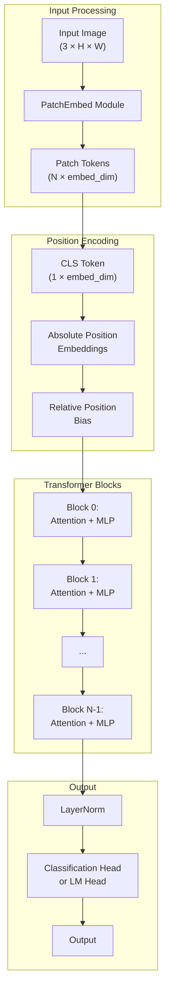
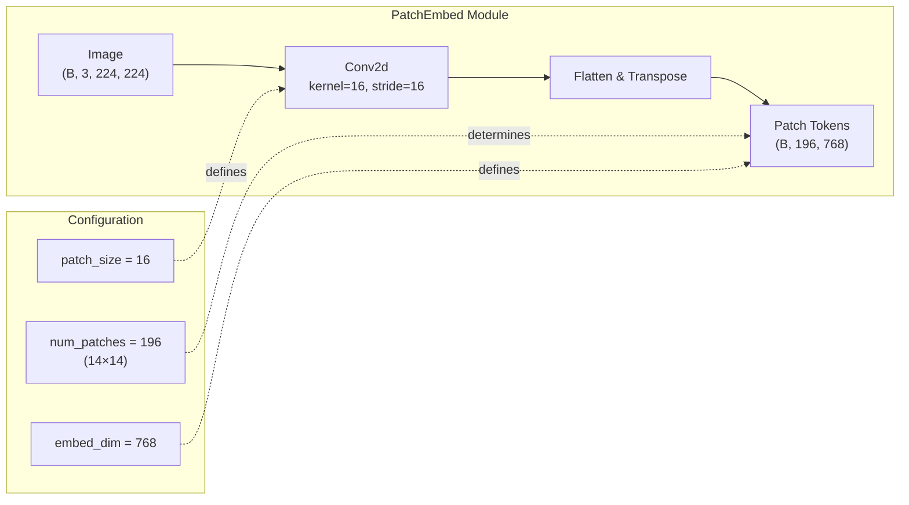
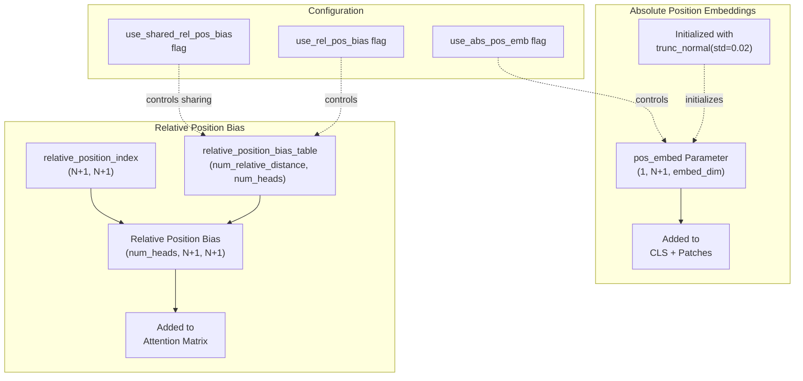
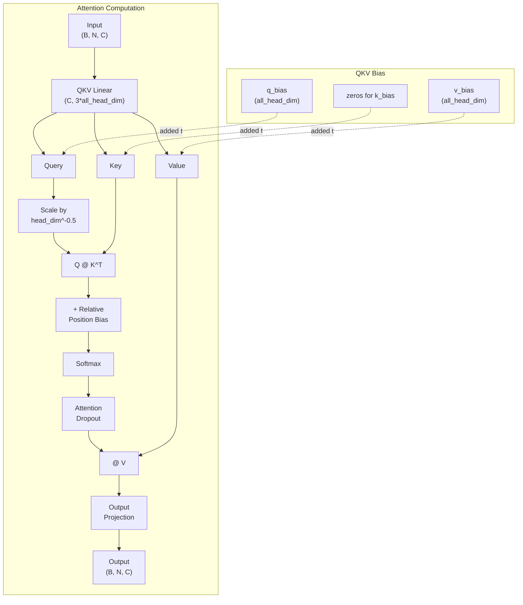
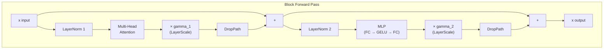
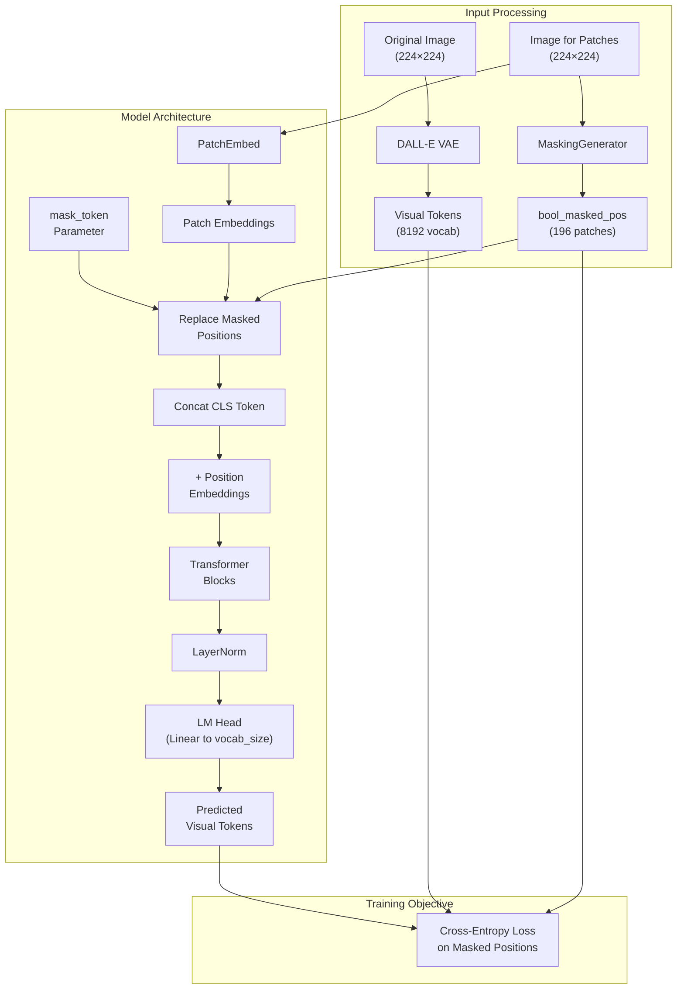
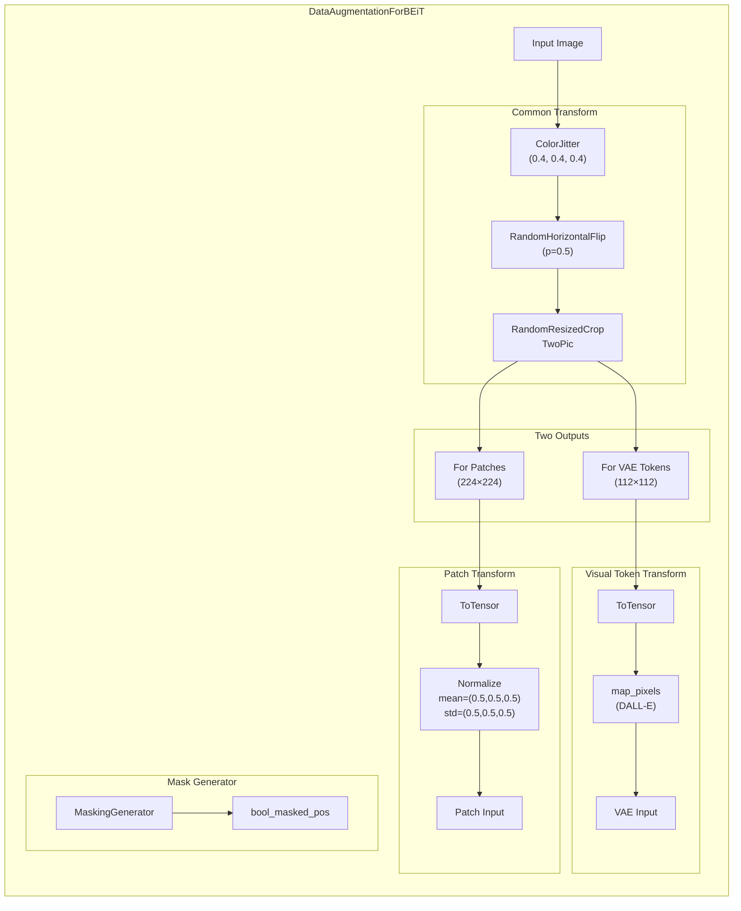
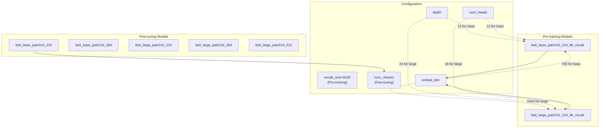
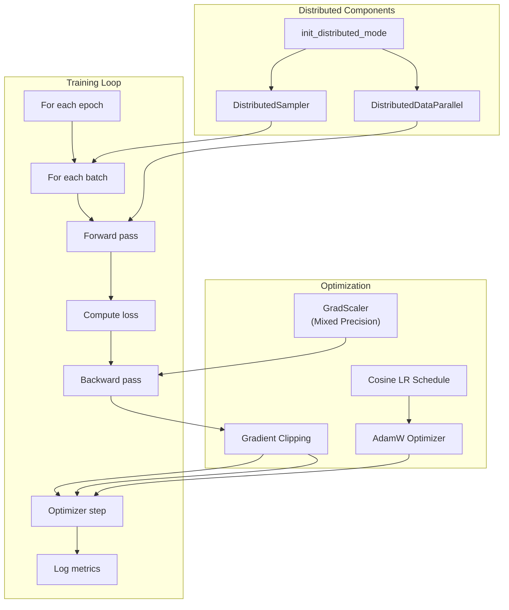

<!-- source: DeepWiki mcp.deepwiki.com · repo microsoft/unilm · extra page BEiT Architecture and Pre-training · fetched 2026-10-26 -->

# BEiT Architecture and Pre-training

<details>
<summary>Relevant source files</summary>

The following files were used as context for generating this wiki page:

- [beit/README.md](beit/README.md)
- [beit/datasets.py](beit/datasets.py)
- [beit/modeling_finetune.py](beit/modeling_finetune.py)
- [beit/modeling_pretrain.py](beit/modeling_pretrain.py)
- [beit/run_beit_pretraining.py](beit/run_beit_pretraining.py)
- [beit/run_class_finetuning.py](beit/run_class_finetuning.py)
- [beit/run_linear_eval.py](beit/run_linear_eval.py)
- [beit/semantic_segmentation/backbone/beit.py](beit/semantic_segmentation/backbone/beit.py)
- [beit/semantic_segmentation/mmcv_custom/checkpoint.py](beit/semantic_segmentation/mmcv_custom/checkpoint.py)
- [beit/utils.py](beit/utils.py)

</details>


This page provides a detailed technical explanation of the BEiT (BERT Pre-Training of Image Transformers) architecture and pre-training methodology. BEiT introduces masked image modeling to Vision Transformers, treating images as sequences of visual tokens and predicting masked patches using a discrete VAE tokenizer from DALL-E.

**Key Topics Covered:**
- Vision Transformer backbone architecture with patch embeddings
- Position encoding strategies (absolute and relative position bias)
- Masked image modeling objective with DALL-E visual tokenization  
- Pre-training configuration and hyperparameters for ImageNet-22k
- Model variants (base and large) and training infrastructure

---

## Overview

BEiT introduces masked image modeling to Vision Transformers, drawing inspiration from BERT's masked language modeling. The key innovation is treating images as sequences of visual tokens and predicting masked patches using a discrete VAE (DALL-E tokenizer).

**Key Components:**
- Vision Transformer backbone with patch-based input processing
- Masked image modeling (MIM) pre-training objective
- DALL-E discrete VAE for visual token generation
- Relative and absolute position embeddings
- Layer-wise scaling for training stability

**Model Variants:**

| Model | Depth | Hidden Dim | Num Heads | MLP Ratio | Patch Size | Parameters | Class Name |
|-------|-------|------------|-----------|-----------|------------|------------|------------|
| BEiT-base | 12 | 768 | 12 | 4× | 16×16 | 86M | `beit_base_patch16_224_8k_vocab` |
| BEiT-large | 24 | 1024 | 16 | 4× | 16×16 | 304M | `beit_large_patch16_224_8k_vocab` |

Sources: [beit/README.md:30-31](), [beit/modeling_pretrain.py:138-163]()

---

## Vision Transformer Architecture

### High-Level Architecture Flow



**Core Architecture Components:**

| Component | File Path | Description |
|-----------|-----------|-------------|
| `VisionTransformerForMaskedImageModeling` | [modeling_pretrain.py:31-136]() | Pre-training architecture with mask token |
| `VisionTransformer` | [modeling_finetune.py:248-357]() | Fine-tuning architecture |
| `PatchEmbed` | [modeling_finetune.py:185-206]() | Converts images to patch embeddings |
| `Block` | [modeling_finetune.py:153-182]() | Transformer block (attention + MLP) |
| `Attention` | [modeling_finetune.py:66-150]() | Multi-head self-attention with bias |
| `RelativePositionBias` | [modeling_finetune.py:209-245]() | Learnable relative position encodings |
| `Mlp` | [modeling_finetune.py:46-63]() | Feed-forward network with GELU |

Sources: [beit/modeling_finetune.py:46-357](), [beit/modeling_pretrain.py:31-136]()

---

## Patch Embedding

### Patch Embedding Process



**Implementation:**

The `PatchEmbed` class ([modeling_finetune.py:185-206]()) uses a convolutional layer to extract patches:

```python
class PatchEmbed(nn.Module):
    def __init__(self, img_size=224, patch_size=16, in_chans=3, embed_dim=768):
        # Convolution with kernel=stride=patch_size (non-overlapping patches)
        self.proj = nn.Conv2d(in_chans, embed_dim, 
                             kernel_size=patch_size, stride=patch_size)
```

**Key Properties:**
- Input: `(B, 3, 224, 224)` RGB image
- Convolution: `kernel_size=patch_size, stride=patch_size` (non-overlapping)
- Output shape: `(B, num_patches, embed_dim)` where `num_patches = (H/patch_size) × (W/patch_size)`
- For 224×224 images with 16×16 patches: `num_patches = 196` (14×14 grid)

**Patch Shape Tracking:**

The `PatchEmbed` module maintains the `patch_shape` attribute `(img_size[0]//patch_size[0], img_size[1]//patch_size[1])` which is used by:
- `RelativePositionBias` module to compute position indices
- Downstream heads to reshape flattened features back to 2D
- Position interpolation when changing input resolution

Sources: [beit/modeling_finetune.py:185-206](), [beit/modeling_pretrain.py:39-41]()

---

## Position Embeddings

BEiT supports two position encoding strategies that can be used independently or together:

### Position Embedding Mechanisms



### Absolute Position Embeddings

**Implementation:**

When `use_abs_pos_emb=True`, learnable position embeddings are created:

```python
# From modeling_finetune.py:266-269
if use_abs_pos_emb:
    self.pos_embed = nn.Parameter(torch.zeros(1, num_patches + 1, embed_dim))
else:
    self.pos_embed = None
```

- Shape: `(1, num_patches + 1, embed_dim)` (includes CLS token position)
- Initialization: Truncated normal with `std=0.02` ([modeling_finetune.py:290]())
- Added directly to token embeddings after concatenating CLS token
- **Position Interpolation**: When fine-tuning at different resolutions, positions are interpolated using bicubic interpolation ([run_class_finetuning.py:413-434]())

### Relative Position Bias

**Mechanism:**

Relative position bias adds learnable attention biases based on spatial relationships between patches:

```python
# From modeling_finetune.py:209-245
class RelativePositionBias(nn.Module):
    def __init__(self, window_size, num_heads):
        self.num_relative_distance = (2 * window_size[0] - 1) * (2 * window_size[1] - 1) + 3
        self.relative_position_bias_table = nn.Parameter(
            torch.zeros(self.num_relative_distance, num_heads))
```

**Key Features:**

- **Bias Table Size**: `(2*H-1) × (2*W-1) + 3` entries for H×W patch grid
  - Extra 3 entries for CLS-to-token, token-to-CLS, and CLS-to-CLS interactions
- **Per-Head Bias**: Independent bias values for each attention head
- **Shared vs. Per-Layer**: 
  - `use_shared_rel_pos_bias=True`: Single `RelativePositionBias` module shared across layers
  - `use_shared_rel_pos_bias=False`: Each attention layer has its own bias table
- **Geometric Interpolation**: When changing resolution, uses geometric progression for better interpolation ([run_class_finetuning.py:367-411](), [semantic_segmentation/mmcv_custom/checkpoint.py:395-438]())

**Relative Position Index Computation:**

The `relative_position_index` buffer maps each (query, key) pair to an entry in the bias table:

1. Compute relative coordinates for all patch pairs
2. Shift coordinates to make them non-negative
3. Flatten to 1D indices
4. Handle CLS token specially with reserved indices

Sources: [beit/modeling_finetune.py:209-245](), [beit/modeling_finetune.py:86-110](), [beit/run_class_finetuning.py:337-411]()

---

## Attention Mechanism

### Multi-Head Self-Attention with Bias



**Attention Implementation:**

The `Attention` module ([modeling_finetune.py:66-150]()) implements multi-head self-attention with several key features:

**QKV Projection with Bias:**
- Uses separate biases for Q and V, but no bias for K (following BEiT design)
- `qkv_bias=True` enables learnable `q_bias` and `v_bias` parameters
- Concatenates biases as `[q_bias, zeros_like(k_bias), v_bias]` before linear projection

**Attention Head Configuration:**
- Default: `head_dim = embed_dim // num_heads`
- Optional: `attn_head_dim` parameter allows custom head dimension
- Total dimension: `all_head_dim = head_dim * num_heads`

**Attention Computation Flow:**
1. Project input to Q, K, V using `qkv` linear layer with concatenated bias
2. Reshape to `(B, num_heads, N, head_dim)`
3. Compute `attn = (Q @ K^T) * scale` where `scale = head_dim^-0.5`
4. Add relative position bias if available: `attn = attn + rel_pos_bias`
5. Apply softmax and attention dropout
6. Compute output: `output = attn @ V`
7. Reshape and project back to `embed_dim`

Sources: [beit/modeling_finetune.py:66-150](), [beit/modeling_pretrain.py:31-64]()

---

## Transformer Block

### Block Architecture



**Block Implementation:**

Each `Block` ([modeling_finetune.py:153-182]()) consists of:

**Normalization**: Pre-norm architecture with LayerNorm before attention and MLP

**Attention Module**: 
- Multi-head self-attention with relative position bias
- Receives `rel_pos_bias` parameter from shared or per-layer bias module

**MLP Module**:
- Two linear layers: `dim → hidden_dim → dim` where `hidden_dim = dim * mlp_ratio`
- Default `mlp_ratio=4` (4× expansion)
- GELU activation function
- Dropout applied after second linear layer

**LayerScale** (optional):
- When `init_values > 0`, learnable scaling parameters `gamma_1` and `gamma_2`
- Initialized with small values for training stability:
  - BEiT-base: `init_values=0.1`
  - BEiT-large: `init_values=1e-5`
- Scales attention and MLP outputs before residual connection

**Stochastic Depth (DropPath)**:
- Randomly drops entire residual branches during training
- Drop probability increases linearly from 0 to `drop_path_rate` across layers
- Helps regularization and improves feature diversity

**Weight Initialization**:

The model uses careful weight initialization ([modeling_finetune.py:302-308]()):

```python
def fix_init_weight(self):
    def rescale(param, layer_id):
        param.div_(math.sqrt(2.0 * layer_id))
    
    for layer_id, layer in enumerate(self.blocks):
        rescale(layer.attn.proj.weight.data, layer_id + 1)
        rescale(layer.mlp.fc2.weight.data, layer_id + 1)
```

This rescales projection weights by `1/sqrt(2*layer_id)` to stabilize deep network training.

Sources: [beit/modeling_finetune.py:153-182](), [beit/modeling_finetune.py:302-308](), [beit/modeling_pretrain.py:78-84]()

---

## Masked Image Modeling for Pre-training

### Pre-training Architecture



### Masked Image Modeling Process

**1. Visual Token Generation:**

BEiT uses DALL-E's discrete VAE to tokenize images into discrete visual tokens:

- **DALL-E VAE**: Pre-trained discrete variational autoencoder ([utils.py:525-537]())
- **Vocabulary Size**: 8192 discrete visual tokens
- **Token Resolution**: Images downsampled to 112×112 before tokenization (controlled by `second_input_size`)
- **Token Mapping**: `map_pixels` transform converts pixels to [-1, 1] range for DALL-E input

**Loading DALL-E VAE:**

The `get_dalle_vae` function ([utils.py:534-537]()) loads pre-trained DALL-E weights:

```python
def get_dalle_vae(weight_path, image_size, device):
    vae = Dalle_VAE(image_size)
    vae.load_model(model_dir=weight_path, device=device)
    return vae
```

The weights (`encoder.pkl` and `decoder.pkl`) are downloaded from OpenAI's CDN as shown in [run_beit_pretraining.py:102-103]().

**2. Masking Strategy:**

The `MaskingGenerator` ([datasets.py:65-69]()) creates random block-wise masks:

- **Default Mask Ratio**: 75 out of 196 patches (≈40%)
- **Block Masking**: Configurable `min_mask_patches_per_block` and `max_mask_patches_per_block`
- **Random Masking**: Different masks for each image in the batch

**3. Model Forward with Masking:**

The `VisionTransformerForMaskedImageModeling.forward` method ([modeling_pretrain.py:128-136]()):

1. Extract patch embeddings from the image
2. Replace masked patch positions with the learnable `mask_token` parameter
3. Concatenate `cls_token` and add `pos_embed` 
4. Process through transformer blocks
5. Apply `lm_head` (linear layer to vocab_size) to predict visual tokens
6. Return predictions only for masked positions

Key masking logic:
```python
w = bool_masked_pos.unsqueeze(-1).type_as(mask_token)
x = x * (1 - w) + mask_token * w  # Replace masked positions
```

**4. Training Objective:**

Cross-entropy loss between predicted and true visual tokens for masked positions only:

```
Loss = CrossEntropy(predicted_tokens[masked_positions], 
                    true_visual_tokens[masked_positions])
```

Sources: [beit/modeling_pretrain.py:31-136](), [beit/datasets.py:27-84](), [beit/utils.py:525-537](), [beit/run_beit_pretraining.py:99-110]()

---

## Data Augmentation Pipeline

### Pre-training Data Augmentation



**Data Augmentation Details:**

The `DataAugmentationForBEiT` class ([datasets.py:27-84]()) implements specialized augmentation for pre-training:

**Common Transformations** (applied to both views):
- **Color Jitter**: Brightness, contrast, saturation, and hue with factor 0.4
- **Random Horizontal Flip**: 50% probability
- **Random Resized Crop with Two Resolutions**:
  - Primary crop: `input_size` (224×224) for patch embedding
  - Secondary crop: `second_input_size` (112×112) for DALL-E VAE
  - Two interpolation methods: `train_interpolation` (bicubic) and `second_interpolation` (lanczos)

**Patch Transform Path**:
- Convert to tensor
- Normalize with mean/std (default: `(0.5, 0.5, 0.5)` unless `imagenet_default_mean_and_std=True`)

**Visual Token Transform Path**:
- Convert to tensor
- Apply `map_pixels` function from DALL-E utilities (maps to [-1, 1])

**Masking**:
- `MaskingGenerator` creates boolean mask with `num_mask_patches=75` (default)
- Supports block-wise masking with configurable min/max patches per block

Sources: [beit/datasets.py:27-84]()

---

## Pre-training Configuration

### Training Hyperparameters

**Pre-training Command Example** ([README.md:94-110]()):

```bash
OMP_NUM_THREADS=1 python -m torch.distributed.launch --nproc_per_node=16 run_beit_pretraining.py \
    --data_path ${DATA_PATH} \
    --output_dir ${OUTPUT_DIR} \
    --num_mask_patches 75 \
    --model beit_base_patch16_224_8k_vocab \
    --discrete_vae_weight_path ${TOKENIZER_PATH} \
    --batch_size 128 \
    --lr 1.5e-3 \
    --warmup_steps 10000 \
    --epochs 150 \
    --clip_grad 3.0 \
    --drop_path 0.1 \
    --layer_scale_init_value 0.1
```

### Key Training Parameters

| Parameter | BEiT-base | BEiT-large | Description |
|-----------|-----------|------------|-------------|
| `batch_size` | 128 per GPU | 64 per GPU | Local batch size |
| Effective batch size | 2048 (16 GPUs) | 2048 (16 GPUs × 2 update_freq) | Total batch size |
| `lr` | 1.5e-3 | 1.5e-3 | Peak learning rate |
| `warmup_steps` | 10000 | 10000 | Linear warmup steps |
| `epochs` | 150 (IN-22k), 800 (IN-1k) | 150 (IN-22k) | Training epochs |
| `num_mask_patches` | 75 | 75 | Number of masked patches |
| `drop_path` | 0.1 | 0.1 | Stochastic depth rate |
| `layer_scale_init_value` | 0.1 | 1e-5 | LayerScale initialization |
| `clip_grad` | 3.0 | 3.0 | Gradient clipping norm |

**Learning Rate Schedule:**

Cosine annealing with linear warmup ([utils.py:383-400]()):

```python
def cosine_scheduler(base_value, final_value, epochs, niter_per_ep, 
                     warmup_epochs=0, start_warmup_value=0, warmup_steps=-1):
    warmup_schedule = np.linspace(start_warmup_value, base_value, warmup_iters)
    schedule = np.array([
        final_value + 0.5 * (base_value - final_value) * 
        (1 + math.cos(math.pi * i / len(iters))) for i in iters
    ])
    return np.concatenate((warmup_schedule, schedule))
```

**Weight Decay Schedule:**

Cosine schedule from `weight_decay` (0.05) to `weight_decay_end` (0.05 by default)

**Mixed Precision Training:**

- Uses `torch.cuda.amp.GradScaler` for automatic mixed precision
- Gradient scaling prevents underflow
- Gradient norm computed before scaling for monitoring

Sources: [beit/README.md:90-142](), [beit/run_beit_pretraining.py:33-132](), [beit/utils.py:383-400]()

---

## Model Variants and Registration

### Model Registration



**Pre-training Model Definitions:**

Models are registered using Timm's `@register_model` decorator:

**BEiT-base Pre-training** ([modeling_pretrain.py:138-149]()):
```python
@register_model
def beit_base_patch16_224_8k_vocab(pretrained=False, **kwargs):
    model = VisionTransformerForMaskedImageModeling(
        patch_size=16, embed_dim=768, depth=12, num_heads=12, 
        mlp_ratio=4, qkv_bias=True,
        norm_layer=partial(nn.LayerNorm, eps=1e-6), 
        vocab_size=8192, **kwargs)
```

**BEiT-large Pre-training** ([modeling_pretrain.py:152-163]()):
```python
@register_model
def beit_large_patch16_224_8k_vocab(pretrained=False, **kwargs):
    model = VisionTransformerForMaskedImageModeling(
        patch_size=16, embed_dim=1024, depth=24, num_heads=16, 
        mlp_ratio=4, qkv_bias=True,
        norm_layer=partial(nn.LayerNorm, eps=1e-6), 
        vocab_size=8192, **kwargs)
```

**Fine-tuning Model Definitions:**

Similar registrations in [modeling_finetune.py:378-420]() for different input resolutions:
- `beit_base_patch16_224`: 224×224 input
- `beit_base_patch16_384`: 384×384 input  
- `beit_large_patch16_224`: 224×224 input
- `beit_large_patch16_384`: 384×384 input
- `beit_large_patch16_512`: 512×512 input

**Creating Models:**

Models are instantiated using Timm's `create_model` factory:

```python
from timm.models import create_model
model = create_model(
    'beit_base_patch16_224_8k_vocab',
    pretrained=False,
    drop_path_rate=args.drop_path,
    use_shared_rel_pos_bias=args.rel_pos_bias,
    use_abs_pos_emb=args.abs_pos_emb,
    init_values=args.layer_scale_init_value,
)
```

Sources: [beit/modeling_pretrain.py:138-163](), [beit/modeling_finetune.py:378-420](), [beit/run_beit_pretraining.py:135-147]()

---

## Training Infrastructure

### Distributed Training Setup



**Distributed Initialization:**

The training script supports multiple distributed backends ([utils.py:256-288]()):
- **PyTorch DDP**: Standard `RANK`, `WORLD_SIZE`, `LOCAL_RANK` environment variables
- **SLURM**: Automatic detection via `SLURM_PROCID`
- **ITP cluster**: Via `OMPI_COMM_WORLD_RANK` environment variables

**Data Loading:**

Distributed sampler ensures each GPU processes different data:
```python
sampler_train = torch.utils.data.DistributedSampler(
    dataset_train, num_replicas=num_tasks, rank=sampler_rank, shuffle=True
)
data_loader_train = torch.utils.data.DataLoader(
    dataset_train, sampler=sampler_train,
    batch_size=args.batch_size,
    num_workers=args.num_workers,
    pin_memory=args.pin_mem,
    drop_last=True,
)
```

**Mixed Precision Training:**

The `NativeScalerWithGradNormCount` class ([utils.py:339-365]()) wraps PyTorch's `GradScaler`:

```python
def __call__(self, loss, optimizer, clip_grad=None, parameters=None, ...):
    self._scaler.scale(loss).backward(create_graph=create_graph)
    if update_grad:
        if clip_grad is not None:
            self._scaler.unscale_(optimizer)
            norm = torch.nn.utils.clip_grad_norm_(parameters, clip_grad)
        self._scaler.step(optimizer)
        self._scaler.update()
```

**Checkpointing:**

Models are saved periodically with full state ([utils.py:413-436]()):
- Model state dict
- Optimizer state
- Loss scaler state  
- Current epoch
- Training arguments

**Auto-resume**: Automatically finds latest checkpoint and resumes training ([utils.py:473-523]())

Sources: [beit/utils.py:256-288](), [beit/utils.py:339-365](), [beit/utils.py:413-523](), [beit/run_beit_pretraining.py:150-274]()

---

## Key Implementation Details

### Important Design Choices

**1. QKV Bias Design:**
- Uses bias only for Q and V projections, not K
- Improves training stability and performance
- Implementation: `qkv_bias = torch.cat([q_bias, zeros_like(k_bias), v_bias])`

**2. LayerScale:**
- Scales attention and MLP outputs by learnable parameters
- Essential for training stability of large/deep models
- Different initialization for base (0.1) vs. large (1e-5)

**3. Weight Initialization:**
- Truncated normal for most parameters (`std=0.02`)
- Layer-wise rescaling by `1/sqrt(2*layer_id)` for projection weights
- Helps gradient flow in deep networks

**4. Position Encoding Strategy:**
- Both absolute and relative position encodings supported
- Can use either, both, or neither (controlled by flags)
- Relative position bias shared across layers by default in pre-training
- Geometric progression interpolation for resolution changes

**5. Masking Strategy:**
- Block-wise masking more effective than random individual patches
- 40% masking ratio (75/196 patches) balances difficulty and learning
- Mask token replaces features before transformer blocks (not at input)

**6. DALL-E Tokenization:**
- Uses pre-trained DALL-E discrete VAE (8192 vocabulary)
- Provides semantically meaningful visual tokens
- Separate resolution (112×112) for tokenization vs. patches (224×224)

Sources: [beit/modeling_finetune.py:66-150](), [beit/modeling_finetune.py:169-173](), [beit/modeling_pretrain.py:78-84](), [beit/datasets.py:27-84]()

---

This page covered the core BEiT architecture and training methodology. For information on fine-tuning BEiT models on downstream tasks, see [BEiT Fine-tuning and Applications](#2.1.2). For the evolution to BEiT v2 and v3 with improved visual tokenization and multimodal capabilities, see [BEiT Evolution: v2 and v3](#2.2).

---

