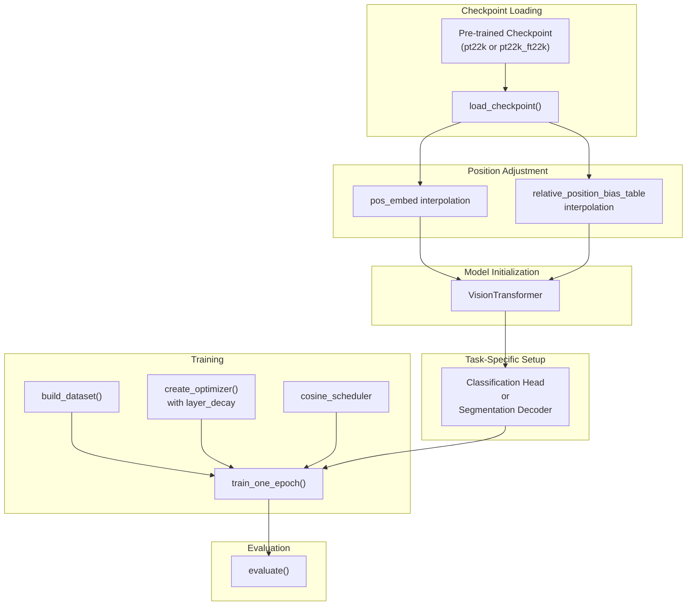
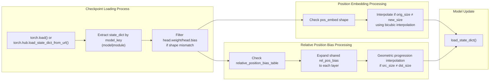
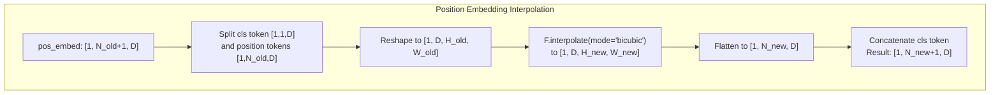
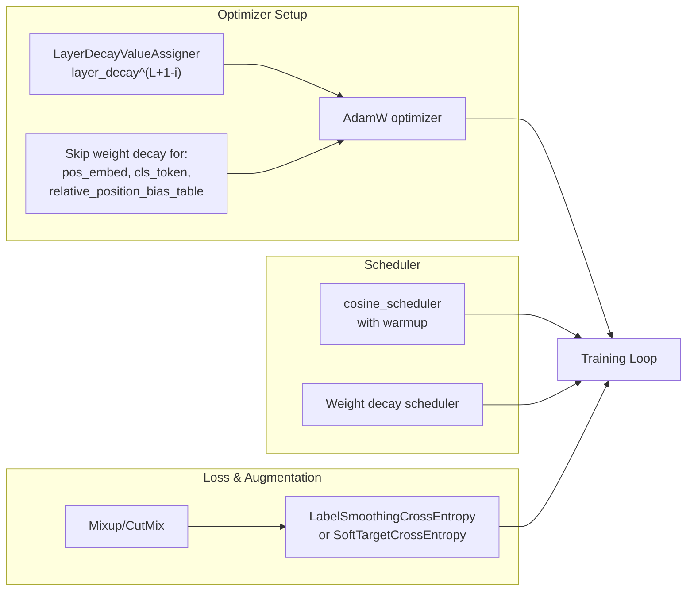
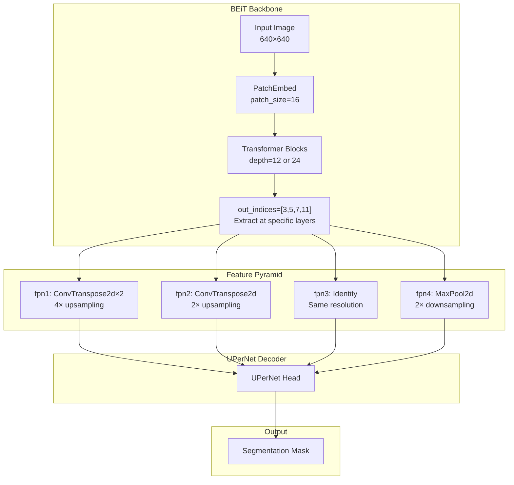
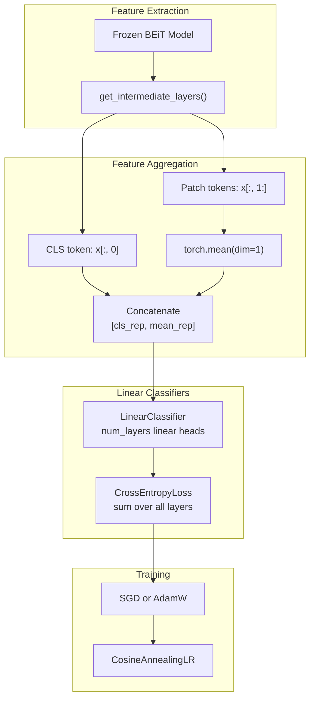
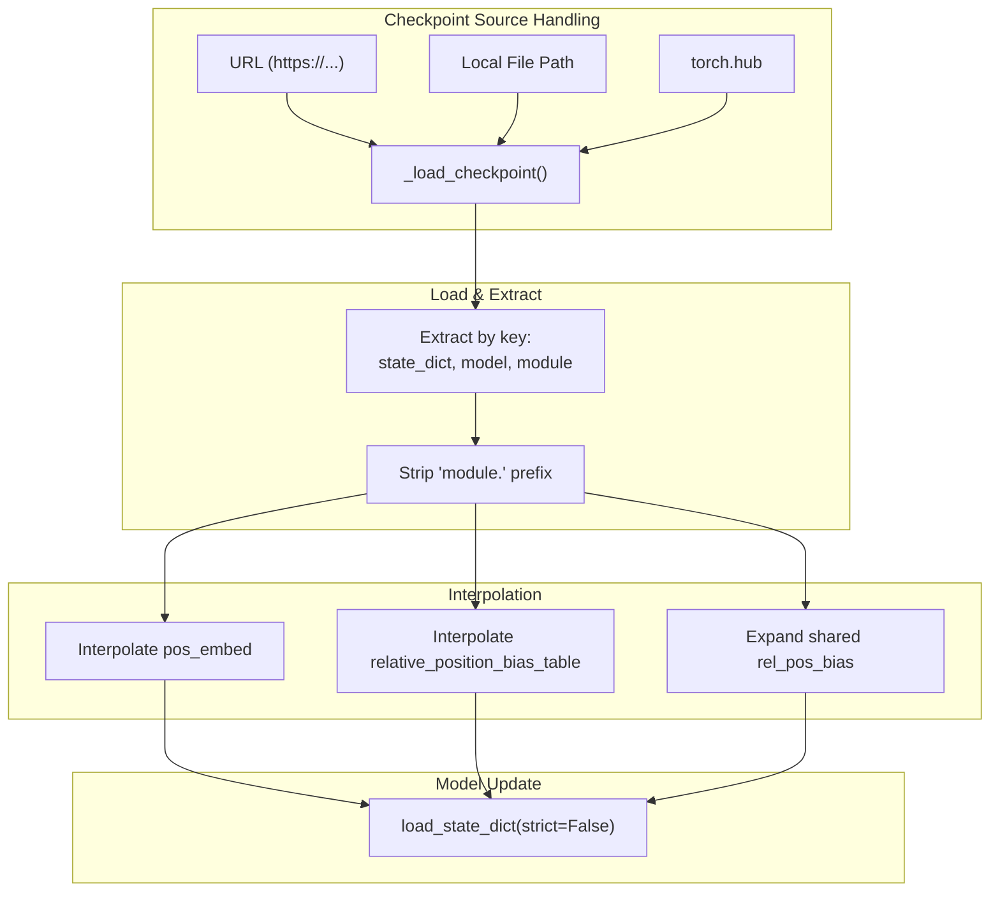

<!-- source: DeepWiki mcp.deepwiki.com · repo microsoft/unilm · extra page BEiT Fine-tuning and Applications · fetched 2026-10-26 -->

# BEiT Fine-tuning and Applications

<details>
<summary>Relevant source files</summary>

The following files were used as context for generating this wiki page:

- [beit/README.md](beit/README.md)
- [beit/datasets.py](beit/datasets.py)
- [beit/modeling_finetune.py](beit/modeling_finetune.py)
- [beit/modeling_pretrain.py](beit/modeling_pretrain.py)
- [beit/run_beit_pretraining.py](beit/run_beit_pretraining.py)
- [beit/run_class_finetuning.py](beit/run_class_finetuning.py)
- [beit/run_linear_eval.py](beit/run_linear_eval.py)
- [beit/semantic_segmentation/backbone/beit.py](beit/semantic_segmentation/backbone/beit.py)
- [beit/semantic_segmentation/mmcv_custom/checkpoint.py](beit/semantic_segmentation/mmcv_custom/checkpoint.py)
- [beit/utils.py](beit/utils.py)

</details>


This document describes the fine-tuning procedures and downstream applications for BEiT (BERT Pre-Training of Image Transformers) models. For information about BEiT architecture and pre-training, see [2.1.1](#2.1.1). This page covers checkpoint initialization, position embedding interpolation, image classification, semantic segmentation, and linear evaluation.

## Overview

BEiT models pre-trained with masked image modeling can be adapted to downstream vision tasks through fine-tuning or linear probing. The fine-tuning process involves loading pre-trained checkpoints, adjusting position embeddings for different input resolutions, and task-specific training with appropriate heads.

**Sources:** [beit/README.md:65-88]()

## Fine-tuning Pipeline



**Sources:** [beit/run_class_finetuning.py:217-587](), [beit/semantic_segmentation/mmcv_custom/checkpoint.py:310-483]()

## Image Classification Fine-tuning

### Checkpoint Initialization

The fine-tuning process begins by loading a pre-trained checkpoint. BEiT supports two initialization strategies:

| Checkpoint Type | Description | Recommended Use |
|----------------|-------------|-----------------|
| `pt22k` | Self-supervised pre-training only on ImageNet-22k | Direct fine-tuning to ImageNet-1k |
| `pt22k_ft22k` | Pre-trained then intermediate fine-tuned on ImageNet-22k | Better performance for ImageNet-1k and other tasks |

**Key Script:** `run_class_finetuning.py`



**Sources:** [beit/run_class_finetuning.py:315-437]()

### Position Embedding Interpolation

When fine-tuning at different resolutions than pre-training (e.g., pre-trained at 224×224, fine-tuned at 384×384), position embeddings must be interpolated:

**Absolute Position Embeddings:**

The `pos_embed` parameter has shape `[1, num_patches + 1, embed_dim]` where the first token is the class token. Interpolation preserves the class token and resizes the spatial position embeddings.



**Sources:** [beit/run_class_finetuning.py:413-434](), [beit/semantic_segmentation/mmcv_custom/checkpoint.py:440-461]()

### Relative Position Bias Interpolation

BEiT uses relative position bias in attention layers. When changing resolution, the bias tables require geometric progression-based interpolation:

**Interpolation Algorithm:**

1. **Extract bias table:** Shape `[num_relative_distances, num_heads]`
2. **Compute source and destination sizes:** `src_size = sqrt(num_pos - extra_tokens)`, `dst_size = sqrt(num_pos_new - extra_tokens)`
3. **Geometric progression:** Find parameter `q` such that geometric progression from center matches destination size
4. **2D cubic interpolation:** Apply `scipy.interpolate.interp2d` with 'cubic' kind
5. **Restore extra tokens:** Concatenate cls-to-token, token-to-cls, cls-to-cls biases

**Sources:** [beit/run_class_finetuning.py:351-411](), [beit/semantic_segmentation/mmcv_custom/checkpoint.py:378-438]()

### Training Configuration



**Key Parameters:**

| Parameter | BEiT-base | BEiT-large | Description |
|-----------|-----------|------------|-------------|
| `layer_decay` | 0.65-0.75 | 0.75 | Layer-wise learning rate decay |
| `layer_scale_init_value` | 0.1 | 1e-5 | LayerScale initialization |
| `drop_path` | 0.1-0.2 | 0.2 | Stochastic depth rate |
| `warmup_epochs` | 5 | 5 | Learning rate warmup |
| `lr` | 2e-3 to 3e-3 | 2e-3 | Base learning rate |

**Sources:** [beit/run_class_finetuning.py:37-214](), [beit/README.md:65-77]()

### Fine-tuning Script Example

The main entry point for classification fine-tuning:

**Command Structure:**
```bash
python run_class_finetuning.py \
    --model beit_base_patch16_224 \
    --data_path /path/to/imagenet \
    --finetune /path/to/pretrained/checkpoint.pth \
    --output_dir /path/to/output \
    --batch_size 128 \
    --lr 4e-3 \
    --epochs 100 \
    --layer_decay 0.65 \
    --drop_path 0.1
```

**Sources:** [beit/run_class_finetuning.py:37-214](), [beit/README.md:144-186]()

## Semantic Segmentation Application

### UPerNet Integration

BEiT serves as a backbone for semantic segmentation using the UPerNet framework. The backbone extracts multi-scale features from intermediate transformer blocks.



**Sources:** [beit/semantic_segmentation/backbone/beit.py:284-449]()

### Backbone Configuration

The `BEiT` class in the semantic segmentation backbone implements:

**Key Components:**

1. **Multi-scale Feature Extraction:** Outputs features at layers `[3, 5, 7, 11]` for BEiT-base
2. **Feature Pyramid Network:** Adapts features to different scales:
   - For `patch_size=16`: 4×, 2×, 1×, 0.5× resolutions relative to patch-level features
   - For `patch_size=8`: 2×, 1×, 0.5×, 0.25× resolutions
3. **Gradient Checkpointing:** Optional `use_checkpoint` for memory efficiency

**Configuration Example (from mmsegmentation config):**
```python
backbone=dict(
    type='BEiT',
    img_size=640,
    patch_size=16,
    embed_dim=768,  # BEiT-base
    depth=12,
    num_heads=12,
    mlp_ratio=4,
    qkv_bias=True,
    use_abs_pos_emb=False,
    use_rel_pos_bias=True,
    init_values=0.1,
    drop_path_rate=0.1,
    out_indices=[3, 5, 7, 11]
)
```

**Sources:** [beit/semantic_segmentation/backbone/beit.py:284-449](), [beit/README.md:80-88]()

## Linear Evaluation and Probing

Linear evaluation measures the quality of learned representations by training a linear classifier on frozen features.



**Key Implementation Details:**

1. **Multi-layer Probing:** `LinearClassifier` creates separate linear layers for each transformer block output
2. **Feature Concatenation:** Combines CLS token with mean-pooled patch tokens: `dim = embed_dim * 2`
3. **Training:** All layers trained jointly with sum of losses

**Sources:** [beit/run_linear_eval.py:177-301]()

### Linear Evaluation Script

**Command Example:**
```bash
python run_linear_eval.py \
    --model beit_base_patch16_224 \
    --pretrained_weights /path/to/checkpoint.pth \
    --data_path /path/to/imagenet \
    --avgpool_patchtokens True \
    --epochs 100 \
    --batch_size_per_gpu 128
```

**Sources:** [beit/run_linear_eval.py:47-175](), [beit/README.md:15]()

## Checkpoint Management Utilities

### State Dictionary Loading

The repository provides robust checkpoint loading with automatic interpolation:



**Key Functions:**

| Function | Location | Purpose |
|----------|----------|---------|
| `load_checkpoint()` | `semantic_segmentation/mmcv_custom/checkpoint.py:310` | Main checkpoint loading with all interpolations |
| `load_state_dict()` | `utils.py:290` | Basic state dict loading with filtering |
| `auto_load_model()` | `utils.py:473` | Automatic checkpoint resumption |

**Sources:** [beit/semantic_segmentation/mmcv_custom/checkpoint.py:310-483](), [beit/utils.py:290-337](), [beit/utils.py:473-523]()

## Performance Results

### ImageNet-1k Classification

| Model | Resolution | Init Checkpoint | Top-1 Acc | Parameters |
|-------|-----------|-----------------|-----------|------------|
| BEiT-base | 224×224 | pt22k | 83.7% | 87M |
| BEiT-base | 224×224 | pt22k_ft22k | 85.2% | 87M |
| BEiT-base | 384×384 | pt22k_ft22k | 86.8% | 87M |
| BEiT-large | 224×224 | pt22k | 86.0% | 304M |
| BEiT-large | 224×224 | pt22k_ft22k | 87.4% | 304M |
| BEiT-large | 384×384 | pt22k_ft22k | 88.4% | 305M |
| BEiT-large | 512×512 | pt22k_ft22k | 88.6% | 306M |

**Sources:** [beit/README.md:69-77]()

### ADE20K Semantic Segmentation

| Model | Method | Resolution | mIoU | mIoU (ms+flip) | Parameters |
|-------|--------|-----------|------|----------------|------------|
| BEiT-base | UPerNet | 640×640 | 53.6 | 54.2 | 163M |
| BEiT-large | UPerNet | 640×640 | 56.7 | 57.0 | 441M |

BEiT-large achieves state-of-the-art results on ADE20K with a significant improvement (57.0 mIoU with multi-scale + flip).

**Sources:** [beit/README.md:84-87](), [beit/README.md:18]()

## Data Augmentation for Fine-tuning

Fine-tuning uses standard ImageNet augmentation strategies:

| Augmentation | Configuration |
|-------------|---------------|
| Random Resize Crop | Standard random crop |
| Horizontal Flip | p=0.5 |
| Color Jitter | 0.4 (brightness, contrast, saturation, hue) |
| AutoAugment | `rand-m9-mstd0.5-inc1` |
| Random Erasing | prob=0.25, mode='pixel' |
| Mixup/CutMix | Optional, alpha=0.8/1.0 |
| Label Smoothing | 0.1 |

**Sources:** [beit/run_class_finetuning.py:102-137](), [beit/datasets.py:127-169]()

---

