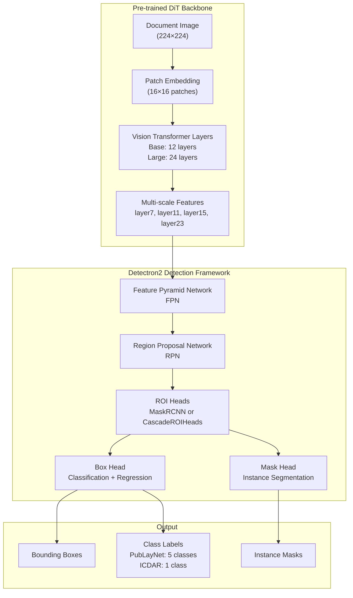
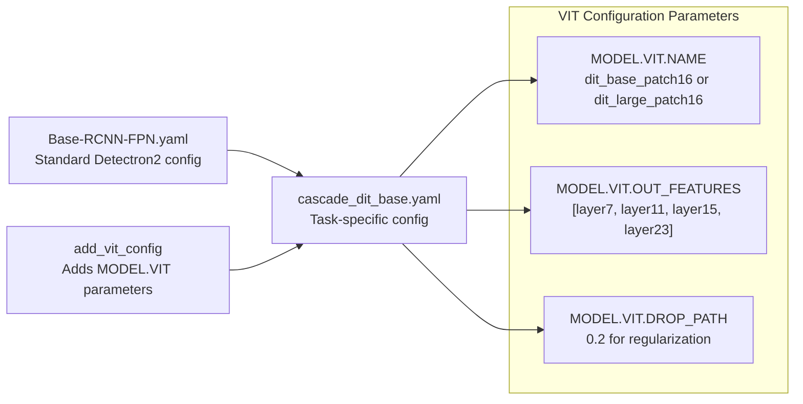
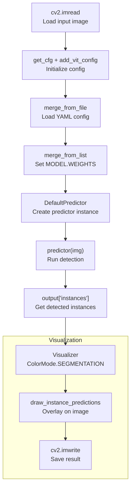
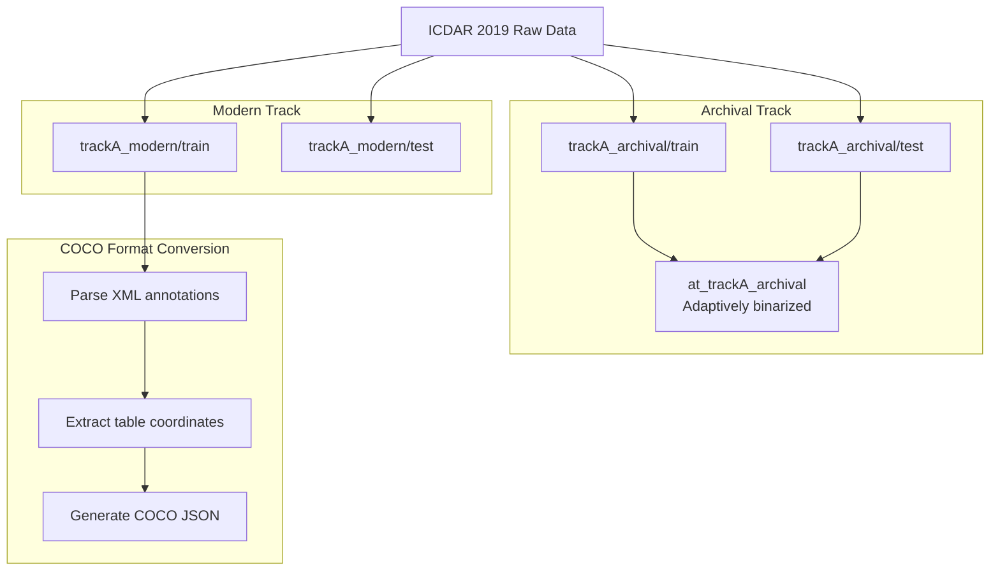
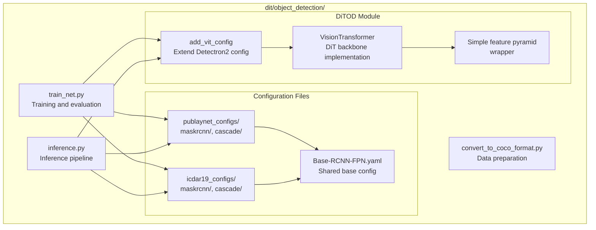

<!-- source: DeepWiki mcp.deepwiki.com · repo microsoft/unilm · extra page DiT for Document Layout Analysis · fetched 2026-10-26 -->

# DiT for Document Layout Analysis

<details>
<summary>Relevant source files</summary>

The following files were used as context for generating this wiki page:

- [dit/README.md](dit/README.md)
- [dit/object_detection/README.md](dit/object_detection/README.md)
- [dit/object_detection/convert_to_coco_format.py](dit/object_detection/convert_to_coco_format.py)
- [dit/object_detection/icdar19_configs/cascade/cascade_dit_base.yaml](dit/object_detection/icdar19_configs/cascade/cascade_dit_base.yaml)
- [dit/object_detection/icdar19_configs/cascade/cascade_dit_large.yaml](dit/object_detection/icdar19_configs/cascade/cascade_dit_large.yaml)
- [dit/object_detection/inference.py](dit/object_detection/inference.py)
- [dit/object_detection/publaynet_example.jpeg](dit/object_detection/publaynet_example.jpeg)

</details>


## Purpose and Scope

This document covers DiT's integration with Detectron2 for object detection tasks in document images, specifically document layout analysis and table detection. DiT serves as a pre-trained backbone that is fine-tuned using Mask R-CNN and Cascade R-CNN detection frameworks.

**Scope:**
- Integration of DiT with Detectron2 for object detection
- Document layout analysis on PubLayNet dataset (5 categories: text, title, list, table, figure)
- Table detection on ICDAR 2019 cTDaR dataset (archival and modern documents)
- Configuration system, training procedures, and inference pipelines

**Related Pages:**
- For DiT's self-supervised pre-training and architecture details, see [DiT: Document Image Transformer](#2.3)
- For BEiT architecture which inspired DiT's Vision Transformer design, see [BEiT Architecture and Training](#2.1.1)

Sources: [dit/README.md:1-132](), [dit/object_detection/README.md:1-121]()

---

## System Architecture

DiT for document layout analysis combines a self-supervised pre-trained Vision Transformer backbone with Detectron2's object detection frameworks. The system adapts DiT's image-level representations for region-based detection tasks.

### Overall Architecture Diagram



**DiT as Backbone:** DiT replaces traditional CNN backbones (e.g., ResNet-50) in Detectron2. The Vision Transformer architecture extracts hierarchical features at multiple scales, which are fed into the Feature Pyramid Network.

**Multi-scale Feature Extraction:** For DiT-Large, features are extracted from layers 7, 11, 15, and 23 to create a multi-resolution feature pyramid, enabling detection of objects at different scales.

Sources: [dit/object_detection/icdar19_configs/cascade/cascade_dit_large.yaml:1-26](), [dit/object_detection/icdar19_configs/cascade/cascade_dit_base.yaml:1-22]()

---

## Integration with Detectron2

### Configuration System

DiT extends Detectron2's configuration system with Vision Transformer-specific parameters through the `add_vit_config` function.



**Key Configuration Parameters:**

| Parameter | Description | Example Value |
|-----------|-------------|---------------|
| `MODEL.VIT.NAME` | DiT model variant | `"dit_base_patch16"` or `"dit_large_patch16"` |
| `MODEL.VIT.OUT_FEATURES` | Transformer layers for feature extraction | `["layer7", "layer11", "layer15", "layer23"]` (Large) |
| `MODEL.VIT.DROP_PATH` | Drop path rate for regularization | `0.2` |
| `MODEL.FPN.IN_FEATURES` | FPN input features (matches OUT_FEATURES) | `["layer7", "layer11", "layer15", "layer23"]` |
| `MODEL.PIXEL_MEAN` | Pixel normalization mean | `[127.5, 127.5, 127.5]` |
| `MODEL.PIXEL_STD` | Pixel normalization std | `[127.5, 127.5, 127.5]` |

Sources: [dit/object_detection/icdar19_configs/cascade/cascade_dit_large.yaml:1-26](), [dit/object_detection/inference.py:43-46]()

### Inference Pipeline

The inference process follows Detectron2's standard pipeline with DiT-specific configurations:



**Metadata Configuration:** The system assigns class names based on the dataset:
- **PubLayNet:** `["text", "title", "list", "table", "figure"]`
- **ICDAR 2019 cTDaR:** `["table"]`

Sources: [dit/object_detection/inference.py:1-81]()

---

## Dataset Preparation

### PubLayNet Dataset

**PubLayNet** is a large-scale dataset for document layout analysis containing over 1 million document images with layout annotations.

**Preparation Steps:**
1. Download dataset (~96GB): [PubLayNet archive](https://dax-cdn.cdn.appdomain.cloud/dax-publaynet/1.0.0/publaynet.tar.gz)
2. Extract to target directory
3. Create symbolic link: `ln -s PATH-to-PubLayNet publaynet_data`

**Categories:** text, title, list, table, figure

### ICDAR 2019 cTDaR Dataset

**ICDAR 2019 cTDaR** (Complex Table Detection and Recognition) contains table detection annotations for modern and archival documents.

**Dataset Structure:**



**Preparation Steps:**
1. Download ICDAR 2019 cTDaR dataset (~4GB)
2. Run conversion script: [dit/object_detection/convert_to_coco_format.py:1-105]()
   ```bash
   python convert_to_coco_format.py --root_dir=PATH-to-ICDARrepo --target_dir=PATH-to-ICDAR
   ```
3. For archival subset, apply adaptive binarization:
   ```bash
   cp -r PATH-to-ICDAR/trackA_archival PATH-to-ICDAR/at_trackA_archival
   python adaptive_binarize.py --root_dir PATH-to-ICDAR/at_trackA_archival
   ```
4. Create symbolic link to appropriate subset:
   - Modern: `ln -s PATH-to-ICDAR/trackA_modern data`
   - Archival: `ln -s PATH-to-ICDAR/at_trackA_archival data`

### COCO Format Conversion

The conversion script [dit/object_detection/convert_to_coco_format.py:10-62]() transforms ICDAR XML annotations to COCO JSON format:

**COCO JSON Structure:**
```json
{
  "images": [
    {
      "file_name": "cTDaR_t0XXXX.jpg",
      "height": 2592,
      "width": 1944,
      "id": 1234
    }
  ],
  "annotations": [
    {
      "segmentation": [[x1,y1,x2,y2,x3,y3,x4,y4]],
      "area": width * height,
      "iscrowd": 0,
      "image_id": 1234,
      "bbox": [x, y, width, height],
      "category_id": 1,
      "id": 0
    }
  ],
  "categories": [
    {"id": 1, "name": "table"}
  ]
}
```

Sources: [dit/object_detection/README.md:23-47](), [dit/object_detection/convert_to_coco_format.py:1-105]()

---

## Model Variants and Detection Algorithms

### Model Variants

| Model Variant | Layers | Hidden Dim | FFN Factor | Heads | Parameters | Patch Size |
|---------------|--------|------------|------------|-------|------------|------------|
| DiT-Base | 12 | 768 | 4× | 12 | 86M | 16×16 |
| DiT-Large | 24 | 1024 | 4× | 16 | 304M | 16×16 |

### Detection Algorithms

Two detection frameworks are supported, each with different trade-offs:

#### Mask R-CNN

**Architecture:**
- Single-stage ROI head
- Parallel box and mask prediction branches
- Faster training and inference

**Configuration:** [dit/object_detection/publaynet_configs/maskrcnn/maskrcnn_dit_base.yaml]()

#### Cascade R-CNN

**Architecture:**
- Multi-stage refinement with cascaded ROI heads
- Progressive IoU threshold increase: 0.5 → 0.6 → 0.7
- Higher quality detections at cost of speed

**Configuration:** Specified via `MODEL.ROI_HEADS.NAME: CascadeROIHeads` in [dit/object_detection/icdar19_configs/cascade/cascade_dit_base.yaml:8-15]()

**Key Parameters:**
- `CLS_AGNOSTIC_BBOX_REG: True` - Class-agnostic bounding box regression
- `POST_NMS_TOPK_TRAIN: 2000` - Top-k proposals after NMS during training

Sources: [dit/README.md:14-24](), [dit/object_detection/icdar19_configs/cascade/cascade_dit_base.yaml:1-22]()

---

## Training Procedures

### Pre-trained Checkpoint Loading

Training begins with loading self-supervised pre-trained DiT checkpoints:

**DiT-Base checkpoint:**
```
https://layoutlm.blob.core.windows.net/dit/dit-pts/dit-base-224-p16-500k-62d53a.pth
```

**DiT-Large checkpoint:**
```
https://layoutlm.blob.core.windows.net/dit/dit-pts/dit-large-224-p16-500k-d7a2fb.pth
```

### Training Configuration

**Hardware Requirements:** 8× 32GB NVIDIA V100 GPUs

**Key Hyperparameters:**

| Parameter | Value | Description |
|-----------|-------|-------------|
| `IMS_PER_BATCH` | 16 | Total batch size across all GPUs (2 per GPU) |
| `BASE_LR` | 0.00005 | Base learning rate |
| `MAX_ITER` | 60000 | Maximum training iterations |
| `WARMUP_ITERS` | 1000 | Learning rate warmup iterations |
| `CHECKPOINT_PERIOD` | 1000 | Checkpoint saving frequency |
| `EVAL_PERIOD` | 1000 | Evaluation frequency |

### Training Commands

**Example 1: Fine-tune DiT-Base with Cascade R-CNN on PubLayNet**
```bash
python train_net.py \
  --config-file publaynet_configs/cascade/cascade_dit_base.yaml \
  --num-gpus 8 \
  MODEL.WEIGHTS <DiT-Base checkpoint path or URL> \
  OUTPUT_DIR <output directory>
```

**Example 2: Fine-tune DiT-Large with Mask R-CNN on ICDAR 2019 cTDaR**
```bash
python train_net.py \
  --config-file icdar19_configs/maskrcnn/maskrcnn_dit_large.yaml \
  --num-gpus 8 \
  MODEL.WEIGHTS <DiT-Large checkpoint path or URL> \
  OUTPUT_DIR <output directory>
```

Sources: [dit/object_detection/README.md:84-100](), [dit/object_detection/icdar19_configs/cascade/cascade_dit_base.yaml:14-22]()

---

## Evaluation and Results

### Evaluation Commands

**Evaluate on PubLayNet:**
```bash
python train_net.py \
  --config-file publaynet_configs/maskrcnn/maskrcnn_dit_base.yaml \
  --eval-only \
  --num-gpus 8 \
  MODEL.WEIGHTS <fine-tuned checkpoint path or URL> \
  OUTPUT_DIR <output directory>
```

**Evaluate on ICDAR 2019 cTDaR Archival:**
```bash
python train_net.py \
  --config-file icdar19_configs/cascade/cascade_dit_large.yaml \
  --eval-only \
  --num-gpus 8 \
  MODEL.WEIGHTS <fine-tuned checkpoint path or URL> \
  OUTPUT_DIR <output directory>
```

### Performance Results

#### PubLayNet (Document Layout Analysis)

Metric: mean Average Precision (mAP)

| Model | Detection Algorithm | mAP | Fine-tuned Weights |
|-------|---------------------|-----|-------------------|
| DiT-Base | Mask R-CNN | 0.935 | [checkpoint](https://mail2sysueducn-my.sharepoint.com/:u:/g/personal/huangyp28_mail2_sysu_edu_cn/EdRCgV60BxNJkMW-DUwg5toBYrfZ13Taiuwidx24LL9uCQ?e=zXH3et) |
| DiT-Large | Mask R-CNN | 0.941 | [checkpoint](https://mail2sysueducn-my.sharepoint.com/:u:/g/personal/huangyp28_mail2_sysu_edu_cn/EbiF6b0pushDuMGeL13uEFMBI-tO8UdGuOaKF1jAJhqjWg?e=hKhaL7) |
| DiT-Base | Cascade R-CNN | 0.945 | [checkpoint](https://mail2sysueducn-my.sharepoint.com/:u:/g/personal/huangyp28_mail2_sysu_edu_cn/Ebu8BdNRx6ZBp4t1KHWyy8cBeytG3evrVm8ae7XVf8Ox0A?e=hlfaML) |
| DiT-Large | Cascade R-CNN | 0.949 | [checkpoint](https://mail2sysueducn-my.sharepoint.com/:u:/g/personal/huangyp28_mail2_sysu_edu_cn/ESKnk2I_O09Em52V1xb2Ux0BrO_Z-7cuzL3H1KQRxipb7Q?e=iqTfGc) |

**Key Findings:**
- DiT-Large + Cascade R-CNN achieves highest mAP of 0.949
- Cascade R-CNN consistently outperforms Mask R-CNN by ~0.8-1.0%
- Model scaling from Base to Large provides ~0.4-0.6% improvement

#### ICDAR 2019 cTDaR (Table Detection)

Metric: Weighted Average F1 Score

**Modern Documents:**

| Model | Detection Algorithm | Weighted F1 | Fine-tuned Weights |
|-------|---------------------|-------------|-------------------|
| DiT-Base | Mask R-CNN | 94.74 | [checkpoint](https://mail2sysueducn-my.sharepoint.com/:u:/g/personal/huangyp28_mail2_sysu_edu_cn/EfJ-YwqPB99FjDL4M-Vc8SgBDLlU3A-YOVlmGy6Cpkwc4A?e=2hr83V) |
| DiT-Large | Mask R-CNN | 95.50 | [checkpoint](https://mail2sysueducn-my.sharepoint.com/:u:/g/personal/huangyp28_mail2_sysu_edu_cn/EfzBky0q6ulGr5AWFDMJOAUBkQu1HWCfeL8Cuuqvdcb5ow?e=tZysTu) |
| DiT-Base | Cascade R-CNN | 95.85 | [checkpoint](https://mail2sysueducn-my.sharepoint.com/:u:/g/personal/huangyp28_mail2_sysu_edu_cn/EeK-N5V6FFhKkReVk6VPWg8Be_PRySGwSBSUyNVjz8Djew?e=fnVxUg) |
| DiT-Large | Cascade R-CNN | 96.29 | [checkpoint](https://mail2sysueducn-my.sharepoint.com/:u:/g/personal/huangyp28_mail2_sysu_edu_cn/EWZYlqMX8HpMoSTkdBOBCY0BWtYlXPfXfWavDsXUjG1xWg?e=dR4YUc) |

**Archival Documents:**

| Model | Detection Algorithm | Weighted F1 | Fine-tuned Weights |
|-------|---------------------|-------------|-------------------|
| DiT-Base | Mask R-CNN | 96.24 | [checkpoint](https://mail2sysueducn-my.sharepoint.com/:u:/g/personal/huangyp28_mail2_sysu_edu_cn/EWAzBbNFunZBvPXVo7oeLK0B52fqOofE60JhzYVmEo4SSg?e=IOQgbl) |
| DiT-Large | Mask R-CNN | 96.46 | [checkpoint](https://mail2sysueducn-my.sharepoint.com/:u:/g/personal/huangyp28_mail2_sysu_edu_cn/ETI0TwK9MsdBlK5k2KDPRzcBDxpQ1tlS6H2qS94SI0s2rQ?e=fx3htJ) |
| DiT-Base | Cascade R-CNN | 96.63 | [checkpoint](https://mail2sysueducn-my.sharepoint.com/:u:/g/personal/huangyp28_mail2_sysu_edu_cn/EWmpA4gS58tOj8kPmIl72ZQBWh11eqsjRKR30ZGTRLYbOg?e=yXdfp8) |
| DiT-Large | Cascade R-CNN | 97.00 | [checkpoint](https://mail2sysueducn-my.sharepoint.com/:u:/g/personal/huangyp28_mail2_sysu_edu_cn/EQY8PZMPCIVKrtJuwJOdSRABOwwsP937dr0EHKCILhCOgQ?e=zeCuNa) |

**Combined (Modern + Archival):**

| Model | Detection Algorithm | Weighted F1 |
|-------|---------------------|-------------|
| DiT-Base | Mask R-CNN | 95.30 |
| DiT-Large | Mask R-CNN | 95.85 |
| DiT-Base | Cascade R-CNN | 96.14 |
| DiT-Large | Cascade R-CNN | 96.55 |

**Key Findings:**
- Archival documents show higher F1 scores than modern documents
- DiT-Large + Cascade R-CNN achieves 97.00 F1 on archival documents
- Adaptive binarization preprocessing improves archival document detection

Sources: [dit/README.md:64-105](), [dit/object_detection/README.md:48-82]()

---

## Implementation Details

### Code Structure



### Key Classes and Functions

**Inference Pipeline** [dit/object_detection/inference.py:15-79]()
- `main()`: Entry point for inference
- Uses `get_cfg()` to initialize Detectron2 config
- Calls `add_vit_config(cfg)` to extend with VIT parameters
- Creates `DefaultPredictor` instance for detection
- Uses `Visualizer` with `ColorMode.SEGMENTATION` for visualization

**Data Conversion** [dit/object_detection/convert_to_coco_format.py:10-105]()
- `convert(ROOT, TRACK, SPLIT)`: Converts ICDAR XML to COCO JSON
- `clean_img(DATA_DIR)`: Standardizes image formats (JPG, TIFF, PNG → JPG)
- Extracts 4-point table coordinates from XML
- Generates bounding boxes and segmentation masks

### Detectron2 Integration Points

```mermaid
graph LR
    subgraph "Standard Detectron2"
        D2Config["CfgNode<br/>Configuration"]
        D2Backbone["Backbone Registry<br/>ResNet, FPN"]
        D2ROI["ROI Heads<br/>Box, Mask Heads"]
    end
    
    subgraph "DiT Extensions"
        VITConfigExt["add_vit_config<br/>Adds MODEL.VIT node"]
        VITBackbone["VisionTransformer<br/>Registered as backbone"]
        CustomFPN["ViT + FPN<br/>Feature pyramid"]
    end
    
    D2Config -->|extends| VITConfigExt
    D2Backbone -->|registers| VITBackbone
    VITBackbone --> CustomFPN
    CustomFPN --> D2ROI
```



**Extension Mechanism:**
1. `add_vit_config(cfg)` extends Detectron2's `CfgNode` with `MODEL.VIT` parameters
2. DiT backbone is registered in Detectron2's backbone registry
3. Feature extraction layers are specified via `MODEL.VIT.OUT_FEATURES`
4. FPN consumes multi-scale features from specified layers
5. Standard ROI heads remain unchanged

Sources: [dit/object_detection/inference.py:1-81](), [dit/object_detection/convert_to_coco_format.py:1-105](), [dit/object_detection/icdar19_configs/cascade/cascade_dit_large.yaml:1-26]()

---

## Web Demos and Resources

### Hugging Face Spaces

Two interactive demos are available:

1. **Document Layout Analysis:** [https://huggingface.co/spaces/nielsr/dit-document-layout-analysis](https://huggingface.co/spaces/nielsr/dit-document-layout-analysis)
   - Interactive layout detection on document images
   - Visualizes detected regions with class labels

2. **Document Image Classification:** [https://huggingface.co/spaces/microsoft/document-image-transformer](https://huggingface.co/spaces/microsoft/document-image-transformer)
   - RVL-CDIP document classification
   - 16 document categories

### Pre-trained and Fine-tuned Checkpoints

**Pre-trained (Self-supervised):**
- [DiT-Base (86M params)](https://mail2sysueducn-my.sharepoint.com/:u:/g/personal/huangyp28_mail2_sysu_edu_cn/ERfMnkSl2mZFlv68E6xxhH4BvJVQOYcwpna3QMbbbLDQCA?e=tOPZRx)
- [DiT-Large (304M params)](https://mail2sysueducn-my.sharepoint.com/:u:/g/personal/huangyp28_mail2_sysu_edu_cn/Ec3vqfjSDLBMoVI9WIK6vZUBEtEFlOD163ChojDQzPoUvQ?e=ccEeNc)

**Fine-tuned (Task-specific):**
- All fine-tuned checkpoints available in tables above
- Organized by dataset (PubLayNet, ICDAR 2019 cTDaR) and detection algorithm

### Citation

```bibtex
@misc{li2022dit,
    title={DiT: Self-supervised Pre-training for Document Image Transformer},
    author={Junlong Li and Yiheng Xu and Tengchao Lv and Lei Cui and Cha Zhang and Furu Wei},
    year={2022},
    eprint={2203.02378},
    archivePrefix={arXiv},
    primaryClass={cs.CV}
}
```

Sources: [dit/README.md:9-12](), [dit/README.md:107-119](), [dit/object_detection/README.md:9-10]()

---

