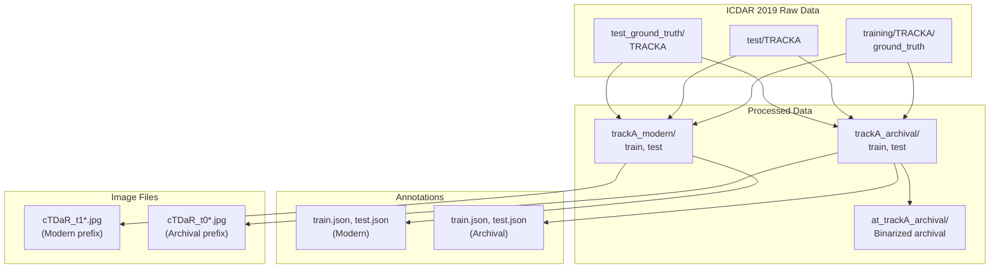
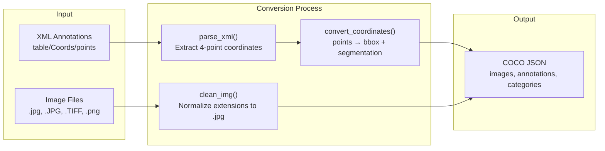
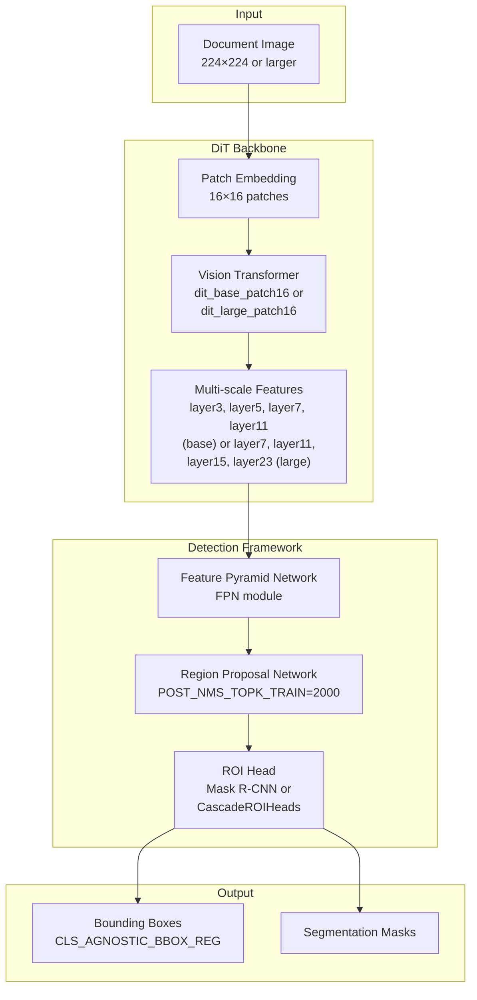
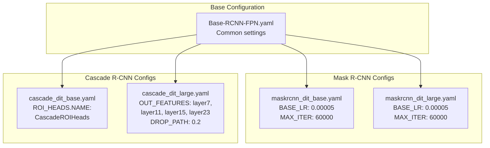
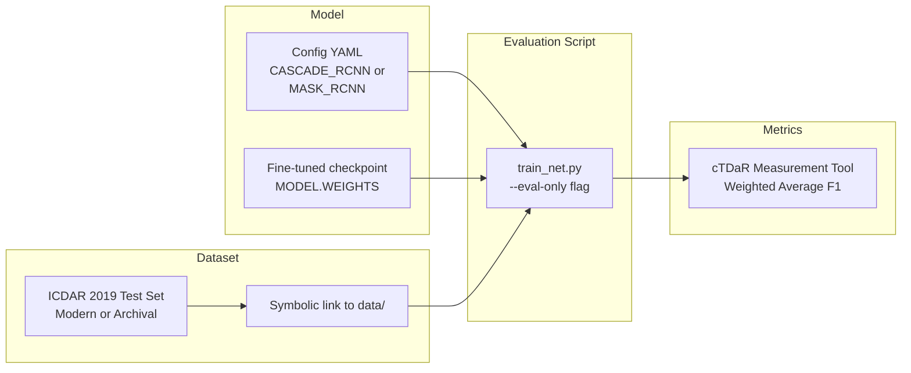
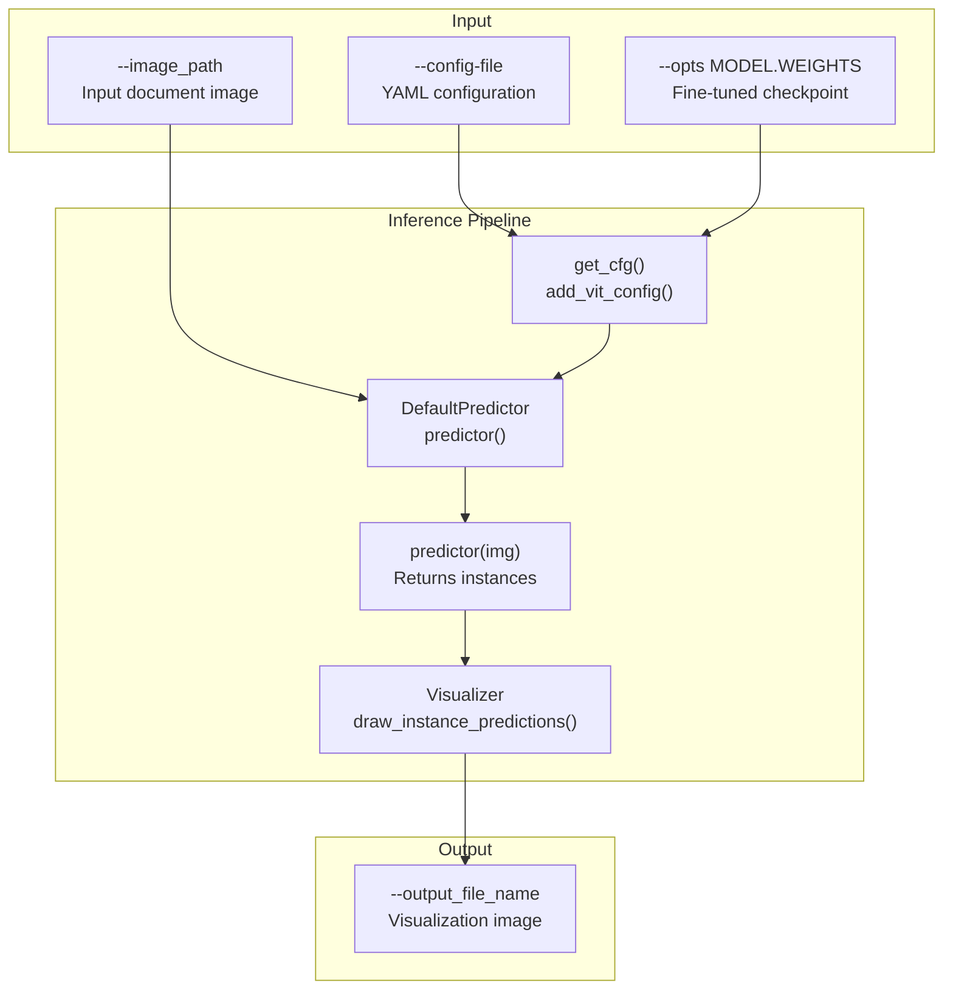

<!-- source: DeepWiki mcp.deepwiki.com · repo microsoft/unilm · extra page DiT for Table Detection · fetched 2026-10-26 -->

# DiT for Table Detection

<details>
<summary>Relevant source files</summary>

The following files were used as context for generating this wiki page:

- [dit/README.md](dit/README.md)
- [dit/object_detection/README.md](dit/object_detection/README.md)
- [dit/object_detection/convert_to_coco_format.py](dit/object_detection/convert_to_coco_format.py)
- [dit/object_detection/icdar19_configs/cascade/cascade_dit_base.yaml](dit/object_detection/icdar19_configs/cascade/cascade_dit_base.yaml)
- [dit/object_detection/icdar19_configs/cascade/cascade_dit_large.yaml](dit/object_detection/icdar19_configs/cascade/cascade_dit_large.yaml)
- [dit/object_detection/inference.py](dit/object_detection/inference.py)
- [dit/object_detection/publaynet_example.jpeg](dit/object_detection/publaynet_example.jpeg)

</details>


## Purpose and Scope

This document describes the application of DiT (Document Image Transformer) to table detection tasks using the ICDAR 2019 cTDaR dataset. Table detection involves localizing and segmenting table regions in document images, distinguishing between modern (born-digital) and archival (scanned historical) documents.

For general DiT architecture and pre-training, see [DiT: Document Image Transformer](#2.2). For other DiT applications, see [DiT for Document Layout Analysis](#2.2.1) and [DiT for Text Detection](#2.2.3).

**Sources:** [dit/README.md:1-132]()

## Task Overview

Table detection on ICDAR 2019 cTDaR (Complex Table Detection and Recognition) focuses on detecting table boundaries in two document subsets:

| Subset | Description | Characteristics |
|--------|-------------|-----------------|
| **Modern** | Born-digital documents | Clean layouts, consistent formatting, high resolution |
| **Archival** | Scanned historical documents | Degraded quality, noise, variable contrast |

The task requires predicting bounding boxes and segmentation masks for table regions. Performance is measured using Weighted Average F1 score, which accounts for both precision and recall across detection confidence thresholds.

**Sources:** [dit/README.md:75-105](), [dit/object_detection/README.md:31-46]()

## Dataset: ICDAR 2019 cTDaR

### Dataset Structure



**Diagram: ICDAR 2019 cTDaR Dataset Organization**

The dataset uses file prefixes to distinguish subsets: `cTDaR_t1` for modern documents and `cTDaR_t0` for archival documents.

**Sources:** [dit/object_detection/README.md:31-46](), [dit/object_detection/convert_to_coco_format.py:10-62]()

### COCO Format Conversion

The `convert_to_coco_format.py` script transforms ICDAR XML annotations to COCO JSON format:



**Diagram: COCO Format Conversion Pipeline**

Key functions in [dit/object_detection/convert_to_coco_format.py:1-105]():
- `convert()`: Main conversion function that processes XML annotations and generates COCO JSON
- `clean_img()`: Normalizes image file extensions (.JPG, .TIFF, .png) to .jpg

The conversion process:
1. **Parse XML**: Extract table coordinates from `<table><Coords points="...">` elements [dit/object_detection/convert_to_coco_format.py:33-40]()
2. **Convert coordinates**: Transform 4-point polygons to COCO bounding boxes and segmentation masks [dit/object_detection/convert_to_coco_format.py:41-46]()
3. **Generate annotations**: Create COCO-format annotation entries with category_id=1 (table) [dit/object_detection/convert_to_coco_format.py:47-57]()

**Sources:** [dit/object_detection/convert_to_coco_format.py:1-105]()

### Archival Subset Preprocessing

Archival documents undergo adaptive binarization to improve detection accuracy on degraded images:

```bash
cp -r PATH-to-ICDAR/trackA_archival PATH-to-ICDAR/at_trackA_archival
python adaptive_binarize.py --root_dir PATH-to-ICDAR/at_trackA_archival
```

This preprocessing step enhances contrast and removes noise from scanned historical documents before training.

**Sources:** [dit/object_detection/README.md:37-44]()

## Detection Architecture

DiT uses Detectron2's Mask R-CNN and Cascade R-CNN frameworks for table detection:



**Diagram: DiT Table Detection Architecture**

### Model Variants

| Model | Layers | Hidden Size | Heads | Parameters | Output Features |
|-------|--------|-------------|-------|------------|-----------------|
| **DiT-base** | 12 | 768 | 12 | 86M | layer3, layer5, layer7, layer11 |
| **DiT-large** | 24 | 1024 | 16 | 304M | layer7, layer11, layer15, layer23 |

**Sources:** [dit/README.md:18-19](), [dit/object_detection/icdar19_configs/cascade/cascade_dit_base.yaml:1-22](), [dit/object_detection/icdar19_configs/cascade/cascade_dit_large.yaml:1-26]()

### Detection Framework Options

**Mask R-CNN**: Single-stage region-based detector
- Predicts bounding boxes and segmentation masks simultaneously
- Uses `StandardROIHeads` from Detectron2

**Cascade R-CNN**: Multi-stage refinement detector
- Applies cascaded detection heads with increasing IoU thresholds
- Uses `CascadeROIHeads` for improved localization accuracy
- Configuration: `ROI_HEADS.NAME: CascadeROIHeads` [dit/object_detection/icdar19_configs/cascade/cascade_dit_base.yaml:8-9]()

**Sources:** [dit/object_detection/icdar19_configs/cascade/cascade_dit_base.yaml:1-22](), [dit/object_detection/icdar19_configs/cascade/cascade_dit_large.yaml:1-26]()

## Training Configuration

### Configuration Files

Training configurations are defined in YAML files under `dit/object_detection/icdar19_configs/`:



**Diagram: Configuration Hierarchy for Table Detection**

### Key Hyperparameters

Configuration parameters in [dit/object_detection/icdar19_configs/cascade/cascade_dit_base.yaml:1-22]():

| Parameter | Value | Description |
|-----------|-------|-------------|
| `MODEL.PIXEL_MEAN` | [127.5, 127.5, 127.5] | Input normalization mean |
| `MODEL.PIXEL_STD` | [127.5, 127.5, 127.5] | Input normalization std |
| `MODEL.VIT.NAME` | dit_base_patch16 / dit_large_patch16 | Backbone architecture |
| `MODEL.VIT.DROP_PATH` | 0.2 (large only) | Stochastic depth rate |
| `SOLVER.BASE_LR` | 0.00005 | Base learning rate |
| `SOLVER.WARMUP_ITERS` | 1000 | Learning rate warmup steps |
| `SOLVER.MAX_ITER` | 60000 | Total training iterations |
| `SOLVER.IMS_PER_BATCH` | 16 | Batch size (across GPUs) |
| `SOLVER.CHECKPOINT_PERIOD` | 1000 | Checkpoint save frequency |
| `TEST.EVAL_PERIOD` | 1000 | Evaluation frequency |
| `MODEL.RPN.POST_NMS_TOPK_TRAIN` | 2000 | Top proposals after NMS |
| `MODEL.ROI_BOX_HEAD.CLS_AGNOSTIC_BBOX_REG` | True | Class-agnostic bounding box regression |

**Sources:** [dit/object_detection/icdar19_configs/cascade/cascade_dit_base.yaml:1-22](), [dit/object_detection/icdar19_configs/cascade/cascade_dit_large.yaml:1-26]()

### Training Command

Fine-tuning on ICDAR 2019 cTDaR modern subset:

```bash
python train_net.py \
  --config-file icdar19_configs/markrcnn/maskrcnn_dit_large.yaml \
  --num-gpus 8 \
  MODEL.WEIGHTS <DiT-Large_file_path or link> \
  OUTPUT_DIR <your_output_dir>
```

Training requires 8 × 32GB Nvidia V100 GPUs. The script uses Detectron2's `train_net.py` as the entry point.

**Sources:** [dit/object_detection/README.md:84-96]()

## Evaluation and Results

### Evaluation Process



**Diagram: Evaluation Pipeline**

Evaluation command:

```bash
python train_net.py \
  --config-file icdar19_configs/cascade/cascade_dit_large.yaml \
  --eval-only \
  --num-gpus 8 \
  MODEL.WEIGHTS <finetuned_checkpoint_file_path or link> \
  OUTPUT_DIR <your_output_dir>
```

**Sources:** [dit/object_detection/README.md:48-62]()

### Performance Results

#### Modern Subset

| Model | Detection Algorithm | Weighted Average F1 | Checkpoint |
|-------|---------------------|---------------------|------------|
| DiT-base | Mask R-CNN | 94.74 | icdar19modern_dit-b_mrcnn.pth |
| DiT-large | Mask R-CNN | 95.50 | icdar19modern_dit-l_mrcnn.pth |
| DiT-base | Cascade R-CNN | **95.85** | icdar19modern_dit-b_cascade.pth |
| DiT-large | Cascade R-CNN | **96.29** | icdar19modern_dit-l_cascade.pth |

**Sources:** [dit/README.md:79-86]()

#### Archival Subset

| Model | Detection Algorithm | Weighted Average F1 | Checkpoint |
|-------|---------------------|---------------------|------------|
| DiT-base | Mask R-CNN | 96.24 | icdar19archival_dit-b_mrcnn.pth |
| DiT-large | Mask R-CNN | 96.46 | icdar19archival_dit-l_mrcnn.pth |
| DiT-base | Cascade R-CNN | 96.63 | icdar19archival_dit-b_cascade.pth |
| DiT-large | Cascade R-CNN | **97.00** | icdar19archival_dit-l_cascade.pth |

**Sources:** [dit/README.md:88-95]()

#### Combined Results

Combined results merge predictions from both modern and archival models:

| Model | Detection Algorithm | Weighted Average F1 |
|-------|---------------------|---------------------|
| DiT-base | Mask R-CNN | 95.30 |
| DiT-large | Mask R-CNN | 95.85 |
| DiT-base | Cascade R-CNN | 96.14 |
| DiT-large | Cascade R-CNN | **96.55** |

**Key Observations:**
- Cascade R-CNN consistently outperforms Mask R-CNN by ~1-2 F1 points
- DiT-large achieves best results: 96.29 (modern), 97.00 (archival)
- Archival subset shows higher scores, likely due to adaptive binarization preprocessing

**Sources:** [dit/README.md:97-104]()

### Measurement Tool Bug Fix

The ICDAR 2019 measurement tool contains a bug in file filtering logic. The corrected code [dit/object_detection/README.md:76-78]():

```python
# Incorrect (original):
# for file in gt_file_lst:
#     if file.split(".") != "xml":
#         gt_file_lst.remove(file)

# Correct (fixed):
for i in range(len(gt_file_lst) - 1, -1, -1):
    if gt_file_lst[i].split(".")[-1] != "xml":
        del gt_file_lst[i]
```

This fix ensures proper XML file filtering during evaluation.

**Sources:** [dit/object_detection/README.md:64-82]()

## Inference

### Inference Script

The `inference.py` script performs table detection on individual images:



**Diagram: Inference Pipeline Code Flow**

### Running Inference

Command to detect tables in a document image:

```bash
python ./dit/object_detection/inference.py \
  --image_path ./dit/object_detection/publaynet_example.jpeg \
  --output_file_name output.jpg \
  --config ./dit/object_detection/publaynet_configs/maskrcnn/maskrcnn_dit_base.yaml \
  --opts MODEL.WEIGHTS https://layoutlm.blob.core.windows.net/dit/dit-fts/publaynet_dit-b_mrcnn.pth
```

**Note:** For ICDAR 2019 table detection, use the appropriate ICDAR configuration file and checkpoint instead of PubLayNet.

**Sources:** [dit/object_detection/README.md:8-21](), [dit/object_detection/inference.py:1-80]()

### Inference Code Components

Key code sections in [dit/object_detection/inference.py:1-80]():

1. **Configuration loading** [dit/object_detection/inference.py:44-53]():
   - `get_cfg()`: Load base Detectron2 config
   - `add_vit_config()`: Add DiT-specific ViT config options
   - `merge_from_file()`: Load task-specific YAML
   - `merge_from_list()`: Apply command-line overrides (MODEL.WEIGHTS)

2. **Model instantiation** [dit/object_detection/inference.py:56]():
   - `DefaultPredictor(cfg)`: Creates predictor with loaded config

3. **Inference execution** [dit/object_detection/inference.py:59-67]():
   - `cv2.imread()`: Load input image
   - `predictor(img)["instances"]`: Run detection, returns instances with boxes and masks

4. **Metadata handling** [dit/object_detection/inference.py:61-65]():
   - For ICDAR 2019 (`cfg.DATASETS.TEST[0]=='icdar2019_test'`): Uses single class `["table"]`
   - For PubLayNet: Uses five classes `["text","title","list","table","figure"]`

5. **Visualization** [dit/object_detection/inference.py:68-73]():
   - `Visualizer`: Renders predictions on image
   - `draw_instance_predictions()`: Draws bounding boxes and masks
   - `cv2.imwrite()`: Saves output image

**Sources:** [dit/object_detection/inference.py:1-80]()

---

## Summary

DiT for table detection achieves state-of-the-art results on ICDAR 2019 cTDaR dataset:
- **Best performance**: DiT-large with Cascade R-CNN (96.29 F1 modern, 97.00 F1 archival)
- **Preprocessing**: Adaptive binarization improves archival subset performance
- **Architecture**: DiT backbone + Detectron2 Mask R-CNN/Cascade R-CNN framework
- **Training**: 60K iterations with batch size 16 on 8 GPUs

All model checkpoints and configurations are available through Hugging Face at `https://huggingface.co/HYPJUDY/dit/tree/main/dit-fts`.

**Sources:** [dit/README.md:75-105](), [dit/object_detection/README.md:1-121]()

---

