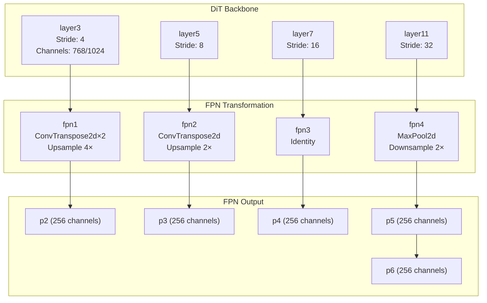
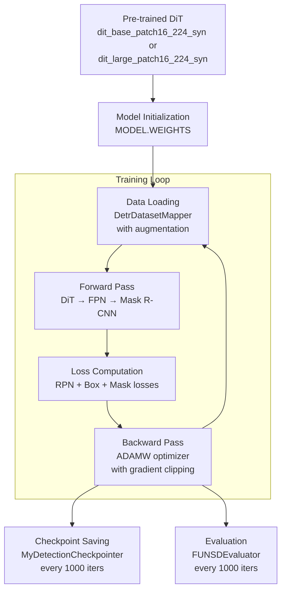
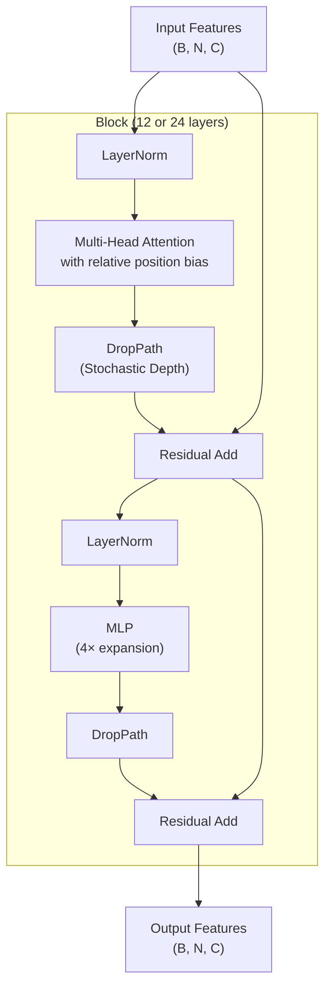
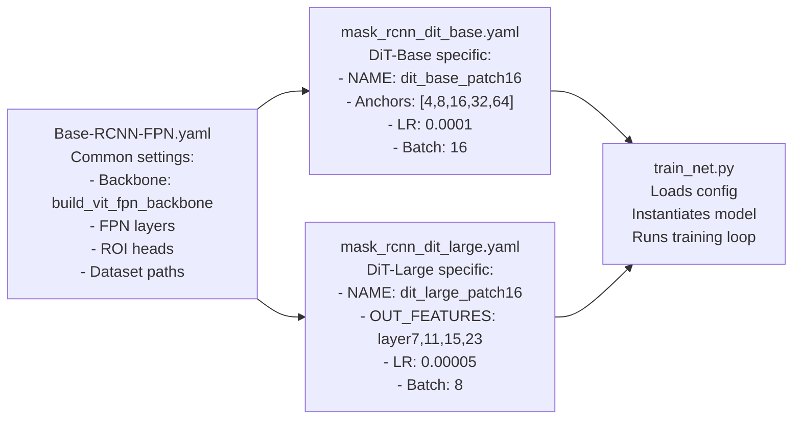

<!-- source: DeepWiki mcp.deepwiki.com · repo microsoft/unilm · extra page DiT for Text Detection · fetched 2026-10-26 -->

# DiT for Text Detection

<details>
<summary>Relevant source files</summary>

The following files were used as context for generating this wiki page:

- [dit/text_detection/README.md](dit/text_detection/README.md)
- [dit/text_detection/configs/Base-RCNN-FPN.yaml](dit/text_detection/configs/Base-RCNN-FPN.yaml)
- [dit/text_detection/configs/mask_rcnn_dit_base.yaml](dit/text_detection/configs/mask_rcnn_dit_base.yaml)
- [dit/text_detection/configs/mask_rcnn_dit_large.yaml](dit/text_detection/configs/mask_rcnn_dit_large.yaml)
- [dit/text_detection/ditod/__init__.py](dit/text_detection/ditod/__init__.py)
- [dit/text_detection/ditod/backbone.py](dit/text_detection/ditod/backbone.py)
- [dit/text_detection/ditod/beit.py](dit/text_detection/ditod/beit.py)
- [dit/text_detection/ditod/concern/__init__.py](dit/text_detection/ditod/concern/__init__.py)
- [dit/text_detection/ditod/concern/average_meter.py](dit/text_detection/ditod/concern/average_meter.py)
- [dit/text_detection/ditod/concern/box2seg.py](dit/text_detection/ditod/concern/box2seg.py)
- [dit/text_detection/ditod/concern/config.py](dit/text_detection/ditod/concern/config.py)

</details>


This document describes the text detection system that applies DiT (Document Image Transformer) as a backbone for the Mask R-CNN detection framework. The system is designed for detecting text regions in document images, specifically evaluated on the FUNSD (Form Understanding in Noisy Scanned Documents) dataset.

For document layout analysis using DiT, see [2.2.1](#2.2.1). For table detection with DiT, see [2.2.2](#2.2.2). For the BEiT vision pre-training that DiT extends, see [2.1](#2.1).

## System Overview

The DiT text detection system combines a self-supervised pre-trained DiT backbone with the Mask R-CNN object detection framework. The architecture processes document images through a Vision Transformer backbone, extracts multi-scale features via FPN (Feature Pyramid Network), and performs instance segmentation to detect text regions.

```mermaid
graph LR
    Input["Document Image<br/>(H×W×3)"]
    Backbone["DiT Backbone<br/>dit_base_patch16 or<br/>dit_large_patch16"]
    FPN["FPN<br/>Feature Pyramid"]
    RPN["Region Proposal<br/>Network"]
    ROIHead["ROI Heads<br/>Box + Mask"]
    Output["Text Detections<br/>Bounding Boxes<br/>+ Segmentation Masks"]
    
    Input --> Backbone
    Backbone --> FPN
    FPN --> RPN
    RPN --> ROIHead
    FPN --> ROIHead
    ROIHead --> Output
    
    style Backbone fill:#f9f9f9
    style FPN fill:#f9f9f9
```

**Sources:** [dit/text_detection/README.md:1-63](), [dit/text_detection/configs/Base-RCNN-FPN.yaml:1-69]()

## Architecture Components

### DiT Vision Transformer Backbone

The DiT backbone is a Vision Transformer adapted for document image understanding. The system supports two model variants defined in `ditod/beit.py`:

| Model | Embedding Dim | Depth | Heads | Init Values | Output Layers |
|-------|---------------|-------|-------|-------------|---------------|
| `dit_base_patch16` | 768 | 12 | 12 | 0.1 | layer3, layer5, layer7, layer11 |
| `dit_large_patch16` | 1024 | 24 | 16 | 1e-5 | layer7, layer11, layer15, layer23 |

The `VIT_Backbone` class in [dit/text_detection/ditod/backbone.py:31-110]() wraps the DiT model to provide a Detectron2-compatible interface. Key features:

- **Patch Embedding**: Converts input images to patch tokens via `PatchEmbed` [dit/text_detection/ditod/beit.py:259-294]()
- **Position Encoding**: Supports absolute (`abs`), relative (`rel`), or shared relative (`shared_rel`) position biases
- **Multi-scale Output**: Extracts features from intermediate transformer layers with configurable strides (4×, 8×, 16×, 32×)
- **FPN Adapters**: Applies upsampling/downsampling operations (`fpn1`, `fpn2`, `fpn3`, `fpn4`) to normalize feature map resolutions [dit/text_detection/ditod/beit.py:485-514]()

**Sources:** [dit/text_detection/ditod/backbone.py:31-156](), [dit/text_detection/ditod/beit.py:414-677]()

### Feature Pyramid Network Integration



The FPN configuration is specified in [dit/text_detection/configs/Base-RCNN-FPN.yaml:13-14]() with input features from the backbone layers and 256 output channels per pyramid level.

**Sources:** [dit/text_detection/ditod/backbone.py:144-156](), [dit/text_detection/configs/Base-RCNN-FPN.yaml:6-26]()

## Dataset and Task Configuration

### FUNSD Dataset

The system targets the FUNSD dataset for text detection. Data preparation follows MMOCR conventions:

```
data/
├── annotations/
├── imgs/
├── instances_test.json
└── instances_training.json
```

The dataset configuration in [dit/text_detection/configs/Base-RCNN-FPN.yaml:39-41]() specifies:
- Training set: `funsd_train`
- Test set: `funsd_test`
- Single class detection (`NUM_CLASSES: 1`) for text regions

**Sources:** [dit/text_detection/README.md:18-28](), [dit/text_detection/configs/Base-RCNN-FPN.yaml:39-41]()

### Detection Configuration

The Mask R-CNN detection head uses specialized anchor configurations optimized for text regions:

| Parameter | DiT-Base | DiT-Large | Purpose |
|-----------|----------|-----------|---------|
| `SIZES` | [4, 8, 16, 32, 64] | [4, 8, 16, 32, 64] | Multi-scale anchor sizes (pixels) |
| `ASPECT_RATIOS` | [1.5, 3.5, 6.5] | [1.5, 3.5, 6.5] | Wide aspect ratios for text |
| `DETECTIONS_PER_IMAGE` | 1000 | 2000 | Maximum detections per image |

The elongated aspect ratios (1.5, 3.5, 6.5) are specifically designed for horizontal text regions common in document forms.

**Sources:** [dit/text_detection/configs/mask_rcnn_dit_base.yaml:8-19](), [dit/text_detection/configs/mask_rcnn_dit_large.yaml:12-25]()

## Training Pipeline

### Training Configuration



**Sources:** [dit/text_detection/README.md:29-43](), [dit/text_detection/ditod/__init__.py:10-15]()

### Optimizer and Training Hyperparameters

The training configuration in [dit/text_detection/configs/Base-RCNN-FPN.yaml:42-56]() specifies:

**Optimizer Settings:**
- Optimizer: `ADAMW` with weight decay `0.05`
- Base learning rate: `0.0001` (DiT-Base) / `0.00005` (DiT-Large)
- LR Schedule: `WarmupCosineLR` with 1000 warmup iterations
- Gradient clipping: Full model clipping with max norm 1.0

**Training Parameters:**
- Batch size: 16 (DiT-Base) / 8 (DiT-Large) images per batch
- Max iterations: 60,000
- Mixed precision (AMP): Enabled
- Checkpoint interval: Every 1000 iterations
- Evaluation interval: Every 1000 iterations

**Data Augmentation:**
- Random cropping: 384×600 pixels
- Multi-scale training: Image sizes from 480 to 800 pixels
- DETR-style augmentations enabled

**Sources:** [dit/text_detection/configs/mask_rcnn_dit_base.yaml:11-20](), [dit/text_detection/configs/mask_rcnn_dit_large.yaml:15-26](), [dit/text_detection/configs/Base-RCNN-FPN.yaml:42-69]()

### Training Command

```bash
python train_net.py \
    --config-file configs/mask_rcnn_dit_base.yaml \
    --num-gpus 8 \
    --resume \
    MODEL.WEIGHTS path/to/pretrained/model.pth \
    OUTPUT_DIR path/to/output
```

The `train_net.py` script uses the `MyTrainer` class which extends Detectron2's default trainer with custom checkpoint loading (`MyDetectionCheckpointer`) and evaluation (`FUNSDEvaluator`).

**Sources:** [dit/text_detection/README.md:29-36](), [dit/text_detection/ditod/__init__.py:13-15]()

## Model Architecture Details

### BEiT/DiT Block Structure

Each transformer block in the DiT backbone follows the standard Vision Transformer architecture with document-specific adaptations:



**Key Components:**

1. **Attention Module** [dit/text_detection/ditod/beit.py:78-223]()
   - Multi-head self-attention with configurable QKV bias
   - Optional relative position bias tables for spatial awareness
   - Window-based position encoding with interpolation for variable image sizes
   - Attention dropout for regularization

2. **MLP Module** [dit/text_detection/ditod/beit.py:58-76]()
   - Two-layer feed-forward network
   - GELU activation
   - Hidden dimension = 4 × embedding dimension
   - Dropout on output

3. **Position Encoding** [dit/text_detection/ditod/beit.py:332-412]()
   - `RelativePositionBias` class for learnable relative position encodings
   - Supports dynamic resolution via bilinear interpolation
   - Handles CLS token special cases

**Sources:** [dit/text_detection/ditod/beit.py:225-257](), [dit/text_detection/ditod/beit.py:78-223]()

### Patch Embedding and Feature Extraction

The `PatchEmbed` module [dit/text_detection/ditod/beit.py:259-294]() converts document images to token sequences:

1. **Patch Projection**: Conv2d with kernel size = patch size (16×16) and stride = patch size
2. **Position Interpolation**: For variable input sizes, interpolates position embeddings to match actual patch grid
3. **Flattening**: Reshapes spatial features to sequence (H×W) → N tokens

The `forward_features` method [dit/text_detection/ditod/beit.py:580-615]() orchestrates the full forward pass:
1. Patch embedding with position encoding
2. CLS token concatenation
3. Sequential transformer blocks with gradient checkpointing
4. Multi-scale feature extraction from specified layers
5. FPN adapter operations for output normalization

**Sources:** [dit/text_detection/ditod/beit.py:259-294](), [dit/text_detection/ditod/beit.py:580-615]()

## Evaluation

### Evaluation Command

```bash
python train_net.py \
    --config-file configs/mask_rcnn_dit_base.yaml \
    --eval-only \
    --num-gpus 8 \
    --resume \
    MODEL.WEIGHTS path/to/checkpoint.pth \
    OUTPUT_DIR path/to/output
```

The evaluation uses `FUNSDEvaluator` [dit/text_detection/ditod/__init__.py:14]() which computes standard COCO-style metrics for text detection, including:
- Average Precision (AP) at different IoU thresholds
- Per-category metrics
- Segmentation mask quality

**Sources:** [dit/text_detection/README.md:38-43](), [dit/text_detection/ditod/__init__.py:14]()

### Model Performance

Performance results on FUNSD validation set:

| Model | Pre-trained Checkpoint | Detection Algorithm | F1 Score | Fine-tuned Weights |
|-------|------------------------|---------------------|----------|-------------------|
| DiT-Base | [dit_base_patch16_224_syn](https://layoutlm.blob.core.windows.net/dit/dit-fts/td-syn_dit-b_mrcnn.pth) | Mask R-CNN | 94.25 | [link](https://layoutlm.blob.core.windows.net/dit/dit-fts/funsd_dit-b_mrcnn.pth) |
| DiT-Large | [dit_large_patch16_224_syn](https://layoutlm.blob.core.windows.net/dit/dit-fts/td-syn_dit-l_mrcnn.pth) | Mask R-CNN | 94.29 | [link](https://layoutlm.blob.core.windows.net/dit/dit-fts/funsd_dit-l_mrcnn.pth) |

Both models achieve similar performance (~94% F1), with DiT-Large showing marginal improvement. The pre-trained checkpoints are initialized from synthetic text detection training before fine-tuning on FUNSD.

**Sources:** [dit/text_detection/README.md:7-14]()

## Implementation Details

### Model Registration and Configuration

The backbone is registered with Detectron2's registry system via the `@BACKBONE_REGISTRY.register()` decorator on `build_vit_fpn_backbone` [dit/text_detection/ditod/backbone.py:134-156](). Configuration parameters are accessed through the cfg object:

**VIT Configuration Keys:**
- `MODEL.VIT.NAME`: Model architecture (`dit_base_patch16` or `dit_large_patch16`)
- `MODEL.VIT.OUT_FEATURES`: Output layer names (e.g., `["layer3", "layer5", "layer7", "layer11"]`)
- `MODEL.VIT.DROP_PATH`: Stochastic depth drop path rate
- `MODEL.VIT.IMG_SIZE`: Input image size for position encoding
- `MODEL.VIT.POS_TYPE`: Position encoding type (`abs`, `rel`, or `shared_rel`)
- `MODEL.VIT.MODEL_KWARGS`: Additional model-specific arguments

**Sources:** [dit/text_detection/ditod/backbone.py:112-156](), [dit/text_detection/configs/Base-RCNN-FPN.yaml:8-12]()

### Custom Components

The system includes several custom Detectron2 components registered in [dit/text_detection/ditod/__init__.py:1-15]():

1. **`add_vit_config`**: Extends Detectron2 config with VIT-specific parameters
2. **`DetrDatasetMapper`**: Custom data mapper supporting DETR-style augmentations
3. **`MyDetectionCheckpointer`**: Checkpoint loader handling pre-trained weight compatibility
4. **`FUNSDEvaluator`**: Dataset-specific evaluation metrics
5. **`MyTrainer`**: Training loop with custom checkpoint and evaluation integration

These components enable seamless integration of DiT-based models with Detectron2's training infrastructure.

**Sources:** [dit/text_detection/ditod/__init__.py:1-15]()

### Gradient Checkpointing and Memory Optimization

The model supports gradient checkpointing [dit/text_detection/ditod/beit.py:598-601]() to reduce memory usage during training:

```python
if self.use_checkpoint:
    x = checkpoint.checkpoint(blk, x, rel_pos_bias, training_window_size)
else:
    x = blk(x, rel_pos_bias=rel_pos_bias, training_window_size=training_window_size)
```

This trades computation for memory by recomputing activations during backward pass, enabling training of larger models or higher resolution images.

**Sources:** [dit/text_detection/ditod/beit.py:438-601]()

## Configuration System Summary



The configuration system follows a hierarchical structure where base settings are shared and model-specific parameters override or extend them. The `_BASE_` key in model configs imports common settings from `Base-RCNN-FPN.yaml`.

**Sources:** [dit/text_detection/configs/Base-RCNN-FPN.yaml:1-69](), [dit/text_detection/configs/mask_rcnn_dit_base.yaml:1-21](), [dit/text_detection/configs/mask_rcnn_dit_large.yaml:1-27]()

---

