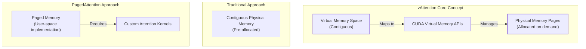
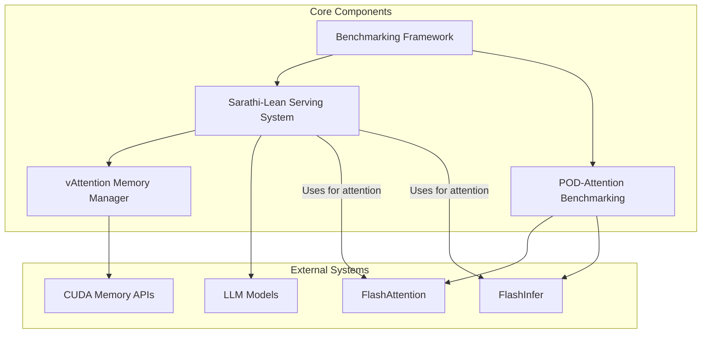
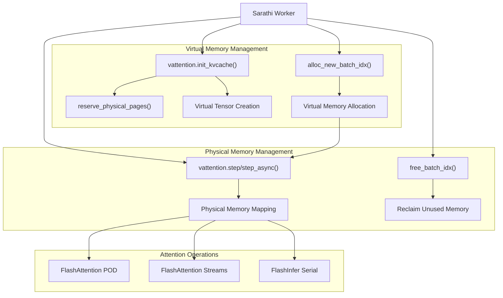
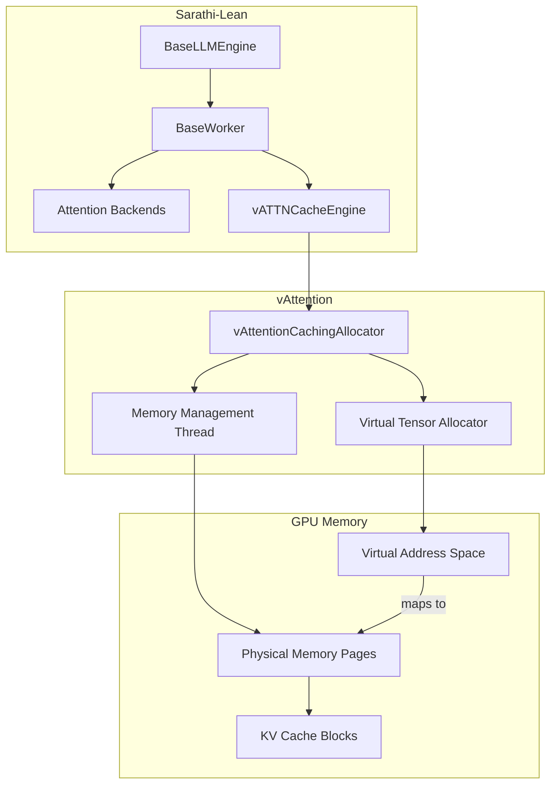
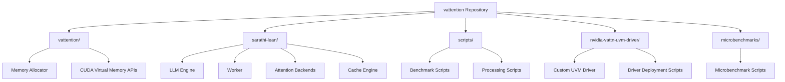
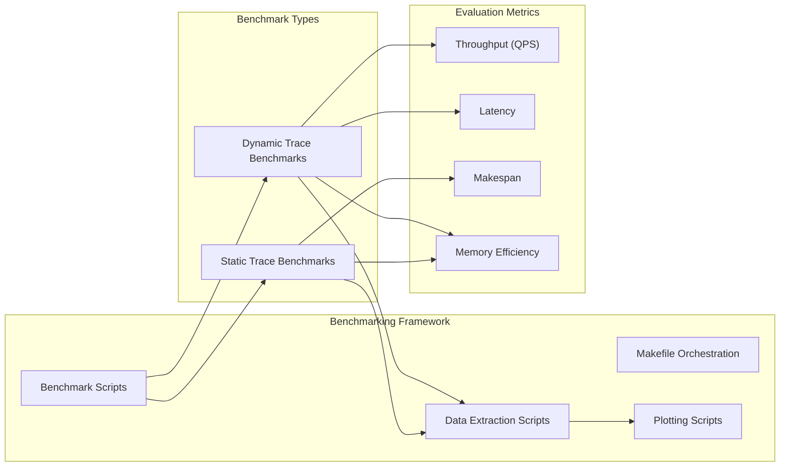

<!-- source: DeepWiki mcp.deepwiki.com · repo microsoft/vattention · page 1 Overview · fetched 2026-10-26 -->

# Overview

Relevant source files

The following files were used as context for generating this wiki page:

- [README.md](README.md)
- [nvidia-vattn-uvm-driver/README.md](nvidia-vattn-uvm-driver/README.md)
- [sarathi-lean/README.md](sarathi-lean/README.md)
- [scripts/artifact_asplos25/.gitignore](scripts/artifact_asplos25/.gitignore)
- [scripts/artifact_asplos25/README.md](scripts/artifact_asplos25/README.md)

## Purpose and Scope

This document provides an introduction to vAttention, a memory management system for key-value (KV) caches in Large Language Model (LLM) inference. vAttention optimizes GPU memory usage through a novel approach that decouples virtual and physical memory allocation, enabling more efficient LLM serving compared to alternatives like PagedAttention. This overview explains the core concepts, architecture, and components of the vAttention system.

For detailed information about specific subsystems, refer to:
- [vAttention Core System](#2)
- [Sarathi-Lean Integration](#3)
- [POD-Attention](#4)
- [Benchmarking Framework](#5)

Sources: [README.md:1-206]()

## What is vAttention?

vAttention is a memory manager specifically designed for KV-cache in LLM serving systems. It introduces a novel approach to memory management by leveraging CUDA virtual memory APIs to separate the allocation of virtual and physical memory. This approach allows:

1. Allocation of physical memory on demand while maintaining contiguous KV-cache in virtual memory
2. Support for dynamic memory allocation with unmodified attention kernels
3. Improved performance over PagedAttention, especially for prefill-bound workloads

Unlike PagedAttention, which implements demand paging in user space and requires custom kernels, vAttention provides a simpler, more portable solution that can work with existing kernels while delivering competitive or superior performance.

Sources: [README.md:1-4](), [README.md:144-191]()

## System Architecture

vAttention's architecture consists of several interconnected components that work together to provide efficient memory management for LLM inference. The following diagram illustrates the high-level system architecture:

### Key Components

1. **vAttention Memory Manager**: The core component that provides memory management functionality through the CUDA virtual memory APIs.

2. **Sarathi-Lean Serving System**: A modified version of Sarathi-Serve that integrates with vAttention for memory management during LLM inference.

3. **POD-Attention**: A specialized attention implementation that optimizes performance by fusing prefill and decode operations.

4. **Benchmarking Framework**: A comprehensive evaluation system for measuring the performance of different attention mechanisms and memory management strategies.

Sources: [README.md:8-15]()

## Data Flow

The following diagram illustrates how data flows through the vAttention system during the LLM inference process:

The data flow consists of several key operations:

1. **Initialization**: The system initializes the KV-cache with `vattention.init_kvcache()`, which creates virtual tensors without physical memory.

2. **Memory Reservation**: Physical memory pages can be reserved ahead of time with `reserve_physical_pages()`.

3. **Request Allocation**: When a new request arrives, `alloc_new_batch_idx()` assigns it a batch index for KV-cache placement.

4. **Memory Mapping**: Before model execution, `vattention.step()` or `vattention.step_async()` maps physical memory to the virtual addresses.

5. **Memory Reclamation**: When requests complete, `free_batch_idx()` allows reclamation of their physical memory.

Sources: [README.md:149-191]()

## Integration with Sarathi-Lean

vAttention integrates with Sarathi-Lean through a set of APIs that manage KV-cache allocation and deallocation. The following diagram shows this integration:

The integration works as follows:

1. The `vATTNCacheEngine` initializes vAttention and manages aspects of KV-cache in Python (mapping sequence IDs to batch indices and tracking context lengths).

2. Before model forward pass, the `BaseWorker` calls `vattention.step_async()` or `vattention.step()` to allocate physical memory.

3. After the forward pass, the worker calls `vattention.free_batch_idx()` for completed requests.

This integration allows Sarathi-Lean to leverage vAttention's memory management capabilities while maintaining its serving infrastructure.

Sources: [README.md:146-191]()

## Attention Backends

vAttention supports multiple attention computation backends, providing flexibility in how attention operations are performed. The main backends are:

| Backend | Description | Implementation |
|---------|-------------|----------------|
| FlashAttention vAttention | Uses FlashAttention for both prefill and decode with vAttention memory management | [sarathi-lean/sarathi/model_executor/attention/vattention_flashattention_wrapper.py]() |
| FlashInfer vAttention | Uses FlashInfer for prefill and FlashAttention for decode with vAttention memory management | [sarathi-lean/sarathi/model_executor/attention/vattention_flashinfer_wrapper.py]() |
| FlashAttention Paged | Uses FlashAttention with PagedAttention memory management | Various block sizes (16, 256) |
| FlashInfer Paged | Uses FlashInfer with PagedAttention memory management | Various block sizes (16, 256) |

These backends can be configured with different page sizes for vAttention (64KB, 128KB, 256KB, 2MB) and different block sizes for paged attention.

Sources: [README.md:76-86]()

## Repository Structure

The vAttention repository is organized into the following main components:

| Component | Description |
|-----------|-------------|
| `vattention/` | Core memory allocator implementation |
| `sarathi-lean/` | Modified version of Sarathi-Serve with vAttention integration |
| `scripts/` | Scripts for running experiments and benchmarks |
| `nvidia-vattn-uvm-driver/` | Custom NVIDIA UVM drivers for smaller page sizes |
| `microbenchmarks/` | Scripts for running microbenchmarks |

Sources: [README.md:8-15]()

## Benchmarking

vAttention includes a comprehensive benchmarking framework to evaluate its performance against alternatives like PagedAttention. The benchmarking system consists of several components:

The benchmarking framework provides:

1. **Dynamic trace benchmarks**: Evaluate performance with dynamically arriving requests (e.g., Poisson distribution).
2. **Static trace benchmarks**: Evaluate performance with batched requests.
3. **OpenAI-compatible API**: For benchmarking with external tools like metron.

The benchmarks can be configured with different models, attention backends, and workload parameters to comprehensively evaluate performance.

Sources: [README.md:45-140](), [scripts/artifact_asplos25/README.md:1-34]()

## Getting Started

To use vAttention, you need:

1. **Prerequisites**: PyTorch 2.3.0, CUDA 12.1+, Python 3.10, Linux kernel, A100 GPUs

2. **Installation**:
   - Create and activate a conda environment
   - Install libtorch dependencies
   - Build and install sarathi-lean and vattention

3. **Running benchmarks**:
   - Configure benchmark settings in scripts
   - Run dynamic or static trace benchmarks
   - Process and visualize results

For smaller page sizes (64KB, 128KB, 256KB), you also need to install the custom NVIDIA UVM driver.

Sources: [README.md:17-44](), [nvidia-vattn-uvm-driver/README.md:1-91]()

## Summary

vAttention represents a novel approach to memory management for LLM inference that provides both performance and ease of integration. By decoupling virtual and physical memory allocation, it enables efficient use of GPU memory without requiring custom attention kernels. The system integrates with Sarathi-Lean for LLM serving and supports various attention backends like FlashAttention and FlashInfer. The comprehensive benchmarking framework allows for thorough evaluation of its performance across different workloads and configurations.

Sources: [README.md:1-206]()

---

