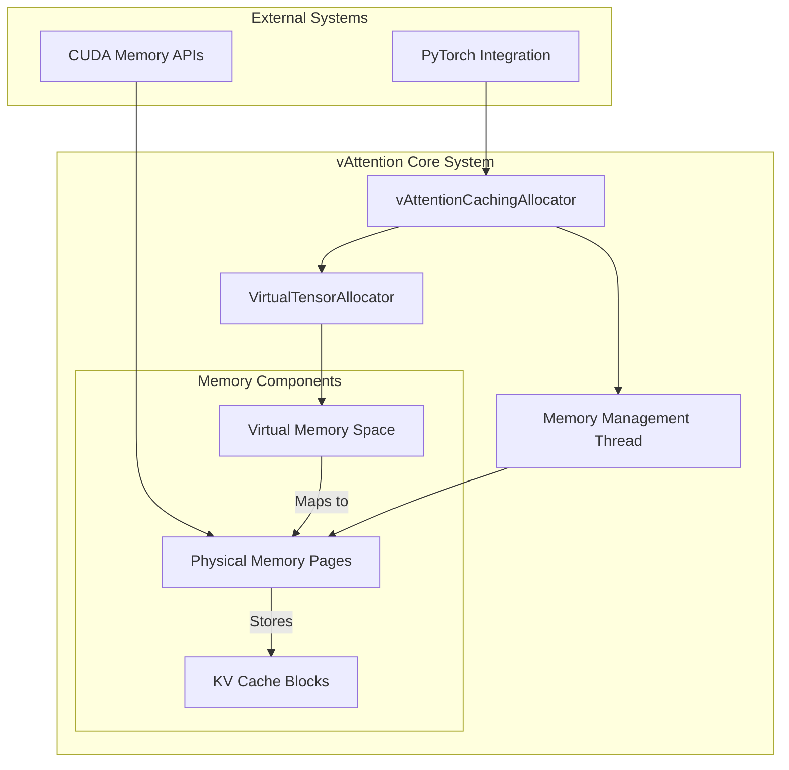
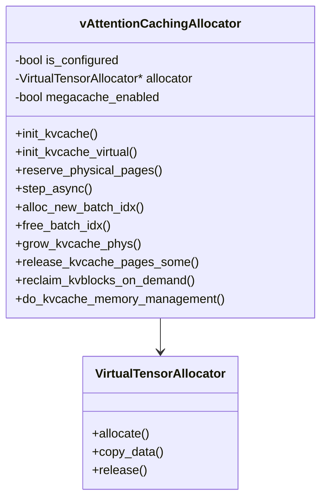
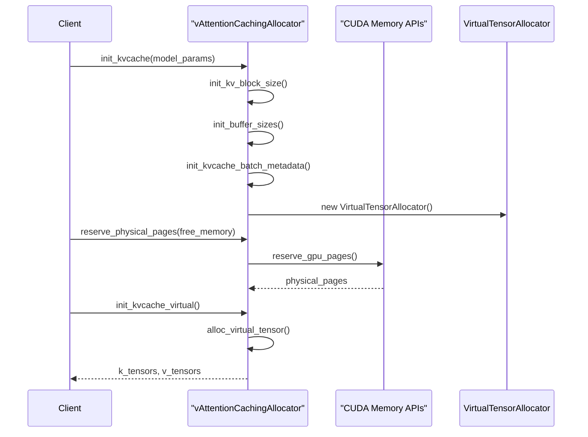
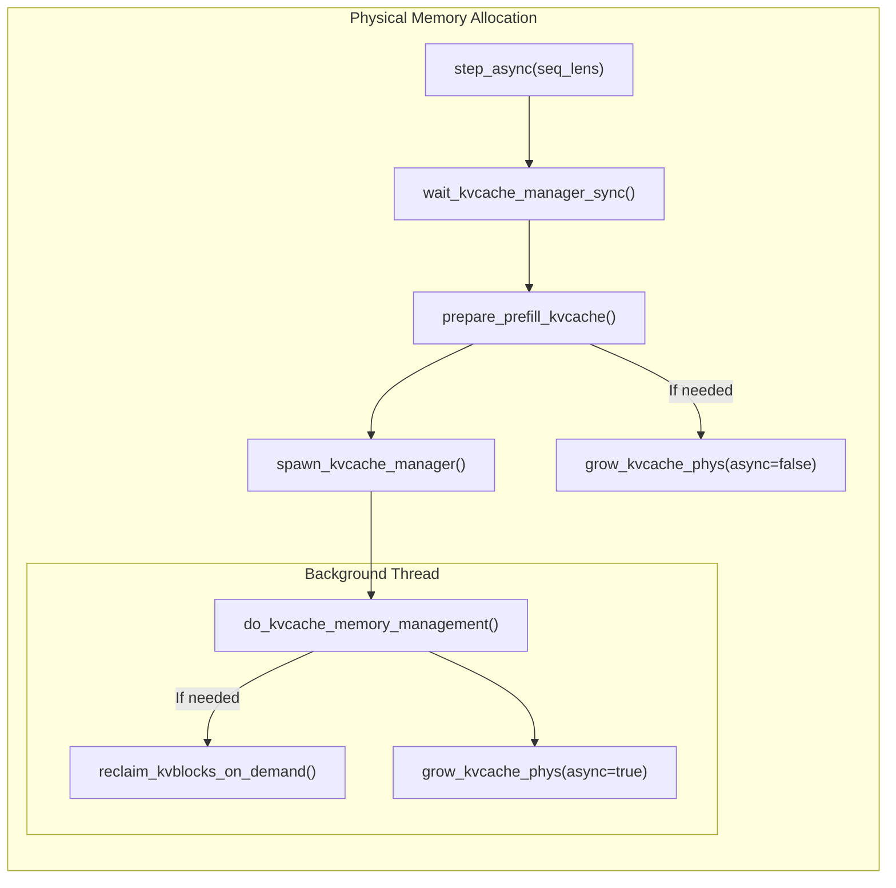
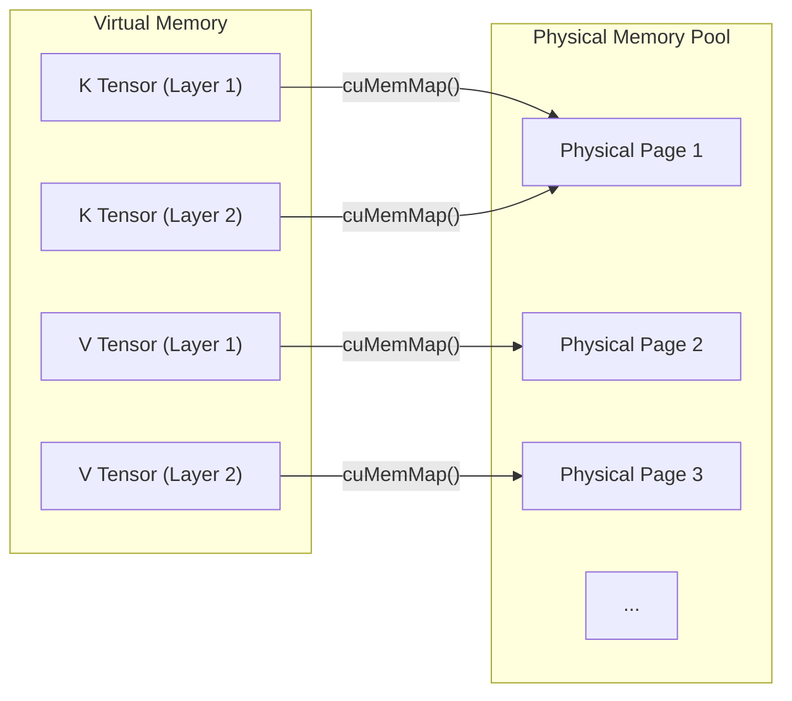
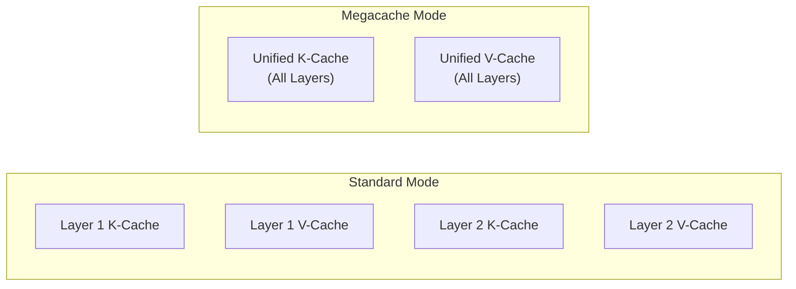

<!-- source: DeepWiki mcp.deepwiki.com · repo microsoft/vattention · page 2 vAttention Core System · fetched 2026-10-26 -->

# vAttention Core System

Relevant source files

The following files were used as context for generating this wiki page:

- [vattention/cudaInternal.h](vattention/cudaInternal.h)
- [vattention/utils.h](vattention/utils.h)
- [vattention/vattention.cu](vattention/vattention.cu)
- [vattention/vtensor.h](vattention/vtensor.h)

## Purpose and Scope

This document describes the core vAttention memory management system architecture, which optimizes GPU memory usage during LLM inference by separating virtual and physical memory allocation for key-value (KV) caches. This document focuses on the internal workings of the memory manager itself, not its integration with serving systems. For information about how vAttention integrates with Sarathi-Lean, see [Sarathi-Lean Integration](#3).

Sources: [vattention/vattention.cu:27-610]()

## System Architecture Overview

vAttention employs a virtual memory management approach that decouples virtual address space allocation from physical memory allocation. This allows for efficient memory utilization by allocating physical memory only when needed, while maintaining contiguous virtual memory for key-value caches.

Sources: [vattention/vattention.cu:27-127](), [vattention/vtensor.h:9-63]()

## Core Components

### vAttentionCachingAllocator

The central class that manages the KV cache memory allocation and deallocation. It handles both virtual memory allocation through the VirtualTensorAllocator and physical memory mapping through CUDA APIs.

Key responsibilities:
- Initialize and configure KV cache memory parameters
- Allocate virtual tensors for KV cache
- Map physical memory pages to virtual addresses
- Reclaim unused memory when needed
- Manage request lifecycles (allocation and freeing)

Sources: [vattention/vattention.cu:27-610](), [vattention/vtensor.h:9-63]()

### Virtual Tensor Allocation

vAttention uses a custom tensor allocator that creates virtual memory space without immediately backing it with physical memory. This allocator extends PyTorch's `at::Allocator` to create virtual tensors that can be used like regular PyTorch tensors.

Key features:
- Reserves virtual memory addresses using CUDA VM APIs
- Integrates with PyTorch's tensor system
- Supports both regular CUDA and UVM backends

Sources: [vattention/vtensor.h:9-125]()

## Memory Management Workflow

### Initialization Phase

The initialization process configures the vAttention system with model-specific parameters and allocates virtual memory for KV caches.

Sources: [vattention/vattention.cu:97-192](), [vattention/cudaInternal.h:15-68]()

### Memory Allocation Process

vAttention allocates physical memory on demand as inference progresses:

1. Client calls `step_async` with sequence lengths for all requests
2. System synchronously maps physical memory for immediate needs (prefill)
3. A background thread asynchronously prepares memory for future steps
4. When memory is scarce, the system reclaims memory from inactive or less important requests

Sources: [vattention/vattention.cu:375-558]()

### Memory Reclamation Strategies

vAttention employs different strategies to reclaim memory:

1. **Eager Reclamation**: Free memory from inactive requests immediately (`release_kvcache_pages_all`)
2. **On-demand Reclamation**: Reclaim memory only when needed for new allocations (`reclaim_kvblocks_on_demand`)
3. **Deferred Reclamation**: Gradually reclaim memory in the background thread (`do_reclaim_pages`)

The system prioritizes reclaiming memory from:
- Inactive requests (where `seq_len` is 0)
- Requests with more allocated memory than required
- Higher request IDs (indicating lower priority)

Sources: [vattention/vattention.cu:420-469]()

## Memory Mapping Mechanism

vAttention uses CUDA's virtual memory management APIs to map physical pages to virtual addresses:

Key operations:
- **Mapping**: `MAP_PAGES` maps physical pages to virtual addresses using `cuMemMap` and `cuMemSetAccess`
- **Unmapping**: `UNMAP_PAGES` releases physical pages using `cuMemUnmap`
- **Tracking**: A pagemap tracks which physical pages are mapped to which virtual addresses

Sources: [vattention/cudaInternal.h:70-94]()

## Request Lifecycle Management

vAttention manages the lifecycle of requests through batch indices:

1. **Allocation**: `alloc_new_batch_idx` assigns an inactive request ID to a new request
2. **Active Use**: Memory is allocated as needed during processing
3. **Deallocation**: `free_batch_idx` marks a request as inactive, allowing its memory to be reclaimed

The system uses a best-fit approach when allocating new request IDs, preferring request slots that already have some allocated memory to minimize new allocations.

Sources: [vattention/vattention.cu:564-594]()

## Configuration Parameters

vAttention can be configured with several parameters that affect its behavior:

| Parameter | Description | Default |
|-----------|-------------|---------|
| `num_layers` | Number of transformer layers in the model | - |
| `num_kv_heads` | Number of attention heads for key and value | - |
| `head_size` | Size of each attention head | - |
| `max_batch_size` | Maximum number of concurrent requests | - |
| `max_context_length` | Maximum sequence length for a request | - |
| `page_size` | Size of physical memory pages | 2MB |
| `megacache_enabled` | Whether to use a unified cache for all layers | false |
| `deferred_reclaim` | Whether to reclaim memory proactively | true |

Sources: [vattention/utils.h:43-81](), [vattention/vattention.cu:97-119]()

## Megacache Mode

vAttention supports two modes of operation:

1. **Standard Mode**: Each layer has its own separate KV cache
2. **Megacache Mode**: All layers share a single unified KV cache

Megacache mode changes how memory is allocated and accessed, affecting the shape of tensors and the calculation of memory requirements.

Sources: [vattention/vattention.cu:53-70](), [vattention/vattention.cu:146-182]()

## Memory Management Optimizations

vAttention implements several optimizations to improve memory efficiency:

1. **Proactive Allocation**: Memory is allocated ahead of time for future steps (`EAGER_NUM_STEPS`, `EAGER_NUM_KVBLOCKS`)
2. **Best-fit Request Assignment**: New requests are assigned to slots that already have suitable memory allocated
3. **Balanced Reclamation**: Memory is reclaimed gradually to avoid impact on serving latency
4. **Overcommitment Tracking**: The system tracks memory that can be repurposed without additional allocation

Sources: [vattention/vattention.cu:486-536](), [vattention/utils.h:177-183]()

## Public API

vAttention exposes the following key APIs:

| API | Description |
|-----|-------------|
| `init_kvcache` | Initialize the KV cache system |
| `reserve_physical_pages` | Reserve physical memory pages for KV cache |
| `step_async` | Allocate memory for the current step and prepare for future steps |
| `alloc_new_batch_idx` | Allocate a batch index for a new request |
| `free_batch_idx` | Free a batch index when a request is complete |
| `cleanup` | Release all resources |

Sources: [vattention/vattention.cu:612-637]()

## Integration with External Systems

vAttention is designed to be integrated with LLM serving systems. The core system provides the memory management infrastructure, while integration with specific serving frameworks and attention mechanisms is handled by separate components. For details on integration with Sarathi-Lean, see [Sarathi-Lean Integration](#3).

Sources: [vattention/vattention.cu:612-637]()

---

