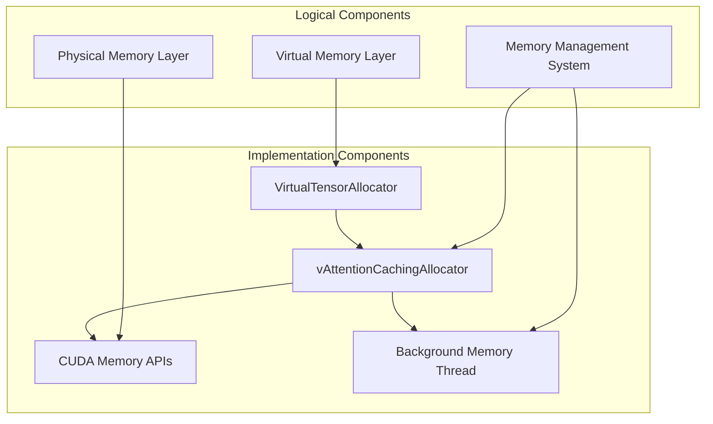
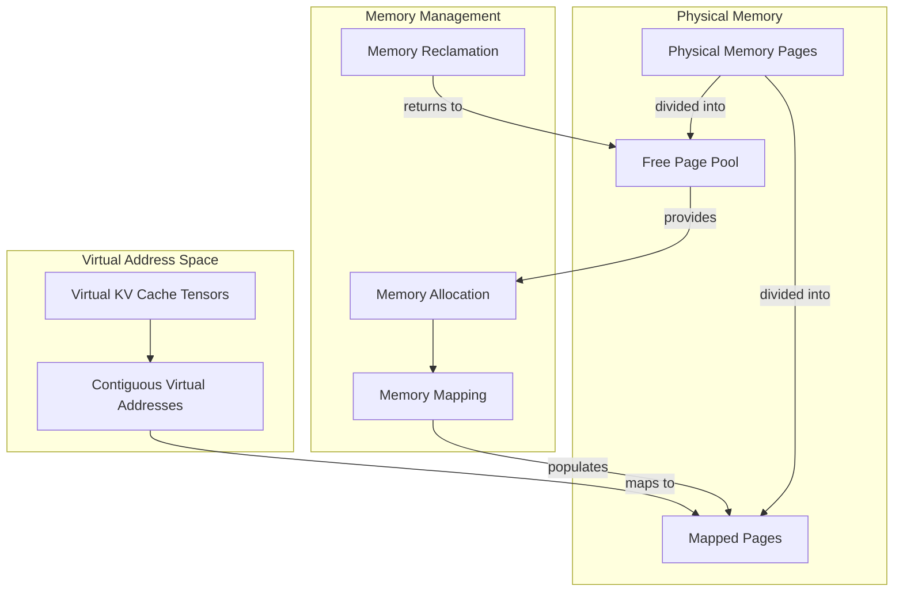
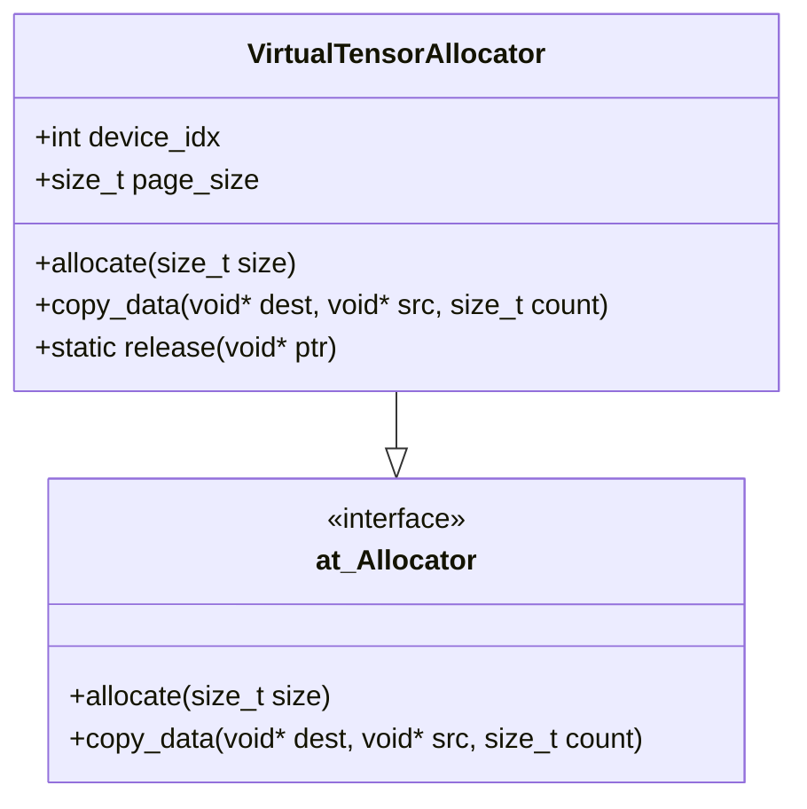
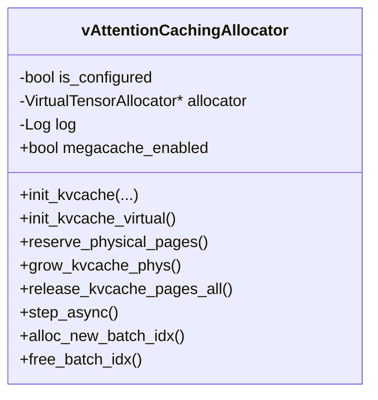
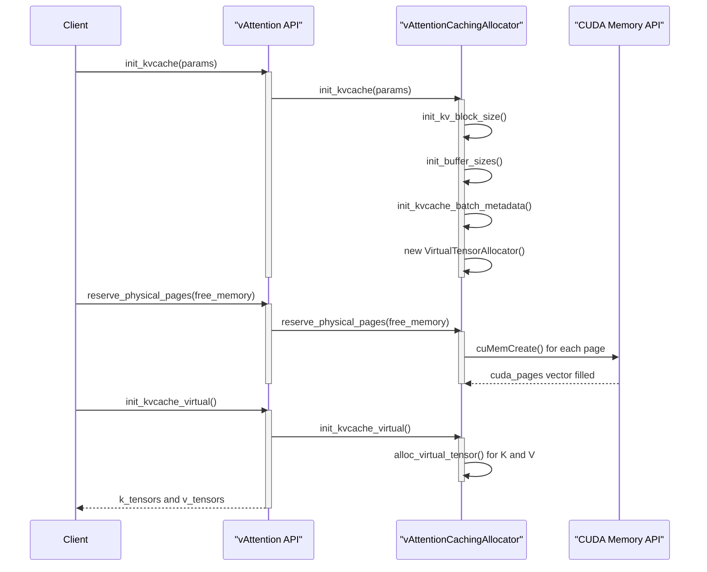
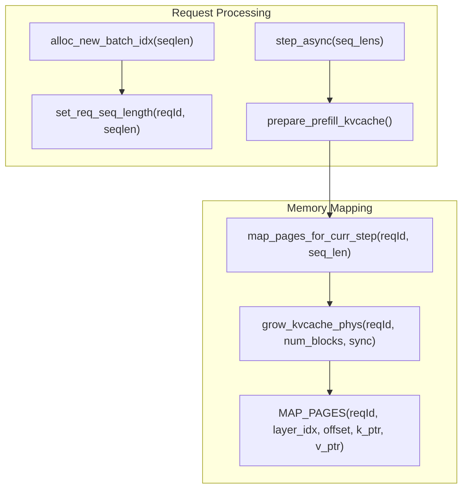
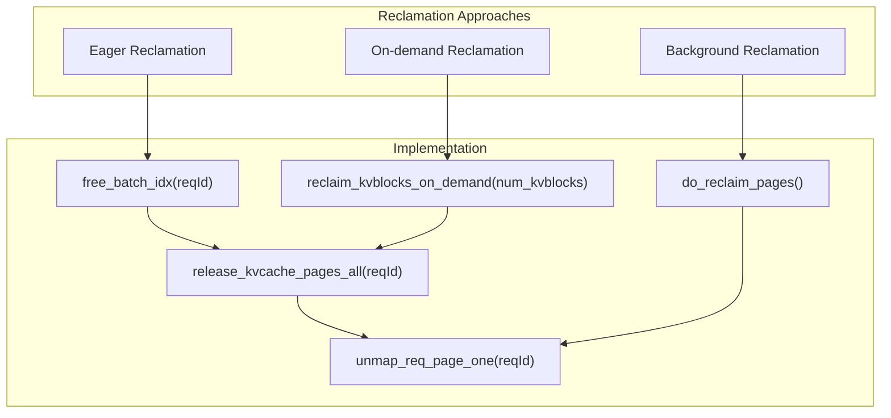
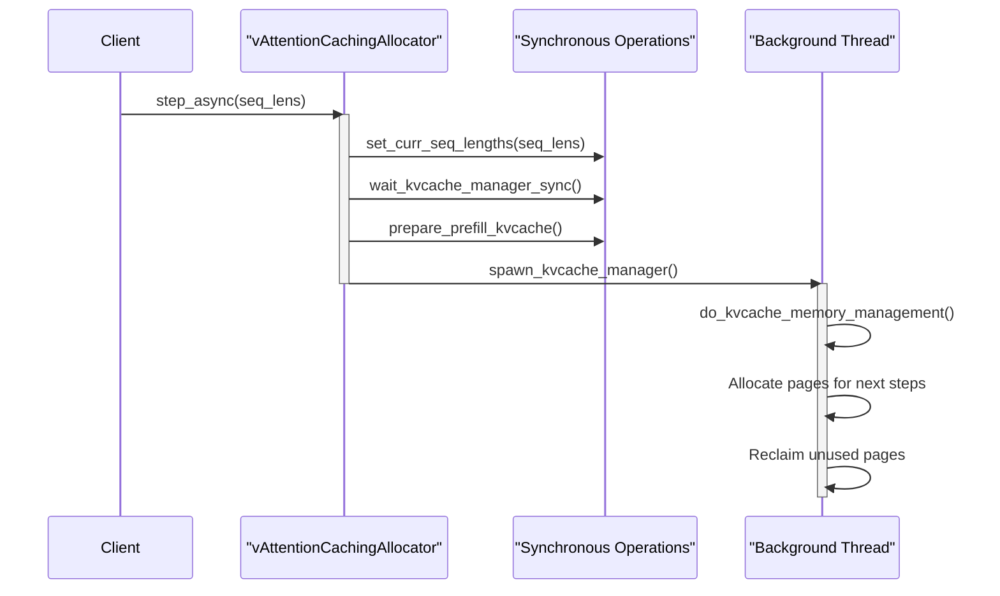
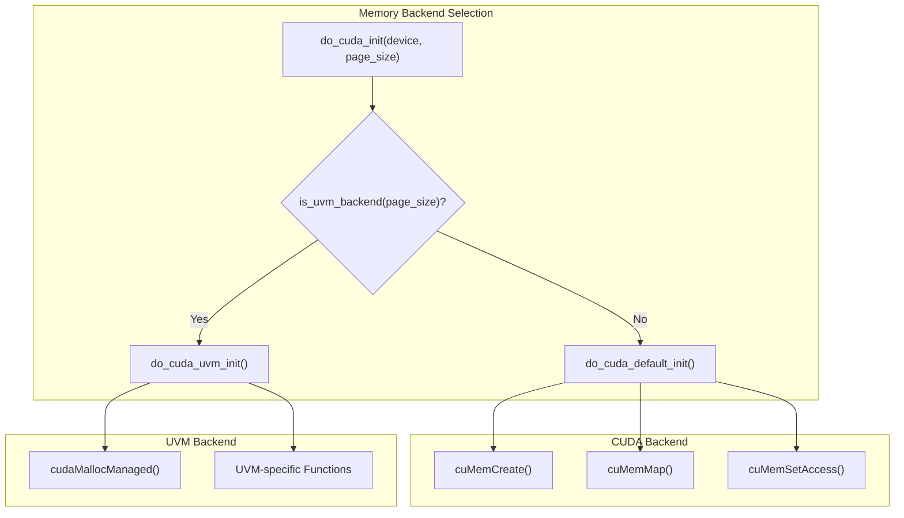
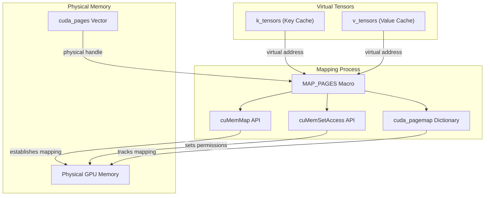

<!-- source: DeepWiki mcp.deepwiki.com · repo microsoft/vattention · page 2.1 Memory Management Architecture · fetched 2026-10-26 -->

# Memory Management Architecture

Relevant source files

The following files were used as context for generating this wiki page:

- [vattention/cudaInternal.h](vattention/cudaInternal.h)
- [vattention/utils.h](vattention/utils.h)
- [vattention/vattention.cu](vattention/vattention.cu)
- [vattention/vtensor.h](vattention/vtensor.h)

## Purpose and Scope

This document details the memory management architecture of vAttention, which provides efficient and dynamic memory allocation for LLM inference. The system implements a virtual memory abstraction layer over physical GPU memory to optimize KV cache usage, allowing for efficient memory sharing and reclamation between concurrent requests.

For information about the API interfaces to this system, see [vAttention APIs](#2.2).

## Core Memory Management Concepts

vAttention's memory management is built around separating virtual address spaces from physical memory pages. This separation enables:

1. Contiguous virtual tensors for efficient attention operations
2. On-demand physical memory allocation
3. Dynamic memory reclamation when resources are needed
4. Sharing of physical memory between requests

Sources: [vattention/vattention.cu:27-610](), [vattention/vtensor.h:9-63]()

## Memory Architecture Overview

The vAttention memory system consists of two primary layers:

1. **Virtual Memory Layer**: Manages a contiguous virtual address space for KV cache tensors
2. **Physical Memory Layer**: Manages physical GPU memory pages that back the virtual address space

Sources: [vattention/vattention.cu:189-192](), [vattention/cudaInternal.h:45-59]()

## Key Components

### VirtualTensorAllocator

This component handles allocation of virtual memory for tensors:

Key responsibilities:
- Reserves contiguous virtual address space using CUDA APIs
- Creates PyTorch tensors that use this virtual address space
- Maintains alignment with the configured page size

Sources: [vattention/vtensor.h:9-63]()

### vAttentionCachingAllocator

This is the central component that manages the entire memory system:

Key responsibilities:
- Initializes the KV cache configuration
- Manages virtual tensor allocation
- Controls physical page reservation and mapping
- Handles memory reclamation
- Provides APIs for request lifecycle management

Sources: [vattention/vattention.cu:27-610]()

## Memory Management Lifecycle

### Initialization

Initialization of the memory management system involves setting up both virtual and physical memory:

During initialization:
1. The system configures KV cache parameters (size, shape, etc.)
2. Physical memory pages are reserved using CUDA memory APIs
3. Virtual tensors are allocated for both key and value caches

Sources: [vattention/vattention.cu:97-127](), [vattention/vattention.cu:142-187](), [vattention/vattention.cu:189-192]()

### Request Allocation and Memory Mapping

When a new request is added to the system, memory is allocated and mapped:

The mapping process:
1. A batch index is allocated for the new request
2. Required memory is calculated based on sequence length
3. Physical pages are mapped to the virtual address space
4. For each layer, both key and value cache pages are mapped

Sources: [vattention/vattention.cu:564-589](), [vattention/vattention.cu:376-392](), [vattention/vattention.cu:268-323]()

### Memory Reclamation

vAttention implements several reclamation strategies:

The system uses multiple strategies for reclaiming memory:
1. **Eager Reclamation**: When a request completes, all its memory is immediately reclaimed
2. **On-demand Reclamation**: When memory is needed for new requests, it's reclaimed from lower-priority requests
3. **Background Reclamation**: A background thread continuously reclaims unused memory

Sources: [vattention/vattention.cu:243-247](), [vattention/vattention.cu:420-438](), [vattention/vattention.cu:444-469]()

## Asynchronous Memory Management

vAttention uses asynchronous memory management to optimize latency and throughput:

Key aspects of asynchronous management:
1. Critical operations like prefill are handled synchronously
2. Future token allocations are handled asynchronously
3. Background thread manages memory proactively for next steps
4. Reclamation occurs when the system is not under load

Sources: [vattention/vattention.cu:549-558](), [vattention/vattention.cu:488-536](), [vattention/vattention.cu:538-546]()

## Physical Memory Backends

vAttention supports multiple physical memory backends:

The system supports two primary backends:
1. **Standard CUDA Memory**: Uses CUDA virtual memory APIs for discrete GPUs
2. **Unified Virtual Memory (UVM)**: For specialized hardware with unified memory capabilities

The backend selection is determined by the page size parameter, with 2MB being the default for standard CUDA memory.

Sources: [vattention/cudaInternal.h:15-43](), [vattention/utils.h:83-86](), [vattention/vtensor.h:35-44]()

## Memory Sizing and Configuration

vAttention calculates memory requirements based on model and system parameters:

| Parameter | Description | Configuration |
|-----------|-------------|---------------|
| `num_layers` | Number of transformer layers | Model-specific |
| `num_kv_heads` | Number of key-value attention heads | Model-specific |
| `head_size` | Dimension of each attention head | Model-specific |
| `max_batch_size` | Maximum concurrent requests | System-specific |
| `max_context_length` | Maximum sequence length | System-specific |
| `page_size` | Physical memory page size | Default: 2MB |
| `tokens_per_page` | Number of tokens per physical page | Calculated |

The system calculates derived values:
- `virt_buff_size_per_token`: Memory required per token
- `virt_buff_size_per_req`: Memory required per request
- `max_pages_per_req`: Maximum pages per request
- `virt_buff_size`: Total virtual buffer size

Sources: [vattention/vattention.cu:49-73](), [vattention/utils.h:43-81]()

## Memory Mapping Mechanism

The core of vAttention's memory management is the mapping between virtual and physical memory:

The mapping process involves:
1. Obtaining virtual addresses from tensor data pointers
2. Getting physical page handles from the free page pool
3. Using CUDA APIs to map physical pages to virtual addresses
4. Tracking mappings in a dictionary for later unmapping

Sources: [vattention/cudaInternal.h:70-82](), [vattention/vattention.cu:268-323]()

## Conclusion

vAttention's memory management architecture provides an efficient solution for LLM inference by:
1. Separating virtual and physical memory concerns
2. Enabling dynamic allocation and reclamation of memory
3. Optimizing memory usage through sharing and on-demand allocation
4. Supporting both synchronous and asynchronous operation

This architecture allows for efficient handling of concurrent requests with variable sequence lengths, maximizing GPU memory utilization while maintaining high performance.

---

