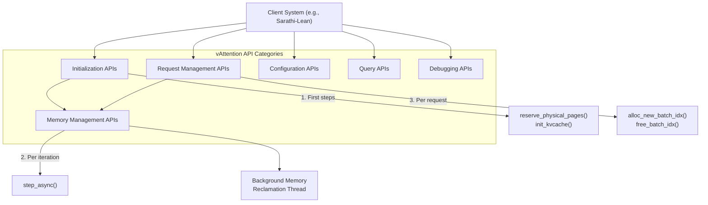
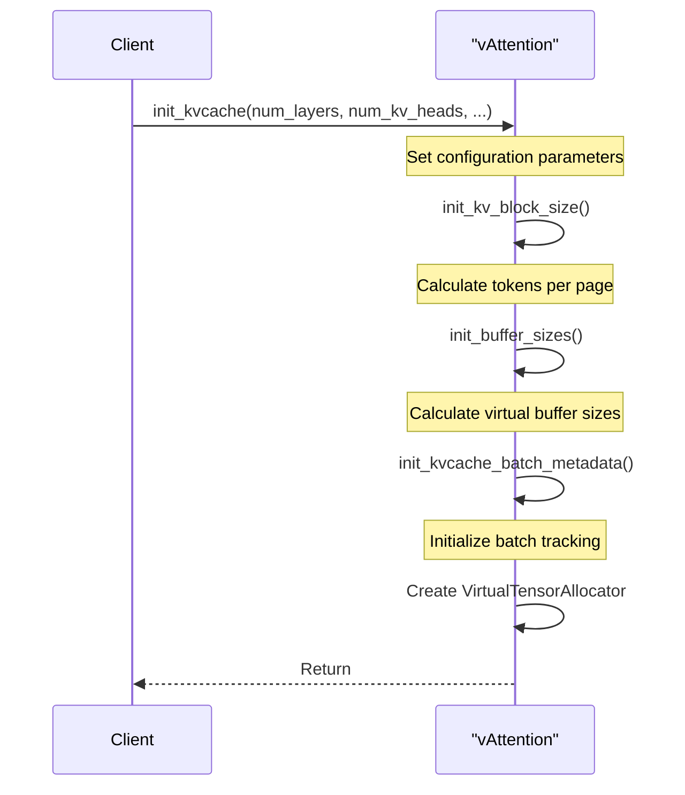
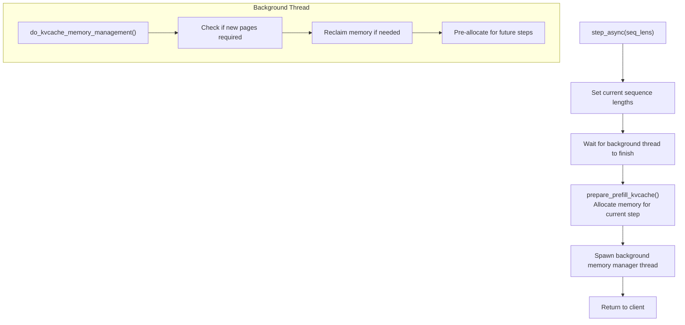
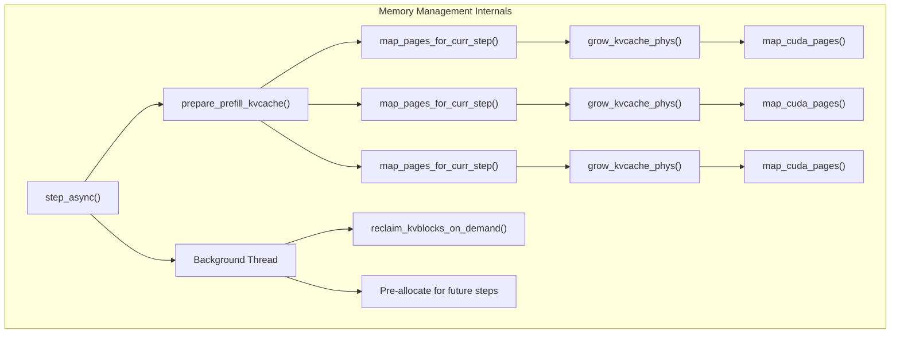
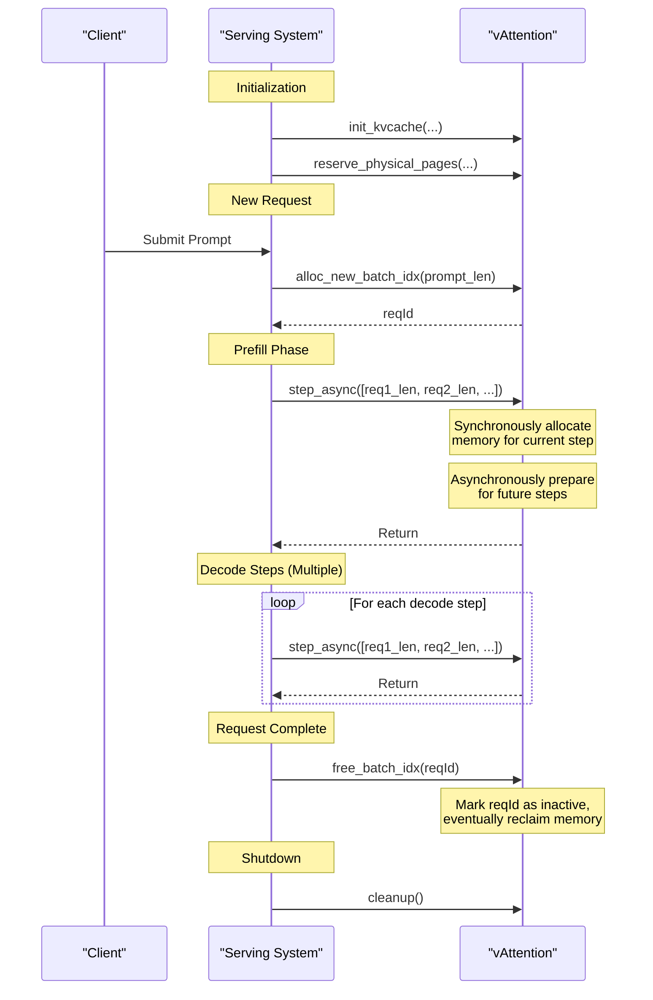

<!-- source: DeepWiki mcp.deepwiki.com · repo microsoft/vattention · page 2.2 vAttention APIs · fetched 2026-10-26 -->

# vAttention APIs

Relevant source files

The following files were used as context for generating this wiki page:

- [vattention/cudaInternal.h](vattention/cudaInternal.h)
- [vattention/vattention.cu](vattention/vattention.cu)

This document provides detailed documentation of the public APIs provided by the vAttention memory management system. These interfaces allow LLM serving systems to efficiently manage GPU memory for key-value (KV) caches during inference. For information about the overall memory management architecture, see [Memory Management Architecture](#2.1).

## API Overview

The vAttention system exposes several categories of APIs for different purposes:

Sources: [vattention/vattention.cu:614-637]()

## Initialization APIs

These APIs must be called during system startup to configure and initialize the vAttention memory system.

### init_kvcache

Initializes the KV cache with model parameters and creates virtual tensors.

**Parameters:**
- `num_layers`: Number of layers in the model
- `num_kv_heads`: Number of key-value heads
- `head_size`: Size of each head
- `max_batch_size`: Maximum batch size 
- `max_context_length`: Maximum context length
- `device`: GPU device ID
- `dtype`: Data type for the KV cache
- `page_size`: Size of memory pages (in bytes)
- `megacache`: Boolean flag for enabling megacache mode

**Function call flow:**

Sources: [vattention/vattention.cu:97-128]()

### reserve_physical_pages

Reserves physical memory blocks for the KV cache. This should be called after `init_kvcache`.

**Parameters:**
- `free_memory`: Amount of memory to reserve (in bytes)

**Returns:**
- Number of physical pages reserved

Sources: [vattention/vattention.cu:189-192](), [vattention/cudaInternal.h:45-59]()

### cleanup

Releases allocator resources and cleans up the vAttention system. Should be called during shutdown.

**Parameters:** None

Sources: [vattention/vattention.cu:602-609]()

## Memory Management APIs

### step_async

The core API for memory management, called once per inference step. Allocates memory for the current step synchronously and future steps asynchronously.

**Parameters:**
- `seq_lens`: Vector of sequence lengths for each active request

**Implementation details:**
1. Updates current sequence lengths
2. Synchronizes with background memory manager
3. Allocates memory for prefill phase if needed
4. Spawns background thread for future memory management

Sources: [vattention/vattention.cu:549-558](), [vattention/vattention.cu:488-536]()

### step

Synchronous version of memory management, primarily for testing purposes.

**Parameters:**
- `seq_lens`: Vector of sequence lengths for each request
- `eager_reclaim`: Boolean flag for eager memory reclamation

Sources: [vattention/vattention.cu:395-409]()

## Request Management APIs

### alloc_new_batch_idx

Allocates a new batch index for a request using best-fit allocation strategy.

**Parameters:**
- `seqlen`: Initial sequence length for the request

**Returns:**
- Batch index allocated, or -1 if no index is available

**Implementation details:**
- Searches for an inactive request ID
- Uses best-fit allocation to find a request slot with pages already mapped
- Sets the sequence length for the selected request ID

Sources: [vattention/vattention.cu:564-589]()

### free_batch_idx

Frees a batch index, making it available for reuse.

**Parameters:**
- `reqId`: Batch index to free

Sources: [vattention/vattention.cu:591-594]()

## Configuration APIs

### set_verbose

Enables or disables verbose logging.

**Parameters:**
- `val`: Boolean flag for enabling verbose logging

Sources: [vattention/vattention.cu:624]()

### set_deferred_reclamation

Enables or disables deferred memory reclamation. When enabled, memory is not reclaimed immediately, allowing for potential reuse.

**Parameters:**
- `val`: Boolean flag for enabling deferred reclamation

Sources: [vattention/vattention.cu:596-599](), [vattention/vattention.cu:625]()

## Query APIs

### num_free_kvblocks

Returns the number of free KV blocks available for allocation.

**Returns:**
- Number of free KV blocks

Sources: [vattention/vattention.cu:207-210](), [vattention/vattention.cu:636]()

## Debugging APIs

### show_kvcache_config

Shows the current KV cache configuration.

Sources: [vattention/vattention.cu:130-140](), [vattention/vattention.cu:627]()

### show_allocator_state

Shows the current state of the allocator, including free memory and allocation per request.

Sources: [vattention/vattention.cu:76-95](), [vattention/vattention.cu:628]()

## Memory Management Internals

The following diagram illustrates the internal memory management process in vAttention:

Sources: [vattention/vattention.cu:375-392](), [vattention/vattention.cu:268-323](), [vattention/cudaInternal.h:70-82]()

## API Integration Example

The following diagram illustrates how a serving system like Sarathi-Lean would interact with vAttention APIs during inference:

Sources: [vattention/vattention.cu:549-558](), [vattention/vattention.cu:564-589](), [vattention/vattention.cu:591-594]()

## Implementation Details

### vAttention Memory Layers

The vAttention system has three key memory management layers:

| Layer | Description | Key Functions |
|-------|-------------|--------------|
| **Virtual Address Space** | Continuous virtual memory for KV cache tensors | `alloc_virtual_tensor()`, `init_kvcache_virtual()` |
| **Physical Memory Management** | Handles allocation/reclamation of GPU memory pages | `grow_kvcache_phys()`, `reclaim_kvblocks_on_demand()` |
| **Memory Mapping** | Maps virtual addresses to physical pages | `MAP_PAGES()`, `UNMAP_PAGES()` (via CUDA memory APIs) |

Sources: [vattention/vattention.cu:142-153](), [vattention/vattention.cu:155-187](), [vattention/vattention.cu:268-323]()

### Request Management

Each request in the batch is associated with:

- Unique request ID (`reqId`)
- Current sequence length
- Number of mapped physical pages
- Virtual memory offset for the request

The system tracks this information internally to optimize memory allocation and reclamation.

Sources: [vattention/vattention.cu:564-589](), [vattention/vattention.cu:375-392]()

## Error Handling

The vAttention APIs handle several error conditions:

1. **OOM (Out of Memory)**: If insufficient physical memory is available during a step
2. **Invalid Configuration**: Parameters passed to `init_kvcache` are checked for validity
3. **CUDA Errors**: Low-level CUDA calls are checked for success

Sources: [vattention/vattention.cu:107-120](), [vattention/vattention.cu:385-390](), [vattention/cudaInternal.h:1-13]()

## Performance Considerations

For optimal performance with vAttention APIs:

1. Use `step_async()` instead of `step()` for production workloads
2. Consider enabling `deferred_reclamation` for workloads with frequent request completion and creation
3. Balance the amount of physical memory reserved vs. overcommitment based on workload characteristics

Sources: [vattention/vattention.cu:549-558](), [vattention/vattention.cu:596-599](), [vattention/vattention.cu:189-192]()

---

