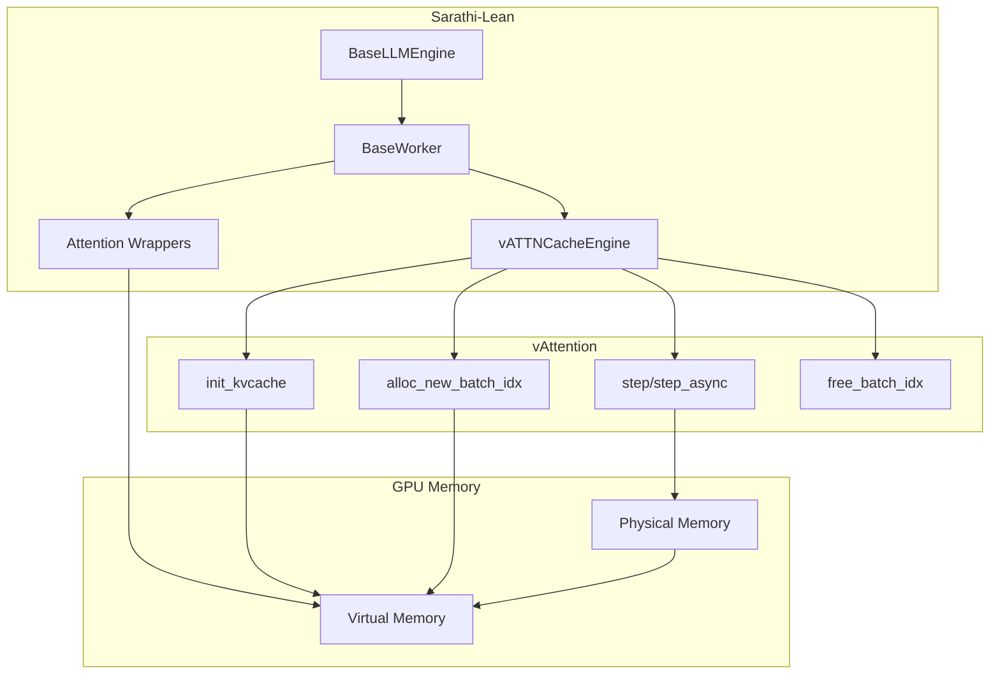
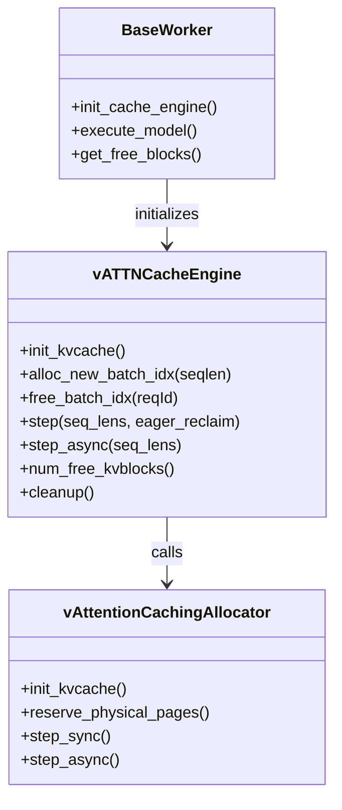
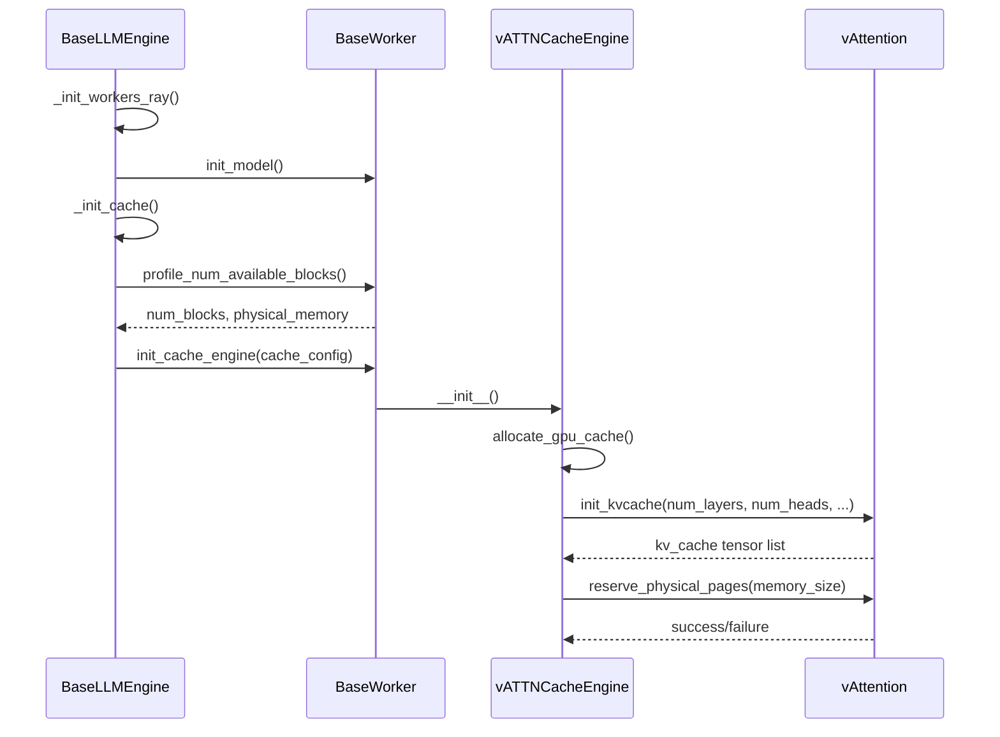
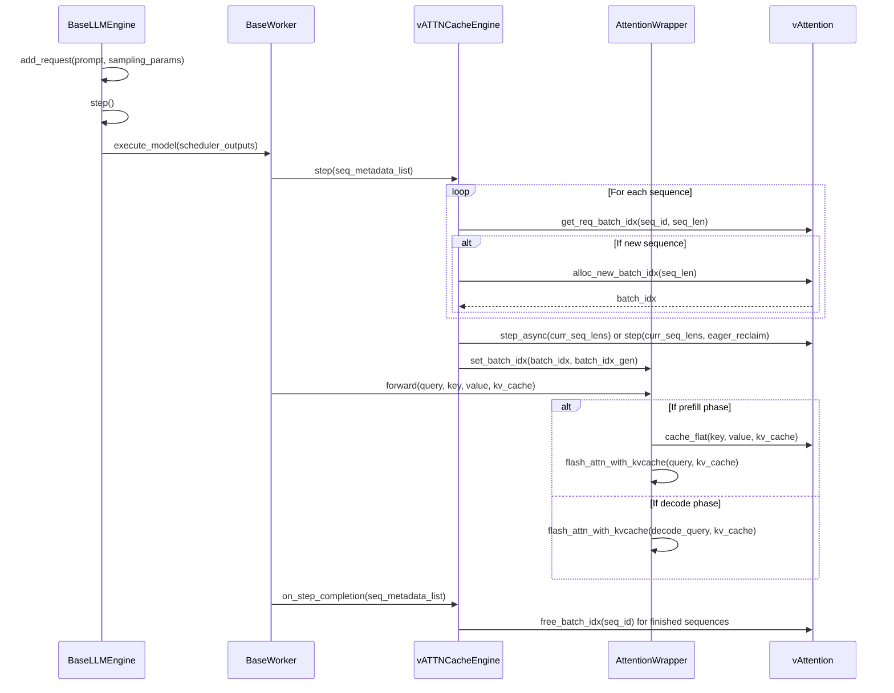
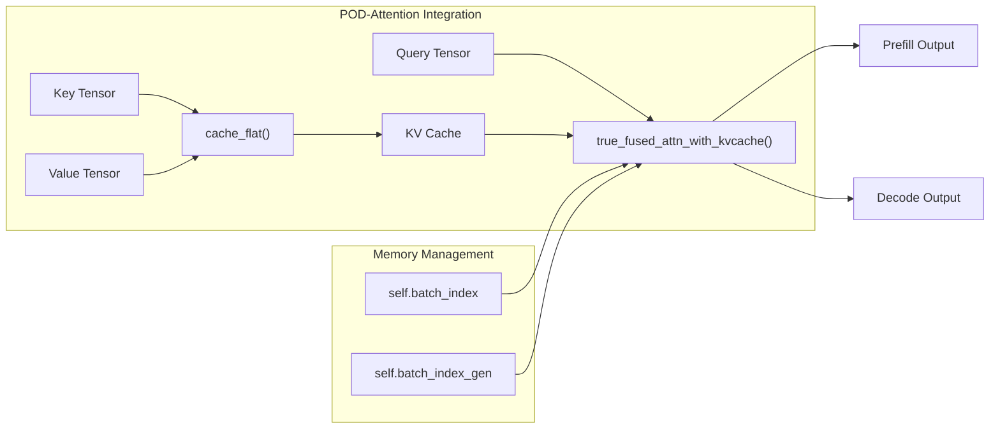
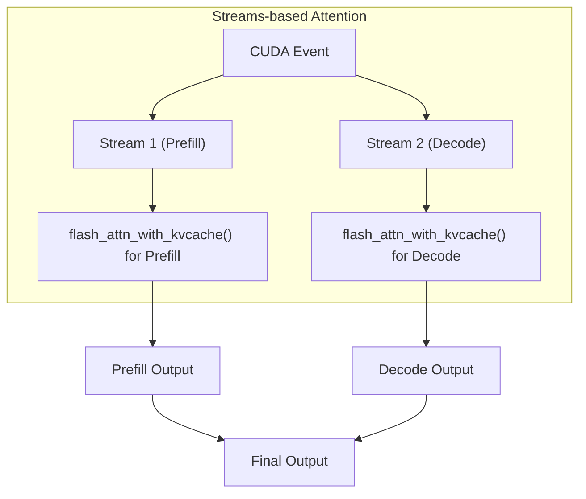

<!-- source: DeepWiki mcp.deepwiki.com · repo microsoft/vattention · page 3 Sarathi-Lean Integration · fetched 2026-10-26 -->

# Sarathi-Lean Integration

<details>
<summary>Relevant source files</summary>

The following files were used as context for generating this wiki page:

- [sarathi-lean/sarathi/engine/base_llm_engine.py](sarathi-lean/sarathi/engine/base_llm_engine.py)
- [sarathi-lean/sarathi/model_executor/attention/__init__.py](sarathi-lean/sarathi/model_executor/attention/__init__.py)
- [sarathi-lean/sarathi/model_executor/attention/flashinfer_paged_serial_attention_wrapper.py](sarathi-lean/sarathi/model_executor/attention/flashinfer_paged_serial_attention_wrapper.py)
- [sarathi-lean/sarathi/model_executor/attention/vattention_flashattention_pod_wrapper.py](sarathi-lean/sarathi/model_executor/attention/vattention_flashattention_pod_wrapper.py)
- [sarathi-lean/sarathi/model_executor/attention/vattention_flashattention_streams_wrapper.py](sarathi-lean/sarathi/model_executor/attention/vattention_flashattention_streams_wrapper.py)
- [sarathi-lean/sarathi/worker/base_worker.py](sarathi-lean/sarathi/worker/base_worker.py)
- [sarathi-lean/sarathi/worker/cache_engine/vATTN_cache_engine.py](sarathi-lean/sarathi/worker/cache_engine/vATTN_cache_engine.py)
- [vattention/apis.h](vattention/apis.h)

</details>


This page documents the integration between vAttention memory manager and the Sarathi-Lean serving system. It explains how Sarathi-Lean leverages vAttention for efficient memory management during LLM inference, the key components involved in this integration, and the data flow during request processing. For information about the core vAttention memory management system, see [vAttention Core System](#2).

## Overview

Sarathi-Lean is an LLM serving system that uses vAttention's memory management capabilities to efficiently handle the key-value (KV) cache during model inference. The integration enables dynamic memory allocation, efficient prefill and decode operations, and memory reclamation for completed requests.



Sources: [sarathi-lean/sarathi/worker/cache_engine/vATTN_cache_engine.py:1-166](), [sarathi-lean/sarathi/engine/base_llm_engine.py:39-166](), [sarathi-lean/sarathi/worker/base_worker.py:37-120]()

## Key Components of Integration

### 1. vATTNCacheEngine

The `vATTNCacheEngine` is the primary component responsible for interfacing with vAttention's memory management system. It handles:

- KV cache initialization
- Batch index allocation and deallocation
- Sequence-to-batch mapping
- Memory reclamation



Sources: [sarathi-lean/sarathi/worker/cache_engine/vATTN_cache_engine.py:18-163](), [vattention/apis.h:1-63]()

### 2. Attention Wrappers

Sarathi-Lean provides multiple attention wrapper implementations that integrate with vAttention:

| Wrapper Class | Backend ID | Purpose |
|---------------|------------|---------|
| VAttentionFlashAttentionWrapper | FA_VATTN | Integrates FlashAttention with vAttention |
| VAttentionFlashInferWrapper | FI_VATTN | Integrates FlashInfer with vAttention |
| VAttentionFlashAttentionPODWrapper | FA_POD | Uses POD Attention with vAttention |
| VAttentionFlashAttentionStreamsWrapper | FA_STREAMS | Implements streamed attention for better performance |

Each wrapper handles the interaction between the attention operation and the KV cache managed by vAttention.

Sources: [sarathi-lean/sarathi/model_executor/attention/__init__.py:35-54](), [sarathi-lean/sarathi/model_executor/attention/__init__.py:124-158]()

### 3. BaseWorker

The `BaseWorker` class acts as a bridge between the LLM engine and the memory management components. It:

- Initializes the cache engine
- Executes the model on inputs
- Manages sequences
- Handles metrics collection

Sources: [sarathi-lean/sarathi/worker/base_worker.py:37-152]()

### 4. BaseLLMEngine

The `BaseLLMEngine` coordinates all components and handles:

- Worker initialization
- Request management
- Scheduling
- Result processing

Sources: [sarathi-lean/sarathi/engine/base_llm_engine.py:39-166]()

## Initialization Flow

The initialization process establishes the connection between Sarathi-Lean and vAttention:



Sources: [sarathi-lean/sarathi/engine/base_llm_engine.py:226-268](), [sarathi-lean/sarathi/worker/cache_engine/vATTN_cache_engine.py:47-79]()

## Request Processing Flow

When processing a request through the Sarathi-Lean system with vAttention:



Sources: [sarathi-lean/sarathi/worker/base_worker.py:173-208](), [sarathi-lean/sarathi/worker/cache_engine/vATTN_cache_engine.py:91-151](), [sarathi-lean/sarathi/model_executor/attention/vattention_flashattention_pod_wrapper.py:117-203]()

## Memory Management

### Batch Index Allocation

Each sequence in Sarathi-Lean is assigned a batch index in vAttention's virtual memory space. The allocation process includes:

1. When a new sequence is processed, `get_req_batch_idx` is called
2. If the sequence doesn't have an existing batch index, `alloc_new_batch_idx` allocates one from vAttention
3. The sequence-to-batch mapping is stored in the cache engine

```python
def get_req_batch_idx(self, seq_id: int, seq_len: int) -> int:
    if seq_id in self.seq_to_batch_idx:
        return self.seq_to_batch_idx[seq_id]
    return self.alloc_new_batch_idx(seq_id, seq_len)

def alloc_new_batch_idx(self, seq_id: int, seq_len: int) -> int:
    new_batch_idx = vattention.alloc_new_batch_idx(seq_len)
    assert new_batch_idx != -1, "Failed to allocate new batch idx..."
    self.seq_to_batch_idx[seq_id] = new_batch_idx
    return new_batch_idx
```

Sources: [sarathi-lean/sarathi/worker/cache_engine/vATTN_cache_engine.py:131-143]()

### Memory Stepping

The `step` or `step_async` method is called to update vAttention's memory mapping based on the current sequence lengths:

1. Current sequence lengths are collected for each batch index
2. vAttention's step method is called to map physical memory pages
3. The batch indices are passed to the attention backend

```python
def step(self, seq_metadata_list: List[SequenceMetadata]) -> None:
    b_idx_prompt = []
    b_idx_gen = []
    for seq_metadata in seq_metadata_list:
        # [code to calculate context_len and get batch index]
        if seq_metadata.is_prompt:
            b_idx_prompt.append(new_batch_idx)
        else:
            b_idx_gen.append(new_batch_idx)
    
    if self.vattn_async:
        vattention.step_async(self.curr_seq_lens)
    else:
        vattention.step(self.curr_seq_lens, True)
    
    self.curr_batch_idx = torch.tensor(b_idx_prompt+b_idx_gen, dtype=torch.int32, device=self.device)
    get_attention_wrapper().set_batch_idx(self.curr_batch_idx, torch.tensor(b_idx_gen, dtype=torch.int32, device=self.device))
```

Sources: [sarathi-lean/sarathi/worker/cache_engine/vATTN_cache_engine.py:91-124]()

### Memory Reclamation

When sequences are completed, their batch indices are freed:

1. `on_step_completion` identifies finished sequences
2. `free_request` is called for each finished sequence
3. vAttention's `free_batch_idx` reclaims the memory

```python
def on_step_completion(self, seq_metadata_list: List[SequenceMetadata]) -> None:
    for seq_metadata in seq_metadata_list:
        if seq_metadata.seq.is_finished():
            self.free_request(seq_metadata.seq.seq_id)

def free_request(self, seq_id: int) -> None:
    if seq_id in self.seq_to_batch_idx:
        batch_idx = self.seq_to_batch_idx[seq_id]
        vattention.free_batch_idx(batch_idx)
        self.seq_to_batch_idx.pop(seq_id)
        self.curr_seq_lens[batch_idx] = 0
        return
    raise Exception(f"seq_id {seq_id} not found in req_table")
```

Sources: [sarathi-lean/sarathi/worker/cache_engine/vATTN_cache_engine.py:126-152]()

## Attention Backend Integration

### POD-Attention Integration

The POD-Attention backend (`VAttentionFlashAttentionPODWrapper`) provides optimized attention computation by fusing prefill and decode operations:



POD-Attention with vAttention handles both prefill and decode phases in a unified way:

1. For prefill, it updates the KV cache with new tokens using `cache_flat`
2. A fused attention kernel (`true_fused_attn_with_kvcache`) processes both prefill and decode simultaneously
3. Outputs are copied back to the correct positions in the output tensor

Sources: [sarathi-lean/sarathi/model_executor/attention/vattention_flashattention_pod_wrapper.py:21-203]()

### Streams-based Attention

The Streams-based attention backend (`VAttentionFlashAttentionStreamsWrapper`) uses CUDA streams for improved parallelism:



The streams implementation:

1. Records a CUDA event to synchronize streams
2. Processes prefill requests on stream1
3. Processes decode requests on stream2
4. Synchronizes both streams before returning the final output

This approach allows overlapping computation for better performance.

Sources: [sarathi-lean/sarathi/model_executor/attention/vattention_flashattention_streams_wrapper.py:17-237]()

## Configuration Options

### Attention Backend Selection

Sarathi-Lean supports multiple vAttention-based backends that can be selected through configuration:

```python
class AttentionBackend(Enum):
    FA_VATTN = "FA_VATTN"  # FlashAttention with vAttention
    FI_VATTN = "FI_VATTN"  # FlashInfer with vAttention
    FA_VATTN_SYNC = "FA_VATTN_SYNC"  # Synchronous version
    FA_POD = "FA_POD"  # POD-Attention with vAttention
    FA_STREAMS = "FA_STREAMS"  # Streams-based FlashAttention with vAttention
    # Other backends...
```

The backend is set in the model configuration and determines which attention wrapper implementation is used.

Sources: [sarathi-lean/sarathi/model_executor/attention/__init__.py:35-54](), [sarathi-lean/sarathi/model_executor/attention/__init__.py:111-160]()

### Memory Management Options

Several configuration options affect the vAttention integration:

| Option | Description |
|--------|-------------|
| `vattn_async` | If True, uses async memory stepping (non-blocking) |
| `vattn_mega_cache` | If True, uses a mega cache configuration (3D tensor instead of list) |
| `page_size` | Size of memory pages (default: typically 16 tokens) |
| `cache_mem_size` | Amount of physical memory to reserve for vAttention |

Sources: [sarathi-lean/sarathi/worker/cache_engine/vATTN_cache_engine.py:25-42](), [sarathi-lean/sarathi/engine/base_llm_engine.py:226-268]()

## Benchmarking and Performance

To evaluate the performance of different vAttention integration approaches, Sarathi-Lean includes:

1. Metrics collection through the `metrics_store` component
2. Timers for different attention operations (prefill, decode, KV cache ops)
3. Batch statistics and hardware utilization metrics

The performance benefits of vAttention integration include:

- Reduced memory fragmentation
- Dynamic memory allocation and reclamation
- Efficient handling of variable-length sequences
- Optimized attention operations through specialized backends

Sources: [sarathi-lean/sarathi/worker/base_worker.py:197-207](), [sarathi-lean/sarathi/engine/base_llm_engine.py:470-488]()

---

