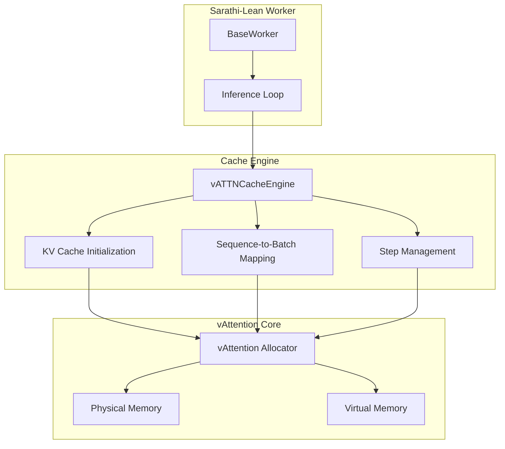
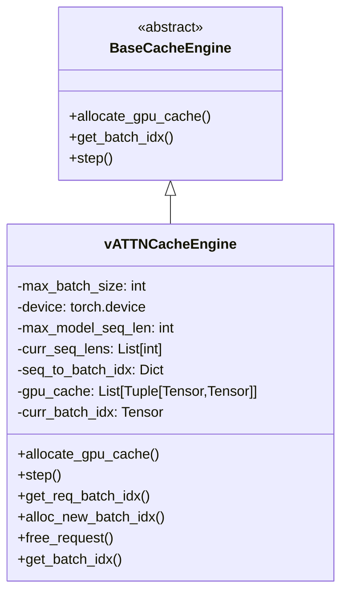
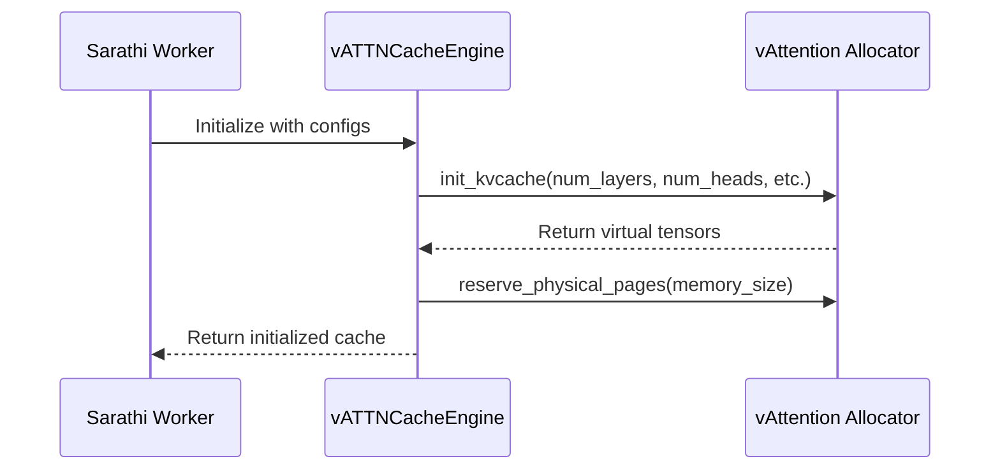
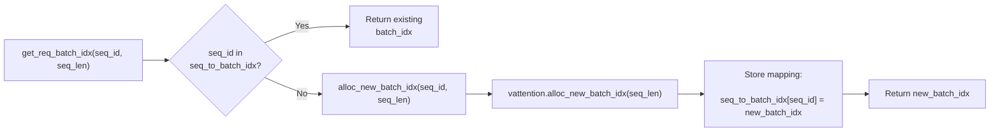
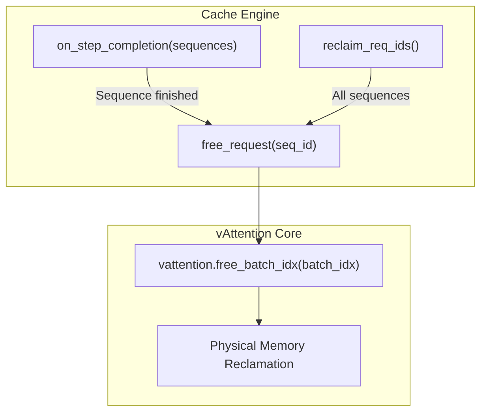
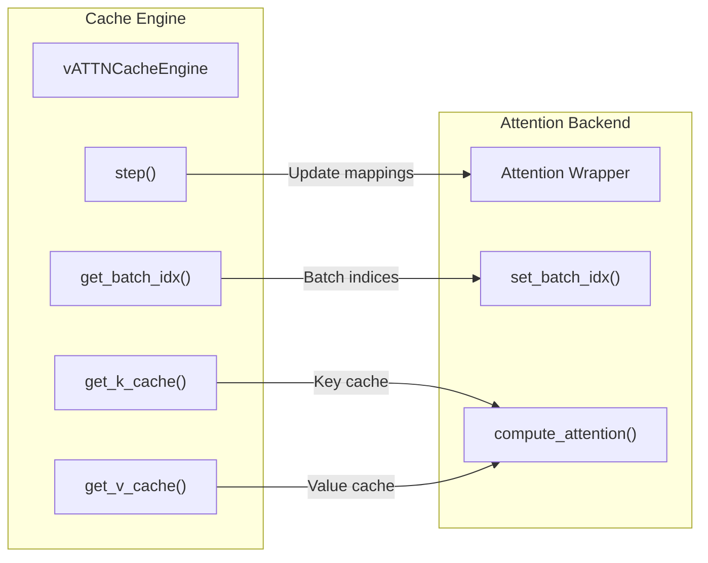
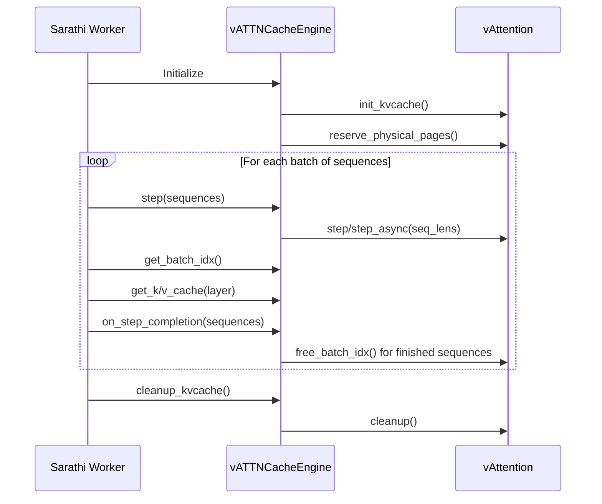

<!-- source: DeepWiki mcp.deepwiki.com · repo microsoft/vattention · page 3.1 Cache Engine · fetched 2026-10-26 -->

# Cache Engine

Relevant source files

The following files were used as context for generating this wiki page:

- [sarathi-lean/sarathi/worker/cache_engine/vATTN_cache_engine.py](sarathi-lean/sarathi/worker/cache_engine/vATTN_cache_engine.py)
- [vattention/apis.h](vattention/apis.h)

The Cache Engine is a critical component within the vAttention memory management system, specifically designed to handle key-value (KV) cache operations for LLM inference in the Sarathi-Lean serving system. This document details the architecture, functionality, and integration of the vAttention Cache Engine, focusing on how it efficiently manages memory for large language model inference. For information about the attention backends that utilize this cache, see [Attention Backends](#3.2).

## Purpose and Overview

The Cache Engine (`vATTNCacheEngine`) serves as the bridge between Sarathi-Lean's worker processes and vAttention's memory management system. Its primary responsibilities include:

1. Initializing the GPU KV cache with virtual tensors
2. Managing sequence-to-batch-index mapping
3. Coordinating physical memory allocation and reclamation
4. Facilitating efficient memory access during attention operations

Sources: [sarathi-lean/sarathi/worker/cache_engine/vATTN_cache_engine.py:18-22](), [vattention/apis.h:1-3]()

## Cache Engine Architecture

The vAttention Cache Engine is implemented as the `vATTNCacheEngine` class, which inherits from `BaseCacheEngine`. It serves as the integration point between Sarathi-Lean's request processing and vAttention's memory management capabilities.

### Key Components

The Cache Engine maintains several critical data structures:

1. **GPU Cache**: A list of key-value tensor pairs for each transformer layer
2. **Sequence-to-Batch Index Mapping**: Maps sequence IDs to corresponding batch indices
3. **Current Sequence Lengths**: Tracks the length of each sequence in the batch
4. **Current Batch Indices**: Used to communicate active batch indices to attention backends

Sources: [sarathi-lean/sarathi/worker/cache_engine/vATTN_cache_engine.py:18-42]()

## Initialization and Memory Allocation

The Cache Engine handles the initialization of KV cache tensors and coordination with vAttention for physical memory allocation.

### KV Cache Initialization Process

The Cache Engine initializes the KV cache through the following steps:

1. Create virtual tensor representations of the KV cache via `vattention.init_kvcache()`
2. Reserve physical memory pages based on configured cache size
3. Organize tensors into layer-specific key-value pairs

Support for two cache formats is provided:
- Standard format: Separate key and value tensors for each layer
- MegaCache format: Consolidated key and value tensors with layer as dimension

Sources: [sarathi-lean/sarathi/worker/cache_engine/vATTN_cache_engine.py:47-79](), [vattention/apis.h:3-13]()

## Memory Management Operations

The Cache Engine orchestrates several critical memory operations that enable efficient KV cache management during inference.

### Batch Index Allocation and Sequence Tracking

When a new sequence is processed, the Cache Engine:
1. Checks if the sequence ID is already mapped to a batch index
2. If not, requests a new batch index from vAttention
3. Updates the mapping to track the sequence

Sources: [sarathi-lean/sarathi/worker/cache_engine/vATTN_cache_engine.py:131-143](), [vattention/apis.h:53-55]()

### Step Management

The Cache Engine's `step` method is called before each processing step to coordinate physical memory mapping:

1. For each sequence in the batch:
   - Determine if it's a prompt or generation sequence
   - Get or allocate a batch index
   - Update the current sequence length

2. Call `vattention.step()` or `vattention.step_async()` to update physical memory mappings
3. Update the attention backend with current batch indices

This step ensures that physical memory is correctly mapped before attention operations are performed.

Sources: [sarathi-lean/sarathi/worker/cache_engine/vATTN_cache_engine.py:91-125](), [vattention/apis.h:27-35]()

### Memory Reclamation

Memory reclamation occurs through several mechanisms:
1. **On-completion reclamation**: When sequences finish processing
2. **Manual reclamation**: When explicitly called to free resources
3. **Deferred reclamation**: Optional delayed reclamation to reduce overhead

Sources: [sarathi-lean/sarathi/worker/cache_engine/vATTN_cache_engine.py:126-157](), [vattention/apis.h:57-59]()

## Integration with Attention Backends

The Cache Engine interfaces with attention backends by providing:
1. Access to KV cache tensors via `get_k_cache()` and `get_v_cache()`
2. Current batch indices via `get_batch_idx()`
3. Current sequence lengths through the step mechanism

This integration ensures that attention operations can efficiently access the correct memory blocks for each sequence being processed.

Sources: [sarathi-lean/sarathi/worker/cache_engine/vATTN_cache_engine.py:85-89](), [sarathi-lean/sarathi/worker/cache_engine/vATTN_cache_engine.py:124]()

## Performance Considerations

The Cache Engine implements several optimizations:

1. **Async mode**: Offloads physical memory mapping to a separate thread with `step_async()`
2. **MegaCache format**: Alternative memory layout that may provide better performance for some workloads
3. **Eager reclamation**: Option to immediately reclaim memory when no longer needed
4. **Deferred reclamation**: Option to delay memory reclamation to reduce overhead during high-throughput operations

These optimizations allow the Cache Engine to adapt to different workload characteristics and hardware configurations.

Sources: [sarathi-lean/sarathi/worker/cache_engine/vATTN_cache_engine.py:39-40](), [vattention/apis.h:31-35]()

## Cache Engine Lifecycle

The complete lifecycle of the Cache Engine encompasses:
1. Initialization of virtual tensors and physical memory reservation
2. Ongoing allocation and mapping for sequence processing
3. Reclamation of resources as sequences complete
4. Final cleanup to ensure all resources are properly released

Sources: [sarathi-lean/sarathi/worker/cache_engine/vATTN_cache_engine.py:189-191](), [vattention/apis.h:41-43]()

---

