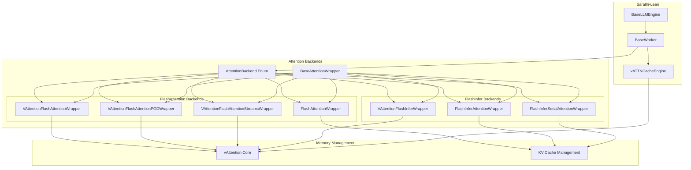
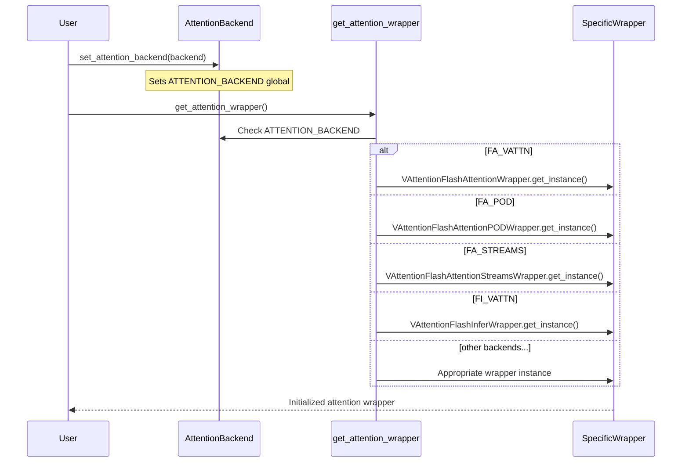
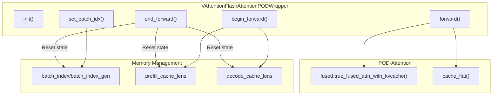
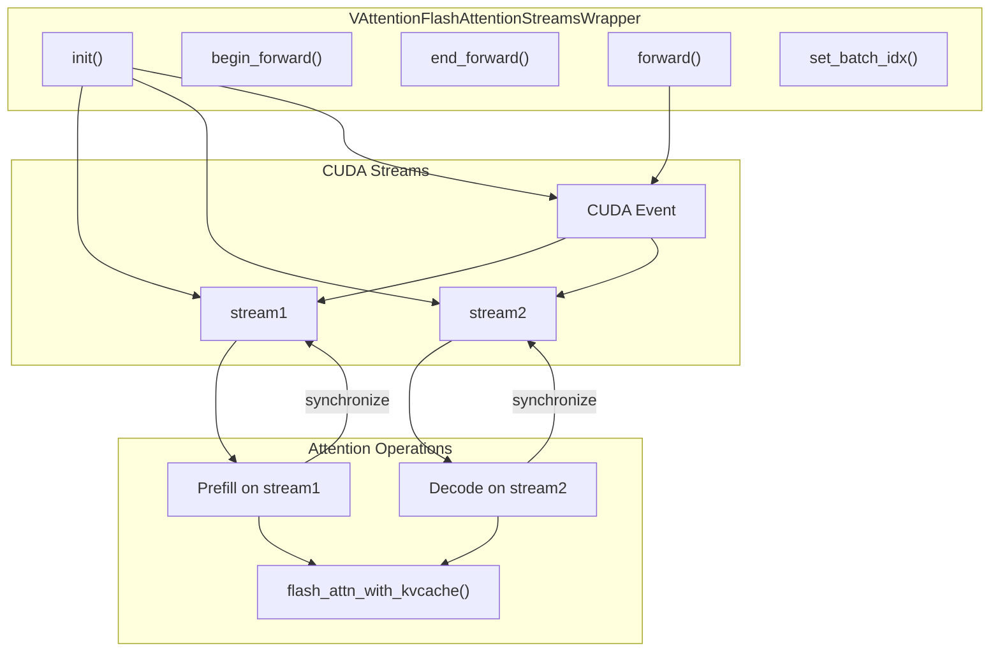
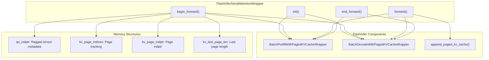
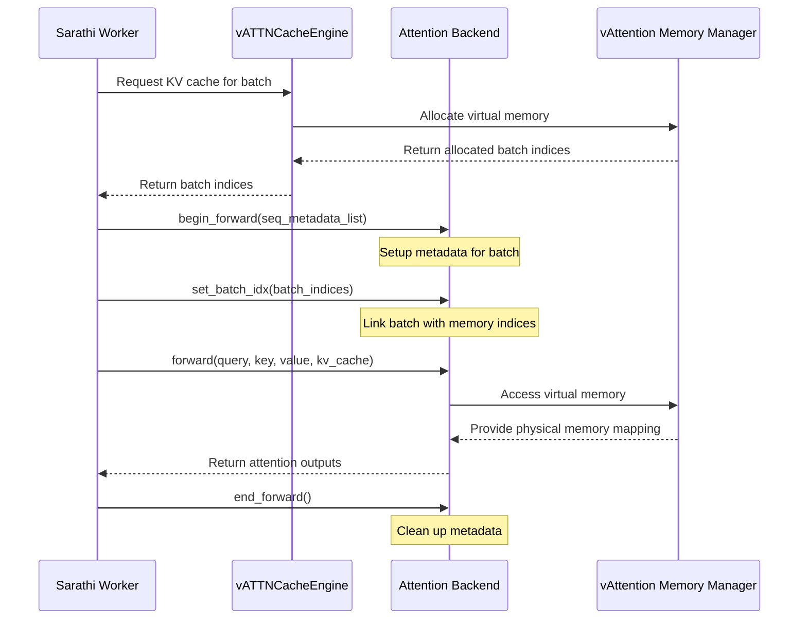
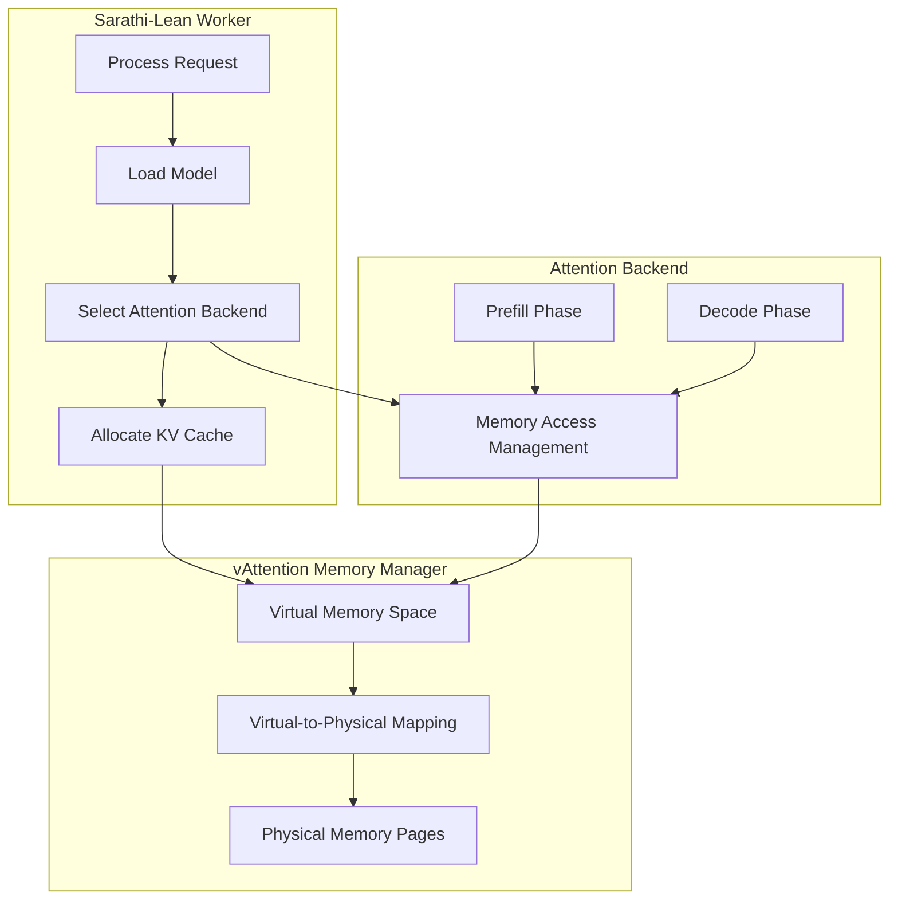

<!-- source: DeepWiki mcp.deepwiki.com · repo microsoft/vattention · page 3.2 Attention Backends · fetched 2026-10-26 -->

# Attention Backends

<details>
<summary>Relevant source files</summary>

The following files were used as context for generating this wiki page:

- [sarathi-lean/sarathi/model_executor/attention/__init__.py](sarathi-lean/sarathi/model_executor/attention/__init__.py)
- [sarathi-lean/sarathi/model_executor/attention/flashinfer_paged_serial_attention_wrapper.py](sarathi-lean/sarathi/model_executor/attention/flashinfer_paged_serial_attention_wrapper.py)
- [sarathi-lean/sarathi/model_executor/attention/vattention_flashattention_pod_wrapper.py](sarathi-lean/sarathi/model_executor/attention/vattention_flashattention_pod_wrapper.py)
- [sarathi-lean/sarathi/model_executor/attention/vattention_flashattention_streams_wrapper.py](sarathi-lean/sarathi/model_executor/attention/vattention_flashattention_streams_wrapper.py)

</details>


## Overview

The Attention Backends module in vAttention provides implementation variants for computing attention operations during LLM inference. These backends integrate with the vAttention memory management system and serve as the computational engine for attention mechanisms, handling both prefill and decode phases of LLM inference.

This page documents the different attention backend implementations available in the Sarathi-Lean serving system and how they integrate with vAttention. For information about the vAttention memory management architecture, see [Memory Management Architecture](#2.1). For information about the POD-Attention implementation, see [POD-Attention](#4).

Sources: [sarathi-lean/sarathi/model_executor/attention/__init__.py:34-54]()

## Attention Backend Architecture

Attention backends are responsible for executing the attention mechanism computations while leveraging the memory management features of vAttention. They form a critical layer in the serving architecture:



Sources: [sarathi-lean/sarathi/model_executor/attention/__init__.py:1-33](), [sarathi-lean/sarathi/model_executor/attention/__init__.py:124-160]()

## Attention Backend Types

The vAttention system supports several attention backend implementations, categorized primarily by their underlying attention implementation library and memory management approach:

| Backend Group | Memory Management | Computational Engine | Variants |
|---------------|-------------------|----------------------|----------|
| FA_VATTN | vAttention | FlashAttention | Standard, SYNC, MEGACACHE |
| FA_PAGED | Paged Attention | FlashAttention | Standard |
| FI_VATTN | vAttention | FlashInfer | Standard, SYNC |
| FI_PAGED | Paged Attention | FlashInfer | Standard, SERIAL |
| FA_POD | vAttention | POD-Attention | Standard, MEGACACHE |
| FA_STREAMS | vAttention | FlashAttention + CUDA Streams | Standard, MEGACACHE |

Sources: [sarathi-lean/sarathi/model_executor/attention/__init__.py:34-54]()

### Selection Mechanism

Backends are selected via the `AttentionBackend` enum and set through the `set_attention_backend` function. The system then uses the `get_attention_wrapper` function to instantiate the appropriate attention implementation:



Sources: [sarathi-lean/sarathi/model_executor/attention/__init__.py:111-160]()

## Key Backend Implementations

### FlashAttention POD Wrapper

The FlashAttention POD Wrapper (`VAttentionFlashAttentionPODWrapper`) is designed to optimize attention computation by fusing the prefill and decode phases using POD-Attention:



Sources: [sarathi-lean/sarathi/model_executor/attention/vattention_flashattention_pod_wrapper.py:21-204]()

### FlashAttention Streams Wrapper

The FlashAttention Streams Wrapper (`VAttentionFlashAttentionStreamsWrapper`) optimizes performance by using CUDA streams to parallelize prefill and decode operations:



Sources: [sarathi-lean/sarathi/model_executor/attention/vattention_flashattention_streams_wrapper.py:17-237]()

### FlashInfer Serial Attention Wrapper

The FlashInfer Serial Attention Wrapper (`FlashInferSerialAttentionWrapper`) uses FlashInfer's optimized kernels with paged attention in a serial processing mode:



Sources: [sarathi-lean/sarathi/model_executor/attention/flashinfer_paged_serial_attention_wrapper.py:14-282]()

## Common Backend Structure

All attention backends follow a common structure defined by the `BaseAttentionWrapper` class:

1. **Initialization**: `init()` configures the backend with model parameters
2. **Begin/End Forward**: `begin_forward()` and `end_forward()` prepare metadata for a batch
3. **Forward**: `forward()` executes the attention computation
4. **Batch Index Management**: Some backends provide `set_batch_idx()` to manage batch indices

The typical execution flow is:



Sources: [sarathi-lean/sarathi/model_executor/attention/vattention_flashattention_pod_wrapper.py:24-116](), [sarathi-lean/sarathi/model_executor/attention/vattention_flashattention_streams_wrapper.py:20-113](), [sarathi-lean/sarathi/model_executor/attention/flashinfer_paged_serial_attention_wrapper.py:17-202]()

## Performance Characteristics

Different attention backends have distinct performance characteristics:

| Backend | Strengths | Use Cases |
|---------|-----------|-----------|
| FA_POD | High throughput for mixed workloads | Production serving with varied sequences |
| FA_STREAMS | Better parallelism | High-throughput scenarios |
| FI_SERIAL | Memory-efficient | Memory-constrained environments |
| FA_VATTN | Lower latency | Low-latency serving |
| FI_VATTN | Better for long sequences | Applications with very long context |

Sources: [sarathi-lean/sarathi/model_executor/attention/__init__.py:34-54]()

## Choosing an Attention Backend

The choice of attention backend depends on:

1. **Workload characteristics**: Prefill-heavy vs. decode-heavy
2. **Memory constraints**: Some backends are more memory-efficient than others
3. **Performance priorities**: Latency vs. throughput
4. **Implementation compatibility**: Some models work better with specific backends

To set the attention backend:

```python
from sarathi.model_executor.attention import set_attention_backend, AttentionBackend

# Use POD-Attention with vAttention
set_attention_backend(AttentionBackend.FA_POD)

# Use FlashInfer with vAttention
set_attention_backend(AttentionBackend.FI_VATTN)
```

Sources: [sarathi-lean/sarathi/model_executor/attention/__init__.py:111-122]()

## Integration with vAttention and Sarathi-Lean

The attention backends are a key integration point between the Sarathi-Lean serving system and the vAttention memory management system:



Sources: [sarathi-lean/sarathi/model_executor/attention/__init__.py:163-201]()

## Conclusion

Attention backends in the vAttention system provide a flexible way to implement attention mechanisms that leverage the memory management capabilities of vAttention. By supporting multiple backend implementations, the system can be optimized for different workloads and hardware configurations.

The backends handle both prefill and decode phases of LLM inference, with specialized implementations like POD-Attention and Streams Attention offering optimizations for specific scenarios. The selection of an appropriate backend is critical for achieving optimal performance in LLM serving.

---

