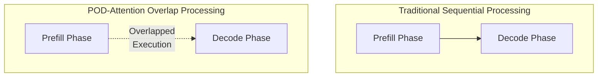
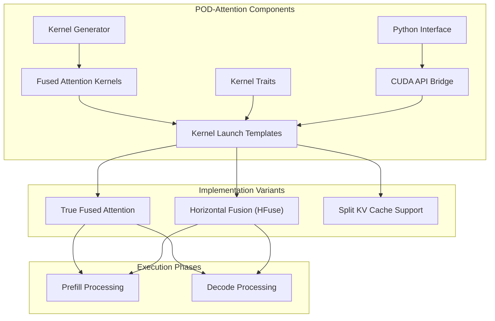
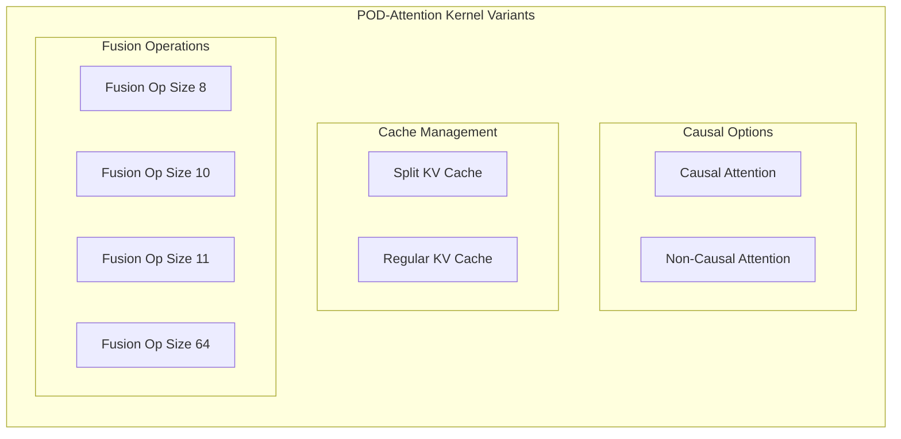
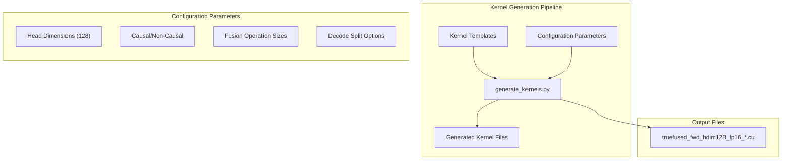
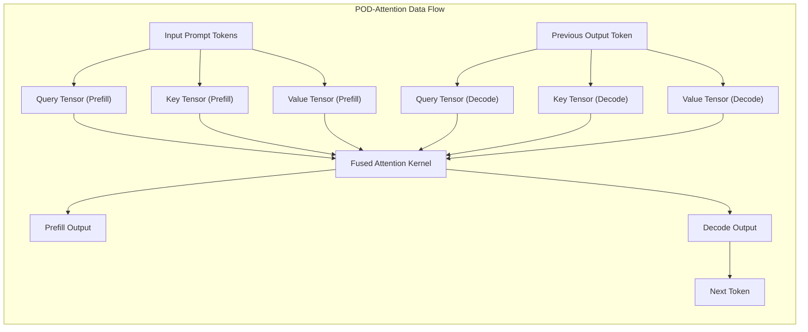
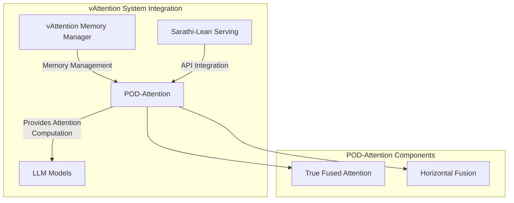

<!-- source: DeepWiki mcp.deepwiki.com · repo microsoft/vattention · page 4 POD-Attention · fetched 2026-10-26 -->

# POD-Attention

Relevant source files

The following files were used as context for generating this wiki page:

- [pod_attn/pod_attn/fused_api_setup.h](pod_attn/pod_attn/fused_api_setup.h)
- [pod_attn/pod_attn/fused_attn_interface.py](pod_attn/pod_attn/fused_attn_interface.py)
- [pod_attn/pod_attn/fused_fwd_kernel.h](pod_attn/pod_attn/fused_fwd_kernel.h)
- [pod_attn/pod_attn/fused_fwd_launch_template.h](pod_attn/pod_attn/fused_fwd_launch_template.h)
- [pod_attn/pod_attn/generate_kernels.py](pod_attn/pod_attn/generate_kernels.py)
- [pod_attn/pod_attn/hfuse_regular.cuh](pod_attn/pod_attn/hfuse_regular.cuh)
- [pod_attn/pod_attn/hfuse_split.cuh](pod_attn/pod_attn/hfuse_split.cuh)
- [pod_attn/pod_attn/hfuse_splitonly.cuh](pod_attn/pod_attn/hfuse_splitonly.cuh)
- [pod_attn/pod_attn/truefused_fwd_hdim128_fp16_causal_fo10_sm80.cu](pod_attn/pod_attn/truefused_fwd_hdim128_fp16_causal_fo10_sm80.cu)
- [pod_attn/pod_attn/truefused_fwd_hdim128_fp16_causal_fo8_sm80.cu](pod_attn/pod_attn/truefused_fwd_hdim128_fp16_causal_fo8_sm80.cu)
- [pod_attn/pod_attn/truefused_fwd_hdim128_fp16_causal_split_fo10_sm80.cu](pod_attn/pod_attn/truefused_fwd_hdim128_fp16_causal_split_fo10_sm80.cu)
- [pod_attn/pod_attn/truefused_fwd_hdim128_fp16_causal_split_fo8_sm80.cu](pod_attn/pod_attn/truefused_fwd_hdim128_fp16_causal_split_fo8_sm80.cu)
- [pod_attn/pod_attn/truefused_fwd_hdim128_fp16_fo10_sm80.cu](pod_attn/pod_attn/truefused_fwd_hdim128_fp16_fo10_sm80.cu)
- [pod_attn/pod_attn/truefused_fwd_hdim128_fp16_fo8_sm80.cu](pod_attn/pod_attn/truefused_fwd_hdim128_fp16_fo8_sm80.cu)
- [pod_attn/pod_attn/truefused_fwd_hdim128_fp16_split_fo10_sm80.cu](pod_attn/pod_attn/truefused_fwd_hdim128_fp16_split_fo10_sm80.cu)
- [pod_attn/setup.py](pod_attn/setup.py)

POD-Attention (Prefill-Overlap-Decode Attention) is a specialized attention implementation that significantly improves LLM inference performance by fusing prefill and decode operations, enabling them to execute concurrently rather than sequentially. This document provides a technical overview of POD-Attention's architecture, implementation, and integration with other components in the vAttention system.

For information about the core vAttention memory management system, see [vAttention Core System](#2), and for details on how POD-Attention integrates with Sarathi-Lean, see [Sarathi-Lean Integration](#3).

## Overview

Traditional LLM inference separates processing into two distinct phases:
1. **Prefill**: Processing the input prompt (potentially hundreds or thousands of tokens)
2. **Decode**: Generating each new token one by one

POD-Attention addresses a key bottleneck in LLM inference by enabling these operations to overlap, rather than executing sequentially. This is achieved through specialized CUDA kernels that fuse attention operations across prefill and decode phases, utilizing GPU hardware more efficiently.

POD-Attention is designed specifically for head dimension 128 (the most common dimension size in modern LLMs) and supports various configurations including causal and non-causal attention, split KV cache, and different fusion operation sizes.

Sources: [pod_attn/setup.py:287-288](). [pod_attn/pod_attn/generate_kernels.py:16-19]().

## Architecture

POD-Attention's architecture consists of several key components that work together to enable efficient prefill-decode overlap:

### Key Components:

1. **Fused Attention Kernels**: The core CUDA kernels that perform the attention computations with prefill-decode overlap
2. **Kernel Traits**: Define specific parameters for kernels (block sizes, shared memory usage, etc.)
3. **Kernel Launch Templates**: Handle the dispatch of different kernel variants based on input parameters
4. **Python Interface**: Provides a user-friendly API for integration with PyTorch models

Sources: [pod_attn/pod_attn/fused_fwd_kernel.h:25-509](). [pod_attn/pod_attn/fused_fwd_launch_template.h:5-345]().

## Implementation Variants

POD-Attention provides several implementation variants to handle different workloads and memory configurations:

### True Fused Attention

The primary implementation that fuses prefill and decode operations into a single kernel execution, enabling full overlap. This approach uses specialized thread block management to process both operations concurrently.

### Horizontal Fusion (HFuse)

An alternative implementation that horizontally fuses prefill and decode operations, allowing for more flexible workload balancing in certain scenarios.

### Split KV Cache Support

Supports operating on split key-value caches, which is important for handling large context lengths efficiently.

The system supports different fusion operation sizes (8, 9, 10, 11, 64) which determine how operations are fused and affect performance characteristics based on the workload.

Sources: [pod_attn/pod_attn/generate_kernels.py:19](). [pod_attn/pod_attn/fused_fwd_launch_template.h:167-347]().

## Kernel Generation System

POD-Attention uses a template-based code generation system to create specialized kernel variants for different configurations. This approach reduces compilation time while ensuring optimal performance for each use case.

The system generates specialized kernel variants based on:
- Head dimension (currently focused on 128)
- Causal vs. non-causal attention
- Different fusion operation sizes (8, 9, 10, 11, 64)
- Split vs. non-split decode operations

This approach results in a set of pre-compiled kernels optimized for different workloads, which can be selected at runtime based on the specific input parameters.

Sources: [pod_attn/pod_attn/generate_kernels.py:1-113](). [pod_attn/setup.py:133-146]().

## Data Flow and Operation

POD-Attention's data flow centers around efficiently processing query, key, and value tensors across both prefill and decode phases:

### Operation Phases:

1. **Input Processing**: Process query, key, and value tensors for both prefill and decode phases
2. **Fused Attention Computation**: Execute the fused attention kernel to process both phases concurrently
3. **Output Generation**: Generate the outputs for both prefill and decode phases in a single kernel execution

Sources: [pod_attn/pod_attn/fused_attn_interface.py:12-138](). [pod_attn/pod_attn/fused_fwd_kernel.h:70-509]().

## Integration with vAttention System

POD-Attention integrates with the broader vAttention system to provide optimized attention computation while leveraging the memory management capabilities of vAttention:

### Integration Points:

1. **Memory Management**: Utilizes vAttention's virtual memory system for efficient KV cache management
2. **Serving Integration**: Integrates with Sarathi-Lean for efficient request processing
3. **Model Support**: Provides optimized attention computation for various LLM architectures

Sources: [pod_attn/pod_attn/fused_api_setup.h:15-381](). [pod_attn/pod_attn/fused_attn_interface.py:12-215]().

## Performance Considerations

POD-Attention's performance characteristics depend on several key factors:

### Key Performance Factors:

| Factor | Impact | Description |
|--------|--------|-------------|
| Fusion Operation Size | High | Different sizes (8, 9, 10, 11, 64) balance memory usage and parallelism |
| Head Dimension | Medium | Optimized for head dimension 128, which is common in modern LLMs |
| KV Cache Configuration | High | Split vs. non-split affects memory bandwidth utilization |
| Causal vs. Non-Causal | Medium | Causal attention has specific optimization patterns |
| Batch Size | High | Affects thread block utilization and overall throughput |

### Optimization Strategies:

1. **Split KV Heuristics**: Automatically determines optimal number of splits based on SM count and workload size
2. **Kernel Selection**: Chooses the best kernel variant based on input parameters
3. **Memory Access Patterns**: Optimized for coalesced memory access and efficient cache utilization

Sources: [pod_attn/pod_attn/fused_api_setup.h:150-190](). [pod_attn/pod_attn/fused_fwd_launch_template.h:350-398]().

## API and Usage

POD-Attention provides a Python API for integration with PyTorch models:

### Key Functions:

1. **`true_fused_attn_with_kvcache`**: Main function for executing fused attention with KV cache
2. **`fused_attn_with_kvcache`**: Alternative implementation for specific use cases

### Example Parameters:

| Parameter | Type | Description |
|-----------|------|-------------|
| q_p | Tensor | Query tensor for prefill phase |
| k_cache_p | Tensor | Key cache for prefill phase |
| v_cache_p | Tensor | Value cache for prefill phase |
| q_d | Tensor | Query tensor for decode phase |
| k_cache_d | Tensor | Key cache for decode phase |
| v_cache_d | Tensor | Value cache for decode phase |
| causal | bool | Whether to use causal attention |
| fused_params | int | Fusion operation size (8, 9, 10, 11, 64) |
| num_splits_p/d | int | Number of splits for KV cache |

Sources: [pod_attn/pod_attn/fused_attn_interface.py:12-215](). [pod_attn/pod_attn/fused_api_setup.h:241-381]().

## Hardware Requirements and Limitations

POD-Attention has specific hardware requirements and limitations:

### Requirements:

- CUDA 11.6 or higher
- GPU with compute capability 8.0 or higher (NVIDIA Ampere architecture or newer)
- CUTLASS library for tensor core operations

### Limitations:

- Currently only supports head dimension 128
- Optimized for FP16 precision
- Focus on causal attention for typical LLM workloads

Sources: [pod_attn/setup.py:110-114](). [pod_attn/pod_attn/fused_api_setup.h:264-265]().

## Summary

POD-Attention provides significant performance improvements for LLM inference by enabling prefill-decode overlap through specialized fused attention kernels. By processing both phases concurrently rather than sequentially, it achieves higher GPU utilization and reduces overall latency for token generation.

The system offers multiple implementation variants to handle different workloads and integrates seamlessly with the broader vAttention memory management system and Sarathi-Lean serving framework. Its carefully designed CUDA kernels, with support for various configurations, make it a powerful tool for optimizing LLM inference performance.

---

