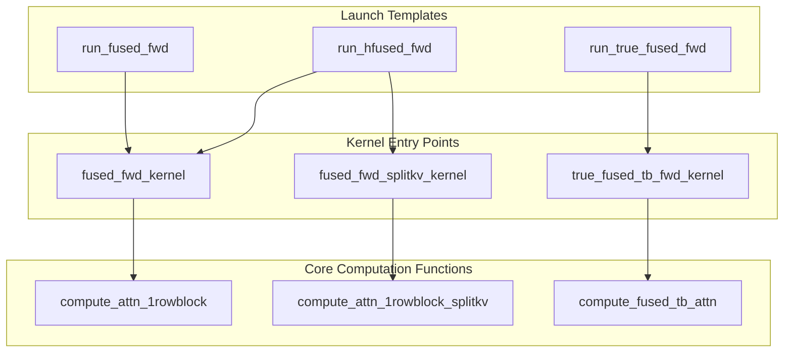
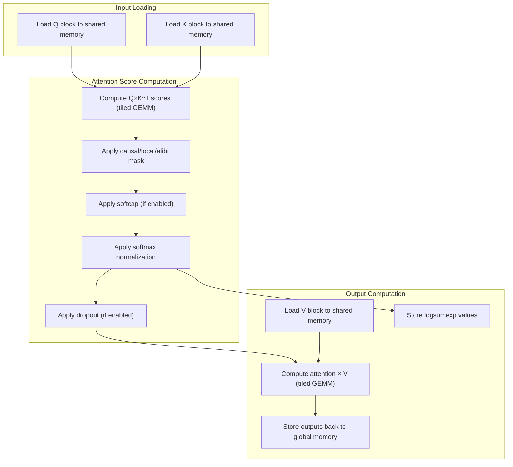
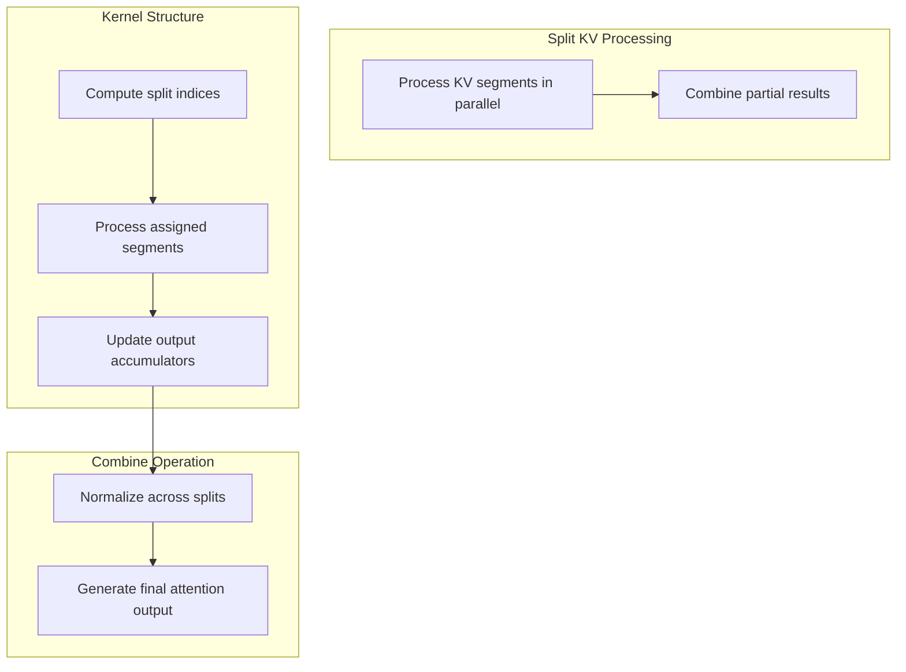
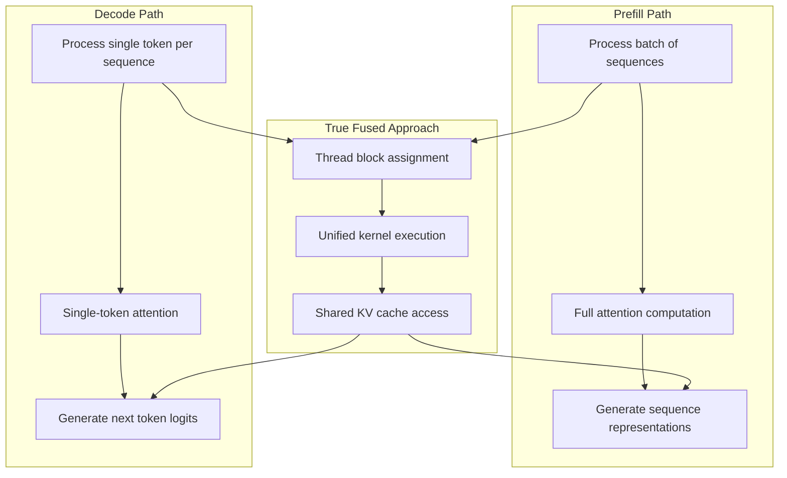
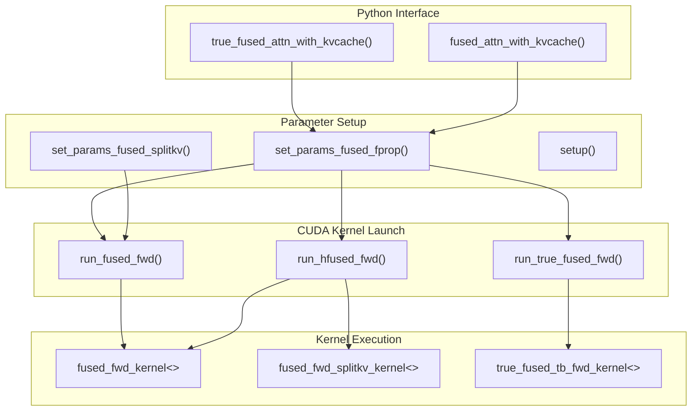

<!-- source: DeepWiki mcp.deepwiki.com · repo microsoft/vattention · page 4.1 Fused Attention Kernels · fetched 2026-10-26 -->

# Fused Attention Kernels

<details>
<summary>Relevant source files</summary>

The following files were used as context for generating this wiki page:

- [pod_attn/pod_attn/fused_api_setup.h](pod_attn/pod_attn/fused_api_setup.h)
- [pod_attn/pod_attn/fused_attn_interface.py](pod_attn/pod_attn/fused_attn_interface.py)
- [pod_attn/pod_attn/fused_fwd_kernel.h](pod_attn/pod_attn/fused_fwd_kernel.h)
- [pod_attn/pod_attn/fused_fwd_launch_template.h](pod_attn/pod_attn/fused_fwd_launch_template.h)
- [pod_attn/pod_attn/hfuse_regular.cuh](pod_attn/pod_attn/hfuse_regular.cuh)
- [pod_attn/pod_attn/hfuse_split.cuh](pod_attn/pod_attn/hfuse_split.cuh)
- [pod_attn/pod_attn/hfuse_splitonly.cuh](pod_attn/pod_attn/hfuse_splitonly.cuh)
- [pod_attn/pod_attn/truefused_fwd_hdim128_fp16_causal_fo10_sm80.cu](pod_attn/pod_attn/truefused_fwd_hdim128_fp16_causal_fo10_sm80.cu)
- [pod_attn/pod_attn/truefused_fwd_hdim128_fp16_causal_fo8_sm80.cu](pod_attn/pod_attn/truefused_fwd_hdim128_fp16_causal_fo8_sm80.cu)
- [pod_attn/pod_attn/truefused_fwd_hdim128_fp16_causal_split_fo10_sm80.cu](pod_attn/pod_attn/truefused_fwd_hdim128_fp16_causal_split_fo10_sm80.cu)
- [pod_attn/pod_attn/truefused_fwd_hdim128_fp16_causal_split_fo8_sm80.cu](pod_attn/pod_attn/truefused_fwd_hdim128_fp16_causal_split_fo8_sm80.cu)
- [pod_attn/pod_attn/truefused_fwd_hdim128_fp16_fo10_sm80.cu](pod_attn/pod_attn/truefused_fwd_hdim128_fp16_fo10_sm80.cu)
- [pod_attn/pod_attn/truefused_fwd_hdim128_fp16_fo8_sm80.cu](pod_attn/pod_attn/truefused_fwd_hdim128_fp16_fo8_sm80.cu)
- [pod_attn/pod_attn/truefused_fwd_hdim128_fp16_split_fo10_sm80.cu](pod_attn/pod_attn/truefused_fwd_hdim128_fp16_split_fo10_sm80.cu)

</details>


## Introduction

Fused Attention Kernels are specialized CUDA kernels that optimize attention operations by fusing multiple computational stages into single, efficient kernels. These kernels form the computational core of POD-Attention, enabling high-performance attention operations for both prefill and decode phases in LLM inference.

The primary goal of these kernels is to minimize global memory access and maximize computational throughput by:
- Fusing multiple attention operations into single GPU kernels
- Optimizing memory access patterns and tiling strategies
- Providing specialized variants for different inference scenarios
- Supporting both FlashAttention and FlashInfer computational patterns

Sources: [pod_attn/pod_attn/fused_fwd_kernel.h:1-25](), [pod_attn/pod_attn/fused_fwd_launch_template.h:1-25]()

## Kernel Architecture

The Fused Attention Kernels are designed around a template-based architecture that allows for extensive customization while maintaining high performance. The architecture is divided into several key components:



The architecture is parameterized by:
- **Kernel Traits**: Define sizing parameters (block sizes, dimensions, etc.)
- **Feature Flags**: Control which optimizations/features are enabled
- **Memory Layout**: Define how data is arranged in memory 

Sources: [pod_attn/pod_attn/fused_fwd_kernel.h:70-509](), [pod_attn/pod_attn/fused_fwd_launch_template.h:32-108]()

### Key Components

1. **Kernel Traits**: Define structural parameters like block dimensions and data types
   ```cpp
   template<typename Kernel_traits, bool Is_dropout, bool Is_causal, bool Is_local, 
            bool Has_alibi, bool Is_even_MN, bool Is_even_K, bool Is_softcap, 
            bool Return_softmax>
   ```

2. **Core Computation Functions**:
   - `compute_attn_1rowblock`: Processes a single row block of queries
   - `compute_attn_1rowblock_splitkv`: Handles split KV cache scenarios
   - `compute_fused_tb_attn`: Combines prefill and decode operations

3. **Launch Templates**:
   - `run_fused_fwd`: Standard attention kernel launcher
   - `run_hfused_fwd`: Horizontally fused kernels (running multiple kernels in parallel)
   - `run_true_fused_fwd`: True fused kernels (combining prefill and decode)

Sources: [pod_attn/pod_attn/fused_fwd_launch_template.h:115-147](), [pod_attn/pod_attn/fused_fwd_kernel.h:70-145]()

## Kernel Variants

POD-Attention implements several variants of fused attention kernels optimized for different scenarios:

```mermaid
classDiagram
    class "Base Attention Kernel" {
        +Template Params
        +Shared Memory Layout
        +Matrix Operations
        +Softmax/Mask Operations
    }
    
    "Base Attention Kernel" <|-- "Standard Fused Kernel"
    "Base Attention Kernel" <|-- "Split KV Kernel"
    "Base Attention Kernel" <|-- "True Fused Kernel"
    "Base Attention Kernel" <|-- "Horizontally Fused Kernel"
    
    class "Standard Fused Kernel" {
        +Single batch attention
        +Single phase (prefill or decode)
    }
    
    class "Split KV Kernel" {
        +Parallel processing across K dimension
        +Combining results across splits
    }
    
    class "True Fused Kernel" {
        +Combines prefill and decode
        +Thread block scheduling
    }
    
    class "Horizontally Fused Kernel" {
        +Processes multiple attention ops
        +Parallel execution
    }
```

### 1. Standard Fused Kernel

The standard fused kernel (`fused_fwd_kernel`) computes attention for a single batch of sequences in either prefill or decode mode. It optimizes memory access by tiling operations and fusing the Q×K, softmax, and result×V operations.

### 2. Split KV Kernel

The split KV kernel (`fused_fwd_splitkv_kernel`) distributes the attention computation across multiple GPU blocks by splitting along the sequence length dimension (K). This allows processing longer contexts efficiently by:
- Processing distinct segments of the KV cache in parallel
- Combining the partial results afterward
- Scaling to very long sequences (beyond what fits in shared memory)

### 3. True Fused Kernel

The true fused kernel (`true_fused_tb_fwd_kernel`) combines the prefill and decode phases into a single kernel launch, enabling efficient processing of batches where some sequences need prefill and others need decode.

### 4. Horizontally Fused Kernel

The horizontally fused approach uses CUDA thread interleaving to execute multiple distinct kernels in parallel on the same GPU, improving utilization when running small batches.

Sources: [pod_attn/pod_attn/fused_fwd_launch_template.h:93-108](), [pod_attn/pod_attn/fused_fwd_launch_template.h:166-347]()

## Core Computation Process

The core attention computation is implemented in the `compute_attn_1rowblock` function. Here's how it processes a single block of queries:



Key processing steps:

1. **Block-based Processing**: Divides attention computation into manageable blocks
   - Processes query sequences in blocks of size `kBlockM`
   - Processes key sequences in blocks of size `kBlockN`

2. **Tiled Matrix Multiplication**: Uses CUDA's tensor cores via CUTLASS library
   - First computes Q×K^T to get attention scores
   - Later computes (softmaxed scores)×V to get final outputs

3. **Attention Masks**: Supports multiple masking schemes
   - Causal masking (each position only attends to previous positions)
   - Local window attention (bounded context window)
   - ALiBi (attention with linear biases)

4. **Softmax Processing**: Implements numerically stable softmax
   - Tracks max values and sums for LogSumExp computation
   - Handles normalization and scaling properly

5. **Memory Access Optimization**:
   - Uses asynchronous copy operations (cp.async)
   - Double-buffering for overlapping computation with memory transfers
   - Exploits tensor core layouts for optimal performance

Sources: [pod_attn/pod_attn/fused_fwd_kernel.h:70-509](), [pod_attn/pod_attn/fused_fwd_kernel.h:336-442]()

## Split KV Cache Implementation

The split KV cache implementation is a specialized variant that processes attention when the KV cache is partitioned across multiple blocks. This is particularly important for handling very long context lengths efficiently.



Key aspects of the split KV implementation:

1. **Segment Assignment**: Each kernel instance is assigned a specific segment of the KV cache
   - Determines start/end blocks based on `n_split_idx` and `num_n_splits`
   - Handles overlapping segments when using causal or local attention

2. **Partial Results**: Each split computes partial attention outputs and LogSumExp values
   - Stores intermediate results in `oaccum` and `softmax_lseaccum` buffers
   - Each split processes a subset of the full sequence length

3. **Result Combination**: A separate kernel combines results from all splits
   - Normalizes the attention weights using the accumulated LogSumExp values
   - Merges the partial outputs into the final attention result

4. **Paged KV Cache Support**: Special handling for paged memory layouts
   - Uses block tables to locate memory for fragmented KV cache
   - Supports both contiguous and paged memory configurations

Sources: [pod_attn/pod_attn/fused_fwd_kernel.h:513-587](), [pod_attn/pod_attn/fused_fwd_launch_template.h:110-114](), [pod_attn/pod_attn/fused_fwd_launch_template.h:192-219]()

## True Fused Attention

True Fused Attention is a specialized implementation that combines prefill and decode operations into a single kernel. This approach is optimized for LLM inference where both operations often need to be performed concurrently.



Key features of True Fused Attention:

1. **Thread Block Scheduling**: Dynamically assigns thread blocks to prefill or decode work
   - Uses the `tbAssign` array to track block assignments
   - Efficiently distributes work based on computational needs

2. **Configuration Specialization**: Implements specialized paths for different combinations
   - Handles different memory layout configurations
   - Optimizes for specific batch sizes and sequence lengths

3. **Performance Optimizations**:
   - Persistent threads for better GPU utilization
   - Dynamic work stealing between prefill and decode operations
   - Shared KV cache access between prefill and decode phases

4. **Template Specialization**: Extensively uses template specialization to optimize code paths
   - Each template variant is tuned for specific hardware and problem characteristics
   - Generated kernels for common configurations to avoid compilation overhead

Sources: [pod_attn/pod_attn/fused_fwd_launch_template.h:350-445](), [pod_attn/pod_attn/truefused_fwd_hdim128_fp16_fo8_sm80.cu:1-10](), [pod_attn/pod_attn/truefused_fwd_hdim128_fp16_causal_fo10_sm80.cu:1-10]()

## Optimizations and Performance Techniques

The fused attention kernels employ numerous optimizations to achieve high performance:

| Optimization | Description | Benefits |
|--------------|-------------|----------|
| Fused Operations | Combines Q×K^T, softmax, and attn×V in one kernel | Eliminates global memory round-trips |
| Tiled Processing | Breaks matrices into tiles for shared memory processing | Maximizes L1/shared memory utilization |
| Asynchronous Copies | Uses CUDA cp.async for memory transfers | Overlaps memory transfers with computation |
| Double-buffering | Processes one tile while loading the next | Hides memory latency |
| Register Blocking | Keeps hot data in registers | Reduces shared memory pressure |
| Tensor Core Utilization | Uses specialized matrix multiplication units | Accelerates matrix operations |
| Early Exit | Skips unnecessary computation for empty/masked blocks | Avoids wasted work |
| Memory Access Coalescing | Organizes data access for efficient memory transfers | Maximizes memory bandwidth utilization |
| Template Specialization | Generates optimized code for specific scenarios | Eliminates runtime branching overhead |
| Persistent Threads | Keeps threads alive for multiple work items | Reduces kernel launch overhead |

Sources: [pod_attn/pod_attn/fused_fwd_kernel.h:93-141](), [pod_attn/pod_attn/fused_fwd_kernel.h:262-297](), [pod_attn/pod_attn/fused_fwd_kernel.h:389-442]()

## Integration with vAttention System

The Fused Attention Kernels integrate with the broader vAttention system through well-defined interfaces:



The integration flow involves:

1. **Python Interface**: High-level functions in `fused_attn_interface.py` that accept PyTorch tensors
2. **Parameter Setup**: Configuration of kernel parameters in `fused_api_setup.h`
3. **Kernel Selection**: Choosing the appropriate kernel variant based on the input parameters
4. **Kernel Launch**: Dispatching the CUDA kernels with the configured parameters
5. **Result Processing**: Handling the outputs and propagating them back to PyTorch

This layered approach allows for flexible integration with both the Sarathi-Lean serving system and direct use in other PyTorch-based applications.

Sources: [pod_attn/pod_attn/fused_attn_interface.py:12-137](), [pod_attn/pod_attn/fused_api_setup.h:15-148](), [pod_attn/pod_attn/fused_api_setup.h:242-381]()

## Compilation and Specialization

The kernels rely on compile-time specialization to achieve maximum performance. This is managed through:

1. **Template Generation**: Specific template instantiations for common configurations
2. **Static Switch Macros**: Conditionally compile optimized code paths
3. **Architecture-specific Code**: Optimizations for different GPU architectures

These kernels require SM80 (NVIDIA Ampere) or newer architectures to leverage the latest tensor core operations and asynchronous copy capabilities.

Sources: [pod_attn/pod_attn/fused_fwd_launch_template.h:20-30](), [pod_attn/pod_attn/truefused_fwd_hdim128_fp16_fo8_sm80.cu:1-10]()

## Further Reading

For more information on related components:
- For the broader POD-Attention system, see [POD-Attention](#4)
- For kernel generation details, see [Kernel Generation System](#4.2)
- For integration with Sarathi-Lean, see [Sarathi-Lean Integration](#3)
- For memory management, see [Memory Management Architecture](#2.1)

---

