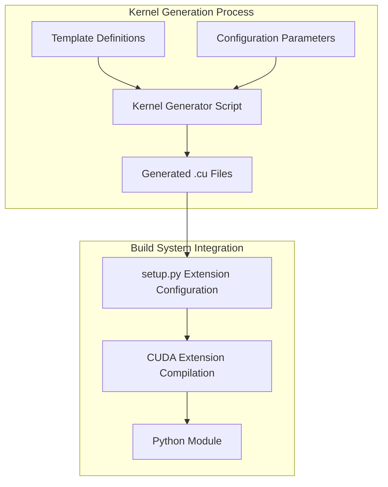
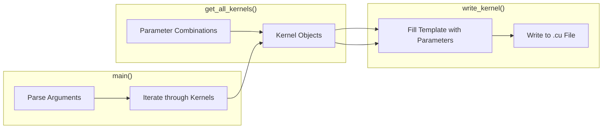
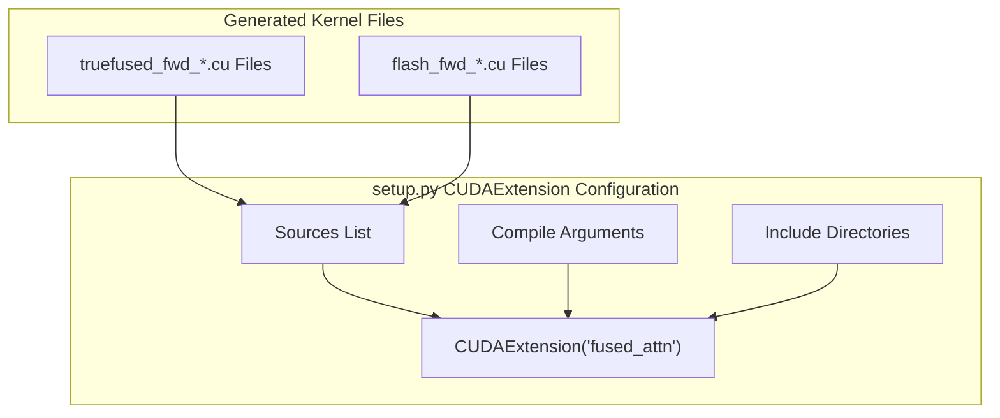
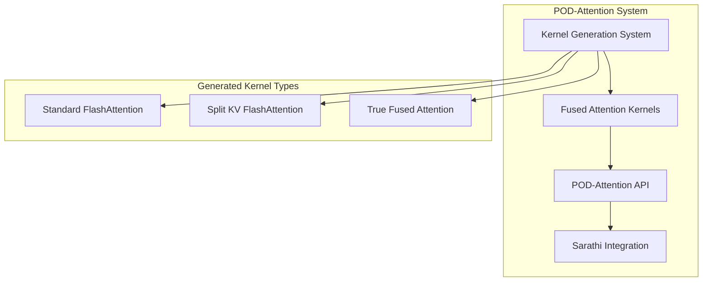

<!-- source: DeepWiki mcp.deepwiki.com · repo microsoft/vattention · page 4.2 Kernel Generation System · fetched 2026-10-26 -->

# Kernel Generation System

<details>
<summary>Relevant source files</summary>

The following files were used as context for generating this wiki page:

- [pod_attn/pod_attn/generate_kernels.py](pod_attn/pod_attn/generate_kernels.py)
- [pod_attn/pod_attn/truefused_fwd_hdim128_fp16_causal_fo10_sm80.cu](pod_attn/pod_attn/truefused_fwd_hdim128_fp16_causal_fo10_sm80.cu)
- [pod_attn/pod_attn/truefused_fwd_hdim128_fp16_causal_fo8_sm80.cu](pod_attn/pod_attn/truefused_fwd_hdim128_fp16_causal_fo8_sm80.cu)
- [pod_attn/pod_attn/truefused_fwd_hdim128_fp16_causal_split_fo10_sm80.cu](pod_attn/pod_attn/truefused_fwd_hdim128_fp16_causal_split_fo10_sm80.cu)
- [pod_attn/pod_attn/truefused_fwd_hdim128_fp16_causal_split_fo8_sm80.cu](pod_attn/pod_attn/truefused_fwd_hdim128_fp16_causal_split_fo8_sm80.cu)
- [pod_attn/pod_attn/truefused_fwd_hdim128_fp16_fo10_sm80.cu](pod_attn/pod_attn/truefused_fwd_hdim128_fp16_fo10_sm80.cu)
- [pod_attn/pod_attn/truefused_fwd_hdim128_fp16_fo8_sm80.cu](pod_attn/pod_attn/truefused_fwd_hdim128_fp16_fo8_sm80.cu)
- [pod_attn/pod_attn/truefused_fwd_hdim128_fp16_split_fo10_sm80.cu](pod_attn/pod_attn/truefused_fwd_hdim128_fp16_split_fo10_sm80.cu)
- [pod_attn/setup.py](pod_attn/setup.py)

</details>


## Purpose and Scope

The Kernel Generation System is a core component of POD-Attention that automatically generates specialized CUDA kernel variants for different attention operation configurations. This system creates optimized implementations for various combinations of parameters (head dimensions, causality, etc.) to ensure maximum performance across different operating scenarios. The generated kernels are crucial for enabling efficient prefill-decode overlap in LLM inference, which is the primary innovation of POD-Attention.

This document focuses specifically on the kernel generation mechanism. For information about the actual implementation of the fused attention kernels, see [Fused Attention Kernels](#4.1).

Sources: [pod_attn/pod_attn/generate_kernels.py:1-113]()

## System Overview

The Kernel Generation System uses a template-based approach to create specialized CUDA kernel instantiations for various configurations. Rather than writing each kernel variant by hand, the system programmatically generates the necessary code files from templates, greatly reducing code duplication and maintenance overhead while allowing for extensive optimization.



The system defines templates for different kernel types and combines them with various parameter sets to create specialized implementations. The generated files are then incorporated into the build process through setup.py.

Sources: [pod_attn/pod_attn/generate_kernels.py:4-11](), [pod_attn/setup.py:129-192]()

## Kernel Configuration Parameters

The Kernel Generation System uses several configuration parameters to generate specialized kernel variants. Each parameter combination results in a unique kernel implementation optimized for that specific scenario.

| Parameter | Description | Values |
|-----------|-------------|--------|
| SM | GPU architecture | 80 (NVIDIA Ampere) |
| Head Dimensions | Size of attention head | 128 |
| Is Causal | Whether attention is causal | true, false |
| Fused Ops | Level of operation fusion | 0, 8, 9, 10, 11, 64 |
| Decode Split | Whether to use split decoding | true, false |
| Direction | Kernel implementation type | fused_fwd, fused_fwd_split, truefused_fwd |

The combination of these parameters creates a matrix of potential kernel implementations. For example, a kernel might be optimized for SM80 architecture, with 128-dimensional heads, causal attention, fused operation level 10, and split decoding.

Sources: [pod_attn/pod_attn/generate_kernels.py:16-20]()

## Kernel Types and Templates

The system generates three main types of kernels:

1. **fused_fwd**: Standard FlashAttention forward implementation
2. **fused_fwd_split**: FlashAttention implementation with split KV cache
3. **truefused_fwd**: True fused attention implementation that enables prefill-decode overlap

Each kernel type has its own template:

```mermaid
classDiagram
    class "Kernel Templates" {
        KERNEL_IMPL_TEMPLATE_FWD
        FUSED_IMPL_TEMPLATE_FWD
        KERNEL_IMPL_TEMPLATE_FWD_SPLIT
    }
    
    class "Kernel" {
        sm: int
        dtype: str
        head_dim: int
        is_causal: bool
        direction: str
        fused_op: Optional[int]
        decode_split: Optional[bool]
        template(): str
        filename(): str
    }
    
    "Kernel Templates" --> "Kernel" : used by
```

The templates define the C++ function declarations and implementations that will be generated. For example, the `FUSED_IMPL_TEMPLATE_FWD` template creates function definitions for the true-fused attention implementation, with template parameters for data type, head dimension, causality, fusion level, and decoding split.

Sources: [pod_attn/pod_attn/generate_kernels.py:21-37](), [pod_attn/pod_attn/generate_kernels.py:40-67]()

## Kernel Generation and Output

The system generates kernel files using a combination of parameters and templates. Each generated file contains a specialized kernel implementation for a specific configuration.



The output files follow a specific naming convention that encodes the kernel configuration, such as `truefused_fwd_hdim128_fp16_causal_fo10_sm80.cu`. This naming scheme helps identify the specific parameters used for each kernel.

Sources: [pod_attn/pod_attn/generate_kernels.py:70-95](), [pod_attn/pod_attn/truefused_fwd_hdim128_fp16_fo10_sm80.cu:1-10](), [pod_attn/pod_attn/truefused_fwd_hdim128_fp16_causal_fo10_sm80.cu:1-10]()

## Generated File Structure

Each generated file includes:

1. Copyright notice
2. Auto-generation comment
3. Required header inclusion
4. Template specialization for the specific parameter combination

For example, a generated file for a true-fused kernel with causal attention, fusion level 10, and split decoding would contain:

```cpp
// Copyright (c) 2023, Tri Dao.
// Splitting the different head dimensions to different files to speed up compilation.
// This file is auto-generated. See "generate_kernels.py"

#include "fused_fwd_launch_template.h"
template<>
void run_true_fused_mha_fwd_<cutlass::half_t, 128, true, 10, true>(Flash_fwd_params &params_prefill, Flash_fwd_params &params_decode, cudaStream_t stream) {
    run_true_fused_mha_fwd_hdim128<cutlass::half_t, true, 10, true>(params_prefill, params_decode, stream);
}
```

This exemplifies how template specialization is used to create optimized implementations for specific parameter combinations.

Sources: [pod_attn/pod_attn/truefused_fwd_hdim128_fp16_causal_split_fo10_sm80.cu:1-10]()

## Build System Integration

The generated kernel files are included in the build system through the `setup.py` configuration. This file lists all the generated kernel files that should be compiled as part of the CUDA extension.



The setup script handles the compilation of these kernel files into CUDA extensions that can be imported and used in Python. The generate_kernels.py script outputs the filenames in a format that can be directly pasted into the setup.py file.

Sources: [pod_attn/setup.py:129-192]()

## Kernel Parameter Space Exploration

The set of parameter combinations defines the exploration space for kernel optimization. The current system focuses on specific parameters, but the framework is extensible to additional dimensions.

| Parameter | Current Values | Potential Extensions |
|-----------|----------------|----------------------|
| SM | 80 | 90 (Hopper), 70 (Volta) |
| Head Dimensions | 128 | 64, 96, 256 |
| Data Types | fp16 | bf16, fp8 |
| Fused Ops | 0, 8, 9, 10, 11, 64 | Additional fusion levels |

Each parameter combination represents a potential optimization point, and the generated kernels allow for selecting the most efficient implementation for a given hardware configuration and workload.

Sources: [pod_attn/pod_attn/generate_kernels.py:16-20](), [pod_attn/pod_attn/generate_kernels.py:70-77]()

## Usage of the Kernel Generation System

The kernel generator is designed to be run during development when changes to the kernel parameter space are needed:

```bash
python -m pod_attn.generate_kernels
```

This will output the filenames of generated kernels, which can then be added to the sources list in setup.py. After modifying the kernel generation parameters, developers can regenerate the kernels and update the build configuration accordingly.

The system could be extended by modifying the parameter values in generate_kernels.py, adding new kernel templates, or introducing new parameter dimensions.

Sources: [pod_attn/pod_attn/generate_kernels.py:97-112]()

## Relationship to Other System Components

The kernel generation system provides the foundation for the POD-Attention implementation by creating optimized kernels that are used by higher-level components.



The generated kernels, particularly the true-fused variants, enable the prefill-decode overlap that is central to POD-Attention's performance advantages.

Sources: [pod_attn/pod_attn/generate_kernels.py:1-5]()

---

