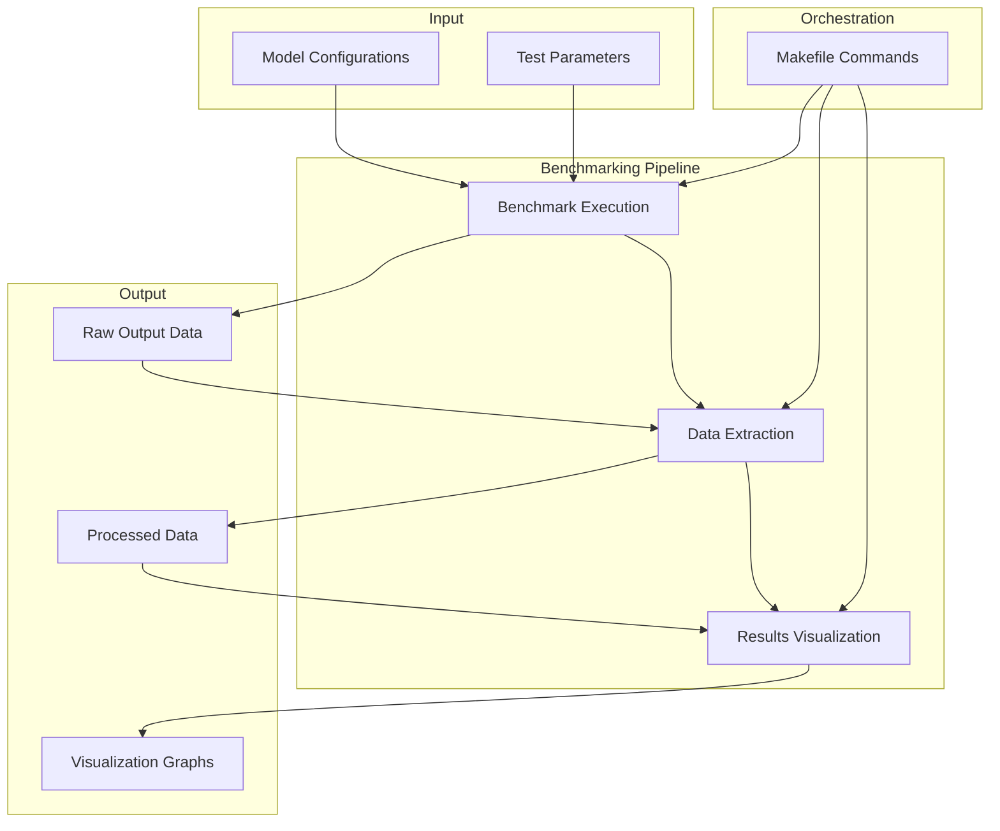
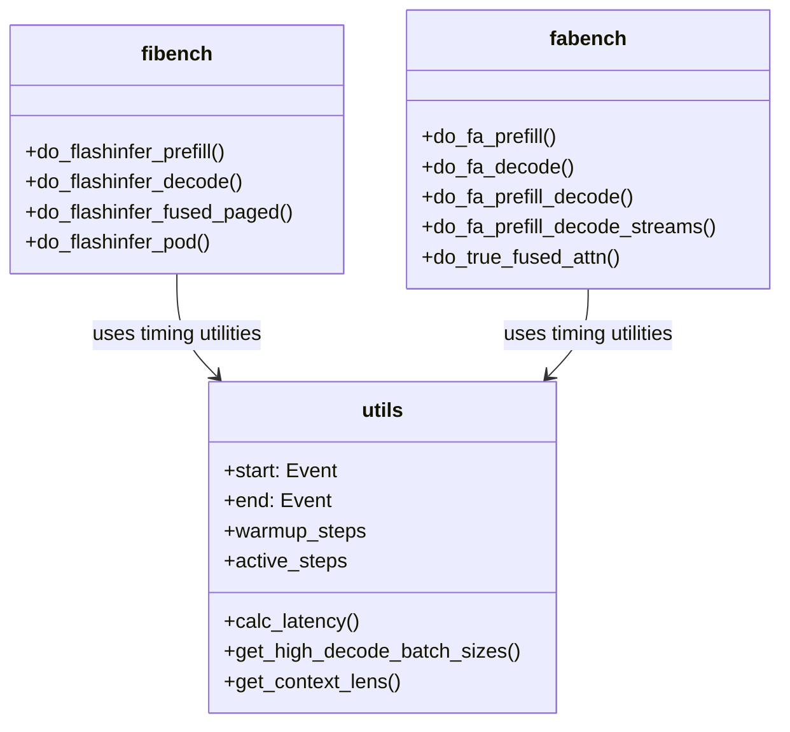
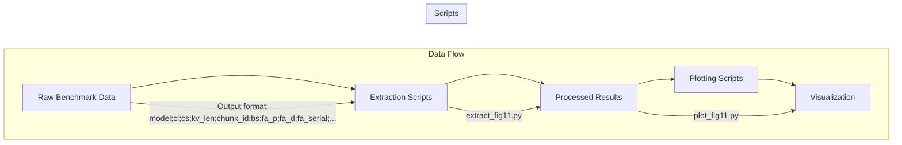
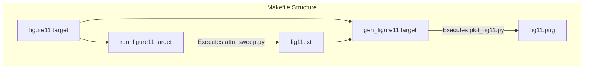

<!-- source: DeepWiki mcp.deepwiki.com · repo microsoft/vattention · page 5 Benchmarking Framework · fetched 2026-10-26 -->

# Benchmarking Framework

<details>
<summary>Relevant source files</summary>

The following files were used as context for generating this wiki page:

- [pod_attn/Makefile](pod_attn/Makefile)
- [pod_attn/requirements.txt](pod_attn/requirements.txt)
- [pod_attn/scripts/plot_fig11.py](pod_attn/scripts/plot_fig11.py)
- [pod_attn/scripts/plot_fig13.py](pod_attn/scripts/plot_fig13.py)
- [pod_attn/tests/attn_sweep.py](pod_attn/tests/attn_sweep.py)
- [pod_attn/tests/fabench.py](pod_attn/tests/fabench.py)
- [pod_attn/tests/fibench.py](pod_attn/tests/fibench.py)
- [pod_attn/tests/sens_cta.py](pod_attn/tests/sens_cta.py)
- [pod_attn/tests/utils.py](pod_attn/tests/utils.py)

</details>


## Purpose and Overview

The Benchmarking Framework provides a comprehensive system for evaluating the performance of different attention mechanisms and memory management strategies in the vAttention system. It enables systematic comparison of various implementations including vAttention, POD-Attention, and traditional approaches across different workloads, model configurations, and hardware settings.

For information about the specific POD-Attention implementation details, see [POD-Attention](#4), and for details on integration with the serving system, see [Sarathi-Lean Integration](#3).

Sources: [pod_attn/Makefile:1-101]()

## Framework Architecture

The benchmarking framework follows a pipeline architecture that consists of three main stages: benchmark execution, data extraction, and visualization.



The framework uses a Makefile for orchestration, making it easy to run specific benchmarks or reproduce figures from academic papers. Each benchmark can be run independently, and the pipeline ensures consistent processing and visualization.

Sources: [pod_attn/Makefile:4-96]()

## Core Components

### Benchmark Drivers

The framework includes several Python scripts that execute different types of benchmarks:

| Benchmark Script | Purpose | Key Metrics |
|------------------|---------|------------|
| `attn_sweep.py` | Tests attention mechanisms across different configurations | Latency, Throughput, Speedup |
| `chunked_quantization.py` | Evaluates quantization techniques | Memory Usage, Precision Loss |
| `sens_cta.py` | Sensitivity analysis for CUDA Thread Array configurations | Performance scaling |
| `tile_sizes.sh` | Tests different tile sizes for FlashAttention | Performance impact |

Each benchmark driver systematically varies parameters such as batch size, context length, model architecture, and hardware-specific settings to provide comprehensive performance evaluations.

Sources: [pod_attn/tests/attn_sweep.py:1-119](), [pod_attn/tests/sens_cta.py:1-54]()

### Benchmark Utilities

The benchmarking framework relies on several utility modules to implement the individual benchmarks:



These utilities provide functionalities for running different attention implementations, timing their execution, and ensuring fair comparisons between different methods.

Sources: [pod_attn/tests/fabench.py:1-300](), [pod_attn/tests/fibench.py:1-295](), [pod_attn/tests/utils.py:1-116]()

### Data Processing and Visualization

After benchmarks are executed, the raw results are processed by extraction scripts and then visualized using plotting scripts:



The visualization scripts use libraries like Matplotlib to create informative graphs that highlight performance differences between different implementations.

Sources: [pod_attn/scripts/plot_fig11.py:1-143](), [pod_attn/scripts/plot_fig13.py:1-173]()

## Benchmark Implementations

### Attention Sweep

The Attention Sweep benchmark (`attn_sweep.py`) is one of the most comprehensive tests in the framework. It evaluates different attention implementations across various model configurations, context lengths, and batch sizes.

```python
# Key Structure of attn_sweep.py
for model in model_configs:           # Iterate through different models
    for chunk_size in chunk_sizes:    # Test different chunk sizes
        for cl in context_lens:       # Test different context lengths
            for bs in d_batch_sizes:  # Test different batch sizes
                # Run different attention implementations
                # Compare their performance
                # Output results in CSV format
```

This benchmark exercises multiple attention implementations including:
- FA Prefill/Decode (Serial and Stream)
- FI Prefill/Decode (Serial and Batched)
- Horizontally Fused Attention
- POD Attention (with both FlashAttention and FlashInfer)

Sources: [pod_attn/tests/attn_sweep.py:26-117]()

### Hardware-Specific Benchmarks

The framework includes benchmarks focused on specific hardware aspects like CTA (Cooperative Thread Array) configurations:

```python
# From sens_cta.py
for fused_op in [9, 11]:  # Different CTA configurations
    # Test FusedAttention operation with different CTA settings
    fu_prefill, fu_decode, tot_time = fabench.do_true_fused_attn(
        q_p, k_p, v_p, q_d, k_d, v_d, fused_op, 
        k_new=k_new, v_new=v_new,
        seq_lens_k_p=cache_seqlens_p, 
        seq_lens_k_d=cache_seqlens_d, 
        cache_batch_idx=cache_batch_idx
    )
```

These benchmarks help to identify optimal hardware-specific settings for different workloads.

Sources: [pod_attn/tests/sens_cta.py:43-53]()

## Makefile Orchestration

The Makefile provides the main interface for running benchmarks and generating visualizations. It offers targets for:

1. Running individual benchmarks
2. Extracting data from benchmark results
3. Generating visualizations
4. Running the complete pipeline for specific figures



This structure enables reproducible benchmarking and visualization, allowing users to recreate specific figures or run the entire benchmark suite.

Sources: [pod_attn/Makefile:57-65]()

## Performance Metrics and Visualization

The benchmarking framework focuses on several key performance metrics:

| Metric | Description | Visualization |
|--------|-------------|---------------|
| Latency | Time to complete an operation | Line charts, Bar charts |
| Speedup | Relative performance compared to baseline | Violin plots, Heatmaps |
| Memory Efficiency | Memory consumption patterns | Bar charts |
| Scaling Behavior | Performance change with increasing parameters | Line charts |

The visualization scripts generate informative charts that highlight performance trends and differences:

```python
# Example from plot_fig11.py (simplified)
vp = axs[0].violinplot(speedup,
                  showmeans=False,
                  showmedians=True)
                  
# Label and format the chart
ax.set_ylabel('Speedup over FlashAttention', fontsize=30, fontweight='bold')
```

These visualizations make it easy to identify performance patterns and make informed decisions about which attention mechanism to use for different workloads.

Sources: [pod_attn/scripts/plot_fig11.py:90-142](), [pod_attn/scripts/plot_fig13.py:35-147]()

## Dependencies and Requirements

The benchmarking framework has several software dependencies:

```
numpy
torch==2.4.0
ninja
packaging
matplotlib
seaborn
```

The benchmarks are designed to run on NVIDIA GPUs with CUDA support, and require sufficient GPU memory to accommodate the tested models and batch sizes.

Sources: [pod_attn/requirements.txt:1-6]()

## Usage Examples

To run a benchmark and generate its visualization:

```bash
# Run the attention sweep benchmark and generate its visualization
make figure11

# Run just the benchmark without visualization
make run_figure11

# Generate visualization from existing benchmark results
make gen_figure11
```

For custom benchmarking configurations, you can modify the relevant test script parameters:

```python
# Customize model configurations in utils.py
model_configs = {
    'llama-3-8b-tp1': {'num_heads': 32, 'num_kv_heads': 8, 'head_size': 128, 'num_layers': 32},
    # Add custom model configuration here
}

# Customize context lengths and batch sizes
context_lens = [4096, 8192, 16384]  # Custom context lengths
d_batch_sizes = [8, 16, 32, 64]     # Custom batch sizes
```

Sources: [pod_attn/tests/utils.py:23-41](), [pod_attn/Makefile:57-65]()

## Extending the Framework

The benchmarking framework is designed to be extensible. To add a new benchmark:

1. Create a new benchmark script in the `tests/` directory
2. Add appropriate extraction and plotting scripts in the `scripts/` directory
3. Add targets to the Makefile for running the benchmark and generating visualizations

Following the existing patterns in the codebase ensures that new benchmarks integrate well with the overall framework.

Sources: [pod_attn/Makefile:1-101]()

---

