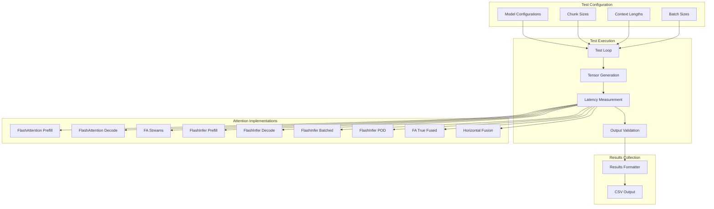
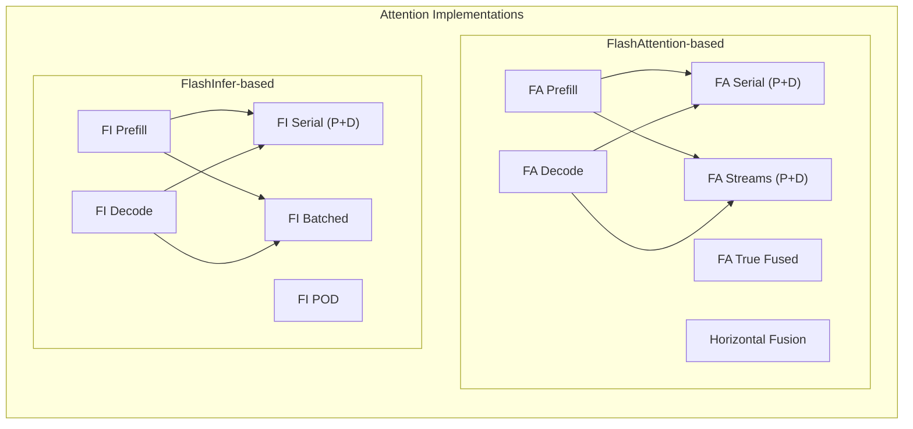
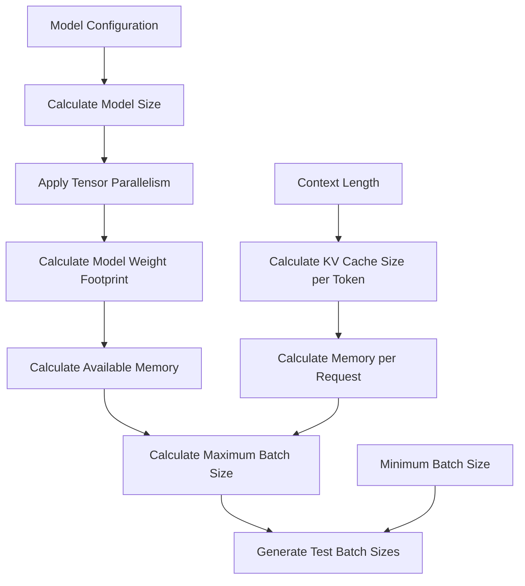

<!-- source: DeepWiki mcp.deepwiki.com · repo microsoft/vattention · page 5.1 Attention Sweep Benchmarks · fetched 2026-10-26 -->

# Attention Sweep Benchmarks

<details>
<summary>Relevant source files</summary>

The following files were used as context for generating this wiki page:

- [pod_attn/tests/attn_sweep.py](pod_attn/tests/attn_sweep.py)
- [pod_attn/tests/banner_fig.sh](pod_attn/tests/banner_fig.sh)
- [pod_attn/tests/banner_fig_comparison.py](pod_attn/tests/banner_fig_comparison.py)
- [pod_attn/tests/banner_fig_profile.py](pod_attn/tests/banner_fig_profile.py)
- [pod_attn/tests/fabench.py](pod_attn/tests/fabench.py)
- [pod_attn/tests/fibench.py](pod_attn/tests/fibench.py)
- [pod_attn/tests/utils.py](pod_attn/tests/utils.py)

</details>


## Purpose and Scope

The Attention Sweep Benchmarks system systematically evaluates the performance of different attention mechanism implementations in the vAttention framework. This benchmarking framework provides a standardized methodology for measuring and comparing latency across various attention implementations, model configurations, and workload characteristics.

The system focuses on measuring the performance of both individual attention operations (prefill and decode) and combined (fused) implementations under various conditions including:
- Different model architectures and tensor parallelism configurations
- Varying context lengths
- Different chunk sizes
- Multiple batch size configurations

For visualization of benchmark results, see [Results Visualization](#5.2). For experimental findings, see [Performance Comparison](#6.1).

Sources: [pod_attn/tests/attn_sweep.py:28-31]()

## Benchmark Architecture

The attention sweep benchmarking system follows a structured approach to test different attention implementations. The overall architecture combines model configuration, test parameter generation, and performance measurement into a cohesive framework.



Sources: [pod_attn/tests/attn_sweep.py:32-118](), [pod_attn/tests/fabench.py:21-299](), [pod_attn/tests/fibench.py:6-294]()

## Model and Test Configurations

The benchmark suite tests performance across multiple model architectures with varying tensor parallelism (TP) configurations. This allows for comprehensive evaluation of how different attention implementations perform across various model scales and hardware distributions.

### Model Configurations

The system focuses on models with grouped-query attention (GQA) architectures, particularly variants of Llama-3 and Yi models:

| Model | Num Heads | KV Heads | Head Size | TP | 
|-------|-----------|----------|-----------|---|
| llama-3-8b-tp1 | 32 | 8 | 128 | 1 |
| llama-3-8b-tp2 | 16 | 4 | 128 | 2 | 
| llama-3-8b-tp4 | 8 | 2 | 128 | 4 |
| llama-3-8b-tp8 | 4 | 1 | 128 | 8 |
| yi-6b-tp1 | 32 | 4 | 128 | 1 |
| yi-6b-tp2 | 16 | 2 | 128 | 2 |
| yi-6b-tp4 | 8 | 1 | 128 | 4 |

### Test Parameters

The benchmarking system evaluates performance across multiple dimensions:

1. **Chunk Sizes**: 512, 1024, 2048 tokens
2. **Context Lengths**: 4096, 8192, 12288, 16384, 20480 tokens
3. **Batch Sizes**: Dynamically calculated based on model and context length
4. **KV Cache Lengths**: Progressive accumulation of chunk sizes

Sources: [pod_attn/tests/attn_sweep.py:8-26](), [pod_attn/tests/attn_sweep.py:28](), [pod_attn/tests/attn_sweep.py:40-41](), [pod_attn/tests/utils.py:23-41]()

## Testing Methodology

The benchmarking system follows a systematic approach to ensure fair and accurate comparisons between different attention implementations:

```mermaid
flowchart LR
    subgraph "Test Setup"
        config["Configure Test Parameters"]
        tensor["Generate Input Tensors"]
        warmup["Perform Warmup Runs"]
    end

    subgraph "Measurement Process"
        launch["Launch Big Kernel (Stabilize GPU)"]
        events["Record CUDA Events"]
        exec["Execute Operations Multiple Times"]
        sync["Synchronize GPU"]
        calc["Calculate Average Latency"]
    end

    subgraph "Validation"
        verify["Verify Output Correctness"]
        log["Log Results"]
    end

    config --> tensor
    tensor --> warmup
    warmup --> launch
    launch --> events
    events --> exec
    exec --> sync
    sync --> calc
    calc --> verify
    verify --> log
```



### Measurement Process

For each attention implementation, the system:

1. Generates appropriate input tensors for the test configuration
2. Performs warmup runs to ensure the GPU is in a stable state
3. Records CUDA events to precisely measure execution time
4. Executes the operation multiple times (typically 100-200 iterations)
5. Calculates the average latency across all runs
6. Verifies output correctness by comparing with reference implementation
7. Computes speedup metrics relative to baseline implementations

Latency is measured using CUDA events for accurate GPU timing:

```python
start = torch.cuda.Event(enable_timing=True)
end = torch.cuda.Event(enable_timing=True)
start.record()
for _ in range(active_steps):
    # Execute attention operation
end.record()
torch.cuda.synchronize()
latency = start.elapsed_time(end) / active_steps
```

Sources: [pod_attn/tests/utils.py:1-21](), [pod_attn/tests/fabench.py:21-36](), [pod_attn/tests/fibench.py:19-31]()

## Attention Implementations Tested

The benchmarking system evaluates a comprehensive set of attention implementations to determine performance characteristics across different scenarios.

### Implementation Types



### Implementation Details

1. **FlashAttention Variants**:
   - **FA Prefill**: Standard FlashAttention implementation for prefill phase
   - **FA Decode**: Standard FlashAttention implementation for decode phase
   - **FA Serial**: Sequential execution of prefill and decode
   - **FA Streams**: Concurrent execution of prefill and decode using CUDA streams
   - **FA True Fused**: Optimized implementation that fuses prefill and decode operations
   - **Horizontal Fusion**: Special fusion strategy for attention operations

2. **FlashInfer Variants**:
   - **FI Prefill**: FlashInfer implementation for prefill phase
   - **FI Decode**: FlashInfer implementation for decode phase
   - **FI Serial**: Sequential execution of prefill and decode
   - **FI Batched**: Optimized batched implementation
   - **FI POD**: POD-Attention implementation using FlashInfer

Each implementation is measured both in isolation and in combination to understand the performance benefits of various fusion and optimization strategies.

Sources: [pod_attn/tests/attn_sweep.py:63-97](), [pod_attn/tests/fabench.py:21-139](), [pod_attn/tests/fabench.py:261-276](), [pod_attn/tests/fibench.py:88-121]()

## Key Benchmarking Functions

### FlashAttention Benchmarking

The core functions for benchmarking FlashAttention implementations include:

1. **FA Prefill**: `do_fa_prefill` in [pod_attn/tests/fabench.py:22-38]()
   - Measures latency of the prefill phase using FlashAttention

2. **FA Decode**: `do_fa_decode` in [pod_attn/tests/fabench.py:41-56]()
   - Measures latency of the decode phase using FlashAttention

3. **FA Streams**: `do_fa_prefill_decode_streams` in [pod_attn/tests/fabench.py:141-165]()
   - Measures latency when running prefill and decode concurrently on different CUDA streams

4. **FA True Fused**: `do_true_fused_attn` in [pod_attn/tests/fabench.py:261-278]()
   - Measures latency of optimized fused attention implementation

### FlashInfer Benchmarking

For FlashInfer implementations, the key functions include:

1. **FI Prefill**: `do_flashinfer_prefill_input` in [pod_attn/tests/fibench.py:19-34]()
   - Measures FlashInfer prefill phase latency

2. **FI Decode**: `do_flashinfer_decode_paged` in [pod_attn/tests/fibench.py:197-227]()
   - Measures FlashInfer decode phase latency with paged KV cache

3. **FI Fused**: `do_flashinfer_fused_paged` in [pod_attn/tests/fibench.py:231-294]()
   - Measures latency of batched FlashInfer implementation with paged KV cache

4. **FI POD**: `do_flashinfer_pod` in [pod_attn/tests/fibench.py:88-123]()
   - Measures POD-Attention implementation using FlashInfer

Sources: [pod_attn/tests/fabench.py](), [pod_attn/tests/fibench.py]()

## Batch Size Calculation

The system dynamically calculates appropriate batch sizes for each test configuration based on available GPU memory, model size, and tensor parallelism configurations.



The key functions for batch size calculation:

1. `get_per_token_kv_cache_size`: Calculates memory required for KV cache per token
2. `get_model_weight_footprint`: Determines memory used by model weights
3. `get_available_kvcache_memory`: Calculates memory available for KV cache
4. `calc_max_batch_size`: Computes maximum possible batch size
5. `get_high_decode_batch_sizes`: Generates test batch sizes (90%, 95%, 100% of max)

This approach ensures tests are conducted with realistic batch sizes that fit within GPU memory constraints while maximizing utilization.

Sources: [pod_attn/tests/utils.py:46-93]()

## Results Collection and Output

The benchmark results are collected, formatted, and output as CSV data for further analysis and visualization. The output includes various metrics:

1. **Model configuration**: Model type, tensor parallelism setting
2. **Test parameters**: Context length, chunk size, KV length, batch size
3. **Latency measurements**: For each attention implementation variant
4. **Speedup calculations**: Relative performance improvements compared to baselines

The results follow this format:

```
model;cl;cs;kv_len;chunk_id;bs;fa_p;fa_d;fa_serial;fa_stream;fi_p;fi_d;fi_serial;fi_batched;HFuse;fi_pod;fa_fused;best_fused_op;speedup_fa_serial;
```

This standardized output format enables subsequent analysis and visualization tools to easily process the data and generate performance comparisons and insights.

Sources: [pod_attn/tests/attn_sweep.py:29-31](), [pod_attn/tests/attn_sweep.py:115-117]()

## Integration with Banner Figure Benchmarks

In addition to the core attention sweep benchmarks, the system includes specialized banner figure benchmarks designed to produce profile data for visualization in research papers or presentations.

The banner figure benchmarks measure similar metrics but focus on specific configurations that highlight the benefits of different attention implementations. These benchmarks collect not only latency data but also hardware utilization metrics:

- SM (Streaming Multiprocessor) throughput
- DRAM throughput

These benchmarks are executed using NVIDIA's `ncu` (NVIDIA Compute Profiler) tool, which provides detailed performance metrics beyond simple latency measurements.

Sources: [pod_attn/tests/banner_fig.sh:5-58](), [pod_attn/tests/banner_fig_comparison.py:1-88](), [pod_attn/tests/banner_fig_profile.py:1-243]()

---

