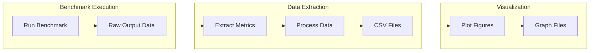
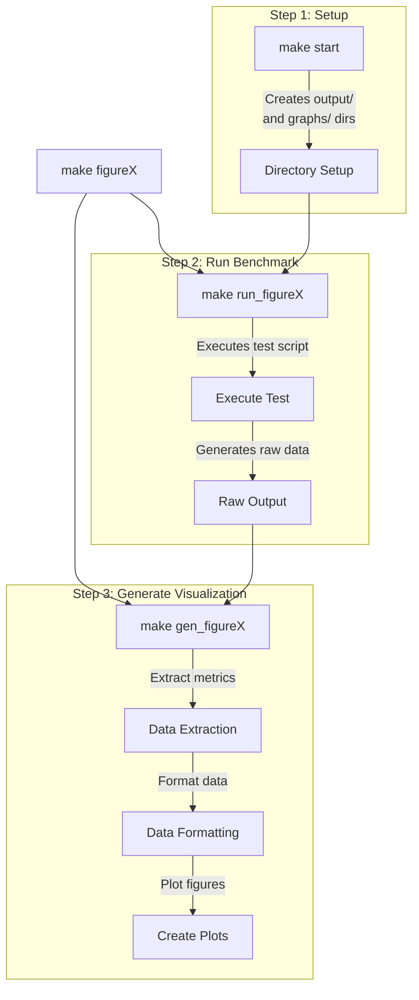
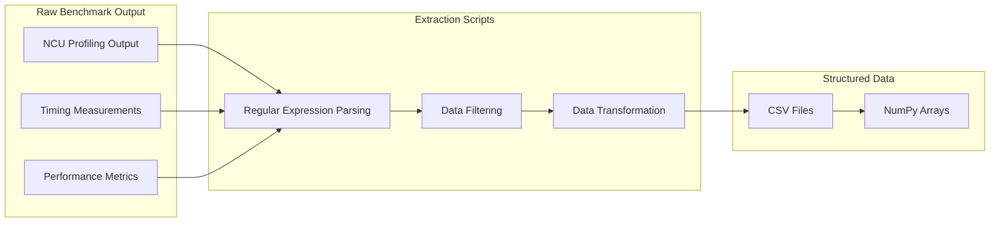
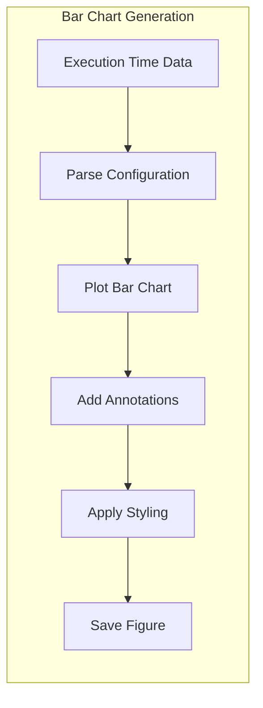
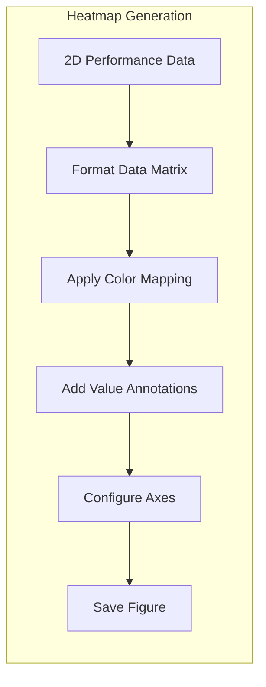
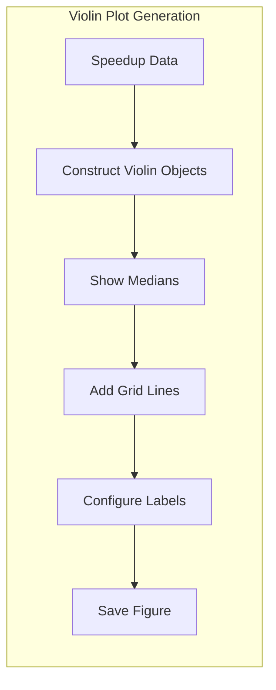
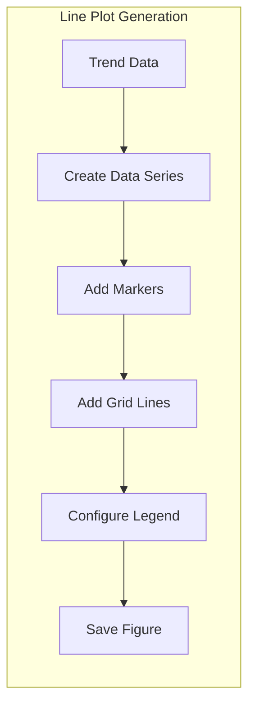
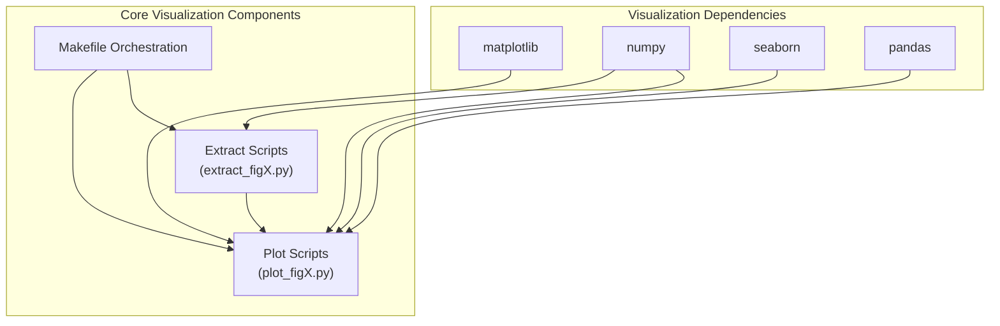

<!-- source: DeepWiki mcp.deepwiki.com · repo microsoft/vattention · page 5.2 Results Visualization · fetched 2026-10-26 -->

# Results Visualization

<details>
<summary>Relevant source files</summary>

The following files were used as context for generating this wiki page:

- [pod_attn/.gitignore](pod_attn/.gitignore)
- [pod_attn/Makefile](pod_attn/Makefile)
- [pod_attn/requirements.txt](pod_attn/requirements.txt)
- [pod_attn/scripts/extract_fig1.py](pod_attn/scripts/extract_fig1.py)
- [pod_attn/scripts/extract_fig10.py](pod_attn/scripts/extract_fig10.py)
- [pod_attn/scripts/plot_fig1.py](pod_attn/scripts/plot_fig1.py)
- [pod_attn/scripts/plot_fig10.py](pod_attn/scripts/plot_fig10.py)
- [pod_attn/scripts/plot_fig11.py](pod_attn/scripts/plot_fig11.py)
- [pod_attn/scripts/plot_fig13.py](pod_attn/scripts/plot_fig13.py)
- [pod_attn/tests/fa_tile_sizes.py](pod_attn/tests/fa_tile_sizes.py)
- [pod_attn/tests/sens_cta.py](pod_attn/tests/sens_cta.py)
- [pod_attn/tests/tile_sizes.sh](pod_attn/tests/tile_sizes.sh)

</details>


This document explains the framework used to extract, process, and visualize benchmark results in the vAttention codebase. The visualization system enables researchers and developers to analyze performance characteristics of different attention mechanisms, memory management strategies, and parameter configurations. For information about how the benchmarks themselves are executed, see [Attention Sweep Benchmarks](#5.1).

## Visualization Workflow

The results visualization process follows a three-step workflow:



Sources: [pod_attn/Makefile:4-96]()

The workflow is automated through Make targets, which handle the entire process from benchmark execution to visualization generation:



Sources: [pod_attn/Makefile:8-66]()

## File Organization

The results visualization system uses a consistent directory structure for organizing benchmarks, raw data, and visualization outputs:

| Directory | Purpose |
|-----------|---------|
| `tests/` | Contains benchmark scripts that generate raw performance data |
| `scripts/` | Contains extraction and plotting scripts for visualization |
| `output/` | Stores raw benchmark outputs and intermediate processed data |
| `graphs/` | Stores the final visualized figures as image files |

Sources: [pod_attn/.gitignore:1-6](), [pod_attn/Makefile:1-3]()

## Data Extraction Process

The data extraction process converts raw benchmark outputs into structured data formats suitable for visualization:



Sources: [pod_attn/scripts/extract_fig1.py:1-54](), [pod_attn/scripts/extract_fig10.py:1-55]()

The extraction scripts use regular expressions to parse specific metrics from benchmark outputs:

- SM (Streaming Multiprocessor) utilization
- DRAM throughput and bandwidth utilization
- Execution time for different operations
- Configuration parameters (batch size, context length, etc.)

For example, the `extract_fig1.py` script parses NVIDIA Nsight Compute (NCU) output to extract SM and DRAM utilization metrics using regex patterns:

```python
sm_regex = re.compile('"sm__throughput.avg.pct_of_peak_sustained_elapsed","%","(.*?)"')
bw_regex = re.compile('"dram__throughput.avg.pct_of_peak_sustained_elapsed","%","(.*?)"')
```

Sources: [pod_attn/scripts/extract_fig1.py:5-6]()

## Visualization Techniques

The visualization system uses a variety of plotting techniques to represent different aspects of performance:

### 1. Bar Charts

Used primarily to compare runtime performance across different attention mechanisms:



Sources: [pod_attn/scripts/plot_fig1.py:139-172]()

### 2. Heatmaps

Used to visualize the impact of multiple parameters on performance metrics:



Sources: [pod_attn/scripts/plot_fig13.py:35-147]()

### 3. Violin Plots

Used to show the distribution of speedup values across different implementations:



Sources: [pod_attn/scripts/plot_fig11.py:99-143]()

### 4. Line Plots

Used to show trends across varying parameters:



Sources: [pod_attn/scripts/plot_fig10.py:43-60]()

## Key Benchmark Visualizations

The vAttention codebase includes several key visualization targets:

### Figure 1: Banner Figure

Compares utilization and performance across different attention mechanisms:
- Prefill utilization (compute and memory bandwidth)
- Decode utilization
- Normalized runtime comparison

```bash
make figure1  # Runs benchmarks and generates visualizations
```

Sources: [pod_attn/Makefile:8-19](), [pod_attn/scripts/plot_fig1.py:52-172]()

### Figure 10: Tile Size Analysis

Visualizes how different attention tile sizes affect compute utilization and memory bandwidth:

```bash
make figure10  # Runs tile size benchmarks and generates visualizations
```

Sources: [pod_attn/Makefile:46-55](), [pod_attn/scripts/plot_fig10.py:43-65]()

### Figure 11: Attention Sweep

Compares different attention implementations using violin plots of speedup distributions:

```bash
make figure11  # Runs attention sweep benchmarks and generates visualizations
```

Sources: [pod_attn/Makefile:57-65](), [pod_attn/scripts/plot_fig11.py:90-143]()

### Figure 13: CTA Sensitivity

Evaluates the impact of Cooperative Thread Array (CTA) configurations on performance:

```bash
make figure13  # Runs CTA sensitivity benchmarks and generates visualizations
```

Sources: [pod_attn/Makefile:79-87](), [pod_attn/scripts/plot_fig13.py:148-172]()

## Code Implementation

The visualization system is implemented as Python scripts that use libraries such as matplotlib, numpy, and seaborn:



Sources: [pod_attn/requirements.txt:1-6]()

Key aspects of the implementation include:

1. **Regular expression parsing**: Used to extract metrics from profiler output
2. **Data transformation**: Converts raw metrics into structured formats
3. **Plot configuration**: Sets figure dimensions, labels, legends, and styling
4. **Visualization output**: Saves figures in image format for inclusion in papers or documentation

## Output Files

The visualization system produces structured output files:

| File Type | Directory | Purpose |
|-----------|-----------|---------|
| Raw benchmark output | `output/` | Original output from benchmarks |
| Processed CSV files | `output/` | Structured data from extraction scripts |
| Figure images | `graphs/` | Final visualizations in image format |

Sources: [pod_attn/Makefile:1-3](), [pod_attn/.gitignore:3-6]()

## Running Visualizations

To generate visualizations, you can use the following Makefile targets:

```bash
# Generate all figures
make figure1 figure6 figure7 figure10 figure11 figure13 figure14

# Generate a specific figure
make figure11

# Run only the benchmark without visualization
make run_figure11

# Generate only the visualization from existing benchmark data
make gen_figure11
```

Sources: [pod_attn/Makefile:8-97]()

## Advanced Visualization Customization

The visualization scripts support customization of plot appearance:

- Figure dimensions (default: `figsize=(10, 7)`)
- Font settings (default: `font.size=28`, `font.family='Sans Serif'`)
- Color schemes and markers for different data series
- Axis labels and tick formatting
- Legend placement and styling

Sources: [pod_attn/scripts/plot_fig1.py:10-15](), [pod_attn/scripts/plot_fig10.py:10-34](), [pod_attn/scripts/plot_fig11.py:63-88]()

For example, to customize a violin plot's appearance:

```python
vp = axs[0].violinplot(speedup,
                  showmeans=False,
                  showmedians=True)
```

Sources: [pod_attn/scripts/plot_fig11.py:99-102]()

## Conclusion

The Results Visualization system provides a comprehensive framework for analyzing benchmark data and presenting it in an accessible visual format. By automating the extraction and visualization process, it allows researchers and developers to quickly interpret performance characteristics and make informed decisions about system configurations and optimizations.

---

