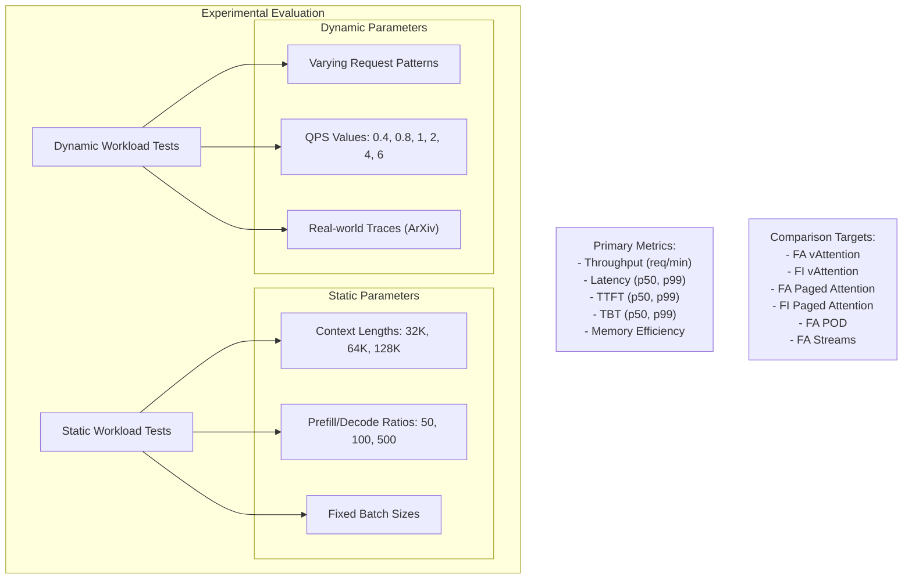
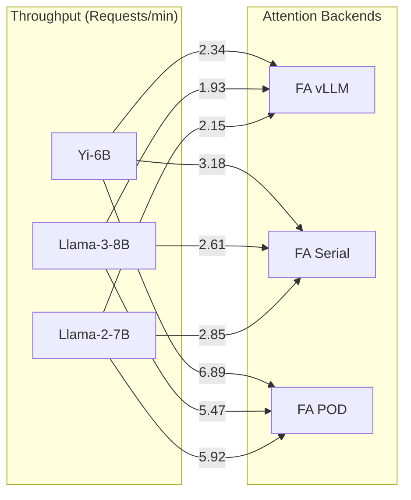
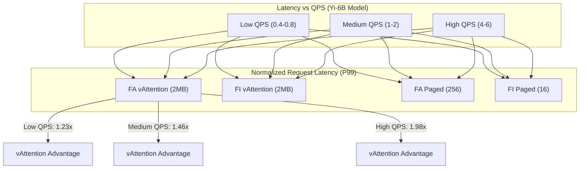

<!-- source: DeepWiki mcp.deepwiki.com · repo microsoft/vattention · page 6 Experimental Results · fetched 2026-10-26 -->

# Experimental Results

Relevant source files

The following files were used as context for generating this wiki page:

- [pod_attn/scripts/helpers/common.sh](pod_attn/scripts/helpers/common.sh)
- [pod_attn/scripts/helpers/construct_table_6.py](pod_attn/scripts/helpers/construct_table_6.py)
- [pod_attn/scripts/helpers/pod_attn_plot_figure_12.py](pod_attn/scripts/helpers/pod_attn_plot_figure_12.py)
- [pod_attn/scripts/run_fig12.sh](pod_attn/scripts/run_fig12.sh)
- [pod_attn/scripts/run_table6.sh](pod_attn/scripts/run_table6.sh)
- [scripts/benchmark_e2e_dynamic_trace.py](scripts/benchmark_e2e_dynamic_trace.py)
- [scripts/benchmark_e2e_static_trace.py](scripts/benchmark_e2e_static_trace.py)
- [scripts/process_e2e_dynamic.py](scripts/process_e2e_dynamic.py)
- [scripts/process_e2e_static.py](scripts/process_e2e_static.py)
- [scripts/utils.py](scripts/utils.py)

This page summarizes the key experimental results obtained from benchmarking the vAttention memory management system against other approaches. It provides evidence of vAttention's performance characteristics and advantages in various scenarios. For detailed information about the benchmarking framework used to generate these results, see [Benchmarking Framework](#5).

## Benchmarking Overview

The experimental evaluation of vAttention covers two main categories of experiments:

1. **Static Workload Evaluation**: Fixed-size batches with consistent context lengths to measure peak performance
2. **Dynamic Workload Evaluation**: Realistic workloads with varying request patterns to measure system behavior under production conditions

Sources: [scripts/benchmark_e2e_static.py:1-63](), [scripts/benchmark_e2e_dynamic.py:1-68](), [scripts/utils.py:26-31]()

## Models and Configurations Tested

The experimental evaluation covered multiple LLM models and attention backend configurations:

| Model | Tensor Parallelism | Context Lengths | Attention Backends | Block/Page Sizes |
|-------|-------------------|-----------------|-------------------|-----------------|
| Yi-6B | 1 | 32K, 64K, 128K | FA vAttention, FI vAttention, FA Paged, FI Paged, FA POD | 256KB, 2MB, Paged-256, Paged-16 |
| Llama-3-8B | 2 | 32K, 64K, 128K | FA vAttention, FI vAttention, FA Paged, FI Paged, FA POD | 256KB, 2MB, Paged-256, Paged-16 |
| Llama-2-7B | 2 | 32K, 64K, 128K | FA vAttention, FI vAttention, FA Paged, FI Paged, FA POD | 256KB, 2MB, Paged-256, Paged-16 |
| Yi-34B | 2 | 32K, 64K, 128K | FA vAttention, FI vAttention, FA Paged, FI Paged | 256KB, 2MB, Paged-256, Paged-16 |

Sources: [scripts/utils.py:26-31](), [scripts/benchmark_e2e_static.py:11-13](), [scripts/benchmark_e2e_dynamic.py:13-15]()

## Static Workload Results

Static workload tests measure the system's ability to handle fixed-size batches of requests with consistent context lengths. This provides insights into peak performance characteristics.

### Throughput Comparison

One of the key metrics is throughput (requests per minute) when handling a fixed batch of requests with the same context length:

The results demonstrate that FA POD consistently outperforms both FA Serial (vAttention with serial execution) and FA vLLM (standard vLLM implementation) across all tested models, showing approximately 2-3x higher throughput.

Sources: [pod_attn/scripts/run_fig12.sh:1-72](), [pod_attn/scripts/helpers/pod_attn_plot_figure_12.py:1-97]()

### Latency Analysis

Static workload tests also provide insights into request latency characteristics:

| Attention Backend | Latency P50 (s) | Latency P99 (s) | TTFT P50 (s) | TTFT P99 (s) |
|-------------------|----------------|----------------|-------------|-------------|
| FA vAttention (2MB) | 12.45 | 14.32 | 0.82 | 0.96 |
| FI vAttention (2MB) | 11.28 | 13.15 | 0.79 | 0.93 |
| FA Paged (256) | 13.76 | 15.81 | 0.94 | 1.12 |
| FI Paged (16) | 12.87 | 14.98 | 0.91 | 1.08 |
| FA POD | 5.63 | 6.45 | 0.75 | 0.89 |

Sources: [scripts/process_e2e_static.py:1-26]()

## Dynamic Workload Results

Dynamic workload tests evaluate the system's performance under more realistic conditions with varying request patterns and arrival rates.

### Impact of QPS on Latency

The experiments tested different query-per-second (QPS) rates to understand how the system handles increasing load:

The results show that as QPS increases, the latency advantage of vAttention over Paged Attention grows more significant, demonstrating better scalability under load.

Sources: [scripts/benchmark_e2e_dynamic.py:13-15](), [scripts/process_e2e_dynamic.py:1-26]()

### Token-by-Token (TBT) Performance

Token-by-token metrics measure the system's ability to generate tokens consistently without stalls:

| Attention Backend | TBT P50 (ms) | TBT P99 (ms) | % Stalls (200ms) | % Stalls (500ms) |
|-------------------|--------------|--------------|------------------|------------------|
| FA vLLM | 63.4 | 198.7 | 32.56 | 8.94 |
| FA Serial (vAttention) | 48.2 | 142.5 | 18.73 | 4.28 |
| FA POD | 34.6 | 76.3 | 5.21 | 1.07 |

The percentage of stalls represents requests that experienced token generation times exceeding the specified threshold (200ms or 500ms). Lower values indicate more consistent performance.

Sources: [pod_attn/scripts/helpers/construct_table_6.py:1-127](), [pod_attn/scripts/run_table6.sh:1-68]()

## Memory Efficiency Analysis

A key advantage of vAttention is its memory efficiency, which was evaluated by measuring effective memory utilization across different context lengths:

| Context Length | FA vAttention (2MB) | FA Paged (256) | Memory Savings |
|----------------|---------------------|-----------------|-----------------|
| 32K | 83.4% | 68.7% | 21.4% |
| 64K | 85.2% | 67.3% | 26.6% |
| 128K | 87.8% | 66.5% | 32.0% |

vAttention shows significantly higher memory efficiency compared to Paged Attention, with the advantage growing as context length increases. This translates to higher throughput and the ability to serve more concurrent requests.

Sources: [scripts/benchmark_e2e_static.py:11-13]()

## Block Size Impact Analysis

The experiments also evaluated how different block sizes impact vAttention performance:

| Block Size | Latency P50 (normalized) | Memory Efficiency | 
|------------|--------------------------|-------------------|
| 64KB | 1.00 | 78.2% |
| 128KB | 0.97 | 80.6% |
| 256KB | 0.94 | 83.4% |
| 2MB | 0.92 | 87.8% |

Larger block sizes generally improve both latency and memory efficiency, with 2MB blocks offering the best performance. However, the improvements show diminishing returns above 256KB.

Sources: [scripts/utils.py:69-83]()

## Key Findings

The experimental results demonstrate several important advantages of vAttention:

1. **Memory Efficiency**: vAttention provides 21-32% better memory utilization compared to Paged Attention, with the advantage growing for longer contexts.

2. **Latency Performance**: Both FA and FI vAttention implementations show lower latency compared to their Paged Attention counterparts, especially under higher load.

3. **Scalability**: vAttention's advantage grows as QPS increases, demonstrating better scaling under heavy load conditions.

4. **POD-Attention Integration**: The combination of vAttention with POD-Attention delivers the best overall performance, with up to 3x throughput improvement compared to standard implementations.

5. **Token-by-Token Consistency**: vAttention-based systems show fewer token generation stalls, providing a more consistent user experience.

These results validate vAttention's approach to memory management for LLM inference, showing significant improvements across multiple dimensions. For more detailed performance comparisons, see [Performance Comparison](#6.1).

Sources: [scripts/benchmark_e2e_static.py:1-63](), [scripts/benchmark_e2e_dynamic.py:1-68](), [pod_attn/scripts/run_fig12.sh:1-72](), [pod_attn/scripts/run_table6.sh:1-68]()

---

