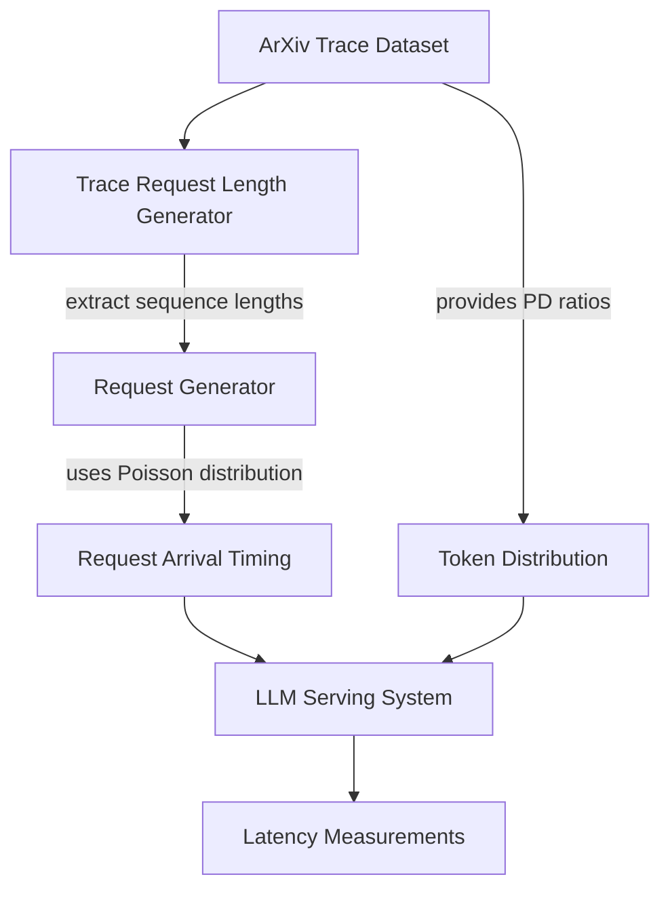
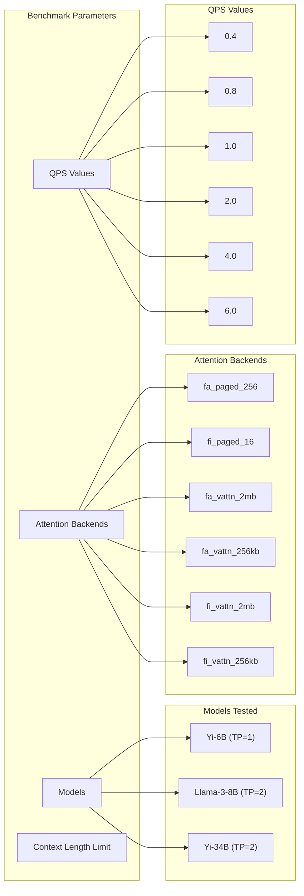
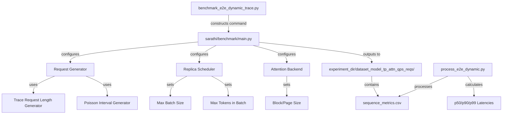
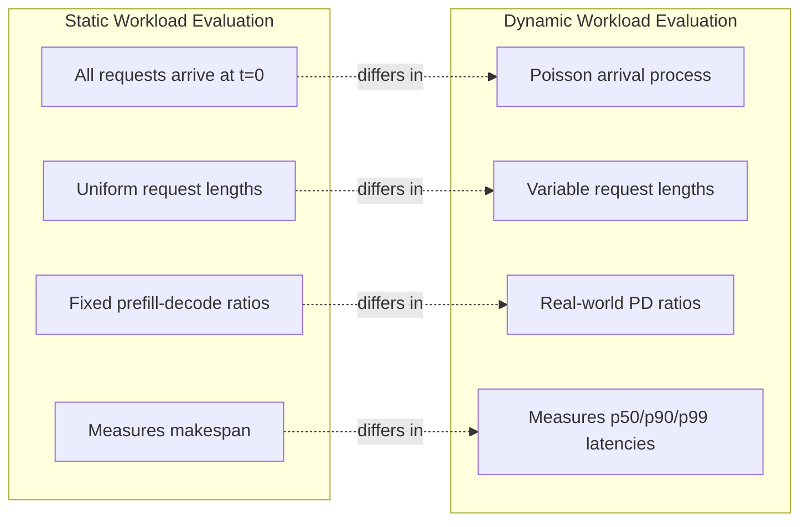

<!-- source: DeepWiki mcp.deepwiki.com · repo microsoft/vattention · page 6.2 Dynamic Workload Evaluation · fetched 2026-10-26 -->

# Dynamic Workload Evaluation

<details>
<summary>Relevant source files</summary>

The following files were used as context for generating this wiki page:

- [pod_attn/scripts/traces/arxiv_sample.csv](pod_attn/scripts/traces/arxiv_sample.csv)
- [scripts/artifact_asplos25/helpers/common.sh](scripts/artifact_asplos25/helpers/common.sh)
- [scripts/artifact_asplos25/traces/arxiv_sample.csv](scripts/artifact_asplos25/traces/arxiv_sample.csv)
- [scripts/benchmark_e2e_dynamic_trace.py](scripts/benchmark_e2e_dynamic_trace.py)
- [scripts/benchmark_e2e_static_trace.py](scripts/benchmark_e2e_static_trace.py)
- [scripts/process_e2e_dynamic.py](scripts/process_e2e_dynamic.py)
- [scripts/process_e2e_static.py](scripts/process_e2e_static.py)
- [scripts/utils.py](scripts/utils.py)

</details>


This document explains how vAttention is evaluated under dynamic workloads that mimic real-world LLM serving scenarios. Unlike static workload evaluation (covered in [Performance Comparison](#6.1)), dynamic workload evaluation tests vAttention's performance when handling varying request patterns with realistic token distributions and arrival rates over time.

## Workload Characterization

In real-world deployments, LLM inference workloads are highly dynamic, with varying request arrival patterns and sequence lengths. To evaluate vAttention under these realistic conditions, the system uses traces derived from datasets such as ArXiv summarization.

### ArXiv Dataset Characteristics

The ArXiv dataset used for dynamic evaluation contains information about token distributions in scientific paper summarization tasks. Each entry includes:

- Number of prefill tokens (context)
- Number of decode tokens (generation)
- Total tokens
- Prefill-to-decode ratio

Here's a sample of the dataset:

| Prefill Tokens | Decode Tokens | Total Tokens | PD Ratio |
|----------------|---------------|--------------|----------|
| 7564.0         | 192.0         | 7756.0       | 39.40    |
| 7050.0         | 222.0         | 7272.0       | 31.76    |
| 9463.0         | 340.0         | 9803.0       | 27.83    |
| 9045.0         | 316.0         | 9361.0       | 28.62    |
| 20712.0        | 633.0         | 21345.0      | 32.72    |

The dataset shows considerable variation in context lengths and prefill-to-decode ratios, representing the diverse workloads that LLM systems encounter in production.

Sources: [pod_attn/scripts/traces/arxiv_sample.csv](), [scripts/artifact_asplos25/traces/arxiv_sample.csv]()

## Dynamic Workload Generation



Dynamic workloads are generated using:

1. **Arrival Pattern**: A Poisson process model determines when requests arrive, with configurable QPS (queries per second)
2. **Sequence Lengths**: Real-world token counts from the ArXiv dataset
3. **Prefill-Decode Ratios**: Maintained as per the source dataset

The workload generation configuration is defined in the benchmark scripts:

```python
# Request interval configuration
'--synthetic_request_generator_interval_provider', 'poisson',
'--poisson_request_interval_generator_qps', f'{qps}',
# Request length configuration
'--trace_request_length_generator_trace_file', f'{dataset_path}',
'--trace_request_length_generator_prefill_scale_factor', '1',
'--trace_request_length_generator_decode_scale_factor', '1',
```

Sources: [scripts/benchmark_e2e_dynamic_trace.py:39-48]()

## Experimental Setup



The dynamic workload evaluation uses a comprehensive test matrix:

### Models

```python
models = {
    'yi-6b-1': {'tp': 1, 'hfrecord': '01-ai/Yi-6B-200k', 'logentry': 'yi-6b'},
    'llama-3-8b-2': {'tp': 2, 'hfrecord': 'meta-llama/Meta-Llama-3-8B' , 'logentry': 'llama-3-8b'},
    'yi-34b-2': {'tp': 2, 'hfrecord': '01-ai/Yi-34B-200k', 'logentry': 'yi-34b'}
}
```

### Attention Backends

The evaluation compares vAttention with different block sizes against traditional paged attention approaches:

```python
attention_backends = [
    'fa_paged_256',    # FlashAttention with paged memory (256-token pages)
    'fi_paged_16',     # FlashInfer with paged memory (16-token pages)
    'fa_vattn_2mb',    # FlashAttention with vAttention (2MB blocks)
    'fa_vattn_256kb',  # FlashAttention with vAttention (256KB blocks)
    'fi_vattn_2mb',    # FlashInfer with vAttention (2MB blocks)
    'fi_vattn_256kb'   # FlashInfer with vAttention (256KB blocks)
]
```

### System Configuration

- Maximum context length: 32,768 tokens
- Number of requests: 256
- Maximum batch size: 256
- GPU memory utilization: 90%

Sources: [scripts/utils.py:26-30](), [scripts/benchmark_e2e_dynamic_trace.py:12-14](), [scripts/utils.py:23-24]()

## Benchmark Execution Pipeline



The benchmark execution follows these steps:

1. For each model, QPS value, and attention backend configuration:
   - Calculate the appropriate memory block/page size
   - Set up the model and tokenizer
   - Configure the request generator with the ArXiv trace
   - Set the Poisson arrival rate
   - Configure memory management (block size, backend type)
   - Execute the benchmark
   - Collect and store results

The command construction includes essential parameters:

```python
command = [
    'python', main,
    '--model_name', utils.models[model]['hfrecord'],
    '--model_tensor_parallel_degree', f'{tp_dim}',
    '--synthetic_request_generator_interval_provider', 'poisson',
    '--poisson_request_interval_generator_qps', f'{qps}',
    '--trace_request_length_generator_trace_file', f'{dataset_path}',
    '--replica_scheduler_provider', 'vllm',
    '--model_block_size', f'{kv_block_size}',
    '--model_attention_backend', f'{attn_backend_arg}',
    '--gpu_memory_utilization', f'{gpu_mem_util}',
]
```

Sources: [scripts/benchmark_e2e_dynamic_trace.py:33-61]()

## Results Analysis

After execution, results are processed using the `process_e2e_dynamic.py` script, which:

1. Collects all sequence metrics from the experiment directories
2. Extracts configuration information (dataset, model, attention backend, QPS)
3. Calculates normalized latency percentiles (p50, p90, p99)

```python
print('dataset;model;tp;attn;qps;num_requests;p50;p90;p99')
for log in logs:
    dataset, model, tp, attn, qps, num_reqs = get_config_info(log)
    df = pd.read_csv(log)
    p50 = round(df['request_e2e_time_normalized'].quantile(0.5), 3)
    p90 = round(df['request_e2e_time_normalized'].quantile(0.9), 3)
    p99 = round(df['request_e2e_time_normalized'].quantile(0.99), 3)
    print(f'{dataset};{model};{tp};{attn};{qps};{num_reqs};{p50};{p90};{p99}')
```

The normalized latency is calculated by dividing the actual request time by the theoretical minimum time if the request was processed in isolation, providing a fair comparison across different request sizes.

Sources: [scripts/process_e2e_dynamic.py:19-26]()

## Comparison with Static Evaluation



The dynamic evaluation differs from static evaluation in several key aspects:

| Aspect | Static Evaluation | Dynamic Evaluation |
|--------|-------------------|-------------------|
| Request arrival | Simultaneous at t=0 | Poisson process with configurable QPS |
| Request lengths | Fixed, uniform | Variable from real-world trace |
| PD ratios | Fixed (500, 100, 50) | Variable from real-world trace |
| Primary metric | Makespan (total completion time) | Latency percentiles (p50, p90, p99) |
| Memory pressure | Constant, predictable | Variable, unpredictable |
| Memory fragmentation | Limited | Naturally occurs over time |

The static workload script uses uniform request lengths and fixed prefill-decode ratios:

```python
'--synthetic_request_generator_length_provider', 'uniform',
'--uniform_request_length_generator_max_tokens', str(context_len),
'--uniform_request_length_generator_min_tokens', str(context_len),
'--uniform_request_length_generator_prefill_to_decode_ratio', str(p_d),
```

While the dynamic workload script uses trace-based lengths and Poisson arrivals:

```python
'--synthetic_request_generator_length_provider', 'trace',
'--synthetic_request_generator_interval_provider', 'poisson',
'--poisson_request_interval_generator_qps', f'{qps}',
'--trace_request_length_generator_trace_file', f'{dataset_path}',
```

Sources: [scripts/benchmark_e2e_static_trace.py:39-43](), [scripts/benchmark_e2e_dynamic_trace.py:39-43]()

## Key Findings

The dynamic workload evaluation reveals several important insights about vAttention's performance:

1. **Latency Control**: vAttention (`fa_vattn` and `fi_vattn`) maintains lower tail latencies (p99) compared to paged attention alternatives as QPS increases.

2. **Block Size Impact**: For vAttention, 2MB blocks generally perform better than 256KB blocks under dynamic workloads, especially at higher QPS values, showing the importance of optimizing block size for the workload.

3. **Memory Efficiency**: vAttention's ability to efficiently reclaim and reuse physical memory becomes particularly valuable in dynamic scenarios where memory fragmentation naturally occurs.

4. **Backend Comparison**: FlashInfer-based vAttention (`fi_vattn`) achieves lower latencies for dynamic workloads compared to FlashAttention-based implementations at higher QPS rates.

5. **Scalability**: As QPS increases, the gap between vAttention and paged attention widens, demonstrating vAttention's superior scalability under increasing load.

6. **Model Size Impact**: Larger models (Yi-34B) see more significant benefits from vAttention compared to smaller models, as memory management becomes more critical with larger KV cache sizes.

These findings highlight that vAttention's virtual memory management approach provides particularly significant benefits in realistic dynamic workloads, where memory fragmentation and variable request patterns are the norm.

Sources: [scripts/benchmark_e2e_dynamic_trace.py](), [scripts/process_e2e_dynamic.py]()

---

