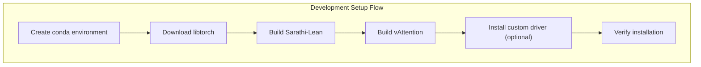
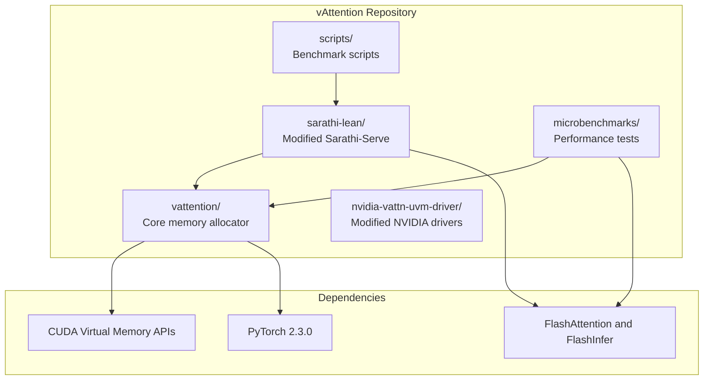
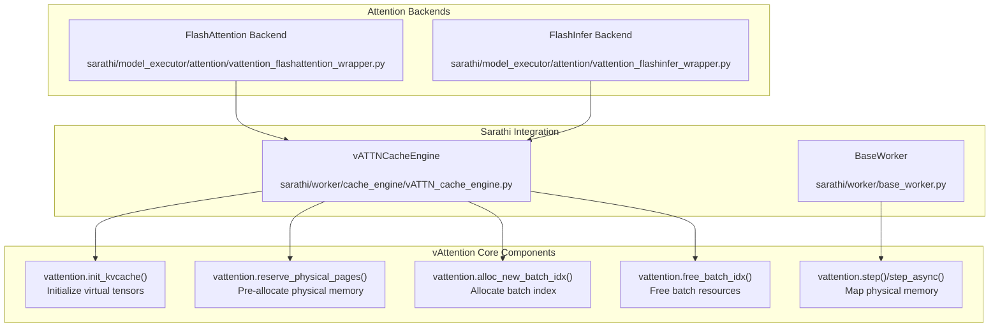
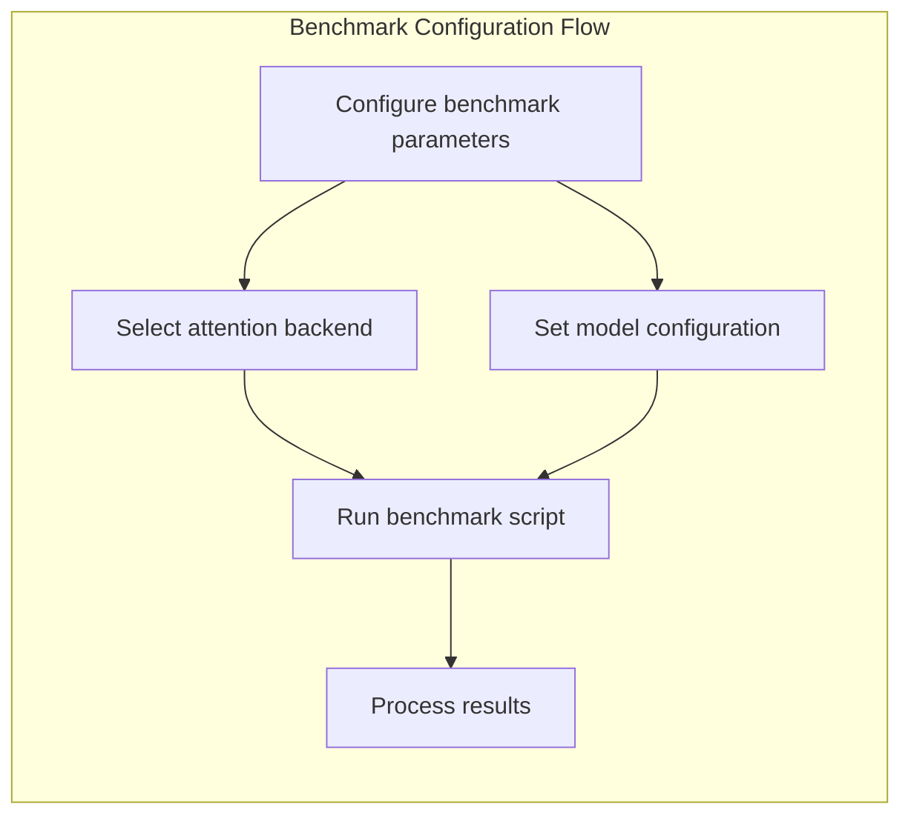

<!-- source: DeepWiki mcp.deepwiki.com · repo microsoft/vattention · page 7 Developer Guide · fetched 2026-10-26 -->

# Developer Guide

<details>
<summary>Relevant source files</summary>

The following files were used as context for generating this wiki page:

- [README.md](README.md)
- [microbenchmarks/perf_attn_kernels/bench_prefill.py](microbenchmarks/perf_attn_kernels/bench_prefill.py)
- [microbenchmarks/perf_attn_kernels/utils.py](microbenchmarks/perf_attn_kernels/utils.py)
- [nvidia-vattn-uvm-driver/README.md](nvidia-vattn-uvm-driver/README.md)

</details>


## Purpose and Scope

This guide provides information for developers who want to contribute to, extend, or use the vAttention memory management system. It covers setting up a development environment, understanding the code architecture, customizing components, and benchmarking performance. For details about using vAttention in production, see [Overview](#1).

## Setting Up Development Environment

### System Requirements

- Linux-based operating system
- CUDA 12.1 or later
- PyTorch 2.3.0
- Python 3.10
- NVIDIA A100 GPUs recommended (other NVIDIA GPUs may work)

### Development Setup Process



#### Step 1: Create Conda Environment

```bash
conda create -n vattn python=3.10
conda activate vattn
```

#### Step 2: Download and Extract LibTorch

```bash
wget https://download.pytorch.org/libtorch/cu121/libtorch-shared-with-deps-2.3.0%2Bcu121.zip
unzip libtorch-shared-with-deps-2.3.0+cu121.zip
```

#### Step 3: Build Sarathi-Lean

```bash
cd sarathi-lean/
pip install -e . --extra-index-url https://flashinfer.ai/whl/cu121/torch2.3/
cd ../
```

#### Step 4: Build vAttention

```bash
cd vattention/
LIBTORCH_PATH=<path to libtorch dir> python setup.py install
cd ../
```

Sources: [README.md:19-43]()

### Custom NVIDIA Driver Installation (Optional)

If you need to use page sizes smaller than 2MB (64KB, 128KB, or 256KB), install the modified NVIDIA UVM driver:

1. Uninstall existing drivers
2. Install NVIDIA driver version 545.23.06 with open-source module enabled
3. Build and deploy custom driver modules
4. Verify installation with test utility

Detailed steps are available in [nvidia-vattn-uvm-driver/README.md]().

Sources: [README.md:84-91](), [nvidia-vattn-uvm-driver/README.md:8-91]()

## Code Architecture

### Repository Structure



Sources: [README.md:7-15]()

### Core Components and Code Entities



Sources: [README.md:146-193]()

## Extending vAttention

### Adding New Attention Backends

To add a new attention backend:

1. Create a new wrapper in `sarathi-lean/sarathi/model_executor/attention/`
2. Implement prefill and decode operations
3. Register the backend in the attention system

| Backend Type | Block/Page Size Recommendation |
|--------------|--------------------------------|
| FlashAttention | 256 |
| FlashInfer | 16 |
| vAttention with FA | 64KB, 128KB, 256KB, 2MB |
| vAttention with FI | 64KB, 128KB, 256KB, 2MB |

Sources: [README.md:76-83]()

### Modifying UVM Driver

For UVM driver changes:

1. Modify code in `nvidia-vattn-uvm-driver/`
2. Build and reinstall using:
   ```bash
   cd vattention/nvidia-vattn-uvm-driver
   sudo ./redeploy_uvm_modules.sh
   ```

Sources: [nvidia-vattn-uvm-driver/README.md:64-72]()

## Running and Customizing Benchmarks

### Available Benchmarks

vAttention includes several benchmark systems:

1. **End-to-end benchmarks**:
   - Dynamic trace benchmark: `scripts/benchmark_e2e_dynamic_trace.py`
   - Static trace benchmark: `scripts/benchmark_e2e_static_trace.py`

2. **Attention kernel benchmarks**:
   - Prefill performance: `microbenchmarks/perf_attn_kernels/bench_prefill.py`

Sources: [README.md:45-72](), [microbenchmarks/perf_attn_kernels/bench_prefill.py:1-26]()

### Benchmark Configuration



Supported attention backends:
- `fa_paged_[block_size]` - FlashAttention with paged memory
- `fi_paged_[block_size]` - FlashInfer with paged memory
- `fa_vattn_[page_size]` - FlashAttention with vAttention
- `fi_vattn_[page_size]` - FlashInfer with vAttention
- `fa_vattn_[page_size]_sync` - FlashAttention with vAttention (synchronous mode)
- `fi_vattn_[page_size]_sync` - FlashInfer with vAttention (synchronous mode)

To configure attention models:

```python
attn_configs = {
    'model_name': {
        'num_heads': 32, 
        'num_kv_heads': 4, 
        'head_dim': 128
    },
}
```

Sources: [README.md:76-83](), [microbenchmarks/perf_attn_kernels/utils.py:1-32]()

## Using vAttention APIs

### Core API Integration

Key vAttention APIs for memory management:

```python
# Initialize KV cache
vattention.init_kvcache(
    num_layers,          # Number of transformer layers
    num_heads,           # Number of attention heads
    head_size,           # Size of each attention head
    max_batch_size,      # Maximum batch size
    max_model_seq_len,   # Maximum sequence length
    device_idx,          # GPU device index
    dtype,               # Data type (e.g., torch.float16)
    page_size            # Memory page size
)

# Reserve physical memory
vattention.reserve_physical_pages(memory_size)

# Allocate batch index for new request
batch_idx = vattention.alloc_new_batch_idx()

# Allocate physical memory (asynchronous)
vattention.step_async(current_sequence_lengths)
# Or synchronous version
vattention.step(current_sequence_lengths)

# Free resources when request completes
vattention.free_batch_idx(batch_idx)
```

Sources: [README.md:146-193]()

## Debugging and Troubleshooting

### Common Issues

| Issue | Solution |
|-------|----------|
| CUDA version mismatch | Ensure you're using CUDA 12.1+ with PyTorch 2.3.0 |
| UVM driver errors | Check kernel logs, verify driver installation with test utility |
| Memory allocation failures | Use synchronous allocation with `step()` instead of `step_async()` |
| GPU out of memory | Increase preallocated physical memory with `reserve_physical_pages()` |

### Performance Optimization

For best performance:

1. Choose appropriate page size:
   - Smaller pages (64KB, 128KB) for dynamic workloads with many short requests
   - Larger pages (256KB, 2MB) for more static workloads with fewer long requests

2. Select optimal attention backend:
   - FlashAttention with block size 256 for general use
   - FlashInfer with block size 16 for specialized workloads

3. Consider using asynchronous memory allocation (`step_async()`) to overlap memory management with computation

Sources: [README.md:82-83]()

## Contributing to vAttention

For contributing code to vAttention:

1. Set up the development environment as described above
2. Make changes to the appropriate components
3. Test changes using provided benchmark scripts
4. Document any API changes or new features

Sources: [README.md:194-206]()