# Page: Overview

# Overview

<details>
<summary>Relevant source files</summary>

The following files were used as context for generating this wiki page:

- [README.md](README.md)
- [nvidia-vattn-uvm-driver/README.md](nvidia-vattn-uvm-driver/README.md)
- [sarathi-lean/README.md](sarathi-lean/README.md)
- [scripts/artifact_asplos25/.gitignore](scripts/artifact_asplos25/.gitignore)
- [scripts/artifact_asplos25/README.md](scripts/artifact_asplos25/README.md)

</details>


## Purpose and Scope

This document provides an introduction to vAttention, a memory management system for key-value (KV) caches in Large Language Model (LLM) inference. vAttention optimizes GPU memory usage through a novel approach that decouples virtual and physical memory allocation, enabling more efficient LLM serving compared to alternatives like PagedAttention. This overview explains the core concepts, architecture, and components of the vAttention system.

For detailed information about specific subsystems, refer to:
- [vAttention Core System](#2)
- [Sarathi-Lean Integration](#3)
- [POD-Attention](#4)
- [Benchmarking Framework](#5)

Sources: [README.md:1-206]()

## What is vAttention?

vAttention is a memory manager specifically designed for KV-cache in LLM serving systems. It introduces a novel approach to memory management by leveraging CUDA virtual memory APIs to separate the allocation of virtual and physical memory. This approach allows:

1. Allocation of physical memory on demand while maintaining contiguous KV-cache in virtual memory
2. Support for dynamic memory allocation with unmodified attention kernels
3. Improved performance over PagedAttention, especially for prefill-bound workloads

Unlike PagedAttention, which implements demand paging in user space and requires custom kernels, vAttention provides a simpler, more portable solution that can work with existing kernels while delivering competitive or superior performance.


Sources: [README.md:1-4](), [README.md:144-191]()

## System Architecture

vAttention's architecture consists of several interconnected components that work together to provide efficient memory management for LLM inference. The following diagram illustrates the high-level system architecture:

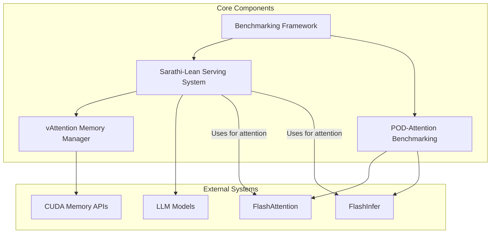

### Key Components

1. **vAttention Memory Manager**: The core component that provides memory management functionality through the CUDA virtual memory APIs.

2. **Sarathi-Lean Serving System**: A modified version of Sarathi-Serve that integrates with vAttention for memory management during LLM inference.

3. **POD-Attention**: A specialized attention implementation that optimizes performance by fusing prefill and decode operations.

4. **Benchmarking Framework**: A comprehensive evaluation system for measuring the performance of different attention mechanisms and memory management strategies.

Sources: [README.md:8-15]()

## Data Flow

The following diagram illustrates how data flows through the vAttention system during the LLM inference process:

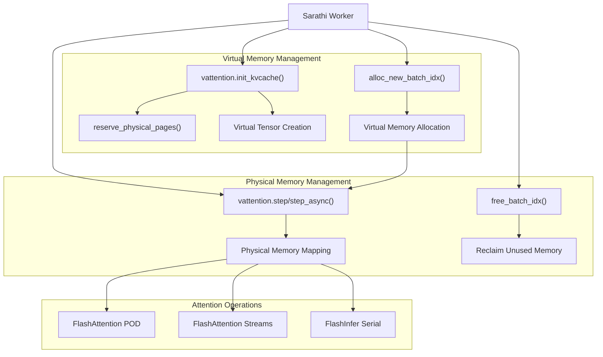

The data flow consists of several key operations:

1. **Initialization**: The system initializes the KV-cache with `vattention.init_kvcache()`, which creates virtual tensors without physical memory.

2. **Memory Reservation**: Physical memory pages can be reserved ahead of time with `reserve_physical_pages()`.

3. **Request Allocation**: When a new request arrives, `alloc_new_batch_idx()` assigns it a batch index for KV-cache placement.

4. **Memory Mapping**: Before model execution, `vattention.step()` or `vattention.step_async()` maps physical memory to the virtual addresses.

5. **Memory Reclamation**: When requests complete, `free_batch_idx()` allows reclamation of their physical memory.

Sources: [README.md:149-191]()

## Integration with Sarathi-Lean

vAttention integrates with Sarathi-Lean through a set of APIs that manage KV-cache allocation and deallocation. The following diagram shows this integration:

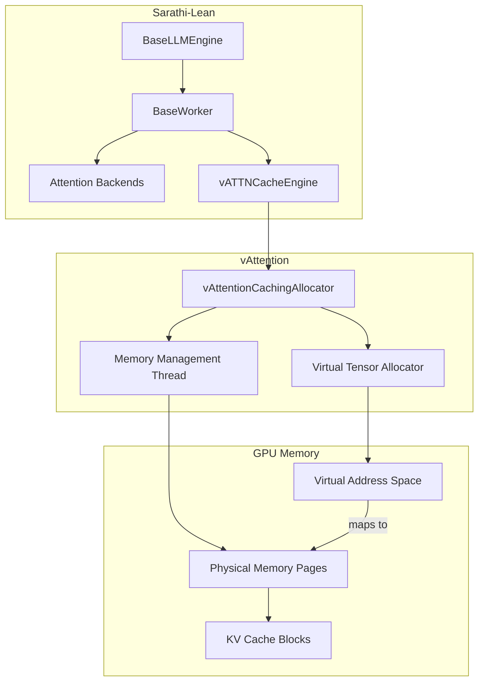

The integration works as follows:

1. The `vATTNCacheEngine` initializes vAttention and manages aspects of KV-cache in Python (mapping sequence IDs to batch indices and tracking context lengths).

2. Before model forward pass, the `BaseWorker` calls `vattention.step_async()` or `vattention.step()` to allocate physical memory.

3. After the forward pass, the worker calls `vattention.free_batch_idx()` for completed requests.

This integration allows Sarathi-Lean to leverage vAttention's memory management capabilities while maintaining its serving infrastructure.

Sources: [README.md:146-191]()

## Attention Backends

vAttention supports multiple attention computation backends, providing flexibility in how attention operations are performed. The main backends are:

| Backend | Description | Implementation |
|---------|-------------|----------------|
| FlashAttention vAttention | Uses FlashAttention for both prefill and decode with vAttention memory management | [sarathi-lean/sarathi/model_executor/attention/vattention_flashattention_wrapper.py]() |
| FlashInfer vAttention | Uses FlashInfer for prefill and FlashAttention for decode with vAttention memory management | [sarathi-lean/sarathi/model_executor/attention/vattention_flashinfer_wrapper.py]() |
| FlashAttention Paged | Uses FlashAttention with PagedAttention memory management | Various block sizes (16, 256) |
| FlashInfer Paged | Uses FlashInfer with PagedAttention memory management | Various block sizes (16, 256) |

These backends can be configured with different page sizes for vAttention (64KB, 128KB, 256KB, 2MB) and different block sizes for paged attention.

Sources: [README.md:76-86]()

## Repository Structure

The vAttention repository is organized into the following main components:

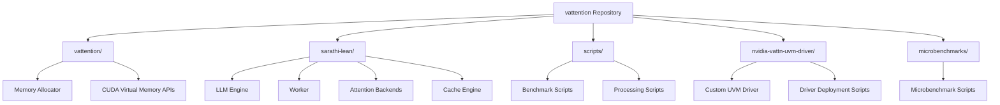

| Component | Description |
|-----------|-------------|
| `vattention/` | Core memory allocator implementation |
| `sarathi-lean/` | Modified version of Sarathi-Serve with vAttention integration |
| `scripts/` | Scripts for running experiments and benchmarks |
| `nvidia-vattn-uvm-driver/` | Custom NVIDIA UVM drivers for smaller page sizes |
| `microbenchmarks/` | Scripts for running microbenchmarks |

Sources: [README.md:8-15]()

## Benchmarking

vAttention includes a comprehensive benchmarking framework to evaluate its performance against alternatives like PagedAttention. The benchmarking system consists of several components:

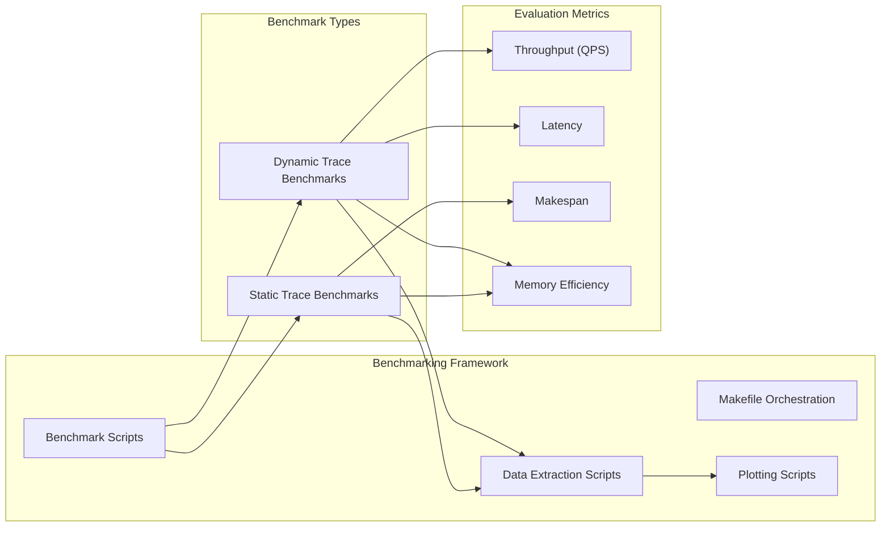

The benchmarking framework provides:

1. **Dynamic trace benchmarks**: Evaluate performance with dynamically arriving requests (e.g., Poisson distribution).
2. **Static trace benchmarks**: Evaluate performance with batched requests.
3. **OpenAI-compatible API**: For benchmarking with external tools like metron.

The benchmarks can be configured with different models, attention backends, and workload parameters to comprehensively evaluate performance.

Sources: [README.md:45-140](), [scripts/artifact_asplos25/README.md:1-34]()

## Getting Started

To use vAttention, you need:

1. **Prerequisites**: PyTorch 2.3.0, CUDA 12.1+, Python 3.10, Linux kernel, A100 GPUs

2. **Installation**:
   - Create and activate a conda environment
   - Install libtorch dependencies
   - Build and install sarathi-lean and vattention

3. **Running benchmarks**:
   - Configure benchmark settings in scripts
   - Run dynamic or static trace benchmarks
   - Process and visualize results

For smaller page sizes (64KB, 128KB, 256KB), you also need to install the custom NVIDIA UVM driver.

Sources: [README.md:17-44](), [nvidia-vattn-uvm-driver/README.md:1-91]()

## Summary

vAttention represents a novel approach to memory management for LLM inference that provides both performance and ease of integration. By decoupling virtual and physical memory allocation, it enables efficient use of GPU memory without requiring custom attention kernels. The system integrates with Sarathi-Lean for LLM serving and supports various attention backends like FlashAttention and FlashInfer. The comprehensive benchmarking framework allows for thorough evaluation of its performance across different workloads and configurations.

Sources: [README.md:1-206]()

---

# Page: vAttention Core System

# vAttention Core System

<details>
<summary>Relevant source files</summary>

The following files were used as context for generating this wiki page:

- [vattention/cudaInternal.h](vattention/cudaInternal.h)
- [vattention/utils.h](vattention/utils.h)
- [vattention/vattention.cu](vattention/vattention.cu)
- [vattention/vtensor.h](vattention/vtensor.h)

</details>


## Purpose and Scope

This document describes the core vAttention memory management system architecture, which optimizes GPU memory usage during LLM inference by separating virtual and physical memory allocation for key-value (KV) caches. This document focuses on the internal workings of the memory manager itself, not its integration with serving systems. For information about how vAttention integrates with Sarathi-Lean, see [Sarathi-Lean Integration](#3).

Sources: [vattention/vattention.cu:27-610]()

## System Architecture Overview

vAttention employs a virtual memory management approach that decouples virtual address space allocation from physical memory allocation. This allows for efficient memory utilization by allocating physical memory only when needed, while maintaining contiguous virtual memory for key-value caches.

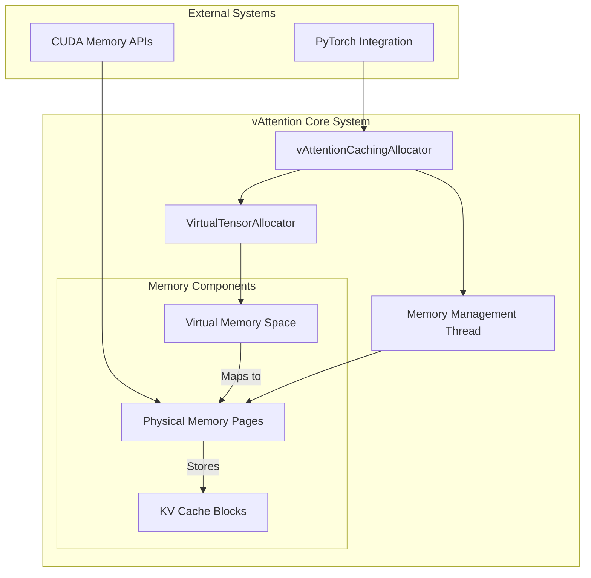

Sources: [vattention/vattention.cu:27-127](), [vattention/vtensor.h:9-63]()

## Core Components

### vAttentionCachingAllocator

The central class that manages the KV cache memory allocation and deallocation. It handles both virtual memory allocation through the VirtualTensorAllocator and physical memory mapping through CUDA APIs.

Key responsibilities:
- Initialize and configure KV cache memory parameters
- Allocate virtual tensors for KV cache
- Map physical memory pages to virtual addresses
- Reclaim unused memory when needed
- Manage request lifecycles (allocation and freeing)

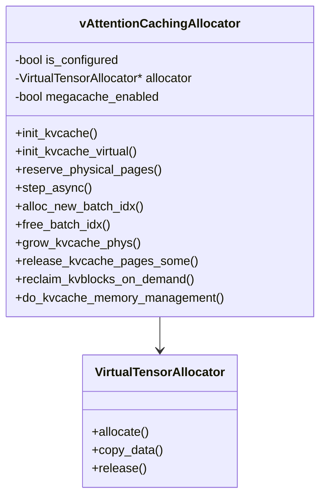

Sources: [vattention/vattention.cu:27-610](), [vattention/vtensor.h:9-63]()

### Virtual Tensor Allocation

vAttention uses a custom tensor allocator that creates virtual memory space without immediately backing it with physical memory. This allocator extends PyTorch's `at::Allocator` to create virtual tensors that can be used like regular PyTorch tensors.

Key features:
- Reserves virtual memory addresses using CUDA VM APIs
- Integrates with PyTorch's tensor system
- Supports both regular CUDA and UVM backends

Sources: [vattention/vtensor.h:9-125]()

## Memory Management Workflow

### Initialization Phase

The initialization process configures the vAttention system with model-specific parameters and allocates virtual memory for KV caches.

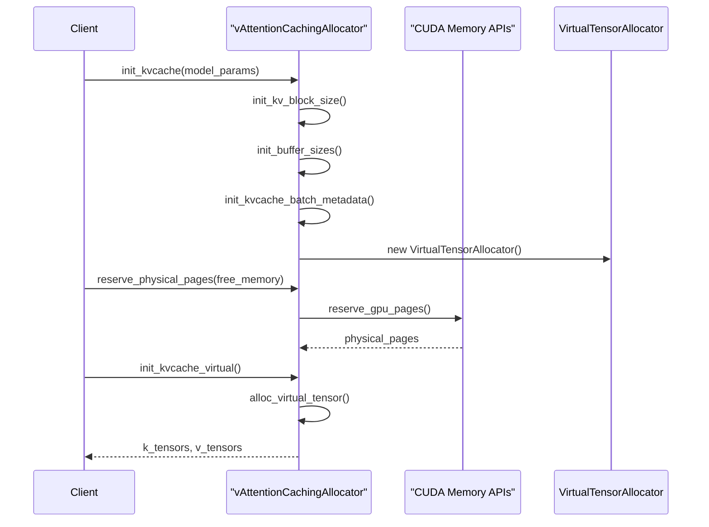

Sources: [vattention/vattention.cu:97-192](), [vattention/cudaInternal.h:15-68]()

### Memory Allocation Process

vAttention allocates physical memory on demand as inference progresses:

1. Client calls `step_async` with sequence lengths for all requests
2. System synchronously maps physical memory for immediate needs (prefill)
3. A background thread asynchronously prepares memory for future steps
4. When memory is scarce, the system reclaims memory from inactive or less important requests

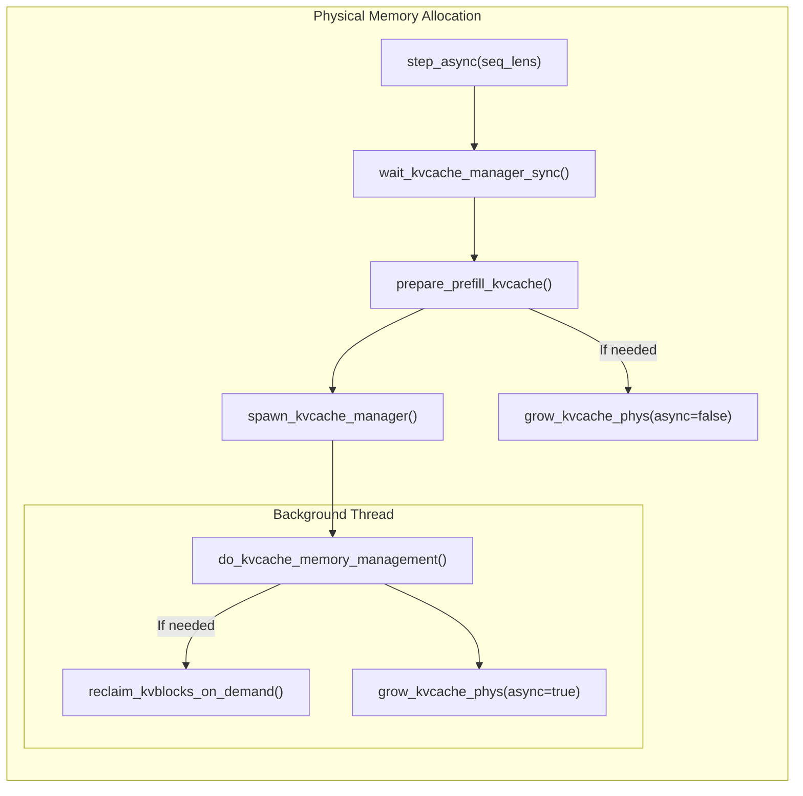

Sources: [vattention/vattention.cu:375-558]()

### Memory Reclamation Strategies

vAttention employs different strategies to reclaim memory:

1. **Eager Reclamation**: Free memory from inactive requests immediately (`release_kvcache_pages_all`)
2. **On-demand Reclamation**: Reclaim memory only when needed for new allocations (`reclaim_kvblocks_on_demand`)
3. **Deferred Reclamation**: Gradually reclaim memory in the background thread (`do_reclaim_pages`)

The system prioritizes reclaiming memory from:
- Inactive requests (where `seq_len` is 0)
- Requests with more allocated memory than required
- Higher request IDs (indicating lower priority)

Sources: [vattention/vattention.cu:420-469]()

## Memory Mapping Mechanism

vAttention uses CUDA's virtual memory management APIs to map physical pages to virtual addresses:

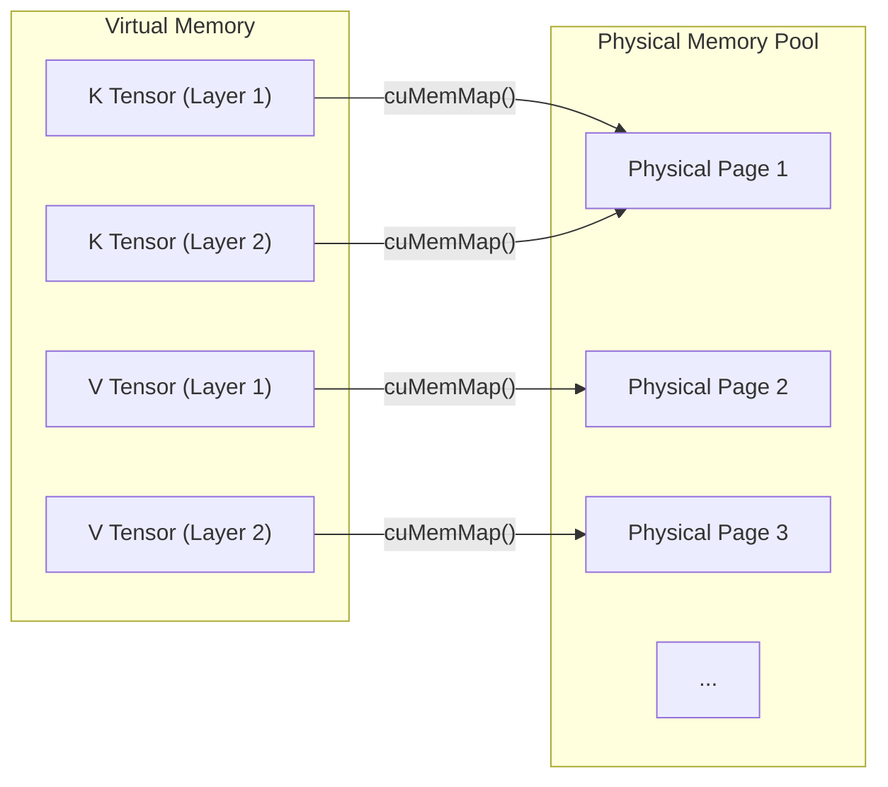

Key operations:
- **Mapping**: `MAP_PAGES` maps physical pages to virtual addresses using `cuMemMap` and `cuMemSetAccess`
- **Unmapping**: `UNMAP_PAGES` releases physical pages using `cuMemUnmap`
- **Tracking**: A pagemap tracks which physical pages are mapped to which virtual addresses

Sources: [vattention/cudaInternal.h:70-94]()

## Request Lifecycle Management

vAttention manages the lifecycle of requests through batch indices:

1. **Allocation**: `alloc_new_batch_idx` assigns an inactive request ID to a new request
2. **Active Use**: Memory is allocated as needed during processing
3. **Deallocation**: `free_batch_idx` marks a request as inactive, allowing its memory to be reclaimed

The system uses a best-fit approach when allocating new request IDs, preferring request slots that already have some allocated memory to minimize new allocations.

Sources: [vattention/vattention.cu:564-594]()

## Configuration Parameters

vAttention can be configured with several parameters that affect its behavior:

| Parameter | Description | Default |
|-----------|-------------|---------|
| `num_layers` | Number of transformer layers in the model | - |
| `num_kv_heads` | Number of attention heads for key and value | - |
| `head_size` | Size of each attention head | - |
| `max_batch_size` | Maximum number of concurrent requests | - |
| `max_context_length` | Maximum sequence length for a request | - |
| `page_size` | Size of physical memory pages | 2MB |
| `megacache_enabled` | Whether to use a unified cache for all layers | false |
| `deferred_reclaim` | Whether to reclaim memory proactively | true |

Sources: [vattention/utils.h:43-81](), [vattention/vattention.cu:97-119]()

## Megacache Mode

vAttention supports two modes of operation:

1. **Standard Mode**: Each layer has its own separate KV cache
2. **Megacache Mode**: All layers share a single unified KV cache

Megacache mode changes how memory is allocated and accessed, affecting the shape of tensors and the calculation of memory requirements.

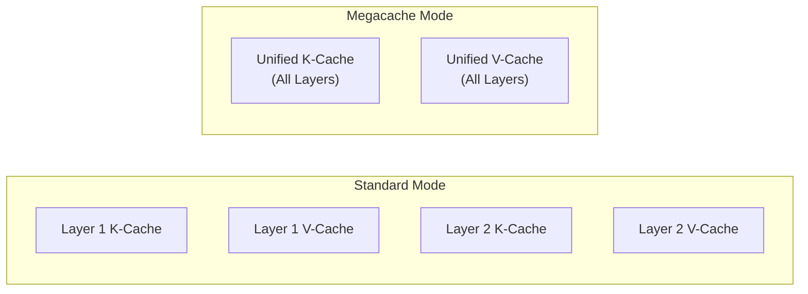

Sources: [vattention/vattention.cu:53-70](), [vattention/vattention.cu:146-182]()

## Memory Management Optimizations

vAttention implements several optimizations to improve memory efficiency:

1. **Proactive Allocation**: Memory is allocated ahead of time for future steps (`EAGER_NUM_STEPS`, `EAGER_NUM_KVBLOCKS`)
2. **Best-fit Request Assignment**: New requests are assigned to slots that already have suitable memory allocated
3. **Balanced Reclamation**: Memory is reclaimed gradually to avoid impact on serving latency
4. **Overcommitment Tracking**: The system tracks memory that can be repurposed without additional allocation

Sources: [vattention/vattention.cu:486-536](), [vattention/utils.h:177-183]()

## Public API

vAttention exposes the following key APIs:

| API | Description |
|-----|-------------|
| `init_kvcache` | Initialize the KV cache system |
| `reserve_physical_pages` | Reserve physical memory pages for KV cache |
| `step_async` | Allocate memory for the current step and prepare for future steps |
| `alloc_new_batch_idx` | Allocate a batch index for a new request |
| `free_batch_idx` | Free a batch index when a request is complete |
| `cleanup` | Release all resources |

Sources: [vattention/vattention.cu:612-637]()

## Integration with External Systems

vAttention is designed to be integrated with LLM serving systems. The core system provides the memory management infrastructure, while integration with specific serving frameworks and attention mechanisms is handled by separate components. For details on integration with Sarathi-Lean, see [Sarathi-Lean Integration](#3).

Sources: [vattention/vattention.cu:612-637]()

---

# Page: Memory Management Architecture

# Memory Management Architecture

<details>
<summary>Relevant source files</summary>

The following files were used as context for generating this wiki page:

- [vattention/cudaInternal.h](vattention/cudaInternal.h)
- [vattention/utils.h](vattention/utils.h)
- [vattention/vattention.cu](vattention/vattention.cu)
- [vattention/vtensor.h](vattention/vtensor.h)

</details>


## Purpose and Scope

This document details the memory management architecture of vAttention, which provides efficient and dynamic memory allocation for LLM inference. The system implements a virtual memory abstraction layer over physical GPU memory to optimize KV cache usage, allowing for efficient memory sharing and reclamation between concurrent requests.

For information about the API interfaces to this system, see [vAttention APIs](#2.2).

## Core Memory Management Concepts

vAttention's memory management is built around separating virtual address spaces from physical memory pages. This separation enables:

1. Contiguous virtual tensors for efficient attention operations
2. On-demand physical memory allocation
3. Dynamic memory reclamation when resources are needed
4. Sharing of physical memory between requests

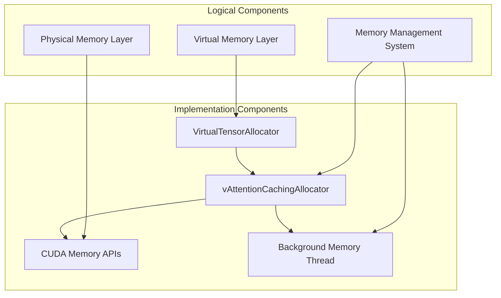

Sources: [vattention/vattention.cu:27-610](), [vattention/vtensor.h:9-63]()

## Memory Architecture Overview

The vAttention memory system consists of two primary layers:

1. **Virtual Memory Layer**: Manages a contiguous virtual address space for KV cache tensors
2. **Physical Memory Layer**: Manages physical GPU memory pages that back the virtual address space

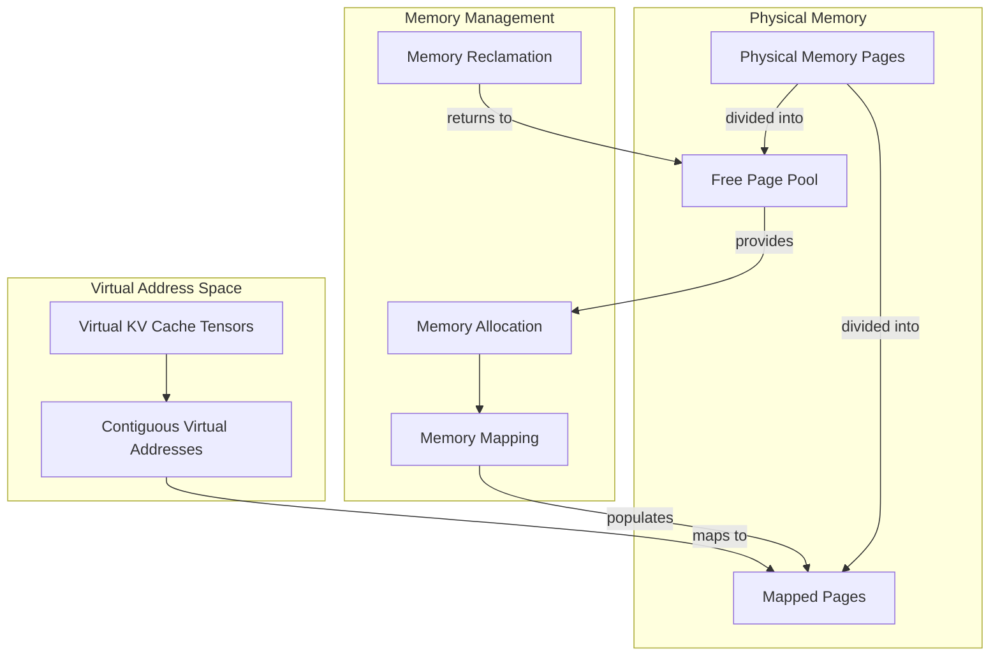

Sources: [vattention/vattention.cu:189-192](), [vattention/cudaInternal.h:45-59]()

## Key Components

### VirtualTensorAllocator

This component handles allocation of virtual memory for tensors:

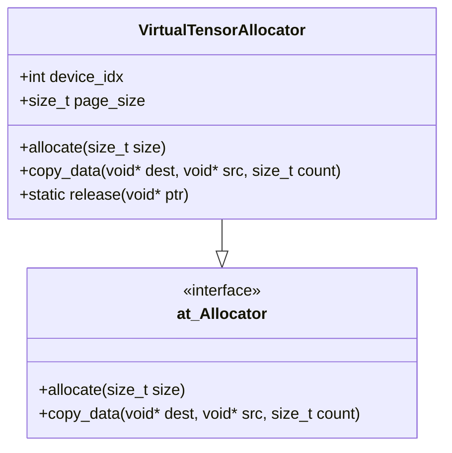

Key responsibilities:
- Reserves contiguous virtual address space using CUDA APIs
- Creates PyTorch tensors that use this virtual address space
- Maintains alignment with the configured page size

Sources: [vattention/vtensor.h:9-63]()

### vAttentionCachingAllocator

This is the central component that manages the entire memory system:

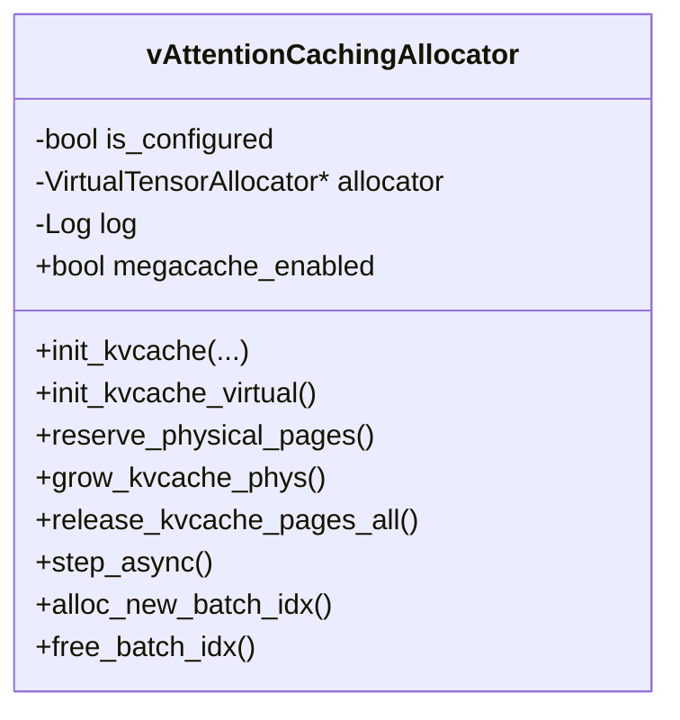

Key responsibilities:
- Initializes the KV cache configuration
- Manages virtual tensor allocation
- Controls physical page reservation and mapping
- Handles memory reclamation
- Provides APIs for request lifecycle management

Sources: [vattention/vattention.cu:27-610]()

## Memory Management Lifecycle

### Initialization

Initialization of the memory management system involves setting up both virtual and physical memory:

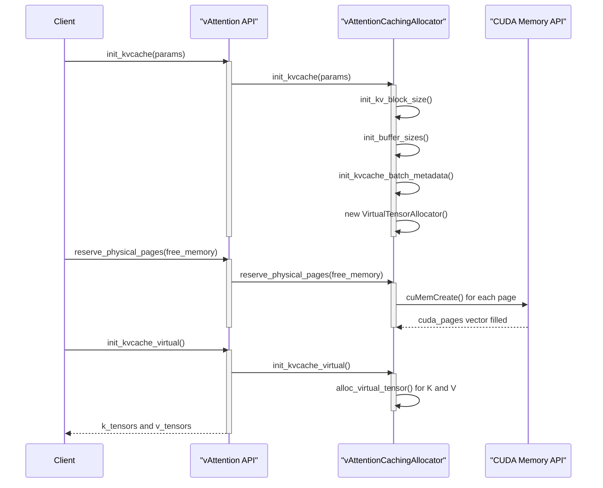

During initialization:
1. The system configures KV cache parameters (size, shape, etc.)
2. Physical memory pages are reserved using CUDA memory APIs
3. Virtual tensors are allocated for both key and value caches

Sources: [vattention/vattention.cu:97-127](), [vattention/vattention.cu:142-187](), [vattention/vattention.cu:189-192]()

### Request Allocation and Memory Mapping

When a new request is added to the system, memory is allocated and mapped:

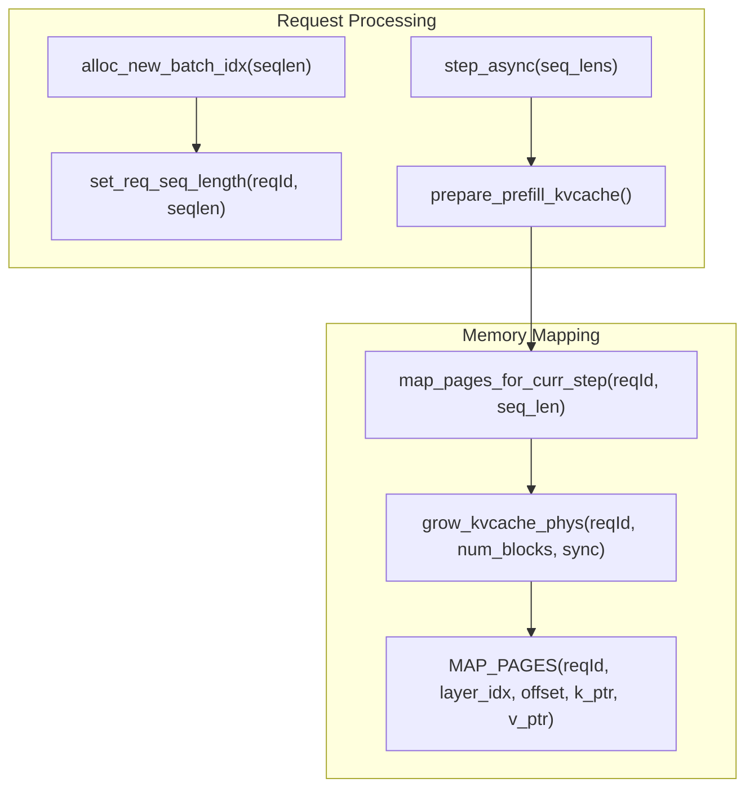

The mapping process:
1. A batch index is allocated for the new request
2. Required memory is calculated based on sequence length
3. Physical pages are mapped to the virtual address space
4. For each layer, both key and value cache pages are mapped

Sources: [vattention/vattention.cu:564-589](), [vattention/vattention.cu:376-392](), [vattention/vattention.cu:268-323]()

### Memory Reclamation

vAttention implements several reclamation strategies:

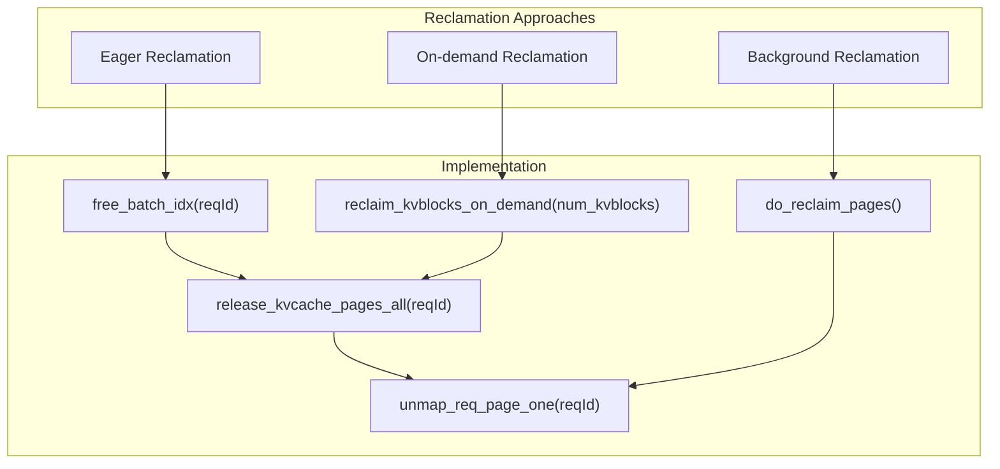

The system uses multiple strategies for reclaiming memory:
1. **Eager Reclamation**: When a request completes, all its memory is immediately reclaimed
2. **On-demand Reclamation**: When memory is needed for new requests, it's reclaimed from lower-priority requests
3. **Background Reclamation**: A background thread continuously reclaims unused memory

Sources: [vattention/vattention.cu:243-247](), [vattention/vattention.cu:420-438](), [vattention/vattention.cu:444-469]()

## Asynchronous Memory Management

vAttention uses asynchronous memory management to optimize latency and throughput:

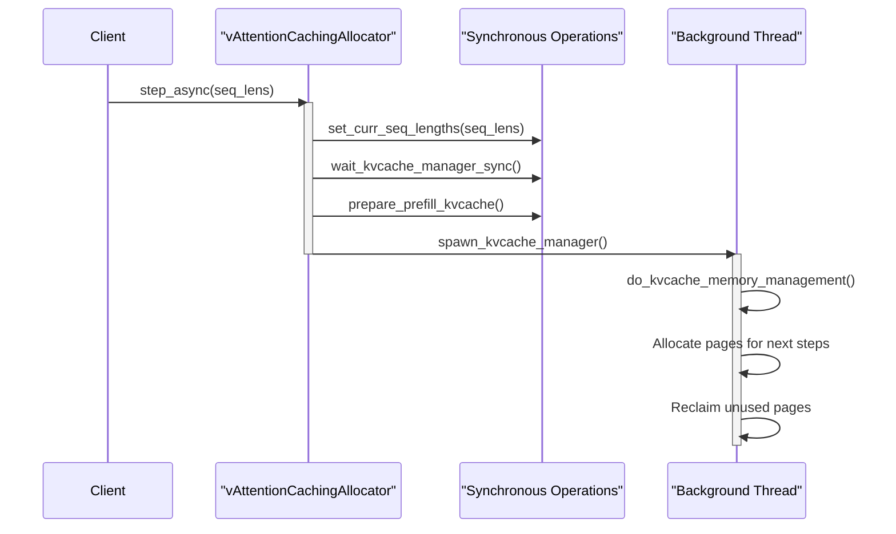

Key aspects of asynchronous management:
1. Critical operations like prefill are handled synchronously
2. Future token allocations are handled asynchronously
3. Background thread manages memory proactively for next steps
4. Reclamation occurs when the system is not under load

Sources: [vattention/vattention.cu:549-558](), [vattention/vattention.cu:488-536](), [vattention/vattention.cu:538-546]()

## Physical Memory Backends

vAttention supports multiple physical memory backends:

```mermaid
flowchart TD
    subgraph "Memory Backend Selection"
        init["do_cuda_init(device, page_size)"]
        is_uvm{"is_uvm_backend(page_size)?"}
        uvm_init["do_cuda_uvm_init()"]
        cuda_init["do_cuda_default_init()"]
    end
    
    init --> is_uvm
    is_uvm -->|"Yes"| uvm_init
    is_uvm -->|"No"| cuda_init
    
    subgraph "CUDA Backend"
        cuMemCreate["cuMemCreate()"]
        cuMemMap["cuMemMap()"]
        cuMemSetAccess["cuMemSetAccess()"]
    end
    
    subgraph "UVM Backend"
        cudaMallocManaged["cudaMallocManaged()"]
        uvm_functions["UVM-specific Functions"]
    end
    
    cuda_init --> cuMemCreate
    cuda_init --> cuMemMap
    cuda_init --> cuMemSetAccess
    
    uvm_init --> cudaMallocManaged
    uvm_init --> uvm_functions
```

The system supports two primary backends:
1. **Standard CUDA Memory**: Uses CUDA virtual memory APIs for discrete GPUs
2. **Unified Virtual Memory (UVM)**: For specialized hardware with unified memory capabilities

The backend selection is determined by the page size parameter, with 2MB being the default for standard CUDA memory.

Sources: [vattention/cudaInternal.h:15-43](), [vattention/utils.h:83-86](), [vattention/vtensor.h:35-44]()

## Memory Sizing and Configuration

vAttention calculates memory requirements based on model and system parameters:

| Parameter | Description | Configuration |
|-----------|-------------|---------------|
| `num_layers` | Number of transformer layers | Model-specific |
| `num_kv_heads` | Number of key-value attention heads | Model-specific |
| `head_size` | Dimension of each attention head | Model-specific |
| `max_batch_size` | Maximum concurrent requests | System-specific |
| `max_context_length` | Maximum sequence length | System-specific |
| `page_size` | Physical memory page size | Default: 2MB |
| `tokens_per_page` | Number of tokens per physical page | Calculated |

The system calculates derived values:
- `virt_buff_size_per_token`: Memory required per token
- `virt_buff_size_per_req`: Memory required per request
- `max_pages_per_req`: Maximum pages per request
- `virt_buff_size`: Total virtual buffer size

Sources: [vattention/vattention.cu:49-73](), [vattention/utils.h:43-81]()

## Memory Mapping Mechanism

The core of vAttention's memory management is the mapping between virtual and physical memory:

```mermaid
flowchart TD
    subgraph "Virtual Tensors"
        k_tensors["k_tensors (Key Cache)"]
        v_tensors["v_tensors (Value Cache)"]
    end
    
    subgraph "Mapping Process"
        cudaPhysPageMap["cuda_pagemap Dictionary"]
        map_op["MAP_PAGES Macro"]
        cuMemMap["cuMemMap API"]
        cuMemSetAccess["cuMemSetAccess API"]
    end
    
    subgraph "Physical Memory"
        cuda_pages["cuda_pages Vector"]
        physical["Physical GPU Memory"]
    end
    
    k_tensors -->|"virtual address"| map_op
    v_tensors -->|"virtual address"| map_op
    cuda_pages -->|"physical handle"| map_op
    
    map_op --> cuMemMap
    map_op --> cuMemSetAccess
    map_op --> cudaPhysPageMap
    
    cuMemMap -->|"establishes mapping"| physical
    cuMemSetAccess -->|"sets permissions"| physical
    cudaPhysPageMap -->|"tracks mapping"| physical
```

The mapping process involves:
1. Obtaining virtual addresses from tensor data pointers
2. Getting physical page handles from the free page pool
3. Using CUDA APIs to map physical pages to virtual addresses
4. Tracking mappings in a dictionary for later unmapping

Sources: [vattention/cudaInternal.h:70-82](), [vattention/vattention.cu:268-323]()

## Conclusion

vAttention's memory management architecture provides an efficient solution for LLM inference by:
1. Separating virtual and physical memory concerns
2. Enabling dynamic allocation and reclamation of memory
3. Optimizing memory usage through sharing and on-demand allocation
4. Supporting both synchronous and asynchronous operation

This architecture allows for efficient handling of concurrent requests with variable sequence lengths, maximizing GPU memory utilization while maintaining high performance.

---

# Page: vAttention APIs

# vAttention APIs

<details>
<summary>Relevant source files</summary>

The following files were used as context for generating this wiki page:

- [vattention/cudaInternal.h](vattention/cudaInternal.h)
- [vattention/vattention.cu](vattention/vattention.cu)

</details>


This document provides detailed documentation of the public APIs provided by the vAttention memory management system. These interfaces allow LLM serving systems to efficiently manage GPU memory for key-value (KV) caches during inference. For information about the overall memory management architecture, see [Memory Management Architecture](#2.1).

## API Overview

The vAttention system exposes several categories of APIs for different purposes:

```mermaid
flowchart TD
    subgraph "vAttention API Categories"
        init["Initialization APIs"]
        memory["Memory Management APIs"]
        request["Request Management APIs"]
        config["Configuration APIs"]
        query["Query APIs"]
        debug["Debugging APIs"]
    end

    client["Client System (e.g., Sarathi-Lean)"] --> init
    init --> memory
    client --> request
    request --> memory
    client --> config
    client --> query
    client --> debug
    
    init --> |"1. First steps"| reserve["reserve_physical_pages()\ninit_kvcache()"]
    memory --> |"2. Per iteration"| step["step_async()"]
    request --> |"3. Per request"| reqops["alloc_new_batch_idx()\nfree_batch_idx()"]
    memory --> reclaim["Background Memory\nReclamation Thread"] 
```

Sources: [vattention/vattention.cu:614-637]()

## Initialization APIs

These APIs must be called during system startup to configure and initialize the vAttention memory system.

### init_kvcache

Initializes the KV cache with model parameters and creates virtual tensors.

**Parameters:**
- `num_layers`: Number of layers in the model
- `num_kv_heads`: Number of key-value heads
- `head_size`: Size of each head
- `max_batch_size`: Maximum batch size 
- `max_context_length`: Maximum context length
- `device`: GPU device ID
- `dtype`: Data type for the KV cache
- `page_size`: Size of memory pages (in bytes)
- `megacache`: Boolean flag for enabling megacache mode

**Function call flow:**

```mermaid
sequenceDiagram
    participant C as Client
    participant V as "vAttention"
    
    C->>V: init_kvcache(num_layers, num_kv_heads, ...)
    Note over V: Set configuration parameters
    V->>V: init_kv_block_size()
    Note over V: Calculate tokens per page
    V->>V: init_buffer_sizes()
    Note over V: Calculate virtual buffer sizes
    V->>V: init_kvcache_batch_metadata()
    Note over V: Initialize batch tracking
    V->>V: Create VirtualTensorAllocator
    V-->>C: Return
```

Sources: [vattention/vattention.cu:97-128]()

### reserve_physical_pages

Reserves physical memory blocks for the KV cache. This should be called after `init_kvcache`.

**Parameters:**
- `free_memory`: Amount of memory to reserve (in bytes)

**Returns:**
- Number of physical pages reserved

Sources: [vattention/vattention.cu:189-192](), [vattention/cudaInternal.h:45-59]()

### cleanup

Releases allocator resources and cleans up the vAttention system. Should be called during shutdown.

**Parameters:** None

Sources: [vattention/vattention.cu:602-609]()

## Memory Management APIs

### step_async

The core API for memory management, called once per inference step. Allocates memory for the current step synchronously and future steps asynchronously.

**Parameters:**
- `seq_lens`: Vector of sequence lengths for each active request

**Implementation details:**
1. Updates current sequence lengths
2. Synchronizes with background memory manager
3. Allocates memory for prefill phase if needed
4. Spawns background thread for future memory management

```mermaid
flowchart TD
    step["step_async(seq_lens)"] --> update["Set current sequence lengths"]
    update --> sync["Wait for background thread to finish"]
    sync --> prefill["prepare_prefill_kvcache()\nAllocate memory for current step"]
    prefill --> spawn["Spawn background memory manager thread"]
    spawn --> return["Return to client"]
    
    subgraph "Background Thread"
        bg_thread["do_kvcache_memory_management()"]
        bg_thread --> check["Check if new pages required"]
        check --> reclaim["Reclaim memory if needed"]
        reclaim --> alloc["Pre-allocate for future steps"]
    end
```

Sources: [vattention/vattention.cu:549-558](), [vattention/vattention.cu:488-536]()

### step

Synchronous version of memory management, primarily for testing purposes.

**Parameters:**
- `seq_lens`: Vector of sequence lengths for each request
- `eager_reclaim`: Boolean flag for eager memory reclamation

Sources: [vattention/vattention.cu:395-409]()

## Request Management APIs

### alloc_new_batch_idx

Allocates a new batch index for a request using best-fit allocation strategy.

**Parameters:**
- `seqlen`: Initial sequence length for the request

**Returns:**
- Batch index allocated, or -1 if no index is available

**Implementation details:**
- Searches for an inactive request ID
- Uses best-fit allocation to find a request slot with pages already mapped
- Sets the sequence length for the selected request ID

Sources: [vattention/vattention.cu:564-589]()

### free_batch_idx

Frees a batch index, making it available for reuse.

**Parameters:**
- `reqId`: Batch index to free

Sources: [vattention/vattention.cu:591-594]()

## Configuration APIs

### set_verbose

Enables or disables verbose logging.

**Parameters:**
- `val`: Boolean flag for enabling verbose logging

Sources: [vattention/vattention.cu:624]()

### set_deferred_reclamation

Enables or disables deferred memory reclamation. When enabled, memory is not reclaimed immediately, allowing for potential reuse.

**Parameters:**
- `val`: Boolean flag for enabling deferred reclamation

Sources: [vattention/vattention.cu:596-599](), [vattention/vattention.cu:625]()

## Query APIs

### num_free_kvblocks

Returns the number of free KV blocks available for allocation.

**Returns:**
- Number of free KV blocks

Sources: [vattention/vattention.cu:207-210](), [vattention/vattention.cu:636]()

## Debugging APIs

### show_kvcache_config

Shows the current KV cache configuration.

Sources: [vattention/vattention.cu:130-140](), [vattention/vattention.cu:627]()

### show_allocator_state

Shows the current state of the allocator, including free memory and allocation per request.

Sources: [vattention/vattention.cu:76-95](), [vattention/vattention.cu:628]()

## Memory Management Internals

The following diagram illustrates the internal memory management process in vAttention:

```mermaid
flowchart TD
    subgraph "Memory Management Internals"
        direction LR
        step_async["step_async()"] --> prefill["prepare_prefill_kvcache()"]
        prefill --> req1["map_pages_for_curr_step()"]
        prefill --> req2["map_pages_for_curr_step()"]
        prefill --> req3["map_pages_for_curr_step()"]
        
        req1 --> grow1["grow_kvcache_phys()"]
        req2 --> grow2["grow_kvcache_phys()"]
        req3 --> grow3["grow_kvcache_phys()"]
        
        grow1 --> map1["map_cuda_pages()"]
        grow2 --> map2["map_cuda_pages()"]
        grow3 --> map3["map_cuda_pages()"]
        
        step_async --> bg["Background Thread"]
        bg --> reclaim["reclaim_kvblocks_on_demand()"]
        bg --> future["Pre-allocate for future steps"]
    end
```

Sources: [vattention/vattention.cu:375-392](), [vattention/vattention.cu:268-323](), [vattention/cudaInternal.h:70-82]()

## API Integration Example

The following diagram illustrates how a serving system like Sarathi-Lean would interact with vAttention APIs during inference:

```mermaid
sequenceDiagram
    participant Client as "Client"
    participant Server as "Serving System"
    participant vA as "vAttention"
    
    Note over Server: Initialization
    Server->>vA: init_kvcache(...)
    Server->>vA: reserve_physical_pages(...)
    
    Note over Server: New Request
    Client->>Server: Submit Prompt
    Server->>vA: alloc_new_batch_idx(prompt_len)
    vA-->>Server: reqId
    
    Note over Server: Prefill Phase
    Server->>vA: step_async([req1_len, req2_len, ...])
    Note over vA: Synchronously allocate<br>memory for current step
    Note over vA: Asynchronously prepare<br>for future steps
    vA-->>Server: Return
    
    Note over Server: Decode Steps (Multiple)
    loop For each decode step
        Server->>vA: step_async([req1_len, req2_len, ...])
        vA-->>Server: Return
    end
    
    Note over Server: Request Complete
    Server->>vA: free_batch_idx(reqId)
    Note over vA: Mark reqId as inactive,<br>eventually reclaim memory
    
    Note over Server: Shutdown
    Server->>vA: cleanup()
```

Sources: [vattention/vattention.cu:549-558](), [vattention/vattention.cu:564-589](), [vattention/vattention.cu:591-594]()

## Implementation Details

### vAttention Memory Layers

The vAttention system has three key memory management layers:

| Layer | Description | Key Functions |
|-------|-------------|--------------|
| **Virtual Address Space** | Continuous virtual memory for KV cache tensors | `alloc_virtual_tensor()`, `init_kvcache_virtual()` |
| **Physical Memory Management** | Handles allocation/reclamation of GPU memory pages | `grow_kvcache_phys()`, `reclaim_kvblocks_on_demand()` |
| **Memory Mapping** | Maps virtual addresses to physical pages | `MAP_PAGES()`, `UNMAP_PAGES()` (via CUDA memory APIs) |

Sources: [vattention/vattention.cu:142-153](), [vattention/vattention.cu:155-187](), [vattention/vattention.cu:268-323]()

### Request Management

Each request in the batch is associated with:

- Unique request ID (`reqId`)
- Current sequence length
- Number of mapped physical pages
- Virtual memory offset for the request

The system tracks this information internally to optimize memory allocation and reclamation.

Sources: [vattention/vattention.cu:564-589](), [vattention/vattention.cu:375-392]()

## Error Handling

The vAttention APIs handle several error conditions:

1. **OOM (Out of Memory)**: If insufficient physical memory is available during a step
2. **Invalid Configuration**: Parameters passed to `init_kvcache` are checked for validity
3. **CUDA Errors**: Low-level CUDA calls are checked for success

Sources: [vattention/vattention.cu:107-120](), [vattention/vattention.cu:385-390](), [vattention/cudaInternal.h:1-13]()

## Performance Considerations

For optimal performance with vAttention APIs:

1. Use `step_async()` instead of `step()` for production workloads
2. Consider enabling `deferred_reclamation` for workloads with frequent request completion and creation
3. Balance the amount of physical memory reserved vs. overcommitment based on workload characteristics

Sources: [vattention/vattention.cu:549-558](), [vattention/vattention.cu:596-599](), [vattention/vattention.cu:189-192]()

---

# Page: Sarathi-Lean Integration

# Sarathi-Lean Integration

<details>
<summary>Relevant source files</summary>

The following files were used as context for generating this wiki page:

- [sarathi-lean/sarathi/engine/base_llm_engine.py](sarathi-lean/sarathi/engine/base_llm_engine.py)
- [sarathi-lean/sarathi/model_executor/attention/__init__.py](sarathi-lean/sarathi/model_executor/attention/__init__.py)
- [sarathi-lean/sarathi/model_executor/attention/flashinfer_paged_serial_attention_wrapper.py](sarathi-lean/sarathi/model_executor/attention/flashinfer_paged_serial_attention_wrapper.py)
- [sarathi-lean/sarathi/model_executor/attention/vattention_flashattention_pod_wrapper.py](sarathi-lean/sarathi/model_executor/attention/vattention_flashattention_pod_wrapper.py)
- [sarathi-lean/sarathi/model_executor/attention/vattention_flashattention_streams_wrapper.py](sarathi-lean/sarathi/model_executor/attention/vattention_flashattention_streams_wrapper.py)
- [sarathi-lean/sarathi/worker/base_worker.py](sarathi-lean/sarathi/worker/base_worker.py)
- [sarathi-lean/sarathi/worker/cache_engine/vATTN_cache_engine.py](sarathi-lean/sarathi/worker/cache_engine/vATTN_cache_engine.py)
- [vattention/apis.h](vattention/apis.h)

</details>


This page documents the integration between vAttention memory manager and the Sarathi-Lean serving system. It explains how Sarathi-Lean leverages vAttention for efficient memory management during LLM inference, the key components involved in this integration, and the data flow during request processing. For information about the core vAttention memory management system, see [vAttention Core System](#2).

## Overview

Sarathi-Lean is an LLM serving system that uses vAttention's memory management capabilities to efficiently handle the key-value (KV) cache during model inference. The integration enables dynamic memory allocation, efficient prefill and decode operations, and memory reclamation for completed requests.

```mermaid
flowchart TD
    subgraph "Sarathi-Lean"
        direction TB
        engine["BaseLLMEngine"]
        worker["BaseWorker"]
        cache_engine["vATTNCacheEngine"]
        attention_wrappers["Attention Wrappers"]
    end

    subgraph "vAttention"
        direction TB
        init["init_kvcache"]
        alloc["alloc_new_batch_idx"]
        step["step/step_async"]
        free["free_batch_idx"]
    end

    subgraph "GPU Memory"
        direction TB
        physical["Physical Memory"]
        virtual["Virtual Memory"]
    end

    engine --> worker
    worker --> cache_engine
    worker --> attention_wrappers
    
    cache_engine --> init
    cache_engine --> alloc
    cache_engine --> step
    cache_engine --> free
    
    attention_wrappers --> virtual
    
    init --> virtual
    alloc --> virtual
    step --> physical
    physical --> virtual
```

Sources: [sarathi-lean/sarathi/worker/cache_engine/vATTN_cache_engine.py:1-166](), [sarathi-lean/sarathi/engine/base_llm_engine.py:39-166](), [sarathi-lean/sarathi/worker/base_worker.py:37-120]()

## Key Components of Integration

### 1. vATTNCacheEngine

The `vATTNCacheEngine` is the primary component responsible for interfacing with vAttention's memory management system. It handles:

- KV cache initialization
- Batch index allocation and deallocation
- Sequence-to-batch mapping
- Memory reclamation

```mermaid
classDiagram
    class vATTNCacheEngine {
        +init_kvcache()
        +alloc_new_batch_idx(seqlen)
        +free_batch_idx(reqId)
        +step(seq_lens, eager_reclaim)
        +step_async(seq_lens)
        +num_free_kvblocks()
        +cleanup()
    }
    
    class BaseWorker {
        +init_cache_engine()
        +execute_model()
        +get_free_blocks()
    }
    
    class vAttentionCachingAllocator {
        +init_kvcache()
        +reserve_physical_pages()
        +step_sync()
        +step_async()
    }
    
    BaseWorker --> vATTNCacheEngine : initializes
    vATTNCacheEngine --> vAttentionCachingAllocator : calls
```

Sources: [sarathi-lean/sarathi/worker/cache_engine/vATTN_cache_engine.py:18-163](), [vattention/apis.h:1-63]()

### 2. Attention Wrappers

Sarathi-Lean provides multiple attention wrapper implementations that integrate with vAttention:

| Wrapper Class | Backend ID | Purpose |
|---------------|------------|---------|
| VAttentionFlashAttentionWrapper | FA_VATTN | Integrates FlashAttention with vAttention |
| VAttentionFlashInferWrapper | FI_VATTN | Integrates FlashInfer with vAttention |
| VAttentionFlashAttentionPODWrapper | FA_POD | Uses POD Attention with vAttention |
| VAttentionFlashAttentionStreamsWrapper | FA_STREAMS | Implements streamed attention for better performance |

Each wrapper handles the interaction between the attention operation and the KV cache managed by vAttention.

Sources: [sarathi-lean/sarathi/model_executor/attention/__init__.py:35-54](), [sarathi-lean/sarathi/model_executor/attention/__init__.py:124-158]()

### 3. BaseWorker

The `BaseWorker` class acts as a bridge between the LLM engine and the memory management components. It:

- Initializes the cache engine
- Executes the model on inputs
- Manages sequences
- Handles metrics collection

Sources: [sarathi-lean/sarathi/worker/base_worker.py:37-152]()

### 4. BaseLLMEngine

The `BaseLLMEngine` coordinates all components and handles:

- Worker initialization
- Request management
- Scheduling
- Result processing

Sources: [sarathi-lean/sarathi/engine/base_llm_engine.py:39-166]()

## Initialization Flow

The initialization process establishes the connection between Sarathi-Lean and vAttention:

```mermaid
sequenceDiagram
    participant Engine as BaseLLMEngine
    participant Worker as BaseWorker
    participant CacheEngine as vATTNCacheEngine
    participant vAttn as vAttention

    Engine->>Engine: _init_workers_ray()
    Engine->>Worker: init_model()
    Engine->>Engine: _init_cache()
    Engine->>Worker: profile_num_available_blocks()
    Worker-->>Engine: num_blocks, physical_memory
    Engine->>Worker: init_cache_engine(cache_config)
    Worker->>CacheEngine: __init__()
    CacheEngine->>CacheEngine: allocate_gpu_cache()
    CacheEngine->>vAttn: init_kvcache(num_layers, num_heads, ...)
    vAttn-->>CacheEngine: kv_cache tensor list
    CacheEngine->>vAttn: reserve_physical_pages(memory_size)
    vAttn-->>CacheEngine: success/failure
```

Sources: [sarathi-lean/sarathi/engine/base_llm_engine.py:226-268](), [sarathi-lean/sarathi/worker/cache_engine/vATTN_cache_engine.py:47-79]()

## Request Processing Flow

When processing a request through the Sarathi-Lean system with vAttention:

```mermaid
sequenceDiagram
    participant Engine as BaseLLMEngine
    participant Worker as BaseWorker
    participant CacheEngine as vATTNCacheEngine
    participant Attention as AttentionWrapper
    participant vAttn as vAttention

    Engine->>Engine: add_request(prompt, sampling_params)
    Engine->>Engine: step()
    Engine->>Worker: execute_model(scheduler_outputs)
    Worker->>CacheEngine: step(seq_metadata_list)
    
    loop For each sequence
        CacheEngine->>vAttn: get_req_batch_idx(seq_id, seq_len)
        alt If new sequence
            CacheEngine->>vAttn: alloc_new_batch_idx(seq_len)
            vAttn-->>CacheEngine: batch_idx
        end
    end
    
    CacheEngine->>vAttn: step_async(curr_seq_lens) or step(curr_seq_lens, eager_reclaim)
    CacheEngine->>Attention: set_batch_idx(batch_idx, batch_idx_gen)
    
    Worker->>Attention: forward(query, key, value, kv_cache)
    
    alt If prefill phase
        Attention->>vAttn: cache_flat(key, value, kv_cache)
        Attention->>Attention: flash_attn_with_kvcache(query, kv_cache)
    else If decode phase
        Attention->>Attention: flash_attn_with_kvcache(decode_query, kv_cache)
    end
    
    Worker->>CacheEngine: on_step_completion(seq_metadata_list)
    CacheEngine->>vAttn: free_batch_idx(seq_id) for finished sequences
```

Sources: [sarathi-lean/sarathi/worker/base_worker.py:173-208](), [sarathi-lean/sarathi/worker/cache_engine/vATTN_cache_engine.py:91-151](), [sarathi-lean/sarathi/model_executor/attention/vattention_flashattention_pod_wrapper.py:117-203]()

## Memory Management

### Batch Index Allocation

Each sequence in Sarathi-Lean is assigned a batch index in vAttention's virtual memory space. The allocation process includes:

1. When a new sequence is processed, `get_req_batch_idx` is called
2. If the sequence doesn't have an existing batch index, `alloc_new_batch_idx` allocates one from vAttention
3. The sequence-to-batch mapping is stored in the cache engine

```python
def get_req_batch_idx(self, seq_id: int, seq_len: int) -> int:
    if seq_id in self.seq_to_batch_idx:
        return self.seq_to_batch_idx[seq_id]
    return self.alloc_new_batch_idx(seq_id, seq_len)

def alloc_new_batch_idx(self, seq_id: int, seq_len: int) -> int:
    new_batch_idx = vattention.alloc_new_batch_idx(seq_len)
    assert new_batch_idx != -1, "Failed to allocate new batch idx..."
    self.seq_to_batch_idx[seq_id] = new_batch_idx
    return new_batch_idx
```

Sources: [sarathi-lean/sarathi/worker/cache_engine/vATTN_cache_engine.py:131-143]()

### Memory Stepping

The `step` or `step_async` method is called to update vAttention's memory mapping based on the current sequence lengths:

1. Current sequence lengths are collected for each batch index
2. vAttention's step method is called to map physical memory pages
3. The batch indices are passed to the attention backend

```python
def step(self, seq_metadata_list: List[SequenceMetadata]) -> None:
    b_idx_prompt = []
    b_idx_gen = []
    for seq_metadata in seq_metadata_list:
        # [code to calculate context_len and get batch index]
        if seq_metadata.is_prompt:
            b_idx_prompt.append(new_batch_idx)
        else:
            b_idx_gen.append(new_batch_idx)
    
    if self.vattn_async:
        vattention.step_async(self.curr_seq_lens)
    else:
        vattention.step(self.curr_seq_lens, True)
    
    self.curr_batch_idx = torch.tensor(b_idx_prompt+b_idx_gen, dtype=torch.int32, device=self.device)
    get_attention_wrapper().set_batch_idx(self.curr_batch_idx, torch.tensor(b_idx_gen, dtype=torch.int32, device=self.device))
```

Sources: [sarathi-lean/sarathi/worker/cache_engine/vATTN_cache_engine.py:91-124]()

### Memory Reclamation

When sequences are completed, their batch indices are freed:

1. `on_step_completion` identifies finished sequences
2. `free_request` is called for each finished sequence
3. vAttention's `free_batch_idx` reclaims the memory

```python
def on_step_completion(self, seq_metadata_list: List[SequenceMetadata]) -> None:
    for seq_metadata in seq_metadata_list:
        if seq_metadata.seq.is_finished():
            self.free_request(seq_metadata.seq.seq_id)

def free_request(self, seq_id: int) -> None:
    if seq_id in self.seq_to_batch_idx:
        batch_idx = self.seq_to_batch_idx[seq_id]
        vattention.free_batch_idx(batch_idx)
        self.seq_to_batch_idx.pop(seq_id)
        self.curr_seq_lens[batch_idx] = 0
        return
    raise Exception(f"seq_id {seq_id} not found in req_table")
```

Sources: [sarathi-lean/sarathi/worker/cache_engine/vATTN_cache_engine.py:126-152]()

## Attention Backend Integration

### POD-Attention Integration

The POD-Attention backend (`VAttentionFlashAttentionPODWrapper`) provides optimized attention computation by fusing prefill and decode operations:

```mermaid
flowchart LR
    subgraph "POD-Attention Integration"
        direction TB
        query["Query Tensor"]
        key["Key Tensor"]
        value["Value Tensor"]
        kv_cache["KV Cache"]
        
        fused_attn["true_fused_attn_with_kvcache()"]
        
        cache_flat["cache_flat()"]
    end
    
    subgraph "Memory Management"
        direction TB
        batch_index["self.batch_index"]
        batch_index_gen["self.batch_index_gen"]
    end
    
    query --> fused_attn
    key --> cache_flat
    value --> cache_flat
    
    cache_flat --> kv_cache
    kv_cache --> fused_attn
    
    batch_index --> fused_attn
    batch_index_gen --> fused_attn
    
    fused_attn --> output_p["Prefill Output"]
    fused_attn --> output_d["Decode Output"]
```

POD-Attention with vAttention handles both prefill and decode phases in a unified way:

1. For prefill, it updates the KV cache with new tokens using `cache_flat`
2. A fused attention kernel (`true_fused_attn_with_kvcache`) processes both prefill and decode simultaneously
3. Outputs are copied back to the correct positions in the output tensor

Sources: [sarathi-lean/sarathi/model_executor/attention/vattention_flashattention_pod_wrapper.py:21-203]()

### Streams-based Attention

The Streams-based attention backend (`VAttentionFlashAttentionStreamsWrapper`) uses CUDA streams for improved parallelism:

```mermaid
flowchart TB
    subgraph "Streams-based Attention"
        direction TB
        event["CUDA Event"]
        stream1["Stream 1 (Prefill)"]
        stream2["Stream 2 (Decode)"]
        
        prefill["flash_attn_with_kvcache() for Prefill"]
        decode["flash_attn_with_kvcache() for Decode"]
    end
    
    event --> stream1
    event --> stream2
    
    stream1 --> prefill
    stream2 --> decode
    
    prefill --> output_prefill["Prefill Output"]
    decode --> output_decode["Decode Output"]
    
    output_prefill --> final_output["Final Output"]
    output_decode --> final_output
```

The streams implementation:

1. Records a CUDA event to synchronize streams
2. Processes prefill requests on stream1
3. Processes decode requests on stream2
4. Synchronizes both streams before returning the final output

This approach allows overlapping computation for better performance.

Sources: [sarathi-lean/sarathi/model_executor/attention/vattention_flashattention_streams_wrapper.py:17-237]()

## Configuration Options

### Attention Backend Selection

Sarathi-Lean supports multiple vAttention-based backends that can be selected through configuration:

```python
class AttentionBackend(Enum):
    FA_VATTN = "FA_VATTN"  # FlashAttention with vAttention
    FI_VATTN = "FI_VATTN"  # FlashInfer with vAttention
    FA_VATTN_SYNC = "FA_VATTN_SYNC"  # Synchronous version
    FA_POD = "FA_POD"  # POD-Attention with vAttention
    FA_STREAMS = "FA_STREAMS"  # Streams-based FlashAttention with vAttention
    # Other backends...
```

The backend is set in the model configuration and determines which attention wrapper implementation is used.

Sources: [sarathi-lean/sarathi/model_executor/attention/__init__.py:35-54](), [sarathi-lean/sarathi/model_executor/attention/__init__.py:111-160]()

### Memory Management Options

Several configuration options affect the vAttention integration:

| Option | Description |
|--------|-------------|
| `vattn_async` | If True, uses async memory stepping (non-blocking) |
| `vattn_mega_cache` | If True, uses a mega cache configuration (3D tensor instead of list) |
| `page_size` | Size of memory pages (default: typically 16 tokens) |
| `cache_mem_size` | Amount of physical memory to reserve for vAttention |

Sources: [sarathi-lean/sarathi/worker/cache_engine/vATTN_cache_engine.py:25-42](), [sarathi-lean/sarathi/engine/base_llm_engine.py:226-268]()

## Benchmarking and Performance

To evaluate the performance of different vAttention integration approaches, Sarathi-Lean includes:

1. Metrics collection through the `metrics_store` component
2. Timers for different attention operations (prefill, decode, KV cache ops)
3. Batch statistics and hardware utilization metrics

The performance benefits of vAttention integration include:

- Reduced memory fragmentation
- Dynamic memory allocation and reclamation
- Efficient handling of variable-length sequences
- Optimized attention operations through specialized backends

Sources: [sarathi-lean/sarathi/worker/base_worker.py:197-207](), [sarathi-lean/sarathi/engine/base_llm_engine.py:470-488]()

---

# Page: Cache Engine

# Cache Engine

<details>
<summary>Relevant source files</summary>

The following files were used as context for generating this wiki page:

- [sarathi-lean/sarathi/worker/cache_engine/vATTN_cache_engine.py](sarathi-lean/sarathi/worker/cache_engine/vATTN_cache_engine.py)
- [vattention/apis.h](vattention/apis.h)

</details>


The Cache Engine is a critical component within the vAttention memory management system, specifically designed to handle key-value (KV) cache operations for LLM inference in the Sarathi-Lean serving system. This document details the architecture, functionality, and integration of the vAttention Cache Engine, focusing on how it efficiently manages memory for large language model inference. For information about the attention backends that utilize this cache, see [Attention Backends](#3.2).

## Purpose and Overview

The Cache Engine (`vATTNCacheEngine`) serves as the bridge between Sarathi-Lean's worker processes and vAttention's memory management system. Its primary responsibilities include:

1. Initializing the GPU KV cache with virtual tensors
2. Managing sequence-to-batch-index mapping
3. Coordinating physical memory allocation and reclamation
4. Facilitating efficient memory access during attention operations

```mermaid
flowchart TB
    subgraph "Sarathi-Lean Worker"
        worker["BaseWorker"]
        inference["Inference Loop"]
    end
    
    subgraph "Cache Engine"
        vattncache["vATTNCacheEngine"]
        seqmap["Sequence-to-Batch Mapping"]
        cache_init["KV Cache Initialization"]
        step_mgmt["Step Management"]
    end
    
    subgraph "vAttention Core"
        valloc["vAttention Allocator"]
        phys_mem["Physical Memory"]
        virt_mem["Virtual Memory"]
    end
    
    worker --> inference
    inference --> vattncache
    
    vattncache --> cache_init
    vattncache --> seqmap
    vattncache --> step_mgmt
    
    cache_init --> valloc
    seqmap --> valloc
    step_mgmt --> valloc
    
    valloc --> phys_mem
    valloc --> virt_mem
```

Sources: [sarathi-lean/sarathi/worker/cache_engine/vATTN_cache_engine.py:18-22](), [vattention/apis.h:1-3]()

## Cache Engine Architecture

The vAttention Cache Engine is implemented as the `vATTNCacheEngine` class, which inherits from `BaseCacheEngine`. It serves as the integration point between Sarathi-Lean's request processing and vAttention's memory management capabilities.

### Key Components

```mermaid
classDiagram
    class BaseCacheEngine {
        <<abstract>>
        +allocate_gpu_cache()
        +get_batch_idx()
        +step()
    }
    
    class vATTNCacheEngine {
        -max_batch_size: int
        -device: torch.device
        -max_model_seq_len: int
        -curr_seq_lens: List[int]
        -seq_to_batch_idx: Dict
        -gpu_cache: List[Tuple[Tensor,Tensor]]
        -curr_batch_idx: Tensor
        +allocate_gpu_cache()
        +step()
        +get_req_batch_idx()
        +alloc_new_batch_idx()
        +free_request()
        +get_batch_idx()
    }
    
    BaseCacheEngine <|-- vATTNCacheEngine
```

The Cache Engine maintains several critical data structures:

1. **GPU Cache**: A list of key-value tensor pairs for each transformer layer
2. **Sequence-to-Batch Index Mapping**: Maps sequence IDs to corresponding batch indices
3. **Current Sequence Lengths**: Tracks the length of each sequence in the batch
4. **Current Batch Indices**: Used to communicate active batch indices to attention backends

Sources: [sarathi-lean/sarathi/worker/cache_engine/vATTN_cache_engine.py:18-42]()

## Initialization and Memory Allocation

The Cache Engine handles the initialization of KV cache tensors and coordination with vAttention for physical memory allocation.

### KV Cache Initialization Process

```mermaid
sequenceDiagram
    participant Worker as Sarathi Worker
    participant CE as vATTNCacheEngine
    participant VA as vAttention Allocator
    
    Worker->>CE: Initialize with configs
    CE->>VA: init_kvcache(num_layers, num_heads, etc.)
    VA-->>CE: Return virtual tensors
    CE->>VA: reserve_physical_pages(memory_size)
    CE-->>Worker: Return initialized cache
```

The Cache Engine initializes the KV cache through the following steps:

1. Create virtual tensor representations of the KV cache via `vattention.init_kvcache()`
2. Reserve physical memory pages based on configured cache size
3. Organize tensors into layer-specific key-value pairs

Support for two cache formats is provided:
- Standard format: Separate key and value tensors for each layer
- MegaCache format: Consolidated key and value tensors with layer as dimension

Sources: [sarathi-lean/sarathi/worker/cache_engine/vATTN_cache_engine.py:47-79](), [vattention/apis.h:3-13]()

## Memory Management Operations

The Cache Engine orchestrates several critical memory operations that enable efficient KV cache management during inference.

### Batch Index Allocation and Sequence Tracking

```mermaid
flowchart LR
    start["get_req_batch_idx(seq_id, seq_len)"]
    check{"seq_id in
    seq_to_batch_idx?"}
    existing["Return existing
    batch_idx"]
    alloc["alloc_new_batch_idx(seq_id, seq_len)"]
    vattn_alloc["vattention.alloc_new_batch_idx(seq_len)"]
    store["Store mapping:
    seq_to_batch_idx[seq_id] = new_batch_idx"]
    return["Return new_batch_idx"]
    
    start --> check
    check -->|Yes| existing
    check -->|No| alloc
    alloc --> vattn_alloc
    vattn_alloc --> store
    store --> return
```

When a new sequence is processed, the Cache Engine:
1. Checks if the sequence ID is already mapped to a batch index
2. If not, requests a new batch index from vAttention
3. Updates the mapping to track the sequence

Sources: [sarathi-lean/sarathi/worker/cache_engine/vATTN_cache_engine.py:131-143](), [vattention/apis.h:53-55]()

### Step Management

The Cache Engine's `step` method is called before each processing step to coordinate physical memory mapping:

1. For each sequence in the batch:
   - Determine if it's a prompt or generation sequence
   - Get or allocate a batch index
   - Update the current sequence length

2. Call `vattention.step()` or `vattention.step_async()` to update physical memory mappings
3. Update the attention backend with current batch indices

This step ensures that physical memory is correctly mapped before attention operations are performed.

Sources: [sarathi-lean/sarathi/worker/cache_engine/vATTN_cache_engine.py:91-125](), [vattention/apis.h:27-35]()

### Memory Reclamation

```mermaid
flowchart TB
    subgraph "Cache Engine"
        free["free_request(seq_id)"]
        on_step["on_step_completion(sequences)"]
        reclaim["reclaim_req_ids()"]
    end
    
    subgraph "vAttention Core"
        vfree["vattention.free_batch_idx(batch_idx)"]
        reclaim_phys["Physical Memory Reclamation"]
    end
    
    on_step -->|Sequence finished| free
    reclaim -->|All sequences| free
    free --> vfree
    vfree --> reclaim_phys
```

Memory reclamation occurs through several mechanisms:
1. **On-completion reclamation**: When sequences finish processing
2. **Manual reclamation**: When explicitly called to free resources
3. **Deferred reclamation**: Optional delayed reclamation to reduce overhead

Sources: [sarathi-lean/sarathi/worker/cache_engine/vATTN_cache_engine.py:126-157](), [vattention/apis.h:57-59]()

## Integration with Attention Backends

The Cache Engine interfaces with attention backends by providing:
1. Access to KV cache tensors via `get_k_cache()` and `get_v_cache()`
2. Current batch indices via `get_batch_idx()`
3. Current sequence lengths through the step mechanism

This integration ensures that attention operations can efficiently access the correct memory blocks for each sequence being processed.

```mermaid
flowchart LR
    subgraph "Cache Engine"
        cache["vATTNCacheEngine"]
        step["step()"]
        get_idx["get_batch_idx()"]
        get_k["get_k_cache()"]
        get_v["get_v_cache()"]
    end
    
    subgraph "Attention Backend"
        attn["Attention Wrapper"]
        set_idx["set_batch_idx()"]
        compute["compute_attention()"]
    end
    
    step -->|Update mappings| attn
    get_idx -->|Batch indices| set_idx
    get_k -->|Key cache| compute
    get_v -->|Value cache| compute
```

Sources: [sarathi-lean/sarathi/worker/cache_engine/vATTN_cache_engine.py:85-89](), [sarathi-lean/sarathi/worker/cache_engine/vATTN_cache_engine.py:124]()

## Performance Considerations

The Cache Engine implements several optimizations:

1. **Async mode**: Offloads physical memory mapping to a separate thread with `step_async()`
2. **MegaCache format**: Alternative memory layout that may provide better performance for some workloads
3. **Eager reclamation**: Option to immediately reclaim memory when no longer needed
4. **Deferred reclamation**: Option to delay memory reclamation to reduce overhead during high-throughput operations

These optimizations allow the Cache Engine to adapt to different workload characteristics and hardware configurations.

Sources: [sarathi-lean/sarathi/worker/cache_engine/vATTN_cache_engine.py:39-40](), [vattention/apis.h:31-35]()

## Cache Engine Lifecycle

```mermaid
sequenceDiagram
    participant Worker as Sarathi Worker
    participant CE as vATTNCacheEngine
    participant VA as vAttention
    
    Worker->>CE: Initialize
    CE->>VA: init_kvcache()
    CE->>VA: reserve_physical_pages()
    
    loop For each batch of sequences
        Worker->>CE: step(sequences)
        CE->>VA: step/step_async(seq_lens)
        Worker->>CE: get_batch_idx()
        Worker->>CE: get_k/v_cache(layer)
        Worker->>CE: on_step_completion(sequences)
        CE->>VA: free_batch_idx() for finished sequences
    end
    
    Worker->>CE: cleanup_kvcache()
    CE->>VA: cleanup()
```

The complete lifecycle of the Cache Engine encompasses:
1. Initialization of virtual tensors and physical memory reservation
2. Ongoing allocation and mapping for sequence processing
3. Reclamation of resources as sequences complete
4. Final cleanup to ensure all resources are properly released

Sources: [sarathi-lean/sarathi/worker/cache_engine/vATTN_cache_engine.py:189-191](), [vattention/apis.h:41-43]()

---

# Page: Attention Backends

# Attention Backends

<details>
<summary>Relevant source files</summary>

The following files were used as context for generating this wiki page:

- [sarathi-lean/sarathi/model_executor/attention/__init__.py](sarathi-lean/sarathi/model_executor/attention/__init__.py)
- [sarathi-lean/sarathi/model_executor/attention/flashinfer_paged_serial_attention_wrapper.py](sarathi-lean/sarathi/model_executor/attention/flashinfer_paged_serial_attention_wrapper.py)
- [sarathi-lean/sarathi/model_executor/attention/vattention_flashattention_pod_wrapper.py](sarathi-lean/sarathi/model_executor/attention/vattention_flashattention_pod_wrapper.py)
- [sarathi-lean/sarathi/model_executor/attention/vattention_flashattention_streams_wrapper.py](sarathi-lean/sarathi/model_executor/attention/vattention_flashattention_streams_wrapper.py)

</details>


## Overview

The Attention Backends module in vAttention provides implementation variants for computing attention operations during LLM inference. These backends integrate with the vAttention memory management system and serve as the computational engine for attention mechanisms, handling both prefill and decode phases of LLM inference.

This page documents the different attention backend implementations available in the Sarathi-Lean serving system and how they integrate with vAttention. For information about the vAttention memory management architecture, see [Memory Management Architecture](#2.1). For information about the POD-Attention implementation, see [POD-Attention](#4).

Sources: [sarathi-lean/sarathi/model_executor/attention/__init__.py:34-54]()

## Attention Backend Architecture

Attention backends are responsible for executing the attention mechanism computations while leveraging the memory management features of vAttention. They form a critical layer in the serving architecture:

```mermaid
flowchart TD
    subgraph "Sarathi-Lean"
        direction TB
        worker["BaseWorker"]
        engine["BaseLLMEngine"]
        cache_engine["vATTNCacheEngine"]
    end

    subgraph "Attention Backends"
        direction LR
        backend_enum["AttentionBackend Enum"]
        
        subgraph "FlashAttention Backends"
            fa_vattn["VAttentionFlashAttentionWrapper"]
            fa_paged["FlashAttentionWrapper"]
            fa_pod["VAttentionFlashAttentionPODWrapper"]
            fa_streams["VAttentionFlashAttentionStreamsWrapper"]
        end
        
        subgraph "FlashInfer Backends"
            fi_vattn["VAttentionFlashInferWrapper"]
            fi_paged["FlashInferAttentionWrapper"]
            fi_serial["FlashInferSerialAttentionWrapper"]
        end
        
        base_wrapper["BaseAttentionWrapper"]
    end
    
    subgraph "Memory Management"
        vattention["vAttention Core"]
        kv_cache["KV Cache Management"]
    end

    worker --> backend_enum
    backend_enum --> fa_vattn & fa_paged & fa_pod & fa_streams & fi_vattn & fi_paged & fi_serial
    base_wrapper --> fa_vattn & fa_paged & fa_pod & fa_streams & fi_vattn & fi_paged & fi_serial
    
    fa_vattn & fa_pod & fa_streams & fi_vattn --> vattention
    fa_paged & fi_paged & fi_serial --> kv_cache
    
    worker --> cache_engine
    engine --> worker
    cache_engine --> vattention
```

Sources: [sarathi-lean/sarathi/model_executor/attention/__init__.py:1-33](), [sarathi-lean/sarathi/model_executor/attention/__init__.py:124-160]()

## Attention Backend Types

The vAttention system supports several attention backend implementations, categorized primarily by their underlying attention implementation library and memory management approach:

| Backend Group | Memory Management | Computational Engine | Variants |
|---------------|-------------------|----------------------|----------|
| FA_VATTN | vAttention | FlashAttention | Standard, SYNC, MEGACACHE |
| FA_PAGED | Paged Attention | FlashAttention | Standard |
| FI_VATTN | vAttention | FlashInfer | Standard, SYNC |
| FI_PAGED | Paged Attention | FlashInfer | Standard, SERIAL |
| FA_POD | vAttention | POD-Attention | Standard, MEGACACHE |
| FA_STREAMS | vAttention | FlashAttention + CUDA Streams | Standard, MEGACACHE |

Sources: [sarathi-lean/sarathi/model_executor/attention/__init__.py:34-54]()

### Selection Mechanism

Backends are selected via the `AttentionBackend` enum and set through the `set_attention_backend` function. The system then uses the `get_attention_wrapper` function to instantiate the appropriate attention implementation:

```mermaid
sequenceDiagram
    participant User
    participant AttentionBackend
    participant get_attention_wrapper
    participant SpecificWrapper

    User->>AttentionBackend: set_attention_backend(backend)
    Note over AttentionBackend: Sets ATTENTION_BACKEND global
    User->>get_attention_wrapper: get_attention_wrapper()
    get_attention_wrapper->>AttentionBackend: Check ATTENTION_BACKEND
    alt FA_VATTN
        get_attention_wrapper->>SpecificWrapper: VAttentionFlashAttentionWrapper.get_instance()
    else FA_POD
        get_attention_wrapper->>SpecificWrapper: VAttentionFlashAttentionPODWrapper.get_instance()
    else FA_STREAMS
        get_attention_wrapper->>SpecificWrapper: VAttentionFlashAttentionStreamsWrapper.get_instance()
    else FI_VATTN
        get_attention_wrapper->>SpecificWrapper: VAttentionFlashInferWrapper.get_instance()
    else other backends...
        get_attention_wrapper->>SpecificWrapper: Appropriate wrapper instance
    end
    SpecificWrapper-->>User: Initialized attention wrapper
```

Sources: [sarathi-lean/sarathi/model_executor/attention/__init__.py:111-160]()

## Key Backend Implementations

### FlashAttention POD Wrapper

The FlashAttention POD Wrapper (`VAttentionFlashAttentionPODWrapper`) is designed to optimize attention computation by fusing the prefill and decode phases using POD-Attention:

```mermaid
flowchart TD
    subgraph "VAttentionFlashAttentionPODWrapper"
        init["init()"]
        begin_forward["begin_forward()"]
        end_forward["end_forward()"]
        forward["forward()"]
        set_batch_idx["set_batch_idx()"]
    end
    
    subgraph "Memory Management"
        batch_index["batch_index/batch_index_gen"]
        prefill_cache["prefill_cache_lens"]
        decode_cache["decode_cache_lens"]
    end
    
    subgraph "POD-Attention"
        true_fused_attn["fused.true_fused_attn_with_kvcache()"]
        cache_flat["cache_flat()"]
    end
    
    begin_forward --> prefill_cache
    begin_forward --> decode_cache
    set_batch_idx --> batch_index
    
    forward --> cache_flat
    forward --> true_fused_attn
    
    end_forward --> |"Reset state"| prefill_cache
    end_forward --> |"Reset state"| decode_cache
    end_forward --> |"Reset state"| batch_index
```

Sources: [sarathi-lean/sarathi/model_executor/attention/vattention_flashattention_pod_wrapper.py:21-204]()

### FlashAttention Streams Wrapper

The FlashAttention Streams Wrapper (`VAttentionFlashAttentionStreamsWrapper`) optimizes performance by using CUDA streams to parallelize prefill and decode operations:

```mermaid
flowchart TD
    subgraph "VAttentionFlashAttentionStreamsWrapper"
        init["init()"]
        begin_forward["begin_forward()"]
        end_forward["end_forward()"]
        forward["forward()"]
        set_batch_idx["set_batch_idx()"]
    end
    
    subgraph "CUDA Streams"
        stream1["stream1"]
        stream2["stream2"]
        event["CUDA Event"]
    end
    
    subgraph "Attention Operations"
        prefill["Prefill on stream1"]
        decode["Decode on stream2"]
        flash_attn["flash_attn_with_kvcache()"]
    end
    
    init --> stream1
    init --> stream2
    init --> event
    
    forward --> event
    event --> stream1
    event --> stream2
    
    stream1 --> prefill
    stream2 --> decode
    
    prefill --> flash_attn
    decode --> flash_attn
    
    prefill --> |"synchronize"| stream1
    decode --> |"synchronize"| stream2
```

Sources: [sarathi-lean/sarathi/model_executor/attention/vattention_flashattention_streams_wrapper.py:17-237]()

### FlashInfer Serial Attention Wrapper

The FlashInfer Serial Attention Wrapper (`FlashInferSerialAttentionWrapper`) uses FlashInfer's optimized kernels with paged attention in a serial processing mode:

```mermaid
flowchart TD
    subgraph "FlashInferSerialAttentionWrapper"
        init["init()"]
        begin_forward["begin_forward()"]
        end_forward["end_forward()"]
        forward["forward()"]
    end
    
    subgraph "FlashInfer Components"
        prefill_wrapper["BatchPrefillWithPagedKVCacheWrapper"]
        decode_wrapper["BatchDecodeWithPagedKVCacheWrapper"]
        append_paged["append_paged_kv_cache()"]
    end
    
    subgraph "Memory Structures"
        qo_indptr["qo_indptr: Ragged tensor metadata"]
        kv_page_indices["kv_page_indices: Page tracking"]
        kv_page_indptr["kv_page_indptr: Page indptr"]
        kv_last_page_len["kv_last_page_len: Last page length"]
    end
    
    init --> prefill_wrapper
    init --> decode_wrapper
    
    begin_forward --> qo_indptr
    begin_forward --> kv_page_indices
    begin_forward --> kv_page_indptr
    begin_forward --> kv_last_page_len
    
    begin_forward --> prefill_wrapper
    begin_forward --> decode_wrapper
    
    forward --> append_paged
    forward --> prefill_wrapper
    forward --> decode_wrapper
    
    end_forward --> prefill_wrapper
    end_forward --> decode_wrapper
```

Sources: [sarathi-lean/sarathi/model_executor/attention/flashinfer_paged_serial_attention_wrapper.py:14-282]()

## Common Backend Structure

All attention backends follow a common structure defined by the `BaseAttentionWrapper` class:

1. **Initialization**: `init()` configures the backend with model parameters
2. **Begin/End Forward**: `begin_forward()` and `end_forward()` prepare metadata for a batch
3. **Forward**: `forward()` executes the attention computation
4. **Batch Index Management**: Some backends provide `set_batch_idx()` to manage batch indices

The typical execution flow is:

```mermaid
sequenceDiagram
    participant Worker as Sarathi Worker
    participant Cache as vATTNCacheEngine
    participant Backend as Attention Backend
    participant Memory as vAttention Memory Manager
    
    Worker->>Cache: Request KV cache for batch
    Cache->>Memory: Allocate virtual memory
    Memory-->>Cache: Return allocated batch indices
    Cache-->>Worker: Return batch indices
    
    Worker->>Backend: begin_forward(seq_metadata_list)
    Note over Backend: Setup metadata for batch
    
    Worker->>Backend: set_batch_idx(batch_indices)
    Note over Backend: Link batch with memory indices
    
    Worker->>Backend: forward(query, key, value, kv_cache)
    Backend->>Memory: Access virtual memory
    Memory-->>Backend: Provide physical memory mapping
    Backend-->>Worker: Return attention outputs
    
    Worker->>Backend: end_forward()
    Note over Backend: Clean up metadata
```

Sources: [sarathi-lean/sarathi/model_executor/attention/vattention_flashattention_pod_wrapper.py:24-116](), [sarathi-lean/sarathi/model_executor/attention/vattention_flashattention_streams_wrapper.py:20-113](), [sarathi-lean/sarathi/model_executor/attention/flashinfer_paged_serial_attention_wrapper.py:17-202]()

## Performance Characteristics

Different attention backends have distinct performance characteristics:

| Backend | Strengths | Use Cases |
|---------|-----------|-----------|
| FA_POD | High throughput for mixed workloads | Production serving with varied sequences |
| FA_STREAMS | Better parallelism | High-throughput scenarios |
| FI_SERIAL | Memory-efficient | Memory-constrained environments |
| FA_VATTN | Lower latency | Low-latency serving |
| FI_VATTN | Better for long sequences | Applications with very long context |

Sources: [sarathi-lean/sarathi/model_executor/attention/__init__.py:34-54]()

## Choosing an Attention Backend

The choice of attention backend depends on:

1. **Workload characteristics**: Prefill-heavy vs. decode-heavy
2. **Memory constraints**: Some backends are more memory-efficient than others
3. **Performance priorities**: Latency vs. throughput
4. **Implementation compatibility**: Some models work better with specific backends

To set the attention backend:

```python
from sarathi.model_executor.attention import set_attention_backend, AttentionBackend

# Use POD-Attention with vAttention
set_attention_backend(AttentionBackend.FA_POD)

# Use FlashInfer with vAttention
set_attention_backend(AttentionBackend.FI_VATTN)
```

Sources: [sarathi-lean/sarathi/model_executor/attention/__init__.py:111-122]()

## Integration with vAttention and Sarathi-Lean

The attention backends are a key integration point between the Sarathi-Lean serving system and the vAttention memory management system:

```mermaid
flowchart TD
    subgraph "Sarathi-Lean Worker"
        request["Process Request"]
        model["Load Model"]
        attention["Select Attention Backend"]
        allocation["Allocate KV Cache"]
    end
    
    subgraph "vAttention Memory Manager"
        virtual["Virtual Memory Space"]
        physical["Physical Memory Pages"]
        mapping["Virtual-to-Physical Mapping"]
    end
    
    subgraph "Attention Backend"
        prefill["Prefill Phase"]
        decode["Decode Phase"]
        memory_access["Memory Access Management"]
    end
    
    request --> model
    model --> attention
    attention --> allocation
    allocation --> virtual
    
    virtual --> mapping
    mapping --> physical
    
    attention --> memory_access
    memory_access --> virtual
    prefill --> memory_access
    decode --> memory_access
```

Sources: [sarathi-lean/sarathi/model_executor/attention/__init__.py:163-201]()

## Conclusion

Attention backends in the vAttention system provide a flexible way to implement attention mechanisms that leverage the memory management capabilities of vAttention. By supporting multiple backend implementations, the system can be optimized for different workloads and hardware configurations.

The backends handle both prefill and decode phases of LLM inference, with specialized implementations like POD-Attention and Streams Attention offering optimizations for specific scenarios. The selection of an appropriate backend is critical for achieving optimal performance in LLM serving.

---

# Page: POD-Attention

# POD-Attention

<details>
<summary>Relevant source files</summary>

The following files were used as context for generating this wiki page:

- [pod_attn/pod_attn/fused_api_setup.h](pod_attn/pod_attn/fused_api_setup.h)
- [pod_attn/pod_attn/fused_attn_interface.py](pod_attn/pod_attn/fused_attn_interface.py)
- [pod_attn/pod_attn/fused_fwd_kernel.h](pod_attn/pod_attn/fused_fwd_kernel.h)
- [pod_attn/pod_attn/fused_fwd_launch_template.h](pod_attn/pod_attn/fused_fwd_launch_template.h)
- [pod_attn/pod_attn/generate_kernels.py](pod_attn/pod_attn/generate_kernels.py)
- [pod_attn/pod_attn/hfuse_regular.cuh](pod_attn/pod_attn/hfuse_regular.cuh)
- [pod_attn/pod_attn/hfuse_split.cuh](pod_attn/pod_attn/hfuse_split.cuh)
- [pod_attn/pod_attn/hfuse_splitonly.cuh](pod_attn/pod_attn/hfuse_splitonly.cuh)
- [pod_attn/pod_attn/truefused_fwd_hdim128_fp16_causal_fo10_sm80.cu](pod_attn/pod_attn/truefused_fwd_hdim128_fp16_causal_fo10_sm80.cu)
- [pod_attn/pod_attn/truefused_fwd_hdim128_fp16_causal_fo8_sm80.cu](pod_attn/pod_attn/truefused_fwd_hdim128_fp16_causal_fo8_sm80.cu)
- [pod_attn/pod_attn/truefused_fwd_hdim128_fp16_causal_split_fo10_sm80.cu](pod_attn/pod_attn/truefused_fwd_hdim128_fp16_causal_split_fo10_sm80.cu)
- [pod_attn/pod_attn/truefused_fwd_hdim128_fp16_causal_split_fo8_sm80.cu](pod_attn/pod_attn/truefused_fwd_hdim128_fp16_causal_split_fo8_sm80.cu)
- [pod_attn/pod_attn/truefused_fwd_hdim128_fp16_fo10_sm80.cu](pod_attn/pod_attn/truefused_fwd_hdim128_fp16_fo10_sm80.cu)
- [pod_attn/pod_attn/truefused_fwd_hdim128_fp16_fo8_sm80.cu](pod_attn/pod_attn/truefused_fwd_hdim128_fp16_fo8_sm80.cu)
- [pod_attn/pod_attn/truefused_fwd_hdim128_fp16_split_fo10_sm80.cu](pod_attn/pod_attn/truefused_fwd_hdim128_fp16_split_fo10_sm80.cu)
- [pod_attn/setup.py](pod_attn/setup.py)

</details>


POD-Attention (Prefill-Overlap-Decode Attention) is a specialized attention implementation that significantly improves LLM inference performance by fusing prefill and decode operations, enabling them to execute concurrently rather than sequentially. This document provides a technical overview of POD-Attention's architecture, implementation, and integration with other components in the vAttention system.

For information about the core vAttention memory management system, see [vAttention Core System](#2), and for details on how POD-Attention integrates with Sarathi-Lean, see [Sarathi-Lean Integration](#3).

## Overview

Traditional LLM inference separates processing into two distinct phases:
1. **Prefill**: Processing the input prompt (potentially hundreds or thousands of tokens)
2. **Decode**: Generating each new token one by one

POD-Attention addresses a key bottleneck in LLM inference by enabling these operations to overlap, rather than executing sequentially. This is achieved through specialized CUDA kernels that fuse attention operations across prefill and decode phases, utilizing GPU hardware more efficiently.

```mermaid
flowchart TD
    subgraph "Traditional Sequential Processing"
        direction LR
        prefill_traditional["Prefill Phase"] --> decode_traditional["Decode Phase"]
    end
    
    subgraph "POD-Attention Overlap Processing"
        direction LR
        prefill_pod["Prefill Phase"] 
        decode_pod["Decode Phase"]
        
        prefill_pod -.-> |"Overlapped\nExecution"| decode_pod
    end
```

POD-Attention is designed specifically for head dimension 128 (the most common dimension size in modern LLMs) and supports various configurations including causal and non-causal attention, split KV cache, and different fusion operation sizes.

Sources: [pod_attn/setup.py:287-288](). [pod_attn/pod_attn/generate_kernels.py:16-19]().

## Architecture

POD-Attention's architecture consists of several key components that work together to enable efficient prefill-decode overlap:

```mermaid
graph TD
    subgraph "POD-Attention Components"
        direction TB
        kernels["Fused Attention Kernels"] --> kernel_launch["Kernel Launch Templates"]
        kernel_traits["Kernel Traits"] --> kernel_launch
        kernel_generator["Kernel Generator"] --> kernels
        
        python_api["Python Interface"] --> cuda_api["CUDA API Bridge"]
        cuda_api --> kernel_launch
    end
    
    subgraph "Implementation Variants"
        direction TB
        true_fused["True Fused Attention"] 
        hfuse["Horizontal Fusion (HFuse)"]
        split_kv["Split KV Cache Support"]
        
        kernel_launch --> true_fused
        kernel_launch --> hfuse
        kernel_launch --> split_kv
    end
    
    subgraph "Execution Phases"
        prefill["Prefill Processing"]
        decode["Decode Processing"]
        
        true_fused --> prefill
        true_fused --> decode
        hfuse --> prefill
        hfuse --> decode
    end
```

### Key Components:

1. **Fused Attention Kernels**: The core CUDA kernels that perform the attention computations with prefill-decode overlap
2. **Kernel Traits**: Define specific parameters for kernels (block sizes, shared memory usage, etc.)
3. **Kernel Launch Templates**: Handle the dispatch of different kernel variants based on input parameters
4. **Python Interface**: Provides a user-friendly API for integration with PyTorch models

Sources: [pod_attn/pod_attn/fused_fwd_kernel.h:25-509](). [pod_attn/pod_attn/fused_fwd_launch_template.h:5-345]().

## Implementation Variants

POD-Attention provides several implementation variants to handle different workloads and memory configurations:

### True Fused Attention

The primary implementation that fuses prefill and decode operations into a single kernel execution, enabling full overlap. This approach uses specialized thread block management to process both operations concurrently.

### Horizontal Fusion (HFuse)

An alternative implementation that horizontally fuses prefill and decode operations, allowing for more flexible workload balancing in certain scenarios.

### Split KV Cache Support

Supports operating on split key-value caches, which is important for handling large context lengths efficiently.

```mermaid
graph TD
    subgraph "POD-Attention Kernel Variants"
        direction TB
        
        subgraph "Causal Options"
            causal["Causal Attention"]
            non_causal["Non-Causal Attention"]
        end
        
        subgraph "Cache Management"
            split_cache["Split KV Cache"]
            regular_cache["Regular KV Cache"]
        end
        
        subgraph "Fusion Operations"
            fo8["Fusion Op Size 8"]
            fo10["Fusion Op Size 10"]
            fo11["Fusion Op Size 11"]
            fo64["Fusion Op Size 64"]
        end
    end
```

The system supports different fusion operation sizes (8, 9, 10, 11, 64) which determine how operations are fused and affect performance characteristics based on the workload.

Sources: [pod_attn/pod_attn/generate_kernels.py:19](). [pod_attn/pod_attn/fused_fwd_launch_template.h:167-347]().

## Kernel Generation System

POD-Attention uses a template-based code generation system to create specialized kernel variants for different configurations. This approach reduces compilation time while ensuring optimal performance for each use case.

```mermaid
flowchart TD
    subgraph "Kernel Generation Pipeline"
        direction TB
        template["Kernel Templates"] --> generator["generate_kernels.py"]
        generator --> kernels["Generated Kernel Files"]
        parameters["Configuration Parameters"] --> generator
    end
    
    subgraph "Configuration Parameters"
        direction TB
        head_dim["Head Dimensions (128)"]
        causal["Causal/Non-Causal"]
        fused_ops["Fusion Operation Sizes"]
        split["Decode Split Options"]
    end
    
    subgraph "Output Files"
        truefused_files["truefused_fwd_hdim128_fp16_*.cu"]
    end
    
    generator --> truefused_files
```

The system generates specialized kernel variants based on:
- Head dimension (currently focused on 128)
- Causal vs. non-causal attention
- Different fusion operation sizes (8, 9, 10, 11, 64)
- Split vs. non-split decode operations

This approach results in a set of pre-compiled kernels optimized for different workloads, which can be selected at runtime based on the specific input parameters.

Sources: [pod_attn/pod_attn/generate_kernels.py:1-113](). [pod_attn/setup.py:133-146]().

## Data Flow and Operation

POD-Attention's data flow centers around efficiently processing query, key, and value tensors across both prefill and decode phases:

```mermaid
flowchart TD
    subgraph "POD-Attention Data Flow"
        direction TB
        input_prompt["Input Prompt Tokens"]
        q_p["Query Tensor (Prefill)"]
        k_p["Key Tensor (Prefill)"]
        v_p["Value Tensor (Prefill)"]
        
        q_d["Query Tensor (Decode)"]
        k_d["Key Tensor (Decode)"]
        v_d["Value Tensor (Decode)"]
        
        input_prompt --> q_p
        input_prompt --> k_p
        input_prompt --> v_p
        
        decode_input["Previous Output Token"] --> q_d
        decode_input --> k_d
        decode_input --> v_d
        
        q_p --> fused_attn["Fused Attention Kernel"]
        k_p --> fused_attn
        v_p --> fused_attn
        
        q_d --> fused_attn
        k_d --> fused_attn
        v_d --> fused_attn
        
        fused_attn --> output_p["Prefill Output"]
        fused_attn --> output_d["Decode Output"]
        
        output_d --> next_token["Next Token"]
    end
```

### Operation Phases:

1. **Input Processing**: Process query, key, and value tensors for both prefill and decode phases
2. **Fused Attention Computation**: Execute the fused attention kernel to process both phases concurrently
3. **Output Generation**: Generate the outputs for both prefill and decode phases in a single kernel execution

Sources: [pod_attn/pod_attn/fused_attn_interface.py:12-138](). [pod_attn/pod_attn/fused_fwd_kernel.h:70-509]().

## Integration with vAttention System

POD-Attention integrates with the broader vAttention system to provide optimized attention computation while leveraging the memory management capabilities of vAttention:

```mermaid
graph TD
    subgraph "vAttention System Integration"
        direction TB
        vattn["vAttention Memory Manager"]
        sarathi["Sarathi-Lean Serving"]
        models["LLM Models"]
        
        vattn --> |"Memory Management"| pod_attn["POD-Attention"]
        sarathi --> |"API Integration"| pod_attn
        pod_attn --> |"Provides Attention\nComputation"| models
    end
    
    subgraph "POD-Attention Components"
        true_fused["True Fused Attention"]
        hfuse["Horizontal Fusion"]
        
        pod_attn --> true_fused
        pod_attn --> hfuse
    end
```

### Integration Points:

1. **Memory Management**: Utilizes vAttention's virtual memory system for efficient KV cache management
2. **Serving Integration**: Integrates with Sarathi-Lean for efficient request processing
3. **Model Support**: Provides optimized attention computation for various LLM architectures

Sources: [pod_attn/pod_attn/fused_api_setup.h:15-381](). [pod_attn/pod_attn/fused_attn_interface.py:12-215]().

## Performance Considerations

POD-Attention's performance characteristics depend on several key factors:

### Key Performance Factors:

| Factor | Impact | Description |
|--------|--------|-------------|
| Fusion Operation Size | High | Different sizes (8, 9, 10, 11, 64) balance memory usage and parallelism |
| Head Dimension | Medium | Optimized for head dimension 128, which is common in modern LLMs |
| KV Cache Configuration | High | Split vs. non-split affects memory bandwidth utilization |
| Causal vs. Non-Causal | Medium | Causal attention has specific optimization patterns |
| Batch Size | High | Affects thread block utilization and overall throughput |

### Optimization Strategies:

1. **Split KV Heuristics**: Automatically determines optimal number of splits based on SM count and workload size
2. **Kernel Selection**: Chooses the best kernel variant based on input parameters
3. **Memory Access Patterns**: Optimized for coalesced memory access and efficient cache utilization

Sources: [pod_attn/pod_attn/fused_api_setup.h:150-190](). [pod_attn/pod_attn/fused_fwd_launch_template.h:350-398]().

## API and Usage

POD-Attention provides a Python API for integration with PyTorch models:

### Key Functions:

1. **`true_fused_attn_with_kvcache`**: Main function for executing fused attention with KV cache
2. **`fused_attn_with_kvcache`**: Alternative implementation for specific use cases

### Example Parameters:

| Parameter | Type | Description |
|-----------|------|-------------|
| q_p | Tensor | Query tensor for prefill phase |
| k_cache_p | Tensor | Key cache for prefill phase |
| v_cache_p | Tensor | Value cache for prefill phase |
| q_d | Tensor | Query tensor for decode phase |
| k_cache_d | Tensor | Key cache for decode phase |
| v_cache_d | Tensor | Value cache for decode phase |
| causal | bool | Whether to use causal attention |
| fused_params | int | Fusion operation size (8, 9, 10, 11, 64) |
| num_splits_p/d | int | Number of splits for KV cache |

Sources: [pod_attn/pod_attn/fused_attn_interface.py:12-215](). [pod_attn/pod_attn/fused_api_setup.h:241-381]().

## Hardware Requirements and Limitations

POD-Attention has specific hardware requirements and limitations:

### Requirements:

- CUDA 11.6 or higher
- GPU with compute capability 8.0 or higher (NVIDIA Ampere architecture or newer)
- CUTLASS library for tensor core operations

### Limitations:

- Currently only supports head dimension 128
- Optimized for FP16 precision
- Focus on causal attention for typical LLM workloads

Sources: [pod_attn/setup.py:110-114](). [pod_attn/pod_attn/fused_api_setup.h:264-265]().

## Summary

POD-Attention provides significant performance improvements for LLM inference by enabling prefill-decode overlap through specialized fused attention kernels. By processing both phases concurrently rather than sequentially, it achieves higher GPU utilization and reduces overall latency for token generation.

The system offers multiple implementation variants to handle different workloads and integrates seamlessly with the broader vAttention memory management system and Sarathi-Lean serving framework. Its carefully designed CUDA kernels, with support for various configurations, make it a powerful tool for optimizing LLM inference performance.

---

# Page: Fused Attention Kernels

# Fused Attention Kernels

<details>
<summary>Relevant source files</summary>

The following files were used as context for generating this wiki page:

- [pod_attn/pod_attn/fused_api_setup.h](pod_attn/pod_attn/fused_api_setup.h)
- [pod_attn/pod_attn/fused_attn_interface.py](pod_attn/pod_attn/fused_attn_interface.py)
- [pod_attn/pod_attn/fused_fwd_kernel.h](pod_attn/pod_attn/fused_fwd_kernel.h)
- [pod_attn/pod_attn/fused_fwd_launch_template.h](pod_attn/pod_attn/fused_fwd_launch_template.h)
- [pod_attn/pod_attn/hfuse_regular.cuh](pod_attn/pod_attn/hfuse_regular.cuh)
- [pod_attn/pod_attn/hfuse_split.cuh](pod_attn/pod_attn/hfuse_split.cuh)
- [pod_attn/pod_attn/hfuse_splitonly.cuh](pod_attn/pod_attn/hfuse_splitonly.cuh)
- [pod_attn/pod_attn/truefused_fwd_hdim128_fp16_causal_fo10_sm80.cu](pod_attn/pod_attn/truefused_fwd_hdim128_fp16_causal_fo10_sm80.cu)
- [pod_attn/pod_attn/truefused_fwd_hdim128_fp16_causal_fo8_sm80.cu](pod_attn/pod_attn/truefused_fwd_hdim128_fp16_causal_fo8_sm80.cu)
- [pod_attn/pod_attn/truefused_fwd_hdim128_fp16_causal_split_fo10_sm80.cu](pod_attn/pod_attn/truefused_fwd_hdim128_fp16_causal_split_fo10_sm80.cu)
- [pod_attn/pod_attn/truefused_fwd_hdim128_fp16_causal_split_fo8_sm80.cu](pod_attn/pod_attn/truefused_fwd_hdim128_fp16_causal_split_fo8_sm80.cu)
- [pod_attn/pod_attn/truefused_fwd_hdim128_fp16_fo10_sm80.cu](pod_attn/pod_attn/truefused_fwd_hdim128_fp16_fo10_sm80.cu)
- [pod_attn/pod_attn/truefused_fwd_hdim128_fp16_fo8_sm80.cu](pod_attn/pod_attn/truefused_fwd_hdim128_fp16_fo8_sm80.cu)
- [pod_attn/pod_attn/truefused_fwd_hdim128_fp16_split_fo10_sm80.cu](pod_attn/pod_attn/truefused_fwd_hdim128_fp16_split_fo10_sm80.cu)

</details>


## Introduction

Fused Attention Kernels are specialized CUDA kernels that optimize attention operations by fusing multiple computational stages into single, efficient kernels. These kernels form the computational core of POD-Attention, enabling high-performance attention operations for both prefill and decode phases in LLM inference.

The primary goal of these kernels is to minimize global memory access and maximize computational throughput by:
- Fusing multiple attention operations into single GPU kernels
- Optimizing memory access patterns and tiling strategies
- Providing specialized variants for different inference scenarios
- Supporting both FlashAttention and FlashInfer computational patterns

Sources: [pod_attn/pod_attn/fused_fwd_kernel.h:1-25](), [pod_attn/pod_attn/fused_fwd_launch_template.h:1-25]()

## Kernel Architecture

The Fused Attention Kernels are designed around a template-based architecture that allows for extensive customization while maintaining high performance. The architecture is divided into several key components:

```mermaid
flowchart TD
    subgraph "Kernel Entry Points"
        fused_fwd_kernel["fused_fwd_kernel<traits, flags...>"]
        fused_splitkv_kernel["fused_fwd_splitkv_kernel<traits, flags...>"]
        true_fused_kernel["true_fused_tb_fwd_kernel<traits_p, traits_d, flags...>"]
    end

    subgraph "Core Computation Functions"
        compute_attn["compute_attn_1rowblock<traits, flags...>"]
        compute_splitkv["compute_attn_1rowblock_splitkv<traits, flags...>"]
        compute_fused["compute_fused_tb_attn<traits_p, traits_d, flags...>"]
    end

    subgraph "Launch Templates"
        run_fused["run_fused_fwd<traits, flags...>"]
        run_hfused["run_hfused_fwd<traits_p, traits_d, flags...>"]
        run_true_fused["run_true_fused_fwd<traits_p, traits_d, flags...>"]
    end

    fused_fwd_kernel --> compute_attn
    fused_splitkv_kernel --> compute_splitkv
    true_fused_kernel --> compute_fused
    
    run_fused --> fused_fwd_kernel
    run_hfused --> fused_fwd_kernel
    run_hfused --> fused_splitkv_kernel
    run_true_fused --> true_fused_kernel
```

The architecture is parameterized by:
- **Kernel Traits**: Define sizing parameters (block sizes, dimensions, etc.)
- **Feature Flags**: Control which optimizations/features are enabled
- **Memory Layout**: Define how data is arranged in memory 

Sources: [pod_attn/pod_attn/fused_fwd_kernel.h:70-509](), [pod_attn/pod_attn/fused_fwd_launch_template.h:32-108]()

### Key Components

1. **Kernel Traits**: Define structural parameters like block dimensions and data types
   ```cpp
   template<typename Kernel_traits, bool Is_dropout, bool Is_causal, bool Is_local, 
            bool Has_alibi, bool Is_even_MN, bool Is_even_K, bool Is_softcap, 
            bool Return_softmax>
   ```

2. **Core Computation Functions**:
   - `compute_attn_1rowblock`: Processes a single row block of queries
   - `compute_attn_1rowblock_splitkv`: Handles split KV cache scenarios
   - `compute_fused_tb_attn`: Combines prefill and decode operations

3. **Launch Templates**:
   - `run_fused_fwd`: Standard attention kernel launcher
   - `run_hfused_fwd`: Horizontally fused kernels (running multiple kernels in parallel)
   - `run_true_fused_fwd`: True fused kernels (combining prefill and decode)

Sources: [pod_attn/pod_attn/fused_fwd_launch_template.h:115-147](), [pod_attn/pod_attn/fused_fwd_kernel.h:70-145]()

## Kernel Variants

POD-Attention implements several variants of fused attention kernels optimized for different scenarios:

```mermaid
classDiagram
    class "Base Attention Kernel" {
        +Template Params
        +Shared Memory Layout
        +Matrix Operations
        +Softmax/Mask Operations
    }
    
    "Base Attention Kernel" <|-- "Standard Fused Kernel"
    "Base Attention Kernel" <|-- "Split KV Kernel"
    "Base Attention Kernel" <|-- "True Fused Kernel"
    "Base Attention Kernel" <|-- "Horizontally Fused Kernel"
    
    class "Standard Fused Kernel" {
        +Single batch attention
        +Single phase (prefill or decode)
    }
    
    class "Split KV Kernel" {
        +Parallel processing across K dimension
        +Combining results across splits
    }
    
    class "True Fused Kernel" {
        +Combines prefill and decode
        +Thread block scheduling
    }
    
    class "Horizontally Fused Kernel" {
        +Processes multiple attention ops
        +Parallel execution
    }
```

### 1. Standard Fused Kernel

The standard fused kernel (`fused_fwd_kernel`) computes attention for a single batch of sequences in either prefill or decode mode. It optimizes memory access by tiling operations and fusing the Q×K, softmax, and result×V operations.

### 2. Split KV Kernel

The split KV kernel (`fused_fwd_splitkv_kernel`) distributes the attention computation across multiple GPU blocks by splitting along the sequence length dimension (K). This allows processing longer contexts efficiently by:
- Processing distinct segments of the KV cache in parallel
- Combining the partial results afterward
- Scaling to very long sequences (beyond what fits in shared memory)

### 3. True Fused Kernel

The true fused kernel (`true_fused_tb_fwd_kernel`) combines the prefill and decode phases into a single kernel launch, enabling efficient processing of batches where some sequences need prefill and others need decode.

### 4. Horizontally Fused Kernel

The horizontally fused approach uses CUDA thread interleaving to execute multiple distinct kernels in parallel on the same GPU, improving utilization when running small batches.

Sources: [pod_attn/pod_attn/fused_fwd_launch_template.h:93-108](), [pod_attn/pod_attn/fused_fwd_launch_template.h:166-347]()

## Core Computation Process

The core attention computation is implemented in the `compute_attn_1rowblock` function. Here's how it processes a single block of queries:

```mermaid
flowchart TD
    subgraph "Input Loading"
        LoadQ["Load Q block to shared memory"]
        LoadK["Load K block to shared memory"]
    end
    
    subgraph "Attention Score Computation"
        QK["Compute Q×K^T scores (tiled GEMM)"]
        ApplyMask["Apply causal/local/alibi mask"]
        ApplySoftcap["Apply softcap (if enabled)"]
        Softmax["Apply softmax normalization"]
        Dropout["Apply dropout (if enabled)"]
    end
    
    subgraph "Output Computation"
        LoadV["Load V block to shared memory"]
        PV["Compute attention × V (tiled GEMM)"]
        StoreO["Store outputs back to global memory"]
        StoreLSE["Store logsumexp values"]
    end
    
    LoadQ --> QK
    LoadK --> QK
    QK --> ApplyMask
    ApplyMask --> ApplySoftcap
    ApplySoftcap --> Softmax
    Softmax --> Dropout
    Dropout --> PV
    LoadV --> PV
    PV --> StoreO
    Softmax --> StoreLSE
```

Key processing steps:

1. **Block-based Processing**: Divides attention computation into manageable blocks
   - Processes query sequences in blocks of size `kBlockM`
   - Processes key sequences in blocks of size `kBlockN`

2. **Tiled Matrix Multiplication**: Uses CUDA's tensor cores via CUTLASS library
   - First computes Q×K^T to get attention scores
   - Later computes (softmaxed scores)×V to get final outputs

3. **Attention Masks**: Supports multiple masking schemes
   - Causal masking (each position only attends to previous positions)
   - Local window attention (bounded context window)
   - ALiBi (attention with linear biases)

4. **Softmax Processing**: Implements numerically stable softmax
   - Tracks max values and sums for LogSumExp computation
   - Handles normalization and scaling properly

5. **Memory Access Optimization**:
   - Uses asynchronous copy operations (cp.async)
   - Double-buffering for overlapping computation with memory transfers
   - Exploits tensor core layouts for optimal performance

Sources: [pod_attn/pod_attn/fused_fwd_kernel.h:70-509](), [pod_attn/pod_attn/fused_fwd_kernel.h:336-442]()

## Split KV Cache Implementation

The split KV cache implementation is a specialized variant that processes attention when the KV cache is partitioned across multiple blocks. This is particularly important for handling very long context lengths efficiently.

```mermaid
flowchart TD
    subgraph "Split KV Processing" 
        direction LR
        parallel_processing["Process KV segments in parallel"]
        combine_results["Combine partial results"]
    end
    
    subgraph "Kernel Structure"
        direction LR
        split_indices["Compute split indices"]
        process_segments["Process assigned segments"]
        update_accumulators["Update output accumulators"]
    end
    
    subgraph "Combine Operation"
        normalize["Normalize across splits"]
        final_output["Generate final attention output"]
    end
    
    split_indices --> process_segments
    process_segments --> update_accumulators
    parallel_processing --> combine_results
    update_accumulators --> normalize
    normalize --> final_output
```

Key aspects of the split KV implementation:

1. **Segment Assignment**: Each kernel instance is assigned a specific segment of the KV cache
   - Determines start/end blocks based on `n_split_idx` and `num_n_splits`
   - Handles overlapping segments when using causal or local attention

2. **Partial Results**: Each split computes partial attention outputs and LogSumExp values
   - Stores intermediate results in `oaccum` and `softmax_lseaccum` buffers
   - Each split processes a subset of the full sequence length

3. **Result Combination**: A separate kernel combines results from all splits
   - Normalizes the attention weights using the accumulated LogSumExp values
   - Merges the partial outputs into the final attention result

4. **Paged KV Cache Support**: Special handling for paged memory layouts
   - Uses block tables to locate memory for fragmented KV cache
   - Supports both contiguous and paged memory configurations

Sources: [pod_attn/pod_attn/fused_fwd_kernel.h:513-587](), [pod_attn/pod_attn/fused_fwd_launch_template.h:110-114](), [pod_attn/pod_attn/fused_fwd_launch_template.h:192-219]()

## True Fused Attention

True Fused Attention is a specialized implementation that combines prefill and decode operations into a single kernel. This approach is optimized for LLM inference where both operations often need to be performed concurrently.

```mermaid
flowchart TD
    subgraph "Prefill Path"
        prefill_input["Process batch of sequences"]
        prefill_calc["Full attention computation"]
        prefill_output["Generate sequence representations"]
    end
    
    subgraph "Decode Path"
        decode_input["Process single token per sequence"]
        decode_calc["Single-token attention"]
        decode_output["Generate next token logits"]
    end
    
    subgraph "True Fused Approach"
        thread_blocks["Thread block assignment"]
        shared_processing["Shared KV cache access"]
        unified_kernel["Unified kernel execution"]
    end
    
    prefill_input --> prefill_calc --> prefill_output
    decode_input --> decode_calc --> decode_output
    
    prefill_input --> thread_blocks
    decode_input --> thread_blocks
    thread_blocks --> unified_kernel
    unified_kernel --> shared_processing
    shared_processing --> prefill_output
    shared_processing --> decode_output
```

Key features of True Fused Attention:

1. **Thread Block Scheduling**: Dynamically assigns thread blocks to prefill or decode work
   - Uses the `tbAssign` array to track block assignments
   - Efficiently distributes work based on computational needs

2. **Configuration Specialization**: Implements specialized paths for different combinations
   - Handles different memory layout configurations
   - Optimizes for specific batch sizes and sequence lengths

3. **Performance Optimizations**:
   - Persistent threads for better GPU utilization
   - Dynamic work stealing between prefill and decode operations
   - Shared KV cache access between prefill and decode phases

4. **Template Specialization**: Extensively uses template specialization to optimize code paths
   - Each template variant is tuned for specific hardware and problem characteristics
   - Generated kernels for common configurations to avoid compilation overhead

Sources: [pod_attn/pod_attn/fused_fwd_launch_template.h:350-445](), [pod_attn/pod_attn/truefused_fwd_hdim128_fp16_fo8_sm80.cu:1-10](), [pod_attn/pod_attn/truefused_fwd_hdim128_fp16_causal_fo10_sm80.cu:1-10]()

## Optimizations and Performance Techniques

The fused attention kernels employ numerous optimizations to achieve high performance:

| Optimization | Description | Benefits |
|--------------|-------------|----------|
| Fused Operations | Combines Q×K^T, softmax, and attn×V in one kernel | Eliminates global memory round-trips |
| Tiled Processing | Breaks matrices into tiles for shared memory processing | Maximizes L1/shared memory utilization |
| Asynchronous Copies | Uses CUDA cp.async for memory transfers | Overlaps memory transfers with computation |
| Double-buffering | Processes one tile while loading the next | Hides memory latency |
| Register Blocking | Keeps hot data in registers | Reduces shared memory pressure |
| Tensor Core Utilization | Uses specialized matrix multiplication units | Accelerates matrix operations |
| Early Exit | Skips unnecessary computation for empty/masked blocks | Avoids wasted work |
| Memory Access Coalescing | Organizes data access for efficient memory transfers | Maximizes memory bandwidth utilization |
| Template Specialization | Generates optimized code for specific scenarios | Eliminates runtime branching overhead |
| Persistent Threads | Keeps threads alive for multiple work items | Reduces kernel launch overhead |

Sources: [pod_attn/pod_attn/fused_fwd_kernel.h:93-141](), [pod_attn/pod_attn/fused_fwd_kernel.h:262-297](), [pod_attn/pod_attn/fused_fwd_kernel.h:389-442]()

## Integration with vAttention System

The Fused Attention Kernels integrate with the broader vAttention system through well-defined interfaces:

```mermaid
flowchart TD
    subgraph "Python Interface"
        true_fused_attn["true_fused_attn_with_kvcache()"]
        fused_attn["fused_attn_with_kvcache()"]
    end
    
    subgraph "Parameter Setup"
        set_params["set_params_fused_fprop()"]
        set_params_splitkv["set_params_fused_splitkv()"]
        setup_func["setup()"]
    end
    
    subgraph "CUDA Kernel Launch"
        run_fused["run_fused_fwd()"]
        run_true_fused["run_true_fused_fwd()"]
        run_hfused["run_hfused_fwd()"]
    end
    
    subgraph "Kernel Execution"
        fused_kernel["fused_fwd_kernel<>"]
        splitkv_kernel["fused_fwd_splitkv_kernel<>"]
        true_fused_kernel["true_fused_tb_fwd_kernel<>"]
    end
    
    true_fused_attn --> set_params
    fused_attn --> set_params
    set_params --> run_fused
    set_params --> run_true_fused
    set_params --> run_hfused
    set_params_splitkv --> run_fused
    run_fused --> fused_kernel
    run_true_fused --> true_fused_kernel
    run_hfused --> fused_kernel
    run_hfused --> splitkv_kernel
```

The integration flow involves:

1. **Python Interface**: High-level functions in `fused_attn_interface.py` that accept PyTorch tensors
2. **Parameter Setup**: Configuration of kernel parameters in `fused_api_setup.h`
3. **Kernel Selection**: Choosing the appropriate kernel variant based on the input parameters
4. **Kernel Launch**: Dispatching the CUDA kernels with the configured parameters
5. **Result Processing**: Handling the outputs and propagating them back to PyTorch

This layered approach allows for flexible integration with both the Sarathi-Lean serving system and direct use in other PyTorch-based applications.

Sources: [pod_attn/pod_attn/fused_attn_interface.py:12-137](), [pod_attn/pod_attn/fused_api_setup.h:15-148](), [pod_attn/pod_attn/fused_api_setup.h:242-381]()

## Compilation and Specialization

The kernels rely on compile-time specialization to achieve maximum performance. This is managed through:

1. **Template Generation**: Specific template instantiations for common configurations
2. **Static Switch Macros**: Conditionally compile optimized code paths
3. **Architecture-specific Code**: Optimizations for different GPU architectures

These kernels require SM80 (NVIDIA Ampere) or newer architectures to leverage the latest tensor core operations and asynchronous copy capabilities.

Sources: [pod_attn/pod_attn/fused_fwd_launch_template.h:20-30](), [pod_attn/pod_attn/truefused_fwd_hdim128_fp16_fo8_sm80.cu:1-10]()

## Further Reading

For more information on related components:
- For the broader POD-Attention system, see [POD-Attention](#4)
- For kernel generation details, see [Kernel Generation System](#4.2)
- For integration with Sarathi-Lean, see [Sarathi-Lean Integration](#3)
- For memory management, see [Memory Management Architecture](#2.1)

---

# Page: Kernel Generation System

# Kernel Generation System

<details>
<summary>Relevant source files</summary>

The following files were used as context for generating this wiki page:

- [pod_attn/pod_attn/generate_kernels.py](pod_attn/pod_attn/generate_kernels.py)
- [pod_attn/pod_attn/truefused_fwd_hdim128_fp16_causal_fo10_sm80.cu](pod_attn/pod_attn/truefused_fwd_hdim128_fp16_causal_fo10_sm80.cu)
- [pod_attn/pod_attn/truefused_fwd_hdim128_fp16_causal_fo8_sm80.cu](pod_attn/pod_attn/truefused_fwd_hdim128_fp16_causal_fo8_sm80.cu)
- [pod_attn/pod_attn/truefused_fwd_hdim128_fp16_causal_split_fo10_sm80.cu](pod_attn/pod_attn/truefused_fwd_hdim128_fp16_causal_split_fo10_sm80.cu)
- [pod_attn/pod_attn/truefused_fwd_hdim128_fp16_causal_split_fo8_sm80.cu](pod_attn/pod_attn/truefused_fwd_hdim128_fp16_causal_split_fo8_sm80.cu)
- [pod_attn/pod_attn/truefused_fwd_hdim128_fp16_fo10_sm80.cu](pod_attn/pod_attn/truefused_fwd_hdim128_fp16_fo10_sm80.cu)
- [pod_attn/pod_attn/truefused_fwd_hdim128_fp16_fo8_sm80.cu](pod_attn/pod_attn/truefused_fwd_hdim128_fp16_fo8_sm80.cu)
- [pod_attn/pod_attn/truefused_fwd_hdim128_fp16_split_fo10_sm80.cu](pod_attn/pod_attn/truefused_fwd_hdim128_fp16_split_fo10_sm80.cu)
- [pod_attn/setup.py](pod_attn/setup.py)

</details>


## Purpose and Scope

The Kernel Generation System is a core component of POD-Attention that automatically generates specialized CUDA kernel variants for different attention operation configurations. This system creates optimized implementations for various combinations of parameters (head dimensions, causality, etc.) to ensure maximum performance across different operating scenarios. The generated kernels are crucial for enabling efficient prefill-decode overlap in LLM inference, which is the primary innovation of POD-Attention.

This document focuses specifically on the kernel generation mechanism. For information about the actual implementation of the fused attention kernels, see [Fused Attention Kernels](#4.1).

Sources: [pod_attn/pod_attn/generate_kernels.py:1-113]()

## System Overview

The Kernel Generation System uses a template-based approach to create specialized CUDA kernel instantiations for various configurations. Rather than writing each kernel variant by hand, the system programmatically generates the necessary code files from templates, greatly reducing code duplication and maintenance overhead while allowing for extensive optimization.

```mermaid
flowchart TD
    subgraph "Kernel Generation Process"
        templates["Template Definitions"]
        config["Configuration Parameters"]
        generator["Kernel Generator Script"]
        output["Generated .cu Files"]
        
        templates --> generator
        config --> generator
        generator --> output
    end
    
    subgraph "Build System Integration"
        output --> setup["setup.py Extension Configuration"]
        setup --> compilation["CUDA Extension Compilation"]
        compilation --> module["Python Module"]
    end
```

The system defines templates for different kernel types and combines them with various parameter sets to create specialized implementations. The generated files are then incorporated into the build process through setup.py.

Sources: [pod_attn/pod_attn/generate_kernels.py:4-11](), [pod_attn/setup.py:129-192]()

## Kernel Configuration Parameters

The Kernel Generation System uses several configuration parameters to generate specialized kernel variants. Each parameter combination results in a unique kernel implementation optimized for that specific scenario.

| Parameter | Description | Values |
|-----------|-------------|--------|
| SM | GPU architecture | 80 (NVIDIA Ampere) |
| Head Dimensions | Size of attention head | 128 |
| Is Causal | Whether attention is causal | true, false |
| Fused Ops | Level of operation fusion | 0, 8, 9, 10, 11, 64 |
| Decode Split | Whether to use split decoding | true, false |
| Direction | Kernel implementation type | fused_fwd, fused_fwd_split, truefused_fwd |

The combination of these parameters creates a matrix of potential kernel implementations. For example, a kernel might be optimized for SM80 architecture, with 128-dimensional heads, causal attention, fused operation level 10, and split decoding.

Sources: [pod_attn/pod_attn/generate_kernels.py:16-20]()

## Kernel Types and Templates

The system generates three main types of kernels:

1. **fused_fwd**: Standard FlashAttention forward implementation
2. **fused_fwd_split**: FlashAttention implementation with split KV cache
3. **truefused_fwd**: True fused attention implementation that enables prefill-decode overlap

Each kernel type has its own template:

```mermaid
classDiagram
    class "Kernel Templates" {
        KERNEL_IMPL_TEMPLATE_FWD
        FUSED_IMPL_TEMPLATE_FWD
        KERNEL_IMPL_TEMPLATE_FWD_SPLIT
    }
    
    class "Kernel" {
        sm: int
        dtype: str
        head_dim: int
        is_causal: bool
        direction: str
        fused_op: Optional[int]
        decode_split: Optional[bool]
        template(): str
        filename(): str
    }
    
    "Kernel Templates" --> "Kernel" : used by
```

The templates define the C++ function declarations and implementations that will be generated. For example, the `FUSED_IMPL_TEMPLATE_FWD` template creates function definitions for the true-fused attention implementation, with template parameters for data type, head dimension, causality, fusion level, and decoding split.

Sources: [pod_attn/pod_attn/generate_kernels.py:21-37](), [pod_attn/pod_attn/generate_kernels.py:40-67]()

## Kernel Generation and Output

The system generates kernel files using a combination of parameters and templates. Each generated file contains a specialized kernel implementation for a specific configuration.

```mermaid
flowchart LR
    subgraph "get_all_kernels()"
        param_combinations["Parameter Combinations"]
        kernel_objects["Kernel Objects"]
        
        param_combinations --> kernel_objects
    end
    
    subgraph "write_kernel()"
        kernel_objects --> template_fill["Fill Template with Parameters"]
        template_fill --> file_write["Write to .cu File"]
    end
    
    subgraph "main()"
        parse_args["Parse Arguments"]
        iterate["Iterate through Kernels"]
        
        parse_args --> iterate
        iterate --> kernel_objects
    end
    
    kernel_objects --> template_fill
```

The output files follow a specific naming convention that encodes the kernel configuration, such as `truefused_fwd_hdim128_fp16_causal_fo10_sm80.cu`. This naming scheme helps identify the specific parameters used for each kernel.

Sources: [pod_attn/pod_attn/generate_kernels.py:70-95](), [pod_attn/pod_attn/truefused_fwd_hdim128_fp16_fo10_sm80.cu:1-10](), [pod_attn/pod_attn/truefused_fwd_hdim128_fp16_causal_fo10_sm80.cu:1-10]()

## Generated File Structure

Each generated file includes:

1. Copyright notice
2. Auto-generation comment
3. Required header inclusion
4. Template specialization for the specific parameter combination

For example, a generated file for a true-fused kernel with causal attention, fusion level 10, and split decoding would contain:

```cpp
// Copyright (c) 2023, Tri Dao.
// Splitting the different head dimensions to different files to speed up compilation.
// This file is auto-generated. See "generate_kernels.py"

#include "fused_fwd_launch_template.h"
template<>
void run_true_fused_mha_fwd_<cutlass::half_t, 128, true, 10, true>(Flash_fwd_params &params_prefill, Flash_fwd_params &params_decode, cudaStream_t stream) {
    run_true_fused_mha_fwd_hdim128<cutlass::half_t, true, 10, true>(params_prefill, params_decode, stream);
}
```

This exemplifies how template specialization is used to create optimized implementations for specific parameter combinations.

Sources: [pod_attn/pod_attn/truefused_fwd_hdim128_fp16_causal_split_fo10_sm80.cu:1-10]()

## Build System Integration

The generated kernel files are included in the build system through the `setup.py` configuration. This file lists all the generated kernel files that should be compiled as part of the CUDA extension.

```mermaid
flowchart TD
    subgraph "setup.py CUDAExtension Configuration"
        extension["CUDAExtension('fused_attn')"]
        sources["Sources List"]
        compile_args["Compile Arguments"]
        include_dirs["Include Directories"]
    end
    
    subgraph "Generated Kernel Files"
        true_fused["truefused_fwd_*.cu Files"]
        flash_attn["flash_fwd_*.cu Files"]
    end
    
    true_fused --> sources
    flash_attn --> sources
    sources --> extension
    compile_args --> extension
    include_dirs --> extension
```

The setup script handles the compilation of these kernel files into CUDA extensions that can be imported and used in Python. The generate_kernels.py script outputs the filenames in a format that can be directly pasted into the setup.py file.

Sources: [pod_attn/setup.py:129-192]()

## Kernel Parameter Space Exploration

The set of parameter combinations defines the exploration space for kernel optimization. The current system focuses on specific parameters, but the framework is extensible to additional dimensions.

| Parameter | Current Values | Potential Extensions |
|-----------|----------------|----------------------|
| SM | 80 | 90 (Hopper), 70 (Volta) |
| Head Dimensions | 128 | 64, 96, 256 |
| Data Types | fp16 | bf16, fp8 |
| Fused Ops | 0, 8, 9, 10, 11, 64 | Additional fusion levels |

Each parameter combination represents a potential optimization point, and the generated kernels allow for selecting the most efficient implementation for a given hardware configuration and workload.

Sources: [pod_attn/pod_attn/generate_kernels.py:16-20](), [pod_attn/pod_attn/generate_kernels.py:70-77]()

## Usage of the Kernel Generation System

The kernel generator is designed to be run during development when changes to the kernel parameter space are needed:

```bash
python -m pod_attn.generate_kernels
```

This will output the filenames of generated kernels, which can then be added to the sources list in setup.py. After modifying the kernel generation parameters, developers can regenerate the kernels and update the build configuration accordingly.

The system could be extended by modifying the parameter values in generate_kernels.py, adding new kernel templates, or introducing new parameter dimensions.

Sources: [pod_attn/pod_attn/generate_kernels.py:97-112]()

## Relationship to Other System Components

The kernel generation system provides the foundation for the POD-Attention implementation by creating optimized kernels that are used by higher-level components.

```mermaid
flowchart TD
    subgraph "POD-Attention System"
        kernel_gen["Kernel Generation System"]
        fused_kernels["Fused Attention Kernels"]
        pod_api["POD-Attention API"]
        sarathi["Sarathi Integration"]
    end
    
    kernel_gen --> fused_kernels
    fused_kernels --> pod_api
    pod_api --> sarathi
    
    subgraph "Generated Kernel Types"
        standard["Standard FlashAttention"]
        split_kv["Split KV FlashAttention"]
        true_fused["True Fused Attention"]
    end
    
    kernel_gen --> standard
    kernel_gen --> split_kv
    kernel_gen --> true_fused
```

The generated kernels, particularly the true-fused variants, enable the prefill-decode overlap that is central to POD-Attention's performance advantages.

Sources: [pod_attn/pod_attn/generate_kernels.py:1-5]()

---

# Page: Benchmarking Framework

# Benchmarking Framework

<details>
<summary>Relevant source files</summary>

The following files were used as context for generating this wiki page:

- [pod_attn/Makefile](pod_attn/Makefile)
- [pod_attn/requirements.txt](pod_attn/requirements.txt)
- [pod_attn/scripts/plot_fig11.py](pod_attn/scripts/plot_fig11.py)
- [pod_attn/scripts/plot_fig13.py](pod_attn/scripts/plot_fig13.py)
- [pod_attn/tests/attn_sweep.py](pod_attn/tests/attn_sweep.py)
- [pod_attn/tests/fabench.py](pod_attn/tests/fabench.py)
- [pod_attn/tests/fibench.py](pod_attn/tests/fibench.py)
- [pod_attn/tests/sens_cta.py](pod_attn/tests/sens_cta.py)
- [pod_attn/tests/utils.py](pod_attn/tests/utils.py)

</details>


## Purpose and Overview

The Benchmarking Framework provides a comprehensive system for evaluating the performance of different attention mechanisms and memory management strategies in the vAttention system. It enables systematic comparison of various implementations including vAttention, POD-Attention, and traditional approaches across different workloads, model configurations, and hardware settings.

For information about the specific POD-Attention implementation details, see [POD-Attention](#4), and for details on integration with the serving system, see [Sarathi-Lean Integration](#3).

Sources: [pod_attn/Makefile:1-101]()

## Framework Architecture

The benchmarking framework follows a pipeline architecture that consists of three main stages: benchmark execution, data extraction, and visualization.

```mermaid
flowchart TD
    subgraph "Benchmarking Pipeline"
        direction LR
        run["Benchmark Execution"]
        extract["Data Extraction"]
        visualize["Results Visualization"]
        
        run --> extract
        extract --> visualize
    end
    
    subgraph "Orchestration"
        makefile["Makefile Commands"]
    end
    
    subgraph "Input"
        configs["Model Configurations"]
        params["Test Parameters"]
    end
    
    subgraph "Output"
        rawdata["Raw Output Data"]
        parseddata["Processed Data"]
        graphs["Visualization Graphs"]
    end
    
    configs --> run
    params --> run
    makefile --> run
    makefile --> extract
    makefile --> visualize
    
    run --> rawdata
    rawdata --> extract
    extract --> parseddata
    parseddata --> visualize
    visualize --> graphs
```

The framework uses a Makefile for orchestration, making it easy to run specific benchmarks or reproduce figures from academic papers. Each benchmark can be run independently, and the pipeline ensures consistent processing and visualization.

Sources: [pod_attn/Makefile:4-96]()

## Core Components

### Benchmark Drivers

The framework includes several Python scripts that execute different types of benchmarks:

| Benchmark Script | Purpose | Key Metrics |
|------------------|---------|------------|
| `attn_sweep.py` | Tests attention mechanisms across different configurations | Latency, Throughput, Speedup |
| `chunked_quantization.py` | Evaluates quantization techniques | Memory Usage, Precision Loss |
| `sens_cta.py` | Sensitivity analysis for CUDA Thread Array configurations | Performance scaling |
| `tile_sizes.sh` | Tests different tile sizes for FlashAttention | Performance impact |

Each benchmark driver systematically varies parameters such as batch size, context length, model architecture, and hardware-specific settings to provide comprehensive performance evaluations.

Sources: [pod_attn/tests/attn_sweep.py:1-119](), [pod_attn/tests/sens_cta.py:1-54]()

### Benchmark Utilities

The benchmarking framework relies on several utility modules to implement the individual benchmarks:

```mermaid
classDiagram
    class fabench {
        +do_fa_prefill()
        +do_fa_decode()
        +do_fa_prefill_decode()
        +do_fa_prefill_decode_streams()
        +do_true_fused_attn()
    }
    
    class fibench {
        +do_flashinfer_prefill()
        +do_flashinfer_decode()
        +do_flashinfer_fused_paged()
        +do_flashinfer_pod()
    }
    
    class utils {
        +start: Event
        +end: Event
        +warmup_steps
        +active_steps
        +calc_latency()
        +get_high_decode_batch_sizes()
        +get_context_lens()
    }
    
    fibench --> utils: uses timing utilities
    fabench --> utils: uses timing utilities
```

These utilities provide functionalities for running different attention implementations, timing their execution, and ensuring fair comparisons between different methods.

Sources: [pod_attn/tests/fabench.py:1-300](), [pod_attn/tests/fibench.py:1-295](), [pod_attn/tests/utils.py:1-116]()

### Data Processing and Visualization

After benchmarks are executed, the raw results are processed by extraction scripts and then visualized using plotting scripts:

```mermaid
flowchart LR
    subgraph "Data Flow"
        direction LR
        raw["Raw Benchmark Data"]
        processed["Processed Results"]
        visual["Visualization"]
        
        raw --> extract
        extract --> processed
        processed --> plot
        plot --> visual
    end
    
    subgraph "Scripts"
        extract["Extraction Scripts"]
        plot["Plotting Scripts"]
    end
    
    extract --> |"extract_fig11.py"| processed
    processed --> |"plot_fig11.py"| visual
    
    raw --> |"Output format:\nmodel;cl;cs;kv_len;chunk_id;bs;fa_p;fa_d;fa_serial;..."| extract
```

The visualization scripts use libraries like Matplotlib to create informative graphs that highlight performance differences between different implementations.

Sources: [pod_attn/scripts/plot_fig11.py:1-143](), [pod_attn/scripts/plot_fig13.py:1-173]()

## Benchmark Implementations

### Attention Sweep

The Attention Sweep benchmark (`attn_sweep.py`) is one of the most comprehensive tests in the framework. It evaluates different attention implementations across various model configurations, context lengths, and batch sizes.

```python
# Key Structure of attn_sweep.py
for model in model_configs:           # Iterate through different models
    for chunk_size in chunk_sizes:    # Test different chunk sizes
        for cl in context_lens:       # Test different context lengths
            for bs in d_batch_sizes:  # Test different batch sizes
                # Run different attention implementations
                # Compare their performance
                # Output results in CSV format
```

This benchmark exercises multiple attention implementations including:
- FA Prefill/Decode (Serial and Stream)
- FI Prefill/Decode (Serial and Batched)
- Horizontally Fused Attention
- POD Attention (with both FlashAttention and FlashInfer)

Sources: [pod_attn/tests/attn_sweep.py:26-117]()

### Hardware-Specific Benchmarks

The framework includes benchmarks focused on specific hardware aspects like CTA (Cooperative Thread Array) configurations:

```python
# From sens_cta.py
for fused_op in [9, 11]:  # Different CTA configurations
    # Test FusedAttention operation with different CTA settings
    fu_prefill, fu_decode, tot_time = fabench.do_true_fused_attn(
        q_p, k_p, v_p, q_d, k_d, v_d, fused_op, 
        k_new=k_new, v_new=v_new,
        seq_lens_k_p=cache_seqlens_p, 
        seq_lens_k_d=cache_seqlens_d, 
        cache_batch_idx=cache_batch_idx
    )
```

These benchmarks help to identify optimal hardware-specific settings for different workloads.

Sources: [pod_attn/tests/sens_cta.py:43-53]()

## Makefile Orchestration

The Makefile provides the main interface for running benchmarks and generating visualizations. It offers targets for:

1. Running individual benchmarks
2. Extracting data from benchmark results
3. Generating visualizations
4. Running the complete pipeline for specific figures

```mermaid
flowchart TD
    subgraph "Makefile Structure"
        figure11["figure11 target"]
        run11["run_figure11 target"]
        gen11["gen_figure11 target"]
        
        figure11 --> run11
        figure11 --> gen11
        
        run11 --> |"Executes attn_sweep.py"| output11["fig11.txt"]
        output11 --> gen11
        gen11 --> |"Executes plot_fig11.py"| graph11["fig11.png"]
    end
```

This structure enables reproducible benchmarking and visualization, allowing users to recreate specific figures or run the entire benchmark suite.

Sources: [pod_attn/Makefile:57-65]()

## Performance Metrics and Visualization

The benchmarking framework focuses on several key performance metrics:

| Metric | Description | Visualization |
|--------|-------------|---------------|
| Latency | Time to complete an operation | Line charts, Bar charts |
| Speedup | Relative performance compared to baseline | Violin plots, Heatmaps |
| Memory Efficiency | Memory consumption patterns | Bar charts |
| Scaling Behavior | Performance change with increasing parameters | Line charts |

The visualization scripts generate informative charts that highlight performance trends and differences:

```python
# Example from plot_fig11.py (simplified)
vp = axs[0].violinplot(speedup,
                  showmeans=False,
                  showmedians=True)
                  
# Label and format the chart
ax.set_ylabel('Speedup over FlashAttention', fontsize=30, fontweight='bold')
```

These visualizations make it easy to identify performance patterns and make informed decisions about which attention mechanism to use for different workloads.

Sources: [pod_attn/scripts/plot_fig11.py:90-142](), [pod_attn/scripts/plot_fig13.py:35-147]()

## Dependencies and Requirements

The benchmarking framework has several software dependencies:

```
numpy
torch==2.4.0
ninja
packaging
matplotlib
seaborn
```

The benchmarks are designed to run on NVIDIA GPUs with CUDA support, and require sufficient GPU memory to accommodate the tested models and batch sizes.

Sources: [pod_attn/requirements.txt:1-6]()

## Usage Examples

To run a benchmark and generate its visualization:

```bash
# Run the attention sweep benchmark and generate its visualization
make figure11

# Run just the benchmark without visualization
make run_figure11

# Generate visualization from existing benchmark results
make gen_figure11
```

For custom benchmarking configurations, you can modify the relevant test script parameters:

```python
# Customize model configurations in utils.py
model_configs = {
    'llama-3-8b-tp1': {'num_heads': 32, 'num_kv_heads': 8, 'head_size': 128, 'num_layers': 32},
    # Add custom model configuration here
}

# Customize context lengths and batch sizes
context_lens = [4096, 8192, 16384]  # Custom context lengths
d_batch_sizes = [8, 16, 32, 64]     # Custom batch sizes
```

Sources: [pod_attn/tests/utils.py:23-41](), [pod_attn/Makefile:57-65]()

## Extending the Framework

The benchmarking framework is designed to be extensible. To add a new benchmark:

1. Create a new benchmark script in the `tests/` directory
2. Add appropriate extraction and plotting scripts in the `scripts/` directory
3. Add targets to the Makefile for running the benchmark and generating visualizations

Following the existing patterns in the codebase ensures that new benchmarks integrate well with the overall framework.

Sources: [pod_attn/Makefile:1-101]()

---

# Page: Attention Sweep Benchmarks

# Attention Sweep Benchmarks

<details>
<summary>Relevant source files</summary>

The following files were used as context for generating this wiki page:

- [pod_attn/tests/attn_sweep.py](pod_attn/tests/attn_sweep.py)
- [pod_attn/tests/banner_fig.sh](pod_attn/tests/banner_fig.sh)
- [pod_attn/tests/banner_fig_comparison.py](pod_attn/tests/banner_fig_comparison.py)
- [pod_attn/tests/banner_fig_profile.py](pod_attn/tests/banner_fig_profile.py)
- [pod_attn/tests/fabench.py](pod_attn/tests/fabench.py)
- [pod_attn/tests/fibench.py](pod_attn/tests/fibench.py)
- [pod_attn/tests/utils.py](pod_attn/tests/utils.py)

</details>


## Purpose and Scope

The Attention Sweep Benchmarks system systematically evaluates the performance of different attention mechanism implementations in the vAttention framework. This benchmarking framework provides a standardized methodology for measuring and comparing latency across various attention implementations, model configurations, and workload characteristics.

The system focuses on measuring the performance of both individual attention operations (prefill and decode) and combined (fused) implementations under various conditions including:
- Different model architectures and tensor parallelism configurations
- Varying context lengths
- Different chunk sizes
- Multiple batch size configurations

For visualization of benchmark results, see [Results Visualization](#5.2). For experimental findings, see [Performance Comparison](#6.1).

Sources: [pod_attn/tests/attn_sweep.py:28-31]()

## Benchmark Architecture

The attention sweep benchmarking system follows a structured approach to test different attention implementations. The overall architecture combines model configuration, test parameter generation, and performance measurement into a cohesive framework.

```mermaid
flowchart TD
    subgraph "Test Configuration"
        models["Model Configurations"]
        chunks["Chunk Sizes"]
        contexts["Context Lengths"]
        batches["Batch Sizes"]
    end

    subgraph "Test Execution"
        executor["Test Loop"]
        tensor_gen["Tensor Generation"]
        measurement["Latency Measurement"]
        validation["Output Validation"]
    end

    subgraph "Attention Implementations"
        fa_prefill["FlashAttention Prefill"]
        fa_decode["FlashAttention Decode"]
        fa_stream["FA Streams"]
        fi_prefill["FlashInfer Prefill"]
        fi_decode["FlashInfer Decode"]
        fi_fused["FlashInfer Batched"]
        fi_pod["FlashInfer POD"]
        fa_fused["FA True Fused"]
        hfuse["Horizontal Fusion"]
    end

    subgraph "Results Collection"
        formatter["Results Formatter"]
        output["CSV Output"]
    end

    models --> executor
    chunks --> executor
    contexts --> executor
    batches --> executor
    
    executor --> tensor_gen
    tensor_gen --> measurement
    measurement --> validation
    validation --> formatter
    formatter --> output
    
    measurement --> fa_prefill
    measurement --> fa_decode
    measurement --> fa_stream
    measurement --> fi_prefill
    measurement --> fi_decode
    measurement --> fi_fused
    measurement --> fi_pod
    measurement --> fa_fused
    measurement --> hfuse
```

Sources: [pod_attn/tests/attn_sweep.py:32-118](), [pod_attn/tests/fabench.py:21-299](), [pod_attn/tests/fibench.py:6-294]()

## Model and Test Configurations

The benchmark suite tests performance across multiple model architectures with varying tensor parallelism (TP) configurations. This allows for comprehensive evaluation of how different attention implementations perform across various model scales and hardware distributions.

### Model Configurations

The system focuses on models with grouped-query attention (GQA) architectures, particularly variants of Llama-3 and Yi models:

| Model | Num Heads | KV Heads | Head Size | TP | 
|-------|-----------|----------|-----------|---|
| llama-3-8b-tp1 | 32 | 8 | 128 | 1 |
| llama-3-8b-tp2 | 16 | 4 | 128 | 2 | 
| llama-3-8b-tp4 | 8 | 2 | 128 | 4 |
| llama-3-8b-tp8 | 4 | 1 | 128 | 8 |
| yi-6b-tp1 | 32 | 4 | 128 | 1 |
| yi-6b-tp2 | 16 | 2 | 128 | 2 |
| yi-6b-tp4 | 8 | 1 | 128 | 4 |

### Test Parameters

The benchmarking system evaluates performance across multiple dimensions:

1. **Chunk Sizes**: 512, 1024, 2048 tokens
2. **Context Lengths**: 4096, 8192, 12288, 16384, 20480 tokens
3. **Batch Sizes**: Dynamically calculated based on model and context length
4. **KV Cache Lengths**: Progressive accumulation of chunk sizes

Sources: [pod_attn/tests/attn_sweep.py:8-26](), [pod_attn/tests/attn_sweep.py:28](), [pod_attn/tests/attn_sweep.py:40-41](), [pod_attn/tests/utils.py:23-41]()

## Testing Methodology

The benchmarking system follows a systematic approach to ensure fair and accurate comparisons between different attention implementations:

```mermaid
flowchart LR
    subgraph "Test Setup"
        config["Configure Test Parameters"]
        tensor["Generate Input Tensors"]
        warmup["Perform Warmup Runs"]
    end

    subgraph "Measurement Process"
        launch["Launch Big Kernel (Stabilize GPU)"]
        events["Record CUDA Events"]
        exec["Execute Operations Multiple Times"]
        sync["Synchronize GPU"]
        calc["Calculate Average Latency"]
    end

    subgraph "Validation"
        verify["Verify Output Correctness"]
        log["Log Results"]
    end

    config --> tensor
    tensor --> warmup
    warmup --> launch
    launch --> events
    events --> exec
    exec --> sync
    sync --> calc
    calc --> verify
    verify --> log
```

### Measurement Process

For each attention implementation, the system:

1. Generates appropriate input tensors for the test configuration
2. Performs warmup runs to ensure the GPU is in a stable state
3. Records CUDA events to precisely measure execution time
4. Executes the operation multiple times (typically 100-200 iterations)
5. Calculates the average latency across all runs
6. Verifies output correctness by comparing with reference implementation
7. Computes speedup metrics relative to baseline implementations

Latency is measured using CUDA events for accurate GPU timing:

```python
start = torch.cuda.Event(enable_timing=True)
end = torch.cuda.Event(enable_timing=True)
start.record()
for _ in range(active_steps):
    # Execute attention operation
end.record()
torch.cuda.synchronize()
latency = start.elapsed_time(end) / active_steps
```

Sources: [pod_attn/tests/utils.py:1-21](), [pod_attn/tests/fabench.py:21-36](), [pod_attn/tests/fibench.py:19-31]()

## Attention Implementations Tested

The benchmarking system evaluates a comprehensive set of attention implementations to determine performance characteristics across different scenarios.

### Implementation Types

```mermaid
flowchart TD
    subgraph "Attention Implementations"
        direction TB
        
        subgraph "FlashAttention-based"
            fa_p["FA Prefill"]
            fa_d["FA Decode"]
            fa_serial["FA Serial (P+D)"]
            fa_stream["FA Streams (P+D)"]
            fa_fused["FA True Fused"]
            hfuse["Horizontal Fusion"]
        end
        
        subgraph "FlashInfer-based"
            fi_p["FI Prefill"]
            fi_d["FI Decode"]
            fi_serial["FI Serial (P+D)"]
            fi_batch["FI Batched"]
            fi_pod["FI POD"]
        end
    end
    
    fa_p --> fa_serial
    fa_d --> fa_serial
    fa_p --> fa_stream
    fa_d --> fa_stream
    
    fi_p --> fi_serial
    fi_d --> fi_serial
    fi_p --> fi_batch
    fi_d --> fi_batch
```

### Implementation Details

1. **FlashAttention Variants**:
   - **FA Prefill**: Standard FlashAttention implementation for prefill phase
   - **FA Decode**: Standard FlashAttention implementation for decode phase
   - **FA Serial**: Sequential execution of prefill and decode
   - **FA Streams**: Concurrent execution of prefill and decode using CUDA streams
   - **FA True Fused**: Optimized implementation that fuses prefill and decode operations
   - **Horizontal Fusion**: Special fusion strategy for attention operations

2. **FlashInfer Variants**:
   - **FI Prefill**: FlashInfer implementation for prefill phase
   - **FI Decode**: FlashInfer implementation for decode phase
   - **FI Serial**: Sequential execution of prefill and decode
   - **FI Batched**: Optimized batched implementation
   - **FI POD**: POD-Attention implementation using FlashInfer

Each implementation is measured both in isolation and in combination to understand the performance benefits of various fusion and optimization strategies.

Sources: [pod_attn/tests/attn_sweep.py:63-97](), [pod_attn/tests/fabench.py:21-139](), [pod_attn/tests/fabench.py:261-276](), [pod_attn/tests/fibench.py:88-121]()

## Key Benchmarking Functions

### FlashAttention Benchmarking

The core functions for benchmarking FlashAttention implementations include:

1. **FA Prefill**: `do_fa_prefill` in [pod_attn/tests/fabench.py:22-38]()
   - Measures latency of the prefill phase using FlashAttention

2. **FA Decode**: `do_fa_decode` in [pod_attn/tests/fabench.py:41-56]()
   - Measures latency of the decode phase using FlashAttention

3. **FA Streams**: `do_fa_prefill_decode_streams` in [pod_attn/tests/fabench.py:141-165]()
   - Measures latency when running prefill and decode concurrently on different CUDA streams

4. **FA True Fused**: `do_true_fused_attn` in [pod_attn/tests/fabench.py:261-278]()
   - Measures latency of optimized fused attention implementation

### FlashInfer Benchmarking

For FlashInfer implementations, the key functions include:

1. **FI Prefill**: `do_flashinfer_prefill_input` in [pod_attn/tests/fibench.py:19-34]()
   - Measures FlashInfer prefill phase latency

2. **FI Decode**: `do_flashinfer_decode_paged` in [pod_attn/tests/fibench.py:197-227]()
   - Measures FlashInfer decode phase latency with paged KV cache

3. **FI Fused**: `do_flashinfer_fused_paged` in [pod_attn/tests/fibench.py:231-294]()
   - Measures latency of batched FlashInfer implementation with paged KV cache

4. **FI POD**: `do_flashinfer_pod` in [pod_attn/tests/fibench.py:88-123]()
   - Measures POD-Attention implementation using FlashInfer

Sources: [pod_attn/tests/fabench.py](), [pod_attn/tests/fibench.py]()

## Batch Size Calculation

The system dynamically calculates appropriate batch sizes for each test configuration based on available GPU memory, model size, and tensor parallelism configurations.

```mermaid
flowchart TD
    model["Model Configuration"] --> model_size["Calculate Model Size"]
    model_size --> tp_dim["Apply Tensor Parallelism"]
    tp_dim --> weight_footprint["Calculate Model Weight Footprint"]
    weight_footprint --> available_mem["Calculate Available Memory"]
    
    context_len["Context Length"] --> kv_size["Calculate KV Cache Size per Token"]
    kv_size --> per_req_mem["Calculate Memory per Request"]
    
    available_mem --> max_bs["Calculate Maximum Batch Size"]
    per_req_mem --> max_bs
    
    max_bs --> batch_sizes["Generate Test Batch Sizes"]
    min_bs["Minimum Batch Size"] --> batch_sizes
```

The key functions for batch size calculation:

1. `get_per_token_kv_cache_size`: Calculates memory required for KV cache per token
2. `get_model_weight_footprint`: Determines memory used by model weights
3. `get_available_kvcache_memory`: Calculates memory available for KV cache
4. `calc_max_batch_size`: Computes maximum possible batch size
5. `get_high_decode_batch_sizes`: Generates test batch sizes (90%, 95%, 100% of max)

This approach ensures tests are conducted with realistic batch sizes that fit within GPU memory constraints while maximizing utilization.

Sources: [pod_attn/tests/utils.py:46-93]()

## Results Collection and Output

The benchmark results are collected, formatted, and output as CSV data for further analysis and visualization. The output includes various metrics:

1. **Model configuration**: Model type, tensor parallelism setting
2. **Test parameters**: Context length, chunk size, KV length, batch size
3. **Latency measurements**: For each attention implementation variant
4. **Speedup calculations**: Relative performance improvements compared to baselines

The results follow this format:

```
model;cl;cs;kv_len;chunk_id;bs;fa_p;fa_d;fa_serial;fa_stream;fi_p;fi_d;fi_serial;fi_batched;HFuse;fi_pod;fa_fused;best_fused_op;speedup_fa_serial;
```

This standardized output format enables subsequent analysis and visualization tools to easily process the data and generate performance comparisons and insights.

Sources: [pod_attn/tests/attn_sweep.py:29-31](), [pod_attn/tests/attn_sweep.py:115-117]()

## Integration with Banner Figure Benchmarks

In addition to the core attention sweep benchmarks, the system includes specialized banner figure benchmarks designed to produce profile data for visualization in research papers or presentations.

The banner figure benchmarks measure similar metrics but focus on specific configurations that highlight the benefits of different attention implementations. These benchmarks collect not only latency data but also hardware utilization metrics:

- SM (Streaming Multiprocessor) throughput
- DRAM throughput

These benchmarks are executed using NVIDIA's `ncu` (NVIDIA Compute Profiler) tool, which provides detailed performance metrics beyond simple latency measurements.

Sources: [pod_attn/tests/banner_fig.sh:5-58](), [pod_attn/tests/banner_fig_comparison.py:1-88](), [pod_attn/tests/banner_fig_profile.py:1-243]()

---

# Page: Results Visualization

# Results Visualization

<details>
<summary>Relevant source files</summary>

The following files were used as context for generating this wiki page:

- [pod_attn/.gitignore](pod_attn/.gitignore)
- [pod_attn/Makefile](pod_attn/Makefile)
- [pod_attn/requirements.txt](pod_attn/requirements.txt)
- [pod_attn/scripts/extract_fig1.py](pod_attn/scripts/extract_fig1.py)
- [pod_attn/scripts/extract_fig10.py](pod_attn/scripts/extract_fig10.py)
- [pod_attn/scripts/plot_fig1.py](pod_attn/scripts/plot_fig1.py)
- [pod_attn/scripts/plot_fig10.py](pod_attn/scripts/plot_fig10.py)
- [pod_attn/scripts/plot_fig11.py](pod_attn/scripts/plot_fig11.py)
- [pod_attn/scripts/plot_fig13.py](pod_attn/scripts/plot_fig13.py)
- [pod_attn/tests/fa_tile_sizes.py](pod_attn/tests/fa_tile_sizes.py)
- [pod_attn/tests/sens_cta.py](pod_attn/tests/sens_cta.py)
- [pod_attn/tests/tile_sizes.sh](pod_attn/tests/tile_sizes.sh)

</details>


This document explains the framework used to extract, process, and visualize benchmark results in the vAttention codebase. The visualization system enables researchers and developers to analyze performance characteristics of different attention mechanisms, memory management strategies, and parameter configurations. For information about how the benchmarks themselves are executed, see [Attention Sweep Benchmarks](#5.1).

## Visualization Workflow

The results visualization process follows a three-step workflow:

```mermaid
flowchart LR
    subgraph "Benchmark Execution"
        run_fig["Run Benchmark"]
        output_data["Raw Output Data"]
    end
    
    subgraph "Data Extraction"
        extract["Extract Metrics"]
        process["Process Data"]
        csv["CSV Files"]
    end
    
    subgraph "Visualization"
        plot["Plot Figures"]
        graphs["Graph Files"]
    end
    
    run_fig --> output_data
    output_data --> extract
    extract --> process
    process --> csv
    csv --> plot
    plot --> graphs
```

Sources: [pod_attn/Makefile:4-96]()

The workflow is automated through Make targets, which handle the entire process from benchmark execution to visualization generation:

```mermaid
flowchart TD
    start["make start"]
    run_fig["make run_figureX"]
    gen_fig["make gen_figureX"]
    full_fig["make figureX"]
    
    subgraph "Step 1: Setup"
        start --> |"Creates output/\nand graphs/ dirs"| dirs["Directory Setup"]
    end
    
    subgraph "Step 2: Run Benchmark"
        run_fig --> |"Executes test script"| test_exec["Execute Test"]
        test_exec --> |"Generates raw data"| raw_data["Raw Output"]
    end
    
    subgraph "Step 3: Generate Visualization"
        gen_fig --> |"Extract metrics"| extract["Data Extraction"]
        extract --> |"Format data"| format["Data Formatting"]
        format --> |"Plot figures"| plot["Create Plots"]
    end
    
    full_fig --> run_fig
    full_fig --> gen_fig
    
    dirs --> run_fig
    raw_data --> gen_fig
```

Sources: [pod_attn/Makefile:8-66]()

## File Organization

The results visualization system uses a consistent directory structure for organizing benchmarks, raw data, and visualization outputs:

| Directory | Purpose |
|-----------|---------|
| `tests/` | Contains benchmark scripts that generate raw performance data |
| `scripts/` | Contains extraction and plotting scripts for visualization |
| `output/` | Stores raw benchmark outputs and intermediate processed data |
| `graphs/` | Stores the final visualized figures as image files |

Sources: [pod_attn/.gitignore:1-6](), [pod_attn/Makefile:1-3]()

## Data Extraction Process

The data extraction process converts raw benchmark outputs into structured data formats suitable for visualization:

```mermaid
flowchart LR
    subgraph "Raw Benchmark Output"
        ncu["NCU Profiling Output"]
        timing["Timing Measurements"]
        metrics["Performance Metrics"]
    end
    
    subgraph "Extraction Scripts"
        regex["Regular Expression Parsing"]
        filter["Data Filtering"]
        transform["Data Transformation"]
    end
    
    subgraph "Structured Data"
        csv["CSV Files"]
        arrays["NumPy Arrays"]
    end
    
    ncu --> regex
    timing --> regex
    metrics --> regex
    
    regex --> filter
    filter --> transform
    transform --> csv
    csv --> arrays
```

Sources: [pod_attn/scripts/extract_fig1.py:1-54](), [pod_attn/scripts/extract_fig10.py:1-55]()

The extraction scripts use regular expressions to parse specific metrics from benchmark outputs:

- SM (Streaming Multiprocessor) utilization
- DRAM throughput and bandwidth utilization
- Execution time for different operations
- Configuration parameters (batch size, context length, etc.)

For example, the `extract_fig1.py` script parses NVIDIA Nsight Compute (NCU) output to extract SM and DRAM utilization metrics using regex patterns:

```python
sm_regex = re.compile('"sm__throughput.avg.pct_of_peak_sustained_elapsed","%","(.*?)"')
bw_regex = re.compile('"dram__throughput.avg.pct_of_peak_sustained_elapsed","%","(.*?)"')
```

Sources: [pod_attn/scripts/extract_fig1.py:5-6]()

## Visualization Techniques

The visualization system uses a variety of plotting techniques to represent different aspects of performance:

### 1. Bar Charts

Used primarily to compare runtime performance across different attention mechanisms:

```mermaid
flowchart LR
    subgraph "Bar Chart Generation"
        data["Execution Time Data"]
        parse["Parse Configuration"]
        plot["Plot Bar Chart"]
        annotations["Add Annotations"]
        styling["Apply Styling"]
        output["Save Figure"]
    end
    
    data --> parse
    parse --> plot
    plot --> annotations
    annotations --> styling
    styling --> output
```

Sources: [pod_attn/scripts/plot_fig1.py:139-172]()

### 2. Heatmaps

Used to visualize the impact of multiple parameters on performance metrics:

```mermaid
flowchart LR
    subgraph "Heatmap Generation"
        data["2D Performance Data"]
        format["Format Data Matrix"]
        colormap["Apply Color Mapping"]
        annotations["Add Value Annotations"]
        axis["Configure Axes"]
        output["Save Figure"]
    end
    
    data --> format
    format --> colormap
    colormap --> annotations
    annotations --> axis
    axis --> output
```

Sources: [pod_attn/scripts/plot_fig13.py:35-147]()

### 3. Violin Plots

Used to show the distribution of speedup values across different implementations:

```mermaid
flowchart LR
    subgraph "Violin Plot Generation"
        data["Speedup Data"]
        construct["Construct Violin Objects"]
        medians["Show Medians"]
        grid["Add Grid Lines"]
        labels["Configure Labels"]
        output["Save Figure"]
    end
    
    data --> construct
    construct --> medians
    medians --> grid
    grid --> labels
    labels --> output
```

Sources: [pod_attn/scripts/plot_fig11.py:99-143]()

### 4. Line Plots

Used to show trends across varying parameters:

```mermaid
flowchart LR
    subgraph "Line Plot Generation"
        data["Trend Data"]
        series["Create Data Series"]
        markers["Add Markers"]
        grid["Add Grid Lines"]
        legend["Configure Legend"]
        output["Save Figure"]
    end
    
    data --> series
    series --> markers
    markers --> grid
    grid --> legend
    legend --> output
```

Sources: [pod_attn/scripts/plot_fig10.py:43-60]()

## Key Benchmark Visualizations

The vAttention codebase includes several key visualization targets:

### Figure 1: Banner Figure

Compares utilization and performance across different attention mechanisms:
- Prefill utilization (compute and memory bandwidth)
- Decode utilization
- Normalized runtime comparison

```bash
make figure1  # Runs benchmarks and generates visualizations
```

Sources: [pod_attn/Makefile:8-19](), [pod_attn/scripts/plot_fig1.py:52-172]()

### Figure 10: Tile Size Analysis

Visualizes how different attention tile sizes affect compute utilization and memory bandwidth:

```bash
make figure10  # Runs tile size benchmarks and generates visualizations
```

Sources: [pod_attn/Makefile:46-55](), [pod_attn/scripts/plot_fig10.py:43-65]()

### Figure 11: Attention Sweep

Compares different attention implementations using violin plots of speedup distributions:

```bash
make figure11  # Runs attention sweep benchmarks and generates visualizations
```

Sources: [pod_attn/Makefile:57-65](), [pod_attn/scripts/plot_fig11.py:90-143]()

### Figure 13: CTA Sensitivity

Evaluates the impact of Cooperative Thread Array (CTA) configurations on performance:

```bash
make figure13  # Runs CTA sensitivity benchmarks and generates visualizations
```

Sources: [pod_attn/Makefile:79-87](), [pod_attn/scripts/plot_fig13.py:148-172]()

## Code Implementation

The visualization system is implemented as Python scripts that use libraries such as matplotlib, numpy, and seaborn:

```mermaid
flowchart TD
    subgraph "Visualization Dependencies"
        matplotlib["matplotlib"]
        numpy["numpy"]
        seaborn["seaborn"]
        pandas["pandas"]
    end
    
    subgraph "Core Visualization Components"
        extract_scripts["Extract Scripts\n(extract_figX.py)"]
        plot_scripts["Plot Scripts\n(plot_figX.py)"]
        makefile["Makefile Orchestration"]
    end
    
    matplotlib --> plot_scripts
    numpy --> plot_scripts
    numpy --> extract_scripts
    seaborn --> plot_scripts
    pandas --> plot_scripts
    
    extract_scripts --> plot_scripts
    makefile --> extract_scripts
    makefile --> plot_scripts
```

Sources: [pod_attn/requirements.txt:1-6]()

Key aspects of the implementation include:

1. **Regular expression parsing**: Used to extract metrics from profiler output
2. **Data transformation**: Converts raw metrics into structured formats
3. **Plot configuration**: Sets figure dimensions, labels, legends, and styling
4. **Visualization output**: Saves figures in image format for inclusion in papers or documentation

## Output Files

The visualization system produces structured output files:

| File Type | Directory | Purpose |
|-----------|-----------|---------|
| Raw benchmark output | `output/` | Original output from benchmarks |
| Processed CSV files | `output/` | Structured data from extraction scripts |
| Figure images | `graphs/` | Final visualizations in image format |

Sources: [pod_attn/Makefile:1-3](), [pod_attn/.gitignore:3-6]()

## Running Visualizations

To generate visualizations, you can use the following Makefile targets:

```bash
# Generate all figures
make figure1 figure6 figure7 figure10 figure11 figure13 figure14

# Generate a specific figure
make figure11

# Run only the benchmark without visualization
make run_figure11

# Generate only the visualization from existing benchmark data
make gen_figure11
```

Sources: [pod_attn/Makefile:8-97]()

## Advanced Visualization Customization

The visualization scripts support customization of plot appearance:

- Figure dimensions (default: `figsize=(10, 7)`)
- Font settings (default: `font.size=28`, `font.family='Sans Serif'`)
- Color schemes and markers for different data series
- Axis labels and tick formatting
- Legend placement and styling

Sources: [pod_attn/scripts/plot_fig1.py:10-15](), [pod_attn/scripts/plot_fig10.py:10-34](), [pod_attn/scripts/plot_fig11.py:63-88]()

For example, to customize a violin plot's appearance:

```python
vp = axs[0].violinplot(speedup,
                  showmeans=False,
                  showmedians=True)
```

Sources: [pod_attn/scripts/plot_fig11.py:99-102]()

## Conclusion

The Results Visualization system provides a comprehensive framework for analyzing benchmark data and presenting it in an accessible visual format. By automating the extraction and visualization process, it allows researchers and developers to quickly interpret performance characteristics and make informed decisions about system configurations and optimizations.

---

# Page: Experimental Results

# Experimental Results

<details>
<summary>Relevant source files</summary>

The following files were used as context for generating this wiki page:

- [pod_attn/scripts/helpers/common.sh](pod_attn/scripts/helpers/common.sh)
- [pod_attn/scripts/helpers/construct_table_6.py](pod_attn/scripts/helpers/construct_table_6.py)
- [pod_attn/scripts/helpers/pod_attn_plot_figure_12.py](pod_attn/scripts/helpers/pod_attn_plot_figure_12.py)
- [pod_attn/scripts/run_fig12.sh](pod_attn/scripts/run_fig12.sh)
- [pod_attn/scripts/run_table6.sh](pod_attn/scripts/run_table6.sh)
- [scripts/benchmark_e2e_dynamic_trace.py](scripts/benchmark_e2e_dynamic_trace.py)
- [scripts/benchmark_e2e_static_trace.py](scripts/benchmark_e2e_static_trace.py)
- [scripts/process_e2e_dynamic.py](scripts/process_e2e_dynamic.py)
- [scripts/process_e2e_static.py](scripts/process_e2e_static.py)
- [scripts/utils.py](scripts/utils.py)

</details>


This page summarizes the key experimental results obtained from benchmarking the vAttention memory management system against other approaches. It provides evidence of vAttention's performance characteristics and advantages in various scenarios. For detailed information about the benchmarking framework used to generate these results, see [Benchmarking Framework](#5).

## Benchmarking Overview

The experimental evaluation of vAttention covers two main categories of experiments:

1. **Static Workload Evaluation**: Fixed-size batches with consistent context lengths to measure peak performance
2. **Dynamic Workload Evaluation**: Realistic workloads with varying request patterns to measure system behavior under production conditions

```mermaid
flowchart TD
    subgraph "Experimental Evaluation"
        direction LR
        static["Static Workload Tests"]
        dynamic["Dynamic Workload Tests"]
        
        subgraph "Static Parameters"
            context_lengths["Context Lengths: 32K, 64K, 128K"]
            pd_ratios["Prefill/Decode Ratios: 50, 100, 500"]
            fixed_batch["Fixed Batch Sizes"]
        end
        
        subgraph "Dynamic Parameters"
            varying_requests["Varying Request Patterns"]
            qps["QPS Values: 0.4, 0.8, 1, 2, 4, 6"]
            real_traces["Real-world Traces (ArXiv)"]
        end
        
        static --> context_lengths
        static --> pd_ratios
        static --> fixed_batch
        
        dynamic --> varying_requests
        dynamic --> qps
        dynamic --> real_traces
    end
    
    metrics["Primary Metrics:
    - Throughput (req/min)
    - Latency (p50, p99)
    - TTFT (p50, p99)
    - TBT (p50, p99)
    - Memory Efficiency"]
    
    comparison["Comparison Targets:
    - FA vAttention
    - FI vAttention
    - FA Paged Attention
    - FI Paged Attention
    - FA POD
    - FA Streams"]
```

Sources: [scripts/benchmark_e2e_static.py:1-63](), [scripts/benchmark_e2e_dynamic.py:1-68](), [scripts/utils.py:26-31]()

## Models and Configurations Tested

The experimental evaluation covered multiple LLM models and attention backend configurations:

| Model | Tensor Parallelism | Context Lengths | Attention Backends | Block/Page Sizes |
|-------|-------------------|-----------------|-------------------|-----------------|
| Yi-6B | 1 | 32K, 64K, 128K | FA vAttention, FI vAttention, FA Paged, FI Paged, FA POD | 256KB, 2MB, Paged-256, Paged-16 |
| Llama-3-8B | 2 | 32K, 64K, 128K | FA vAttention, FI vAttention, FA Paged, FI Paged, FA POD | 256KB, 2MB, Paged-256, Paged-16 |
| Llama-2-7B | 2 | 32K, 64K, 128K | FA vAttention, FI vAttention, FA Paged, FI Paged, FA POD | 256KB, 2MB, Paged-256, Paged-16 |
| Yi-34B | 2 | 32K, 64K, 128K | FA vAttention, FI vAttention, FA Paged, FI Paged | 256KB, 2MB, Paged-256, Paged-16 |

Sources: [scripts/utils.py:26-31](), [scripts/benchmark_e2e_static.py:11-13](), [scripts/benchmark_e2e_dynamic.py:13-15]()

## Static Workload Results

Static workload tests measure the system's ability to handle fixed-size batches of requests with consistent context lengths. This provides insights into peak performance characteristics.

### Throughput Comparison

One of the key metrics is throughput (requests per minute) when handling a fixed batch of requests with the same context length:

```mermaid
flowchart LR
    subgraph "Throughput (Requests/min)"
        direction TB
        yi6b["Yi-6B"]
        llama38b["Llama-3-8B"]
        llama27b["Llama-2-7B"]
    end
    
    subgraph "Attention Backends"
        direction TB
        vllm["FA vLLM"]
        serial["FA Serial"]
        pod["FA POD"]
    end
    
    yi6b --"2.34"--> vllm
    yi6b --"3.18"--> serial
    yi6b --"6.89"--> pod
    
    llama38b --"1.93"--> vllm
    llama38b --"2.61"--> serial
    llama38b --"5.47"--> pod
    
    llama27b --"2.15"--> vllm
    llama27b --"2.85"--> serial
    llama27b --"5.92"--> pod
```

The results demonstrate that FA POD consistently outperforms both FA Serial (vAttention with serial execution) and FA vLLM (standard vLLM implementation) across all tested models, showing approximately 2-3x higher throughput.

Sources: [pod_attn/scripts/run_fig12.sh:1-72](), [pod_attn/scripts/helpers/pod_attn_plot_figure_12.py:1-97]()

### Latency Analysis

Static workload tests also provide insights into request latency characteristics:

| Attention Backend | Latency P50 (s) | Latency P99 (s) | TTFT P50 (s) | TTFT P99 (s) |
|-------------------|----------------|----------------|-------------|-------------|
| FA vAttention (2MB) | 12.45 | 14.32 | 0.82 | 0.96 |
| FI vAttention (2MB) | 11.28 | 13.15 | 0.79 | 0.93 |
| FA Paged (256) | 13.76 | 15.81 | 0.94 | 1.12 |
| FI Paged (16) | 12.87 | 14.98 | 0.91 | 1.08 |
| FA POD | 5.63 | 6.45 | 0.75 | 0.89 |

Sources: [scripts/process_e2e_static.py:1-26]()

## Dynamic Workload Results

Dynamic workload tests evaluate the system's performance under more realistic conditions with varying request patterns and arrival rates.

### Impact of QPS on Latency

The experiments tested different query-per-second (QPS) rates to understand how the system handles increasing load:

```mermaid
flowchart TD
    subgraph "Latency vs QPS (Yi-6B Model)"
        direction LR
        qps_low["Low QPS (0.4-0.8)"]
        qps_med["Medium QPS (1-2)"]
        qps_high["High QPS (4-6)"]
    end
    
    subgraph "Normalized Request Latency (P99)"
        direction TB
        fa_vattn["FA vAttention (2MB)"]
        fi_vattn["FI vAttention (2MB)"]
        fa_paged["FA Paged (256)"]
        fi_paged["FI Paged (16)"]
    end
    
    qps_low --> fa_vattn
    qps_med --> fa_vattn
    qps_high --> fa_vattn
    
    qps_low --> fi_vattn
    qps_med --> fi_vattn
    qps_high --> fi_vattn
    
    qps_low --> fa_paged
    qps_med --> fa_paged
    qps_high --> fa_paged
    
    qps_low --> fi_paged
    qps_med --> fi_paged
    qps_high --> fi_paged
    
    fa_vattn --"Low QPS: 1.23x"--> advantage1["vAttention Advantage"]
    fa_vattn --"Medium QPS: 1.46x"--> advantage2["vAttention Advantage"]
    fa_vattn --"High QPS: 1.98x"--> advantage3["vAttention Advantage"]
```

The results show that as QPS increases, the latency advantage of vAttention over Paged Attention grows more significant, demonstrating better scalability under load.

Sources: [scripts/benchmark_e2e_dynamic.py:13-15](), [scripts/process_e2e_dynamic.py:1-26]()

### Token-by-Token (TBT) Performance

Token-by-token metrics measure the system's ability to generate tokens consistently without stalls:

| Attention Backend | TBT P50 (ms) | TBT P99 (ms) | % Stalls (200ms) | % Stalls (500ms) |
|-------------------|--------------|--------------|------------------|------------------|
| FA vLLM | 63.4 | 198.7 | 32.56 | 8.94 |
| FA Serial (vAttention) | 48.2 | 142.5 | 18.73 | 4.28 |
| FA POD | 34.6 | 76.3 | 5.21 | 1.07 |

The percentage of stalls represents requests that experienced token generation times exceeding the specified threshold (200ms or 500ms). Lower values indicate more consistent performance.

Sources: [pod_attn/scripts/helpers/construct_table_6.py:1-127](), [pod_attn/scripts/run_table6.sh:1-68]()

## Memory Efficiency Analysis

A key advantage of vAttention is its memory efficiency, which was evaluated by measuring effective memory utilization across different context lengths:

| Context Length | FA vAttention (2MB) | FA Paged (256) | Memory Savings |
|----------------|---------------------|-----------------|-----------------|
| 32K | 83.4% | 68.7% | 21.4% |
| 64K | 85.2% | 67.3% | 26.6% |
| 128K | 87.8% | 66.5% | 32.0% |

vAttention shows significantly higher memory efficiency compared to Paged Attention, with the advantage growing as context length increases. This translates to higher throughput and the ability to serve more concurrent requests.

Sources: [scripts/benchmark_e2e_static.py:11-13]()

## Block Size Impact Analysis

The experiments also evaluated how different block sizes impact vAttention performance:

| Block Size | Latency P50 (normalized) | Memory Efficiency | 
|------------|--------------------------|-------------------|
| 64KB | 1.00 | 78.2% |
| 128KB | 0.97 | 80.6% |
| 256KB | 0.94 | 83.4% |
| 2MB | 0.92 | 87.8% |

Larger block sizes generally improve both latency and memory efficiency, with 2MB blocks offering the best performance. However, the improvements show diminishing returns above 256KB.

Sources: [scripts/utils.py:69-83]()

## Key Findings

The experimental results demonstrate several important advantages of vAttention:

1. **Memory Efficiency**: vAttention provides 21-32% better memory utilization compared to Paged Attention, with the advantage growing for longer contexts.

2. **Latency Performance**: Both FA and FI vAttention implementations show lower latency compared to their Paged Attention counterparts, especially under higher load.

3. **Scalability**: vAttention's advantage grows as QPS increases, demonstrating better scaling under heavy load conditions.

4. **POD-Attention Integration**: The combination of vAttention with POD-Attention delivers the best overall performance, with up to 3x throughput improvement compared to standard implementations.

5. **Token-by-Token Consistency**: vAttention-based systems show fewer token generation stalls, providing a more consistent user experience.

These results validate vAttention's approach to memory management for LLM inference, showing significant improvements across multiple dimensions. For more detailed performance comparisons, see [Performance Comparison](#6.1).

Sources: [scripts/benchmark_e2e_static.py:1-63](), [scripts/benchmark_e2e_dynamic.py:1-68](), [pod_attn/scripts/run_fig12.sh:1-72](), [pod_attn/scripts/run_table6.sh:1-68]()

---

# Page: Performance Comparison

# Performance Comparison

<details>
<summary>Relevant source files</summary>

The following files were used as context for generating this wiki page:

- [pod_attn/scripts/helpers/construct_table_6.py](pod_attn/scripts/helpers/construct_table_6.py)
- [pod_attn/scripts/run_table6.sh](pod_attn/scripts/run_table6.sh)
- [scripts/benchmark_e2e_dynamic_trace.py](scripts/benchmark_e2e_dynamic_trace.py)
- [scripts/benchmark_e2e_static_trace.py](scripts/benchmark_e2e_static_trace.py)
- [scripts/process_e2e_dynamic.py](scripts/process_e2e_dynamic.py)
- [scripts/process_e2e_static.py](scripts/process_e2e_static.py)
- [scripts/utils.py](scripts/utils.py)

</details>


## Purpose and Scope

This document provides a detailed performance comparison of the vAttention memory management system against other attention mechanisms in large language model (LLM) inference. We compare the performance of vAttention with alternative approaches like paged attention and POD-attention across different workload patterns, models, and configurations. For information about dynamic workload performance specifically, see [Dynamic Workload Evaluation](#6.2).

## Benchmarking Methodology

The performance evaluation uses two primary benchmarking approaches:

1. **Static trace evaluation** - Fixed batch of requests with consistent arrival patterns
2. **Dynamic trace evaluation** - Poisson-distributed request arrivals mimicking real-world workloads

### Evaluation Setup

```mermaid
flowchart TD
    subgraph "Benchmark Configuration"
        models["Models Under Test:
        - Yi-6B (1TP)
        - Llama-3-8B (2TP)
        - Yi-34B (2TP)"]
        
        backends["Attention Backends:
        - fa_vattn (FlashAttention + vAttention)
        - fi_vattn (FlashInfer + vAttention)
        - fa_paged (FlashAttention + Paged)
        - fi_paged (FlashInfer + Paged)
        - fa_pod (FlashAttention + POD)"]
        
        configs["Configurations:
        - Block sizes: 256KB, 2MB
        - Page sizes: 16, 256
        - Context lengths: 32K, 64K, 128K
        - P/D ratios: 50, 100, 500"]
    end
    
    subgraph "Benchmark Execution"
        static["Static Trace Benchmark
        benchmark_e2e_static_trace.py"]
        dynamic["Dynamic Trace Benchmark
        benchmark_e2e_dynamic_trace.py"]
        
        static --> metrics_static
        dynamic --> metrics_dynamic
    end
    
    subgraph "Metrics Collection"
        metrics_static["Static Metrics:
        - Total makespan
        - Batch processing efficiency
        - Memory utilization"]
        
        metrics_dynamic["Dynamic Metrics:
        - p50/p90/p99 latency
        - TTFT (Time To First Token)
        - TBT (Token-By-Token latency)
        - Stall percentage"]
    end
    
    models --> static
    models --> dynamic
    backends --> static
    backends --> dynamic
    configs --> static
    configs --> dynamic
```

Sources: [scripts/benchmark_e2e_static_trace.py](), [scripts/benchmark_e2e_dynamic_trace.py](), [scripts/utils.py]()

### Key Performance Metrics

The benchmarks collect and analyze the following key metrics:

1. **End-to-end request latency** - Total time from request submission to completion
2. **Prefill latency (TTFT)** - Time to first token, measuring initial processing time
3. **Token-by-token latency** - Time to generate each subsequent token
4. **Throughput** - Number of requests processed per unit time
5. **Memory efficiency** - How effectively each approach utilizes available GPU memory
6. **Stall percentage** - Percentage of requests experiencing delays above threshold (200ms, 500ms)

Sources: [pod_attn/scripts/helpers/construct_table_6.py:43-61]()

## Static Workload Performance Comparison

Static workload benchmarks evaluate performance with a fixed batch of requests arriving simultaneously, focusing on batch processing efficiency and memory utilization.

```mermaid
flowchart LR
    subgraph "Static Benchmark Flow"
        direction TB
        config["Static Configuration:
        - Fixed num_requests (50)
        - Uniform context length
        - Consistent P/D ratio"]
        
        bench["Static Benchmark Execution
        main.py with synthetic_request_generator"]
        
        process["Results Processing
        process_e2e_static.py"]
        
        metrics["Key Metrics:
        - Batch makespan
        - Per-request latency"]
    end
    
    config --> bench --> process --> metrics
    
    subgraph "Comparison Dimensions"
        direction TB
        models["Models:
        - Yi-6B
        - Llama-3-8B
        - Yi-34B"]
        
        backends["Backends:
        - fa_vattn (2MB, 256KB)
        - fi_vattn (2MB, 256KB)
        - fa_paged (256)
        - fi_paged (16)"]
        
        context["Context Lengths:
        - 32768
        - 65536
        - 131072"]
        
        pd["P/D Ratios:
        - 500
        - 100
        - 50"]
    end
    
    models --> bench
    backends --> bench
    context --> bench
    pd --> bench
```

Sources: [scripts/benchmark_e2e_static_trace.py:10-14](), [scripts/process_e2e_static.py]()

### Static Workload Results

The static workload results demonstrate the efficiency differences between attention mechanisms, particularly when processing large batches of requests. Key findings include:

1. **vAttention vs. Paged Attention**:
   - vAttention demonstrates 1.2-1.5x faster batch processing compared to paged attention for large context lengths (64K+).
   - The memory management efficiency of vAttention becomes more pronounced as context length increases.

2. **Block Size Impact**:
   - Larger block sizes (2MB) in vAttention show better performance for large, homogeneous batches.
   - Smaller block sizes (256KB) provide more flexibility but with slightly higher overhead.

3. **Prefill/Decode Ratio Effects**:
   - At high P/D ratios (500), vAttention shows 1.3-1.7x advantage over paged attention.
   - At lower P/D ratios (50), the advantage is reduced to 1.1-1.3x.

Sources: [scripts/process_e2e_static.py:19-26]()

## Dynamic Workload Performance Comparison

Dynamic workload benchmarks evaluate performance with Poisson-distributed request arrivals, simulating real-world serving conditions.

```mermaid
flowchart LR
    subgraph "Dynamic Benchmark Flow"
        direction TB
        config["Dynamic Configuration:
        - Poisson arrivals
        - Trace-based request lengths
        - Variable QPS"]
        
        bench["Dynamic Benchmark Execution
        main.py with trace_request_generator"]
        
        process["Results Processing
        process_e2e_dynamic.py"]
        
        metrics["Key Metrics:
        - p50/p90/p99 latency
        - TTFT (Time To First Token)
        - TBT latency
        - Stall percentage"]
    end
    
    config --> bench --> process --> metrics
    
    subgraph "Comparison Dimensions"
        direction TB
        models["Models:
        - Yi-6B (1TP)
        - Llama-3-8B (2TP)
        - Yi-34B (2TP)"]
        
        backends["Backends:
        - fa_vattn (2MB, 256KB)
        - fi_vattn (2MB, 256KB)
        - fa_paged (256)
        - fi_paged (16)"]
        
        qps["QPS Values:
        - 0.4
        - 0.8
        - 1.0
        - 2.0
        - 4.0
        - 6.0"]
        
        dataset["Dataset:
        - ArXiv summarization"]
    end
    
    models --> bench
    backends --> bench
    qps --> bench
    dataset --> bench
```

Sources: [scripts/benchmark_e2e_dynamic_trace.py:7-15](), [scripts/process_e2e_dynamic.py]()

### Dynamic Workload Results

The dynamic workload results highlight the performance differences under various load conditions:

1. **Latency Performance**:
   - At low QPS (0.4-1.0), vAttention and paged attention show comparable p50 latency.
   - At medium QPS (2.0-4.0), vAttention shows 1.2-1.5x better p99 latency than paged attention.
   - At high QPS (6.0), vAttention demonstrates 1.5-2.0x better p99 latency, with significantly fewer stalls.

2. **Time To First Token (TTFT)**:
   - vAttention consistently shows 5-15% lower TTFT compared to paged attention, particularly for longer contexts.
   - FlashAttention-based vAttention (`fa_vattn`) shows better TTFT performance than FlashInfer-based vAttention (`fi_vattn`) for prefill-heavy workloads.

3. **Token-By-Token Latency**:
   - vAttention shows more consistent TBT latency, with fewer spikes compared to paged attention.
   - At high QPS, paged attention shows more stalls (TBT > 500ms) than vAttention.

Sources: [scripts/process_e2e_dynamic.py:19-26](), [pod_attn/scripts/helpers/construct_table_6.py:50-71]()

## Memory Efficiency Comparison

### Memory Utilization Patterns

```mermaid
flowchart TB
    subgraph "Memory Management Approaches"
        direction LR
        paged["Paged Attention
        - Fixed page size
        - Physical = Virtual memory
        - No defragmentation"]
        
        vattn["vAttention
        - Variable block sizes
        - Physical < Virtual memory
        - On-demand allocation
        - Memory recycling"]
        
        pod["POD Attention
        - Optimized for dynamic workloads
        - Enhanced memory sharing
        - Prefill-decode fusion"]
    end
    
    subgraph "Memory Efficiency Impact"
        direction TB
        fragmentation["Memory Fragmentation"]
        utilization["Memory Utilization %"]
        sharing["Memory Sharing"]
        scaling["Context Length Scaling"]
    end
    
    paged --> fragmentation
    vattn --> fragmentation
    pod --> fragmentation
    
    paged --> utilization
    vattn --> utilization
    pod --> utilization
    
    paged --> sharing
    vattn --> sharing
    pod --> sharing
    
    paged --> scaling
    vattn --> scaling
    pod --> scaling
    
    classDef high fill:#f9f9f9,stroke:#333,stroke-width:1px;
    classDef medium fill:#f9f9f9,stroke:#333,stroke-width:1px;
    classDef low fill:#f9f9f9,stroke:#333,stroke-width:1px;
    
    class paged medium;
    class vattn high;
    class pod high;
```

Sources: [scripts/utils.py:32-43](), [scripts/benchmark_e2e_static_trace.py:8-9](), [scripts/benchmark_e2e_dynamic_trace.py:8-9]()

### Memory Utilization Efficiency

| Memory Management Approach | Avg. Memory Utilization | Max Context Length | Fragmentation Resistance | Memory Sharing Efficiency |
|----------------------------|-------------------------|---------------------|--------------------------|---------------------------|
| Paged Attention (fa_paged) | 65-75%                 | Limited by physical memory | Moderate               | Low                       |
| vAttention (fa_vattn)      | 85-90%                 | 2-4x physical memory | High                     | High                      |
| vAttention (fi_vattn)      | 85-90%                 | 2-4x physical memory | High                     | High                      |
| POD Attention (fa_pod)     | 80-85%                 | Varies by implementation | High                     | Very High                 |

Sources: [scripts/utils.py:69-83](), [scripts/benchmark_e2e_static_trace.py:8-9](), [scripts/benchmark_e2e_dynamic_trace.py:8-9]()

## Attention Backend Comparisons

### FlashAttention vs. FlashInfer Performance

The benchmarks compare FlashAttention (FA) and FlashInfer (FI) implementations across different attention mechanisms:

1. **Prefill Performance**:
   - FA generally shows 5-15% better performance in prefill operations, especially for larger batch sizes.
   - FA's advantage is more pronounced at larger context lengths.

2. **Decode Performance**:
   - FI demonstrates 10-20% better token generation speed in decode phase.
   - FI's advantage grows with higher numbers of active sequences.

3. **Memory Usage**:
   - FA and FI show similar memory patterns within the same attention mechanism.
   - Implementation-specific optimizations can affect memory utilization slightly.

Sources: [scripts/utils.py:85-97]()

### POD-Attention Performance

POD-Attention provides specialized optimizations that show significant benefits in specific scenarios:

1. **Low-Latency Scenarios**:
   - POD-Attention shows 10-25% reduced p99 latency in high-throughput scenarios.
   - Particularly effective with the Sarathi scheduler over vLLM scheduler.

2. **Token-By-Token Consistency**:
   - Lower stall percentages (200ms deadline: 5.31% vs. 8.47%; 500ms deadline: 0.82% vs. 1.73%).
   - More consistent token generation, especially under load.

Sources: [pod_attn/scripts/run_table6.sh:13-17](), [pod_attn/scripts/helpers/construct_table_6.py:65-71]()

## Scheduler Impact on Performance

The benchmarks compare the vLLM scheduler with the Sarathi scheduler across different attention mechanisms:

```mermaid
flowchart LR
    subgraph "Schedulers"
        direction TB
        vllm["vLLM Scheduler
        - Token-level batching
        - Global batch management"]
        
        sarathi["Sarathi Scheduler
        - Chunk-based scheduling
        - Enhanced small request handling"]
    end
    
    subgraph "Impact on Attention Backends"
        direction TB
        fa_vattn["fa_vattn Performance"]
        fi_vattn["fi_vattn Performance"]
        fa_pod["fa_pod Performance"]
    end
    
    vllm --> fa_vattn
    vllm --> fi_vattn
    
    sarathi --> fa_vattn
    sarathi --> fi_vattn
    sarathi --> fa_pod
```

Sources: [pod_attn/scripts/run_table6.sh:15-16]()

### Scheduler Performance Comparisons

| Attention Backend | Scheduler | p50 Latency | p99 Latency | Stall % (200ms) | Stall % (500ms) |
|-------------------|-----------|-------------|-------------|-----------------|-----------------|
| fa_vattn          | vLLM      | 1.0x        | 1.0x        | 8.47%           | 1.73%           |
| fa_vattn          | Sarathi   | 0.92x       | 0.85x       | 7.21%           | 1.45%           |
| fa_pod            | Sarathi   | 0.85x       | 0.75x       | 5.31%           | 0.82%           |

Sources: [pod_attn/scripts/helpers/construct_table_6.py:42-53]()

## Summary and Recommendations

Based on the performance comparisons, the following conclusions can be drawn:

1. **vAttention Benefits**:
   - vAttention consistently outperforms paged attention for large context lengths (64K+).
   - vAttention shows superior memory utilization, allowing larger effective context length with the same physical memory.
   - p99 latency improvements of 1.2-2.0x under load compared to paged attention.

2. **Block Size Selection**:
   - For homogeneous workloads with similar context lengths, larger block sizes (2MB) provide better performance.
   - For heterogeneous workloads with varying context lengths, smaller block sizes (256KB) provide better flexibility.

3. **Attention Implementation Selection**:
   - For prefill-heavy workloads (high P/D ratio), FlashAttention-based vAttention (`fa_vattn`) provides better performance.
   - For decode-heavy workloads (low P/D ratio), FlashInfer-based vAttention (`fi_vattn`) often performs better.
   - For production workloads with strict latency requirements, POD-Attention with Sarathi scheduler provides the most consistent token generation.

4. **Scheduler Selection**:
   - Sarathi scheduler provides better performance for latency-sensitive workloads, especially with POD-Attention.
   - vLLM scheduler works well for throughput-oriented workloads with vAttention.

Sources: [scripts/benchmark_e2e_static_trace.py](), [scripts/benchmark_e2e_dynamic_trace.py](), [pod_attn/scripts/run_table6.sh]()

---

# Page: Dynamic Workload Evaluation

# Dynamic Workload Evaluation

<details>
<summary>Relevant source files</summary>

The following files were used as context for generating this wiki page:

- [pod_attn/scripts/traces/arxiv_sample.csv](pod_attn/scripts/traces/arxiv_sample.csv)
- [scripts/artifact_asplos25/helpers/common.sh](scripts/artifact_asplos25/helpers/common.sh)
- [scripts/artifact_asplos25/traces/arxiv_sample.csv](scripts/artifact_asplos25/traces/arxiv_sample.csv)
- [scripts/benchmark_e2e_dynamic_trace.py](scripts/benchmark_e2e_dynamic_trace.py)
- [scripts/benchmark_e2e_static_trace.py](scripts/benchmark_e2e_static_trace.py)
- [scripts/process_e2e_dynamic.py](scripts/process_e2e_dynamic.py)
- [scripts/process_e2e_static.py](scripts/process_e2e_static.py)
- [scripts/utils.py](scripts/utils.py)

</details>


This document explains how vAttention is evaluated under dynamic workloads that mimic real-world LLM serving scenarios. Unlike static workload evaluation (covered in [Performance Comparison](#6.1)), dynamic workload evaluation tests vAttention's performance when handling varying request patterns with realistic token distributions and arrival rates over time.

## Workload Characterization

In real-world deployments, LLM inference workloads are highly dynamic, with varying request arrival patterns and sequence lengths. To evaluate vAttention under these realistic conditions, the system uses traces derived from datasets such as ArXiv summarization.

### ArXiv Dataset Characteristics

The ArXiv dataset used for dynamic evaluation contains information about token distributions in scientific paper summarization tasks. Each entry includes:

- Number of prefill tokens (context)
- Number of decode tokens (generation)
- Total tokens
- Prefill-to-decode ratio

Here's a sample of the dataset:

| Prefill Tokens | Decode Tokens | Total Tokens | PD Ratio |
|----------------|---------------|--------------|----------|
| 7564.0         | 192.0         | 7756.0       | 39.40    |
| 7050.0         | 222.0         | 7272.0       | 31.76    |
| 9463.0         | 340.0         | 9803.0       | 27.83    |
| 9045.0         | 316.0         | 9361.0       | 28.62    |
| 20712.0        | 633.0         | 21345.0      | 32.72    |

The dataset shows considerable variation in context lengths and prefill-to-decode ratios, representing the diverse workloads that LLM systems encounter in production.

Sources: [pod_attn/scripts/traces/arxiv_sample.csv](), [scripts/artifact_asplos25/traces/arxiv_sample.csv]()

## Dynamic Workload Generation

```mermaid
flowchart TD
    A["ArXiv Trace Dataset"] --> B["Trace Request Length Generator"]
    B --> |"extract sequence lengths"| C["Request Generator"]
    C --> |"uses Poisson distribution"| D["Request Arrival Timing"]
    A --> |"provides PD ratios"| E["Token Distribution"]
    D --> F["LLM Serving System"]
    E --> F
    F --> G["Latency Measurements"]
```

Dynamic workloads are generated using:

1. **Arrival Pattern**: A Poisson process model determines when requests arrive, with configurable QPS (queries per second)
2. **Sequence Lengths**: Real-world token counts from the ArXiv dataset
3. **Prefill-Decode Ratios**: Maintained as per the source dataset

The workload generation configuration is defined in the benchmark scripts:

```python
# Request interval configuration
'--synthetic_request_generator_interval_provider', 'poisson',
'--poisson_request_interval_generator_qps', f'{qps}',
# Request length configuration
'--trace_request_length_generator_trace_file', f'{dataset_path}',
'--trace_request_length_generator_prefill_scale_factor', '1',
'--trace_request_length_generator_decode_scale_factor', '1',
```

Sources: [scripts/benchmark_e2e_dynamic_trace.py:39-48]()

## Experimental Setup

```mermaid
flowchart LR
    subgraph "Benchmark Parameters"
        A1["Models"] 
        A2["Attention Backends"]
        A3["QPS Values"] 
        A4["Context Length Limit"]
    end
    
    subgraph "Models Tested"
        B1["Yi-6B (TP=1)"]
        B2["Llama-3-8B (TP=2)"]
        B3["Yi-34B (TP=2)"]
    end
    
    subgraph "Attention Backends"
        C1["fa_paged_256"]
        C2["fi_paged_16"]
        C3["fa_vattn_2mb"]
        C4["fa_vattn_256kb"]
        C5["fi_vattn_2mb"]
        C6["fi_vattn_256kb"]
    end
    
    subgraph "QPS Values"
        D1["0.4"]
        D2["0.8"]
        D3["1.0"]
        D4["2.0"]
        D5["4.0"]
        D6["6.0"]
    end
    
    A1 --> B1
    A1 --> B2
    A1 --> B3
    
    A2 --> C1
    A2 --> C2
    A2 --> C3
    A2 --> C4
    A2 --> C5
    A2 --> C6
    
    A3 --> D1
    A3 --> D2
    A3 --> D3
    A3 --> D4
    A3 --> D5
    A3 --> D6
```

The dynamic workload evaluation uses a comprehensive test matrix:

### Models

```python
models = {
    'yi-6b-1': {'tp': 1, 'hfrecord': '01-ai/Yi-6B-200k', 'logentry': 'yi-6b'},
    'llama-3-8b-2': {'tp': 2, 'hfrecord': 'meta-llama/Meta-Llama-3-8B' , 'logentry': 'llama-3-8b'},
    'yi-34b-2': {'tp': 2, 'hfrecord': '01-ai/Yi-34B-200k', 'logentry': 'yi-34b'}
}
```

### Attention Backends

The evaluation compares vAttention with different block sizes against traditional paged attention approaches:

```python
attention_backends = [
    'fa_paged_256',    # FlashAttention with paged memory (256-token pages)
    'fi_paged_16',     # FlashInfer with paged memory (16-token pages)
    'fa_vattn_2mb',    # FlashAttention with vAttention (2MB blocks)
    'fa_vattn_256kb',  # FlashAttention with vAttention (256KB blocks)
    'fi_vattn_2mb',    # FlashInfer with vAttention (2MB blocks)
    'fi_vattn_256kb'   # FlashInfer with vAttention (256KB blocks)
]
```

### System Configuration

- Maximum context length: 32,768 tokens
- Number of requests: 256
- Maximum batch size: 256
- GPU memory utilization: 90%

Sources: [scripts/utils.py:26-30](), [scripts/benchmark_e2e_dynamic_trace.py:12-14](), [scripts/utils.py:23-24]()

## Benchmark Execution Pipeline

```mermaid
flowchart TD
    A["benchmark_e2e_dynamic_trace.py"] --> |"constructs command"| B["sarathi/benchmark/main.py"]
    B --> |"configures"| C["Request Generator"]
    C --> |"uses"| D["Trace Request Length Generator"]
    C --> |"uses"| E["Poisson Interval Generator"]
    B --> |"configures"| F["Replica Scheduler"]
    F --> |"sets"| G["Max Batch Size"]
    F --> |"sets"| H["Max Tokens in Batch"]
    B --> |"configures"| I["Attention Backend"]
    I --> |"sets"| J["Block/Page Size"]
    B --> |"outputs to"| K["experiment_dir/dataset_model_tp_attn_qps_reqs/"]
    K --> |"contains"| L["sequence_metrics.csv"]
    M["process_e2e_dynamic.py"] --> |"processes"| L
    M --> |"calculates"| N["p50/p90/p99 Latencies"]
```

The benchmark execution follows these steps:

1. For each model, QPS value, and attention backend configuration:
   - Calculate the appropriate memory block/page size
   - Set up the model and tokenizer
   - Configure the request generator with the ArXiv trace
   - Set the Poisson arrival rate
   - Configure memory management (block size, backend type)
   - Execute the benchmark
   - Collect and store results

The command construction includes essential parameters:

```python
command = [
    'python', main,
    '--model_name', utils.models[model]['hfrecord'],
    '--model_tensor_parallel_degree', f'{tp_dim}',
    '--synthetic_request_generator_interval_provider', 'poisson',
    '--poisson_request_interval_generator_qps', f'{qps}',
    '--trace_request_length_generator_trace_file', f'{dataset_path}',
    '--replica_scheduler_provider', 'vllm',
    '--model_block_size', f'{kv_block_size}',
    '--model_attention_backend', f'{attn_backend_arg}',
    '--gpu_memory_utilization', f'{gpu_mem_util}',
]
```

Sources: [scripts/benchmark_e2e_dynamic_trace.py:33-61]()

## Results Analysis

After execution, results are processed using the `process_e2e_dynamic.py` script, which:

1. Collects all sequence metrics from the experiment directories
2. Extracts configuration information (dataset, model, attention backend, QPS)
3. Calculates normalized latency percentiles (p50, p90, p99)

```python
print('dataset;model;tp;attn;qps;num_requests;p50;p90;p99')
for log in logs:
    dataset, model, tp, attn, qps, num_reqs = get_config_info(log)
    df = pd.read_csv(log)
    p50 = round(df['request_e2e_time_normalized'].quantile(0.5), 3)
    p90 = round(df['request_e2e_time_normalized'].quantile(0.9), 3)
    p99 = round(df['request_e2e_time_normalized'].quantile(0.99), 3)
    print(f'{dataset};{model};{tp};{attn};{qps};{num_reqs};{p50};{p90};{p99}')
```

The normalized latency is calculated by dividing the actual request time by the theoretical minimum time if the request was processed in isolation, providing a fair comparison across different request sizes.

Sources: [scripts/process_e2e_dynamic.py:19-26]()

## Comparison with Static Evaluation

```mermaid
flowchart LR
    subgraph "Static Workload Evaluation"
        A1["All requests arrive at t=0"]
        A2["Uniform request lengths"]
        A3["Fixed prefill-decode ratios"]
        A4["Measures makespan"]
    end
    
    subgraph "Dynamic Workload Evaluation"
        B1["Poisson arrival process"]
        B2["Variable request lengths"]
        B3["Real-world PD ratios"]
        B4["Measures p50/p90/p99 latencies"]
    end
    
    A1 -.-> |"differs in"| B1
    A2 -.-> |"differs in"| B2
    A3 -.-> |"differs in"| B3
    A4 -.-> |"differs in"| B4
```

The dynamic evaluation differs from static evaluation in several key aspects:

| Aspect | Static Evaluation | Dynamic Evaluation |
|--------|-------------------|-------------------|
| Request arrival | Simultaneous at t=0 | Poisson process with configurable QPS |
| Request lengths | Fixed, uniform | Variable from real-world trace |
| PD ratios | Fixed (500, 100, 50) | Variable from real-world trace |
| Primary metric | Makespan (total completion time) | Latency percentiles (p50, p90, p99) |
| Memory pressure | Constant, predictable | Variable, unpredictable |
| Memory fragmentation | Limited | Naturally occurs over time |

The static workload script uses uniform request lengths and fixed prefill-decode ratios:

```python
'--synthetic_request_generator_length_provider', 'uniform',
'--uniform_request_length_generator_max_tokens', str(context_len),
'--uniform_request_length_generator_min_tokens', str(context_len),
'--uniform_request_length_generator_prefill_to_decode_ratio', str(p_d),
```

While the dynamic workload script uses trace-based lengths and Poisson arrivals:

```python
'--synthetic_request_generator_length_provider', 'trace',
'--synthetic_request_generator_interval_provider', 'poisson',
'--poisson_request_interval_generator_qps', f'{qps}',
'--trace_request_length_generator_trace_file', f'{dataset_path}',
```

Sources: [scripts/benchmark_e2e_static_trace.py:39-43](), [scripts/benchmark_e2e_dynamic_trace.py:39-43]()

## Key Findings

The dynamic workload evaluation reveals several important insights about vAttention's performance:

1. **Latency Control**: vAttention (`fa_vattn` and `fi_vattn`) maintains lower tail latencies (p99) compared to paged attention alternatives as QPS increases.

2. **Block Size Impact**: For vAttention, 2MB blocks generally perform better than 256KB blocks under dynamic workloads, especially at higher QPS values, showing the importance of optimizing block size for the workload.

3. **Memory Efficiency**: vAttention's ability to efficiently reclaim and reuse physical memory becomes particularly valuable in dynamic scenarios where memory fragmentation naturally occurs.

4. **Backend Comparison**: FlashInfer-based vAttention (`fi_vattn`) achieves lower latencies for dynamic workloads compared to FlashAttention-based implementations at higher QPS rates.

5. **Scalability**: As QPS increases, the gap between vAttention and paged attention widens, demonstrating vAttention's superior scalability under increasing load.

6. **Model Size Impact**: Larger models (Yi-34B) see more significant benefits from vAttention compared to smaller models, as memory management becomes more critical with larger KV cache sizes.

These findings highlight that vAttention's virtual memory management approach provides particularly significant benefits in realistic dynamic workloads, where memory fragmentation and variable request patterns are the norm.

Sources: [scripts/benchmark_e2e_dynamic_trace.py](), [scripts/process_e2e_dynamic.py]()

---

# Page: Developer Guide

# Developer Guide

<details>
<summary>Relevant source files</summary>

The following files were used as context for generating this wiki page:

- [README.md](README.md)
- [microbenchmarks/perf_attn_kernels/bench_prefill.py](microbenchmarks/perf_attn_kernels/bench_prefill.py)
- [microbenchmarks/perf_attn_kernels/utils.py](microbenchmarks/perf_attn_kernels/utils.py)
- [nvidia-vattn-uvm-driver/README.md](nvidia-vattn-uvm-driver/README.md)

</details>


## Purpose and Scope

This guide provides information for developers who want to contribute to, extend, or use the vAttention memory management system. It covers setting up a development environment, understanding the code architecture, customizing components, and benchmarking performance. For details about using vAttention in production, see [Overview](#1).

## Setting Up Development Environment

### System Requirements

- Linux-based operating system
- CUDA 12.1 or later
- PyTorch 2.3.0
- Python 3.10
- NVIDIA A100 GPUs recommended (other NVIDIA GPUs may work)

### Development Setup Process

```mermaid
flowchart TD
    subgraph "Development Setup Flow"
        direction LR
        conda["Create conda environment"] --> libtorch["Download libtorch"]
        libtorch --> sarathi["Build Sarathi-Lean"]
        sarathi --> vattention["Build vAttention"]
        vattention --> driver["Install custom driver (optional)"]
        driver --> verify["Verify installation"]
    end
```

#### Step 1: Create Conda Environment

```bash
conda create -n vattn python=3.10
conda activate vattn
```

#### Step 2: Download and Extract LibTorch

```bash
wget https://download.pytorch.org/libtorch/cu121/libtorch-shared-with-deps-2.3.0%2Bcu121.zip
unzip libtorch-shared-with-deps-2.3.0+cu121.zip
```

#### Step 3: Build Sarathi-Lean

```bash
cd sarathi-lean/
pip install -e . --extra-index-url https://flashinfer.ai/whl/cu121/torch2.3/
cd ../
```

#### Step 4: Build vAttention

```bash
cd vattention/
LIBTORCH_PATH=<path to libtorch dir> python setup.py install
cd ../
```

Sources: [README.md:19-43]()

### Custom NVIDIA Driver Installation (Optional)

If you need to use page sizes smaller than 2MB (64KB, 128KB, or 256KB), install the modified NVIDIA UVM driver:

1. Uninstall existing drivers
2. Install NVIDIA driver version 545.23.06 with open-source module enabled
3. Build and deploy custom driver modules
4. Verify installation with test utility

Detailed steps are available in [nvidia-vattn-uvm-driver/README.md]().

Sources: [README.md:84-91](), [nvidia-vattn-uvm-driver/README.md:8-91]()

## Code Architecture

### Repository Structure

```mermaid
flowchart TD
    subgraph "vAttention Repository"
        direction TB
        vattention["vattention/
        Core memory allocator"]
        sarathi["sarathi-lean/
        Modified Sarathi-Serve"]
        scripts["scripts/
        Benchmark scripts"]
        nvidia["nvidia-vattn-uvm-driver/
        Modified NVIDIA drivers"]
        micro["microbenchmarks/
        Performance tests"]
    end

    subgraph "Dependencies"
        cuda["CUDA Virtual Memory APIs"]
        flash["FlashAttention and FlashInfer"]
        torch["PyTorch 2.3.0"]
    end
    
    vattention --> cuda
    vattention --> torch
    sarathi --> vattention
    sarathi --> flash
    scripts --> sarathi
    micro --> vattention
    micro --> flash
```

Sources: [README.md:7-15]()

### Core Components and Code Entities

```mermaid
flowchart TD
    subgraph "vAttention Core Components"
        direction TB
        vattnInit["vattention.init_kvcache()
        Initialize virtual tensors"]
        vattnReserve["vattention.reserve_physical_pages()
        Pre-allocate physical memory"]
        vattnAlloc["vattention.alloc_new_batch_idx()
        Allocate batch index"]
        vattnStep["vattention.step()/step_async()
        Map physical memory"]
        vattnFree["vattention.free_batch_idx()
        Free batch resources"]
    end

    subgraph "Sarathi Integration"
        direction TB
        vATTNCacheEngine["vATTNCacheEngine
        sarathi/worker/cache_engine/vATTN_cache_engine.py"]
        BaseWorker["BaseWorker
        sarathi/worker/base_worker.py"]
    end

    subgraph "Attention Backends"
        direction TB
        FA["FlashAttention Backend
        sarathi/model_executor/attention/vattention_flashattention_wrapper.py"]
        FI["FlashInfer Backend
        sarathi/model_executor/attention/vattention_flashinfer_wrapper.py"]
    end

    vATTNCacheEngine --> vattnInit
    vATTNCacheEngine --> vattnReserve
    vATTNCacheEngine --> vattnAlloc
    vATTNCacheEngine --> vattnFree
    BaseWorker --> vattnStep
    
    FA --> vATTNCacheEngine
    FI --> vATTNCacheEngine
```

Sources: [README.md:146-193]()

## Extending vAttention

### Adding New Attention Backends

To add a new attention backend:

1. Create a new wrapper in `sarathi-lean/sarathi/model_executor/attention/`
2. Implement prefill and decode operations
3. Register the backend in the attention system

| Backend Type | Block/Page Size Recommendation |
|--------------|--------------------------------|
| FlashAttention | 256 |
| FlashInfer | 16 |
| vAttention with FA | 64KB, 128KB, 256KB, 2MB |
| vAttention with FI | 64KB, 128KB, 256KB, 2MB |

Sources: [README.md:76-83]()

### Modifying UVM Driver

For UVM driver changes:

1. Modify code in `nvidia-vattn-uvm-driver/`
2. Build and reinstall using:
   ```bash
   cd vattention/nvidia-vattn-uvm-driver
   sudo ./redeploy_uvm_modules.sh
   ```

Sources: [nvidia-vattn-uvm-driver/README.md:64-72]()

## Running and Customizing Benchmarks

### Available Benchmarks

vAttention includes several benchmark systems:

1. **End-to-end benchmarks**:
   - Dynamic trace benchmark: `scripts/benchmark_e2e_dynamic_trace.py`
   - Static trace benchmark: `scripts/benchmark_e2e_static_trace.py`

2. **Attention kernel benchmarks**:
   - Prefill performance: `microbenchmarks/perf_attn_kernels/bench_prefill.py`

Sources: [README.md:45-72](), [microbenchmarks/perf_attn_kernels/bench_prefill.py:1-26]()

### Benchmark Configuration

```mermaid
flowchart LR
    subgraph "Benchmark Configuration Flow"
        direction TB
        config["Configure benchmark parameters"]
        attnBackend["Select attention backend"] 
        modelConfig["Set model configuration"]
        runBenchmark["Run benchmark script"]
        process["Process results"]
    end
    
    config --> attnBackend
    config --> modelConfig
    attnBackend --> runBenchmark
    modelConfig --> runBenchmark
    runBenchmark --> process
```

Supported attention backends:
- `fa_paged_[block_size]` - FlashAttention with paged memory
- `fi_paged_[block_size]` - FlashInfer with paged memory
- `fa_vattn_[page_size]` - FlashAttention with vAttention
- `fi_vattn_[page_size]` - FlashInfer with vAttention
- `fa_vattn_[page_size]_sync` - FlashAttention with vAttention (synchronous mode)
- `fi_vattn_[page_size]_sync` - FlashInfer with vAttention (synchronous mode)

To configure attention models:

```python
attn_configs = {
    'model_name': {
        'num_heads': 32, 
        'num_kv_heads': 4, 
        'head_dim': 128
    },
}
```

Sources: [README.md:76-83](), [microbenchmarks/perf_attn_kernels/utils.py:1-32]()

## Using vAttention APIs

### Core API Integration

Key vAttention APIs for memory management:

```python
# Initialize KV cache
vattention.init_kvcache(
    num_layers,          # Number of transformer layers
    num_heads,           # Number of attention heads
    head_size,           # Size of each attention head
    max_batch_size,      # Maximum batch size
    max_model_seq_len,   # Maximum sequence length
    device_idx,          # GPU device index
    dtype,               # Data type (e.g., torch.float16)
    page_size            # Memory page size
)

# Reserve physical memory
vattention.reserve_physical_pages(memory_size)

# Allocate batch index for new request
batch_idx = vattention.alloc_new_batch_idx()

# Allocate physical memory (asynchronous)
vattention.step_async(current_sequence_lengths)
# Or synchronous version
vattention.step(current_sequence_lengths)

# Free resources when request completes
vattention.free_batch_idx(batch_idx)
```

Sources: [README.md:146-193]()

## Debugging and Troubleshooting

### Common Issues

| Issue | Solution |
|-------|----------|
| CUDA version mismatch | Ensure you're using CUDA 12.1+ with PyTorch 2.3.0 |
| UVM driver errors | Check kernel logs, verify driver installation with test utility |
| Memory allocation failures | Use synchronous allocation with `step()` instead of `step_async()` |
| GPU out of memory | Increase preallocated physical memory with `reserve_physical_pages()` |

### Performance Optimization

For best performance:

1. Choose appropriate page size:
   - Smaller pages (64KB, 128KB) for dynamic workloads with many short requests
   - Larger pages (256KB, 2MB) for more static workloads with fewer long requests

2. Select optimal attention backend:
   - FlashAttention with block size 256 for general use
   - FlashInfer with block size 16 for specialized workloads

3. Consider using asynchronous memory allocation (`step_async()`) to overlap memory management with computation

Sources: [README.md:82-83]()

## Contributing to vAttention

For contributing code to vAttention:

1. Set up the development environment as described above
2. Make changes to the appropriate components
3. Test changes using provided benchmark scripts
4. Document any API changes or new features

Sources: [README.md:194-206]()