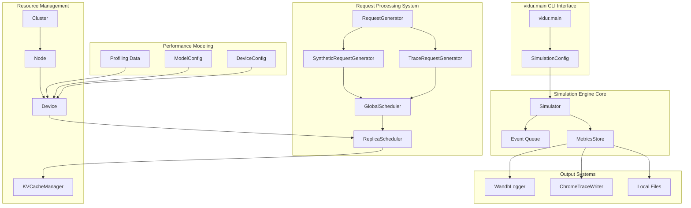

<!-- source: DeepWiki mcp.deepwiki.com · repo microsoft/vidur · page 1 Overview · fetched 2026-10-26 -->

# Overview

Relevant source files

The following files were used as context for generating this wiki page:

- [LICENSE](LICENSE)
- [README.md](README.md)
- [assets/chrome_trace.png](assets/chrome_trace.png)

This document provides a comprehensive introduction to Vidur, an LLM inference system simulator that enables performance analysis, capacity planning, and research experimentation without requiring access to GPU hardware. It covers the system's purpose, key capabilities, architecture, and operational principles.

For detailed setup instructions, see [Getting Started](#2). For in-depth architectural details, see [Core Architecture](#3). For practical usage guidance, see [Running Simulations](#9).

## Purpose and Capabilities

Vidur is a high-fidelity, extensible LLM inference system simulator designed to address critical challenges in deploying and optimizing large language model serving systems. The simulator enables users to study system performance, conduct capacity planning, and test research ideas without the substantial cost and complexity of maintaining GPU infrastructure.

### Primary Use Cases

**Performance Analysis**: Vidur simulates LLM inference workloads to analyze key performance metrics including Time to First Token (TTFT), Time Per Output Token (TPOT), end-to-end request latency, and batch size dynamics. Users can evaluate how different models perform under various workload patterns and system configurations.

**Capacity Planning**: The system helps determine optimal deployment configurations by modeling the relationship between hardware resources, model requirements, and service level objectives. Users can explore trade-offs between cost, performance, and quality of service across different hardware configurations.

**Research and Development**: Vidur provides an extensible platform for testing new scheduling algorithms, optimization techniques like speculative decoding, and novel serving architectures. Researchers can prototype and evaluate ideas rapidly without needing physical hardware.

### Key Technical Capabilities

| Capability | Description |
|------------|-------------|
| **Hardware Independence** | Simulates GPU clusters using profiling data, eliminating need for physical hardware |
| **Multi-Model Support** | Supports major LLM families including Llama, CodeLlama, InternLM, and Qwen models |
| **Parallelism Strategies** | Models tensor parallelism, pipeline parallelism, and hybrid configurations |
| **Realistic Workloads** | Supports both synthetic request generation and trace-based replay of real workloads |
| **Extensible Scheduling** | Pluggable scheduling algorithms at both global and replica levels |
| **Comprehensive Metrics** | Detailed performance analytics with visualization and monitoring capabilities |

Sources: [README.md:1-18]()

## System Architecture

Vidur implements a discrete event-driven simulation architecture that models the complete LLM inference pipeline from request arrival to response completion.

### Core System Components

The architecture separates concerns into distinct subsystems that interact through well-defined interfaces. The `Simulator` class serves as the central orchestrator, managing the discrete event queue and coordinating between request processing, resource management, and performance modeling components.

Sources: [README.md:57-85]()

### Simulation Workflow

```mermaid
graph LR
    subgraph "Request Generation Phase"
        WorkloadSpec["Workload Specification"] --> RequestGenerator["RequestGenerator"]
        RequestGenerator --> ArrivalEvent["RequestArrivalEvent"]
    end
    
    subgraph "Scheduling Phase"
        ArrivalEvent --> GlobalScheduler["GlobalScheduler"]
        GlobalScheduler --> ReplicaScheduler["ReplicaScheduler"]
        ReplicaScheduler --> BatchScheduler["Batch Formation"]
    end
    
    subgraph "Execution Simulation"
        BatchScheduler --> PrefillStage["Prefill Stage"]
        PrefillStage --> DecodeStage["Decode Stage"]
        DecodeStage --> ResponseComplete["Response Completion"]
    end
    
    subgraph "Performance Tracking"
        PrefillStage --> MetricsCollection["Metrics Collection"]
        DecodeStage --> MetricsCollection
        ResponseComplete --> MetricsCollection
        MetricsCollection --> Analysis["Performance Analysis"]
    end
```

The simulation workflow processes requests through the complete inference pipeline. Each request undergoes scheduling decisions, resource allocation, and execution simulation using pre-collected profiling data to model realistic hardware performance characteristics.

Sources: [README.md:6-11]()

## Hardware and Model Support

Vidur supports a comprehensive range of hardware configurations and model architectures commonly used in production LLM deployments.

### Supported Hardware Configurations

| Hardware Type | Specifications | Supported Models |
|---------------|----------------|------------------|
| **H100 DGX** | 8x H100 GPUs, NVLink interconnect | All supported models |
| **A100 80GB DGX** | 8x A100 80GB GPUs, NVLink interconnect | All supported models |
| **4xA100 80GB Pairwise** | 4x A100 80GB GPUs, Pairwise NVLink | All supported models |
| **8xA40 Pairwise** | 8x A40 GPUs, Pairwise NVLink | Llama-2, CodeLlama, InternLM, Qwen |

### Model Architecture Support

Vidur includes pre-configured support for major LLM families with varying parameter counts and context lengths:

- **Llama-3 Series**: 8B and 70B parameter models with 16K context length
- **Llama-2 Series**: 7B and 70B parameter models with 4K context length  
- **CodeLlama**: 34B parameter instruction-tuned model
- **InternLM**: 20B parameter model
- **Qwen**: 72B parameter model

The system supports flexible parallelism configurations including tensor parallelism (TP) dimensions that divide evenly into the available GPUs, and pipeline parallelism (PP) dimensions that divide the model's layer count.

Sources: [README.md:21-39]()

## Simulation Without GPUs

Vidur's core innovation is enabling realistic LLM inference simulation without requiring actual GPU hardware. This is achieved through a sophisticated profiling-based performance modeling system.

### Profiling Data Foundation

The system uses pre-collected profiling data that captures the performance characteristics of various hardware configurations running different model architectures. This profiling data includes:

- **Compute Performance**: Execution times for attention mechanisms and MLP operations across different batch sizes and sequence lengths
- **Network Performance**: Communication overhead for tensor parallelism (allreduce operations) and pipeline parallelism (send/receive operations)
- **Memory Characteristics**: Memory allocation patterns and KV cache management behavior

### Performance Model Integration

During simulation, Vidur consults this profiling data to determine realistic execution times for each operation. The `Device` class integrates model configurations with hardware specifications and profiling data to compute expected performance metrics. This approach enables the simulator to model complex interactions between workload characteristics, model architecture, and hardware capabilities without executing actual neural network computations.

The profiling approach allows Vidur to maintain high fidelity while remaining accessible to researchers and practitioners who lack access to expensive GPU infrastructure for experimentation and capacity planning.

Sources: [README.md:18](), [README.md:33]()

---

