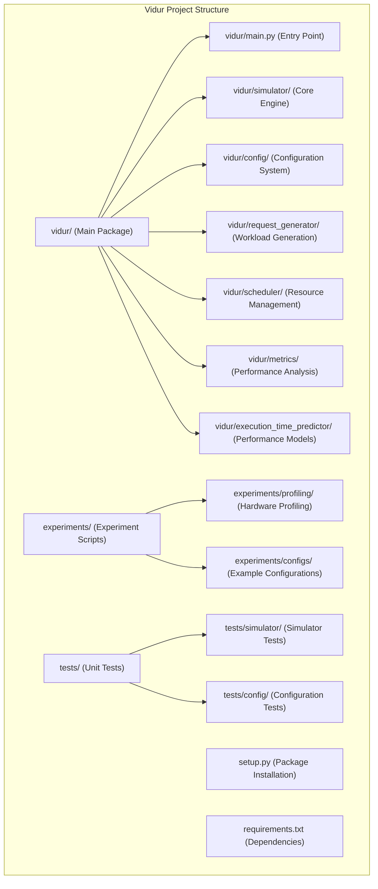
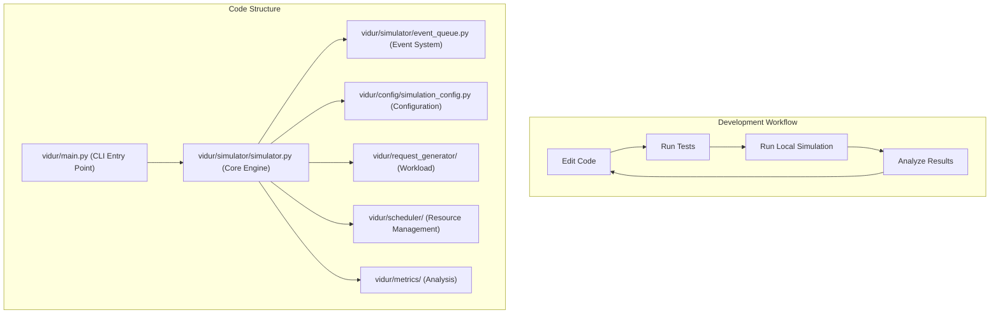
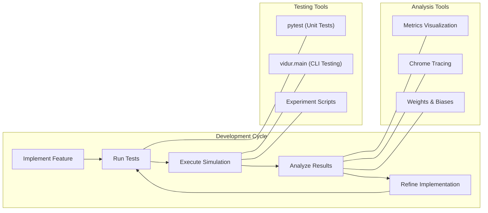
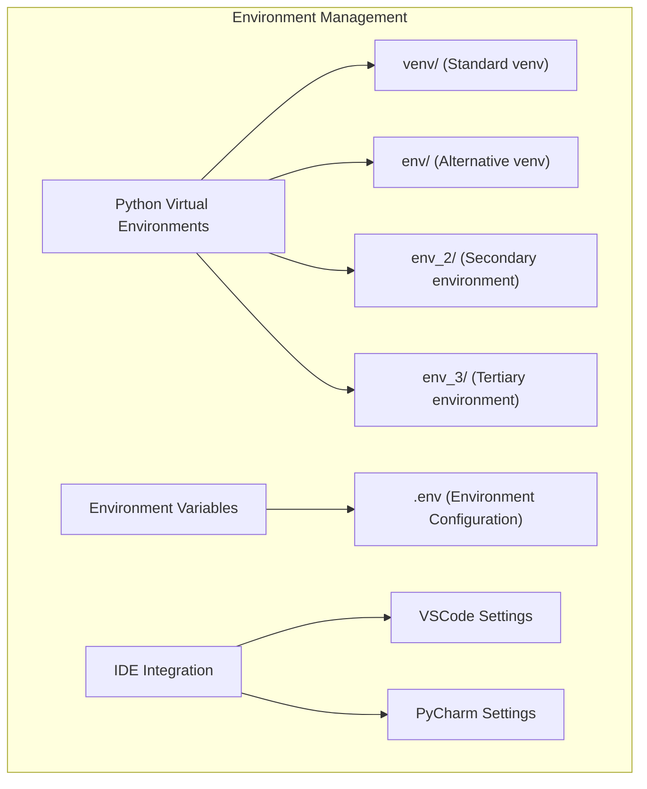

<!-- source: DeepWiki mcp.deepwiki.com · repo microsoft/vidur · page 10.1 Development Environment · fetched 2026-10-26 -->

# Development Environment

<details>
<summary>Relevant source files</summary>

The following files were used as context for generating this wiki page:

- [.gitignore](.gitignore)

</details>


This document provides guidance on setting up a development environment for the Vidur LLM inference simulator. It covers the project structure, development setup, dependencies, and build artifacts. For information about contributing to the project and community guidelines, see [Community Guidelines](#10.2).

## Project Overview

Vidur is a Python-based LLM inference simulator with a modular architecture. The development environment is designed to support efficient development, testing, and experimentation with the simulation framework.



Sources: [.gitignore:1-180]()

## Development Setup

### Prerequisites

To develop for Vidur, you'll need:

1. Python 3.8 or higher
2. Git for version control
3. (Optional) A virtual environment manager (venv, conda, etc.)

### Setting Up the Development Environment

1. Clone the repository:
   ```bash
   git clone https://github.com/microsoft/vidur.git
   cd vidur
   ```

2. Create and activate a virtual environment:
   ```bash
   python -m venv venv
   source venv/bin/activate  # On Windows: venv\Scripts\activate
   ```

3. Install dependencies:
   ```bash
   pip install -r requirements.txt
   pip install -e .  # Install in development mode
   ```

Sources: [.gitignore:122-130]()

## Project Structure

The Vidur codebase is organized into several key directories:

| Directory | Purpose |
|-----------|---------|
| `vidur/` | Main package containing all simulator code |
| `vidur/simulator/` | Core simulation engine and event loop |
| `vidur/config/` | Configuration system and dataclasses |
| `vidur/request_generator/` | Workload generation components |
| `vidur/scheduler/` | Scheduling algorithms and resource management |
| `vidur/metrics/` | Performance metrics collection and analysis |
| `vidur/execution_time_predictor/` | Performance prediction models |
| `experiments/` | Scripts for running experiments and profiling |
| `tests/` | Unit and integration tests |

Sources: [.gitignore:1-180]()

### Code Organization



Sources: [.gitignore:1-180]()

## Development Artifacts

During development, Vidur generates several artifacts that are excluded from version control:

| Artifact | Description | Location |
|----------|-------------|----------|
| Cache files | Cached prediction models | `cache/`, `cache_random_forrest/`, `cache_linear_regression/` |
| Simulation outputs | Results from simulation runs | `simulator_output/` |
| Profiling data | Hardware profiling results | `profiling_outputs/`, `profiling_outputs_*/` |
| Wandb logs | Weights & Biases experiment tracking | `wandb/` |
| Chrome traces | Execution timeline visualizations | `profiler_traces*/` |
| Python artifacts | Bytecode, package files | `__pycache__/`, `*.py[cod]`, `*.egg-info/` |

Sources: [.gitignore:1-180]()

## Development Workflow

The typical development workflow for Vidur involves:

1. **Code Modification**: Implement new features or fix bugs
2. **Testing**: Run unit tests to verify changes
3. **Local Simulation**: Execute small-scale simulations to validate behavior
4. **Result Analysis**: Analyze performance metrics and simulation outputs
5. **Iteration**: Refine implementation based on results



Sources: [.gitignore:40-52](), [.gitignore:164-179]()

## Managing Dependencies

Vidur uses standard Python dependency management through `requirements.txt` and `setup.py`. Dependencies are categorized as:

1. **Core dependencies**: Required for basic simulator functionality
2. **Development dependencies**: Tools for testing, linting, and development
3. **Optional dependencies**: Enhanced functionality for specific use cases

When adding new dependencies, ensure they are properly documented in both `requirements.txt` and `setup.py`.

Sources: [.gitignore:9-27]()

## Build Artifacts

When building or packaging Vidur, several artifacts are generated:

| Artifact | Description | Location |
|----------|-------------|----------|
| Distribution packages | Wheel and source distributions | `dist/` |
| Build directories | Temporary build files | `build/`, `*.egg-info/` |
| Compiled extensions | C extension modules | `*.so`, `*.pyd` |

These artifacts are excluded from version control via `.gitignore`.

Sources: [.gitignore:9-27]()

## Environment Management

Vidur supports multiple Python environments for development and testing:



The project supports multiple environments to facilitate testing across different Python versions or dependency configurations.

Sources: [.gitignore:122-130](), [.gitignore:179-180]()

## Recommended Development Tools

For effective development with Vidur, the following tools are recommended:

1. **IDE**: VSCode or PyCharm with Python extensions
2. **Testing**: pytest for unit testing
3. **Linting**: flake8, pylint, or black for code formatting
4. **Debugging**: Python debugger (pdb) or IDE-integrated debugging
5. **Profiling**: Python profilers for performance analysis
6. **Visualization**: Weights & Biases for experiment tracking

Sources: [.gitignore:156-161](), [.gitignore:169-169]()

## Troubleshooting Development Issues

Common development issues and their solutions:

| Issue | Solution |
|-------|----------|
| Cache conflicts | Delete cache directories (`cache/`, `cache_*/`) |
| Stale simulation results | Clear `simulator_output/` directory |
| Environment conflicts | Create a fresh virtual environment |
| Import errors | Ensure package is installed in development mode (`pip install -e .`) |
| Profiling data issues | Remove and regenerate profiling outputs |

Sources: [.gitignore:164-179]()

## Conclusion

This development environment guide provides the foundation for contributing to the Vidur project. By following these setup instructions and understanding the project structure, developers can efficiently work with the codebase and contribute new features or improvements.

For information about community guidelines and contribution processes, see [Community Guidelines](#10.2). For details on extending Vidur with new models, schedulers, or metrics, see [Extending Vidur](#11).

---

